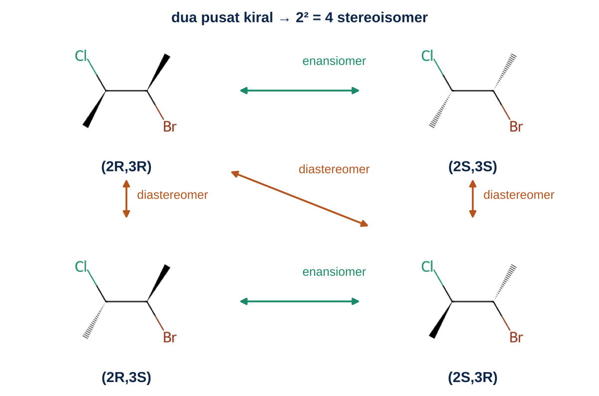
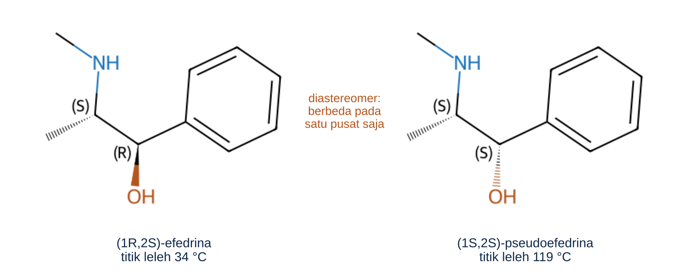
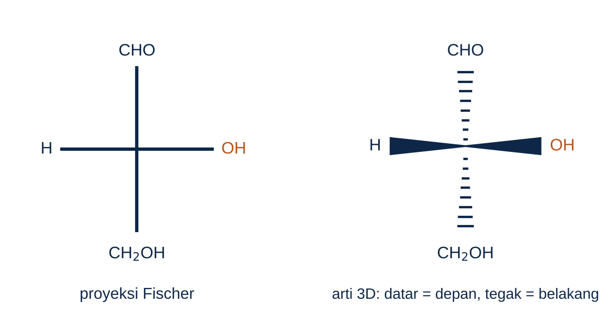
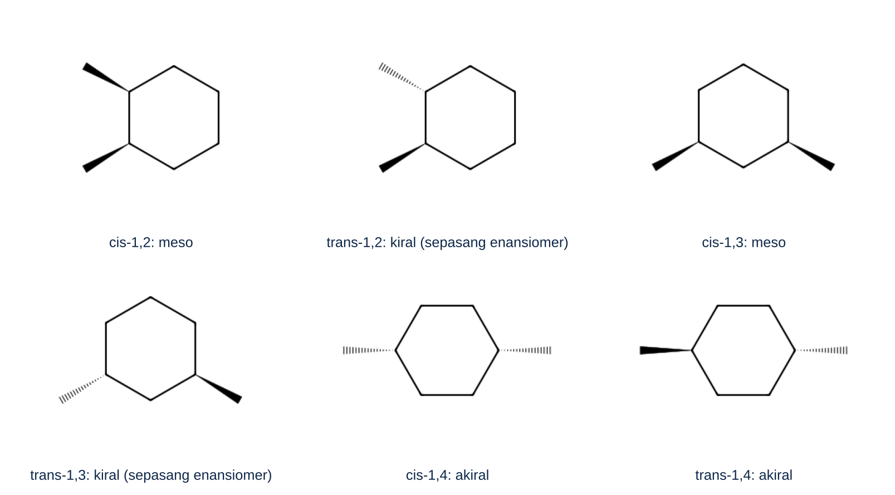

## 5.6 Diastereomer

Molekul dengan satu pusat kiral hanya mempunyai dua stereoisomer, yaitu sepasang enansiomer. Bila ada dua pusat kiral, keadaannya lebih kaya. Setiap pusat dapat R atau S, sehingga ada empat kombinasi: (R,R), (S,S), (R,S), dan (S,R). Secara umum, molekul dengan *n* pusat kiral mempunyai **paling banyak 2ⁿ stereoisomer**. Glukosa rantai terbuka dengan empat pusat kiral mempunyai $2^4 = 16$ stereoisomer, dan kolesterol dengan delapan pusat kiral mempunyai $2^8 = 256$. Alam hanya membuat satu dari 256 kemungkinan itu.

### Hubungan di antara keempat stereoisomer

Ambil contoh 2-bromo-3-klorobutana, CH₃CHBrCHClCH₃, dengan pusat kiral di C2 dan C3. Keempat stereoisomernya berhubungan sebagai berikut:

* (2R,3R) dan (2S,3S) adalah **enansiomer**: setiap pusat kiral terbalik.
* (2R,3S) dan (2S,3R) adalah **enansiomer**: setiap pusat kiral terbalik.
* (2R,3R) dan (2R,3S) adalah **diastereomer**: hanya satu pusat yang terbalik.

Aturan umumnya mudah diingat: **enansiomer membalik semua pusat kiral; diastereomer membalik sebagian, tetapi tidak semua**. Membalik semua pusat berarti membuat bayangan cermin. Membalik hanya sebagian menghasilkan molekul yang bukan bayangan cermin dan bukan pula molekul yang sama.

### Diastereomer mempunyai sifat fisika yang berbeda

Perbedaan ini mempunyai akibat praktis yang sangat besar. Enansiomer mempunyai sifat fisika yang identik (kecuali arah putar cahaya terpolarisasi), karena setiap jarak dan sudut di antara atom-atom yang tidak terikat sama persis pada kedua bayangan cermin. Diastereomer **tidak** demikian. Pada diastereomer, jarak antara gugus-gugus berbeda, sehingga gaya antarmolekul, titik didih, titik leleh, kelarutan, dan bahkan spektrum NMR-nya berbeda. Diastereomer dapat dipisahkan dengan distilasi, kristalisasi, atau kromatografi biasa. Sifat inilah yang dipakai di subbab 5.12 untuk memisahkan enansiomer.

{width=80%}

::: {.contoh}
**Contoh 5.7 · Efedrina dan pseudoefedrina**

Efedrina dan pseudoefedrina adalah obat pelega hidung dengan rumus C₆H₅CH(OH)CH(NHCH₃)CH₃. (1R,2S)-Efedrina meleleh pada 34 °C; (1S,2S)-pseudoefedrina meleleh pada 119 °C. (a) Apa hubungan keduanya? (b) Mengapa titik lelehnya berbeda? (c) Apa nama stereoisomer (1S,2R)?

**Penyelesaian.** (a) Pusat C2 sama (S), pusat C1 berbeda (R lawan S). Hanya satu pusat yang terbalik: diastereomer.

(b) Diastereomer mempunyai susunan ruang yang berbeda, sehingga cara molekul tersusun dalam kristal dan ikatan hidrogen antarmolekulnya berbeda. Titik leleh berbeda jauh.

(c) (1S,2R) adalah kebalikan semua pusat dari (1R,2S)-efedrina: enansiomer efedrina, yaitu (+)-efedrina.

**Memahami hasil.** Keempat stereoisomer mempunyai rumus struktur yang sama, tetapi menjadi dua pasang enansiomer dengan sifat fisika yang berbeda antarpasangan. Pseudoefedrina dijual bebas sebagai obat flu, sedangkan efedrina diawasi lebih ketat. Perbedaan aturan itu berdasarkan pada perbedaan aktivitas biologis yang berasal dari satu pusat kiral saja.
:::

::: {.kuis}
**Kuis cepat 5.6** Berapa stereoisomer yang mungkin untuk 2,3-dibromopentana? Apa hubungan antara (2R,3R) dan (2S,3R)?
:::

{width=82%}

## 5.7 Senyawa meso

Ada kasus ketika rumus 2ⁿ memberi jumlah yang terlalu besar. Lihat asam tartarat, HOOC–CH(OH)–CH(OH)–COOH, zat yang mengendap sebagai kristal di dasar tong anggur. Asam tartarat mempunyai dua pusat kiral, C2 dan C3, sehingga rumus memberi empat stereoisomer. Kenyataannya hanya ada tiga.

Mengapa? Karena kedua pusat kiral mengikat gugus-gugus yang sama: H, OH, COOH, dan sisa molekul yang identik. Akibatnya (2R,3S) dan (2S,3R) ternyata **molekul yang sama**. Bila (2R,3S)-asam tartarat digambar dalam konformasi tindih yang tepat, terlihat ada bidang cermin yang membelah molekul di tengah ikatan C2–C3: setengah atas adalah bayangan cermin setengah bawah. Molekul yang mempunyai bidang cermin internal adalah bayangan cerminnya sendiri, sehingga **akiral**, walaupun mengandung dua pusat kiral. Molekul seperti ini disebut **senyawa meso**.

{width=92%}

Jadi asam tartarat mempunyai tiga stereoisomer: sepasang enansiomer (R,R) dan (S,S), yang aktif optik, dan satu bentuk meso, yang tidak aktif optik. Bentuk meso adalah diastereomer dari (R,R) dan dari (S,S), sehingga sifat fisikanya berbeda: (R,R) dan (S,S) meleleh pada 170 °C, bentuk meso pada 146 °C.

### Mengenali senyawa meso

Senyawa meso hanya mungkin bila molekulnya mempunyai dua (atau lebih) pusat kiral yang **mengikat gugus-gugus yang sama**, dan bila konfigurasinya "berlawanan" sehingga satu bagian menjadi bayangan cermin bagian lainnya. Untuk dua pusat kiral yang setara, tanda yang cepat adalah konfigurasi (R,S). Cara yang paling pasti adalah mencari bidang cermin internal. Pada molekul rantai terbuka, bidang itu sering baru terlihat bila molekul diputar ke konformasi tindih atau digambar dalam proyeksi Fischer (subbab 5.8).

::: {.awas}
**Kesalahan umum: pusat kiral tidak sama dengan kiral**

Mempunyai pusat kiral **tidak** menjamin sebuah molekul kiral. Senyawa meso mempunyai pusat kiral tetapi akiral. Sebaliknya, beberapa molekul kiral tidak mempunyai pusat kiral sama sekali (subbab 5.10). Ujian yang sebenarnya adalah ujian simetri: apakah molekul dapat ditumpangkan pada bayangan cerminnya?
:::

::: {.contoh}
**Contoh 5.8 · Meso atau tidak?**

Tentukan apakah senyawa berikut meso: (a) (2R,3S)-2,3-dibromobutana; (b) (2R,3R)-2,3-dibromobutana; (c) (2R,3S)-2-bromo-3-klorobutana; (d) cis-1,2-dimetilsiklopentana.

**Penyelesaian.** (a) Kedua pusat mengikat H, Br, CH₃, dan sisa molekul yang identik. Konfigurasi R,S: ada bidang cermin di tengah. **Meso**.

(b) R,R: tidak ada bidang cermin; bayangan cerminnya adalah S,S. Kiral, bukan meso.

(c) Pusat C2 mengikat Br, pusat C3 mengikat Cl. Kedua pusat tidak setara, sehingga tidak mungkin ada bidang cermin yang menukar keduanya. Kiral, bukan meso. Rumus 2ⁿ berlaku penuh: empat stereoisomer.

(d) Kedua metil berada di sisi yang sama dari cincin, dan ada bidang cermin yang melewati tengah ikatan C1–C2 dan karbon di seberangnya. **Meso** (subbab 5.9).

**Memahami hasil.** Senyawa meso muncul bila molekulnya dapat "dilipat" menjadi dua bagian yang serupa. Ketika menghitung jumlah stereoisomer, selalu periksa dulu apakah pusat-pusat kiralnya setara. Bila ya, kurangi jumlahnya untuk setiap bentuk meso.
:::

::: {.kuis}
**Kuis cepat 5.7** Berapa stereoisomer 2,3-dibromobutana? Berapa di antaranya yang aktif optik?
:::

## 5.8 Proyeksi Fischer

Pada akhir abad ke-19, Emil Fischer mempelajari gula, molekul dengan banyak pusat kiral berturut-turut di sepanjang rantai. Menggambar setiap pusat dengan baji sangat merepotkan. Fischer mengusulkan cara menggambar yang ringkas, yang sampai sekarang dipakai untuk gula dan asam amino.

### Aturan menggambar

Dalam **proyeksi Fischer**, setiap pusat kiral digambar sebagai titik potong dua garis, seperti tanda tambah:

* **Garis mendatar** menyatakan ikatan yang mengarah **ke depan**, ke arah pembaca (seperti baji tebal).
* **Garis tegak** menyatakan ikatan yang mengarah **ke belakang**, menjauhi pembaca (seperti baji putus-putus).
* Rantai karbon utama digambar tegak, dengan karbon yang paling teroksidasi (misalnya –CHO pada gula) di atas.

Cara mengingatnya: proyeksi Fischer seperti melihat seseorang yang **membuka kedua tangannya untuk memeluk** kamu. Kedua tangan (mendatar) mengarah ke depan, kepala dan kaki (tegak) sedikit menjauh ke belakang.

{width=72%}

### Operasi yang diizinkan dan dilarang

Karena setiap garis mempunyai arti tiga dimensi, proyeksi Fischer tidak boleh diputar sembarangan:

* **Diputar 180° di bidang kertas: diizinkan.** Garis mendatar tetap mendatar (ke depan), garis tegak tetap tegak (ke belakang). Molekulnya sama.
* **Diputar 90°: dilarang.** Garis mendatar menjadi tegak, artinya gugus yang tadinya di depan sekarang di belakang. Hasilnya enansiomer.
* **Menukar dua gugus: menghasilkan enansiomer.** Menukar dua pasang (dua kali tukar) kembali ke molekul semula.

### Menentukan R/S dari proyeksi Fischer

Ada cara cepat yang memanfaatkan arti garis-garis Fischer. Bila gugus prioritas terendah (biasanya H) berada pada **garis tegak** (di belakang), telusuri 1 → 2 → 3 dan baca arahnya langsung. Bila gugus terendah berada pada **garis mendatar** (di depan), baca arahnya lalu **balik** jawabannya, sama seperti aturan baji di subbab 5.4.

### Konvensi D dan L

Sebelum ada sistem R/S, kimiawan gula dan asam amino memakai sistem D/L yang diturunkan dari gliseraldehida. Dalam proyeksi Fischer, bila gugus –OH (pada gula) atau –NH₂ (pada asam amino) di pusat kiral **paling bawah** berada di **kanan**, molekul itu disebut **D**; bila di kiri, **L**. Hampir semua gula alami adalah D, dan hampir semua asam amino alami adalah L. Sistem D/L masih dipakai luas dalam biokimia, walaupun R/S lebih umum dan lebih pasti.

::: {.contoh}
**Contoh 5.9 · R/S dari proyeksi Fischer**

Proyeksi Fischer sebuah asam laktat menunjukkan –COOH di atas, –CH₃ di bawah, –OH di kiri, dan –H di kanan. Tentukan konfigurasinya, dan apakah ini D atau L.

**Penyelesaian.** Prioritas: –OH (1), –COOH (2), –CH₃ (3), –H (4). –H berada pada garis mendatar (di depan). Telusuri 1 → 2 → 3: –OH (kiri) → –COOH (atas) → –CH₃ (bawah). Dari kiri ke atas ke bawah lewat kanan adalah searah jarum jam, memberi R. Karena H di depan, balik: **S**.

–OH di kiri pada satu-satunya pusat kiral: **L**. Jadi ini (S)-asam laktat, yaitu L-asam laktat, bentuk yang dihasilkan otot ketika bekerja keras tanpa cukup oksigen.

**Memahami hasil.** Untuk asam laktat, L kebetulan sesuai dengan S, tetapi D/L dan R/S adalah dua sistem yang berbeda dan tidak selalu sejalan. Pada sistein, L-sistein adalah R.
:::

::: {.kuis}
**Kuis cepat 5.8** Sebuah proyeksi Fischer diputar 90°. Apa hubungan molekul hasil dengan molekul semula? Bagaimana bila diputar 180°?
:::

## 5.9 Stereokimia senyawa siklik

Cincin memberi cara lain untuk melihat pusat kiral, karena cincin tidak dapat berputar bebas dan isomer cis/trans sudah kita kenal (subbab 2.4 dan 4.9). Bagaimana cis/trans berhubungan dengan R/S?

### Cincin datar sebagai alat analisis

Walaupun cincin sikloheksana sebenarnya berbentuk kursi, untuk menentukan kiralitas kita boleh menggambarnya sebagai segi enam datar dengan substituen pada baji. Kursi terus membalik, dan rata-rata waktunya sama dengan bentuk datar dari segi simetri. Bentuk datar memudahkan kita mencari bidang cermin.

### Contoh 1,2-dimetilsikloheksana

1,2-Dimetilsikloheksana mempunyai dua pusat kiral, C1 dan C2, masing-masing terikat pada H, CH₃, dan dua jalur cincin yang berbeda.

* **cis-1,2-Dimetilsikloheksana**: kedua metil di sisi yang sama. Dalam gambar datar, ada bidang cermin yang membelah ikatan C1–C2 dan ikatan C4–C5. Molekul ini **meso**, konfigurasinya (1R,2S).
* **trans-1,2-Dimetilsikloheksana**: kedua metil di sisi yang berlawanan. Tidak ada bidang cermin. Molekul ini kiral dan ada sepasang enansiomer, (1R,2R) dan (1S,2S).

Jadi 1,2-dimetilsikloheksana mempunyai tiga stereoisomer: satu meso (cis) dan sepasang enansiomer (trans), sama seperti asam tartarat.

### Kapan cincin tersubstitusi kiral?

Polanya dapat dirangkum: **sikloalkana dengan dua substituen yang sama** pada posisi 1,2 atau 1,3 mempunyai bentuk cis yang meso dan bentuk trans yang kiral. Pada posisi 1,4 sikloheksana, kedua karbon bersubstituen **bukan** pusat kiral (kedua jalur cincin sama), dan baik cis maupun trans akiral; keduanya hanya diastereomer. Bila kedua substituen berbeda, misalnya 1-bromo-2-klorosikloheksana, tidak ada bentuk meso, dan ada empat stereoisomer (dua pasang enansiomer).

{width=90%}

::: {.contoh}
**Contoh 5.10 · Stereoisomer dimetilsikloheksana**

Tentukan jumlah stereoisomer dan sebutkan mana yang kiral untuk (a) 1,3-dimetilsikloheksana; (b) 1,4-dimetilsikloheksana; (c) 1-etil-2-metilsikloheksana.

**Penyelesaian.** (a) C1 dan C3 adalah pusat kiral. cis: ada bidang cermin melalui C2 dan C5, **meso**. trans: tidak ada bidang cermin, kiral, sepasang enansiomer. Tiga stereoisomer.

(b) C1 dan C4: masing-masing terikat pada H, CH₃, dan dua jalur cincin yang identik (C2–C3 dan C6–C5). Bukan pusat kiral. cis dan trans masing-masing mempunyai bidang cermin melalui C1 dan C4, keduanya akiral. Dua stereoisomer, keduanya akiral.

(c) Dua pusat kiral yang tidak setara. Tidak ada meso. Empat stereoisomer: cis (sepasang enansiomer) dan trans (sepasang enansiomer).

**Memahami hasil.** Kasus (b) menunjukkan stereoisomer yang bukan enansiomer dan bukan karena pusat kiral: isomer cis/trans pada cincin adalah diastereomer walaupun molekulnya akiral. Peta isomer (Gambar 5.1) tetap berlaku: diastereomer adalah stereoisomer yang bukan bayangan cermin.
:::

::: {.kuis}
**Kuis cepat 5.9** Apakah cis-1,3-diklorosiklobutana kiral? Apakah trans-1,2-diklorosiklopropana kiral?
:::
