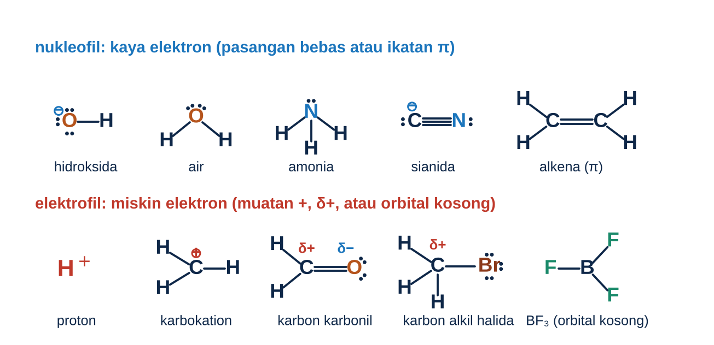
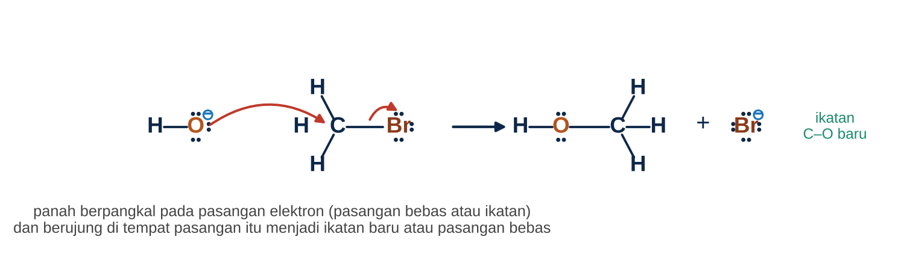
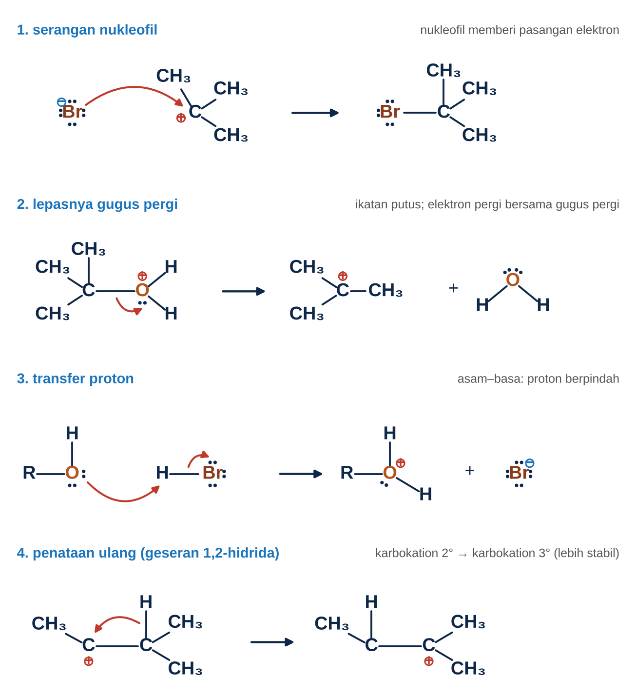

# Bab 6 Mekanisme Reaksi

Seorang mahasiswa menghafal sepuluh reaksi alkil halida, dua belas reaksi alkena, dan lima belas reaksi karbonil sebelum ujian. Dua minggu kemudian, sebagian besar hafalan itu sudah hilang. Temannya tidak menghafal satu reaksi pun. Ia hanya memahami empat pola gerak elektron dan beberapa aturan tentang kestabilan muatan, lalu menurunkan setiap reaksi dari pola-pola itu ketika diperlukan. Pada ujian, ia bahkan dapat meramalkan hasil reaksi yang belum pernah dibahas di kelas. Bagaimana mungkin empat pola saja cukup untuk ratusan reaksi?

Jawabannya adalah gagasan **mekanisme reaksi**: urutan langkah demi langkah tentang ikatan mana yang putus, ikatan mana yang terbentuk, dan ke mana elektron bergerak ketika pereaksi berubah menjadi produk. Ternyata ratusan reaksi organik yang tampak berbeda tersusun dari sedikit langkah dasar yang sama, seperti ribuan kata yang tersusun dari dua puluh enam huruf. Siapa yang memahami langkah-langkah dasar itu tidak perlu menghafal reaksi; ia dapat "membaca" reaksi.

Bab ini adalah jembatan antara bagian struktur (Bab 1–5) dan bagian reaksi (Bab 7–13). Kita mulai dengan dua pelaku utama setiap reaksi polar, yaitu nukleofil dan elektrofil, lalu memperluas panah lengkung dari Bab 1 dan 3 menjadi alat untuk menggambar mekanisme. Kita mengenali empat pola langkah polar dan berlatih menggabungkannya. Setelah itu kita bertanya mengapa sebuah reaksi berjalan (termodinamika) dan seberapa cepat (kinetika), dan menggambar keduanya dalam diagram energi. Bab ini ditutup dengan tiga jenis intermediet yang paling penting, yaitu karbokation, karbanion, dan radikal, beserta mekanisme radikal dan perbedaan antara kendali kinetik dan termodinamik.

::: {.kuis}
**Pertanyaan pembuka**

1. Apa yang membuat sebuah molekul menjadi "penyerang" (nukleofil) dan molekul lain menjadi "yang diserang" (elektrofil)?
2. Mengapa hampir semua reaksi organik dapat digambar dengan beberapa pola panah lengkung saja?
3. Mengapa reaksi yang melepaskan banyak energi kadang berjalan sangat lambat?
4. Apa beda keadaan transisi dan intermediet, dan mengapa intermediet kadang dapat diamati sedangkan keadaan transisi tidak?
5. Mengapa karbokation tersier jauh lebih stabil daripada karbokation primer, dan mengapa karbokation kadang berpindah tempat?
6. Mengapa produk sebuah reaksi dapat berubah hanya karena suhunya dinaikkan?
:::

::: {.tujuan}
**Tujuan belajar**

Setelah mempelajari bab ini, kamu mampu:

1. Mengenali nukleofil dan elektrofil dari muatan, kepolaran, pasangan bebas, dan ikatan π.
2. Menggambar panah lengkung untuk langkah reaksi dengan benar, termasuk muatan formal produknya.
3. Mengenali empat pola langkah polar: serangan nukleofil, lepasnya gugus pergi, transfer proton, dan penataan ulang.
4. Menyusun mekanisme beberapa langkah dari pola-pola itu.
5. Memperkirakan ΔH° reaksi dari energi disosiasi ikatan dan menghubungkan ΔG° dengan tetapan kesetimbangan.
6. Menghubungkan energi aktivasi dengan laju reaksi melalui persamaan Arrhenius.
7. Menggambar dan membaca diagram energi reaksi satu langkah dan beberapa langkah; menentukan langkah penentu laju.
8. Memakai postulat Hammond untuk membandingkan keadaan transisi.
9. Mengurutkan kestabilan karbokation, radikal, dan karbanion, dan meramalkan penataan ulang karbokation.
10. Menjelaskan tahap inisiasi, propagasi, dan terminasi reaksi radikal berantai.
11. Membedakan produk kendali kinetik dan kendali termodinamik.
:::

::: {.mat}
**Prasyarat**

Bab 1: muatan formal (subbab 1.3), kepolaran ikatan (subbab 1.7), resonansi dan panah lengkung (subbab 1.8), HOMO dan LUMO (subbab 1.6). Bab 3: transfer proton, pKa, ΔG° = 2,303 *RT* pKa, asam dan basa Lewis (subbab 3.1–3.4, 3.12). Dari *Termodinamika Kimia*: ΔG = ΔH − TΔS dan ΔG° = −*RT* ln *K* (Bab 7 dan 12). Dari Kimia Dasar: laju reaksi dan persamaan Arrhenius.
:::

## 6.1 Mengapa mempelajari mekanisme

Persamaan reaksi memberi tahu kita apa yang masuk dan apa yang keluar. Misalnya, 2-bromo-2-metilpropana bereaksi dengan air menghasilkan 2-metilpropan-2-ol dan HBr. Persamaan itu tidak memberi tahu **bagaimana** perubahan itu terjadi. Apakah ikatan C–Br putus lebih dulu, lalu air datang? Atau air datang lebih dulu, mendorong bromin keluar? Apakah semuanya terjadi dalam satu langkah? Jawaban atas pertanyaan-pertanyaan ini adalah **mekanisme reaksi**.

Mengapa kita perlu tahu mekanismenya, bukan hanya hasilnya? Ada tiga alasan yang sangat praktis.

* **Meramalkan.** Bila kita tahu mekanisme sebuah reaksi, kita dapat meramalkan hasilnya untuk senyawa lain yang belum pernah dicoba. Mekanisme yang sama berlaku untuk seluruh golongan senyawa.
* **Mengendalikan.** Mekanisme menunjukkan langkah mana yang lambat dan apa yang mempengaruhinya. Dengan begitu kita dapat memilih pelarut, suhu, dan pereaksi untuk mempercepat reaksi yang kita inginkan dan memperlambat reaksi samping yang tidak kita inginkan.
* **Memahami.** Mekanisme menjelaskan pengamatan yang tampak aneh, seperti mengapa sebuah reaksi menghasilkan dua produk, mengapa kerangka karbon kadang berubah, atau mengapa satu stereoisomer terbentuk lebih banyak daripada yang lain.

Bagaimana mekanisme diketahui, padahal tidak ada yang dapat melihat molekul bereaksi? Mekanisme adalah **hipotesis** yang disusun untuk menjelaskan bukti-bukti percobaan: bagaimana laju bergantung pada konsentrasi pereaksi (hukum laju), stereokimia produk, pengaruh substituen dan pelarut, intermediet yang dapat ditangkap atau diamati dengan spektroskopi, dan percobaan dengan isotop. Mekanisme yang baik menjelaskan semua bukti itu. Bila ditemukan bukti baru yang bertentangan, mekanismenya diperbaiki. Mekanisme yang akan kita pelajari di buku ini sudah diuji dengan bukti seperti itu selama puluhan tahun.

::: {.kuis}
**Kuis cepat 6.1** Sebutkan tiga jenis bukti percobaan yang dipakai untuk menyusun mekanisme reaksi.
:::

## 6.2 Nukleofil dan elektrofil

Hampir semua reaksi organik yang kita pelajari di buku ini adalah **reaksi polar**: reaksi yang terjadi karena bagian molekul yang kaya elektron tertarik ke bagian molekul lain yang miskin elektron. Gagasan ini sudah kita temui dua kali. Di Bab 1 kita melihat bahwa ikatan polar menciptakan atom δ+ dan δ−. Di Bab 3 kita melihat basa memakai pasangan bebasnya untuk menangkap proton, dan basa Lewis memakai pasangan bebasnya untuk mengikat asam Lewis. Kimia organik memberi nama khusus untuk kedua pelaku ini ketika yang diserang adalah atom selain proton, terutama karbon.

* **Nukleofil** (dari bahasa Yunani "pencinta inti") adalah spesi yang **memberikan pasangan elektron** untuk membentuk ikatan baru. Nukleofil kaya elektron. Lambangnya Nu: atau Nu⁻.
* **Elektrofil** ("pencinta elektron") adalah spesi yang **menerima pasangan elektron** untuk membentuk ikatan baru. Elektrofil miskin elektron. Lambangnya E⁺.

Nukleofil adalah basa Lewis, dan elektrofil adalah asam Lewis. Mengapa diberi nama baru? Karena kebiasaan istilahnya berbeda. Istilah "basa" dipakai ketika pasangan elektron menyerang **proton**. Istilah "nukleofil" dipakai ketika pasangan elektron menyerang **atom lain**, terutama karbon. Satu spesi dapat bertindak sebagai keduanya. Ion hidroksida adalah basa ketika menarik proton dari asam asetat, dan nukleofil ketika menyerang karbon pada bromometana. Perbedaan ini penting di Bab 7, karena persaingan antara peran basa (eliminasi) dan peran nukleofil (substitusi) menentukan produk.

### Mengenali nukleofil

Nukleofil adalah sumber elektron. Ada tiga jenis sumber elektron yang umum:

1. **Anion dengan pasangan bebas**: OH⁻, CH₃O⁻, CN⁻, Br⁻, I⁻, HS⁻, N₃⁻. Muatan negatif membuat elektron mudah diberikan.
2. **Molekul netral dengan pasangan bebas**: H₂O, CH₃OH, NH₃, amina, eter. Pasangan bebas pada O dan N dapat membentuk ikatan, walaupun kurang bersemangat daripada anion.
3. **Ikatan π**: alkena, alkuna, cincin aromatik. Elektron π lebih lemah terikat daripada elektron σ (subbab 1.6), sehingga dapat diberikan kepada elektrofil yang kuat. Inilah dasar reaksi adisi alkena (Bab 8) dan substitusi aromatik (Bab 10).

Dalam bahasa orbital (subbab 1.6), nukleofil adalah spesi dengan **HOMO yang tinggi**, yaitu elektron yang energinya tinggi dan mudah dilepas.

### Mengenali elektrofil

Elektrofil adalah tempat elektron masuk. Jenis yang umum:

1. **Kation dan spesi dengan oktet tak lengkap**: H⁺, karbokation (R₃C⁺), BF₃, AlCl₃. Mempunyai orbital kosong yang siap menerima elektron.
2. **Atom δ+ yang terikat pada gugus pergi**: karbon pada C–Br, C–Cl, C–OTs. Elektron yang masuk dapat mendorong gugus pergi keluar bersama pasangan elektronnya.
3. **Atom δ+ pada ikatan π polar**: karbon karbonil (C=O), karbon nitril (C≡N). Elektron yang masuk dapat mendorong elektron π ke oksigen atau nitrogen yang elektronegatif.

Dalam bahasa orbital, elektrofil adalah spesi dengan **LUMO yang rendah**: orbital kosong yang energinya rendah dan mudah diisi. Pada C–Br, LUMO-nya adalah orbital σ* C–Br; pada C=O, LUMO-nya adalah orbital π* C=O. Mengisi orbital antiikatan itu melemahkan ikatan yang bersangkutan, dan itulah sebabnya ikatan C–Br atau ikatan π C=O putus ketika nukleofil menyerang.

{width=96%}

::: {.contoh}
**Contoh 6.1 · Nukleofil atau elektrofil?**

Tentukan apakah spesi atau atom yang ditandai bersifat nukleofilik atau elektrofilik: (a) C pada CH₃Br; (b) N pada (CH₃)₃N; (c) C karbonil pada aseton; (d) O karbonil pada aseton; (e) ikatan π pada etena; (f) C pada CH₃MgBr.

**Penyelesaian.** (a) Br lebih elektronegatif, sehingga C bersifat δ+ dan terikat pada gugus pergi: **elektrofilik**. (b) N membawa pasangan bebas: **nukleofilik**. (c) C=O polar, C bersifat δ+ (subbab 1.8, struktur penyumbang C⁺–O⁻): **elektrofilik**. (d) O mempunyai dua pasangan bebas dan bersifat δ−: **nukleofilik** (lemah), misalnya terhadap proton dalam asam kuat. (e) Elektron π mudah dijangkau: **nukleofilik**. (f) Mg kurang elektronegatif daripada C, sehingga C bersifat δ−: **nukleofilik** (subbab 1.7).

**Memahami hasil.** Satu molekul dapat mengandung bagian nukleofilik dan elektrofilik sekaligus, seperti aseton pada (c) dan (d). Ketika meramalkan reaksi, tanyakan selalu: di mana pusat nukleofilik yang paling kuat, dan di mana pusat elektrofilik yang paling kuat? Reaksi biasanya terjadi di antara keduanya.
:::

::: {.kuis}
**Kuis cepat 6.2** Sebutkan dua nukleofil anionik, dua nukleofil netral, dan dua elektrofil yang bukan kation.
:::

::: {.contoh}
**Contoh 6.2 · Menandai polaritas untuk meramalkan tempat serangan**

Tandai karbon δ+ atau δ− dalam (a) klorometana, CH₃Cl; (b) metilmagnesium bromida, CH₃MgBr; (c) aseton, (CH₃)₂C=O. Lalu ramalkan apa yang terjadi bila (b) dicampur dengan (c).

**Penyelesaian.** (a) Cl (3,16) lebih elektronegatif daripada C (2,55): karbon **δ+**, elektrofil. (b) Mg (1,31) jauh kurang elektronegatif daripada C: ikatan C–Mg terpolarisasi ke arah karbon, sehingga karbon **δ−**, nukleofil. (c) O lebih elektronegatif: karbon karbonil **δ+**, elektrofil. Bila (b) dan (c) bertemu, karbon δ− pada CH₃MgBr menyerang karbon δ+ pada aseton, membentuk ikatan C–C baru dan, setelah ditambah air, 2-metilpropan-2-ol (reaksi Grignard, Bab 11).

**Memahami hasil.** Atom karbon yang sama dapat menjadi elektrofil atau nukleofil, bergantung pada atom yang terikat padanya. Mengganti Cl dengan Mg membalik polaritas karbon. Kemampuan membaca polaritas ikatan seperti ini adalah langkah pertama untuk meramalkan reaksi apa pun.
:::

## 6.3 Panah lengkung untuk reaksi

Di subbab 1.8 panah lengkung dipakai untuk resonansi, dan di subbab 3.1 untuk transfer proton. Sekarang panah yang sama menjadi alat utama untuk menggambar mekanisme. Aturannya tidak berubah, tetapi karena kini ikatan benar-benar putus dan terbentuk, ada beberapa hal yang perlu diperhatikan dengan lebih teliti.

### Aturan menggambar

1. **Setiap panah lengkung berkepala penuh menunjukkan gerak dua elektron.** Panah berkepala setengah (seperti kail pancing) menunjukkan gerak satu elektron; panah ini dipakai untuk reaksi radikal (subbab 6.12).
2. **Pangkal panah selalu pada elektron**: pasangan bebas, ikatan σ, atau ikatan π. Tidak pernah pada atom H, atom tanpa elektron, atau muatan positif.
3. **Kepala panah menunjuk ke tujuan elektron**: ke sebuah atom (elektron menjadi pasangan bebas atau membentuk ikatan dengan atom itu), atau ke ruang di antara dua atom (ikatan baru terbentuk di sana).
4. **Oktet tidak boleh dilampaui.** Bila panah membawa elektron ke atom periode kedua yang sudah oktet, panah lain harus membawa elektron keluar dari atom itu pada langkah yang sama. Kalau tidak, atom itu akan dikelilingi sepuluh elektron, yang mustahil bagi C, N, dan O.
5. **Muatan dipertahankan.** Jumlah muatan sebelum dan sesudah setiap langkah harus sama. Hitung muatan formal setiap atom yang berubah.

Aturan 4 adalah aturan yang paling sering dilanggar dalam mekanisme yang digambar mahasiswa. Bila nukleofil menyerang karbon yang sudah mempunyai empat ikatan, salah satu ikatan karbon itu **harus** putus dalam langkah yang sama. Itulah sebabnya serangan pada CH₃Br selalu disertai lepasnya Br⁻.

### Menerjemahkan panah menjadi struktur

Setiap panah mengubah struktur dengan cara yang dapat diramalkan:

* Panah dari **pasangan bebas** ke **ruang di antara dua atom**: pasangan bebas hilang, ikatan baru terbentuk. Atom asal pasangan bebas bertambah muatan positif satu (atau berkurang muatan negatif satu).
* Panah dari **ikatan** ke **satu atom**: ikatan putus, atom tujuan mendapat pasangan bebas baru dan bertambah muatan negatif satu. Atom di ujung lain ikatan kehilangan satu ikatan dan bertambah muatan positif satu.
* Panah dari **ikatan π** ke **ruang di antara dua atom lain**: ikatan π lama hilang, ikatan baru terbentuk di tempat lain.

{width=96%}

::: {.contoh}
**Contoh 6.3 · Menggambar produk dari panah**

Ion sianida, CN⁻, menyerang karbon bromometana dengan pasangan bebas karbonnya, dan ion bromida lepas. Gambar panah lengkungnya dan produknya, dan periksa muatannya.

**Penyelesaian.** *Panah 1:* dari pasangan bebas C pada CN⁻ ke ruang di antara C sianida dan C metil. *Panah 2:* dari ikatan C–Br ke Br. Produk: CH₃–C≡N dan Br⁻.

Periksa muatan. Sebelum: CN⁻ (−1) + CH₃Br (0) = −1. Sesudah: CH₃CN (0) + Br⁻ (−1) = −1. Muatan dipertahankan.

Periksa oktet: karbon metil menerima satu ikatan baru dan kehilangan satu ikatan, sehingga tetap mempunyai empat ikatan.

**Memahami hasil.** Panah kedua tidak boleh dilupakan. Tanpa panah itu, karbon metil akan mempunyai lima ikatan. Reaksi ini adalah contoh substitusi SN2, mekanisme yang akan dibahas tuntas di Bab 7. Produk CH₃CN mempunyai satu karbon lebih banyak daripada bromometana, sehingga reaksi ini dipakai untuk memperpanjang rantai karbon.
:::

::: {.kuis}
**Kuis cepat 6.3** Apa yang salah dengan mekanisme yang menggambar satu panah dari OH⁻ ke karbon CH₃Cl tanpa panah lain?
:::

## 6.4 Empat pola langkah polar

Setelah memeriksa ribuan reaksi, kimiawan menemukan bahwa hampir setiap langkah dalam mekanisme polar termasuk salah satu dari **empat pola** saja. Mengenali pola-pola ini adalah langkah terpenting untuk memahami reaksi organik, karena begitu pola dikenali, panah lengkungnya hampir dapat digambar dengan sendirinya.

### Pola 1: serangan nukleofil

Nukleofil memakai pasangan elektronnya untuk membentuk ikatan dengan elektrofil. Dalam bentuk paling sederhana, satu panah: dari nukleofil ke elektrofil. Contohnya ion bromida menyerang karbokation, atau air menyerang karbokation (subbab 3.12). Bila elektrofilnya mempunyai ikatan π polar, seperti C=O, serangan nukleofil disertai panah kedua yang mendorong elektron π ke oksigen; ini adalah langkah pertama adisi pada karbonil (Bab 11).

### Pola 2: lepasnya gugus pergi

Kebalikan pola 1. Sebuah ikatan putus, dan kedua elektronnya ikut bersama atom yang lebih elektronegatif, yang disebut **gugus pergi** (LG). Satu panah: dari ikatan C–LG ke LG. Hasilnya karbokation dan anion gugus pergi. Contohnya 2-bromo-2-metilpropana yang melepaskan Br⁻ menjadi karbokation *tert*-butil. Gugus pergi yang baik adalah gugus yang stabil sebagai anion atau molekul netral setelah pergi, yaitu basa lemah: I⁻, Br⁻, Cl⁻, H₂O, ion sulfonat. Hubungan antara "gugus pergi yang baik" dan "basa konjugat dari asam kuat" adalah penerapan langsung Bab 3.

### Pola 3: transfer proton

Pola yang sudah kita kenal di Bab 3. Basa menyerang proton, dan ikatan H–A putus. Dua panah. Transfer proton sering terjadi di awal mekanisme (untuk mengaktifkan pereaksi, misalnya memprotonasi gugus –OH supaya menjadi gugus pergi yang baik) dan di akhir mekanisme (untuk menetralkan produk).

### Pola 4: penataan ulang

Sebuah gugus kecil, biasanya atom hidrogen bersama pasangan elektronnya (**geseran hidrida**) atau gugus alkil bersama pasangan elektronnya (**geseran alkil**), berpindah dari satu atom ke atom tetangganya yang bermuatan positif. Satu panah: dari ikatan C–H atau C–C ke atom bermuatan positif di sebelahnya. Penataan ulang terjadi bila hasilnya karbokation yang lebih stabil (subbab 6.10).

::: {.inti}
**Empat pola langkah polar.**

1. **Serangan nukleofil**: Nu: → E⁺ (membentuk ikatan).
2. **Lepasnya gugus pergi**: C–LG → C⁺ + LG⁻ (memutus ikatan).
3. **Transfer proton**: B: + H–A → B–H⁺ + A⁻.
4. **Penataan ulang**: H atau R berpindah ke C⁺ di sebelahnya.

Pola 1 dan 2 adalah kebalikan satu sama lain; pola 3 adalah pola 1 dan 2 yang terjadi bersamaan pada proton.
:::

Beberapa langkah reaksi menggabungkan dua pola sekaligus dalam satu langkah **serempak** (*concerted*). Reaksi SN2 adalah serangan nukleofil dan lepasnya gugus pergi yang terjadi bersamaan (Contoh 6.3). Reaksi E2 adalah transfer proton dan lepasnya gugus pergi yang terjadi bersamaan (Bab 7). Mengenali pola-pola dasarnya membuat langkah gabungan seperti ini juga mudah dipahami.

{width=94%}

::: {.contoh}
**Contoh 6.4 · Mengenali pola**

Tentukan pola setiap langkah: (a) (CH₃)₃C⁺ + H₂O → (CH₃)₃C–OH₂⁺; (b) (CH₃)₃C–OH₂⁺ + H₂O → (CH₃)₃C–OH + H₃O⁺; (c) (CH₃)₂CH–CH⁺–CH₃ → (CH₃)₂C⁺–CH₂CH₃; (d) (CH₃)₃C–Br → (CH₃)₃C⁺ + Br⁻.

**Penyelesaian.** (a) Pasangan bebas O pada air menyerang karbokation: **serangan nukleofil**. (b) Air kedua menarik proton dari O⁺: **transfer proton**. (c) H pada karbon tersier berpindah bersama pasangan elektronnya ke C⁺ sekunder di sebelahnya, menghasilkan C⁺ tersier: **penataan ulang** (geseran hidrida). (d) Br⁻ lepas bersama pasangan elektron ikatan: **lepasnya gugus pergi**.

**Memahami hasil.** Langkah (d), (a), dan (b), dalam urutan itu, adalah mekanisme lengkap hidrolisis 2-bromo-2-metilpropana menjadi 2-metilpropan-2-ol: gugus pergi lepas, nukleofil menyerang, proton dipindahkan. Ini adalah mekanisme SN1 (Bab 7). Tiga langkah, tiga pola.
:::

::: {.kuis}
**Kuis cepat 6.4** Mengapa ion iodida adalah gugus pergi yang jauh lebih baik daripada ion hidroksida? Kaitkan dengan pKa HI dan H₂O.
:::

## 6.5 Menggabungkan pola menjadi mekanisme

Dengan empat pola, kita dapat menyusun mekanisme reaksi yang belum pernah kita lihat. Kuncinya adalah bekerja dengan teratur dan bertanya pada setiap langkah: di mana sumber elektron terbaik, dan di mana tempat elektron yang terbaik?

::: {.strategi}
**Strategi: menyusun mekanisme polar**

1. **Bandingkan pereaksi dan produk.** Ikatan apa yang putus, dan ikatan apa yang terbentuk? Atom mana yang berpindah?
2. **Kenali kondisi.** Dalam asam, langkah pertama hampir selalu transfer proton ke atom yang paling basa (biasanya O atau N), dan intermediet bermuatan positif. Dalam basa, langkah pertama sering transfer proton dari atom yang paling asam, dan intermediet bermuatan negatif. **Jangan mencampur**: dalam asam kuat, tidak ada OH⁻ atau anion kuat; dalam basa kuat, tidak ada H₃O⁺ atau karbokation.
3. **Pilih langkah berikutnya** dari empat pola. Satu langkah sebaiknya hanya satu pola, kecuali untuk langkah serempak yang dikenal (SN2, E2).
4. **Gambar panah, produk, dan muatan** setiap langkah. Periksa oktet dan muatan.
5. **Periksa kewajaran**: apakah intermediet yang kamu usulkan cukup stabil? Karbokation primer, misalnya, hampir tidak pernah terbentuk dalam larutan.
:::

Aturan "jangan mencampur" pada langkah 2 sangat penting. Mahasiswa sering menulis mekanisme di dalam asam kuat yang memakai OH⁻ sebagai nukleofil, padahal dalam asam kuat konsentrasi OH⁻ sangat kecil (subbab 3.11). Dalam asam, nukleofilnya adalah molekul netral seperti air atau alkohol, dan proton dilepas oleh molekul air, bukan oleh hidroksida.

::: {.contoh}
**Contoh 6.5 · Mekanisme dalam asam: alkohol menjadi alkil bromida**

2-Metilpropan-2-ol bereaksi dengan HBr pekat menghasilkan 2-bromo-2-metilpropana dan air. Usulkan mekanismenya.

**Rencana.** Ikatan C–OH putus, ikatan C–Br terbentuk. Kondisinya asam. –OH bukan gugus pergi yang baik (OH⁻ basa kuat), sehingga perlu diubah dulu.

**Penyelesaian.** *Langkah 1 (transfer proton):* pasangan bebas O pada alkohol menyerang H pada HBr; ikatan H–Br putus. Hasilnya ion alkiloksonium, (CH₃)₃C–OH₂⁺, dan Br⁻. Kini gugus pergi adalah H₂O, molekul netral yang stabil.

*Langkah 2 (lepasnya gugus pergi):* ikatan C–O putus, kedua elektron ikut ke O. Hasilnya karbokation *tert*-butil dan H₂O.

*Langkah 3 (serangan nukleofil):* Br⁻ menyerang karbokation. Hasilnya 2-bromo-2-metilpropana.

**Memahami hasil.** Tiga langkah, tiga pola. Langkah 1 adalah trik yang sangat sering dipakai: memprotonasi gugus –OH mengubah gugus pergi yang buruk (OH⁻, asam konjugat pKa 15,7) menjadi gugus pergi yang baik (H₂O, asam konjugat pKa −1,7). Selisih 17 satuan pKa ini adalah alasan mengapa alkohol tidak bereaksi dengan NaBr, tetapi bereaksi dengan HBr.
:::

::: {.contoh}
**Contoh 6.6 · Mekanisme dalam basa: hidrolisis ester**

Etil asetat bereaksi dengan NaOH menghasilkan ion asetat dan etanol. Usulkan mekanisme yang hanya memakai pola-pola dasar dan tidak melibatkan karbokation.

**Penyelesaian.** *Langkah 1 (serangan nukleofil pada C=O):* OH⁻ menyerang karbon karbonil; elektron π C=O berpindah ke O. Hasilnya intermediet tetrahedral dengan O⁻.

*Langkah 2 (lepasnya gugus pergi, dibantu pasangan bebas):* pasangan bebas O⁻ membentuk kembali ikatan π C=O, dan ikatan C–OCH₂CH₃ putus, melepaskan CH₃CH₂O⁻. Hasilnya asam asetat dan ion etoksida.

*Langkah 3 (transfer proton):* ion etoksida (asam konjugat pKa 16) menarik proton dari asam asetat (pKa 4,76). Hasilnya ion asetat dan etanol. Keq sekitar 10¹¹, sehingga langkah ini mendorong seluruh reaksi ke kanan.

**Memahami hasil.** Dalam basa, tidak ada karbokation dan tidak ada spesi bermuatan positif; semua intermediet netral atau negatif. Langkah 3 menjelaskan mengapa hidrolisis ester dalam basa (saponifikasi, pembuatan sabun) berjalan sempurna dan tidak dapat berbalik. Mekanisme ini, yang disebut substitusi asil nukleofilik, dibahas lengkap di Bab 12.
:::

::: {.kuis}
**Kuis cepat 6.5** Dalam mekanisme yang berlangsung dalam H₂SO₄ pekat, mengapa salah menuliskan OH⁻ sebagai nukleofil? Apa yang seharusnya dipakai?
:::
