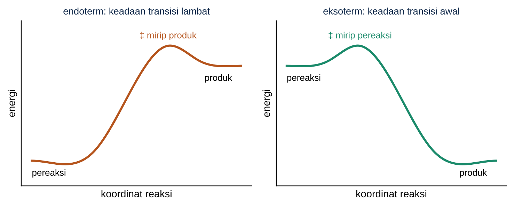

## 6.6 Termodinamika reaksi: ΔH°, ΔS°, ΔG°, dan energi disosiasi ikatan

Mekanisme menjelaskan **bagaimana** reaksi berjalan. Dua pertanyaan lain sama pentingnya: **apakah** reaksi itu berjalan ke arah produk, dan **seberapa cepat**. Pertanyaan pertama dijawab oleh termodinamika, pertanyaan kedua oleh kinetika. Keduanya sering tertukar, padahal jawabannya bisa sangat berbeda.

### Arah reaksi ditentukan oleh ΔG°

Dari *Termodinamika Kimia* (Bab 7 dan 12), arah kesetimbangan ditentukan oleh perubahan energi Gibbs standar:

$$
\Delta G^\circ = \Delta H^\circ - T\Delta S^\circ = -RT\ln K \qquad \text{(6.1)}
$$

Bila ΔG° negatif, *K* lebih besar dari 1 dan kesetimbangan berpihak pada produk. Pada 25 °C, ΔG° = −10 kJ mol⁻¹ memberi *K* = 56, dan ΔG° = −20 kJ mol⁻¹ memberi *K* = 3200. Setiap penurunan 5,71 kJ mol⁻¹ menaikkan *K* sepuluh kali, persis seperti skala pKa di subbab 3.4.

Dua suku dalam (6.1) mempunyai arti yang berbeda. **ΔH°** mencerminkan perubahan kekuatan ikatan: bila ikatan yang terbentuk lebih kuat daripada ikatan yang putus, ΔH° negatif dan reaksi eksoterm. **ΔS°** mencerminkan perubahan ketidakteraturan: reaksi yang menambah jumlah molekul (satu molekul pecah menjadi dua) biasanya mempunyai ΔS° positif, sedangkan reaksi yang menggabungkan dua molekul menjadi satu biasanya mempunyai ΔS° negatif. Pada suhu kamar, suku ΔH° biasanya lebih besar, tetapi suku *T*ΔS° makin penting pada suhu tinggi.

### Memperkirakan ΔH° dari energi disosiasi ikatan

Untuk reaksi organik, ΔH° dapat diperkirakan dengan cepat dari **energi disosiasi ikatan** (BDE), yaitu energi yang diperlukan untuk memutus ikatan secara homolitik (setiap atom membawa satu elektron) dalam fasa gas. Gagasannya mengikuti hukum Hess: bayangkan semua ikatan yang putus diputus lebih dulu (memerlukan energi), lalu semua ikatan baru dibentuk (melepaskan energi).

$$
\Delta H^\circ \approx \sum \text{BDE}(\text{ikatan putus}) - \sum \text{BDE}(\text{ikatan terbentuk}) \qquad \text{(6.2)}
$$

| Ikatan | BDE (kJ mol⁻¹) | Ikatan | BDE (kJ mol⁻¹) |
|---|---|---|---|
| CH₃–H | 439 | H–Cl | 432 |
| CH₃CH₂–H | 421 | H–Br | 366 |
| (CH₃)₂CH–H | 413 | H–I | 298 |
| (CH₃)₃C–H | 400 | Cl–Cl | 242 |
| CH₃–Cl | 350 | Br–Br | 192 |
| CH₃–Br | 294 | I–I | 151 |
| CH₃–I | 239 | H–OH | 497 |

::: {.contoh}
**Contoh 6.6 · ΔH° halogenasi metana**

Perkirakan ΔH° untuk CH₄ + X₂ → CH₃X + HX dengan X = Cl, Br, dan I.

**Penyelesaian.** Ikatan yang putus: CH₃–H dan X–X. Ikatan yang terbentuk: CH₃–X dan H–X.

*Cl:* $\Delta H^\circ = (439 + 242) - (350 + 432) = -101$ kJ mol⁻¹.

*Br:* $\Delta H^\circ = (439 + 192) - (294 + 366) = -29$ kJ mol⁻¹.

*I:* $\Delta H^\circ = (439 + 151) - (239 + 298) = +53$ kJ mol⁻¹.

**Memahami hasil.** Klorinasi sangat eksoterm, brominasi sedikit eksoterm, dan iodinasi endoterm. Karena ΔS° reaksi ini kecil (dua molekul menjadi dua molekul), ΔG° hampir sama dengan ΔH°: iodinasi metana tidak berjalan sama sekali. Bab 7 menunjukkan bahwa perbedaan energi ini juga menentukan **selektivitas** klorinasi dan brominasi.
:::

::: {.kuis}
**Kuis cepat 6.6** Reaksi A + B → C mempunyai ΔH° = −30 kJ mol⁻¹ dan ΔS° = −100 J K⁻¹ mol⁻¹. Berapa ΔG° pada 25 °C dan pada 400 K? Di atas suhu berapa reaksi menjadi tidak menguntungkan?
:::

## 6.7 Kinetika: energi aktivasi dan laju

Termodinamika memberi tahu arah, tetapi tidak memberi tahu kecepatan. Pembakaran gula dalam udara sangat menguntungkan (ΔG° sekitar −2900 kJ mol⁻¹), tetapi sebungkus gula di dapur dapat bertahan bertahun-tahun tanpa terbakar. Reaksi itu "ingin" berjalan tetapi tidak dapat mulai. Yang menahannya adalah **energi aktivasi**.

### Energi aktivasi

Untuk berubah dari pereaksi menjadi produk, molekul harus melewati susunan atom yang tidak stabil di tengah jalan: ikatan lama setengah putus dan ikatan baru setengah terbentuk. Susunan ini mempunyai energi yang lebih tinggi daripada pereaksi maupun produk. Selisih energi antara pereaksi dan puncak itu disebut **energi aktivasi**, *E*ₐ (atau dalam bentuk energi Gibbs, ΔG‡). Hanya molekul yang bertumbukan dengan energi cukup yang dapat melewati puncak itu.

Hubungan antara energi aktivasi dan laju diberikan oleh **persamaan Arrhenius**:

$$
k = A\,e^{-E_\text{a}/RT} \qquad \text{(6.3)}
$$

dengan *k* tetapan laju dan *A* faktor frekuensi, yang mencerminkan seberapa sering molekul bertumbukan dengan arah yang tepat. Bagian eksponensial adalah bagian molekul yang mempunyai energi cukup. Karena bentuknya eksponensial, laju sangat peka terhadap *E*ₐ: pada 25 °C, menurunkan *E*ₐ sebesar 5,7 kJ mol⁻¹ mempercepat reaksi sepuluh kali, dan menurunkan 10 kJ mol⁻¹ mempercepatnya sekitar 56 kali.

### Pengaruh suhu

Persamaan (6.3) juga menjelaskan mengapa reaksi lebih cepat pada suhu tinggi. Menaikkan suhu memperbesar bagian molekul yang mempunyai energi melebihi *E*ₐ. Aturan praktis yang sering disebut, "laju naik dua kali setiap kenaikan 10 °C", hanya berlaku untuk reaksi dengan *E*ₐ sekitar 50 kJ mol⁻¹ di sekitar suhu kamar. Untuk *E*ₐ yang lebih besar, kenaikan suhu berpengaruh lebih besar lagi.

::: {.contoh}
**Contoh 6.7 · Laju dan energi aktivasi**

(a) Sebuah reaksi mempunyai *E*ₐ = 80 kJ mol⁻¹ dan *A* = 10¹³ s⁻¹. Hitung tetapan laju dan waktu paruhnya pada 25 °C (reaksi orde satu, $t_{1/2} = \ln 2/k$). (b) Berapa kali laju naik bila suhu dinaikkan dari 25 °C ke 35 °C untuk *E*ₐ = 50 dan 80 kJ mol⁻¹?

**Penyelesaian.** (a) $k = 10^{13}\,e^{-80\,000/(8{,}314 \times 298)} = 10^{13} \times 9{,}6 \times 10^{-15} = 0{,}096$ s⁻¹. Waktu paruh $= 0{,}693/0{,}096 = 7{,}2$ s.

(b) Perbandingan tetapan laju $= \exp\left[\frac{E_\text{a}}{R}\left(\frac{1}{298} - \frac{1}{308}\right)\right]$. Untuk 50 kJ mol⁻¹: 1,9 kali. Untuk 80 kJ mol⁻¹: 2,9 kali.

**Memahami hasil.** Energi aktivasi 80 kJ mol⁻¹ memberi reaksi yang selesai dalam hitungan detik pada suhu kamar. Reaksi dengan *E*ₐ di atas sekitar 100 kJ mol⁻¹ memerlukan pemanasan, dan reaksi dengan *E*ₐ di bawah sekitar 40 kJ mol⁻¹ berjalan sangat cepat bahkan pada suhu rendah. Batas-batas kasar ini berguna untuk menaksir apakah sebuah langkah mekanisme masuk akal.
:::

::: {.awas}
**Kesalahan umum: reaksi eksoterm tidak selalu cepat**

ΔG° (atau ΔH°) dan *E*ₐ adalah dua besaran yang **tidak saling bergantung secara langsung**. ΔG° menentukan seberapa jauh reaksi berjalan; *E*ₐ menentukan seberapa cepat. Gula dan oksigen mempunyai ΔG° sangat negatif tetapi *E*ₐ sangat tinggi, sehingga tidak bereaksi pada suhu kamar. Sebaliknya, beberapa reaksi dengan ΔG° hampir nol berjalan sangat cepat. Katalis menurunkan *E*ₐ, tetapi tidak mengubah ΔG°: katalis mempercepat datangnya kesetimbangan, tetapi tidak menggeser letaknya.
:::

::: {.kuis}
**Kuis cepat 6.7** Katalis menurunkan *E*ₐ sebesar 17 kJ mol⁻¹. Berapa kali laju naik pada 25 °C? Apakah katalis itu mengubah tetapan kesetimbangan?
:::

## 6.8 Diagram energi, keadaan transisi, dan intermediet

Cara yang paling jelas untuk memperlihatkan termodinamika dan kinetika sekaligus adalah **diagram energi reaksi**: grafik energi terhadap **koordinat reaksi**, yaitu ukuran seberapa jauh reaksi sudah berjalan dari pereaksi ke produk.

### Reaksi satu langkah

Pada reaksi satu langkah, diagramnya berbentuk satu bukit. Pereaksi di kiri, produk di kanan, dan di antaranya satu puncak. Puncak itu disebut **keadaan transisi** (ditandai ‡). Selisih tinggi antara pereaksi dan keadaan transisi adalah energi aktivasi; selisih tinggi antara pereaksi dan produk adalah ΔG° (atau ΔH°) reaksi.

Keadaan transisi bukan molekul. Keadaan transisi adalah susunan atom pada puncak energi, yang hanya ada selama satu getaran molekul, sekitar 10⁻¹³ detik. Keadaan transisi tidak dapat diisolasi dan tidak dapat diamati secara langsung dengan spektroskopi biasa. Dalam gambar mekanisme, keadaan transisi biasanya digambar dengan ikatan putus-putus untuk ikatan yang sedang terbentuk atau sedang putus, dan diberi kurung siku dengan tanda ‡.

### Reaksi beberapa langkah dan intermediet

Pada reaksi dua langkah, diagramnya mempunyai **dua bukit** dengan satu **lembah** di antaranya. Lembah itu adalah **intermediet**: spesi yang terbentuk pada langkah pertama dan dipakai pada langkah kedua. Berbeda dari keadaan transisi, intermediet adalah spesi nyata yang berada di lembah energi, sehingga mempunyai waktu hidup tertentu. Karbokation, karbanion, dan radikal adalah intermediet. Intermediet yang cukup stabil kadang dapat diamati dengan spektroskopi atau ditangkap dengan pereaksi lain.

{width=92%}

### Langkah penentu laju

Pada reaksi beberapa langkah, laju keseluruhan ditentukan oleh langkah yang mempunyai **keadaan transisi tertinggi** di seluruh jalur. Langkah itu disebut **langkah penentu laju**. Perumpamaannya adalah antrean di sebuah kantor dengan beberapa loket berurutan: jumlah orang yang selesai per jam ditentukan oleh loket yang paling lambat. Mempercepat loket lain tidak membantu.

Konsep ini sangat berguna untuk memahami pengaruh struktur pada laju. Misalnya, pada reaksi SN1 (Contoh 6.3 dan 6.4), langkah penentu lajunya adalah lepasnya gugus pergi untuk membentuk karbokation. Apa pun yang menstabilkan karbokation akan menurunkan keadaan transisi langkah itu dan mempercepat seluruh reaksi.

::: {.contoh}
**Contoh 6.8 · Membaca diagram energi**

Sebuah reaksi dua langkah A → I → P mempunyai energi (relatif terhadap A, kJ mol⁻¹): keadaan transisi pertama +85, intermediet I +40, keadaan transisi kedua +60, produk −25. (a) Langkah mana yang menentukan laju? (b) Berapa energi aktivasi keseluruhan? (c) Apakah reaksi eksergonik? (d) Bila I terbentuk, apakah I lebih mungkin kembali ke A atau maju ke P?

**Penyelesaian.** (a) Keadaan transisi tertinggi adalah yang pertama (+85): langkah pertama penentu laju. (b) Dari A ke puncak tertinggi: 85 kJ mol⁻¹. (c) Produk (−25) lebih rendah daripada A (0): ya, eksergonik. (d) Dari I, penghalang kembali ke A adalah $85 - 40 = 45$ kJ mol⁻¹, sedangkan penghalang maju ke P adalah $60 - 40 = 20$ kJ mol⁻¹. Penghalang maju jauh lebih kecil, sehingga I hampir selalu maju ke P.

**Memahami hasil.** Intermediet yang berada di lembah dangkal dengan penghalang kecil ke arah produk hanya hidup sangat singkat dan jumlahnya sangat sedikit. Itulah sebabnya karbokation dalam reaksi SN1 jarang terlihat: begitu terbentuk, karbokation segera ditangkap nukleofil.
:::

::: {.kuis}
**Kuis cepat 6.8** Sebutkan dua perbedaan antara keadaan transisi dan intermediet.
:::

## 6.9 Postulat Hammond

Keadaan transisi tidak dapat diamati, tetapi kita sering perlu tahu seperti apa bentuknya, karena faktor yang menstabilkan keadaan transisi akan mempercepat reaksi. George Hammond pada 1955 mengusulkan pedoman yang sangat berguna untuk menebak bentuk keadaan transisi:

::: {.inti}
**Postulat Hammond.** Keadaan transisi mirip spesi (pereaksi, intermediet, atau produk) yang **energinya paling dekat** dengannya. Pada langkah **endoterm**, keadaan transisi terletak dekat produk dan mirip produk ("keadaan transisi lambat"). Pada langkah **eksoterm**, keadaan transisi terletak dekat pereaksi dan mirip pereaksi ("keadaan transisi awal").
:::

Mengapa postulat ini masuk akal? Bayangkan mendaki bukit untuk sampai ke sebuah desa. Bila desa itu terletak tinggi di lereng (langkah endoterm), puncak bukit dekat dengan desa, dan pemandangan di puncak mirip pemandangan di desa. Bila desa itu terletak jauh di bawah (langkah eksoterm), puncak bukit dekat dengan tempat kita berangkat. Dua titik yang energinya berdekatan dan saling bersambung pada jalur yang sama biasanya juga berdekatan strukturnya.

{width=86%}

### Akibat terpenting: pembentukan karbokation

Pembentukan karbokation dari alkil halida (langkah penentu laju SN1) adalah langkah yang sangat endoterm, karena karbokation adalah spesi berenergi tinggi. Menurut postulat Hammond, keadaan transisinya mirip karbokation: ikatan C–Br sudah hampir putus, dan karbon sudah bermuatan hampir +1. Akibatnya, faktor apa pun yang menstabilkan karbokation juga menstabilkan keadaan transisi menuju karbokation itu. Karbokation tersier lebih stabil daripada karbokation sekunder (subbab 6.10), sehingga keadaan transisi menuju karbokation tersier juga lebih rendah, dan alkil halida tersier bereaksi jauh lebih cepat melalui jalur SN1.

Postulat Hammond adalah alasan kita boleh memakai **kestabilan intermediet** untuk meramalkan **laju**. Tanpa postulat ini, kestabilan karbokation (termodinamika) tidak akan berkata apa pun tentang kecepatan pembentukannya (kinetika).

::: {.contoh}
**Contoh 6.9 · Hammond dan selektivitas halogenasi**

Langkah pertama klorinasi metana, Cl· + CH₄ → HCl + ·CH₃, mempunyai ΔH° = +7 kJ mol⁻¹. Langkah yang sama untuk brominasi, Br· + CH₄ → HBr + ·CH₃, mempunyai ΔH° = +73 kJ mol⁻¹ (dari tabel BDE). Pada reaksi mana keadaan transisi lebih mirip radikal metil? Apa akibatnya bila alkana mempunyai beberapa jenis C–H?

**Penyelesaian.** Langkah brominasi jauh lebih endoterm, sehingga keadaan transisinya lambat dan mirip produk, yaitu radikal alkil. Langkah klorinasi hampir termonetral, sehingga keadaan transisinya terletak di tengah dan hanya sedikit menyerupai radikal.

Bila alkana mempunyai C–H primer, sekunder, dan tersier, radikal tersier lebih stabil daripada radikal sekunder dan primer (subbab 6.11). Pada brominasi, keadaan transisi yang mirip radikal "merasakan" perbedaan kestabilan itu sepenuhnya, sehingga brominasi sangat memilih C–H tersier. Pada klorinasi, perbedaan itu hanya sedikit terasa, sehingga klorinasi kurang selektif.

**Memahami hasil.** Inilah sebabnya brominasi radikal propana menghasilkan hampir hanya 2-bromopropana, sedangkan klorinasi menghasilkan campuran 1- dan 2-kloropropana yang hampir sama banyak. Bab 7 menghitung perbandingan itu secara kuantitatif. Postulat Hammond menghubungkan selektivitas dengan energi reaksi: **pereaksi yang kurang reaktif lebih selektif**.
:::

::: {.kuis}
**Kuis cepat 6.9** Untuk langkah yang sangat eksoterm, apakah keadaan transisi lebih mirip pereaksi atau produk? Apakah kestabilan produk banyak mempengaruhi laju langkah itu?
:::
