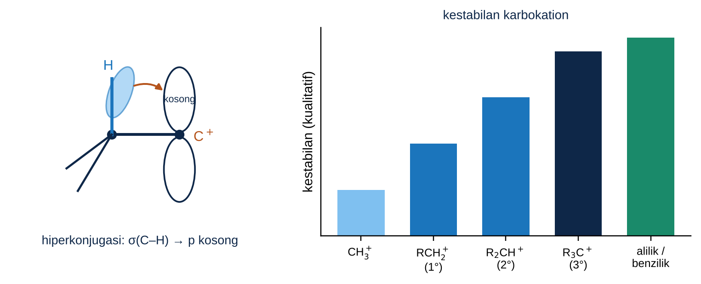

## 6.10 Karbokation: kestabilan, hiperkonjugasi, dan penataan ulang

Karbokation adalah intermediet yang paling penting dalam kimia organik polar. Karbokation muncul dalam reaksi SN1 dan E1 (Bab 7), adisi pada alkena (Bab 8), dehidrasi alkohol (Bab 9), dan substitusi aromatik (Bab 10). Memahami apa yang membuat sebuah karbokation stabil adalah kunci untuk memahami semua reaksi itu.

### Struktur karbokation

Karbokation adalah karbon dengan tiga ikatan dan muatan formal +1 (subbab 1.3). Karbon ini hanya dikelilingi enam elektron. Tiga kelompok elektron berarti karbon itu **sp²**, dengan ketiga ikatan dalam satu bidang dan sudut 120°. Satu orbital p yang **kosong** berdiri tegak lurus terhadap bidang itu. Orbital kosong inilah yang membuat karbokation sangat elektrofilik: nukleofil dapat menyerang dari atas maupun dari bawah bidang. Fakta bahwa serangan dapat terjadi dari kedua sisi akan menjelaskan mengapa reaksi SN1 pada pusat kiral menghasilkan campuran rasemik (Bab 7).

### Urutan kestabilan

Pengukuran dalam fasa gas dan dalam larutan menunjukkan urutan kestabilan yang sangat jelas:

$$
\text{metil} < \text{primer (1°)} < \text{sekunder (2°)} < \text{tersier (3°)}
$$

Perbedaannya besar: dalam fasa gas, karbokation *tert*-butil ratusan kJ mol⁻¹ lebih stabil daripada kation metil. Di dalam larutan, perbedaannya lebih kecil karena pelarut ikut menstabilkan semua kation, tetapi urutannya tetap sama. Dalam praktik, karbokation metil dan primer hampir tidak pernah terbentuk dalam larutan; reaksi yang "seharusnya" melewati karbokation primer memilih jalur lain.

Mengapa gugus alkil menstabilkan karbokation? Ada dua penjelasan yang saling melengkapi.

**Efek induktif.** Gugus alkil sedikit memberi elektron melalui ikatan σ (subbab 3.7). Karbon tersier dikelilingi tiga gugus alkil yang masing-masing mendorong sedikit kerapatan elektron ke karbon bermuatan positif, sehingga muatannya tersebar.

**Hiperkonjugasi.** Penjelasan yang lebih penting melibatkan orbital. Ikatan C–H (atau C–C) pada karbon **tetangga** karbokation dapat berputar sehingga sejajar dengan orbital p kosong. Dalam posisi itu, elektron ikatan σ C–H dapat sebagian "bocor" ke orbital p kosong, menyebarkan muatan positif ke atom-atom tetangga. Interaksi antara ikatan σ yang terisi dan orbital kosong di sebelahnya ini disebut **hiperkonjugasi**. Kita sudah menjumpai bentuk lain dari interaksi yang sama ketika membahas konformasi goyang etana (subbab 4.2). Makin banyak ikatan C–H dan C–C di sebelah karbon bermuatan, makin banyak hiperkonjugasi yang mungkin. Karbokation tersier mempunyai sembilan ikatan C–H tetangga (pada tiga gugus metil), karbokation metil tidak mempunyai satu pun.

{width=90%}

### Resonansi: karbokation alilik dan benzilik

Faktor penstabil yang paling kuat adalah **resonansi**. Karbokation yang bersebelahan dengan ikatan π (pola resonansi 3, subbab 1.8) dapat menyebarkan muatan positifnya ke beberapa atom. Karbokation **alilik** (CH₂=CH–CH₂⁺) menyebarkan muatan ke dua karbon ujung. Karbokation **benzilik** (C₆H₅–CH₂⁺) menyebarkan muatan ke tiga karbon cincin. Kedua karbokation primer ini sekitar sama stabil dengan karbokation sekunder biasa, atau lebih. Karbokation yang bersebelahan dengan atom yang membawa pasangan bebas (pola 2), seperti CH₃O–CH₂⁺, lebih stabil lagi, karena muatan positif dapat berpindah ke oksigen dan semua atom mencapai oktet.

### Penataan ulang karbokation

Karena perbedaan kestabilannya besar, sebuah karbokation sekunder yang bersebelahan dengan karbon tersier akan **berubah** menjadi karbokation tersier bila hal itu dapat dilakukan dengan satu langkah sederhana. Langkah itu adalah pola 4 di subbab 6.4: penataan ulang.

* **Geseran 1,2-hidrida**: atom hidrogen pada karbon tetangga berpindah **bersama pasangan elektron ikatannya** ke karbon bermuatan positif. Karbon tetangga itu kini kehilangan ikatan dan menjadi karbokation baru.
* **Geseran 1,2-alkil** (biasanya metil): gugus alkil pada karbon tetangga berpindah bersama pasangan elektronnya.

Penataan ulang hanya terjadi bila menghasilkan karbokation yang **lebih stabil** atau sama stabil. Kata "1,2" berarti gugus berpindah dari satu karbon ke karbon tepat di sebelahnya.

::: {.contoh}
**Contoh 6.10 · Meramalkan penataan ulang**

3-Metilbutan-2-ol dipanaskan dengan HBr dan menghasilkan 2-bromo-2-metilbutana sebagai produk utama, bukan 2-bromo-3-metilbutana. Jelaskan dengan mekanisme.

**Penyelesaian.** *Langkah 1 (transfer proton):* –OH diprotonasi menjadi –OH₂⁺. *Langkah 2 (gugus pergi):* air lepas dari C2, menghasilkan karbokation **sekunder** di C2. *Langkah 3 (penataan ulang):* C3 di sebelahnya adalah karbon tersier yang mengikat satu H. Geseran 1,2-hidrida memindahkan H itu bersama pasangan elektronnya ke C2. C3 kehilangan ikatan C–H dan menjadi karbokation **tersier**. *Langkah 4 (serangan nukleofil):* Br⁻ menyerang karbokation tersier di C3, menghasilkan 2-bromo-2-metilbutana (dinomori ulang).

**Memahami hasil.** Penataan ulang mengubah letak gugus fungsi, sehingga produk mempunyai kerangka atau letak substituen yang berbeda dari bahan awal. Ini adalah bukti percobaan yang kuat bahwa reaksi berjalan lewat karbokation: reaksi SN2, yang tidak melewati karbokation, tidak pernah menghasilkan produk tertata ulang. Setiap kali kamu menggambar karbokation, periksa apakah ada karbon tetangga yang lebih tersubstitusi.
:::

::: {.awas}
**Kesalahan umum: geseran hidrida bukan geseran proton**

Dalam geseran 1,2-hidrida, hidrogen berpindah **bersama dua elektron** (sebagai H⁻), sehingga karbon asal menjadi bermuatan positif. Ini berbeda dari transfer proton, ketika hidrogen berpindah **tanpa** elektron (sebagai H⁺). Panah lengkung pada geseran hidrida berpangkal pada ikatan C–H dan berujung di antara H dan karbon bermuatan positif, bukan berpangkal pada H.
:::

::: {.kuis}
**Kuis cepat 6.10** Urutkan kestabilan: CH₃CH₂⁺, (CH₃)₂CH⁺, CH₂=CHCH₂⁺, CH₃⁺. Apakah karbokation 3,3-dimetilbutan-2-il akan mengalami penataan ulang? Dengan geseran apa?
:::

## 6.11 Karbanion dan radikal

### Karbanion

Karbanion adalah karbon dengan tiga ikatan, satu pasangan bebas, dan muatan formal −1. Empat kelompok elektron membuat karbanion sederhana berbentuk piramida (seperti amonia), mendekati sp³. Karbanion adalah nukleofil dan basa yang sangat kuat, karena karbon kurang elektronegatif dan tidak suka membawa muatan negatif (subbab 3.5).

Urutan kestabilan karbanion **kebalikan** dari karbokation:

$$
\text{tersier} < \text{sekunder} < \text{primer} < \text{metil}
$$

Gugus alkil yang memberi elektron menstabilkan muatan positif, tetapi justru mengganggu muatan negatif. Karbanion distabilkan oleh faktor yang sudah kita kenal dari Bab 3: resonansi dengan C=O atau C≡N (ion enolat, pKa sekitar 19–20 untuk keton), karakter s yang besar (asetilida, pKa 25), dan gugus penarik elektron di dekatnya. Dalam praktik, karbanion bebas jarang dipakai. Yang dipakai adalah karbon nukleofilik dalam senyawa organologam (pereaksi Grignard, organolitium; Bab 7 dan 11) dan ion enolat yang distabilkan resonansi (Bab 11).

### Radikal

Radikal adalah spesi dengan **elektron tak berpasangan**. Radikal karbon mempunyai tiga ikatan dan satu elektron tunggal, tidak bermuatan (subbab 1.3). Karbon dikelilingi tujuh elektron, satu kurang dari oktet. Radikal alkil sederhana hampir datar (sp²), dengan elektron tunggal di orbital p.

Karena kekurangan elektron, radikal distabilkan oleh faktor yang sama dengan karbokation, walaupun pengaruhnya lebih kecil:

$$
\text{metil} < \text{primer} < \text{sekunder} < \text{tersier} < \text{alilik} \approx \text{benzilik}
$$

Data energi disosiasi ikatan menunjukkan urutan ini secara langsung. Memutus ikatan C–H secara homolitik menghasilkan radikal; makin stabil radikalnya, makin sedikit energi yang diperlukan. BDE C–H turun dari 439 kJ mol⁻¹ (metil) ke 421 (primer), 413 (sekunder), dan 400 (tersier). Perbedaan 39 kJ mol⁻¹ antara C–H metil dan C–H tersier adalah ukuran kestabilan tambahan radikal tersier, yang terutama berasal dari hiperkonjugasi.

::: {.contoh}
**Contoh 6.11 · Membandingkan tiga intermediet**

Untuk setiap pasangan, mana yang lebih stabil? (a) (CH₃)₃C⁺ atau CH₃CH₂⁺; (b) (CH₃)₃C⁻ atau CH₃CH₂⁻; (c) (CH₃)₃C· atau CH₃CH₂·; (d) CH₂=CHCH₂· atau (CH₃)₂CH·.

**Penyelesaian.** (a) Karbokation tersier: lebih banyak hiperkonjugasi dan induksi. (b) Karbanion primer: gugus alkil memberi elektron, mengganggu muatan negatif. (c) Radikal tersier: seperti karbokation, walaupun selisihnya lebih kecil. (d) Radikal alilik: elektron tunggal tersebar oleh resonansi ke dua karbon.

**Memahami hasil.** Karbokation dan radikal kekurangan elektron, sehingga disukai oleh gugus pemberi elektron. Karbanion kelebihan elektron, sehingga tidak disukai oleh gugus pemberi elektron. Resonansi menstabilkan ketiganya, karena menyebarkan muatan atau elektron tunggal ke beberapa atom.
:::

::: {.kuis}
**Kuis cepat 6.11** Ikatan C–H mana yang paling mudah diputus homolitik dalam 2-metilbutana? Mengapa?
:::

## 6.12 Mekanisme radikal: inisiasi, propagasi, terminasi

Sebagian kecil reaksi organik tidak berjalan lewat pasangan elektron, melainkan lewat elektron tunggal. Reaksi seperti ini disebut **reaksi radikal**. Contoh yang paling dikenal adalah halogenasi alkana dengan cahaya, polimerisasi etena menjadi polietilena, dan pembakaran. Reaksi radikal digambar dengan **panah berkepala setengah** (seperti kail pancing), yang menunjukkan gerak **satu** elektron. Pemutusan ikatan secara homolitik memerlukan dua panah setengah, masing-masing membawa satu elektron ke masing-masing atom.

### Reaksi berantai

Klorinasi metana (CH₄ + Cl₂ → CH₃Cl + HCl) dengan cahaya ultraungu adalah contoh klasik **reaksi berantai radikal**. Mekanismenya mempunyai tiga tahap.

**Inisiasi.** Cahaya memutus ikatan Cl–Cl, ikatan terlemah dalam campuran (242 kJ mol⁻¹), menjadi dua radikal klorin:

$$
\text{Cl–Cl} \xrightarrow{h\nu} 2\,\text{Cl}\cdot
$$

Tahap ini hanya perlu terjadi sesekali, karena satu radikal klorin dapat memicu ribuan siklus berikutnya.

**Propagasi.** Dua langkah yang berulang dan saling memberi bahan:

$$
\text{Cl}\cdot + \text{CH}_4 \longrightarrow \text{HCl} + \cdot\text{CH}_3 \qquad \Delta H^\circ = +7\ \text{kJ mol}^{-1}
$$
$$
\cdot\text{CH}_3 + \text{Cl}_2 \longrightarrow \text{CH}_3\text{Cl} + \text{Cl}\cdot \qquad \Delta H^\circ = -108\ \text{kJ mol}^{-1}
$$

Radikal klorin yang dipakai di langkah pertama dihasilkan kembali di langkah kedua. Kedua langkah membentuk sebuah lingkaran yang terus berputar, seperti rantai yang terus memanjang. Jumlah kedua ΔH° propagasi, −101 kJ mol⁻¹, sama dengan ΔH° reaksi keseluruhan (Contoh 6.6).

**Terminasi.** Rantai berhenti bila dua radikal bertemu dan bergabung: Cl· + Cl· → Cl₂, ·CH₃ + Cl· → CH₃Cl, atau ·CH₃ + ·CH₃ → CH₃CH₃. Karena konsentrasi radikal sangat kecil, pertemuan seperti ini jarang, sehingga setiap rantai berputar ribuan kali sebelum berhenti. Terbentuknya sedikit etana dalam klorinasi metana adalah bukti percobaan bahwa radikal metil memang ada.

### Mengapa iodinasi tidak berjalan dan fluorinasi berbahaya

Analisis energi propagasi menjelaskan perbedaan keempat halogen. Untuk iodin, langkah propagasi pertama (I· + CH₄ → HI + ·CH₃) sangat endoterm (+141 kJ mol⁻¹), sehingga rantai tidak dapat berputar. Untuk fluorin, kedua langkah propagasi sangat eksoterm (−131 dan −301 kJ mol⁻¹), sehingga reaksi melepaskan kalor begitu cepat dan dapat meledak. Klorin dan bromin berada di tengah dan dapat dikendalikan. Bab 7 membahas pemakaian klorinasi dan brominasi radikal dalam sintesis.

::: {.contoh}
**Contoh 6.12 · Propagasi brominasi metana**

Hitung ΔH° kedua langkah propagasi brominasi metana dari tabel BDE di subbab 6.6. Langkah mana yang lebih lambat?

**Penyelesaian.** *Langkah 1:* Br· + CH₄ → HBr + ·CH₃. Putus CH₃–H (439), bentuk H–Br (366): ΔH° = +73 kJ mol⁻¹.

*Langkah 2:* ·CH₃ + Br₂ → CH₃Br + Br·. Putus Br–Br (192), bentuk CH₃–Br (294): ΔH° = −102 kJ mol⁻¹.

Jumlah: −29 kJ mol⁻¹, sesuai Contoh 6.6. Langkah 1 sangat endoterm, sehingga energi aktivasinya paling sedikit 73 kJ mol⁻¹ dan langkah ini menjadi langkah lambat.

**Memahami hasil.** Langkah pertama yang lambat dan endoterm inilah yang membuat brominasi selektif (Contoh 6.9). Kimiawan memanfaatkan selektivitas itu untuk memasang bromin hanya pada karbon tersier, alilik, atau benzilik.
:::

::: {.terapan}
**Antioksidan: memutus rantai**

Minyak goreng menjadi tengik karena reaksi berantai radikal dengan oksigen udara (autoksidasi). Antioksidan seperti vitamin E dan BHT (butilhidroksitoluena) adalah fenol yang memberikan atom hidrogen O–H kepada radikal yang membawa rantai, menghasilkan radikal fenoksil yang sangat stabil karena resonansi. Radikal fenoksil terlalu stabil untuk melanjutkan rantai, sehingga reaksi berhenti. Antioksidan bekerja seperti pemadam kebakaran yang menghentikan rantai di tahap propagasi. Bab 9 membahas autoksidasi lebih lanjut.
:::

::: {.kuis}
**Kuis cepat 6.12** Dalam klorinasi etana, produk samping apa yang menunjukkan adanya radikal etil? Tulis langkah terminasi yang membentuknya.
:::

## 6.13 Kendali kinetik dan termodinamik

Kadang sebuah pereaksi dapat menghasilkan dua produk yang berbeda melalui dua jalur. Produk mana yang terbentuk lebih banyak? Jawabannya bergantung pada pertanyaan yang lebih halus: apakah kedua produk dapat saling berubah di bawah kondisi reaksi?

* Bila reaksi **tidak dapat berbalik** (biasanya pada suhu rendah), produk yang terbentuk lebih banyak adalah produk yang terbentuk **lebih cepat**, yaitu produk dengan energi aktivasi lebih rendah. Ini disebut **kendali kinetik**.
* Bila reaksi **dapat berbalik** (biasanya pada suhu lebih tinggi atau waktu yang lebih lama), produk-produk mencapai kesetimbangan, dan produk yang terbentuk lebih banyak adalah produk yang **lebih stabil**, yaitu produk dengan ΔG° lebih negatif. Ini disebut **kendali termodinamik**.

Kedua jenis produk tidak selalu sama. Produk yang paling cepat terbentuk tidak harus produk yang paling stabil.

{width=80%}

::: {.contoh}
**Contoh 6.13 · Adisi HBr pada buta-1,3-diena**

HBr bereaksi dengan buta-1,3-diena menghasilkan dua produk: 3-bromobut-1-ena (adisi 1,2) dan 1-bromobut-2-ena (adisi 1,4). Pada 0 °C perbandingannya sekitar 71:29; pada 40 °C sekitar 15:85. (a) Jelaskan dengan intermediet. (b) Produk mana yang merupakan produk kinetik dan mana produk termodinamik?

**Penyelesaian.** (a) Proton menempel pada C1, menghasilkan karbokation **alilik** yang muatan positifnya tersebar di C2 dan C4 (pola resonansi 3). Br⁻ dapat menyerang C2 (adisi 1,2) atau C4 (adisi 1,4).

(b) Pada 0 °C, reaksi praktis tidak berbalik, dan produk 1,2 dominan. Br⁻ menyerang C2 lebih cepat, karena C2 lebih dekat dengan tempat Br⁻ berada setelah proton lepas dari HBr dan karena C2 membawa bagian muatan yang lebih besar. Produk 1,2 adalah **produk kinetik**. Pada 40 °C, produk-produk dapat terionisasi kembali menjadi karbokation alilik dan mencapai kesetimbangan. Produk 1,4 mempunyai ikatan rangkap yang lebih tersubstitusi (di tengah rantai), sehingga lebih stabil. Produk 1,4 adalah **produk termodinamik**.

**Memahami hasil.** Dengan memilih suhu, kimiawan dapat memilih produk. Gagasan kendali kinetik dan termodinamik akan muncul lagi di Bab 10 (sulfonasi naftalena) dan di *Kimia Organik 2* (pembentukan enolat dan reaksi Diels–Alder).
:::

::: {.kuis}
**Kuis cepat 6.13** Bila sebuah reaksi dijalankan sangat lama pada suhu tinggi, produk mana yang akan dominan: produk kinetik atau termodinamik? Mengapa?
:::

## Menuju bab berikutnya

Teka-teki pembuka bab kini terjawab. Mahasiswa yang memahami empat pola langkah polar dan aturan kestabilan muatan tidak perlu menghafal reaksi, karena setiap reaksi polar adalah gabungan serangan nukleofil, lepasnya gugus pergi, transfer proton, dan penataan ulang, yang diatur oleh kestabilan intermediet dan tinggi penghalang energi.

Bab 7 memakai seluruh alat ini untuk golongan reaksi pertama yang dibahas tuntas: reaksi alkil halida. Alkil halida dapat mengalami substitusi atau eliminasi, masing-masing dengan dua mekanisme yang berbeda (SN1, SN2, E1, E2). Memilih di antara keempatnya adalah latihan yang sempurna untuk berpikir dengan mekanisme: siapa nukleofilnya, siapa elektrofilnya, seberapa stabil intermedietnya, dan langkah mana yang menentukan laju.
