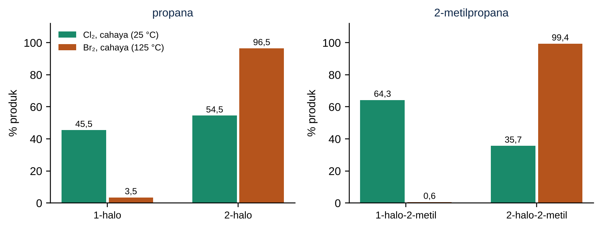
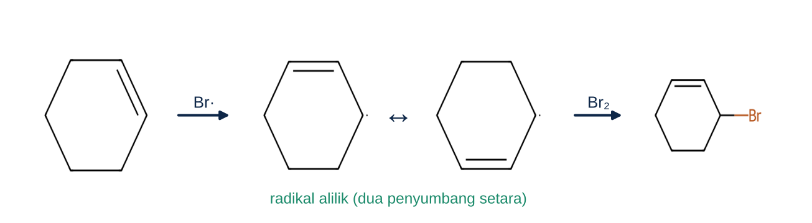

# Bab 7 Alkil Halida: Substitusi dan Eliminasi

Dua botol berisi alkil halida dengan rumus molekul yang sama, C₄H₉Br. Botol pertama berisi 1-bromobutana, botol kedua 2-bromo-2-metilpropana. Ke dalam masing-masing ditambahkan larutan natrium etoksida dalam etanol, dan keduanya dipanaskan. Dari botol pertama hampir seluruhnya terbentuk eter, CH₃CH₂CH₂CH₂OCH₂CH₃: atom bromin diganti oleh gugus etoksi. Dari botol kedua hampir tidak terbentuk eter sama sekali. Yang terbentuk adalah gas 2-metilpropena: atom bromin dan satu atom hidrogen hilang, dan sebuah ikatan rangkap muncul. Pereaksi sama, pelarut sama, suhu sama. Mengapa hasilnya begitu berbeda?

Jawabannya terletak pada dua jenis reaksi yang selalu bersaing setiap kali alkil halida bertemu nukleofil yang juga basa: **substitusi**, ketika nukleofil menggantikan halogen, dan **eliminasi**, ketika basa menarik proton dan halogen lepas sehingga terbentuk alkena. Masing-masing dapat berjalan dengan dua mekanisme yang berbeda, sehingga ada empat kemungkinan: SN2, SN1, E2, dan E1. Struktur alkil halida, kekuatan dan ukuran nukleofil atau basa, pelarut, dan suhu menentukan mana yang menang. Pada 1-bromobutana, karbon yang membawa bromin mudah dijangkau, sehingga etoksida menyerangnya (SN2). Pada 2-bromo-2-metilpropana, karbon itu terkubur di antara tiga gugus metil, sehingga etoksida tidak dapat menyentuhnya dan malah mengambil proton dari karbon tetangga (E2).

Bab ini adalah bab reaksi pertama yang dibahas tuntas, dan keempat mekanismenya akan muncul berulang kali di bab-bab berikutnya. Kita mulai dengan sifat alkil halida dan cara membuatnya dengan reaksi radikal. Lalu kita membahas SN2 dan SN1, masing-masing dengan bukti kinetika dan stereokimianya, serta faktor-faktor yang mempengaruhinya. Setelah itu E2 dan E1, termasuk aturan Zaitsev dan tuntutan geometri anti-periplanar. Kita menyusun **peta keputusan** untuk memilih di antara keempat jalur, mempelajari cara mengubah alkohol menjadi substrat yang baik (tosilat), membuat senyawa organologam dari alkil halida, dan melihat peran alkil halida di lingkungan dan dalam tubuh.

::: {.kuis}
**Pertanyaan pembuka**

1. Mengapa brominasi radikal jauh lebih selektif daripada klorinasi radikal?
2. Mengapa nukleofil dalam reaksi SN2 selalu menyerang dari sisi yang berlawanan dengan gugus pergi, dan apa akibatnya pada pusat kiral?
3. Mengapa alkil halida tersier bereaksi cepat dengan air tetapi lambat dengan ion sianida, sedangkan alkil halida primer sebaliknya?
4. Mengapa eliminasi E2 menghasilkan alkena yang lebih tersubstitusi, kecuali bila basanya besar?
5. Mengapa sebuah kloro­sikloheksana bereaksi E2 dua ratus kali lebih cepat daripada isomernya, padahal keduanya hanya berbeda arah satu gugus?
6. Bagaimana kimiawan memilih kondisi supaya sebuah alkil halida menghasilkan produk substitusi dan bukan eliminasi, atau sebaliknya?
:::

::: {.tujuan}
**Tujuan belajar**

Setelah mempelajari bab ini, kamu mampu:

1. Menamai alkil halida, menjelaskan sifat fisikanya, dan menulis mekanisme halogenasi radikal.
2. Menghitung perbandingan produk halogenasi radikal dari reaktivitas relatif dan menjelaskan selektivitas brominasi; memakai NBS untuk brominasi alilik dan benzilik.
3. Menulis mekanisme SN2 dan SN1 lengkap dengan stereokimianya, dan menjelaskan hukum lajunya.
4. Meramalkan pengaruh struktur substrat, nukleofil, gugus pergi, dan pelarut pada laju SN2 dan SN1.
5. Menulis mekanisme E2 dan E1, meramalkan produk Zaitsev dan Hofmann, dan menerapkan syarat anti-periplanar pada rantai terbuka dan sikloheksana.
6. Memakai peta keputusan untuk meramalkan apakah SN2, SN1, E2, atau E1 yang dominan.
7. Mengubah alkohol menjadi tosilat atau mesilat dan memakainya dalam substitusi dengan stereokimia yang terkendali.
8. Membuat pereaksi Grignard, organolitium, dan kuprat Gilman dari alkil halida dan menjelaskan kereaktifannya.
9. Menjelaskan peran alkil halida dalam lingkungan (CFC dan ozon) dan dalam biologi (metilasi oleh SAM).
:::

::: {.mat}
**Prasyarat**

Bab 2: tata nama haloalkana (subbab 2.6). Bab 3: pKa dan kebasaan (subbab 3.2–3.5), pelarut (subbab 3.11). Bab 4: konformasi dan sikloheksana kursi (subbab 4.2–4.9). Bab 5: konfigurasi R/S dan rasemat (subbab 5.4–5.5). Bab 6: nukleofil, elektrofil, gugus pergi, empat pola, diagram energi, postulat Hammond, karbokation, radikal, reaksi berantai (seluruhnya).
:::

## 7.1 Alkil halida: struktur dan sifat

**Alkil halida** (haloalkana) adalah senyawa dengan atom halogen yang terikat pada karbon sp³. Alkil halida digolongkan menurut karbon yang membawa halogen: **primer** (RCH₂X), **sekunder** (R₂CHX), atau **tersier** (R₃CX), sama seperti penggolongan karbon di subbab 2.2. Penggolongan ini akan menjadi kunci di seluruh bab, karena primer, sekunder, dan tersier bereaksi dengan cara yang sangat berbeda. Halogen yang terikat pada karbon sp² mempunyai nama lain: **vinil halida** bila terikat pada C=C, dan **aril halida** bila terikat pada cincin benzena. Keduanya hampir tidak mengalami reaksi SN1 dan SN2, karena alasan yang dibahas di subbab 7.12.

### Ikatan C–X

Sifat kimia alkil halida ditentukan oleh ikatan C–X. Tiga besaran berubah teratur dari fluorin ke iodin:

| Ikatan | Panjang (pm) | BDE (kJ mol⁻¹) | Selisih keelektronegatifan | pKa HX |
|---|---|---|---|---|
| C–F | 139 | 460 | 1,43 | 3,2 |
| C–Cl | 178 | 350 | 0,61 | −7 |
| C–Br | 193 | 294 | 0,41 | −9 |
| C–I | 214 | 239 | 0,11 | −10 |

Ikatan C–X polar, dengan karbon δ+ (subbab 1.7), sehingga karbon itu adalah **elektrofil**. Turun dari F ke I, ikatan makin panjang dan makin lemah, dan ion halida yang lepas makin stabil (asam konjugatnya makin kuat, subbab 6.4). Akibatnya kereaktifan alkil halida dalam substitusi dan eliminasi naik dari fluorida ke iodida: R–I > R–Br > R–Cl ≫ R–F. Alkil fluorida hampir tidak bereaksi, sehingga ikatan C–F sering dipakai dalam obat untuk "mengunci" bagian molekul yang tidak boleh berubah di dalam tubuh.

### Sifat fisika

Alkil halida polar tetapi tidak membentuk ikatan hidrogen. Titik didihnya lebih tinggi daripada alkana dengan jumlah karbon yang sama, karena atom halogen menambah massa, menambah gaya dispersi (atom Br dan I sangat besar dan mudah terpolarisasi), dan menambah gaya dipol–dipol. Alkil halida tidak larut dalam air, tetapi larut dalam pelarut organik. Banyak alkil halida yang mengandung beberapa atom klorin atau bromin lebih rapat daripada air: diklorometana (1,33 g mL⁻¹) dan kloroform (1,49 g mL⁻¹) berada di **lapisan bawah** corong pisah, bukan di atas seperti eter. Fakta praktis ini penting di laboratorium (subbab 3.13).

::: {.kuis}
**Kuis cepat 7.1** Golongkan sebagai primer, sekunder, tersier, vinil, atau aril: (a) 2-bromobutana; (b) bromosikloheksana; (c) 1-bromo-1-metilsikloheksana; (d) bromobenzena; (e) 2-bromopropena.
:::

## 7.2 Halogenasi radikal alkana: reaksi berantai dan selektivitas

Alkana tidak mempunyai gugus fungsi, sehingga hampir tidak bereaksi (subbab 4.11). Halogenasi radikal adalah salah satu dari sedikit cara untuk memasang gugus fungsi pada alkana. Mekanismenya sudah kita pelajari di subbab 6.12: inisiasi dengan cahaya atau panas, dua langkah propagasi yang membentuk lingkaran, dan terminasi. Di sini kita fokus pada pertanyaan yang sangat praktis: bila alkana mempunyai beberapa jenis C–H, produk mana yang terbentuk?

### Reaktivitas relatif

Langkah propagasi pertama, X· + R–H → H–X + R·, menentukan karbon mana yang kehilangan hidrogen. Langkah ini lebih mudah bila radikal yang terbentuk lebih stabil (subbab 6.11). Percobaan menunjukkan **reaktivitas relatif per atom H**:

| Halogen | Primer (1°) | Sekunder (2°) | Tersier (3°) |
|---|---|---|---|
| Cl (25 °C) | 1 | 3,6 | 5,0 |
| Br (125 °C) | 1 | 82 | 1600 |

Untuk menghitung perbandingan produk, kalikan reaktivitas relatif dengan **jumlah atom H** dari setiap jenis:

$$
\text{bagian produk} = \frac{(\text{jumlah H}) \times (\text{reaktivitas per H})}{\sum (\text{jumlah H} \times \text{reaktivitas per H})} \qquad \text{(7.1)}
$$

Jumlah H penting, karena faktor kebetulan juga berperan: pada propana ada enam H primer tetapi hanya dua H sekunder. Radikal klorin yang bertabrakan secara acak lebih sering bertemu H primer, walaupun setiap H sekunder lebih mudah diambil.

{width=88%}

::: {.contoh}
**Contoh 7.1 · Klorinasi dan brominasi propana**

Hitung persentase 1-halopropana dan 2-halopropana pada klorinasi dan brominasi radikal propana.

**Penyelesaian.** Propana mempunyai 6 H primer (dua CH₃) dan 2 H sekunder (CH₂).

*Klorinasi:* primer $6 \times 1 = 6$; sekunder $2 \times 3{,}6 = 7{,}2$. Jumlah 13,2. 1-Kloropropana $6/13{,}2 = 45\%$; 2-kloropropana $7{,}2/13{,}2 = 55\%$.

*Brominasi:* primer $6 \times 1 = 6$; sekunder $2 \times 82 = 164$. Jumlah 170. 1-Bromopropana $6/170 = 3{,}5\%$; 2-bromopropana $96{,}5\%$.

**Memahami hasil.** Klorinasi memberi campuran yang hampir 1:1, sehingga tidak berguna untuk membuat satu produk. Brominasi memberi hampir hanya satu produk. Contoh 6.b4 menjelaskan sebabnya dengan postulat Hammond: langkah propagasi brominasi sangat endoterm, sehingga keadaan transisinya mirip radikal dan "merasakan" perbedaan kestabilan radikal sekunder dan primer sepenuhnya.
:::

::: {.contoh}
**Contoh 7.2 · Empat produk dari 2-metilbutana**

Klorinasi radikal 2-metilbutana dapat menghasilkan empat monokloroalkana. Hitung persentasenya, lalu bandingkan dengan brominasi.

**Penyelesaian.** Jenis H: dua CH₃ yang setara pada C2 dan C1 (6 H primer), CH₃ pada C4 (3 H primer), CH₂ pada C3 (2 H sekunder), CH pada C2 (1 H tersier).

*Klorinasi:* $6 \times 1 = 6$; $3 \times 1 = 3$; $2 \times 3{,}6 = 7{,}2$; $1 \times 5{,}0 = 5{,}0$. Jumlah 21,2. Persentase: 1-kloro-2-metilbutana 28%, 1-kloro-3-metilbutana 14%, 2-kloro-3-metilbutana 34%, 2-kloro-2-metilbutana 24%.

*Brominasi:* $6$; $3$; $2 \times 82 = 164$; $1 \times 1600 = 1600$. Jumlah 1773. 2-Bromo-2-metilbutana 90%, 2-bromo-3-metilbutana 9%, sisanya kurang dari 1%.

**Memahami hasil.** Untuk memasang halogen pada karbon tersier alkana, brominasi adalah pilihan yang jelas. Klorinasi hanya berguna untuk alkana yang semua H-nya setara, seperti metana, etana, sikloheksana, atau 2,2-dimetilpropana, karena di sana tidak ada masalah selektivitas.
:::

::: {.kuis}
**Kuis cepat 7.2** Berapa monokloroalkana berbeda yang dapat terbentuk dari klorinasi butana? Hitung persentasenya.
:::

## 7.3 Brominasi alilik dan benzilik dengan NBS

Radikal alilik dan benzilik jauh lebih stabil daripada radikal alkil biasa, karena elektron tunggalnya tersebar oleh resonansi (subbab 6.11). Energi disosiasi ikatan C–H alilik hanya sekitar 370 kJ mol⁻¹, dan C–H benzilik sekitar 375 kJ mol⁻¹, jauh lebih kecil daripada C–H tersier biasa (400 kJ mol⁻¹). Karena itu radikal bromin sangat memilih hidrogen alilik dan benzilik.

### Masalah: Br₂ juga bereaksi dengan C=C

Ada satu kesulitan bila kita ingin membrominasi posisi alilik sebuah alkena dengan Br₂. Br₂ bereaksi dengan ikatan rangkap melalui adisi (Bab 8), dan adisi itu bersaing dengan substitusi alilik. Penyelesaiannya adalah menjaga konsentrasi Br₂ **sangat rendah**. Pada konsentrasi Br₂ yang sangat rendah, adisi ke C=C (yang memerlukan dua molekul Br₂ atau Br₂ dan Br⁻ dalam langkahnya) menjadi sangat lambat, sedangkan reaksi rantai radikal (yang hanya memerlukan Br₂ dalam satu langkah propagasi) tetap berjalan.

### N-Bromosuksinimida

Pereaksi yang menyediakan Br₂ sedikit demi sedikit adalah **N-bromosuksinimida (NBS)**, padatan yang dipakai dalam pelarut CCl₄ atau sikloheksana bersama sedikit inisiator radikal atau cahaya. NBS bereaksi dengan HBr yang terbentuk pada langkah propagasi untuk menghasilkan Br₂ baru dalam jumlah yang sangat kecil:

$$
\text{NBS} + \text{HBr} \longrightarrow \text{suksinimida} + \text{Br}_2
$$

Dengan begitu konsentrasi Br₂ selalu sebanding dengan HBr yang baru dihasilkan, sangat rendah dan tetap. Mekanismenya:

1. **Inisiasi:** cahaya atau peroksida menghasilkan sedikit Br·.
2. **Propagasi 1:** Br· mengambil H alilik, menghasilkan HBr dan radikal alilik yang terdelokalisasi.
3. **Pembentukan Br₂:** HBr bereaksi dengan NBS menghasilkan Br₂.
4. **Propagasi 2:** radikal alilik mengambil satu atom Br dari Br₂, menghasilkan alil bromida dan Br· yang baru.

{width=88%}

::: {.contoh}
**Contoh 7.3 · Brominasi alilik yang menghasilkan dua produk**

But-1-ena bereaksi dengan NBS dan cahaya. Tulis kedua struktur penyumbang radikal alilik dan ramalkan produknya.

**Penyelesaian.** H alilik berada di C3 (CH₂ di sebelah C=C). Mengambil H dari C3 menghasilkan radikal CH₂=CH–ĊH–CH₃, yang mempunyai struktur penyumbang kedua ·CH₂–CH=CH–CH₃. Elektron tunggal tersebar di C1 dan C3. Br₂ dapat bereaksi di kedua karbon: di C3 memberi 3-bromobut-1-ena, di C1 memberi 1-bromobut-2-ena (campuran E dan Z).

**Memahami hasil.** Radikal alilik yang tidak simetris memberi dua produk. Produk dengan ikatan rangkap di tengah (1-bromobut-2-ena) biasanya lebih banyak karena lebih stabil, mirip dengan produk termodinamik pada adisi HBr ke buta-1,3-diena (subbab 6.13). Untuk sintesis yang bersih, pilih substrat yang radikal aliliknya simetris, seperti sikloheksena.
:::

::: {.contoh}
**Contoh 7.4 · Brominasi benzilik**

Toluena (metilbenzena) bereaksi dengan NBS dan cahaya. Ramalkan produknya dan jelaskan mengapa cincin aromatik tidak ikut bereaksi.

**Penyelesaian.** H paling lemah adalah H benzilik pada gugus metil (BDE ± 375 kJ mol⁻¹), karena radikal benzil distabilkan resonansi ke cincin. Br· mengambil H itu, dan radikal benzil bereaksi dengan Br₂. Produknya benzil bromida, C₆H₅CH₂Br. C–H aromatik jauh lebih kuat (± 470 kJ mol⁻¹) karena radikal aril (elektron di orbital sp²) tidak distabilkan resonansi; ikatan π cincin tidak bereaksi dengan Br₂ yang sangat encer tanpa katalis asam Lewis (Bab 10).

**Memahami hasil.** Benzil bromida adalah substrat yang sangat baik untuk substitusi, karena karbon benzilik dapat bereaksi baik lewat SN2 (karbon primer yang terbuka) maupun SN1 (karbokation benzilik yang distabilkan resonansi). Brominasi benzilik diikuti substitusi adalah cara standar memasang gugus fungsi pada rantai samping cincin aromatik.
:::

::: {.kuis}
**Kuis cepat 7.3** Mengapa NBS dipakai untuk brominasi alilik, bukan Br₂ pekat? Apa produk NBS dengan siklopentena?
:::
