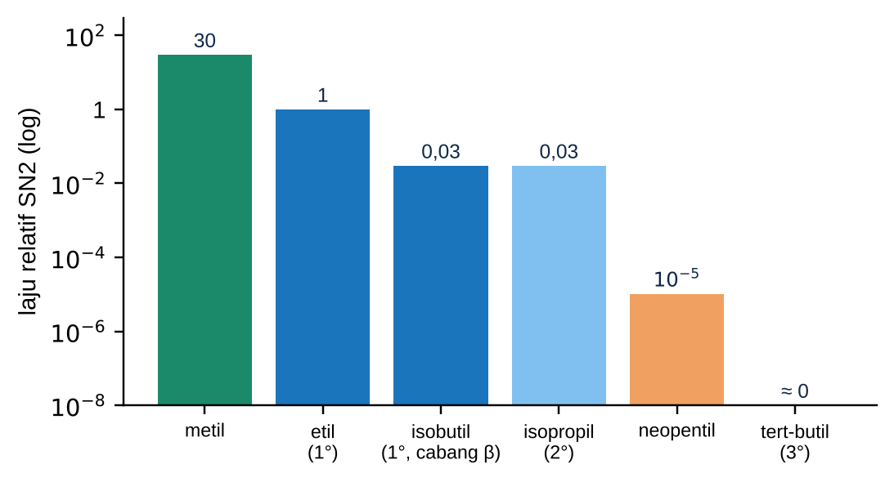
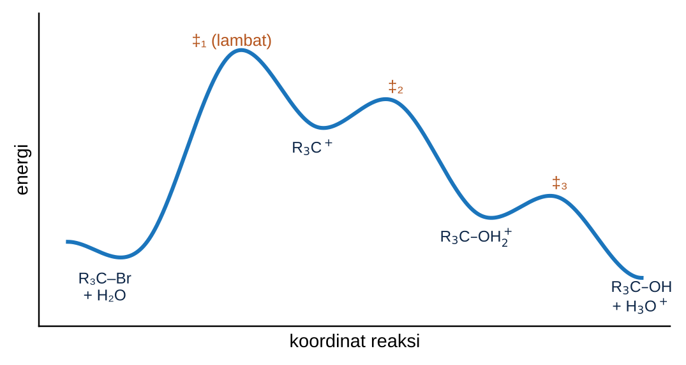
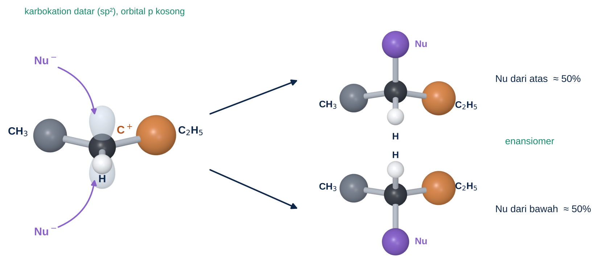

## 7.4 Substitusi nukleofilik: gambaran umum

Dalam **substitusi nukleofilik**, sebuah nukleofil menggantikan gugus pergi pada karbon sp³:

$$
\text{Nu}^{-} + \text{R–LG} \longrightarrow \text{R–Nu} + \text{LG}^{-}
$$

Reaksi ini adalah salah satu reaksi yang paling serbaguna dalam kimia organik, karena dengan memilih nukleofil, satu alkil halida dapat diubah menjadi banyak golongan senyawa:

| Nukleofil | Produk | Golongan |
|---|---|---|
| OH⁻ | R–OH | alkohol |
| R'O⁻ | R–OR' | eter (sintesis Williamson, Bab 9) |
| HS⁻ | R–SH | tiol |
| CN⁻ | R–CN | nitril (rantai bertambah satu karbon) |
| N₃⁻ | R–N₃ | azida (lalu direduksi menjadi amina) |
| NH₃ | R–NH₂ | amina (Bab 13) |
| R'C≡C⁻ | R–C≡CR' | alkuna (ikatan C–C baru, Bab 8) |
| I⁻ | R–I | alkil iodida (reaksi Finkelstein) |
| R'COO⁻ | R–OOCR' | ester |

### Dua mekanisme

Pada awal abad ke-20, Christopher Ingold dan Edward Hughes mengukur laju banyak reaksi substitusi dan menemukan dua pola yang sangat berbeda. Pada sebagian reaksi, laju bergantung pada konsentrasi alkil halida **dan** konsentrasi nukleofil. Pada sebagian lainnya, laju hanya bergantung pada konsentrasi alkil halida; menambah nukleofil tidak mempercepat apa pun. Kedua pola ini hanya dapat dijelaskan dengan dua mekanisme yang berbeda.

* **SN2** (substitusi nukleofilik bimolekuler): satu langkah serempak. Nukleofil menyerang karbon pada saat yang sama dengan lepasnya gugus pergi. Dua spesi terlibat dalam langkah penentu laju, sehingga "bimolekuler" dan laju bergantung pada keduanya.
* **SN1** (substitusi nukleofilik unimolekuler): dua langkah. Gugus pergi lepas lebih dulu membentuk karbokation (langkah lambat), lalu nukleofil menyerang karbokation (langkah cepat). Hanya alkil halida yang terlibat dalam langkah lambat, sehingga "unimolekuler".

Kedua mekanisme adalah gabungan pola-pola dasar dari subbab 6.4. SN2 menggabungkan serangan nukleofil dan lepasnya gugus pergi dalam satu langkah; SN1 memisahkan keduanya menjadi dua langkah berurutan.

::: {.kuis}
**Kuis cepat 7.4** Nukleofil apa yang kamu pilih untuk mengubah 1-bromobutana menjadi (a) pentananitril; (b) butan-1-ol; (c) 1-azidobutana?
:::

## 7.5 Mekanisme SN2: kinetika dan stereokimia

### Hukum laju

Untuk reaksi CH₃Br + OH⁻ → CH₃OH + Br⁻, percobaan menunjukkan bahwa menggandakan [CH₃Br] menggandakan laju, dan menggandakan [OH⁻] juga menggandakan laju. Hukum lajunya:

$$
\text{laju} = k[\text{R–LG}][\text{Nu}^-] \qquad \text{(7.2)}
$$

Laju orde satu terhadap masing-masing pereaksi, orde dua secara keseluruhan. Hukum laju ini adalah bukti pertama bahwa kedua pereaksi bertemu dalam langkah penentu laju.

### Serangan dari belakang

Di mana nukleofil menyerang? Jawabannya datang dari orbital (subbab 6.2). LUMO alkil halida adalah orbital antiikatan σ* C–LG, dengan cuping besar di sisi karbon yang **berlawanan** dengan gugus pergi. Nukleofil menyerang cuping itu, yaitu **dari belakang**, 180° dari gugus pergi. Ada dua alasan tambahan yang membuat serangan dari belakang masuk akal: nukleofil yang bermuatan negatif ditolak oleh pasangan bebas dan muatan parsial negatif gugus pergi bila datang dari depan, dan di belakang ada ruang kosong yang tidak dihalangi gugus pergi.

Pada keadaan transisi, karbon terikat setengah pada nukleofil dan setengah pada gugus pergi, yang berada pada satu garis lurus. Tiga gugus lain pada karbon itu terletak dalam satu bidang yang tegak lurus garis itu, seperti jari-jari payung yang sedang membalik. Karbon pada keadaan transisi sementara berbentuk bipiramida segitiga, dikelilingi lima gugus.

{width=96%}

### Inversi konfigurasi

Akibat serangan dari belakang adalah sesuatu yang dapat diamati: ketiga gugus lain pada karbon "membalik" seperti payung yang tertiup angin kencang. Bila karbon yang diserang adalah pusat kiral, **konfigurasinya terbalik**. Gejala ini pertama kali diamati oleh Paul Walden pada 1896 dan disebut **inversi Walden**. (S)-2-bromobutana yang bereaksi dengan OH⁻ melalui SN2 menghasilkan (R)-butan-2-ol, bukan campuran rasemik dan bukan (S)-butan-2-ol.

Inversi konfigurasi adalah bukti yang sangat kuat untuk serangan dari belakang dalam satu langkah. Mekanisme lain mana pun, misalnya serangan dari depan atau pembentukan karbokation lebih dulu, akan memberi retensi atau rasemisasi.

::: {.awas}
**Kesalahan umum: inversi bukan berarti R menjadi S**

Inversi berarti susunan geometris di ruang terbalik. Huruf R/S tergantung prioritas CIP, dan nukleofil yang baru dapat mempunyai prioritas yang berbeda dari gugus pergi yang lama. Bila prioritas nukleofil dan gugus pergi sama-sama tertinggi (misalnya Br diganti OH pada 2-bromobutana), inversi mengubah S menjadi R. Bila prioritas berubah urutan, inversi dapat mempertahankan huruf yang sama. Selalu tentukan R/S produk dari gambarnya, bukan dari aturan "terbalik berarti hurufnya terbalik".
:::

::: {.contoh}
**Contoh 7.5 · Stereokimia SN2**

(R)-2-Bromooktana bereaksi dengan NaCN dalam DMSO. (a) Gambar produknya dengan stereokimia yang benar. (b) Tentukan R/S produk. (c) Bila trans-1-bromo-4-metilsikloheksana bereaksi dengan NaI dalam aseton, apa produknya?

**Penyelesaian.** (a) CN⁻ menyerang dari belakang C2; konfigurasi geometris terbalik. Produk: 2-metiloktananitril dengan CN di posisi ruang yang berlawanan dari Br semula.

(b) Pada bahan awal, prioritas: Br > C₆H₁₃ > CH₃ > H. Pada produk: CN (C dengan N, N, N) > C₆H₁₃ (C dengan C, H, H) > CH₃ > H. Urutan prioritas tidak berubah (gugus baru tetap tertinggi), sehingga inversi geometri memberi huruf terbalik: **S**.

(c) Br dan CH₃ trans (berseberangan). I⁻ menyerang dari belakang, sehingga I masuk di sisi yang sama dengan CH₃: **cis-1-iodo-4-metilsikloheksana**.

**Memahami hasil.** Pada cincin, inversi Walden terlihat sebagai perubahan trans menjadi cis (atau sebaliknya), sehingga mudah diamati tanpa polarimeter. Percobaan seperti (c) termasuk bukti paling sederhana untuk mekanisme SN2.
:::

::: {.kuis}
**Kuis cepat 7.5** (S)-2-Iodobutana bereaksi dengan NaN₃ lewat SN2. Apa konfigurasi 2-azidobutana yang terbentuk? Bila konsentrasi NaN₃ digandakan, apa yang terjadi pada laju?
:::

## 7.6 Faktor yang mempengaruhi SN2

Karena SN2 berlangsung dalam satu langkah dengan serangan dari belakang, laju SN2 dipengaruhi oleh empat faktor: seberapa mudah karbon dijangkau (substrat), seberapa kuat nukleofil, seberapa baik gugus pergi, dan pelarut.

### Substrat: halangan sterik

Nukleofil harus mendekati karbon dari belakang. Gugus-gugus besar di sekitar karbon itu menghalangi jalannya, seperti pagar di depan pintu. Data laju relatif SN2 menunjukkan pengaruh ini dengan sangat jelas:

| Substrat | Contoh | Laju relatif SN2 |
|---|---|---|
| metil | CH₃–Br | 30 |
| primer | CH₃CH₂–Br | 1 |
| primer bercabang | (CH₃)₂CHCH₂–Br | 0,03 |
| sekunder | (CH₃)₂CH–Br | 0,03 |
| neopentil | (CH₃)₃CCH₂–Br | 0,000 01 |
| tersier | (CH₃)₃C–Br | ≈ 0 |

{width=78%}

Substrat tersier praktis tidak bereaksi lewat SN2: tiga gugus alkil menutup sisi belakang karbon sepenuhnya. Substrat neopentil, walaupun primer, juga hampir tidak bereaksi, karena gugus *tert*-butil di karbon tetangga menutup jalan masuk. Urutan umum: **metil > primer > sekunder ≫ tersier**.

### Nukleofil

Nukleofil yang lebih kuat menyerang lebih cepat. **Nukleofilisitas** (kekuatan sebagai nukleofil) berhubungan dengan kebasaan, tetapi tidak sama. Beberapa pedoman:

1. **Anion lebih nukleofilik daripada molekul netral asamnya**: OH⁻ > H₂O; CH₃O⁻ > CH₃OH; NH₂⁻ > NH₃.
2. **Dalam satu periode, nukleofilisitas sejalan dengan kebasaan**: CH₃⁻ > NH₂⁻ > OH⁻ > F⁻. Atom yang kurang elektronegatif lebih bersedia memberikan pasangan elektronnya.
3. **Dalam satu golongan, di pelarut protik, nukleofilisitas naik ke bawah**: I⁻ > Br⁻ > Cl⁻ > F⁻ dan HS⁻ > HO⁻, walaupun kebasaan turun ke bawah. Ada dua alasan. Atom besar mempunyai awan elektron yang mudah terpolarisasi, sehingga dapat mulai membentuk ikatan dari jarak yang lebih jauh. Selain itu, anion kecil seperti F⁻ dikelilingi sangat rapat oleh molekul pelarut protik melalui ikatan hidrogen, sehingga "terbungkus" dan sulit menyerang.
4. **Halangan sterik mengurangi nukleofilisitas**: ion *tert*-butoksida adalah basa yang kuat tetapi nukleofil yang buruk, karena terlalu besar untuk menyelinap ke belakang karbon.

Urutan kasar nukleofil umum dalam pelarut protik:

$$
\text{I}^- \approx \text{HS}^- \approx \text{CN}^- > \text{Br}^- > \text{N}_3^- > \text{CH}_3\text{O}^- \approx \text{OH}^- > \text{Cl}^- > \text{NH}_3 > \text{F}^- > \text{CH}_3\text{COO}^- > \text{H}_2\text{O} > \text{CH}_3\text{OH}
$$

### Gugus pergi

Gugus pergi yang baik adalah basa lemah, yang stabil setelah membawa pasangan elektron (subbab 6.4). Urutannya mengikuti keasaman asam konjugatnya: TsO⁻ (tosilat) ≈ I⁻ > Br⁻ > H₂O > Cl⁻ ≫ F⁻, OH⁻, OR⁻, NH₂⁻. Tiga gugus terakhir praktis tidak pernah pergi dalam SN2, karena basa konjugatnya terlalu kuat. Itulah sebabnya alkohol, eter, dan amina tidak mengalami substitusi kecuali gugusnya diubah lebih dulu (protonasi, atau diubah menjadi tosilat, subbab 7.13).

### Pelarut: protik lawan aprotik polar

Pelarut mempengaruhi SN2 dengan cara yang tidak terduga. **Pelarut protik** (air, metanol, etanol) mempunyai ikatan O–H atau N–H dan membentuk ikatan hidrogen dengan nukleofil anionik. Ikatan hidrogen itu menstabilkan nukleofil, menurunkan energinya, sehingga menaikkan energi aktivasi. **Pelarut aprotik polar** (DMSO, DMF, aseton, asetonitril) cukup polar untuk melarutkan garam, tetapi tidak mempunyai O–H atau N–H. Pelarut ini mengelilingi kation (Na⁺, K⁺) dengan baik lewat pasangan bebas oksigennya, tetapi membiarkan anion hampir "telanjang". Nukleofil yang telanjang jauh lebih reaktif.

Efeknya sangat besar. Untuk reaksi N₃⁻ dengan 1-bromobutana, laju relatif dalam metanol 1, dalam air 7, dalam DMSO sekitar 1300, dalam DMF sekitar 2800, dan dalam asetonitril sekitar 5000. Mengganti pelarut dapat mempercepat SN2 ribuan kali.

::: {.inti}
**Kondisi terbaik untuk SN2:** substrat metil atau primer (sekunder masih mungkin); nukleofil kuat dan tidak besar; gugus pergi baik (I, Br, OTs); pelarut aprotik polar (DMSO, DMF, aseton, asetonitril).
:::

::: {.contoh}
**Contoh 7.6 · Memilih kondisi SN2**

Untuk setiap pasangan, mana yang bereaksi lebih cepat lewat SN2? (a) 1-bromobutana atau 2-bromobutana dengan NaCN; (b) CH₃CH₂Br dengan NaSH atau NaOH dalam etanol; (c) 1-klorobutana atau 1-iodobutana dengan NaN₃; (d) CH₃I dengan NaCN dalam metanol atau dalam DMSO.

**Penyelesaian.** (a) 1-Bromobutana (primer, kurang terhalang). (b) NaSH: HS⁻ lebih nukleofilik daripada OH⁻ dalam pelarut protik karena belerang lebih besar dan lebih mudah terpolarisasi. (c) 1-Iodobutana: I⁻ gugus pergi yang lebih baik. (d) DMSO: pelarut aprotik polar membiarkan CN⁻ tidak tersolvasi.

**Memahami hasil.** Setiap pasangan hanya berbeda satu faktor, sehingga keputusannya jelas. Dalam merancang sintesis, kimiawan mengatur keempat faktor sekaligus supaya SN2 berjalan cepat dan bersih.
:::

::: {.kuis}
**Kuis cepat 7.6** Mengapa F⁻ adalah nukleofil buruk dalam metanol tetapi cukup baik dalam DMSO? Mengapa *tert*-butoksida tidak dipakai untuk SN2?
:::

## 7.7 Mekanisme SN1: kinetika, karbokation, dan rasemisasi

### Hukum laju

Untuk hidrolisis 2-bromo-2-metilpropana dalam air (CH₃)₃CBr + H₂O → (CH₃)₃COH + HBr, laju hanya bergantung pada konsentrasi alkil halida:

$$
\text{laju} = k[\text{R–LG}] \qquad \text{(7.3)}
$$

Menambah nukleofil tidak mempercepat reaksi. Ini hanya dapat berarti bahwa nukleofil **tidak** terlibat dalam langkah penentu laju. Langkah lambat harus berupa sesuatu yang dilakukan alkil halida sendirian: lepasnya gugus pergi.

### Tiga langkah

Mekanisme SN1 untuk hidrolisis 2-bromo-2-metilpropana sudah kita susun di Contoh 6.4:

1. **Lepasnya gugus pergi** (lambat, penentu laju): ikatan C–Br putus heterolitik, menghasilkan karbokation *tert*-butil dan Br⁻.
2. **Serangan nukleofil** (cepat): air menyerang karbokation, menghasilkan ion alkiloksonium.
3. **Transfer proton** (cepat): molekul air lain menarik proton, menghasilkan alkohol dan H₃O⁺.

Bila nukleofilnya anion (misalnya Br⁻ atau N₃⁻), langkah 3 tidak diperlukan.

{width=82%}

### Rasemisasi

Karbokation datar (sp²) dengan orbital p kosong di atas dan di bawah bidang (subbab 6.10). Nukleofil dapat menyerang dari kedua sisi dengan peluang hampir sama. Bila karbon itu adalah pusat kiral pada bahan awal, kedua serangan menghasilkan kedua enansiomer. Akibatnya SN1 pada pusat kiral memberi **rasemisasi**: campuran kedua enansiomer.

{width=90%}

Dalam praktik, rasemisasinya biasanya tidak sempurna: produk inversi sering sedikit lebih banyak, misalnya 60:40. Penyebabnya, ion halida yang baru lepas masih berada dekat karbokation sesaat, membentuk **pasangan ion**, dan menghalangi sisi depan. Nukleofil yang datang pada saat itu lebih mudah masuk dari belakang. Bila karbokation hidup cukup lama untuk berpisah sepenuhnya dari gugus pergi, rasemisasi menjadi hampir sempurna.

::: {.contoh}
**Contoh 7.7 · Membedakan SN1 dan SN2 dari data**

(S)-3-Bromo-3-metilheksana dilarutkan dalam metanol tanpa basa tambahan. Setelah beberapa jam terbentuk 3-metoksi-3-metilheksana yang hampir tidak aktif optik. Lajunya tidak berubah bila ditambahkan natrium metoksida dalam jumlah kecil. Mekanisme apa yang terjadi? Mengapa produknya hampir tidak aktif optik?

**Penyelesaian.** Substratnya tersier, sehingga SN2 tidak mungkin. Laju tidak bergantung pada nukleofil, sesuai hukum laju SN1. Mekanismenya SN1: Br⁻ lepas menghasilkan karbokation tersier datar; metanol (pelarut) menyerang dari kedua sisi; proton lepas. Kedua enansiomer terbentuk dalam jumlah hampir sama, sehingga rotasi hampir nol.

**Memahami hasil.** Reaksi seperti ini, ketika pelarut sendiri menjadi nukleofil, disebut **solvolisis** (metanolisis untuk metanol, hidrolisis untuk air). Solvolisis hampir selalu SN1, karena pelarut seperti air atau metanol adalah nukleofil yang terlalu lemah untuk SN2 tetapi sangat baik dalam menstabilkan ion yang terbentuk.
:::

::: {.kuis}
**Kuis cepat 7.7** Bila konsentrasi (CH₃)₃CBr digandakan dan konsentrasi nukleofil dijadikan separuh dalam reaksi SN1, apa yang terjadi pada laju?
:::

## 7.8 Faktor SN1 dan penataan ulang

Karena langkah penentu laju SN1 adalah pembentukan karbokation, dan menurut postulat Hammond keadaan transisinya mirip karbokation (subbab 6.9), apa pun yang menstabilkan karbokation mempercepat SN1.

### Substrat: kestabilan karbokation

Urutan laju SN1 adalah **kebalikan** dari SN2:

| Substrat | Laju relatif SN1 (solvolisis) |
|---|---|
| metil, primer | ± 1 (praktis tidak bereaksi lewat SN1) |
| sekunder | ± 12 |
| tersier | ± 1 200 000 |
| alilik, benzilik | tinggi (mendekati tersier) |

Substrat tersier, alilik, dan benzilik bereaksi cepat lewat SN1. Substrat sekunder lambat. Substrat primer dan metil hampir tidak pernah lewat SN1, karena karbokationnya terlalu tidak stabil. Pengecualiannya substrat primer alilik dan benzilik, yang karbokationnya distabilkan resonansi.

### Gugus pergi

Sama seperti SN2: gugus pergi yang baik mempercepat SN1, karena ikatan C–LG putus pada langkah penentu laju. Urutannya sama.

### Nukleofil

Nukleofil **tidak** mempengaruhi laju SN1, karena tidak terlibat dalam langkah lambat. Nukleofil hanya menentukan produk apa yang terbentuk. Bahkan nukleofil yang sangat lemah, seperti air atau metanol, cukup untuk menangkap karbokation. Nukleofil yang kuat dalam jumlah besar justru cenderung mendorong reaksi ke arah SN2 (bila substratnya memungkinkan) atau E2.

### Pelarut: protik polar

Pembentukan karbokation menghasilkan dua ion dari satu molekul netral. Pelarut yang dapat menstabilkan kedua ion sekaligus mempercepat langkah ini. **Pelarut protik polar** seperti air, metanol, etanol, dan asam asetat sangat baik untuk itu: oksigennya membungkus kation, dan ikatan hidrogennya membungkus anion gugus pergi. Laju solvolisis 2-kloro-2-metilpropana dalam air sekitar seratus ribu kali lebih cepat daripada dalam etanol murni, karena air lebih polar dan lebih baik menstabilkan ion.

::: {.inti}
**Kondisi terbaik untuk SN1:** substrat tersier, alilik, atau benzilik; gugus pergi baik; nukleofil lemah (sering pelarut sendiri); pelarut protik polar (air, alkohol, asam asetat). Waspadai penataan ulang karbokation.
:::

### Penataan ulang dalam SN1

Karena SN1 melewati karbokation, penataan ulang dapat terjadi (subbab 6.10). Bila karbokation awal dapat berubah menjadi karbokation yang lebih stabil melalui geseran 1,2-hidrida atau 1,2-alkil, produk yang tertata ulang sering menjadi produk utama.

::: {.contoh}
**Contoh 7.8 · SN1 dengan penataan ulang**

2-Bromo-3-metilbutana dipanaskan dalam etanol. Ramalkan produk substitusi utama dan jelaskan.

**Penyelesaian.** Br⁻ lepas dari C2, menghasilkan karbokation sekunder. C3 di sebelahnya adalah karbon tersier yang membawa satu H. Geseran 1,2-hidrida memindahkan H itu ke C2, menghasilkan karbokation tersier di C3. Etanol menyerang karbokation tersier, lalu proton dilepas. Produk utama: **2-etoksi-2-metilbutana**. Produk tanpa penataan ulang (2-etoksi-3-metilbutana) hanya sedikit.

**Memahami hasil.** Kerangka karbonnya tidak berubah, tetapi letak gugus fungsinya berpindah satu karbon. Penataan ulang adalah salah satu kelemahan SN1 untuk sintesis: produk yang diinginkan sering bercampur dengan produk tertata ulang. Bila letak gugus fungsi harus terkendali, kimiawan memilih kondisi SN2.
:::

::: {.contoh}
**Contoh 7.9 · Membandingkan SN1 dan SN2**

Ramalkan mekanisme (SN1 atau SN2) dan produk untuk: (a) 1-bromopropana + NaN₃ dalam DMF; (b) 2-kloro-2-metilpropana dalam air hangat; (c) 3-bromosikloheksena dalam metanol; (d) bromosikloheksana + NaSCH₃ dalam aseton.

**Penyelesaian.** (a) Primer, nukleofil kuat, pelarut aprotik polar: **SN2**, 1-azidopropana. (b) Tersier, nukleofil lemah, pelarut protik polar: **SN1**, 2-metilpropan-2-ol. (c) Sekunder alilik, nukleofil lemah, pelarut protik: **SN1** lewat karbokation alilik, 3-metoksisikloheksena. (d) Sekunder, nukleofil sangat kuat dan tidak terlalu basa, pelarut aprotik polar: **SN2**, metil sikloheksil sulfida, dengan inversi bila ada pusat stereo.

**Memahami hasil.** Substrat sekunder adalah daerah abu-abu: dapat SN1 atau SN2 bergantung pada nukleofil dan pelarut. Nukleofil kuat dalam pelarut aprotik mendorong SN2; nukleofil lemah dalam pelarut protik mendorong SN1. Substrat sekunder juga paling rawan eliminasi, yang dibahas di subbab berikutnya.
:::

::: {.kuis}
**Kuis cepat 7.8** Urutkan laju solvolisis SN1 dalam air: 2-bromopropana, 2-bromo-2-metilpropana, 1-bromopropana, 3-bromopropena. Jelaskan.
:::
