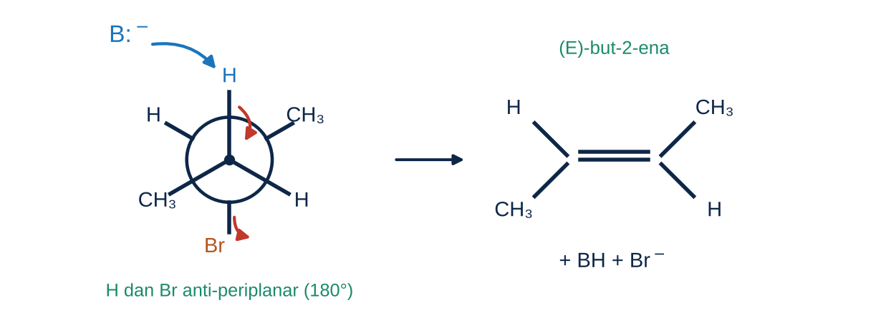
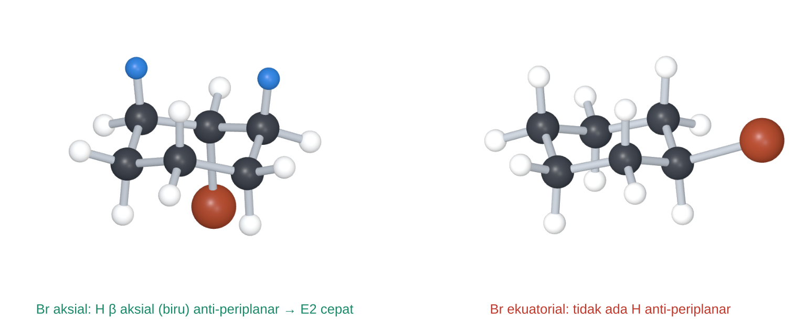
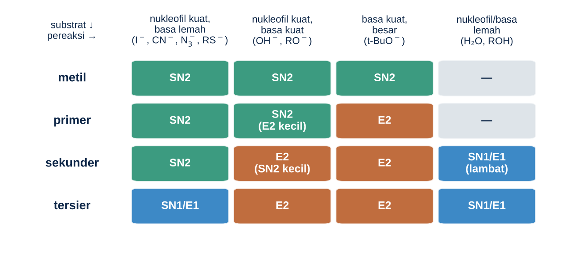

## 7.9 Eliminasi E2: kinetika, aturan Zaitsev, dan basa besar

Nukleofil yang bermuatan negatif hampir selalu juga basa. Ketika basa seperti ion etoksida mendekati alkil halida, ia mempunyai dua pilihan. Ia dapat menyerang karbon yang membawa halogen (substitusi), atau menarik proton dari karbon **tetangga** (karbon β). Bila proton β ditarik pada saat yang sama dengan lepasnya gugus pergi, elektron ikatan C–H berpindah membentuk ikatan π, dan terbentuk alkena. Reaksi ini disebut **eliminasi**, karena dua atom (H dan X) dikeluarkan dari dua karbon yang bersebelahan.

Penamaan karbon dalam eliminasi memakai huruf Yunani: karbon yang membawa gugus pergi disebut **karbon α**, dan karbon di sebelahnya disebut **karbon β**. Hidrogen yang dilepas berada di karbon β, sehingga reaksi ini juga disebut **eliminasi β**.

### Mekanisme E2

**E2** (eliminasi bimolekuler) berlangsung dalam satu langkah serempak, yang menggabungkan dua pola dari subbab 6.4: transfer proton dan lepasnya gugus pergi. Tiga hal terjadi bersamaan:

1. Basa menarik proton dari karbon β (panah dari pasangan bebas basa ke H).
2. Elektron ikatan C–H berpindah ke antara Cα dan Cβ, membentuk ikatan π (panah dari ikatan C–H ke ikatan C–C).
3. Ikatan C–X putus, dan halida lepas membawa pasangan elektronnya (panah dari ikatan C–X ke X).

Karena basa dan substrat terlibat dalam satu langkah, hukum lajunya orde dua, sama seperti SN2:

$$
\text{laju} = k[\text{R–X}][\text{basa}] \qquad \text{(7.4)}
$$

{width=90%}

### Aturan Zaitsev

Bila alkil halida mempunyai lebih dari satu jenis hidrogen β, eliminasi dapat menghasilkan lebih dari satu alkena. 2-Bromobutana, misalnya, mempunyai H β di C1 dan di C3. Melepas H dari C3 menghasilkan but-2-ena; melepas H dari C1 menghasilkan but-1-ena. Dengan natrium etoksida dalam etanol, hasilnya sekitar 81% but-2-ena (trans lebih banyak daripada cis) dan 19% but-1-ena.

Pola ini, yang dirumuskan oleh Alexander Zaitsev pada 1875, berlaku umum: **eliminasi cenderung menghasilkan alkena yang lebih tersubstitusi**, yaitu alkena dengan lebih banyak gugus alkil pada karbon ikatan rangkap. Alasannya, alkena yang lebih tersubstitusi lebih stabil (subbab 8.1), dan karena keadaan transisi E2 sudah mempunyai sebagian sifat ikatan rangkap, kestabilan alkena ikut menurunkan energi keadaan transisinya. Produk yang lebih tersubstitusi disebut **produk Zaitsev**.

### Basa besar: produk Hofmann

Bila basanya besar dan terhalang, seperti kalium *tert*-butoksida, hasilnya berbalik. 2-Bromo-2-metilbutana dengan kalium etoksida menghasilkan sekitar 70% 2-metilbut-2-ena (Zaitsev, trisubstitusi) dan 30% 2-metilbut-1-ena. Dengan kalium *tert*-butoksida, perbandingannya menjadi sekitar 28% dan 72%: alkena yang **kurang** tersubstitusi menjadi produk utama.

Mengapa? H β yang menghasilkan produk Zaitsev berada di karbon CH₂ di tengah molekul, terlindung oleh gugus-gugus di sekitarnya. H β yang menghasilkan alkena ujung berada di gugus CH₃, di tepi molekul, mudah dijangkau. Basa kecil dapat menjangkau keduanya dan memilih jalur yang menghasilkan alkena paling stabil. Basa besar tidak dapat menyelinap ke tengah molekul, sehingga mengambil H yang paling mudah dijangkau. Produk yang kurang tersubstitusi disebut **produk Hofmann**.

::: {.contoh}
**Contoh 7.10 · Zaitsev atau Hofmann**

Ramalkan alkena utama dari 2-bromo-2,3-dimetilbutana dengan (a) natrium metoksida dalam metanol; (b) kalium *tert*-butoksida dalam *tert*-butanol.

**Penyelesaian.** H β tersedia di dua tempat: di C3 (satu H, pada karbon tersier) dan di dua gugus CH₃ yang terikat pada C2 (enam H). Melepas H dari C3 memberi 2,3-dimetilbut-2-ena (tetrasubstitusi). Melepas H dari CH₃ pada C2 memberi 2,3-dimetilbut-1-ena (disubstitusi).

(a) Basa kecil: produk Zaitsev, **2,3-dimetilbut-2-ena**.

(b) Basa besar: H di C3 terlindung oleh empat gugus metil di sekitarnya; H pada CH₃ mudah dijangkau. Produk Hofmann, **2,3-dimetilbut-1-ena**.

**Memahami hasil.** Dengan memilih basa, kimiawan memilih letak ikatan rangkap. Ini contoh selektivitas yang dikendalikan sterik, bukan termodinamika.
:::

::: {.kuis}
**Kuis cepat 7.9** Tuliskan semua alkena yang dapat terbentuk dari 2-bromopentana lewat E2. Mana produk Zaitsev?
:::

## 7.10 Stereokimia E2: anti-periplanar

### Mengapa anti-periplanar

Pada keadaan transisi E2, orbital-orbital yang akan membentuk ikatan π baru, yaitu orbital ikatan C–H yang putus dan orbital σ* C–X yang menerima elektron, harus bertumpang tindih sebaik mungkin. Tumpang tindih terbaik terjadi bila **H dan gugus pergi berada dalam satu bidang**, dengan sudut torsi H–Cβ–Cα–X 180°. Susunan ini disebut **anti-periplanar** ("anti" = berlawanan, "periplanar" = sebidang). Dalam proyeksi Newman sepanjang ikatan Cα–Cβ, H dan X tampak berseberangan, seperti konformasi anti butana (subbab 4.3). Susunan syn-periplanar (sudut 0°) juga sebidang, tetapi tindih dan berenergi tinggi, sehingga jarang dipakai.

Syarat anti-periplanar mempunyai akibat yang dapat diramalkan: **geometri alkena yang terbentuk ditentukan oleh konformasi tempat eliminasi terjadi**. Gugus-gugus yang berada di sisi yang sama dalam proyeksi Newman anti-periplanar akan berada di sisi yang sama dari ikatan rangkap. Karena itu E2 bersifat **stereospesifik**: setiap stereoisomer bahan awal memberi stereoisomer alkena tertentu.

::: {.contoh}
**Contoh 7.11 · Stereospesifisitas E2**

(1R,2R)-1-Bromo-1,2-difenilpropana bereaksi dengan NaOEt lewat E2 dengan melepas satu-satunya H β di C2. Tentukan apakah produknya (E)- atau (Z)-1,2-difenilprop-1-ena.

**Rencana.** Gambar proyeksi Newman sepanjang C1–C2 dalam konformasi yang menempatkan H (di C2) anti terhadap Br (di C1). Gugus-gugus lain yang bersebelahan dalam gambar itu akan tetap bersebelahan dalam alkena.

**Penyelesaian.** Dengan H dan Br anti, sisa gugusnya: di C1 ada fenil dan H; di C2 ada fenil dan CH₃. Untuk isomer (1R,2R), penyusunan Newman yang konsisten dengan konfigurasi menempatkan kedua gugus fenil pada sisi yang sama (gauche), sehingga setelah eliminasi kedua fenil berada di sisi yang sama dari ikatan rangkap. Pada C1, fenil berprioritas lebih tinggi daripada H; pada C2, fenil lebih tinggi daripada CH₃. Kedua gugus prioritas tinggi di sisi yang sama: **(Z)**.

**Memahami hasil.** Diastereomer lain, (1R,2S), memberi alkena (E). Satu stereoisomer bahan awal memberi satu stereoisomer produk; inilah arti stereospesifik. Hubungan ini menjadi salah satu bukti terkuat bahwa E2 berlangsung dalam satu langkah dengan geometri anti.
:::

### E2 pada sikloheksana

Pada cincin sikloheksana, syarat anti-periplanar menjadi sangat tegas. Dua ikatan pada karbon yang bersebelahan hanya dapat anti-periplanar bila keduanya **aksial**: satu aksial ke atas, satu aksial ke bawah (subbab 4.7). Ikatan ekuatorial tidak pernah anti-periplanar dengan ikatan apa pun pada cincin. Jadi **gugus pergi harus aksial**, dan H β yang dilepas juga harus aksial.

Akibatnya, laju E2 sikloheksana bergantung pada seberapa mudah gugus pergi menempati posisi aksial. Contoh yang terkenal adalah dua isomer kloro turunan mentol. Pada **neomentil klorida**, klorin dapat aksial dalam kursi yang sekaligus menempatkan isopropil dan metil ekuatorial; ada dua H β aksial yang tersedia, dan eliminasi berjalan cepat menghasilkan sebagian besar alkena Zaitsev. Pada **mentil klorida**, klorin hanya dapat aksial dalam kursi yang memaksa isopropil dan metil aksial, bentuk yang jarang; selain itu hanya satu H β aksial yang tersedia. Eliminasi berjalan sekitar 200 kali lebih lambat dan hanya memberi alkena yang kurang tersubstitusi (produk anti-Zaitsev).

{width=90%}

::: {.contoh}
**Contoh 7.12 · Mengapa cis dan trans berbeda laju**

cis-1-Bromo-4-*tert*-butilsikloheksana bereaksi E2 dengan NaOEt jauh lebih cepat daripada isomer trans-nya. Jelaskan.

**Penyelesaian.** Gugus *tert*-butil mengunci kursi dengan dirinya ekuatorial (subbab 4.8). Pada isomer **cis** (1,4), satu gugus aksial dan satu ekuatorial; karena *tert*-butil ekuatorial, Br **aksial**. Br aksial anti-periplanar dengan H aksial pada C2 dan C6, sehingga E2 cepat. Pada isomer **trans** (1,4), kedua gugus ekuatorial atau keduanya aksial; karena *tert*-butil harus ekuatorial, Br juga **ekuatorial**. Br ekuatorial tidak anti-periplanar dengan H mana pun, dan cincin tidak dapat membalik karena terkunci. E2 sangat lambat.

**Memahami hasil.** Satu perbedaan konfigurasi (cis lawan trans) mengubah laju ratusan kali, hanya karena geometri. Contoh ini menunjukkan mengapa analisis konformasi di Bab 4 penting: tanpa gambar kursi, perbedaan laju ini tidak dapat dijelaskan.
:::

::: {.kuis}
**Kuis cepat 7.10** Mengapa gugus pergi ekuatorial pada sikloheksana tidak dapat mengalami E2? Apa yang harus terjadi lebih dulu?
:::

## 7.11 Eliminasi E1

Eliminasi juga dapat berjalan dalam dua langkah, lewat karbokation, seperti SN1. Mekanisme ini disebut **E1** (eliminasi unimolekuler):

1. **Lepasnya gugus pergi** (lambat, penentu laju): terbentuk karbokation. Langkah ini sama persis dengan langkah pertama SN1.
2. **Transfer proton** (cepat): basa lemah, biasanya pelarut (air, alkohol), menarik proton dari karbon β di sebelah karbokation. Elektron ikatan C–H membentuk ikatan π.

Hukum lajunya sama dengan SN1: laju = *k*[R–X]. Karena SN1 dan E1 berbagi langkah pertama yang sama, keduanya hampir selalu terjadi bersamaan. Karbokation yang terbentuk dapat ditangkap nukleofil (SN1) atau kehilangan proton (E1).

### Sifat-sifat E1

* **Substrat**: tersier, alilik, benzilik, seperti SN1.
* **Basa**: lemah, sering pelarut. Basa kuat mendorong reaksi ke arah E2.
* **Regiokimia**: produk Zaitsev, karena karbokation melepas proton yang menghasilkan alkena paling stabil (kendali termodinamik, subbab 6.13).
* **Stereokimia**: tidak memerlukan anti-periplanar, karena karbokation datar dan proton dapat lepas dari konformasi mana pun. Alkena E biasanya lebih banyak daripada Z.
* **Penataan ulang**: mungkin, seperti SN1.
* **Suhu**: suhu tinggi mendukung E1 dibandingkan SN1. Eliminasi menghasilkan lebih banyak molekul (alkena + H⁺ + X⁻ dari satu substrat dan satu basa) dan mempunyai ΔS° lebih positif, sehingga suku −*T*ΔS° makin menguntungkan pada suhu tinggi (subbab 6.6).

::: {.contoh}
**Contoh 7.13 · SN1 dan E1 bersaing**

2-Bromo-2-metilbutana dipanaskan dalam etanol pada 25 °C dan pada 80 °C. Ramalkan produk-produknya dan bagaimana perbandingannya berubah dengan suhu.

**Penyelesaian.** Substrat tersier dalam pelarut protik tanpa basa kuat: SN1 dan E1 bersaing lewat karbokation 2-metilbutan-2-il. *SN1:* etanol menyerang, menghasilkan 2-etoksi-2-metilbutana. *E1:* etanol menarik proton β, menghasilkan 2-metilbut-2-ena (Zaitsev, utama) dan 2-metilbut-1-ena (minor). Pada 25 °C, produk substitusi biasanya lebih banyak. Pada 80 °C, produk eliminasi bertambah, karena eliminasi diuntungkan entropi.

**Memahami hasil.** Untuk substrat tersier dengan nukleofil lemah, campuran SN1/E1 hampir tidak dapat dihindari. Bila kimiawan menginginkan alkena dari substrat tersier, pilihan yang lebih bersih adalah E2 dengan basa kuat; bila menginginkan substitusi, pilihan yang lebih bersih adalah suhu rendah.
:::

::: {.kuis}
**Kuis cepat 7.11** Apa persamaan dan perbedaan E1 dan E2 dalam hal hukum laju, basa, stereokimia, dan penataan ulang?
:::

## 7.12 Substitusi atau eliminasi: peta keputusan

Sekarang kita mempunyai empat mekanisme dan banyak faktor. Bagaimana meramalkan mana yang dominan untuk kombinasi substrat dan pereaksi tertentu? Cara yang paling praktis adalah menjawab dua pertanyaan secara berurutan: **(1) Seperti apa substratnya?** dan **(2) Seperti apa pereaksinya: nukleofil, basa, atau keduanya, kuat atau lemah?**

### Menggolongkan pereaksi

Pereaksi dibagi menjadi empat golongan menurut kemampuan nukleofilik dan kebasaannya:

| Golongan | Contoh | Perilaku utama |
|---|---|---|
| nukleofil kuat, basa lemah | I⁻, Br⁻, Cl⁻, HS⁻, RS⁻, CN⁻, N₃⁻, RCOO⁻ | substitusi |
| nukleofil kuat, basa kuat | OH⁻, CH₃O⁻, CH₃CH₂O⁻ | substitusi atau eliminasi |
| basa kuat, nukleofil lemah (besar) | (CH₃)₃CO⁻, LDA, DBU | eliminasi |
| nukleofil lemah, basa lemah | H₂O, CH₃OH, CH₃CH₂OH | SN1/E1 (hanya substrat 2°/3°) |

### Peta keputusan

{width=98%}

Pola-pola utamanya dapat diringkas sebagai berikut, dengan alasan masing-masing:

* **Metil**: hanya SN2. Tidak ada H β, sehingga eliminasi mustahil, dan karbokation metil terlalu tidak stabil untuk SN1.
* **Primer**: SN2 dengan hampir semua nukleofil. Hanya basa besar (*tert*-butoksida) yang memberi E2, karena tidak dapat menjangkau karbon α tetapi dapat menjangkau H β.
* **Sekunder**: daerah yang paling sulit. Nukleofil kuat yang basa lemah (I⁻, CN⁻, N₃⁻, RS⁻) memberi SN2. Basa kuat (OH⁻, RO⁻) memberi terutama E2. Nukleofil lemah dalam pelarut protik memberi campuran SN1 dan E1, sering lambat.
* **Tersier**: tidak pernah SN2. Basa kuat memberi E2. Nukleofil atau basa lemah memberi SN1 dan E1; suhu tinggi menambah E1.

::: {.strategi}
**Strategi: meramalkan SN1, SN2, E1, atau E2**

1. **Golongkan substrat**: metil, 1°, 2°, 3°; perhatikan alilik/benzilik (karbokation stabil) dan cabang di karbon β (sterik).
2. **Golongkan pereaksi**: lihat tabel di atas. Perhatikan ukurannya (besar = basa, bukan nukleofil).
3. **Baca peta keputusan** untuk mekanisme utama.
4. **Periksa pelarut dan suhu**: aprotik polar mendukung SN2; protik polar mendukung SN1/E1; suhu tinggi mendukung eliminasi.
5. **Tentukan produk dengan detailnya**: regiokimia (Zaitsev/Hofmann), stereokimia (inversi untuk SN2, rasemisasi untuk SN1, anti-periplanar untuk E2), dan kemungkinan penataan ulang (SN1/E1).
:::

::: {.contoh}
**Contoh 7.14 · Teka-teki pembuka**

Jelaskan dengan peta keputusan mengapa 1-bromobutana dan 2-bromo-2-metilpropana memberi hasil yang berbeda dengan NaOEt dalam etanol.

**Penyelesaian.** *1-Bromobutana:* primer, tidak bercabang di karbon β. Etoksida adalah nukleofil kuat dan basa kuat, tetapi tidak besar. Untuk substrat primer, SN2 jauh lebih cepat daripada E2. Produk utama: etil butil eter (1-etoksibutana).

*2-Bromo-2-metilpropana:* tersier. SN2 mustahil karena sisi belakang tertutup. Etoksida adalah basa kuat, sehingga E2 dominan atas SN1/E1. Produk utama: 2-metilpropena.

**Memahami hasil.** Teka-teki pembuka bab terjawab oleh dua faktor: halangan sterik pada karbon α (yang mematikan SN2 pada substrat tersier) dan kebasaan etoksida (yang mendorong E2 begitu SN2 tertutup).
:::

::: {.contoh}
**Contoh 7.15 · Empat kasus sekunder**

2-Bromopropana direaksikan dengan (a) NaI dalam aseton; (b) NaOEt dalam etanol, 55 °C; (c) etanol saja, 25 °C; (d) KOC(CH₃)₃ dalam *tert*-butanol. Ramalkan mekanisme dan produk utama.

**Penyelesaian.** (a) I⁻ nukleofil kuat, basa sangat lemah, pelarut aprotik: **SN2**, 2-iodopropana. (b) Basa kuat dengan substrat sekunder, suhu dinaikkan: **E2**, propena (sekitar 80%), dengan sedikit eter dari SN2. (c) Nukleofil lemah, pelarut protik, substrat sekunder: **SN1/E1** lambat, campuran 2-etoksipropana dan propena. (d) Basa besar: **E2**, propena.

**Memahami hasil.** Satu substrat, empat kondisi, empat hasil yang berbeda. Itulah kekuatan berpikir dengan mekanisme: hasilnya dapat diramalkan dan dikendalikan dengan memilih pereaksi dan kondisi.
:::

::: {.kuis}
**Kuis cepat 7.12** Ramalkan mekanisme utama: (a) 1-bromo-2-metilpropana + KOC(CH₃)₃; (b) 2-bromobutana + NaCN dalam DMSO; (c) 2-kloro-2-metilbutana dalam air hangat; (d) bromometana + NaOH.
:::
