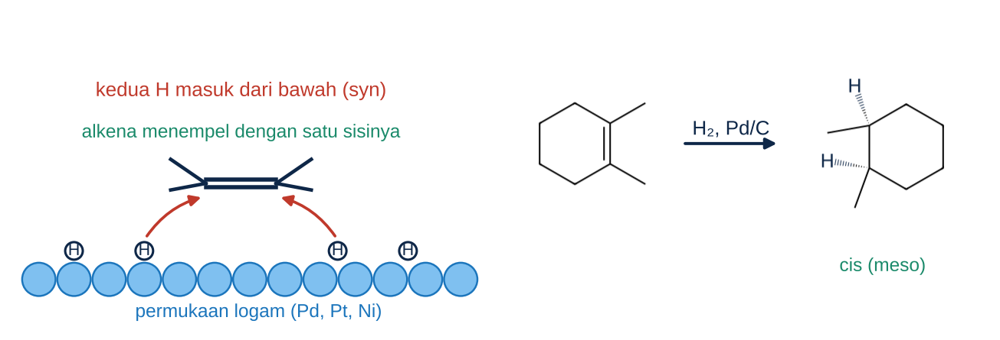

## 8.3 Adisi elektrofilik HX: aturan Markovnikov dan karbokation

### Mekanisme dua langkah

Bila gas hidrogen bromida dialirkan ke dalam 2-metilpropena, terbentuk 2-bromo-2-metilpropana. Atom H dan atom Br masuk ke kedua karbon ikatan rangkap, dan ikatan π hilang. Reaksi ini adalah contoh paling sederhana dari **adisi elektrofilik**, dan mekanismenya menjadi pola dasar bagi hampir semua reaksi di bab ini.

Mari kita susun mekanismenya dengan cara berpikir dari Bab 6: cari nukleofil, cari elektrofil, lalu gerakkan elektron dari nukleofil ke elektrofil. Nukleofilnya adalah elektron π alkena, yang kaya dan mudah dijangkau. Elektrofilnya adalah atom H pada HBr: ikatan H–Br sangat polar, dengan H bermuatan δ+, dan bromida adalah gugus pergi yang sangat baik (HBr asam kuat, pKa −9).

**Langkah 1 (lambat): protonasi alkena.** Pasangan elektron π menyerang atom H dari HBr, dan pasangan elektron ikatan H–Br berpindah seluruhnya ke bromin. Satu karbon ikatan rangkap mendapat ikatan C–H baru. Karbon yang lain kehilangan ikatan π-nya tanpa mendapat apa-apa sebagai ganti, sehingga kini hanya mempunyai tiga ikatan dan orbital p kosong: karbon itu menjadi **karbokation**. Langkah ini mengubah dua molekul netral menjadi dua ion, sehingga energinya tinggi dan lajunya lambat. Langkah inilah yang menentukan laju.

**Langkah 2 (cepat): serangan nukleofil.** Ion bromida, yang baru terbentuk dan berada di dekatnya, menyerang karbokation dan membentuk ikatan C–Br. Pertemuan ion bermuatan berlawanan ini hampir tanpa hambatan energi.

{width=96%}

Perhatikan bahwa langkah 1 adalah pola **serangan nukleofil pada proton** (transfer proton), dan langkah 2 adalah pola **serangan nukleofil pada karbokation** (subbab 6.4). Tidak ada yang baru: adisi elektrofilik hanyalah dua pola dasar yang dirangkai. Laju adisi naik dengan kekuatan asam HX, **HI > HBr > HCl ≫ HF**, karena langkah lambatnya adalah pemberian proton. HF terlalu lemah sebagai asam untuk beradisi dengan mudah.

### Aturan Markovnikov dan alasannya

Pada 2-metilpropena, proton dapat masuk ke salah satu dari dua karbon ikatan rangkap, dan kedua pilihan memberi produk yang berbeda:

- Bila H masuk ke CH₂ (karbon ujung), muatan positif berada di karbon tengah, yang terikat pada tiga gugus karbon: **karbokation tersier**. Produk akhirnya 2-bromo-2-metilpropana.
- Bila H masuk ke karbon tengah, muatan positif berada di karbon ujung: **karbokation primer**. Produk akhirnya 1-bromo-2-metilpropana.

Kenyataannya hanya produk pertama yang terbentuk. Reaksi yang dapat memberi dua isomer struktur tetapi hanya memberi satu (atau terutama satu) disebut **regioselektif**. Pada tahun 1869 Vladimir Markovnikov merumuskan pengamatan ini sebagai aturan empiris: *dalam adisi HX pada alkena, hidrogen masuk ke karbon yang sudah membawa lebih banyak hidrogen, dan X masuk ke karbon yang membawa lebih sedikit hidrogen.*

Aturan itu mudah dihafal ("yang kaya makin kaya"), tetapi lebih berguna bila kita memahami alasannya. Langkah 1 menentukan laju dan juga menentukan regiokimia, karena setelah karbokation terbentuk, letak X sudah pasti. Menurut postulat Hammond (subbab 6.9), keadaan transisi langkah endoterm ini mirip dengan karbokation yang akan terbentuk. Jadi apa pun yang menstabilkan karbokation juga menurunkan keadaan transisi menuju karbokation itu. Karbokation tersier jauh lebih stabil daripada karbokation primer (hiperkonjugasi dan efek induksi gugus alkil, subbab 6.10), sehingga keadaan transisi menuju karbokation tersier jauh lebih rendah, dan jalur itu jauh lebih cepat.

{width=80%}

::: {.inti}
**Aturan Markovnikov dalam bahasa mekanisme**

Dalam adisi elektrofilik, elektrofil (H⁺ atau yang lain) masuk ke karbon ikatan rangkap sedemikian rupa sehingga terbentuk **karbokation yang lebih stabil**. Nukleofil kemudian masuk ke karbon yang membawa muatan positif itu, yaitu karbon yang lebih tersubstitusi.
:::

Rumusan modern ini lebih luas daripada rumusan asli Markovnikov, karena berlaku untuk elektrofil apa pun, bukan hanya H⁺, dan juga menjelaskan kasus di mana karbokation distabilkan oleh hal lain selain gugus alkil, misalnya oleh resonansi dengan cincin benzena.

::: {.contoh}
**Contoh 8.4 · Meramalkan produk adisi HX**

Tulis produk utama: (a) 1-metilsikloheksena + HBr; (b) pent-2-ena + HCl; (c) stirena (fenil­etena, C₆H₅CH=CH₂) + HI.

**Rencana.** Untuk setiap alkena, tentukan karbokation mana yang lebih stabil bila proton masuk ke salah satu karbon ikatan rangkap. Halida masuk ke karbon bermuatan positif.

**Penyelesaian.** (a) Proton masuk ke CH cincin, membentuk karbokation tersier di karbon yang membawa metil. Produk: **1-bromo-1-metilsikloheksana**. (b) Kedua karbon ikatan rangkap sama-sama membawa satu gugus alkil (metil di satu sisi, etil di sisi lain), sehingga kedua karbokation sama-sama sekunder dan hampir sama stabil. Produknya **campuran 2-kloropentana dan 3-kloropentana** dengan perbandingan mendekati 1 : 1. (c) Proton masuk ke CH₂ ujung, sehingga muatan positif berada di karbon yang terikat pada cincin benzena: **karbokation benzilik**, yang distabilkan resonansi dengan cincin. Produk: **(1-iodoetil)benzena**, C₆H₅CHICH₃.

**Memahami hasil.** Regioselektivitas hanya muncul bila kedua karbokation yang mungkin berbeda kestabilannya. Bila keduanya setara, seperti pada (b), reaksi tidak berguna untuk membuat satu produk murni. Pada (c), resonansi dengan cincin benzena memberi alasan Markovnikov yang tidak berkaitan dengan "banyaknya hidrogen".
:::

### Stereokimia adisi HX

Karbokation yang terbentuk pada langkah 1 datar (sp²), dan ion halida dapat menyerangnya dari atas atau dari bawah dengan peluang yang sama. Akibatnya, bila adisi menciptakan pusat kiral baru dari bahan yang akiral, produknya selalu **rasemat**. Contohnya, but-1-ena + HBr menghasilkan 2-bromobutana sebagai campuran 50 : 50 (*R*) dan (*S*). Ini berlaku umum: **pereaksi akiral dan bahan akiral tidak pernah menghasilkan produk yang aktif optik** (subbab 5.5). Kiralitas hanya dapat masuk dari sesuatu yang sudah kiral, seperti katalis kiral atau enzim.

::: {.kuis}
**Kuis cepat 8.3** (a) Tulis produk utama 2-metilbut-2-ena + HBr dan jelaskan dengan karbokation. (b) Mengapa adisi HBr pada pent-1-ena menghasilkan campuran rasemat?
:::

## 8.4 Penataan ulang dalam adisi

Karena adisi HX melewati karbokation, semua yang kita ketahui tentang karbokation berlaku di sini, termasuk kemampuannya untuk **menata ulang** (subbab 6.10). Bila karbokation yang mula-mula terbentuk bersebelahan dengan karbon yang dapat memberi karbokation lebih stabil, hidrogen atau gugus metil dapat bergeser bersama pasangan elektronnya ke karbon bermuatan positif. Geseran semacam ini berlangsung sangat cepat, sering lebih cepat daripada serangan halida, sehingga produk yang tertata ulang dapat menjadi produk utama.

Contoh klasiknya adalah adisi HCl pada 3-metilbut-1-ena. Proton masuk ke CH₂ ujung sesuai aturan Markovnikov, dan terbentuk karbokation sekunder di C2. Tetapi C3 di sebelahnya tersier dan membawa satu hidrogen. Hidrogen itu bergeser bersama pasangan elektronnya ke C2 (**geseran hidrida**, geseran 1,2-H), dan muatan positif pindah ke C3 yang kini tersier. Klorida dapat menyerang karbokation sekunder sebelum penataan ulang, atau karbokation tersier sesudahnya:

- 2-kloro-3-metilbutana (dari karbokation sekunder): sekitar setengahnya;
- 2-kloro-2-metilbutana (dari karbokation tersier, setelah geseran hidrida): sekitar setengahnya.

Perbandingan pastinya bergantung pada kondisi, tetapi intinya jelas: produk yang tertata ulang terbentuk dalam jumlah besar.

::: {.contoh}
**Contoh 8.5 · Geseran metil dalam adisi**

3,3-Dimetilbut-1-ena bereaksi dengan HBr. Ramalkan produknya dan tulis mekanismenya.

**Penyelesaian.** Proton masuk ke CH₂ ujung, membentuk karbokation sekunder di C2. Karbon tetangganya, C3, adalah karbon kuarterner yang membawa tiga gugus metil dan tidak mempunyai hidrogen. Satu gugus metil dari C3 bergeser bersama pasangan elektronnya ke C2 (**geseran metil**). Sekarang C2 membawa dua metil dan satu H, dan muatan positif berada di C3, yang terikat pada C2 dan dua gugus metil yang tersisa: karbokation tersier. Bromida menyerang karbokation tersier ini. Produk utama: **2-bromo-2,3-dimetilbutana**. Produk tanpa penataan ulang, 3-bromo-2,2-dimetilbutana, terbentuk dalam jumlah lebih kecil.

**Memahami hasil.** Kerangka karbon berubah: bahan awal mempunyai satu karbon kuarterner (C(CH₃)₃), produk utama mempunyai dua karbon yang masing-masing membawa dua gugus metil. Bila kerangka karbon produk tidak cocok dengan kerangka bahan awal, curigai penataan ulang karbokation. Inilah juga alasan kita memerlukan cara adisi lain yang tidak lewat karbokation bebas, seperti oksimerkurasi dan hidroborasi di subbab berikutnya.
:::

::: {.awas}
**Kapan penataan ulang perlu dicurigai?**

Periksa setiap karbokation yang kamu tulis: apakah karbon tetangganya **lebih tersubstitusi**? Bila ya, dan karbon tetangga itu membawa H atau gugus alkil yang dapat bergeser, penataan ulang mungkin terjadi. Penataan ulang hanya terjadi bila hasilnya **lebih stabil** (sekunder → tersier, atau menjadi benzilik), dan hanya geseran ke karbon yang **langsung bersebelahan** (geseran 1,2). Karbokation primer bebas hampir tidak pernah terbentuk.
:::

::: {.kuis}
**Kuis cepat 8.4** Ramalkan produk utama vinilsikloheksana (CH₂=CH–C₆H₁₁) + HBr. Petunjuk: perhatikan karbon cincin yang terikat pada rantai.
:::

## 8.5 Hidrasi: katalis asam dan oksimerkurasi–demerkurasi

Menambahkan air pada alkena menghasilkan alkohol, salah satu gugus fungsi yang paling berguna. Ada tiga cara untuk melakukannya. Dua dibahas di subbab ini, dan cara ketiga, hidroborasi–oksidasi, di subbab berikutnya. Ketiganya berbeda dalam dua hal yang sangat penting: **regiokimia** (ke karbon mana –OH masuk) dan **ada tidaknya penataan ulang**.

### Hidrasi katalis asam

Air sendiri tidak bereaksi dengan alkena, karena air bukan asam yang cukup kuat untuk memprotonasi ikatan π. Dengan asam kuat dalam air (biasanya H₂SO₄ encer), reaksinya berjalan. Mekanismenya adalah kebalikan langkah demi langkah dari dehidrasi E1 (subbab 8.2):

1. Alkena menyerang H₃O⁺, membentuk karbokation (lambat).
2. Air, sebagai nukleofil, menyerang karbokation, membentuk alkohol terprotonasi (ion oksonium).
3. Air lain mengambil proton dari oksigen, menghasilkan alkohol dan mengembalikan H₃O⁺.

Asam muncul lagi di akhir, jadi asam hanya **katalis**. Karena lewat karbokation, hidrasi ini mengikuti aturan Markovnikov (–OH di karbon yang lebih tersubstitusi) dan dapat mengalami penataan ulang. Industri memakai reaksi ini dalam skala besar: etanol dibuat dari etena dan uap air di atas katalis asam fosfat pada sekitar 300 °C dan tekanan tinggi. Pada suhu setinggi itu kesetimbangan sebenarnya tidak menguntungkan hidrasi (ΔG° > 0 di atas 89 °C, subbab 8.2), sehingga hanya sebagian kecil etena yang bereaksi setiap kali lewat. Tekanan tinggi menolong (dua molekul gas menjadi satu), dan etena yang tidak bereaksi dialirkan kembali berulang-ulang.

Prinsip **reversibilitas mikroskopik** mengatakan bahwa reaksi maju dan reaksi balik melewati jalur yang sama, hanya dengan arah terbalik. Karena itu, bila kamu sudah memahami dehidrasi E1, kamu juga sudah memahami hidrasi katalis asam. Yang membedakan keduanya hanya kondisi: banyak air dan suhu rendah untuk hidrasi, sedikit air dan suhu tinggi untuk dehidrasi.

### Oksimerkurasi–demerkurasi

Hidrasi katalis asam mempunyai dua kelemahan di laboratorium: penataan ulang dan kondisi asam yang dapat merusak gugus lain. **Oksimerkurasi–demerkurasi** mengatasi keduanya. Reaksinya dua tahap:

1. **Oksimerkurasi**: alkena + merkuri(II) asetat, Hg(OAc)₂, dalam campuran air dan THF. Terbentuk alkohol yang membawa gugus –HgOAc.
2. **Demerkurasi**: natrium borohidrida, NaBH₄, mengganti –HgOAc dengan H.

Hasil bersihnya adalah penambahan H dan OH dengan **regiokimia Markovnikov, tanpa penataan ulang**.

Mengapa tanpa penataan ulang? Kuncinya ada pada elektrofilnya. Ion ⁺HgOAc adalah elektrofil yang besar dengan orbital terisi yang dapat "memberi kembali" elektron. Ketika ikatan π menyerang merkuri, merkuri terikat pada **kedua** karbon sekaligus, membentuk cincin beranggota tiga yang disebut **ion merkurinium**. Muatan positifnya tersebar di cincin, dan tidak ada karbokation bebas yang dapat menata ulang. Namun ikatan Hg–C pada karbon yang lebih tersubstitusi lebih panjang dan lebih lemah, sehingga karbon itu memikul bagian muatan positif yang lebih besar. Air menyerang karbon itu, dari sisi yang berlawanan dengan merkuri (seperti SN2 dari belakang), dan cincinnya terbuka. Hasilnya: –OH di karbon yang lebih tersubstitusi (Markovnikov) dan –HgOAc di karbon yang kurang tersubstitusi, dengan susunan anti. Tahap demerkurasi dengan NaBH₄ berjalan lewat radikal dan tidak mempertahankan stereokimia, sehingga stereokimia keseluruhan tidak dapat diandalkan; yang penting dari reaksi ini adalah regiokimianya.

::: {.contoh}
**Contoh 8.6 · Asam lawan oksimerkurasi**

3,3-Dimetilbut-1-ena dihidrasi dengan dua cara: (a) H₂SO₄ encer; (b) Hg(OAc)₂, H₂O/THF, lalu NaBH₄. Tulis produk utama masing-masing.

**Penyelesaian.** (a) Seperti pada Contoh 8.5, proton masuk ke CH₂, karbokation sekunder di C2 mengalami geseran metil menjadi karbokation tersier di C3, dan air menyerang karbokation tersier itu. Produk: **2,3-dimetilbutan-2-ol**, dengan kerangka karbon yang sudah berubah. (b) Ion merkurinium terbentuk tanpa karbokation bebas, air menyerang C2 (karbon yang lebih tersubstitusi di antara kedua karbon ikatan rangkap), dan NaBH₄ mengganti merkuri dengan H. Produk: **3,3-dimetilbutan-2-ol**, dengan kerangka karbon yang utuh.

**Memahami hasil.** Kedua cara sama-sama "Markovnikov", tetapi hanya oksimerkurasi yang memberi alkohol yang kerangkanya sama dengan alkena awal. Dalam sintesis, keandalan seperti ini sangat berharga. Kekurangannya, senyawa merkuri sangat beracun, sehingga di laboratorium modern reaksi ini dipakai hanya bila cara lain tidak berhasil, dan limbahnya harus ditangani dengan sangat hati-hati.
:::

Bila oksimerkurasi dilakukan dalam alkohol sebagai pengganti air, alkohol itulah yang menyerang ion merkurinium, dan produknya eter. Reaksi ini, **alkoksimerkurasi**, dibahas lagi di Bab 9 sebagai cara membuat eter.

::: {.kuis}
**Kuis cepat 8.5** Tulis produk 1-metilsikloheksena dengan (a) H₂O, H₂SO₄; (b) Hg(OAc)₂, H₂O/THF, lalu NaBH₄. Apakah keduanya berbeda? Mengapa?
:::

## 8.6 Hidroborasi–oksidasi: anti-Markovnikov dan adisi syn

Kedua cara hidrasi di atas menaruh –OH di karbon yang lebih tersubstitusi. Bagaimana bila kita menginginkan –OH di karbon ujung, misalnya membuat butan-1-ol dari but-1-ena? Herbert C. Brown menemukan jawabannya pada tahun 1950-an, dan penemuannya mendapat Hadiah Nobel Kimia 1979: **hidroborasi–oksidasi**.

### Tahap 1: hidroborasi

Boran, BH₃, adalah molekul dengan atom boron yang hanya dikelilingi enam elektron dan mempunyai orbital p kosong. Boron karena itu adalah **elektrofil** (asam Lewis). BH₃ murni berbentuk dimer, B₂H₆ (diboran), gas beracun yang menyala sendiri di udara. Di laboratorium dipakai kompleks BH₃·THF, larutan yang lebih aman, di mana pasangan bebas oksigen THF mengisi orbital kosong boron untuk sementara.

Alkena bereaksi dengan BH₃ dalam **satu langkah serempak**. Elektron π menyerang orbital kosong boron, dan pada saat yang sama satu atom H berpindah dari boron ke karbon yang lain, membawa pasangan elektron ikatan B–H. Keadaan transisinya berupa cincin beranggota empat: C–C–B–H. Karena boron dan hidrogen masuk bersamaan dari satu molekul BH₃ yang mendekat dari satu sisi bidang alkena, keduanya terpasang **di sisi yang sama**: adisi **syn**.

Ke karbon mana boron masuk? **Boron masuk ke karbon yang kurang tersubstitusi, dan hidrogen ke karbon yang lebih tersubstitusi.** Ada dua alasan, dan keduanya bekerja ke arah yang sama:

- **Sterik.** Boron membawa dua atom H lain (dan nantinya gugus alkil), sehingga lebih besar daripada hidrogen yang dipindahkan. Boron lebih mudah mendekati karbon ujung yang tidak terhalang.
- **Elektronik.** Dalam keadaan transisi, ikatan C–B terbentuk sedikit lebih dulu daripada ikatan C–H, sehingga karbon yang lain memikul sebagian muatan positif (δ+). Muatan parsial itu lebih stabil di karbon yang lebih tersubstitusi, persis seperti karbokation. Jadi karbon yang lebih tersubstitusi menjadi karbon yang menerima H.

Satu molekul BH₃ mempunyai tiga ikatan B–H, sehingga dapat beradisi pada tiga molekul alkena dan menghasilkan trialkilboran, R₃B. Karena tidak ada karbokation bebas, **tidak ada penataan ulang**.

### Tahap 2: oksidasi

Trialkilboran kemudian direaksikan dengan hidrogen peroksida dalam basa (H₂O₂, NaOH). Ion hidroperoksida, HOO⁻, menyerang boron yang elektrofilik, lalu satu gugus alkil berpindah dari boron ke oksigen sambil melepas ion hidroksida. Gugus alkil berpindah bersama pasangan elektronnya dan **tanpa melepaskan ikatannya ke karbon** sepenuhnya, sehingga karbon itu mempertahankan konfigurasinya: oksigen menempati persis posisi boron sebelumnya (**retensi**). Setelah ketiga gugus alkil berpindah, hidrolisis membebaskan tiga molekul alkohol.

::: {.inti}
**Hidroborasi–oksidasi**

- Hasil bersih: penambahan H dan OH pada ikatan rangkap.
- Regiokimia **anti-Markovnikov**: –OH di karbon yang **kurang** tersubstitusi.
- Stereokimia **syn**: H dan OH masuk dari sisi yang sama.
- **Tanpa penataan ulang.**
:::

{width=96%}

::: {.contoh}
**Contoh 8.7 · Stereokimia hidroborasi**

Tulis produk 1-metilsiklopentena dengan (1) BH₃·THF; (2) H₂O₂, NaOH, lengkap dengan stereokimia dan konfigurasi R/S.

**Rencana.** Tiga pertanyaan: apa yang masuk (H dan OH), di karbon mana (OH di karbon yang kurang tersubstitusi), dan dari sisi mana (syn).

**Penyelesaian.** Boron, lalu –OH, masuk ke C2 cincin (CH), dan H masuk ke C1 (karbon yang membawa metil). Karena H dan OH masuk dari sisi yang sama, misalnya keduanya dari atas, gugus metil di C1 terdorong ke sisi bawah, berlawanan dengan –OH. Produknya **trans-2-metilsiklopentan-1-ol**. Penomoran baru dimulai dari karbon yang membawa –OH (C1), sehingga metil berada di C2. BH₃ dapat mendekat dari atas maupun dari bawah dengan peluang sama, sehingga produknya campuran rasemat **(1*R*,2*R*) dan (1*S*,2*S*)**.

**Memahami hasil.** Pernyataan "adisi syn" berlaku untuk H dan OH yang **baru masuk**, bukan untuk gugus-gugus lain di produk. Gugus metil yang sudah ada sebelumnya berakhir di sisi yang berlawanan dengan –OH. Inilah kesalahan yang paling sering terjadi: menganggap "syn" berarti "semua gugus cis".
:::

::: {.contoh}
**Contoh 8.8 · Tiga cara, tiga alkohol**

Kamu mempunyai 2-metilbut-2-ena. Tunjukkan bagaimana membuat (a) 2-metilbutan-2-ol dan (b) 3-metilbutan-2-ol.

**Penyelesaian.** Ikatan rangkap berada di antara C2 (membawa dua gugus karbon: C1 dan metil) dan C3 (membawa satu gugus karbon dan satu H). (a) –OH di C2, karbon yang lebih tersubstitusi: **hidrasi Markovnikov**. Karena karbokation yang terbentuk sudah tersier dan tidak dapat menata ulang ke yang lebih stabil, hidrasi katalis asam (H₂O, H₂SO₄) atau oksimerkurasi–demerkurasi sama-sama berhasil. (b) –OH di C3, karbon yang kurang tersubstitusi: **hidroborasi–oksidasi** (BH₃·THF, lalu H₂O₂, NaOH).

**Memahami hasil.** Dari satu alkena, kita dapat memilih letak –OH dengan memilih pereaksi. Pilihan pereaksi bukan soal hafalan, tetapi soal mekanisme: lewat karbokation (atau ion yang menyerupai karbokation) berarti Markovnikov, lewat keadaan transisi empat pusat dengan boron berarti anti-Markovnikov.
:::

::: {.kuis}
**Kuis cepat 8.6** Tulis produk hidroborasi–oksidasi (a) but-1-ena; (b) metilenasikloheksana (C₆H₁₀=CH₂). Mengapa boron tidak masuk ke karbon yang lebih tersubstitusi?
:::

## 8.7 Adisi halogen dan halohidrin: ion halonium dan adisi anti

### Uji bromin dan pengamatan stereokimia

Bila beberapa tetes larutan bromin yang berwarna merah cokelat ditambahkan pada sikloheksena, warnanya langsung hilang. Bromin beradisi pada ikatan rangkap, membentuk 1,2-dibromosikloheksana yang tidak berwarna. Pada sikloheksana, warna bromin bertahan, karena tidak ada ikatan rangkap. Reaksi sederhana ini sudah lama dipakai sebagai **uji ketidakjenuhan**. Klorin bereaksi dengan cara yang sama. Iodin biasanya tidak beradisi, karena kesetimbangannya tidak menguntungkan, dan fluorin bereaksi terlalu hebat sehingga tidak terkendali.

Hal yang paling menarik dari reaksi ini terungkap ketika produknya diperiksa. Sikloheksena dan Br₂ menghasilkan **hanya *trans*-1,2-dibromosikloheksana**; isomer *cis* tidak terbentuk. Kedua atom bromin masuk dari sisi yang berlawanan: adisi **anti**. Mekanisme lewat karbokation bebas tidak dapat menjelaskan hal ini, karena karbokation yang datar dapat diserang dari kedua sisi dan seharusnya memberi campuran *cis* dan *trans*.

### Ion bromonium

Penjelasannya adalah **ion bromonium**, cincin beranggota tiga yang memuat atom bromin bermuatan positif. Mekanismenya:

1. Saat Br₂ mendekati ikatan π, awan elektron π menolak elektron ikatan Br–Br sehingga ikatan itu terpolarisasi: bromin yang dekat menjadi δ+. Elektron π menyerang bromin itu, dan ikatan Br–Br putus, melepas Br⁻. Bersamaan dengan itu, salah satu pasangan bebas bromin yang baru masuk membentuk ikatan dengan karbon yang lain. Bromin terikat pada **kedua karbon sekaligus**, membentuk ion bromonium. Setiap atom dalam ion ini mempunyai oktet lengkap, sehingga ion bromonium lebih stabil daripada karbokation terbuka.
2. Ion Br⁻ menyerang salah satu karbon cincin. Sisi atas karbon itu tertutup oleh atom bromin jembatan, sehingga Br⁻ hanya dapat menyerang **dari sisi yang berlawanan**, seperti pada SN2 (subbab 7.5). Ikatan C–Br⁺ putus, cincin terbuka, dan kedua bromin berakhir di sisi yang berlawanan.

{width=96%}

Ion bromonium bukan sekadar gagasan. George Olah berhasil mengamati ion bromonium yang stabil dalam pelarut "super asam" dengan spektroskopi NMR pada tahun 1960-an, salah satu karya yang membawanya ke Hadiah Nobel Kimia 1994.

### Stereospesifisitas: cis dan trans memberi produk yang berbeda

Karena adisi bromin selalu anti, bahan awal yang berbeda konfigurasinya memberi produk yang berbeda konfigurasinya. Reaksi seperti ini disebut **stereospesifik**: setiap stereoisomer bahan awal memberi stereoisomer produk tertentu. Contoh yang paling jelas adalah but-2-ena:

- *trans*-But-2-ena + Br₂ → **meso**-2,3-dibromobutana, yaitu (2*R*,3*S*), yang akiral.
- *cis*-But-2-ena + Br₂ → campuran rasemat **(2*R*,3*R*) dan (2*S*,3*S*)**-2,3-dibromobutana.

::: {.contoh}
**Contoh 8.9 · Mengapa trans memberi meso**

Tunjukkan dengan gambaran ruang mengapa adisi anti Br₂ pada *trans*-but-2-ena menghasilkan senyawa meso.

**Rencana.** Bayangkan alkena terletak datar di bidang kertas. Satu Br masuk dari depan (baji), yang lain dari belakang (garis putus), lalu periksa apakah produk mempunyai bidang simetri.

**Penyelesaian.** Pada *trans*-but-2-ena, kedua gugus metil berada di sisi berlawanan ikatan rangkap, dan kedua H juga. Bila Br pertama masuk ke C2 dari depan dan Br kedua masuk ke C3 dari belakang, lalu kita putar ikatan C2–C3 sehingga molekul berada dalam konformasi eklips, terlihat bahwa Br di C2 berhadapan dengan Br di C3, CH₃ dengan CH₃, dan H dengan H. Ada bidang cermin di tengah ikatan C2–C3. Molekul dengan dua pusat kiral dan bidang simetri dalam adalah senyawa **meso** (subbab 5.7): konfigurasinya (2*R*,3*S*). Bila Br pertama masuk dari belakang dan yang kedua dari depan, hasilnya senyawa yang sama. Jadi hanya satu produk yang terbentuk.

**Memahami hasil.** Pada *cis*-but-2-ena, cara yang sama memberi molekul tanpa bidang simetri, dan dua cara serangan memberi sepasang enansiomer. Aturan praktis yang mudah diingat untuk alkena simetris: **anti + trans → meso, anti + cis → rasemat; syn + cis → meso, syn + trans → rasemat.** Aturan ini juga berlaku untuk dihidroksilasi di subbab 8.9.
:::

### Halohidrin: air ikut bersaing

Bila bromin ditambahkan pada alkena dalam **air** sebagai pelarut, ion bromonium tetap terbentuk, tetapi kini ada dua nukleofil yang bersaing untuk membukanya: Br⁻ dan H₂O. Air jumlahnya jauh lebih banyak (sekitar 55 mol L⁻¹), sehingga air yang menang. Setelah air menyerang dan melepas proton, terbentuk **halohidrin**: senyawa yang membawa halogen dan –OH pada karbon bertetangga, dengan susunan anti. Dengan Br₂ disebut bromohidrin, dengan Cl₂ klorohidrin. Sebagai sumber bromin yang lebih mudah ditangani, sering dipakai NBS dalam campuran DMSO dan air.

Pada alkena tak simetris muncul pertanyaan regiokimia: air menyerang karbon yang mana? Ikatan C–Br⁺ pada ion bromonium tidak sama panjang. Ikatan ke karbon yang lebih tersubstitusi lebih panjang dan lebih lemah, sehingga karbon itu memikul bagian muatan positif yang lebih besar, mirip karbokation tersier. Nukleofil menyerang karbon itu. Jadi **–OH masuk ke karbon yang lebih tersubstitusi, Br ke karbon yang kurang tersubstitusi**. Polanya sama dengan Markovnikov, karena Br⁺ berperan sebagai elektrofil dan –OH sebagai nukleofil, sama seperti H⁺ dan X⁻ pada adisi HX.

::: {.contoh}
**Contoh 8.10 · Bromohidrin dari alkena tak simetris**

Tulis produk 1-metilsikloheksena dengan Br₂ dalam air, lengkap dengan stereokimia.

**Penyelesaian.** Ion bromonium terbentuk dari salah satu sisi cincin. Karbon yang membawa metil (C1) lebih tersubstitusi, sehingga air menyerang C1 dari sisi yang berlawanan dengan bromin. Setelah deprotonasi, produknya **2-bromo-1-metilsikloheksan-1-ol**, dengan –OH dan Br pada sisi berlawanan (*trans*). Kedua sisi cincin sama mungkin diserang mula-mula, sehingga produknya rasemat: (1*R*,2*R*) dan (1*S*,2*S*).

**Memahami hasil.** Dua pertanyaan dijawab oleh dua bagian mekanisme yang berbeda. Regiokimia (–OH di C1) ditentukan oleh karbon mana yang lebih mampu memikul muatan positif. Stereokimia (anti) ditentukan oleh serangan dari belakang pada cincin bromonium.
:::

::: {.kuis}
**Kuis cepat 8.7** (a) Tulis produk siklopentena + Cl₂ dengan stereokimianya. (b) Tulis produk propena + Br₂ dalam air. (c) Apa produk *cis*-but-2-ena + Br₂: meso atau rasemat?
:::

## 8.8 Hidrogenasi katalitik

### Reaksi yang eksoterm tetapi memerlukan katalis

Hidrogenasi alkena melepaskan lebih dari 100 kJ mol⁻¹ (subbab 8.1), tetapi campuran alkena dan gas hidrogen dapat disimpan bertahun-tahun tanpa bereaksi. Energi aktivasi reaksi tanpa katalis sangat tinggi, karena ikatan H–H (436 kJ mol⁻¹) harus dipecah dulu, dan tidak ada jalur sederhana untuk itu. Logam transisi yang terbagi halus menyediakan jalur lain. Katalis yang umum adalah **paladium pada karbon** (Pd/C, logam paladium yang tersebar di atas serbuk arang), **platina** (sering sebagai PtO₂, katalis Adams, yang tereduksi menjadi Pt di tempat), dan **nikel Raney** (nikel berpori, murah, dipakai di industri). Reaksinya biasanya dijalankan pada suhu kamar dengan gas H₂ bertekanan rendah, dalam etanol atau etil asetat.

### Mekanisme di permukaan logam dan adisi syn

Mekanisme rincinya rumit dan belum sepenuhnya dipahami, tetapi gambaran pokoknya cukup untuk meramalkan stereokimia:

1. Molekul H₂ teradsorpsi pada permukaan logam, dan ikatan H–H putus. Atom-atom H terikat pada atom logam di permukaan.
2. Alkena teradsorpsi pada permukaan **dengan satu sisinya**, lewat interaksi antara elektron π dan orbital logam.
3. Dua atom H berpindah satu per satu dari permukaan ke kedua karbon ikatan rangkap, **dari sisi yang menempel pada logam**.
4. Alkana yang terbentuk tidak lagi terikat kuat dan lepas dari permukaan.

Karena kedua atom H datang dari permukaan yang sama, keduanya masuk ke sisi yang sama: hidrogenasi adalah **adisi syn**. Contohnya, 1,2-dimetilsikloheksena menghasilkan *cis*-1,2-dimetilsikloheksana. Alkena juga cenderung menempel pada permukaan logam dengan **sisi yang kurang terhalang**, sehingga pada molekul yang kedua sisinya berbeda, hidrogen masuk dari sisi yang lebih terbuka.

{width=92%}

### Selektivitas: apa yang tereduksi dan apa yang tidak

Dalam kondisi biasa, H₂ dengan Pd/C mereduksi ikatan C=C dengan cepat, tetapi **tidak** mereduksi gugus karbonil keton, aldehida, ester, asam karboksilat, nitril, atau cincin benzena. Cincin benzena sangat stabil (Bab 10) dan memerlukan tekanan tinggi serta katalis yang lebih aktif (rodium atau Pt dengan tekanan ratusan atmosfer) untuk dihidrogenasi. Selektivitas ini berguna: sikloheks-2-en-1-on, misalnya, dapat diubah menjadi sikloheksanon tanpa menyentuh gugus karbonilnya.

::: {.terapan}
**Margarin dan lemak trans**

Minyak nabati cair seperti minyak kedelai mengandung asam lemak dengan beberapa ikatan rangkap *cis*. Ikatan rangkap *cis* membengkokkan rantai sehingga molekul sulit tersusun rapat, dan minyak tetap cair. Bila sebagian ikatan rangkap itu dihidrogenasi, rantai menjadi lebih lurus, molekul tersusun lebih rapat, dan minyak menjadi padat seperti mentega. Inilah dasar pembuatan margarin.

Masalahnya, hidrogenasi parsial tidak berhenti dengan rapi. Di permukaan katalis, sebagian alkena teradsorpsi, menerima satu atom H, lalu melepaskan atom H yang lain dan lepas kembali sebagai alkena. Dalam proses bolak-balik itu, ikatan rangkap *cis* dapat berubah menjadi *trans* yang lebih stabil (subbab 8.1). **Lemak trans** yang terbentuk meningkatkan kadar kolesterol LDL dan risiko penyakit jantung. Badan Kesehatan Dunia kini mendorong penghapusan lemak trans buatan dari makanan, dan banyak negara sudah melarang minyak terhidrogenasi parsial.
:::

::: {.contoh}
**Contoh 8.11 · Menentukan ikatan rangkap dan cincin dengan hidrogenasi**

Limonena, C₁₀H₁₆, senyawa aroma kulit jeruk, menyerap 2 mol H₂ dengan katalis Pt dan menghasilkan 1-isopropil-4-metilsikloheksana (C₁₀H₂₀). Berapa ikatan π dan berapa cincin dalam limonena?

**Penyelesaian.** Derajat ketidakjenuhan limonena: alkana C₁₀ jenuh mempunyai 22 H, sehingga (22 − 16)/2 = 3. Limonena menyerap 2 mol H₂, jadi mempunyai **2 ikatan π**. Derajat ketidakjenuhan yang tersisa, 3 − 2 = 1, adalah **1 cincin**, yang terlihat utuh di produk.

**Memahami hasil.** Hidrogenasi memberi tahu jumlah ikatan π, tetapi tidak letaknya. Untuk menentukan letaknya, kita memerlukan reaksi yang memotong molekul tepat di ikatan rangkap, yaitu ozonolisis (subbab 8.10).
:::

::: {.kuis}
**Kuis cepat 8.8** (a) Tulis produk 1,2-dimetilsiklopentena + H₂, Pd/C, dengan stereokimianya. Apakah produknya kiral? (b) Mengapa H₂/Pd/C tidak mereduksi gugus C=O pada aseton dalam kondisi biasa?
:::
