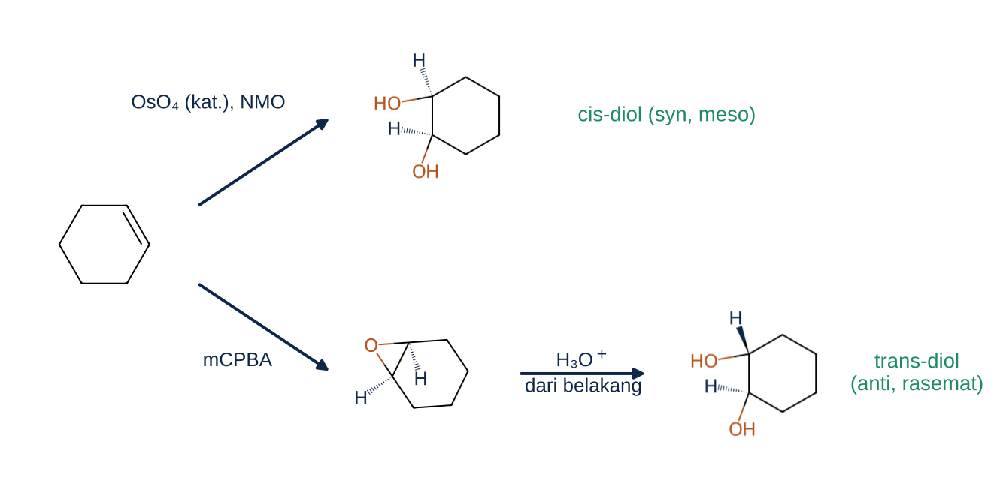
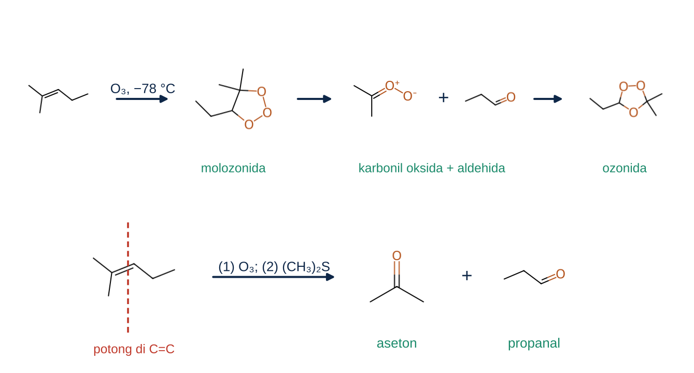
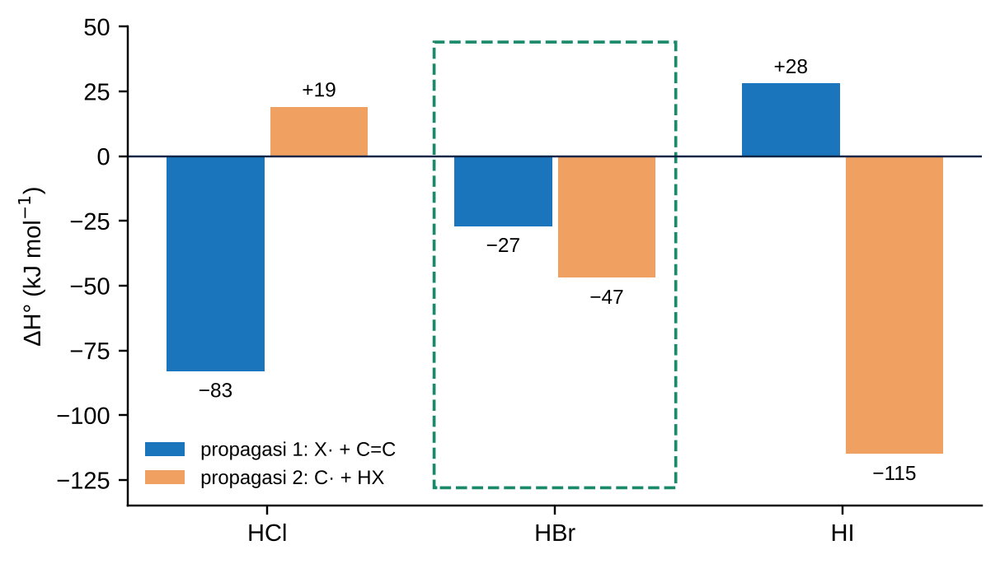

## 8.9 Epoksidasi dan dihidroksilasi

Reaksi-reaksi di subbab ini menambahkan oksigen pada kedua karbon ikatan rangkap. Dari sudut pandang karbon, reaksi itu adalah **oksidasi**: setiap karbon kehilangan ikatan ke karbon lain (ikatan π) dan mendapat ikatan ke oksigen yang lebih elektronegatif. Ada dua produk utama: **epoksida** (eter beranggota tiga, satu oksigen menjembatani kedua karbon) dan **diol 1,2** (glikol, dua gugus –OH pada karbon bertetangga). Untuk diol, kita sekali lagi dapat memilih stereokimia: syn atau anti.

### Epoksidasi dengan peroksiasam

**Peroksiasam** (perasam), RCO₃H, adalah asam karboksilat yang membawa satu atom oksigen tambahan: R–C(=O)–O–O–H. Ikatan O–O lemah (sekitar 190 kJ mol⁻¹), dan oksigen ujungnya bersifat elektrofilik. Peroksiasam yang paling sering dipakai di laboratorium adalah **asam *m*-kloroperoksibenzoat (mCPBA)**, padatan yang cukup stabil untuk disimpan.

Alkena bereaksi dengan mCPBA dalam **satu langkah serempak**. Elektron π menyerang oksigen ujung, ikatan O–O putus, dan bersamaan dengan itu oksigen yang sama membentuk ikatan dengan karbon kedua, sementara proton berpindah ke oksigen karbonil peroksiasam. Semua perubahan ikatan terjadi sekaligus dalam keadaan transisi yang sering digambarkan seperti "kupu-kupu". Hasilnya epoksida dan asam *m*-klorobenzoat.

Karena oksigen masuk ke kedua karbon dari sisi yang sama dan dalam satu langkah, epoksidasi adalah **adisi syn** dan **stereospesifik**: gugus-gugus yang *cis* di alkena tetap *cis* di epoksida, dan gugus-gugus yang *trans* tetap *trans*. *cis*-But-2-ena menghasilkan *cis*-2,3-dimetiloksirana (meso), dan *trans*-but-2-ena menghasilkan *trans*-2,3-dimetiloksirana (rasemat). Alkena yang lebih kaya elektron, yaitu yang lebih tersubstitusi, bereaksi lebih cepat, karena peroksiasam adalah elektrofil. Bila sebuah molekul mempunyai dua ikatan rangkap dengan derajat substitusi berbeda, mCPBA dalam jumlah satu ekuivalen memilih ikatan rangkap yang lebih tersubstitusi.

Epoksida juga dapat dibuat dari **halohidrin** (subbab 8.7) dengan basa: basa mengambil proton –OH, dan ion alkoksida yang terbentuk menyerang karbon tetangga dari belakang, mengusir halida (SN2 intramolekul). Syaratnya, –O⁻ dan halogen harus anti-periplanar, dan susunan itu memang dihasilkan oleh pembentukan halohidrin. Kimia epoksida dibahas tuntas di Bab 9.

### Dihidroksilasi anti: epoksida lalu air

Cincin epoksida beranggota tiga sangat tegang (sekitar 110 kJ mol⁻¹), sehingga mudah dibuka oleh nukleofil. Dalam asam encer, oksigen epoksida terprotonasi, dan air menyerang salah satu karbon dari sisi yang berlawanan dengan oksigen, seperti Br⁻ menyerang ion bromonium. Setelah cincin terbuka dan proton lepas, terbentuk diol 1,2 dengan kedua –OH **anti**. Jadi urutan **(1) mCPBA; (2) H₃O⁺** adalah cara **dihidroksilasi anti**. Sikloheksena dengan cara ini memberi *trans*-sikloheksana-1,2-diol (rasemat).

### Dihidroksilasi syn: osmium tetroksida

**Osmium tetroksida**, OsO₄, beradisi pada alkena dalam satu langkah serempak, dengan dua oksigennya masuk ke kedua karbon sekaligus dari sisi yang sama. Terbentuk cincin beranggota lima, **ester osmat siklik**. Pemutusan ikatan Os–O, misalnya dengan NaHSO₃ dalam air, membebaskan diol dengan kedua –OH **syn** (*cis*). Sikloheksena memberi *cis*-sikloheksana-1,2-diol (meso).

OsO₄ sangat mahal dan sangat beracun (uapnya dapat merusak kornea mata). Karena itu dalam praktik OsO₄ dipakai hanya dalam jumlah katalitik, dan osmium yang sudah tereduksi dioksidasi kembali menjadi OsO₄ oleh oksidator yang murah, biasanya ***N*-metilmorfolina *N*-oksida (NMO)**. Barry Sharpless mengembangkan versi reaksi ini dengan ligan kiral yang menghasilkan diol dengan satu enansiomer berlebih jauh, **dihidroksilasi asimetris Sharpless**, salah satu karya yang membawanya ke Hadiah Nobel Kimia 2001.

Kalium permanganat yang **dingin, encer, dan basa** juga memberi diol syn lewat ester manganat siklik yang serupa. Hasilnya sering rendah, karena permanganat cenderung terus mengoksidasi diol dan memutus ikatan C–C (subbab 8.10). Reaksi ini lebih dikenal sebagai **uji Baeyer**: warna ungu permanganat hilang dan terbentuk endapan cokelat MnO₂ bila ada ikatan rangkap.

{width=96%}

::: {.contoh}
**Contoh 8.12 · Memilih syn atau anti**

Tunjukkan bagaimana mengubah *cis*-but-2-ena menjadi (a) meso-butana-2,3-diol; (b) (2*R*,3*R*)- dan (2*S*,3*S*)-butana-2,3-diol (rasemat).

**Rencana.** Pakai aturan dari Contoh 8.9: untuk alkena simetris, syn + cis → meso, anti + cis → rasemat.

**Penyelesaian.** (a) Meso dari alkena *cis* memerlukan adisi **syn**: OsO₄ (katalitik), NMO; atau KMnO₄ dingin, encer, basa. (b) Rasemat dari alkena *cis* memerlukan adisi **anti**: (1) mCPBA; (2) H₃O⁺. Epoksidasi *cis*-but-2-ena memberi epoksida *cis* (meso). Air menyerang salah satu dari kedua karbon epoksida dari belakang, dan karena kedua karbon setara, serangan ke C2 dan ke C3 memberi kedua enansiomer diol dalam jumlah sama.

**Memahami hasil.** Butana-2,3-diol mempunyai tiga stereoisomer, dan kita dapat memilih yang mana yang terbentuk hanya dengan memilih urutan pereaksi. Untuk *trans*-but-2-ena semuanya terbalik: OsO₄ memberi rasemat, dan epoksidasi lalu hidrolisis memberi meso.
:::

::: {.kuis}
**Kuis cepat 8.9** (a) Tulis produk 1-metilsikloheksena + mCPBA. (b) Bagaimana mengubah siklopentena menjadi *trans*-siklopentana-1,2-diol? Menjadi *cis*-siklopentana-1,2-diol?
:::

## 8.10 Pemutusan oksidatif: ozonolisis

Semua reaksi yang telah kita bahas mempertahankan ikatan σ antara kedua karbon ikatan rangkap: hanya ikatan π yang putus. **Ozonolisis** lebih jauh: ikatan σ juga putus, dan molekul terpotong menjadi dua bagian tepat di tempat ikatan rangkap. Setiap karbon ikatan rangkap menjadi karbon gugus karbonil (C=O).

### Reaksi dan mekanisme

Ozon, O₃, dibuat dengan mengalirkan oksigen melewati lucutan listrik. Gas itu dialirkan ke dalam larutan alkena dalam CH₂Cl₂ atau metanol pada −78 °C. Ozon adalah molekul dengan muatan terpisah (resonansi O=O⁺–O⁻ ↔ ⁻O–O⁺=O), dan ujung-ujungnya dapat bereaksi dengan kedua karbon ikatan rangkap sekaligus. Mekanismenya:

1. Ozon beradisi pada ikatan rangkap dalam satu langkah serempak, membentuk **molozonida**, cincin beranggota lima dengan tiga oksigen berderet (O–O–O). Cincin ini sangat tidak stabil karena memuat dua ikatan O–O yang lemah.
2. Molozonida segera terpecah menjadi dua bagian: satu gugus karbonil dan satu **karbonil oksida** (C=O⁺–O⁻). Pada langkah inilah ikatan C–C putus.
3. Kedua bagian bergabung kembali dengan arah yang berbeda, membentuk **ozonida**, cincin beranggota lima yang kini memuat susunan C–O–O–C dan C–O–C.
4. Ozonida tidak diisolasi (ozonida kering dapat meledak). Ozonida langsung direduksi dengan **dimetil sulfida**, (CH₃)₂S, atau dengan **seng dan asam asetat**. Hasilnya dua senyawa karbonil.

{width=96%}

Aturan untuk meramalkan produk ozonolisis dengan reduksi sangat sederhana: **hapus ikatan C=C, lalu pasang =O pada setiap karbon yang tadinya berikatan rangkap.**

- Karbon ikatan rangkap yang membawa dua gugus alkil (R₂C=) menjadi **keton** (R₂C=O).
- Karbon yang membawa satu gugus alkil dan satu H (RCH=) menjadi **aldehida** (RCHO).
- Karbon ujung (CH₂=) menjadi **formaldehida** (HCHO).

Bila ozonida diolah dengan **hidrogen peroksida** sebagai ganti pereduksi, aldehida yang terbentuk ikut teroksidasi menjadi **asam karboksilat**, sedangkan keton tidak berubah.

### Pemutusan dengan permanganat

Kalium permanganat yang **panas**, dalam asam atau basa, juga memutus ikatan rangkap, dengan hasil yang sama seperti ozonolisis dengan H₂O₂: R₂C= menjadi keton, RCH= menjadi asam karboksilat, dan CH₂= teroksidasi sampai menjadi CO₂. Permanganat lebih murah dan tidak memerlukan alat pembuat ozon, tetapi kurang selektif.

### Ozonolisis untuk menentukan struktur

Sebelum spektroskopi NMR tersedia, ozonolisis adalah salah satu cara terpenting untuk menentukan letak ikatan rangkap dalam molekul yang belum dikenal. Kita memotong molekul, mengenali kedua potongannya, lalu "menjahit" kedua potongan itu kembali dengan menghubungkan kedua karbon karbonil menjadi C=C.

::: {.contoh}
**Contoh 8.13 · Menyusun kembali alkena dari produk ozonolisis**

Sebuah alkena C₆H₁₂, setelah ozonolisis (O₃, lalu (CH₃)₂S), menghasilkan aseton dan propanal. Tentukan strukturnya.

**Rencana.** Hapus =O dari kedua produk, lalu hubungkan kedua karbon yang tadinya karbonil dengan ikatan rangkap.

**Penyelesaian.** Aseton, (CH₃)₂C=O, memberi bagian (CH₃)₂C=. Propanal, CH₃CH₂CH=O, memberi bagian =CHCH₂CH₃. Gabungannya: (CH₃)₂C=CHCH₂CH₃, yaitu **2-metilpent-2-ena**. Periksa: 3 + 3 = 6 karbon, dan rumusnya C₆H₁₂, cocok.

**Memahami hasil.** Jumlah karbon kedua produk harus sama dengan jumlah karbon alkena, karena ozonolisis tidak membuang atom karbon. Perhatikan bahwa ozonolisis tidak membedakan isomer *E* dan *Z*: keduanya memberi produk yang sama. Pada 2-metilpent-2-ena hal ini tidak menjadi soal, karena salah satu karbon ikatan rangkapnya membawa dua gugus metil yang sama, sehingga alkena ini memang tidak mempunyai isomer *E*/*Z*.
:::

::: {.contoh}
**Contoh 8.14 · Ozonolisis limonena**

Limonena (Contoh 8.11) adalah 1-metil-4-(prop-1-en-2-il)sikloheksena. Tulis produk ozonolisisnya dengan pengolahan reduktif.

**Penyelesaian.** Limonena mempunyai dua ikatan rangkap. (1) Ikatan rangkap di dalam cincin, antara C1 (membawa metil) dan C2 (membawa H). Pemutusannya **membuka cincin**, tetapi tidak memisahkan molekul menjadi dua: C1 menjadi keton metil, dan C2 menjadi aldehida, keduanya tetap terhubung oleh sisa cincin. (2) Ikatan rangkap di gugus isopropenil, C(CH₃)=CH₂. Karbon yang membawa metil menjadi keton metil, dan CH₂ ujung lepas sebagai formaldehida. Produknya: satu molekul C₉H₁₄O₃ dengan dua gugus keton dan satu gugus aldehida, CH₃C(=O)CH₂CH₂CH(CH₂CHO)C(=O)CH₃, yaitu **3-asetil-6-oksoheptanal**, ditambah **formaldehida**.

**Memahami hasil.** Pemutusan ikatan rangkap di dalam cincin tidak menghasilkan dua molekul, tetapi satu molekul rantai terbuka dengan dua gugus karbonil di kedua ujungnya. Jumlah karbon tetap terjaga: 9 + 1 = 10.
:::

::: {.kuis}
**Kuis cepat 8.10** Tulis produk ozonolisis (O₃, lalu Zn/CH₃COOH) dari (a) 2-metilbut-2-ena; (b) metilenasikloheksana; (c) sikloheksena.
:::

## 8.11 Adisi radikal HBr dan polimerisasi

### Efek peroksida: kembali ke teka-teki pembuka

Kini kita dapat menjawab teka-teki Kharasch dan Mayo dari awal bab. Tanpa peroksida, HBr beradisi pada propena lewat mekanisme ionik (subbab 8.3): proton masuk lebih dulu, membentuk karbokation sekunder, dan bromin berakhir di karbon tengah (Markovnikov). Dengan peroksida, terjadi **reaksi berantai radikal** (subbab 6.12), di mana **atom bromin**, bukan proton, yang masuk lebih dulu.

**Inisiasi.** Ikatan O–O peroksida sangat lemah (sekitar 150 kJ mol⁻¹) dan putus secara homolitik oleh panas atau cahaya, membentuk dua radikal alkoksi, RO·. Radikal alkoksi mengambil atom H dari HBr, menghasilkan alkohol dan radikal bromin, Br·.

**Propagasi 1.** Br· beradisi pada ikatan rangkap. Br· dapat masuk ke karbon ujung, menghasilkan radikal **sekunder** di karbon tengah, atau ke karbon tengah, menghasilkan radikal **primer** di karbon ujung. Radikal sekunder lebih stabil (subbab 6.11), sehingga Br· masuk ke **karbon ujung**.

**Propagasi 2.** Radikal karbon mengambil atom H dari HBr, menghasilkan 1-bromopropana dan Br· baru, yang kembali ke propagasi 1.

**Terminasi.** Dua radikal bergabung. Karena konsentrasi radikal sangat kecil, langkah ini jarang, dan setiap rantai menghasilkan ratusan molekul produk sebelum berhenti.

Perhatikan bahwa kedua mekanisme sebenarnya mengikuti **prinsip yang sama**: zat yang masuk lebih dulu memilih karbon yang menghasilkan intermediet paling stabil. Pada jalur ionik, yang masuk lebih dulu adalah H⁺, sehingga H berada di karbon ujung. Pada jalur radikal, yang masuk lebih dulu adalah Br·, sehingga Br berada di karbon ujung. "Anti-Markovnikov" bukan pengecualian terhadap prinsip, melainkan akibat dari perbedaan siapa yang datang lebih dulu.

### Mengapa hanya HBr?

HCl dan HI tidak beradisi secara radikal, walaupun ada peroksida. Jawabannya terlihat dari ΔH° kedua langkah propagasi, yang dapat kita perkirakan dari energi ikatan (subbab 6.6). Pakai ikatan π 267 kJ mol⁻¹ (subbab 1.6), energi ikatan C–X dan H–X dari Bab 6, dan C–H sekunder 413 kJ mol⁻¹:

| X | Propagasi 1: X· + C=C (kJ mol⁻¹) | Propagasi 2: C· + HX (kJ mol⁻¹) |
|---|---|---|
| Cl | 267 − 350 = −83 | 432 − 413 = +19 |
| Br | 267 − 294 = −27 | 366 − 413 = −47 |
| I | 267 − 239 = +28 | 298 − 413 = −115 |

Rantai radikal hanya berjalan cepat bila **kedua** langkah propagasinya eksoterm (atau hampir), karena langkah endoterm biasanya mempunyai energi aktivasi tinggi dan menjadi lambat, sehingga rantai terputus sebelum sempat panjang. Hanya untuk HBr kedua langkahnya eksoterm. Untuk HCl, langkah kedua endoterm karena ikatan H–Cl terlalu kuat. Untuk HI, langkah pertama endoterm karena ikatan C–I terlalu lemah.

{width=78%}

::: {.contoh}
**Contoh 8.15 · Ionik atau radikal**

Tulis produk 2-metilpropena dengan (a) HBr; (b) HBr, ROOR; (c) HCl, ROOR.

**Penyelesaian.** (a) Jalur ionik, H⁺ masuk ke CH₂ membentuk karbokation tersier: **2-bromo-2-metilpropana**. (b) Jalur radikal, Br· masuk ke CH₂ membentuk radikal tersier, lalu radikal itu mengambil H dari HBr: **1-bromo-2-metilpropana**. (c) HCl tidak menjalani adisi radikal, sehingga peroksida tidak berpengaruh: produknya sama dengan adisi ionik, **2-kloro-2-metilpropana**.

**Memahami hasil.** Peroksida hanya membalik regiokimia untuk HBr. Dalam soal sintesis, "HBr, ROOR" adalah cara untuk menaruh bromin di karbon yang kurang tersubstitusi, sejajar dengan hidroborasi–oksidasi untuk –OH.
:::

### Polimerisasi radikal

Bila radikal beradisi pada alkena dan tidak ada HBr yang menghentikan radikal karbon yang terbentuk, radikal karbon itu dapat beradisi lagi pada molekul alkena berikutnya, lalu berikutnya lagi, dan seterusnya. Rantai karbon tumbuh panjang: inilah **polimerisasi adisi** (polimerisasi pertumbuhan rantai). Alkena kecil yang menjadi bahan bakunya disebut **monomer**.

Pada polimerisasi radikal etena, sedikit inisiator seperti benzoil peroksida diuraikan menjadi radikal In·. Radikal ini beradisi pada etena, menghasilkan radikal baru In–CH₂–CH₂·, yang beradisi lagi pada etena, dan seterusnya. Setiap langkah propagasi mengubah satu ikatan π menjadi satu ikatan σ, sehingga eksoterm. Rantai berhenti ketika dua radikal bergabung atau saling bertukar atom H. Rantai polietilena yang khas memuat ribuan sampai puluhan ribu satuan monomer.

Untuk monomer tak simetris CH₂=CHZ, radikal selalu beradisi pada CH₂, sehingga radikal yang terbentuk berada di karbon yang membawa Z, yang lebih stabil. Akibatnya gugus Z muncul pada **setiap karbon kedua** sepanjang rantai: susunan **kepala ke ekor**, –CH₂–CHZ–CH₂–CHZ–.

| Monomer | Polimer | Penggunaan |
|---|---|---|
| CH₂=CH₂ (etena) | polietilena (PE) | kantong plastik, botol, pipa |
| CH₂=CHCH₃ (propena) | polipropilena (PP) | wadah makanan, tali, karpet |
| CH₂=CHCl (vinil klorida) | poli(vinil klorida) (PVC) | pipa, kabel, lantai vinil |
| CH₂=CHC₆H₅ (stirena) | polistirena (PS) | styrofoam, wadah sekali pakai |
| CF₂=CF₂ (tetrafluoroetena) | politetrafluoroetilena (PTFE, Teflon) | lapisan antilengket, isolator |
| CH₂=CHCN (akrilonitril) | poliakrilonitril | serat akrilik |
| CH₂=C(CH₃)COOCH₃ (metil metakrilat) | poli(metil metakrilat) (PMMA) | kaca akrilik, lensa |

Polietilena yang dibuat dengan polimerisasi radikal pada tekanan tinggi mempunyai banyak cabang, karena radikal di ujung rantai kadang mengambil atom H dari tengah rantainya sendiri. Rantai bercabang sulit tersusun rapat, sehingga hasilnya **polietilena densitas rendah** (LDPE) yang lunak, untuk kantong plastik. Karl Ziegler dan Giulio Natta mengembangkan katalis logam (titanium dan aluminium) yang mempolimerisasi etena pada tekanan rendah tanpa percabangan, menghasilkan **polietilena densitas tinggi** (HDPE) yang keras, dan juga polipropilena dengan semua gugus metil tersusun teratur. Keduanya mendapat Hadiah Nobel Kimia 1963.

### Polimerisasi kationik

Alkena yang membentuk karbokation stabil juga dapat dipolimerisasi lewat **karbokation**. 2-Metilpropena (isobutilena) dengan sedikit asam Lewis seperti BF₃ dan jejak air membentuk karbokation tersier, yang beradisi pada molekul isobutilena berikutnya dan menghasilkan karbokation tersier baru, dan seterusnya. Hasilnya **poliisobutilena**, bahan dasar karet butil untuk ban dalam dan permen karet. Setiap langkah adalah adisi elektrofilik biasa (subbab 8.3), hanya elektrofilnya karbokation dan bukan proton.

::: {.contoh}
**Contoh 8.16 · Ukuran rantai polimer**

Sebuah sampel polietilena mempunyai massa molar rata-rata 280 000 g mol⁻¹. Berapa satuan etena rata-rata dalam satu rantai?

**Penyelesaian.** Massa molar etena, C₂H₄, adalah 2(12,011) + 4(1,008) = 28,05 g mol⁻¹. Jumlah satuan monomer (**derajat polimerisasi**) adalah

$$
n = \frac{280\,000}{28{,}05} \approx 9\,980
$$

Satu rantai rata-rata memuat sekitar sepuluh ribu satuan etena, atau sekitar dua puluh ribu atom karbon.

**Memahami hasil.** Gugus ujung rantai (sisa inisiator) dapat diabaikan, karena massanya sangat kecil dibanding seluruh rantai. Rantai sepanjang ini saling membelit seperti mi, dan belitan itulah yang membuat plastik kuat dan liat. Karena tulang punggungnya hanya ikatan C–C dan C–H yang tidak polar, tidak ada gugus fungsi yang dapat diserang oleh air atau enzim. Inilah sebabnya polietilena hampir tidak terurai di alam dan menjadi masalah sampah yang serius.
:::

::: {.kuis}
**Kuis cepat 8.11** (a) Tulis produk 1-metilsikloheksena + HBr dengan dan tanpa peroksida. (b) Gambar tiga satuan berulang polipropilena dengan susunan kepala ke ekor.
:::
