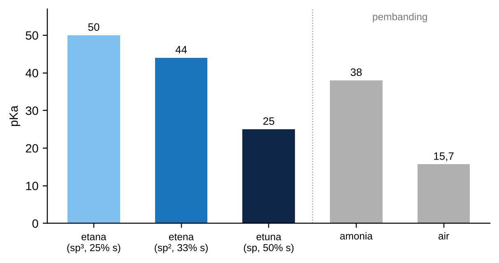
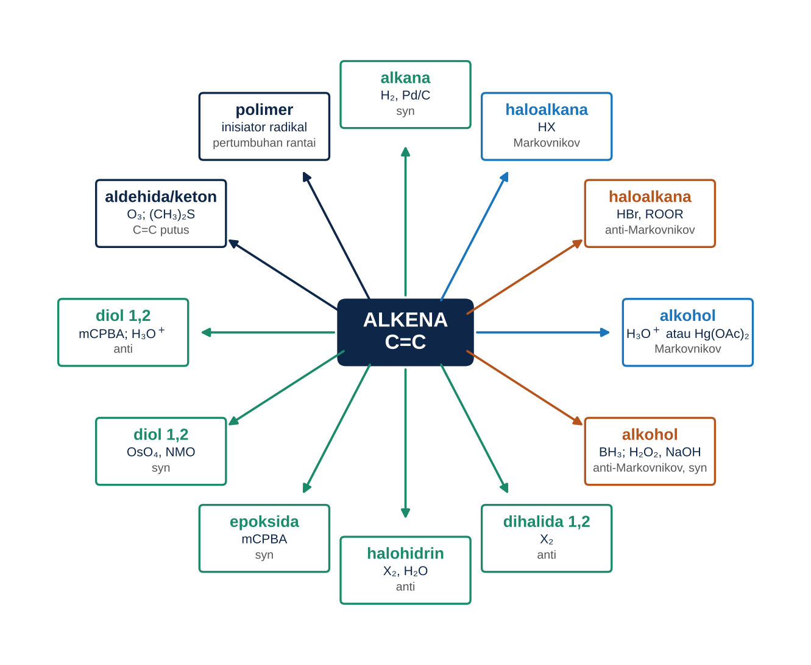

## 8.12 Alkuna: struktur, keasaman, dan ion asetilida

### Ikatan rangkap tiga

Kedua karbon ikatan rangkap tiga terhibridisasi sp (subbab 1.5). Setiap karbon memakai dua orbital sp untuk dua ikatan σ yang membentuk garis lurus (sudut 180°), dan menyisakan dua orbital p yang saling tegak lurus. Kedua pasang orbital p membentuk **dua ikatan π**, satu di bidang atas–bawah dan satu di bidang depan–belakang. Bersama-sama, kedua ikatan π itu membentuk awan elektron berbentuk silinder yang melingkari sumbu C–C. Ikatan C≡C pendek (120 pm) dan kuat (839 kJ mol⁻¹), tetapi seperti pada alkena, ikatan π-nya jauh lebih lemah daripada ikatan σ, dan di situlah reaksi terjadi.

Karena empat atom (H–C≡C–H pada etuna, atau C–C≡C–C pada alkuna dalam) terletak pada satu garis lurus, alkuna tidak mempunyai isomer *cis*–*trans*. Alkuna juga sulit berada dalam cincin kecil: sikloalkuna terkecil yang stabil pada suhu kamar adalah siklooktuna, dan itu pun sangat tegang. Ketegangan itu dimanfaatkan dalam **kimia klik bebas tembaga**, yang dipakai untuk menandai molekul di dalam sel hidup.

Etuna (asetilena) dibuat di industri dari kalsium karbida dan air, CaC₂ + 2H₂O → HC≡CH + Ca(OH)₂, dan dari perengkahan metana pada suhu tinggi. Nyala etuna dengan oksigen mencapai lebih dari 3000 °C, sehingga dipakai untuk mengelas dan memotong logam. Lampu karbida yang dulu dipakai penambang dan penjual di pasar malam juga membakar etuna yang dibuat langsung dari karbida dan air.

### Keasaman alkuna ujung

Alkuna ujung (alkuna terminal), RC≡CH, mempunyai satu sifat yang membedakannya tajam dari alkena dan alkana: hidrogennya **asam**. pKa etuna sekitar 25, jauh lebih asam daripada etena (pKa sekitar 44) dan etana (sekitar 50). Perbedaan 25 satuan pKa antara etuna dan etana berarti etuna sekitar 10²⁵ kali lebih asam.

Penjelasannya terletak pada orbital yang memegang pasangan elektron setelah proton lepas (subbab 3.8). Pada ion asetilida, HC≡C:⁻, pasangan elektron menempati orbital **sp**, yang 50% bersifat s. Pada anion vinil, pasangan elektron berada di orbital sp² (33% s), dan pada anion etil di orbital sp³ (25% s). Orbital s lebih dekat ke inti daripada orbital p, sehingga makin banyak sifat s sebuah orbital, makin dekat elektronnya dipegang oleh inti dan makin rendah energinya. Pasangan elektron di orbital sp karena itu paling stabil, dan basa konjugat yang stabil berarti asam yang kuat.

{width=80%}

"Asam" di sini tentu relatif. Etuna tetap jauh lebih lemah daripada air (pKa 15,7), sehingga ion hidroksida **tidak** dapat mendeprotonasi etuna: kesetimbangannya

$$
\text{HC≡CH} + \text{OH}^- \rightleftharpoons \text{HC≡C}^- + \text{H}_2\text{O} \qquad K = 10^{15{,}7 - 25} = 5 \times 10^{-10}
$$

sangat condong ke kiri. Basa yang cukup kuat adalah **natrium amida**, NaNH₂ (asam konjugatnya amonia, pKa 38):

$$
\text{HC≡CH} + \text{NH}_2^- \rightleftharpoons \text{HC≡C}^- + \text{NH}_3 \qquad K = 10^{38 - 25} = 10^{13} \qquad \text{(8.3)}
$$

Kesetimbangan ini praktis berjalan tuntas: etuna sepuluh triliun kali lebih asam daripada amonia, sesuai pertanyaan pembuka. Natrium hidrida (NaH) dan butillitium juga cukup kuat. Sebagai uji sederhana, alkuna ujung membentuk endapan dengan ion perak atau tembaga(I) dalam amonia, sedangkan alkuna dalam (RC≡CR') tidak, karena tidak mempunyai H yang asam.

### Ion asetilida sebagai nukleofil: memperpanjang rantai karbon

Ion asetilida adalah karbanion yang relatif stabil, dan pasangan elektron bebasnya membuatnya menjadi **nukleofil karbon** yang kuat. Dengan alkil halida primer, ion asetilida bereaksi lewat **SN2** (subbab 7.5) membentuk ikatan C–C baru:

$$
\text{RC≡C}^-\,\text{Na}^+ + \text{R'CH}_2\text{Br} \longrightarrow \text{RC≡CCH}_2\text{R'} + \text{NaBr} \qquad \text{(8.4)}
$$

Reaksi ini disebut **alkilasi asetilida**, dan sangat berharga karena membentuk ikatan karbon–karbon, sesuatu yang belum dapat kita lakukan dengan reaksi lain sejauh ini selain kopling Gilman (subbab 7.14). Etuna mempunyai dua H yang asam, sehingga dapat dialkilasi dua kali, satu sisi demi satu sisi: etuna → alkuna ujung → alkuna dalam.

::: {.awas}
**Asetilida hanya dengan alkil halida primer (dan metil)**

Ion asetilida adalah **basa kuat** sekaligus nukleofil. Dengan alkil halida sekunder dan tersier, asetilida bertindak sebagai basa dan menghasilkan alkena lewat **E2** (subbab 7.12), bukan produk substitusi. Jadi bila kamu merancang alkilasi asetilida, pastikan gugus yang dipasang berasal dari alkil halida metil atau primer. Gugus bercabang harus sudah ada di sisi alkuna.
:::

::: {.contoh}
**Contoh 8.17 · Merancang alkilasi asetilida**

Rancang sintesis 2-metilheks-3-una, (CH₃)₂CHC≡CCH₂CH₃, dari alkuna ujung dan alkil halida.

**Rencana.** Ada dua cara memotong molekul di salah satu ikatan antara karbon alkuna dan gugus alkil: (i) (CH₃)₂CH– dari alkil halida, C≡CCH₂CH₃ dari asetilida; (ii) CH₃CH₂– dari alkil halida, (CH₃)₂CHC≡C⁻ dari asetilida.

**Penyelesaian.** Cara (i) memerlukan 2-bromopropana, alkil halida sekunder, yang dengan asetilida akan mengalami E2 menjadi propena. Cara (ii) memerlukan bromoetana, alkil halida primer, yang bereaksi SN2 dengan baik. Jadi: **3-metilbut-1-una + NaNH₂ dalam NH₃ cair, lalu CH₃CH₂Br**.

**Memahami hasil.** Pilih pemotongan yang membuat alkil halidanya primer. Cabang yang dekat ikatan rangkap tiga harus dibawa oleh alkuna awal.
:::

### Membuat alkuna: eliminasi ganda

Alkuna dapat dibuat dari **dihalida** dengan dua kali eliminasi E2. Dihalida visinal (dua halogen pada karbon bertetangga) mudah dibuat dari alkena dan Br₂ (subbab 8.7). Dengan dua ekuivalen basa yang sangat kuat, biasanya NaNH₂, dua molekul HBr dilepas berturut-turut: yang pertama menghasilkan vinil bromida, yang kedua alkuna. Eliminasi kedua lebih sulit dan memerlukan basa sekuat NaNH₂. Untuk alkuna ujung diperlukan **tiga** ekuivalen NaNH₂, karena alkuna ujung yang terbentuk langsung dideprotonasi menjadi asetilida dan memakan satu ekuivalen basa. Air ditambahkan di akhir untuk memprotonasi asetilida kembali.

Urutan **alkena → (Br₂) → dibromida → (NaNH₂ berlebih) → alkuna** memungkinkan kita mengubah alkena menjadi alkuna dengan kerangka yang sama.

::: {.kuis}
**Kuis cepat 8.12** (a) Dapatkah natrium etoksida (pKa etanol 16) mendeprotonasi propuna secara tuntas? Hitung *K*. (b) Tulis produk 1-bromobutana + natrium asetilida, dan 2-bromobutana + natrium asetilida.
:::

## 8.13 Reaksi alkuna: hidrogenasi, hidrasi, dan halogenasi

Alkuna menjalani banyak reaksi adisi yang sama dengan alkena, tetapi karena mempunyai dua ikatan π, adisi dapat terjadi dua kali. Tantangannya adalah menghentikan reaksi setelah adisi pertama, dan mengendalikan stereokimia alkena yang terbentuk.

### Hidrogenasi: penuh, cis, atau trans

**Hidrogenasi penuh.** Dengan H₂ dan katalis biasa (Pd/C atau Pt), alkuna menyerap dua mol H₂ dan menjadi alkana. Alkena yang terbentuk di tengah jalan langsung dihidrogenasi lebih lanjut dan tidak dapat ditangkap.

**Katalis Lindlar: alkena *cis*.** Katalis Lindlar adalah paladium yang diendapkan pada kalsium karbonat dan sengaja "diracuni" dengan timbal asetat dan kuinolina. Racun itu menurunkan keaktifan paladium sehingga katalis masih mampu mereduksi alkuna, yang menempel lebih kuat pada permukaan logam, tetapi tidak lagi mampu mereduksi alkena. Reaksi berhenti pada alkena. Karena kedua atom H masuk dari permukaan logam yang sama (syn, subbab 8.8), alkena yang terbentuk adalah **alkena *cis* (*Z*)**.

**Natrium dalam amonia cair: alkena *trans*.** Bila alkuna dalam direaksikan dengan logam natrium atau litium dalam amonia cair pada −33 °C, terbentuk **alkena *trans* (*E*)**. Mekanismenya sama sekali berbeda dari hidrogenasi katalitik, karena H dimasukkan sebagai **elektron dan proton secara terpisah**:

1. Atom natrium memberikan satu elektron kepada alkuna, membentuk **anion radikal** (satu elektron tambahan dan satu muatan negatif).
2. Anion radikal mengambil proton dari amonia, membentuk **radikal vinil**. Radikal vinil dapat membalik bentuknya dengan cepat, dan bentuk dengan kedua gugus alkil saling berjauhan (*trans*) lebih stabil.
3. Atom natrium kedua memberikan elektron kedua, membentuk **anion vinil** yang tetap dalam bentuk *trans*.
4. Anion vinil mengambil proton dari amonia, menghasilkan alkena *trans*.

Reaksi berhenti pada alkena, karena alkena tidak menerima elektron semudah alkuna.

{width=92%}

::: {.inti}
**Tiga hasil dari satu alkuna**

- H₂, Pd/C → **alkana**
- H₂, katalis Lindlar → **alkena *cis* (*Z*)**, adisi syn
- Na atau Li, NH₃ cair → **alkena *trans* (*E*)**
:::

### Hidrasi: dari enol ke keton

Alkuna menambahkan air dengan bantuan asam sulfat dan sedikit **merkuri(II) sulfat** sebagai katalis. Ion Hg²⁺ berperan seperti dalam oksimerkurasi, membentuk ion yang menyerupai merkurinium, dan regiokimianya **Markovnikov**: –OH masuk ke karbon yang lebih tersubstitusi. Tetapi produk langsungnya bukan alkohol biasa, melainkan **enol**: alkohol yang gugus –OH-nya terikat pada karbon ikatan rangkap (nama "enol" berasal dari *-ena* + *-ol*).

Enol tidak stabil dan segera berubah menjadi **keton** lewat **tautomerisasi keto–enol**. Dua bentuk ini, yang disebut **tautomer**, berbeda dalam letak satu atom H dan letak ikatan rangkap: pada enol, H berada di oksigen dan ikatan rangkap di C=C; pada keton, H berada di karbon dan ikatan rangkap di C=O. Tautomer bukan struktur resonansi: atom H benar-benar berpindah, sehingga keduanya adalah senyawa yang berbeda dan berada dalam kesetimbangan. Dalam asam, tautomerisasi berlangsung dalam dua langkah: karbon ikatan rangkap enol diprotonasi (seperti alkena diprotonasi pada adisi HX, dengan muatan positif yang distabilkan oleh pasangan bebas oksigen), lalu proton O–H lepas.

Kesetimbangan keto–enol untuk keton sederhana sangat condong ke bentuk keto. Pada aseton, hanya sekitar satu dari seratus juta molekul yang berada dalam bentuk enol. Penyebabnya terutama kekuatan ikatan: ikatan π C=O (dengan oksigen yang elektronegatif) jauh lebih kuat daripada ikatan π C=C. Keto–enol akan menjadi tema utama di kimia karbonil (Bab 11 dan seterusnya).

Hasil bersih hidrasi alkuna ujung adalah **keton metil**: propuna menjadi aseton, heks-1-una menjadi heksan-2-on. Alkuna dalam yang tidak simetris memberi campuran dua keton, sehingga reaksi ini paling berguna untuk alkuna ujung dan alkuna dalam yang simetris.

### Hidroborasi alkuna: aldehida

Hidroborasi–oksidasi alkuna ujung memberi regiokimia yang berlawanan: boron masuk ke karbon ujung, dan oksidasi menghasilkan enol dengan –OH di karbon ujung. Enol ini bertautomerisasi menjadi **aldehida**. Agar boran tidak beradisi dua kali pada kedua ikatan π, dipakai boran besar yang hanya mempunyai satu ikatan B–H, seperti **disiamilboran** atau **9-BBN**. Gugus besar itu juga memperkuat pilihan boron terhadap karbon ujung.

{width=96%}

::: {.contoh}
**Contoh 8.18 · Keton atau aldehida**

Dari pent-1-una, bagaimana membuat (a) pentan-2-on; (b) pentanal?

**Penyelesaian.** (a) –OH (lalu =O) di C2, karbon yang lebih tersubstitusi: **H₂O, H₂SO₄, HgSO₄**. Enol CH₂=C(OH)CH₂CH₂CH₃ bertautomerisasi menjadi CH₃COCH₂CH₂CH₃. (b) =O di C1: **(1) disiamilboran atau 9-BBN; (2) H₂O₂, NaOH**. Enol HOCH=CHCH₂CH₂CH₃ bertautomerisasi menjadi OHCCH₂CH₂CH₂CH₃.

**Memahami hasil.** Pilihan regiokimia untuk alkuna sejajar dengan pilihan untuk alkena (subbab 8.5 dan 8.6). Perbedaannya hanya di akhir: enol tidak bertahan dan berubah menjadi senyawa karbonil.
:::

### Adisi HX dan X₂ pada alkuna

**HX** beradisi pada alkuna dengan regiokimia Markovnikov. Dengan satu ekuivalen HX terbentuk **vinil halida**; dengan dua ekuivalen, HX kedua masuk ke karbon yang sudah membawa halogen, menghasilkan **dihalida geminal** (kedua halogen pada karbon yang sama). Halogen pertama menstabilkan muatan positif di karbon yang sama lewat pasangan bebasnya, sehingga adisi kedua juga Markovnikov. Dengan peroksida, HBr beradisi secara radikal (anti-Markovnikov), seperti pada alkena.

**Br₂ dan Cl₂** beradisi sekali menghasilkan dihaloalkena, biasanya dengan susunan anti (*E*), dan bila berlebih beradisi lagi menghasilkan tetrahaloalkana.

**Pemutusan oksidatif.** Ozon atau KMnO₄ panas memutus ikatan rangkap tiga. Alkuna dalam menghasilkan dua **asam karboksilat**; karbon ujung alkuna ujung menjadi CO₂.

::: {.kuis}
**Kuis cepat 8.13** Tulis produk heks-3-una dengan (a) H₂, Lindlar; (b) Na, NH₃; (c) H₂O, H₂SO₄, HgSO₄; (d) HBr berlebih. Mengapa (c) hanya memberi satu produk?
:::

## 8.14 Merancang sintesis dengan alkena dan alkuna

Kita sekarang mengenal lebih dari dua puluh reaksi alkena dan alkuna. Daftar sepanjang itu baru berguna bila kita dapat **merangkainya** untuk membuat molekul yang kita inginkan. Itulah tugas sintesis organik, dan cara berpikir yang paling ampuh untuk itu adalah **analisis retrosintesis**, gagasan yang dikembangkan E. J. Corey (Hadiah Nobel Kimia 1990).

### Berpikir mundur

Dalam retrosintesis, kita mulai dari **molekul sasaran** dan bertanya: *dari molekul apa sasaran ini dapat dibuat dengan satu reaksi yang kita kenal?* Jawabannya adalah **prekursor**. Lalu kita bertanya hal yang sama untuk prekursor itu, dan seterusnya, sampai tiba pada bahan awal yang tersedia. Langkah mundur ditulis dengan panah berongga, sasaran ⇒ prekursor, yang dibaca "dapat dibuat dari". Setelah rute mundur lengkap, kita membaliknya menjadi rencana maju dengan pereaksi untuk setiap langkah.

Pertanyaan yang membantu pada setiap langkah mundur:

1. **Gugus fungsi apa yang ada di sasaran, dan reaksi apa yang menghasilkannya?** Alkohol dapat berasal dari hidrasi atau hidroborasi alkena; diol 1,2 dari dihidroksilasi; keton metil dari hidrasi alkuna ujung; alkena *cis* dari reduksi Lindlar.
2. **Apakah kerangka karbon sasaran lebih besar daripada bahan awal?** Bila ya, kita memerlukan reaksi pembentuk ikatan C–C. Di bab ini, yang tersedia adalah **alkilasi asetilida**.
3. **Regiokimia dan stereokimia apa yang diminta?** Pilih reaksi yang memberikannya: Markovnikov atau anti-Markovnikov, syn atau anti, *cis* atau *trans*.

{width=96%}

::: {.contoh}
**Contoh 8.19 · Sintesis alkena cis dari etuna**

Rancang sintesis (*Z*)-heks-3-ena dari etuna dan alkil halida apa saja.

**Rencana (mundur).** (*Z*)-Heks-3-ena ⇒ heks-3-una (alkena *cis* dari alkuna dengan Lindlar). Heks-3-una, CH₃CH₂C≡CCH₂CH₃, ⇒ but-1-una + bromoetana (alkilasi asetilida). But-1-una ⇒ etuna + bromoetana (alkilasi asetilida).

**Penyelesaian (maju).**

1. HC≡CH + NaNH₂, NH₃ cair; lalu CH₃CH₂Br → but-1-una.
2. But-1-una + NaNH₂; lalu CH₃CH₂Br → heks-3-una.
3. Heks-3-una + H₂, katalis Lindlar → (*Z*)-heks-3-ena.

**Memahami hasil.** Kedua alkilasi harus dilakukan berurutan, satu ekuivalen basa setiap kali. Bila etuna diberi dua ekuivalen NaNH₂ sekaligus lalu dua ekuivalen bromoetana, hasilnya juga heks-3-una, tetapi rute bertahap lebih aman ketika kedua gugus alkil berbeda. Untuk (*E*)-heks-3-ena, langkah terakhir cukup diganti dengan Na dalam NH₃ cair.
:::

::: {.contoh}
**Contoh 8.20 · Memindahkan gugus –OH**

Ubah 1-metilsikloheksanol menjadi *trans*-2-metilsikloheksanol.

**Rencana (mundur).** Sasaran mempunyai –OH di karbon yang kurang tersubstitusi, dengan –OH dan metil *trans*, ciri khas hidroborasi–oksidasi (Contoh 8.7). *trans*-2-Metilsikloheksanol ⇒ 1-metilsikloheksena (hidroborasi–oksidasi). 1-Metilsikloheksena ⇒ 1-metilsikloheksanol (dehidrasi; alkena Zaitsev yang paling tersubstitusi).

**Penyelesaian (maju).**

1. 1-Metilsikloheksanol + H₂SO₄, panas → 1-metilsikloheksena (E1, produk Zaitsev).
2. (a) BH₃·THF; (b) H₂O₂, NaOH → *trans*-2-metilsikloheksanol (rasemat).

**Memahami hasil.** Gugus –OH "berpindah" ke karbon tetangga dengan cara melepasnya (dehidrasi) lalu memasangnya kembali dengan regiokimia yang berlawanan. Strategi "eliminasi lalu adisi" ini sering dipakai untuk memindahkan gugus fungsi.
:::

::: {.contoh}
**Contoh 8.21 · Sintesis dengan stereokimia yang diminta**

Rancang sintesis meso-heksana-3,4-diol dari but-1-una dan bahan lain yang diperlukan.

**Rencana (mundur).** meso-Heksana-3,4-diol adalah diol simetris. Menurut aturan Contoh 8.9, meso berasal dari alkena *cis* dengan adisi syn, atau dari alkena *trans* dengan adisi anti. Ambil jalur pertama: ⇒ (*Z*)-heks-3-ena + OsO₄. (*Z*)-Heks-3-ena ⇒ heks-3-una (Lindlar). Heks-3-una ⇒ but-1-una + bromoetana.

**Penyelesaian (maju).**

1. But-1-una + NaNH₂, NH₃ cair; lalu CH₃CH₂Br → heks-3-una.
2. H₂, katalis Lindlar → (*Z*)-heks-3-ena.
3. OsO₄ (katalitik), NMO → meso-heksana-3,4-diol.

**Memahami hasil.** Rute lain yang sama baiknya: heks-3-una + Na/NH₃ → (*E*)-heks-3-ena, lalu (1) mCPBA; (2) H₃O⁺ (adisi anti pada alkena *trans* → meso). Sering ada lebih dari satu rute yang benar. Rute yang lebih pendek, lebih murah, dan memakai pereaksi yang lebih aman biasanya dipilih.
:::

::: {.strategi}
**Kebiasaan yang membantu dalam soal sintesis**

1. Tulis sasaran dan bahan awal, lalu hitung atom karbonnya. Bila jumlahnya bertambah, cari langkah pembentuk ikatan C–C (di bab ini: alkilasi asetilida).
2. Kerjakan mundur, satu reaksi setiap langkah. Jangan menebak pereaksi sebelum tahu prekursornya.
3. Periksa regiokimia dan stereokimia di setiap langkah dengan tiga pertanyaan: apa yang masuk, di karbon mana, dari sisi mana.
4. Waspadai langkah lewat karbokation (adisi HX, hidrasi asam, dehidrasi): apakah ada penataan ulang?
5. Periksa urutan langkah. Pereaksi yang merusak gugus fungsi yang sudah ada (misalnya NaNH₂ yang mendeprotonasi –OH) harus dipakai sebelum gugus itu dipasang.
:::

::: {.kuis}
**Kuis cepat 8.14** Rancang sintesis (a) heksan-2-on dari etuna dan 1-bromobutana; (b) 1-bromopropana dari 2-bromopropana (dua langkah).
:::

## Menuju bab berikutnya

Teka-teki pembuka bab kini terjawab sepenuhnya. Tanpa peroksida, HBr beradisi pada propena lewat karbokation: proton datang lebih dulu dan memilih karbon ujung, sehingga bromin berakhir di karbon tengah. Dengan peroksida, reaksi berantai radikal mengambil alih: atom bromin datang lebih dulu dan memilih karbon ujung. Prinsipnya sama, yaitu intermediet yang paling stabil, tetapi siapa yang datang lebih dulu berbeda.

Bab ini memperlihatkan betapa kayanya kimia ikatan π. Dengan tiga pertanyaan (apa yang masuk, di karbon mana, dari sisi mana), puluhan reaksi dapat dipahami sebagai variasi dari beberapa mekanisme saja: karbokation (Markovnikov, penataan ulang), ion berjembatan (anti), keadaan transisi serempak (syn), dan rantai radikal. Banyak produk reaksi-reaksi itu adalah **alkohol, diol, dan epoksida**. Bab 9 membahas senyawa-senyawa oksigen ini secara tuntas: keasaman alkohol dan fenol, cara mengubah alkohol menjadi gugus fungsi lain, oksidasi alkohol menjadi aldehida dan keton, serta eter dan epoksida, termasuk pembukaan cincin epoksida yang sudah kita sentuh di subbab 8.9.
