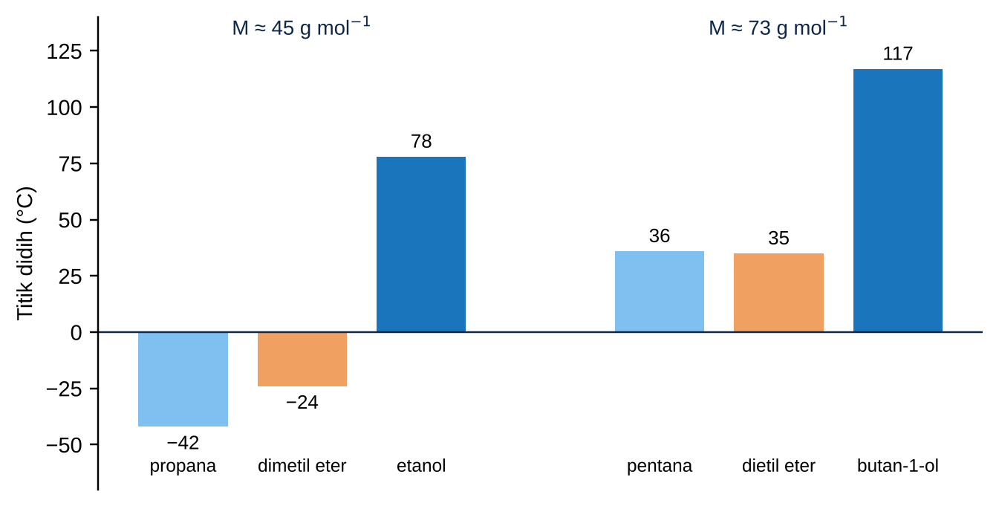
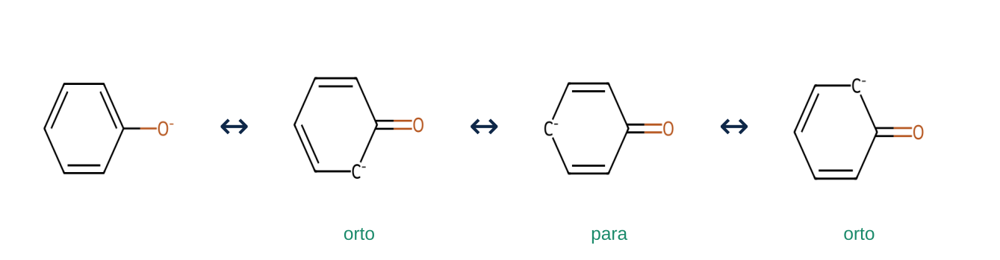
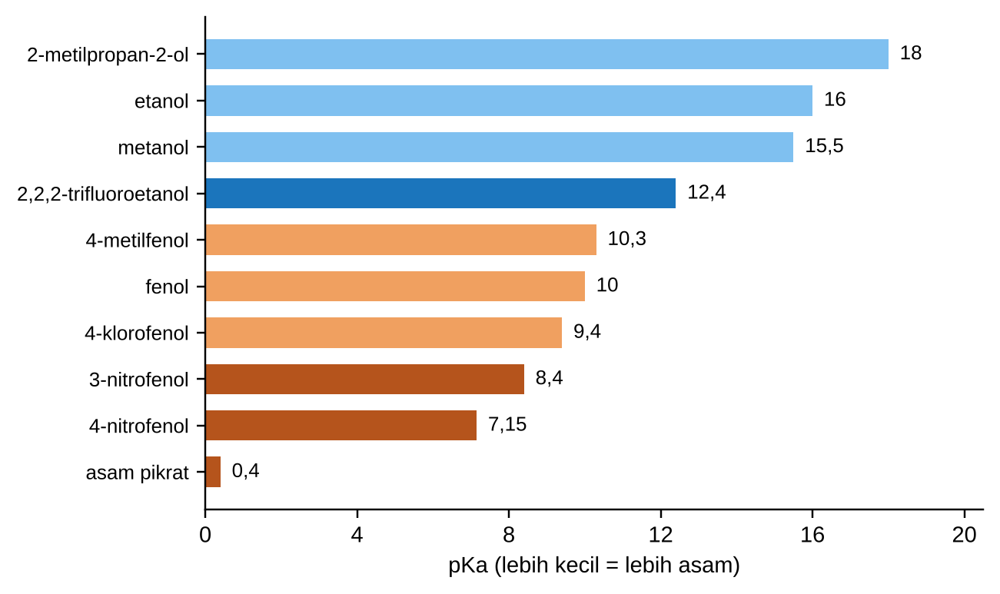
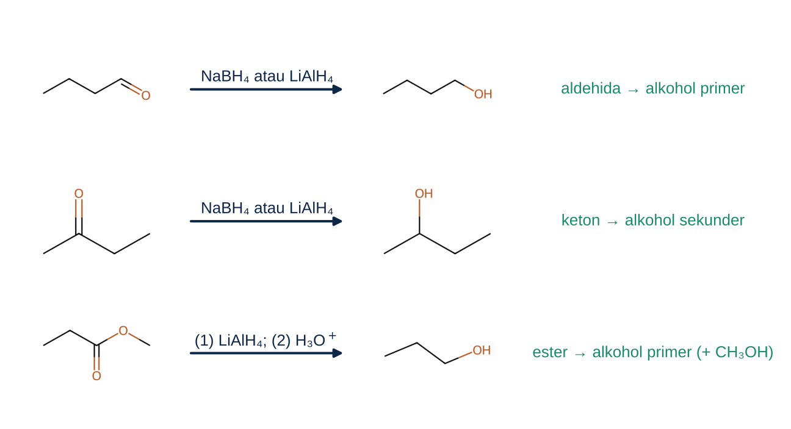
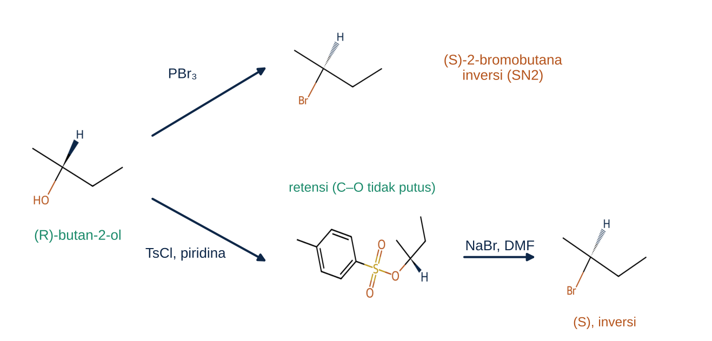

# Bab 9 Alkohol, Fenol, Eter, dan Epoksida

Alat uji napas yang dulu dipakai polisi untuk memeriksa pengemudi mabuk bekerja dengan reaksi kimia yang sederhana. Udara yang diembuskan pengemudi dilewatkan ke dalam tabung berisi kalium dikromat dalam asam sulfat, yang berwarna jingga. Bila napas itu mengandung etanol, warna jingga berubah menjadi hijau: ion dikromat (Cr₂O₇²⁻, jingga) tereduksi menjadi ion Cr³⁺ (hijau), sementara etanol teroksidasi menjadi asam asetat. Makin banyak etanol, makin panjang bagian tabung yang berubah hijau.

Sekarang lakukan percobaan yang sama dengan tiga alkohol isomer C₄H₁₀O. Butan-1-ol mengubah warna dikromat menjadi hijau, begitu pula butan-2-ol. Tetapi 2-metilpropan-2-ol (*tert*-butil alkohol) tidak mengubah warna sama sekali, walaupun ketiganya mempunyai gugus –OH yang sama, rumus yang sama, dan larut dalam pereaksi yang sama. Mengapa satu alkohol menolak dioksidasi? Jawabannya ternyata tidak terletak pada gugus –OH, tetapi pada atom H yang terikat pada karbon pembawa –OH. Kita akan kembali ke teka-teki ini di subbab 9.5.

Alkohol, fenol, dan eter adalah keluarga senyawa yang membawa atom oksigen berikatan tunggal. Pada **alkohol**, gugus –OH terikat pada karbon sp³. Pada **fenol**, gugus –OH terikat langsung pada cincin benzena. Pada **eter**, oksigen terikat pada dua gugus karbon, R–O–R'. **Epoksida** adalah eter dengan cincin beranggota tiga. Senyawa-senyawa ini ada di mana-mana: etanol dalam minuman dan bahan bakar, gliserol dalam lemak, kolesterol dalam membran sel, fenol dalam antiseptik dan vitamin E, dietil eter dan THF sebagai pelarut, dan epoksida sebagai bahan perekat dan obat.

Bagi kimiawan organik, alkohol adalah **persimpangan jalan**. Alkohol dapat dibuat dari hampir semua gugus fungsi lain (alkena, alkil halida, aldehida, keton, ester), dan dapat diubah menjadi hampir semua gugus fungsi lain (alkil halida, alkena, eter, aldehida, keton, asam karboksilat). Bab ini membahas jalan-jalan itu. Dua gagasan akan berulang terus: **gugus –OH adalah gugus pergi yang buruk dan harus diubah dulu** menjadi gugus pergi yang baik, dan **oksidasi alkohol bergantung pada banyaknya H pada karbon pembawa –OH**.

::: {.kuis}
**Pertanyaan pembuka**

1. Mengapa etanol mendidih pada 78 °C, sedangkan dimetil eter dengan rumus yang sama mendidih pada −24 °C?
2. Mengapa fenol sejuta kali lebih asam daripada etanol, sehingga larut dalam larutan NaOH, padahal keduanya sama-sama mempunyai gugus –OH?
3. Mengapa alkohol tidak bereaksi dengan NaBr, tetapi bereaksi dengan HBr?
4. Mengapa alkohol primer dapat dioksidasi menjadi aldehida atau asam karboksilat, alkohol sekunder hanya menjadi keton, dan alkohol tersier tidak dapat dioksidasi?
5. Bagaimana vitamin E melindungi lemak di membran sel dari kerusakan oleh oksigen?
6. Mengapa eter hampir tidak bereaksi dengan apa pun, sedangkan epoksida, yang juga eter, mudah dibuka oleh banyak nukleofil?
7. Mengapa epoksida dibuka di karbon yang berbeda dalam asam dan dalam basa?
:::

::: {.tujuan}
**Tujuan belajar**

Setelah mempelajari bab ini, kamu mampu:

1. Menjelaskan sifat fisika alkohol, fenol, dan eter dari ikatan hidrogen, dan membandingkan keasaman alkohol dan fenol dengan resonansi, efek induktif, dan solvasi.
2. Membuat alkohol dari alkena, alkil halida, dan senyawa karbonil (reduksi dengan NaBH₄ dan LiAlH₄, adisi pereaksi Grignard).
3. Mengubah alkohol menjadi alkil halida dengan HX, SOCl₂, atau PBr₃, dan meramalkan stereokimia serta kemungkinan penataan ulangnya.
4. Memilih kondisi dehidrasi alkohol (asam atau POCl₃) dan menjelaskan penataan ulang pinakol.
5. Menentukan bilangan oksidasi karbon dan memilih oksidator (PCC, Swern, Dess–Martin, kromat) untuk membuat aldehida, keton, atau asam karboksilat.
6. Memakai gugus pelindung silil eter dalam sintesis.
7. Menjelaskan oksidasi fenol menjadi kuinon dan cara kerja antioksidan fenolik.
8. Membuat eter dengan sintesis Williamson dan alkoksimerkurasi, dan memutus eter dengan HBr atau HI.
9. Menjelaskan cara kerja eter mahkota.
10. Membuat epoksida dan meramalkan regiokimia serta stereokimia pembukaan cincinnya dalam asam dan basa.
11. Menjelaskan sifat tiol dan sulfida, termasuk ikatan disulfida dalam protein.
:::

::: {.mat}
**Prasyarat**

Bab 1: ikatan hidrogen (subbab 1.9). Bab 2: tata nama alkohol, eter, dan fenol (subbab 2.6–2.8). Bab 3: pKa, resonansi, efek induktif, dan pelarut (subbab 3.2–3.11). Bab 6: karbokation dan penataan ulang (subbab 6.10). Bab 7: SN1, SN2, E1, E2, tosilat, pereaksi Grignard (subbab 7.5–7.14). Bab 8: hidrasi, hidroborasi, epoksidasi, dihidroksilasi (subbab 8.5–8.9).
:::

## 9.1 Struktur, sifat, dan keasaman alkohol dan fenol

### Struktur dan penggolongan

Atom oksigen dalam alkohol terhibridisasi kira-kira sp³, dengan dua pasangan bebas dan sudut C–O–H sekitar 109° (pada metanol 108,5°). Ikatan C–O dan O–H sama-sama polar, karena oksigen jauh lebih elektronegatif daripada karbon dan hidrogen. Akibatnya karbon pembawa –OH sedikit positif (δ+), hidrogen –OH sedikit positif, dan oksigen membawa muatan parsial negatif serta dua pasangan bebas.

Seperti alkil halida, alkohol digolongkan menurut karbon yang membawa –OH: **primer** (RCH₂OH), **sekunder** (R₂CHOH), dan **tersier** (R₃COH). Penggolongan ini akan sangat penting di bab ini, karena menentukan mekanisme substitusi (subbab 9.3), kemudahan dehidrasi (subbab 9.4), dan hasil oksidasi (subbab 9.5). Tata nama alkohol, fenol, dan eter sudah dibahas di subbab 2.6–2.8: alkohol mendapat akhiran *-ol* (butan-2-ol), dan eter biasanya dinamai sebagai alkoksialkana (metoksietana) atau dengan nama umum (etil metil eter).

### Ikatan hidrogen dan titik didih

Gugus –OH dapat membentuk **ikatan hidrogen** (subbab 1.9): hidrogen yang δ+ pada satu molekul tertarik ke pasangan bebas oksigen pada molekul lain. Setiap molekul alkohol dapat memberi satu ikatan hidrogen (lewat H-nya) dan menerima dua (lewat dua pasangan bebasnya), sehingga molekul-molekul alkohol dalam cairan saling terikat membentuk jaringan. Untuk mendidihkan alkohol, jaringan ini harus diputus, dan itu memerlukan energi tambahan.

Pengaruhnya sangat besar. Bandingkan tiga senyawa dengan massa molar hampir sama:

| Senyawa | Rumus | Massa molar (g mol⁻¹) | Titik didih (°C) |
|---|---|---|---|
| propana | CH₃CH₂CH₃ | 44 | −42 |
| dimetil eter | CH₃OCH₃ | 46 | −24 |
| etanol | CH₃CH₂OH | 46 | 78 |
| pentana | CH₃(CH₂)₃CH₃ | 72 | 36 |
| dietil eter | CH₃CH₂OCH₂CH₃ | 74 | 35 |
| butan-1-ol | CH₃(CH₂)₃OH | 74 | 117 |

Eter mendidih hampir sama dengan alkana yang seukuran. Molekul eter memang sedikit polar, tetapi tidak mempunyai H yang terikat pada oksigen, sehingga molekul eter tidak dapat membentuk ikatan hidrogen satu sama lain. Alkohol mendidih sekitar 80–120 derajat lebih tinggi, semata-mata karena ikatan hidrogen.

{width=80%}

### Kelarutan dalam air

Alkohol kecil (metanol, etanol, propanol) bercampur dengan air dalam segala perbandingan, karena gugus –OH dapat berikatan hidrogen dengan molekul air. Rantai hidrokarbon, sebaliknya, tidak dapat berikatan hidrogen dan "mendorong" molekul air menjauh. Makin panjang rantai, makin kecil kelarutannya: butan-1-ol hanya larut sekitar 7 g per 100 mL air, dan heksan-1-ol kurang dari 1 g. Aturan praktis: satu gugus –OH dapat "membawa" sekitar tiga sampai empat karbon ke dalam air. Eter juga dapat **menerima** ikatan hidrogen dari air (lewat pasangan bebas oksigen), walaupun tidak dapat memberi. Karena itu dietil eter larut dalam air sekitar 7 g per 100 mL, kira-kira sama dengan butan-1-ol, walaupun titik didih keduanya sangat berbeda.

### Keasaman alkohol

Alkohol adalah asam yang sangat lemah, kira-kira sekuat air. pKa metanol 15,5, etanol 16, dan 2-metilpropan-2-ol 18 (subbab 3.2). Basa konjugatnya, ion **alkoksida** (RO⁻), adalah basa kuat, kira-kira sekuat hidroksida.

Mengapa alkohol tersier sedikit kurang asam? Penjelasan yang dulu sering diberikan adalah efek "pendorong elektron" gugus alkil. Pengukuran dalam fase gas menunjukkan hal yang sebaliknya: tanpa pelarut, *tert*-butil alkohol justru **lebih** asam daripada metanol, karena gugus alkil yang besar mudah terpolarisasi dan membantu menampung muatan negatif. Urutan dalam air terbalik karena **solvasi**. Ion metoksida yang kecil mudah dikelilingi molekul air yang menstabilkannya dengan ikatan hidrogen. Ion *tert*-butoksida yang besar dan "berbulu" sulit dikelilingi, sehingga kurang tersolvasi dan kurang stabil. Pelajaran umumnya: keasaman dalam larutan adalah sifat pasangan zat terlarut dan pelarut, bukan sifat molekul saja.

Efek induktif, sebaliknya, bekerja seperti yang kita harapkan (subbab 3.7). 2,2,2-Trifluoroetanol, CF₃CH₂OH, mempunyai pKa 12,4, sekitar seribu kali lebih asam daripada etanol: ketiga atom fluorin menarik kerapatan elektron dan menstabilkan ion alkoksida.

Karena pKa alkohol (16) sedikit di atas pKa air (15,7), NaOH **tidak** dapat mengubah alkohol menjadi alkoksida secara tuntas: *K* untuk etanol + OH⁻ ⇌ etoksida + H₂O hanya $10^{15{,}7 - 16} = 0{,}5$. Untuk membuat alkoksida, dipakai basa yang jauh lebih kuat, atau logam aktif:

$$
2\,\text{ROH} + 2\,\text{Na} \longrightarrow 2\,\text{RO}^-\text{Na}^+ + \text{H}_2 \qquad \text{ROH} + \text{NaH} \longrightarrow \text{RO}^-\text{Na}^+ + \text{H}_2 \qquad \text{(9.1)}
$$

Pada kedua reaksi, gas H₂ yang lepas menarik kesetimbangan sepenuhnya ke kanan. Natrium hidrida sangat populer di laboratorium karena hasil sampingnya hanya gas.

### Alkohol sebagai basa

Pasangan bebas oksigen membuat alkohol juga dapat bertindak sebagai **basa lemah**. Dalam asam kuat, alkohol terprotonasi menjadi ion **oksonium**, ROH₂⁺, yang pKa-nya sekitar −2. Protonasi ini sangat penting, karena mengubah –OH (gugus pergi buruk, karena pergi sebagai OH⁻) menjadi –OH₂⁺ (gugus pergi baik, karena pergi sebagai H₂O). Hampir semua reaksi alkohol dalam asam dimulai dengan langkah ini. Zat seperti alkohol, yang dapat bertindak sebagai asam maupun basa, disebut **amfoter**.

### Keasaman fenol

Fenol, C₆H₅OH, mempunyai pKa 10,0, sejuta kali lebih asam daripada etanol. Dalam energi, faktor sejuta setara dengan sekitar 34 kJ mol⁻¹ pada suhu kamar. Dari mana keuntungan sebesar itu?

Jawabannya **resonansi** (subbab 3.6). Pada ion etoksida, muatan negatif terkurung di satu atom oksigen. Pada ion **fenoksida**, salah satu pasangan bebas oksigen bertumpang tindih dengan sistem π cincin benzena, sehingga muatan negatif tersebar ke tiga karbon cincin: dua karbon *orto* dan satu karbon *para*. Muatan yang tersebar ke empat atom lebih stabil daripada muatan yang terkurung di satu atom.

{width=96%}

Penyebaran muatan ke posisi *orto* dan *para* menjelaskan pengaruh substituen. Gugus penarik elektron di posisi *orto* atau *para*, terutama gugus nitro yang dapat ikut menampung muatan lewat resonansi, menurunkan pKa dengan tajam:

| Fenol | pKa |
|---|---|
| 4-metilfenol (*p*-kresol) | 10,3 |
| fenol | 10,0 |
| 4-klorofenol | 9,4 |
| 3-nitrofenol | 8,4 |
| 4-nitrofenol | 7,15 |
| 2,4,6-trinitrofenol (asam pikrat) | 0,4 |

Gugus nitro di posisi *meta* juga menurunkan pKa, tetapi lebih sedikit, karena di posisi *meta* gugus nitro hanya bekerja lewat efek induktif: muatan resonansi tidak pernah sampai ke karbon *meta*. Gugus metil, pendorong elektron, sedikit menaikkan pKa. Asam pikrat, dengan tiga gugus nitro, hampir sekuat asam kuat.

{width=82%}

::: {.contoh}
**Contoh 9.1 · Memisahkan fenol dari alkohol dengan ekstraksi**

Sebuah campuran 4-metilfenol dan sikloheksanol dilarutkan dalam dietil eter. Bagaimana memisahkan keduanya dengan corong pisah? Mengapa larutan natrium bikarbonat tidak dapat dipakai?

**Rencana.** Ubah salah satu senyawa menjadi garam yang larut dalam air dengan basa yang tepat. Bandingkan pKa senyawa dengan pKa asam konjugat basa.

**Penyelesaian.** Kocok larutan eter dengan NaOH 1 M dalam air. Untuk 4-metilfenol + OH⁻, $K = 10^{15{,}7 - 10{,}3} \approx 2{,}5 \times 10^{5}$: fenol hampir seluruhnya berubah menjadi ion fenoksida, yang pindah ke lapisan air. Sikloheksanol (pKa sekitar 16) hampir tidak bereaksi dan tetap di lapisan eter. Pisahkan kedua lapisan; asamkan lapisan air dengan HCl, dan 4-metilfenol mengendap atau dapat diekstraksi kembali ke eter. Dengan NaHCO₃, $K = 10^{6{,}35 - 10{,}3} \approx 1 \times 10^{-4}$: bikarbonat terlalu lemah untuk mendeprotonasi fenol, sehingga fenol tetap di lapisan eter.

**Memahami hasil.** Ekstraksi asam–basa memanfaatkan perbedaan pKa. Asam karboksilat (pKa sekitar 4–5) larut dalam NaHCO₃, fenol (pKa sekitar 10) hanya dalam NaOH, dan alkohol (pKa 16–18) dalam keduanya tidak. Dengan dua kali ekstraksi berurutan, ketiga golongan dapat dipisahkan.
:::

::: {.kuis}
**Kuis cepat 9.1** (a) Urutkan titik didih: butan-1-ol, dietil eter, pentana, butana-1,4-diol. (b) Urutkan keasaman: etanol, fenol, 4-nitrofenol, 2,2,2-trifluoroetanol. (c) Berapa persen fenol (pKa 10,0) yang terionisasi pada pH 7?
:::

## 9.2 Membuat alkohol

Karena alkohol adalah persimpangan jalan, cara membuatnya juga banyak. Yang sudah kita kenal dapat diringkas dulu, lalu kita tambahkan dua cara terpenting: reduksi senyawa karbonil dan adisi pereaksi Grignard.

### Cara yang sudah kita kenal

- **Dari alkil halida dengan SN2**: R–X + OH⁻ → R–OH. Berguna terutama untuk substrat primer; dengan substrat sekunder dan tersier, eliminasi bersaing atau mendominasi (subbab 7.12).
- **Dari alkena dengan hidrasi**: hidrasi katalis asam atau oksimerkurasi–demerkurasi (Markovnikov), atau hidroborasi–oksidasi (anti-Markovnikov, syn) (subbab 8.5–8.6).
- **Diol 1,2 dari alkena**: OsO₄ (syn) atau epoksidasi lalu hidrolisis (anti) (subbab 8.9).

### Reduksi aldehida dan keton

Gugus karbonil, C=O, dapat menerima dua atom hidrogen, satu pada karbon dan satu pada oksigen, dan berubah menjadi alkohol. **Aldehida menghasilkan alkohol primer, dan keton menghasilkan alkohol sekunder.** Reaksi ini adalah reduksi, karena karbon mendapat ikatan ke hidrogen (subbab 9.5).

Pereaksi yang paling sering dipakai adalah **natrium borohidrida**, NaBH₄, dan **litium aluminium hidrida**, LiAlH₄. Keduanya adalah sumber **ion hidrida** (H:⁻), hidrogen dengan sepasang elektron, yang bertindak sebagai nukleofil. Mekanismenya dua langkah:

1. Hidrida dari BH₄⁻ atau AlH₄⁻ menyerang karbon karbonil yang δ+. Pasangan elektron ikatan π C=O berpindah ke oksigen, membentuk ion alkoksida.
2. Alkoksida diprotonasi oleh pelarut (metanol atau air) atau oleh asam encer yang ditambahkan di akhir, menghasilkan alkohol.

Langkah 1 adalah **adisi nukleofilik pada gugus karbonil**, reaksi khas aldehida dan keton yang akan dibahas tuntas di Bab 11. Satu BH₄⁻ mempunyai empat atom H, sehingga dapat mereduksi sampai empat molekul karbonil.

Kedua pereaksi berbeda kekuatannya:

- **NaBH₄** lunak dan selektif. Pereaksi ini mereduksi aldehida dan keton, tetapi tidak mereduksi ester, asam karboksilat, amida, atau ikatan C=C. NaBH₄ cukup aman dipakai dalam metanol, etanol, atau bahkan air.
- **LiAlH₄** jauh lebih kuat. Selain aldehida dan keton, LiAlH₄ juga mereduksi **ester dan asam karboksilat menjadi alkohol primer**. Tetapi LiAlH₄ bereaksi hebat dengan air dan alkohol (melepaskan H₂, bisa menyala), sehingga harus dipakai dalam eter kering atau THF, dan air atau asam baru ditambahkan pada tahap kedua.

Hidrogenasi katalitik (H₂ dengan Ni, Pt, atau Ru, biasanya pada tekanan lebih tinggi daripada untuk C=C) juga mereduksi C=O, tetapi juga mereduksi C=C, sehingga kurang selektif.

{width=96%}

::: {.contoh}
**Contoh 9.2 · Memilih pereaksi reduksi**

Senyawa A, metil 4-oksopentanoat, CH₃COCH₂CH₂COOCH₃, mempunyai gugus keton dan gugus ester. Tulis produk A dengan (a) NaBH₄ dalam metanol; (b) LiAlH₄ dalam THF, lalu H₃O⁺.

**Penyelesaian.** (a) NaBH₄ hanya mereduksi keton: **metil 4-hidroksipentanoat**, CH₃CH(OH)CH₂CH₂COOCH₃. Gugus ester tetap utuh. (b) LiAlH₄ mereduksi keduanya. Keton menjadi alkohol sekunder; ester menjadi alkohol primer dan melepaskan metanol. Produk: **pentana-1,4-diol**, HOCH₂CH₂CH₂CH(OH)CH₃.

**Memahami hasil.** Perbedaan kekuatan dua pereaksi hidrida memungkinkan kita memilih gugus mana yang direduksi. Inilah contoh pertama **kemoselektivitas**: pereaksi membedakan dua gugus fungsi dalam satu molekul. (Pada (a), alkohol yang terbentuk dapat menyerang ester di molekul yang sama dan menutup cincin lakton beranggota lima bila dipanaskan; kita abaikan dulu kemungkinan ini.)
:::

### Adisi pereaksi Grignard pada karbonil

Pereaksi Grignard, R–MgX (subbab 7.14), mempunyai karbon yang bermuatan parsial negatif dan bertindak sebagai **nukleofil karbon**. Pereaksi ini menyerang karbon karbonil seperti hidrida, tetapi yang masuk adalah gugus karbon. Setelah protonasi dengan asam encer, terbentuk alkohol dengan **ikatan C–C baru**. Inilah salah satu cara terpenting untuk membangun kerangka karbon. Jenis alkohol yang terbentuk bergantung pada senyawa karbonilnya:

| Senyawa karbonil | + R–MgX, lalu H₃O⁺ | Produk |
|---|---|---|
| formaldehida, HCHO | satu R masuk | alkohol primer RCH₂OH |
| aldehida lain, R'CHO | satu R masuk | alkohol sekunder RR'CHOH |
| keton, R'R''CO | satu R masuk | alkohol tersier RR'R''COH |
| ester, R'COOR'' | **dua** R masuk | alkohol tersier R₂R'COH |
| epoksida (etilena oksida) | membuka cincin | alkohol primer RCH₂CH₂OH |

Ester menerima dua gugus R: gugus pertama mengusir –OR'' dan membentuk keton, yang lebih reaktif daripada ester dan segera menerima gugus R kedua. Rincian mekanismenya dibahas di Bab 11 dan 12. Satu hal yang harus diingat sekarang: pereaksi Grignard adalah basa yang sangat kuat, sehingga molekul yang direaksikan dengannya tidak boleh mempunyai H yang asam (–OH, –NH, –COOH, alkuna ujung). Gugus seperti itu akan menghancurkan pereaksi Grignard lebih dulu, dan masalah ini diatasi dengan gugus pelindung (subbab 9.6).

::: {.contoh}
**Contoh 9.3 · Alkohol tersier dari tiga jalan**

Tunjukkan tiga cara membuat 2-fenilbutan-2-ol, C₆H₅C(OH)(CH₃)CH₂CH₃, dengan pereaksi Grignard.

**Rencana.** Karbon pembawa –OH mempunyai tiga gugus: fenil, metil, dan etil. Setiap gugus dapat berasal dari pereaksi Grignard, dan dua gugus sisanya sudah ada pada keton.

**Penyelesaian.**

1. C₆H₅MgBr + butan-2-on (CH₃COCH₂CH₃).
2. CH₃MgBr + 1-fenilpropan-1-on (C₆H₅COCH₂CH₃).
3. CH₃CH₂MgBr + asetofenon (C₆H₅COCH₃).

Setiap cara diikuti protonasi dengan H₃O⁺ encer.

**Memahami hasil.** Untuk alkohol tersier, "potong" satu dari tiga ikatan C–C di sekitar karbon pembawa –OH: gugus yang dipotong menjadi pereaksi Grignard, sisanya menjadi keton. Pilihan di antara ketiga cara bergantung pada bahan yang tersedia dan harganya. Bila dua dari tiga gugus sama, ester dengan dua ekuivalen Grignard juga dapat dipakai.
:::

::: {.kuis}
**Kuis cepat 9.2** Tulis produk (a) sikloheksanon + NaBH₄; (b) etil benzoat + LiAlH₄, lalu H₃O⁺; (c) propanal + CH₃MgBr, lalu H₃O⁺; (d) etil asetat + 2 C₆H₅MgBr, lalu H₃O⁺.
:::

## 9.3 Alkohol menjadi alkil halida

Gugus –OH adalah gugus pergi yang sangat buruk: bila lepas, ia pergi sebagai OH⁻, basa kuat (pKa air 15,7). Itulah sebabnya alkohol tidak bereaksi dengan NaBr: Br⁻ tidak mampu mengusir OH⁻. Semua cara mengubah alkohol menjadi alkil halida bekerja dengan prinsip yang sama: **ubah dulu –OH menjadi gugus pergi yang baik**, lalu biarkan ion halida menggantinya.

### Dengan HX

Asam halida kuat (HCl, HBr, HI) memprotonasi oksigen alkohol, sehingga gugus perginya menjadi air, molekul netral yang stabil. Mekanisme selanjutnya bergantung pada jenis alkohol, sama seperti alkil halida di Bab 7:

- **Alkohol tersier** bereaksi lewat **SN1**: air lepas membentuk karbokation tersier, lalu X⁻ menyerangnya. Reaksinya cepat, bahkan dengan HCl pekat pada suhu kamar. 2-Metilpropan-2-ol dikocok dengan HCl pekat dan dalam beberapa menit terbentuk lapisan 2-kloro-2-metilpropana.
- **Alkohol primer** bereaksi lewat **SN2**: X⁻ menyerang karbon dari belakang sambil air lepas. HBr dan HI bekerja dengan baik, karena Br⁻ dan I⁻ adalah nukleofil yang baik. HCl lambat, karena Cl⁻ nukleofil yang lebih lemah, sehingga memerlukan seng klorida (ZnCl₂) sebagai asam Lewis yang membantu menarik gugus –OH.
- **Alkohol sekunder** berada di tengah dan dapat bereaksi lewat kedua jalur. Karena dapat lewat karbokation, **penataan ulang** mungkin terjadi.

**Uji Lucas** memanfaatkan perbedaan laju ini. Pereaksi Lucas adalah ZnCl₂ dalam HCl pekat. Alkohol kecil larut di dalamnya, tetapi alkil klorida yang terbentuk tidak larut dan membuat larutan keruh. Alkohol tersier membuat larutan keruh hampir seketika, alkohol sekunder dalam sekitar lima menit, dan alkohol primer tidak bereaksi pada suhu kamar.

### Dengan SOCl₂ dan PBr₃

Untuk alkohol primer dan sekunder, kimiawan lebih suka pereaksi yang tidak melewati karbokation:

- **Tionil klorida**, SOCl₂, biasanya dengan piridina, mengubah ROH menjadi **RCl**. Oksigen alkohol menyerang belerang dan menggantikan satu klorida, membentuk **klorosulfit**, R–O–S(=O)Cl. Gugus ini adalah gugus pergi yang sangat baik. Ion klorida kemudian menyerang karbon dari belakang (SN2), dan gugus perginya pecah menjadi SO₂ (gas) dan Cl⁻. Karena hasil sampingnya gas (SO₂ dan HCl yang ditangkap piridina), produk mudah dimurnikan.
- **Fosfor tribromida**, PBr₃, mengubah ROH menjadi **RBr**. Oksigen menyerang fosfor dan menggantikan satu bromida, membentuk R–O–PBr₂, lalu Br⁻ menyerang karbon dari belakang (SN2). Satu PBr₃ dapat mengubah tiga molekul alkohol.

Karena langkah terakhirnya SN2, kedua pereaksi memberi **inversi konfigurasi** pada karbon kiral dan **tidak ada penataan ulang**. Keduanya tidak cocok untuk alkohol tersier, karena SN2 tidak terjadi pada karbon tersier.

{width=96%}

Tosilat dan mesilat (subbab 7.13) adalah cara ketiga mengubah –OH menjadi gugus pergi yang baik. Tosilasi tidak menyentuh ikatan C–O, sehingga konfigurasi dipertahankan, dan gugus tosilat kemudian dapat diganti oleh nukleofil apa pun, bukan hanya halida.

::: {.contoh}
**Contoh 9.4 · HBr atau PBr₃**

3-Metilbutan-2-ol diubah menjadi bromida dengan dua cara: (a) HBr pekat, panas; (b) PBr₃. Tulis produk utama masing-masing.

**Penyelesaian.** (a) Alkohol sekunder dalam asam kuat dapat membentuk karbokation sekunder di C2. Karbon tetangganya, C3, tersier dan membawa satu H. Geseran hidrida memberi karbokation tersier di C3, dan Br⁻ menyerangnya: produk utama **2-bromo-2-metilbutana**, dengan kerangka yang tertata ulang. (b) PBr₃ bekerja lewat SN2 tanpa karbokation: **2-bromo-3-metilbutana**, dengan Br tepat di tempat –OH semula.

**Memahami hasil.** Bila kamu ingin halogen tepat di tempat –OH, terutama pada alkohol sekunder, pilih SOCl₂, PBr₃, atau rute tosilat. HX hanya aman untuk alkohol tersier (yang tidak dapat menata ulang ke yang lebih stabil) dan alkohol primer tanpa cabang di dekatnya.
:::

::: {.kuis}
**Kuis cepat 9.3** Tulis produk (a) (*S*)-pentan-2-ol + SOCl₂, piridina; (b) 1-metilsikloheksanol + HCl pekat; (c) butan-1-ol + PBr₃. Untuk (a), tentukan konfigurasi produk.
:::

## 9.4 Dehidrasi alkohol

Dehidrasi alkohol dengan asam sudah kita bahas sebagai cara membuat alkena (subbab 8.2): mekanismenya E1 untuk alkohol tersier dan sekunder, produknya Zaitsev, dan karbokation dapat menata ulang. Di sini kita menambahkan dua hal: cara dehidrasi tanpa asam kuat, dan satu penataan ulang khusus pada diol.

### Dehidrasi dengan POCl₃ dan piridina

Asam pekat panas dapat merusak gugus lain dalam molekul dan menimbulkan penataan ulang. Cara yang lebih lembut adalah **fosforil klorida**, POCl₃, dalam **piridina** pada suhu 0 °C sampai suhu kamar. Oksigen alkohol menyerang fosfor dan membentuk ester diklorofosfat, R–O–POCl₂, gugus pergi yang baik. Piridina, yang berperan sebagai pelarut sekaligus basa, mengambil proton dari karbon tetangga, dan gugus pergi lepas bersamaan: **E2**. Karena tidak ada karbokation, **tidak ada penataan ulang**, dan karena E2, syarat anti-periplanar berlaku (subbab 7.10). Cara ini bekerja baik untuk alkohol sekunder dan tersier.

::: {.contoh}
**Contoh 9.5 · Dua cara dehidrasi, dua alkena**

Tulis produk utama dehidrasi 3,3-dimetilbutan-2-ol dengan (a) H₂SO₄ panas; (b) POCl₃, piridina.

**Penyelesaian.** (a) Lewat E1: karbokation sekunder di C2 mengalami geseran metil dari C3, menjadi karbokation tersier di C3, lalu melepas proton dari C2 sehingga terbentuk **2,3-dimetilbut-2-ena** (tetrasubstitusi). (b) Lewat E2 tanpa karbokation: proton hanya dapat diambil dari C1 (metil), karena C3 tidak mempunyai H. Produk: **3,3-dimetilbut-1-ena**, dengan kerangka yang utuh.

**Memahami hasil.** Satu alkohol memberi dua alkena yang kerangkanya berbeda. Seperti pada adisi (oksimerkurasi lawan hidrasi asam, Contoh 8.6), menghindari karbokation adalah cara menghindari penataan ulang.
:::

### Penataan ulang pinakol

Diol 1,2 dalam asam menjalani penataan ulang yang khas. Contoh klasiknya adalah **pinakol**, 2,3-dimetilbutana-2,3-diol, yang dalam asam sulfat berubah menjadi **pinakolon**, 3,3-dimetilbutan-2-on. Mekanismenya:

1. Salah satu –OH terprotonasi dan lepas sebagai air, membentuk karbokation tersier.
2. Satu gugus metil dari karbon tetangga (yang membawa –OH kedua) bergeser ke karbokation.
3. Muatan positif kini berada di karbon yang membawa –OH. Pasangan bebas oksigen langsung menstabilkannya membentuk ikatan rangkap C=O⁺–H, ion **oksokarbenium**, yang jauh lebih stabil daripada karbokation biasa karena setiap atom mempunyai oktet lengkap.
4. Proton lepas dari oksigen, menghasilkan keton.

Gaya pendorong penataan ulang ini adalah pembentukan ikatan C=O yang kuat. Di sini geseran metil terjadi walaupun karbokation awalnya sudah tersier, karena hasil akhirnya, kation yang distabilkan oleh oksigen, jauh lebih stabil.

::: {.kuis}
**Kuis cepat 9.4** (a) Tulis produk 1-metilsikloheksanol dengan POCl₃, piridina. (b) Tulis produk penataan ulang pinakol dari 1,1,2,2-tetrafenil­etana-1,2-diol.
:::
