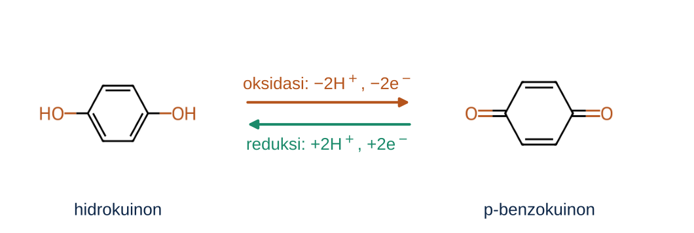

## 9.5 Oksidasi alkohol dan bilangan oksidasi karbon

### Menghitung tingkat oksidasi karbon

Dalam kimia anorganik, oksidasi berarti kehilangan elektron dan bilangan oksidasi naik. Dalam kimia organik, cara yang lebih praktis adalah menghitung **bilangan oksidasi karbon** dari ikatan-ikatannya:

- setiap ikatan ke atom yang **lebih elektronegatif** (O, N, halogen) menyumbang **+1**;
- setiap ikatan ke **hidrogen** menyumbang **−1**;
- ikatan ke karbon lain menyumbang **0**.

Ikatan rangkap dihitung sesuai jumlah ikatannya (C=O menyumbang +2). Dengan aturan ini, deret satu karbon menjadi tangga oksidasi yang rapi:

| Senyawa | CH₄ | CH₃OH | HCHO | HCOOH | CO₂ |
|---|---|---|---|---|---|
| Bilangan oksidasi C | −4 | −2 | 0 | +2 | +4 |
| Golongan | alkana | alkohol | aldehida | asam karboksilat | karbon dioksida |

**Oksidasi** dalam kimia organik berarti karbon kehilangan ikatan ke H atau mendapat ikatan ke O (bilangan oksidasi naik). **Reduksi** adalah kebalikannya. Reduksi karbonil dengan NaBH₄ (subbab 9.2) menaikkan jumlah ikatan C–H, sehingga memang reduksi. Pada setiap tangga oksidasi, karbon naik dua satuan dan kehilangan dua elektron.

{width=94%}

### Mengapa alkohol tersier tidak teroksidasi

Oksidasi alkohol menjadi senyawa karbonil memerlukan dua atom H dilepas: H dari oksigen dan **H dari karbon pembawa –OH** (karbon karbinol). Ikatan C=O terbentuk di antara karbon dan oksigen yang kehilangan H itu. Jadi:

- **Alkohol primer**, RCH₂OH, mempunyai dua H pada karbon karbinol. Oksidasi pertama memberi **aldehida**, RCHO, yang masih mempunyai satu H pada karbon itu, sehingga dapat dioksidasi lagi menjadi **asam karboksilat**, RCOOH.
- **Alkohol sekunder**, R₂CHOH, mempunyai satu H dan teroksidasi menjadi **keton**, R₂C=O. Keton tidak mempunyai H lagi pada karbon karbonil, sehingga oksidasi berhenti.
- **Alkohol tersier**, R₃COH, **tidak mempunyai H** pada karbon karbinol, sehingga tidak dapat membentuk C=O tanpa memutus ikatan C–C. Pada kondisi biasa, alkohol tersier tidak teroksidasi.

Inilah jawaban teka-teki pembuka bab. Butan-1-ol (primer) dan butan-2-ol (sekunder) mereduksi dikromat yang jingga menjadi Cr³⁺ yang hijau, sedangkan 2-metilpropan-2-ol (tersier) tidak mempunyai H yang dapat dilepas dari karbon karbinolnya.

### Oksidator kromium(VI)

Mekanisme oksidasi dengan asam kromat, H₂CrO₄, memperlihatkan dengan jelas mengapa H pada karbon karbinol diperlukan:

1. Alkohol bereaksi dengan asam kromat membentuk **ester kromat**, R₂CH–O–CrO₃H. Kromium(VI) yang terikat pada oksigen adalah gugus pergi yang sangat baik, karena kromium sangat ingin menerima elektron.
2. Basa (air) mengambil **H dari karbon karbinol**, pasangan elektron ikatan C–H membentuk ikatan π C=O, dan ikatan O–Cr putus dengan elektronnya pergi ke kromium, yang tereduksi menjadi Cr(IV). Langkah ini mirip eliminasi E2, dengan C–H dan O–Cr sebagai pasangan yang dilepas.

Tanpa H pada karbon karbinol, langkah 2 tidak mungkin terjadi.

Beberapa oksidator kromium(VI) dipakai di laboratorium:

- **Pereaksi Jones** (CrO₃ dalam H₂SO₄ encer dan aseton). Dalam air, aldehida yang terbentuk dari alkohol primer menangkap air menjadi **hidrat**, RCH(OH)₂, yang mempunyai –OH dan H pada karbon yang sama, sehingga teroksidasi lagi. Hasilnya: alkohol primer → **asam karboksilat**, alkohol sekunder → keton.
- **Piridinium klorokromat (PCC)** dalam diklorometana. Tanpa air, aldehida tidak membentuk hidrat dan oksidasi **berhenti pada aldehida**. PCC adalah pilihan klasik untuk alkohol primer → aldehida.

Senyawa kromium(VI) bersifat karsinogenik dan mencemari lingkungan, sehingga laboratorium modern lebih memilih oksidator lain:

- **Oksidasi Swern**: dimetil sulfoksida (DMSO) yang diaktifkan dengan oksalil klorida pada −78 °C, lalu trietilamina. Alkohol primer → aldehida, sekunder → keton. Hasil sampingnya dimetil sulfida, yang berbau sangat busuk.
- **Periodinan Dess–Martin (DMP)**, senyawa iodium(V), pada suhu kamar dalam CH₂Cl₂. Lembut, cepat, dan juga berhenti pada aldehida.
- **Natrium hipoklorit** (bahan pemutih) dengan katalis TEMPO, cara yang murah dan ramah lingkungan.
- **KMnO₄** dalam basa mengoksidasi alkohol primer menjadi asam karboksilat, tetapi juga menyerang ikatan C=C.

::: {.inti}
**Memilih oksidator**

- Alkohol primer → **aldehida**: PCC, Swern, atau Dess–Martin (tanpa air).
- Alkohol primer → **asam karboksilat**: pereaksi Jones atau KMnO₄.
- Alkohol sekunder → **keton**: hampir semua oksidator di atas.
- Alkohol tersier: **tidak teroksidasi**.
:::

::: {.contoh}
**Contoh 9.6 · Alat uji napas**

Reaksi dalam alat uji napas adalah

$$
2\,\text{Cr}_2\text{O}_7^{2-} + 3\,\text{C}_2\text{H}_5\text{OH} + 16\,\text{H}^+ \longrightarrow 4\,\text{Cr}^{3+} + 3\,\text{CH}_3\text{COOH} + 11\,\text{H}_2\text{O}
$$

Periksa bahwa jumlah elektron yang dilepas etanol sama dengan jumlah elektron yang diterima kromium.

**Penyelesaian.** Karbon karbinol etanol mempunyai satu ikatan ke O (+1), dua ikatan ke H (−2), dan satu ke C (0): bilangan oksidasinya −1. Karbon karboksil asam asetat mempunyai tiga ikatan ke O (C=O dan C–O, +3) dan satu ke C: +3. Setiap molekul etanol melepas 4 elektron, sehingga tiga molekul melepas **12 elektron**. Setiap Cr berubah dari +6 menjadi +3 dan menerima 3 elektron; empat atom Cr menerima **12 elektron**. Seimbang.

**Memahami hasil.** Karbon metil etanol tidak berubah (−3 pada keduanya), jadi hanya karbon karbinol yang teroksidasi. Menghitung bilangan oksidasi karbon per atom memudahkan menyetarakan reaksi redoks organik.
:::

::: {.contoh}
**Contoh 9.7 · Memilih oksidator dalam molekul dengan dua –OH**

Tulis produk 2-metilpentana-1,4-diol, HOCH₂CH(CH₃)CH₂CH(OH)CH₃, dengan (a) PCC berlebih; (b) pereaksi Jones berlebih.

**Penyelesaian.** C1 membawa –OH primer, C4 membawa –OH sekunder. (a) PCC: primer → aldehida, sekunder → keton. Produk: **2-metil-4-oksopentanal**, OHC–CH(CH₃)–CH₂–CO–CH₃. (b) Jones: primer → asam karboksilat, sekunder → keton. Produk: **asam 2-metil-4-oksopentanoat**, HOOC–CH(CH₃)–CH₂–CO–CH₃.

**Memahami hasil.** Perbedaan PCC dan Jones hanya terlihat pada alkohol primer. Gugus –OH sekunder memberi keton dengan oksidator apa pun.
:::

### Oksidasi alkohol di dalam tubuh

Di hati, etanol dioksidasi oleh enzim **alkohol dehidrogenase**. Oksidatornya adalah koenzim **NAD⁺**, yang menerima ion hidrida (H:⁻) dari karbon karbinol, sementara proton –OH diambil oleh enzim. Etanol menjadi asetaldehida, lalu enzim lain mengoksidasi asetaldehida menjadi asam asetat. Asetaldehida yang beracun itulah yang menyebabkan sebagian besar gejala mabuk.

Metanol dioksidasi oleh enzim yang sama menjadi formaldehida dan asam format. Asam format merusak saraf mata dan dapat menyebabkan kebutaan dan kematian. Kasus keracunan metanol dari minuman oplosan masih sering terjadi. Salah satu pengobatannya justru pemberian **etanol** atau obat fomepizol: keduanya menempati enzim alkohol dehidrogenase, sehingga metanol tidak sempat dioksidasi dan dapat dikeluarkan dari tubuh dalam keadaan utuh.

::: {.kuis}
**Kuis cepat 9.5** (a) Tentukan bilangan oksidasi karbon yang dicetak tebal: CH₃**C**H₂Cl, CH₃**C**HO, **C**H₃COOH, (CH₃)₂**C**=CH₂. (b) Tulis produk sikloheksilmetanol dengan PCC dan dengan pereaksi Jones.
:::

## 9.6 Gugus pelindung untuk alkohol

### Masalahnya

Misalkan kita ingin membuat pereaksi Grignard dari 4-bromobutan-1-ol, BrCH₂CH₂CH₂CH₂OH, lalu mereaksikannya dengan aseton. Rencana ini gagal. Pereaksi Grignard adalah basa yang sangat kuat (asam konjugatnya alkana, pKa sekitar 50), sedangkan gugus –OH adalah asam dengan pKa 16. Segera setelah satu molekul Grignard terbentuk, ia mengambil proton –OH dari molekul lain (atau dari dirinya sendiri), dan pereaksi itu hancur menjadi alkana. Gugus –OH "mengganggu" reaksi yang sebenarnya tidak melibatkannya.

Penyelesaiannya adalah **gugus pelindung**: gugus –OH diubah sementara menjadi gugus yang tidak bereaksi dengan pereaksi yang akan dipakai, lalu diubah kembali menjadi –OH setelah reaksi selesai. Gugus pelindung yang baik memenuhi tiga syarat: mudah dipasang, tahan terhadap kondisi reaksi yang direncanakan, dan mudah dilepas tanpa merusak bagian lain molekul.

### Silil eter

Gugus pelindung alkohol yang paling banyak dipakai adalah **silil eter**, R–O–SiR'₃. Alkohol direaksikan dengan klorosilana dan basa lemah seperti imidazol atau trietilamina. Oksigen alkohol menyerang silikon dan menggantikan klorida (substitusi nukleofilik pada silikon), sementara basa menangkap HCl. Pilihan yang paling populer adalah **gugus *tert*-butildimetilsilil (TBS)**, dari *tert*-butildimetilsilil klorida, TBSCl.

Silil eter tidak mempunyai H yang asam, tidak bereaksi dengan pereaksi Grignard, organolitium, hidrida, kebanyakan oksidator, dan basa. Gugus *tert*-butil yang besar melindungi silikon dari serangan, sehingga TBS eter cukup kuat untuk bertahan dalam banyak reaksi. (Trimetilsilil eter, TMS, dengan gugus yang lebih kecil, terlalu mudah terlepas.)

Untuk melepas gugus pelindung, dipakai **ion fluorida**, biasanya sebagai tetrabutilamonium fluorida (TBAF) dalam THF. Fluorida menyerang silikon dan melepaskan ion alkoksida, yang kemudian terprotonasi. Reaksi ini sangat disukai karena ikatan Si–F (sekitar 580 kJ mol⁻¹) jauh lebih kuat daripada ikatan Si–O (sekitar 450 kJ mol⁻¹). Asam encer juga dapat melepas silil eter.

::: {.contoh}
**Contoh 9.8 · Sintesis dengan gugus pelindung**

Rancang sintesis 5-metilheksana-1,5-diol dari 4-bromobutan-1-ol dan aseton.

**Rencana.** Karbon C5 (pembawa –OH tersier dan dua metil) berasal dari aseton; rantai C1–C4 dengan –OH primer berasal dari 4-bromobutan-1-ol lewat pereaksi Grignard. Gugus –OH harus dilindungi selama tahap Grignard.

**Penyelesaian.**

1. Lindungi: HO(CH₂)₄Br + TBSCl, imidazol → TBSO(CH₂)₄Br.
2. Buat Grignard: Mg, eter → TBSO(CH₂)₄MgBr.
3. Adisi: + (CH₃)₂C=O, lalu H₃O⁺ encer dingin → TBSO(CH₂)₄C(OH)(CH₃)₂.
4. Lepas pelindung: TBAF, THF → HO(CH₂)₄C(OH)(CH₃)₂, **5-metilheksana-1,5-diol**.

**Memahami hasil.** Gugus pelindung menambah dua langkah (pasang dan lepas), sehingga dipakai hanya bila benar-benar perlu. Merancang sintesis yang tidak memerlukan pelindung, misalnya dengan mengubah urutan langkah, selalu lebih baik bila mungkin. Gugus –OH tersier yang terbentuk pada langkah 3 tidak perlu dilindungi, karena sesudahnya tidak ada lagi pereaksi yang terganggu olehnya.
:::

Gugus pelindung lain untuk alkohol antara lain **benzil eter** (dilepas dengan H₂, Pd/C) dan **tetrahidropiranil (THP) eter** (dilepas dengan asam encer). Pilihan bergantung pada kondisi yang harus ditahan: silil eter tahan basa tetapi rusak oleh fluorida dan asam, benzil eter tahan asam dan basa tetapi rusak oleh hidrogenasi.

::: {.kuis}
**Kuis cepat 9.6** Mengapa pereaksi Grignard tidak dapat dibuat langsung dari 3-bromopropan-1-ol? Tulis urutan pereaksi untuk mengubahnya menjadi heksana-1,4-diol memakai propanal.
:::

## 9.7 Fenol: kereaktifan, kuinon, dan antioksidan

### Cincin yang sangat aktif

Gugus –OH pada fenol tidak hanya membuat fenol lebih asam; pasangan bebas oksigennya juga "mendorong" elektron ke dalam cincin lewat resonansi, terutama ke posisi *orto* dan *para*. Cincin fenol karena itu jauh lebih nukleofilik daripada benzena biasa. Benzena memerlukan Br₂ dengan katalis FeBr₃ untuk bereaksi (Bab 10), tetapi fenol bereaksi dengan **air bromin** tanpa katalis pada suhu kamar, dan langsung menghasilkan endapan putih **2,4,6-tribromofenol**: ketiga posisi *orto* dan *para* tersubstitusi sekaligus. Reaksi ini dipakai sebagai uji fenol. Kimia substitusi aromatik dibahas di Bab 10.

Fenol pertama kali dipakai sebagai antiseptik oleh Joseph Lister pada tahun 1867, yang menurunkan angka kematian akibat infeksi setelah operasi secara dramatis. Fenol sendiri terlalu merusak kulit untuk dipakai sekarang, tetapi turunannya, seperti 4-heksilresorsinol dan klorosilenol, masih ada dalam obat kumur dan cairan antiseptik.

### Oksidasi fenol menjadi kuinon

Fenol tidak mempunyai H pada karbon pembawa –OH (karbon itu bagian dari cincin), sehingga tidak teroksidasi seperti alkohol. Fenol dengan dua –OH pada posisi *para*, yaitu **hidrokuinon** (benzena-1,4-diol), dioksidasi dengan mudah menjadi ***p*-benzokuinon**, senyawa dengan dua gugus C=O dalam cincin beranggota enam. Hidrokuinon melepas dua elektron dan dua proton. Reaksinya **reversibel**: kuinon dapat direduksi kembali menjadi hidrokuinon.

$$
\text{hidrokuinon} \rightleftharpoons p\text{-benzokuinon} + 2\,\text{H}^+ + 2\,e^- \qquad \text{(9.2)}
$$

Pasangan redoks yang reversibel ini dimanfaatkan di banyak tempat. Hidrokuinon dulu dipakai sebagai pengembang film fotografi: ia mereduksi ion perak yang terkena cahaya menjadi logam perak hitam. Di dalam mitokondria, **ubikuinon** (koenzim Q₁₀), sebuah kuinon dengan rantai samping panjang, membawa elektron dan proton dalam rantai respirasi: ubikuinon menerima dua elektron dan dua proton menjadi ubikuinol (bentuk hidrokuinon), lalu menyerahkannya lagi ke protein berikutnya. **Vitamin K**, yang diperlukan untuk pembekuan darah, juga sebuah kuinon.

{width=78%}

### Autoksidasi dan antioksidan

Minyak goreng yang disimpan lama menjadi tengik, dan lemak tak jenuh di membran sel rusak oleh oksigen. Keduanya disebabkan oleh **autoksidasi**: reaksi berantai radikal (subbab 6.12) antara oksigen udara dan ikatan C–H yang lemah.

1. **Inisiasi**: suatu radikal (dari cahaya, panas, atau ion logam) mengambil atom H dari lemak, R–H, membentuk radikal karbon R·. Ikatan C–H yang paling mudah diambil adalah ikatan C–H **bis-alilik**, yaitu pada CH₂ yang diapit dua ikatan rangkap, seperti dalam asam linoleat. Radikal yang terbentuk distabilkan oleh resonansi dengan kedua ikatan rangkap, sehingga ikatan C–H itu lemah, sekitar 320 kJ mol⁻¹, jauh di bawah ikatan C–H biasa (sekitar 410 kJ mol⁻¹).
2. **Propagasi 1**: R· bereaksi sangat cepat dengan O₂ (yang sendiri adalah diradikal) membentuk radikal **peroksil**, ROO·.
3. **Propagasi 2**: ROO· mengambil atom H dari molekul lemak lain, membentuk **hidroperoksida**, ROOH, dan radikal R· baru yang mengulang siklus.

Hidroperoksida yang menumpuk terurai menjadi aldehida dan keton kecil yang berbau tengik, dan di dalam sel merusak membran, protein, dan DNA.

**Antioksidan fenolik** memutus rantai ini. Fenol, ArOH, memberikan atom H dari gugus –OH-nya kepada radikal peroksil lebih cepat daripada lemak:

$$
\text{ROO}\cdot + \text{ArOH} \longrightarrow \text{ROOH} + \text{ArO}\cdot \qquad \text{(9.3)}
$$

Radikal **fenoksil**, ArO·, yang terbentuk sangat stabil, karena elektron tunggalnya tersebar ke cincin lewat resonansi (seperti muatan pada ion fenoksida). Radikal ini terlalu malas untuk mengambil H dari lemak, sehingga rantai berhenti. Antioksidan yang baik juga mempunyai gugus besar di kedua posisi *orto* yang melindungi atom oksigen radikal dari reaksi lain.

{width=88%}

Dua antioksidan fenolik yang paling penting:

- **BHT** (butil hidroksitoluena, 2,6-di-*tert*-butil-4-metilfenol), ditambahkan pada makanan, minyak, dan plastik. Dua gugus *tert*-butil di posisi *orto* melindungi radikal fenoksilnya.
- **Vitamin E** (α-tokoferol), antioksidan alami yang larut dalam lemak dan bekerja di dalam membran sel. Energi ikatan O–H-nya hanya sekitar 330 kJ mol⁻¹ (fenol sekitar 360), karena gugus metil dan atom oksigen cincin di posisi *para* ikut menstabilkan radikalnya. Radikal tokoferoksil yang terbentuk direduksi kembali menjadi vitamin E oleh **vitamin C** di permukaan membran, sehingga satu molekul vitamin E dapat dipakai berulang kali.

::: {.contoh}
**Contoh 9.9 · Mengapa radikal fenoksil stabil**

Tulis struktur resonansi radikal fenoksil, C₆H₅O·, dan jelaskan mengapa radikal ini tidak meneruskan rantai autoksidasi.

**Penyelesaian.** Elektron tunggal pada oksigen dapat berpasangan dengan satu elektron π cincin, membentuk C=O, sementara elektron tunggal berpindah ke karbon *orto*. Dengan cara yang sama, elektron tunggal dapat berada di karbon *orto* yang lain dan di karbon *para*. Ada empat struktur penyumbang: satu dengan radikal di O, tiga dengan radikal di karbon cincin (dua *orto*, satu *para*). Elektron tunggal yang tersebar ke empat atom membuat radikal ini jauh lebih stabil daripada radikal peroksil atau radikal alkil. Untuk antioksidan yang baik seperti vitamin E, mengambil H dari lemak (membentuk O–H sekitar 330 kJ mol⁻¹, memutus C–H bis-alilik sekitar 320 kJ mol⁻¹) hampir netral secara energi, dan sangat lambat karena radikalnya tersebar dan terlindung secara sterik. Radikal fenoksil lebih mungkin bergabung dengan radikal peroksil kedua, sehingga satu molekul antioksidan mengakhiri dua rantai.

**Memahami hasil.** Pola yang sama dengan keasaman fenol: resonansi yang menstabilkan ion fenoksida juga menstabilkan radikal fenoksil. Itulah sebabnya fenol adalah asam yang baik sekaligus antioksidan yang baik.
:::

::: {.kuis}
**Kuis cepat 9.7** (a) Mengapa asam linoleat (dua ikatan rangkap) jauh lebih cepat tengik daripada asam oleat (satu ikatan rangkap)? (b) Apa produk oksidasi hidrokuinon?
:::
