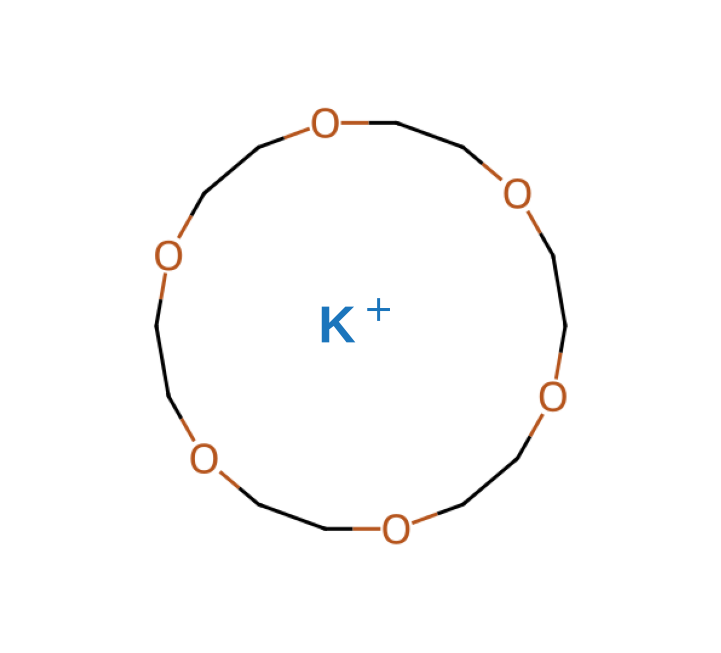
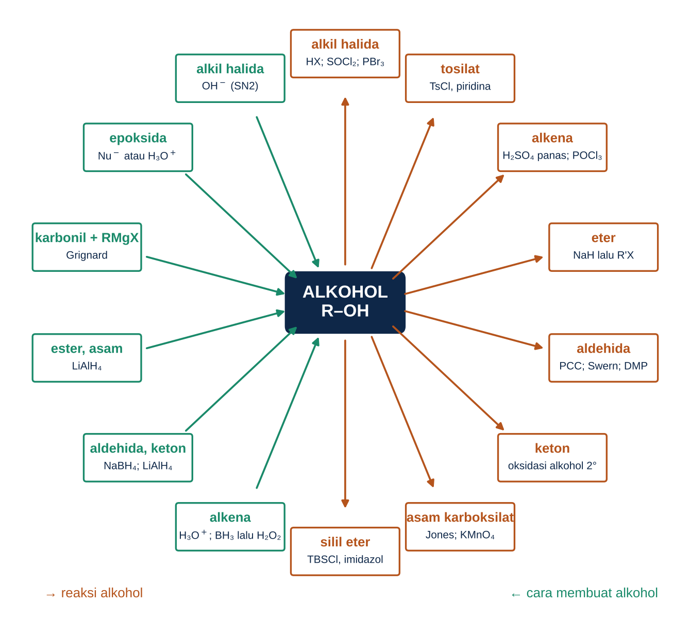

## 9.8 Eter: sifat dan pembuatan

### Struktur dan sifat

Eter adalah senyawa R–O–R', dengan atom oksigen yang terikat pada dua gugus karbon. Oksigennya terhibridisasi kira-kira sp³, dan sudut C–O–C sedikit lebih besar daripada sudut tetrahedral (sekitar 112° pada dimetil eter), karena kedua gugus alkil saling mendorong. Eter tidak mempunyai H pada oksigen, sehingga tidak dapat membentuk ikatan hidrogen antarmolekul (titik didihnya mirip alkana, subbab 9.1), tetapi pasangan bebas oksigennya dapat **menerima** ikatan hidrogen dari air dan **mengikat** ion logam sebagai basa Lewis.

Sifat-sifat inilah yang membuat eter menjadi **pelarut** yang sangat penting. Dietil eter, tetrahidrofuran (THF), dan 1,4-dioksana melarutkan banyak senyawa organik, tetapi hampir tidak bereaksi dengan basa kuat, nukleofil, pereduksi, dan oksidator lunak. Pasangan bebas oksigennya mengikat atom magnesium pada pereaksi Grignard dan menstabilkannya; itulah sebabnya pereaksi Grignard selalu dibuat dalam eter atau THF (subbab 7.14).

::: {.awas}
**Peroksida dalam eter lama**

Eter yang disimpan lama dalam botol terbuka atau terkena cahaya mengalami autoksidasi (subbab 9.7) pada ikatan C–H di sebelah oksigen, membentuk **hidroperoksida eter**. Senyawa ini tidak mudah menguap, sehingga menumpuk di dasar labu ketika eter didistilasi, dan dapat **meledak** bila dipanaskan sampai kering. Eter laboratorium karena itu disimpan dalam botol gelap dengan sedikit BHT sebagai antioksidan, diberi tanggal pembukaan, dan diuji kandungan peroksidanya sebelum didistilasi.
:::

### Sintesis eter Williamson

Cara paling umum membuat eter adalah **sintesis Williamson** (Alexander Williamson, 1850): ion alkoksida bereaksi dengan alkil halida (atau tosilat) lewat **SN2**.

$$
\text{R–O}^- + \text{R'–X} \longrightarrow \text{R–O–R'} + \text{X}^- \qquad \text{(9.4)}
$$

Alkoksida dibuat dari alkohol dengan NaH atau logam Na (subbab 9.1). Karena reaksinya SN2, semua aturan dari subbab 7.6 berlaku: **alkil halida harus metil atau primer**. Alkoksida adalah basa kuat, sehingga dengan alkil halida sekunder dan terutama tersier, eliminasi E2 mendominasi. Sebaliknya, alkoksida boleh besar dan bercabang, karena alkoksida hanya perlu menyerang, bukan diserang.

{width=96%}

::: {.contoh}
**Contoh 9.10 · Memilih pasangan Williamson**

Rancang sintesis (a) siklopentil metil eter; (b) benzil isopropil eter, C₆H₅CH₂OCH(CH₃)₂, dengan sintesis Williamson.

**Rencana.** Untuk setiap eter, ada dua cara memotong ikatan C–O. Pilih cara yang membuat alkil halidanya metil, primer, atau benzilik (benzilik sangat baik untuk SN2).

**Penyelesaian.** (a) Pilihan 1: siklopentoksida + CH₃I. Pilihan 2: CH₃O⁻ + bromosiklopentana (sekunder, eliminasi bersaing). Pilih **siklopentanol + NaH, lalu CH₃I**. (b) Pilihan 1: isopropoksida + benzil bromida (benzilik primer). Pilihan 2: benzil oksida + 2-bromopropana (sekunder). Pilih **propan-2-ol + NaH, lalu C₆H₅CH₂Br**.

**Memahami hasil.** Aturan praktisnya: **gugus yang lebih bercabang dibawa oleh alkoksida, gugus yang paling sederhana dibawa oleh alkil halida.** Eter aril alkil (misalnya anisol, C₆H₅OCH₃) dibuat dari fenoksida dan alkil halida, karena SN2 tidak mungkin terjadi pada karbon cincin benzena.
:::

Bila gugus –OH dan halogen berada dalam satu molekul, sintesis Williamson dapat terjadi **di dalam molekul** dan menghasilkan **eter siklik**. 4-Klorobutan-1-ol dengan NaOH menghasilkan THF; halohidrin dengan basa menghasilkan epoksida (subbab 8.9). Reaksi intramolekul pembentuk cincin beranggota lima dan enam sangat cepat, karena kedua ujung yang bereaksi selalu berada dekat satu sama lain.

### Alkoksimerkurasi

Eter dari alkohol tersier sulit dibuat dengan Williamson bila gugus tersiernya harus dibawa oleh alkil halida. Untuk eter dengan regiokimia Markovnikov, ada cara lain: **alkoksimerkurasi–demerkurasi**, varian oksimerkurasi (subbab 8.5) dengan alkohol sebagai pengganti air. Alkena direaksikan dengan merkuri(II) trifluoroasetat dalam alkohol, lalu dengan NaBH₄. Alkohol menyerang ion merkurinium di karbon yang lebih tersubstitusi, sehingga gugus –OR masuk ke karbon itu, tanpa penataan ulang. Contohnya, 1-metilsikloheksena dalam etanol menghasilkan 1-etoksi-1-metilsikloheksana.

### Eter simetris dari alkohol

Eter simetris sederhana dibuat di industri dari alkohol primer dengan asam sulfat. Satu molekul alkohol terprotonasi, molekul alkohol kedua menyerangnya lewat SN2, dan air lepas. Dietil eter dibuat dengan cara ini pada sekitar 140 °C. Pada suhu yang lebih tinggi, sekitar 180 °C, etanol dalam asam sulfat justru terdehidrasi menjadi etena (subbab 8.2): suhu tinggi menguntungkan eliminasi, karena eliminasi menghasilkan dua molekul dari satu dan entropinya naik. Cara ini hanya cocok untuk eter simetris dari alkohol primer.

::: {.kuis}
**Kuis cepat 9.8** (a) Rancang sintesis Williamson untuk etil fenil eter. (b) Mengapa (CH₃)₃CO⁻ + CH₃CH₂Br berhasil, tetapi CH₃CH₂O⁻ + (CH₃)₃CBr tidak?
:::

## 9.9 Pemutusan eter oleh asam

Eter terkenal tidak reaktif, tetapi ada satu reaksi umum yang memutusnya: pemanasan dengan **HBr atau HI** pekat. Seperti pada alkohol, langkah pertama adalah protonasi oksigen, yang mengubah gugus –OR menjadi gugus pergi yang baik, alkohol netral (R–OH). Lalu ion halida menyerang salah satu karbon di sebelah oksigen. Ke karbon mana halida menyerang bergantung pada mekanisme:

- Bila kedua gugus **metil, primer, atau sekunder**, terjadi **SN2**: halida menyerang **karbon yang kurang terhalang**.
- Bila salah satu gugus **tersier, benzilik, atau alilik**, terjadi **SN1** (atau E1): gugus itu lepas sebagai karbokation, dan halida berakhir **di karbon tersier**.

HCl jarang dipakai, karena Cl⁻ nukleofil yang terlalu lemah untuk SN2 pada eter terprotonasi. Bila HX berlebih, alkohol yang terbentuk ikut berubah menjadi alkil halida (subbab 9.3), sehingga hasil akhirnya dua alkil halida.

**Eter aril alkil** selalu putus di ikatan **alkil–O**, menghasilkan **fenol** dan alkil halida, karena halida tidak dapat menyerang karbon cincin benzena (baik SN2 maupun SN1 tidak mungkin pada karbon sp² cincin). Fenol tidak berubah lebih lanjut menjadi aril halida, dengan alasan yang sama.

::: {.contoh}
**Contoh 9.11 · Meramalkan produk pemutusan eter**

Tulis produk dengan 1 ekuivalen HI: (a) etil isopropil eter; (b) *tert*-butil metil eter; (c) anisol (metoksibenzena).

**Penyelesaian.** (a) Kedua gugus primer dan sekunder, sehingga SN2: I⁻ menyerang karbon etil yang kurang terhalang. Produk: **iodoetana + propan-2-ol**. (b) Gugus *tert*-butil membentuk karbokation tersier yang stabil, sehingga SN1: **2-iodo-2-metilpropana + metanol**. (c) Ikatan aril–O tidak dapat diserang; I⁻ menyerang karbon metil: **fenol + iodometana**.

**Memahami hasil.** Pada (a) dan (b), halida berakhir di gugus yang berbeda karena mekanismenya berbeda: pada SN2 di karbon yang paling mudah dijangkau, pada SN1 di karbon yang paling mampu menampung muatan positif. Pemutusan eter metil aril dengan HBr atau BBr₃ dipakai di sintesis obat dan bahan alam untuk "membuka" gugus –OH fenol yang tadinya dilindungi sebagai metil eter.
:::

Kecenderungan eter *tert*-butil untuk putus lewat karbokation dimanfaatkan dalam gugus pelindung: alkohol dapat dilindungi sebagai ***tert*-butil eter**, yang tahan basa dan nukleofil, lalu dilepas dengan asam trifluoroasetat yang memutus ikatan *tert*-butil–O lewat E1 (melepaskan 2-metilpropena).

::: {.kuis}
**Kuis cepat 9.9** Tulis produk (a) dietil eter + HBr berlebih, panas; (b) benzil metil eter + HBr; (c) THF + HI berlebih.
:::

## 9.10 Eter mahkota

Pada tahun 1967, Charles Pedersen di perusahaan DuPont menemukan secara tidak sengaja sebuah eter siklik besar yang mampu melarutkan garam kalium dalam pelarut organik. Molekul itu, yang ia namai **dibenzo-18-mahkota-6** karena bentuknya seperti mahkota, membuka bidang kimia baru. Pedersen, bersama Donald Cram dan Jean-Marie Lehn yang mengembangkan gagasannya, mendapat Hadiah Nobel Kimia 1987.

**Eter mahkota** adalah polieter siklik dengan satuan –CH₂CH₂O– yang berulang. Namanya ditulis *x*-mahkota-*y*, dengan *x* jumlah atom dalam cincin dan *y* jumlah atom oksigen. 18-Mahkota-6, misalnya, mempunyai cincin 18 atom dengan 6 oksigen. Semua atom oksigen mengarah ke dalam rongga cincin, dan pasangan bebasnya membentuk "sarang" yang dapat mengikat ion logam, seperti air mengikat ion dalam larutan. Bagian luar cincin terdiri atas gugus CH₂ yang nonpolar, sehingga kompleks itu larut dalam pelarut organik.

Kekuatan ikatan bergantung pada **kecocokan ukuran** rongga dan ion:

| Eter mahkota | Diameter rongga (pm) | Ion yang paling cocok | Diameter ion (pm) |
|---|---|---|---|
| 12-mahkota-4 | 120–150 | Li⁺ | 152 |
| 15-mahkota-5 | 170–220 | Na⁺ | 204 |
| 18-mahkota-6 | 260–320 | K⁺ | 276 |

{width=56%}

Pengikatan selektif ini adalah contoh awal **kimia inang–tamu** (*host–guest chemistry*): molekul inang dengan rongga yang dirancang untuk mengenali tamu tertentu, prinsip yang sama yang dipakai enzim dan reseptor dalam tubuh.

Dalam sintesis, eter mahkota dipakai untuk melarutkan garam anorganik dalam pelarut organik dan sekaligus membuat anionnya sangat reaktif. Contohnya, KMnO₄ tidak larut dalam benzena, tetapi dengan 18-mahkota-6, larutan benzena menjadi ungu ("benzena ungu") dan dapat mengoksidasi senyawa organik. Ion K⁺ terbungkus oleh eter mahkota, sehingga anion pasangannya dibiarkan "telanjang", tanpa kation yang menempel dan tanpa pelarut yang membungkusnya. Anion telanjang adalah nukleofil yang jauh lebih kuat. Kalium fluorida, misalnya, hampir tidak bereaksi dengan alkil halida dalam asetonitril, tetapi dengan 18-mahkota-6, ion F⁻ yang telanjang menggantikan halida lain dengan cepat lewat SN2. Efeknya sama dengan pelarut aprotik polar (subbab 7.6), tetapi lebih kuat.

Alam sudah lebih dulu memakai prinsip ini. Antibiotik seperti **valinomisin**, sebuah molekul siklik besar, mengikat ion K⁺ dengan selektif dan membawanya menembus membran sel bakteri. Ketidakseimbangan ion yang ditimbulkannya membunuh bakteri. Molekul pembawa ion seperti ini disebut **ionofor**.

::: {.contoh}
**Contoh 9.12 · Memilih eter mahkota**

Kamu ingin mereaksikan natrium sianida dengan 1-bromoheksana dalam toluena, pelarut yang tidak melarutkan NaCN. Eter mahkota mana yang dipakai, dan mengapa reaksinya menjadi cepat?

**Penyelesaian.** Kation yang harus dibungkus adalah Na⁺ (diameter sekitar 204 pm), yang paling cocok dengan rongga **15-mahkota-5** (170–220 pm). Kompleks Na⁺–eter mahkota bagian luarnya nonpolar dan larut dalam toluena, membawa ion CN⁻ sebagai pasangannya. Di dalam toluena, CN⁻ tidak dibungkus molekul pelarut (toluena tidak membentuk ikatan hidrogen) dan tidak menempel pada Na⁺ (kation terkurung dalam eter mahkota), sehingga menjadi nukleofil yang sangat reaktif. SN2 menghasilkan heptananitril dengan cepat.

**Memahami hasil.** Untuk kalium sianida, pilihan yang tepat adalah 18-mahkota-6. Prinsip kecocokan ukuran ini, yang pertama kali terlihat jelas pada eter mahkota, adalah dasar pengenalan molekul oleh enzim dan reseptor.
:::

::: {.kuis}
**Kuis cepat 9.10** (a) Eter mahkota mana yang paling cocok untuk melarutkan NaCN dalam toluena? (b) Mengapa laju SN2 dengan KCN dalam benzena naik tajam bila 18-mahkota-6 ditambahkan?
:::

## 9.11 Epoksida: pembuatan dan pembukaan cincin

### Pembuatan

**Epoksida** (oksirana) adalah eter siklik beranggota tiga. Nama IUPAC-nya memakai induk **oksirana**: 2-metiloksirana adalah epoksida dari propena, yang lazim juga disebut propilena oksida. Kita sudah mengenal dua cara membuatnya:

1. **Epoksidasi alkena dengan peroksiasam** (mCPBA), adisi syn yang stereospesifik (subbab 8.9).
2. **Halohidrin + basa**: alkoksida menyerang karbon tetangga dari belakang dan mengusir halida (SN2 intramolekul). Karena halohidrin terbentuk dengan susunan anti, gugus –O⁻ dan halida sudah berada pada posisi yang tepat untuk serangan dari belakang.

Di industri, **etilena oksida** dibuat dari etena dan oksigen dengan katalis perak pada sekitar 250 °C. Senyawa ini, puluhan juta ton per tahun, menjadi etilena glikol (antibeku, bahan poliester), deterjen, dan juga dipakai untuk mensterilkan alat kesehatan.

### Mengapa epoksida reaktif

Eter biasa tidak bereaksi dengan nukleofil, karena RO⁻ adalah gugus pergi yang buruk. Epoksida berbeda karena cincin beranggota tiga sangat **tegang**: sudut C–O–C dan C–C–O sekitar 60°, jauh dari sudut tetrahedral 109,5°, dan tegangan cincinnya sekitar 110 kJ mol⁻¹, hampir sama dengan siklopropana. Ketika cincin terbuka, tegangan itu dilepas. Keuntungan energi ini cukup besar untuk membuat alkoksida menjadi gugus pergi yang "bisa diterima", sehingga epoksida diserang oleh nukleofil bahkan tanpa asam. Pada epoksida simetris, kedua karbon setara; pada epoksida tak simetris, pertanyaannya adalah karbon mana yang diserang, dan jawabannya berbeda dalam basa dan asam.

### Pembukaan dalam basa atau dengan nukleofil kuat: SN2 di karbon yang kurang terhalang

Nukleofil kuat (RO⁻, OH⁻, CN⁻, RS⁻, N₃⁻, NH₃, amina, pereaksi Grignard, LiAlH₄) membuka epoksida lewat **SN2 murni**. Karena SN2 peka terhadap halangan sterik, nukleofil menyerang **karbon yang kurang tersubstitusi**, dari sisi yang berlawanan dengan oksigen (inversi pada karbon itu). Ion alkoksida yang terbentuk kemudian terprotonasi oleh pelarut atau asam encer pada tahap pengolahan.

Reaksi epoksida dengan pereaksi Grignard sangat berguna: etilena oksida + RMgBr, lalu H₃O⁺, menghasilkan RCH₂CH₂OH, alkohol primer dengan **dua karbon tambahan** (subbab 9.2).

### Pembukaan dalam asam: serangan di karbon yang lebih tersubstitusi

Dalam asam, oksigen epoksida terprotonasi lebih dulu. Ikatan C–O pada epoksida terprotonasi melemah dan memanjang, tetapi **tidak sama**: ikatan ke karbon yang lebih tersubstitusi lebih lemah, karena karbon itu lebih mampu memikul muatan positif parsial. Keadaan transisinya mempunyai banyak sifat karbokation, mirip ion bromonium (subbab 8.7). Nukleofil lemah (H₂O, ROH, X⁻) menyerang **karbon yang lebih tersubstitusi**, tetapi tetap **dari belakang**, karena ikatan C–O belum putus sepenuhnya dan masih menghalangi sisi depan. Jadi pembukaan dalam asam memberi regiokimia seperti SN1 tetapi stereokimia seperti SN2.

{width=96%}

::: {.inti}
**Epoksida tak simetris: di mana nukleofil masuk**

- **Basa atau nukleofil kuat**: karbon yang **kurang** tersubstitusi (sterik, SN2).
- **Asam dengan nukleofil lemah**: karbon yang **lebih** tersubstitusi (muatan parsial, mirip SN1).
- Dalam kedua kondisi: serangan **dari belakang**, sehingga –OH dan nukleofil berakhir **anti** (*trans* pada cincin).

Pengecualian: bila kedua karbon primer dan sekunder, pembukaan dalam asam sering memberi campuran, karena perbedaan kemampuan memikul muatannya kecil.
:::

::: {.contoh}
**Contoh 9.13 · Regiokimia pembukaan epoksida**

Tulis produk 2,2-dimetiloksirana dengan (a) NaOCH₃ dalam CH₃OH; (b) CH₃OH dengan sedikit H₂SO₄; (c) CH₃MgBr, lalu H₃O⁺.

**Penyelesaian.** (a) Metoksida, nukleofil kuat, menyerang CH₂: **1-metoksi-2-metilpropan-2-ol**, (CH₃)₂C(OH)CH₂OCH₃. (b) Dalam asam, metanol menyerang karbon tersier: **2-metoksi-2-metilpropan-1-ol**, (CH₃)₂C(OCH₃)CH₂OH. (c) Grignard, nukleofil kuat, menyerang CH₂: **2-metilbutan-2-ol**, (CH₃)₂C(OH)CH₂CH₃.

**Memahami hasil.** Dari epoksida dan pereaksi yang hampir sama (metanol), kita mendapat dua isomer struktur yang berbeda hanya dengan mengubah keasaman. Seperti pada adisi alkena, pilihan kondisi menentukan regiokimia.
:::

::: {.contoh}
**Contoh 9.14 · Stereokimia pembukaan epoksida**

Tulis produk (dengan stereokimia) sikloheksena oksida dengan (a) H₃O⁺; (b) NaN₃ dalam air, lalu LiAlH₄. 

**Penyelesaian.** Kedua karbon epoksida setara (keduanya sekunder). (a) Air menyerang salah satu karbon dari sisi yang berlawanan dengan oksigen: ***trans*-sikloheksana-1,2-diol**, rasemat (subbab 8.9). (b) Ion azida menyerang dari belakang, menghasilkan *trans*-2-azidosikloheksanol. LiAlH₄ mereduksi gugus azida (–N₃) menjadi amina (–NH₂) tanpa menyentuh pusat kiral: ***trans*-2-aminosikloheksanol**, rasemat.

**Memahami hasil.** Pembukaan epoksida adalah cara andal untuk memasang dua gugus fungsi pada karbon bertetangga dengan susunan anti. Pola "1,2-amino alkohol" seperti pada (b) terdapat pada banyak obat, misalnya obat penghambat beta untuk tekanan darah tinggi, yang memang dibuat dari epoksida dan amina.
:::

::: {.terapan}
**Epoksida yang menolong dan yang mencelakakan**

**Resin epoksi**, perekat dua komponen yang sangat kuat, dibuat dari epoksida. Komponen pertama adalah molekul dengan dua gugus epoksida di ujungnya (dari bisfenol A dan epiklorohidrin); komponen kedua adalah poliamina. Ketika keduanya dicampur, gugus amina membuka cincin epoksida satu per satu, dan molekul-molekul saling terhubung menjadi jaringan tiga dimensi yang keras.

Kereaktifan yang sama membuat beberapa epoksida berbahaya. **Benzo[*a*]pirena**, hidrokarbon dalam asap rokok dan daging bakar, dioksidasi enzim hati menjadi diol epoksida. Epoksida ini dibuka oleh atom nitrogen basa guanina di DNA lewat SN2, sehingga DNA terikat secara kovalen pada molekul besar itu, dan sel salah membaca kode genetiknya. Inilah salah satu mekanisme utama yang menghubungkan asap rokok dengan kanker paru-paru.
:::

::: {.kuis}
**Kuis cepat 9.11** Tulis produk 2-metiloksirana (propilena oksida) dengan (a) NaOH dalam air; (b) HBr anhidrat; (c) NH₃. Untuk (a), apakah regiokimia menjadi soal?
:::

## 9.12 Tiol dan sulfida

Belerang berada tepat di bawah oksigen dalam tabel periodik, sehingga belerang membentuk senyawa yang sejajar dengan alkohol dan eter: **tiol** (merkaptan), R–SH, dan **sulfida** (tioeter), R–S–R'. Tiol diberi nama dengan akhiran *-tiol* (etanatiol, CH₃CH₂SH); sulfida dinamai seperti eter dengan awalan alkiltio (metiltiometana untuk dimetil sulfida).

### Sifat: bau, titik didih, dan keasaman

Tiol terkenal karena **baunya**. Hidung manusia dapat mencium etanatiol pada konsentrasi kurang dari satu bagian per miliar. Karena itu sedikit tiol ditambahkan pada gas elpiji dan gas alam, yang sebenarnya tidak berbau, agar kebocoran segera tercium. Bau sigung, bau bawang putih, dan sebagian bau bawang merah juga berasal dari senyawa belerang.

Ikatan S–H kurang polar daripada O–H (keelektronegatifan S hanya 2,58), sehingga tiol hampir tidak membentuk ikatan hidrogen. Etanatiol mendidih pada 35 °C, sedangkan etanol pada 78 °C.

Tiol **lebih asam** daripada alkohol: pKa etanatiol 10,6, sekitar seratus ribu kali lebih asam daripada etanol (pKa 16). Alasannya sama dengan keasaman HX yang naik ke bawah golongan (subbab 3.5): atom belerang lebih besar, ikatan S–H lebih panjang dan lebih lemah, dan muatan negatif ion **tiolat**, RS⁻, tersebar dalam volume yang lebih besar. Akibatnya tiolat dapat dibuat dengan NaOH saja.

### Tiolat sebagai nukleofil

Ion tiolat adalah **nukleofil yang sangat baik** tetapi **basa yang lebih lemah** daripada alkoksida. Atom belerang yang besar mudah terpolarisasi, sehingga awan elektronnya dapat menjangkau karbon elektrofil dari jarak yang lebih jauh (subbab 7.6). Karena kebasaannya rendah, tiolat bereaksi lewat SN2 bahkan dengan alkil halida sekunder, dengan sedikit eliminasi. Dua reaksi pembuatan:

- **Tiol**: alkil halida + natrium hidrosulfida, NaSH (SN2). R–Br + HS⁻ → R–SH + Br⁻.
- **Sulfida**: tiolat + alkil halida (versi belerang dari Williamson). RS⁻ + R'–Br → R–S–R' + Br⁻.

Sulfida juga nukleofil, dan dapat bereaksi dengan alkil halida membentuk **ion sulfonium**, R₃S⁺. Inilah jenis ion pada S-adenosilmetionina (SAM), pembawa gugus metil dalam sel (subbab 7.15).

### Oksidasi: disulfida, sulfoksida, dan sulfon

Tiol dioksidasi dengan sangat mudah, bahkan oleh oksigen udara atau iodin, menjadi **disulfida**, R–S–S–R. Reaksinya **reversibel**: pereduksi (misalnya seng dalam asam, atau tiol lain berlebih) memutus ikatan S–S dan mengembalikan dua tiol.

$$
2\,\text{R–SH} \;\underset{\text{reduksi}}{\overset{\text{oksidasi}}{\rightleftharpoons}}\; \text{R–S–S–R} \qquad \text{(9.5)}
$$

Pasangan tiol–disulfida sangat penting dalam biologi. Asam amino **sisteina** membawa gugus –SH. Dua sisteina dalam rantai protein dapat teroksidasi membentuk **jembatan disulfida** (sistina), yang mengikat dua bagian rantai protein bersama-sama dan mengunci bentuk tiga dimensinya. Protein yang harus tahan di luar sel, seperti insulin, antibodi, dan keratin rambut, kaya jembatan disulfida.

::: {.terapan}
**Mengeriting rambut dengan kimia**

Keratin rambut mengandung banyak jembatan disulfida. Bentuk rambut ditentukan oleh di mana jembatan-jembatan itu terbentuk. Pada pengeritingan permanen, rambut lebih dulu diberi larutan **pereduksi** (biasanya garam asam tioglikolat, HSCH₂COO⁻) yang memutus jembatan disulfida menjadi gugus –SH. Rambut kemudian dililitkan pada roller sehingga rantai-rantai keratin bergeser ke posisi baru. Terakhir, rambut diberi **oksidator** (biasanya hidrogen peroksida encer) yang membentuk jembatan disulfida baru di posisi yang baru. Rambut "terkunci" dalam bentuk keriting sampai rambut baru tumbuh.
:::

Sulfida dapat dioksidasi lebih jauh, berbeda dengan eter. Hidrogen peroksida atau satu ekuivalen peroksiasam mengubah sulfida menjadi **sulfoksida**, R₂S=O; oksidasi kedua menghasilkan **sulfon**, R₂SO₂. Dimetil sulfoksida (DMSO) adalah pelarut aprotik polar yang sangat penting (subbab 7.6) dan juga oksidator dalam oksidasi Swern (subbab 9.5).

::: {.contoh}
**Contoh 9.15 · Belerang lawan oksigen**

Jelaskan mengapa reaksi CH₃CH₂S⁻ dengan 2-bromopropana menghasilkan terutama etil isopropil sulfida, sedangkan CH₃CH₂O⁻ dengan 2-bromopropana menghasilkan terutama propena.

**Penyelesaian.** Kedua anion menyerang substrat sekunder yang sama, di mana SN2 dan E2 bersaing. Etoksida adalah basa kuat (pKa etanol 16) dan nukleofil sedang; dengan substrat sekunder, kebasaannya menang dan E2 dominan (subbab 7.12). Etanatiolat adalah basa yang jauh lebih lemah (pKa etanatiol 10,6, lebih dari lima satuan lebih rendah), tetapi nukleofil yang lebih kuat karena belerang besar dan mudah terpolarisasi. Kebasaannya terlalu lemah untuk menarik proton dengan cepat, sedangkan nukleofilisitasnya cukup untuk menyerang karbon sekunder: **SN2 dominan**.

**Memahami hasil.** Nukleofilisitas dan kebasaan biasanya berjalan seiring dalam satu baris tabel periodik, tetapi tidak di sepanjang golongan. Ke bawah golongan, atom makin besar dan mudah terpolarisasi (nukleofilisitas naik) sementara kebasaan turun. Inilah yang membuat tiolat, iodida, dan azida menjadi nukleofil pilihan untuk substitusi pada karbon sekunder.
:::

::: {.contoh}
**Contoh 9.16 · Glutation, penjaga sel**

Glutation (GSH) adalah tripeptida dengan satu gugus –SH yang terdapat dalam hampir semua sel. Glutation melindungi sel dengan mereduksi hidrogen peroksida: 2 GSH + H₂O₂ → GSSG + 2 H₂O. Tentukan perubahan bilangan oksidasi belerang dan oksigen, dan jelaskan mengapa sel dapat memakai glutation berulang kali.

**Penyelesaian.** Pada R–S–H, belerang terikat pada C (belerang lebih elektronegatif: −1) dan H (−1): bilangan oksidasinya −2. Pada R–S–S–R, belerang terikat pada C (−1) dan S (0): −1. Setiap belerang naik satu satuan, sehingga dua GSH melepas **2 elektron**. Oksigen dalam H₂O₂ bernilai −1 dan menjadi −2 dalam air; dua oksigen menerima **2 elektron**. Seimbang. Disulfida GSSG kemudian direduksi kembali menjadi dua GSH oleh enzim glutation reduktase, memakai NADPH sebagai pereduksi. Karena pasangan tiol–disulfida reversibel, glutation berputar terus seperti vitamin E dan vitamin C.

**Memahami hasil.** Perbandingan GSH terhadap GSSG di dalam sel sehat sangat tinggi, sehingga sel berada dalam keadaan tereduksi yang melindungi gugus –SH protein. Obat parasetamol dosis berlebih menghabiskan glutation di hati, dan zat antidotnya, N-asetilsisteina, adalah tiol yang mengisi kembali persediaan glutation.
:::

::: {.kuis}
**Kuis cepat 9.12** (a) Urutkan keasaman: etanol, etanatiol, fenol, air. (b) Tulis produk 1-bromobutana + NaSH, lalu produknya dioksidasi dengan I₂.
:::

## Menuju bab berikutnya

Teka-teki pembuka bab kini terjawab. Butan-1-ol dan butan-2-ol mempunyai atom H pada karbon pembawa –OH, sehingga dapat melepas H itu bersama H pada oksigen dan membentuk ikatan C=O, sambil mereduksi dikromat jingga menjadi Cr³⁺ hijau. 2-Metilpropan-2-ol tidak mempunyai H di tempat itu, sehingga tidak teroksidasi. Satu atom H menentukan semuanya.

Bab ini memperlihatkan alkohol sebagai persimpangan jalan. Alkohol dapat menjadi alkil halida, tosilat, alkena, eter, aldehida, keton, dan asam karboksilat, dan dapat dibuat dari hampir semua gugus fungsi itu. Peta di bawah meringkas jalan-jalan yang telah kita pelajari.

{width=96%}

Sebelum melanjutkan ke senyawa karbonil, Bab 10 membahas satu keluarga senyawa yang mempunyai sifat sangat khusus: **senyawa aromatik**. Cincin benzena, yang sudah muncul berkali-kali di bab ini sebagai cincin fenol, tidak bereaksi seperti alkena biasa. Bab 10 menjelaskan mengapa benzena begitu stabil, dan bagaimana cincin aromatik bereaksi lewat substitusi, bukan adisi. Pengaruh gugus –OH yang mengaktifkan cincin fenol, yang kita lihat pada reaksi fenol dengan air bromin, akan dijelaskan di sana.
