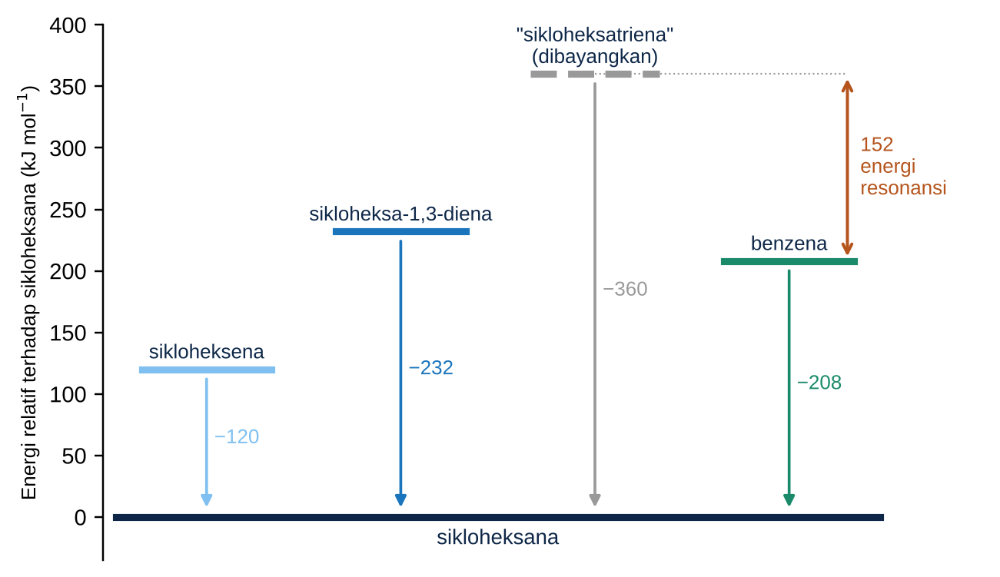
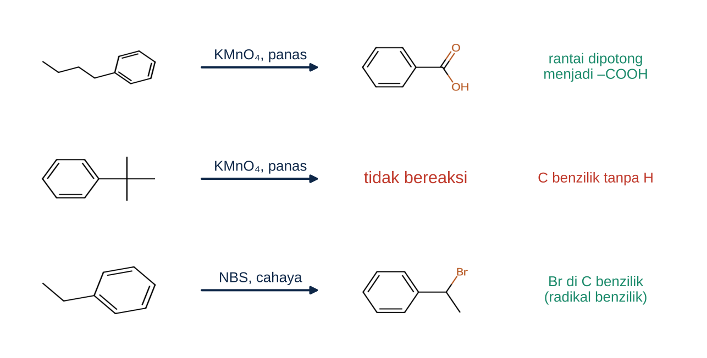

# Bab 10 Senyawa Aromatik dan Substitusi Aromatik

Pada tahun 1825 Michael Faraday mengisolasi cairan yang mudah menguap dari residu gas penerangan kota London. Analisis menunjukkan rumusnya C₆H₆: enam karbon dan hanya enam hidrogen, jauh di bawah empat belas hidrogen pada heksana. Derajat ketidakjenuhannya empat (subbab 1.4), sehingga senyawa ini, yang kemudian dinamai **benzena**, seharusnya sangat reaktif, seperti alkena yang mempunyai beberapa ikatan rangkap. Kenyataannya justru sebaliknya. Benzena tidak menghilangkan warna air bromin, tidak bereaksi dengan larutan KMnO₄ dingin, tidak menyerap HBr, dan hanya terhidrogenasi pada tekanan dan suhu tinggi. Ketika akhirnya dipaksa bereaksi dengan bromin memakai katalis besi(III) bromida, benzena tidak mengadisi bromin seperti alkena, tetapi **mengganti** satu atom H dengan Br, dan cincin enam karbonnya tetap utuh dengan "ketidakjenuhan" yang sama.

Ada satu teka-teki lagi. Bromobenzena, C₆H₅Br, hanya ada **satu** isomer: di posisi mana pun atom Br dipasang, hasilnya sama. Dibromobenzena ada **tiga** isomer, tidak lebih. Fakta-fakta ini menunjukkan bahwa keenam karbon dan keenam hidrogen benzena setara. Pada tahun 1865 August Kekulé mengusulkan struktur cincin enam karbon dengan ikatan tunggal dan rangkap yang berselang-seling, dan konon gagasan itu datang dari mimpi tentang ular yang menggigit ekornya sendiri. Tetapi struktur Kekulé sendiri meramalkan dua isomer 1,2-dibromobenzena (satu dengan ikatan rangkap di antara kedua karbon pembawa Br, satu dengan ikatan tunggal), sedangkan hanya satu yang pernah ditemukan. Apa sebenarnya ikatan dalam benzena, dan mengapa ikatan itu begitu stabil?

Bab ini menjawab pertanyaan tersebut dan membawa kita ke salah satu konsep terpenting dalam kimia organik: **aromatisitas**. Kita akan melihat bahwa benzena distabilkan oleh enam elektron π yang tersebar merata di seluruh cincin, bahwa kestabilan khusus itu dimiliki oleh semua cincin datar dengan 4*n* + 2 elektron π (aturan Hückel), dan bahwa banyak ion dan senyawa heterosiklik, termasuk basa DNA dan cincin dalam banyak obat, juga aromatik. Setelah itu kita membahas reaksi khas senyawa aromatik, **substitusi elektrofilik aromatik**, yang mempertahankan cincin aromatik alih-alih merusaknya. Pertanyaan pokoknya: mengapa substituen yang sudah ada di cincin menentukan seberapa cepat dan di posisi mana substituen berikutnya masuk? Jawabannya memungkinkan kita merancang sintesis senyawa aromatik bertahap, dari pewarna dan obat sampai bahan peledak.

::: {.kuis}
**Pertanyaan pembuka**

1. Mengapa benzena tidak bereaksi seperti alkena, padahal mempunyai tiga "ikatan rangkap"?
2. Mengapa siklobutadiena, dengan empat elektron π, sangat tidak stabil, padahal benzena dengan enam elektron π sangat stabil?
3. Mengapa piridina adalah basa, sedangkan pirola hampir tidak bersifat basa, walaupun keduanya mempunyai atom nitrogen dengan pasangan bebas?
4. Mengapa benzena bereaksi lewat substitusi, bukan adisi?
5. Mengapa gugus metil pada toluena mengarahkan nitrasi ke posisi orto dan para, sedangkan gugus nitro pada nitrobenzena mengarahkan ke posisi meta?
6. Mengapa halogen memperlambat substitusi elektrofilik tetapi tetap mengarahkannya ke orto dan para?
7. Bagaimana klorobenzena dapat berubah menjadi anilina lewat zat antara yang mempunyai "ikatan rangkap tiga" di dalam cincin?
:::

::: {.tujuan}
**Tujuan belajar**

Setelah mempelajari bab ini, kamu mampu:

1. Menjelaskan struktur benzena dengan resonansi dan orbital molekul, dan menghitung energi resonansinya dari kalor hidrogenasi.
2. Memakai aturan Hückel untuk menggolongkan senyawa dan ion sebagai aromatik, antiaromatik, atau nonaromatik.
3. Mengenali heterosiklik aromatik (piridina, pirola, furan, tiofena, imidazola) dan menjelaskan kebasaan nitrogennya.
4. Meramalkan reaksi pada posisi benzilik: oksidasi, brominasi, dan substitusi.
5. Menulis mekanisme umum substitusi elektrofilik aromatik lewat ion arenium.
6. Menulis cara membangkitkan elektrofil untuk halogenasi, nitrasi, sulfonasi, alkilasi, dan asilasi Friedel–Crafts, serta menjelaskan batasan Friedel–Crafts.
7. Menggolongkan substituen sebagai pengaktif atau penonaktif dan sebagai pengarah orto/para atau meta, dan menjelaskannya dengan resonansi dan efek induktif.
8. Meramalkan produk substitusi pada benzena dengan beberapa substituen.
9. Menulis mekanisme substitusi nukleofilik aromatik lewat kompleks Meisenheimer dan lewat benzuna.
10. Merancang sintesis senyawa aromatik tersubstitusi dengan urutan langkah yang tepat.
:::

::: {.mat}
**Prasyarat**

Bab 1: hibridisasi, ikatan π, resonansi (subbab 1.5, 1.6, 1.8). Bab 2: tata nama turunan benzena (subbab 2.8). Bab 3: resonansi, efek induktif, kebasaan heterosiklik nitrogen (subbab 3.6, 3.7, 3.10). Bab 6: karbokation, postulat Hammond (subbab 6.9, 6.10). Bab 7: NBS, SN1 dan SN2 (subbab 7.3–7.8). Bab 8: adisi elektrofilik, kalor hidrogenasi (subbab 8.1, 8.3).
:::

## 10.1 Benzena: struktur dan kestabilan

### Satu struktur, bukan dua

Semua ikatan C–C dalam benzena sama panjang, 139 pm, di antara panjang ikatan tunggal C–C (154 pm) dan ikatan rangkap C=C (134 pm). Molekulnya datar, berbentuk segi enam beraturan, dengan semua sudut 120°. Fakta ini tidak cocok dengan struktur Kekulé yang mempunyai ikatan tunggal dan rangkap berselang-seling, karena struktur itu meramalkan dua panjang ikatan yang berbeda.

Penjelasan modern memakai **resonansi** (subbab 1.8). Kedua struktur Kekulé hanyalah dua cara menggambar susunan elektron yang sama dengan rumus garis; keduanya tidak ada secara terpisah, dan molekul tidak bolak-balik di antara keduanya. Benzena yang sebenarnya adalah **hibrida resonansi**: setiap ikatan C–C mempunyai "satu setengah" ikatan, dan keenam elektron π tersebar merata di seluruh cincin. Karena itu benzena sering digambar sebagai segi enam dengan lingkaran di dalamnya. Dalam buku ini kita tetap memakai salah satu struktur Kekulé, karena struktur itu memudahkan menghitung elektron dan menggambar panah lengkung, tetapi harus selalu diingat bahwa yang dimaksud adalah hibridanya. Dengan gambaran hibrida, teka-teki 1,2-dibromobenzena terpecahkan: hanya ada satu isomer, karena tidak ada ikatan "tunggal" atau "rangkap" yang tertentu di antara dua karbon bertetangga.

### Gambaran orbital

Setiap karbon benzena terhibridisasi sp²: tiga orbital sp² membentuk ikatan σ dengan dua karbon tetangga dan satu hidrogen, semuanya dalam bidang cincin. Setiap karbon menyisakan satu orbital p yang tegak lurus terhadap bidang cincin. Keenam orbital p itu sejajar satu sama lain dan masing-masing bertumpang tindih dengan kedua tetangganya, membentuk awan elektron π berbentuk dua cincin donat, satu di atas dan satu di bawah bidang molekul.

Teori orbital molekul memberi gambaran yang lebih tajam. Enam orbital p bergabung menjadi **enam orbital molekul π**: tiga orbital ikatan (energinya lebih rendah daripada orbital p semula) dan tiga orbital antiikatan. Orbital ikatan terendah, ψ₁, tidak mempunyai simpul dan meliputi keenam karbon sekaligus. Di atasnya terdapat dua orbital ikatan dengan energi yang sama (**terdegenerasi**), ψ₂ dan ψ₃. Keenam elektron π benzena tepat mengisi ketiga orbital ikatan ini, dan semua orbital ikatan **terisi penuh**, sementara semua orbital antiikatan kosong. Susunan seperti ini, dengan kulit elektron π yang penuh seperti gas mulia, adalah sumber kestabilan khusus benzena.

{width=96%}

### Energi resonansi dari kalor hidrogenasi

Seberapa besar kestabilan khusus itu? Kita dapat mengukurnya dengan cara yang sama seperti membandingkan kestabilan alkena (subbab 8.1): bandingkan kalor hidrogenasinya.

- Sikloheksena (satu ikatan rangkap) + H₂ → sikloheksana: ΔH° = −120 kJ mol⁻¹.
- Sikloheksa-1,3-diena (dua ikatan rangkap terkonjugasi) + 2H₂ → sikloheksana: ΔH° = −232 kJ mol⁻¹, sedikit kurang dari 2 × 120 = 240. Konjugasi dua ikatan rangkap memberi kestabilan tambahan kecil, sekitar 8 kJ mol⁻¹.
- Bila benzena hanyalah "sikloheksatriena" dengan tiga ikatan rangkap biasa, kita mengharapkan ΔH° sekitar 3 × (−120) = −360 kJ mol⁻¹.
- Kenyataannya, benzena + 3H₂ → sikloheksana hanya melepas **208 kJ mol⁻¹**.

Benzena berada 360 − 208 = **152 kJ mol⁻¹** lebih rendah daripada sikloheksatriena yang dibayangkan. Selisih ini disebut **energi resonansi** atau **energi aromatisasi** benzena. Besarnya kira-kira setengah energi sebuah ikatan C–C, dan jauh lebih besar daripada keuntungan konjugasi biasa (8 kJ mol⁻¹).

{width=82%}

::: {.contoh}
**Contoh 10.1 · Mengapa benzena sulit dihidrogenasi**

Hitung ΔH° untuk hidrogenasi **parsial** benzena menjadi sikloheksa-1,3-diena. Apa artinya bagi kemudahan reaksi ini?

**Rencana.** Pakai hukum Hess: benzena → sikloheksana (−208) dapat ditulis sebagai benzena → sikloheksadiena (ΔH° = *x*), lalu sikloheksadiena → sikloheksana (−232).

**Penyelesaian.** −208 = *x* + (−232), sehingga *x* = **+24 kJ mol⁻¹**. Langkah pertama hidrogenasi benzena **endoterm**, padahal hidrogenasi alkena biasa melepas lebih dari 100 kJ mol⁻¹.

**Memahami hasil.** Adisi H₂ pada satu "ikatan rangkap" benzena menghancurkan aromatisitas, dan kerugian energi itu lebih besar daripada keuntungan mengubah satu ikatan π menjadi dua ikatan σ C–H. Karena itu hidrogenasi benzena memerlukan katalis yang lebih aktif dan tekanan tinggi, dan bila berhasil, reaksi tidak berhenti di sikloheksadiena atau sikloheksena: zat antara itu jauh lebih reaktif daripada benzena dan segera tereduksi habis menjadi sikloheksana. Hal yang sama menjelaskan mengapa benzena tidak mengadisi Br₂ atau HBr: adisi apa pun yang merusak cincin aromatik bersifat termodinamik tidak menguntungkan atau sangat lambat.
:::

::: {.kuis}
**Kuis cepat 10.1** (a) Berapa isomer tribromobenzena yang ada? (b) Energi resonansi naftalena sekitar 255 kJ mol⁻¹. Berapa per cincin, dan apa artinya bagi kereaktifan naftalena dibanding benzena?
:::

## 10.2 Aromatisitas dan aturan Hückel

### Syarat menjadi aromatik

Apakah setiap cincin dengan ikatan rangkap berselang-seling memperoleh kestabilan seperti benzena? Tidak. Siklobutadiena, C₄H₄, begitu tidak stabil sehingga hanya dapat diamati pada suhu sangat rendah (sekitar 4 K) terperangkap dalam argon padat; pada suhu lebih tinggi, dua molekulnya segera bergabung. Siklooktatetraena, C₈H₈, cukup stabil, tetapi bereaksi seperti alkena biasa (mengadisi Br₂ dengan mudah) dan molekulnya tidak datar, melainkan berbentuk "bak mandi" dengan ikatan tunggal dan rangkap yang panjangnya berbeda.

Pada tahun 1931 Erich Hückel menyimpulkan dari perhitungan orbital molekul bahwa kestabilan khusus hanya dimiliki oleh cincin dengan jumlah elektron π tertentu. Syarat lengkap sebuah senyawa **aromatik**:

1. Molekul (atau bagian molekul) berupa **cincin**.
2. Cincin itu **datar** (atau hampir datar).
3. **Setiap atom cincin mempunyai orbital p** yang ikut dalam sistem π, sehingga terbentuk konjugasi tanpa putus di seluruh cincin. Satu karbon sp³ di dalam cincin memutus konjugasi.
4. Jumlah elektron π dalam cincin memenuhi **aturan Hückel: 4*n* + 2**, dengan *n* = 0, 1, 2, ... Jadi 2, 6, 10, 14, 18, ... elektron π.

Bila tiga syarat pertama terpenuhi tetapi jumlah elektron π **4*n*** (4, 8, 12, ...), senyawa itu **antiaromatik**: lebih **tidak** stabil daripada rantai terbuka yang sebanding. Bila salah satu dari tiga syarat pertama tidak terpenuhi, senyawa itu **nonaromatik**, dan bereaksi seperti alkena biasa.

Alasan aturan 4*n* + 2 terlihat pada lingkaran Frost (Gambar 10.1). Pada setiap cincin konjugasi, orbital terendah tunggal, dan di atasnya orbital-orbital datang berpasangan dengan energi sama. Dua elektron mengisi orbital terendah, lalu setiap pasangan orbital terdegenerasi memerlukan empat elektron untuk terisi penuh. Kulit penuh tercapai pada 2, 2 + 4 = 6, 6 + 4 = 10, ... elektron, yaitu 4*n* + 2. Dengan 4*n* elektron, pasangan orbital teratas hanya terisi setengah, dengan dua elektron tak berpasangan di dua orbital yang berbeda, susunan yang sangat tidak stabil seperti pada siklobutadiena.

Siklooktatetraena "menghindari" nasib antiaromatik dengan cara melipat dirinya menjadi bentuk bak mandi. Dalam bentuk tidak datar itu, orbital-orbital p tidak lagi sejajar, konjugasi di seluruh cincin terputus, dan molekul menjadi nonaromatik, cukup stabil untuk disimpan. Siklobutadiena tidak dapat melakukan hal ini, karena cincin empatnya terlalu kaku untuk dilipat.

::: {.inti}
**Memeriksa aromatisitas, langkah demi langkah**

1. Apakah ada cincin? Apakah cincin itu dapat datar?
2. Apakah **setiap** atom cincin mempunyai orbital p (karbon sp², karbokation, karbanion yang berkonjugasi, atau heteroatom dengan pasangan bebas yang dapat masuk ke sistem π)?
3. Hitung elektron π di dalam cincin. 4*n* + 2 → aromatik. 4*n* → antiaromatik (atau nonaromatik bila molekul dapat melipat).
:::

### Hidrokarbon aromatik polisiklik

Aturan Hückel berlaku ketat untuk cincin tunggal, tetapi gagasan aromatisitas juga berlaku untuk sistem cincin terfusi. **Naftalena** (dua cincin, 10 elektron π), **antrasena** dan **fenantrena** (tiga cincin, 14 elektron π) semuanya aromatik. Energi resonansi per cincinnya sedikit lebih kecil daripada benzena, sehingga cincin-cincin itu sedikit lebih reaktif. Hidrokarbon aromatik polisiklik yang lebih besar terbentuk dalam pembakaran tidak sempurna (asap rokok, knalpot, daging bakar), dan sebagian, seperti benzo[*a*]pirena (subbab 9.11), bersifat karsinogenik. **Grafit** dan **grafena** adalah lembaran tak terhingga dari cincin benzena yang terfusi.

::: {.contoh}
**Contoh 10.2 · Aromatik, antiaromatik, atau nonaromatik**

Golongkan: (a) sikloheksa-1,3-diena; (b) siklooktatetraena; (c) [18]anulena (siklooktadekanonaena, C₁₈H₁₈, datar); (d) azulena (C₁₀H₈, cincin lima terfusi dengan cincin tujuh, keduanya terkonjugasi penuh).

**Penyelesaian.** (a) Ada dua karbon sp³ di cincin, sehingga konjugasi terputus: **nonaromatik**. (b) Delapan elektron π (4*n*, *n* = 2), tetapi molekul melipat menjadi bentuk bak mandi: **nonaromatik**. (c) Delapan belas elektron π (4*n* + 2, *n* = 4), datar dan terkonjugasi penuh: **aromatik**. Pengukuran NMR memang menunjukkan arus cincin khas senyawa aromatik. (d) Sepuluh elektron π di keliling kedua cincin (4*n* + 2, *n* = 2), datar dan terkonjugasi penuh: **aromatik**. Azulena berwarna biru tua, dan mempunyai momen dipol yang cukup besar karena elektron π sedikit bergeser dari cincin tujuh ke cincin lima, sehingga masing-masing cincin mendekati 6 elektron π (seperti kation tropilium dan anion siklopentadienil, subbab 10.3).

**Memahami hasil.** Jumlah elektron π saja tidak cukup; periksa juga apakah setiap atom cincin berkonjugasi dan apakah molekul datar. Untuk cincin terfusi, hitung elektron π di keliling seluruh sistem.
:::

::: {.kuis}
**Kuis cepat 10.2** Berapa elektron π yang dimiliki benzena, naftalena, dan siklooktatetraena? Mana yang memenuhi 4*n* + 2?
:::

## 10.3 Ion dan heterosiklik aromatik

### Ion aromatik

Aturan Hückel tidak menyebut "karbon netral". Ion juga dapat aromatik, asalkan cincinnya datar, setiap atom cincin mempunyai orbital p, dan jumlah elektron π-nya 4*n* + 2.

**Anion siklopentadienil.** Siklopenta-1,3-diena mempunyai satu karbon sp³ (CH₂), sehingga nonaromatik. Tetapi hidrogen pada CH₂ itu luar biasa asam untuk hidrokarbon: pKa sekitar 16, kira-kira seasam air dan alkohol, padahal pKa propena (dengan H alilik) sekitar 43. Bila H⁺ lepas, karbon itu menjadi sp² dengan pasangan elektron di orbital p, dan anion yang terbentuk mempunyai **enam elektron π** (empat dari dua ikatan rangkap, dua dari pasangan bebas) dalam cincin lima yang datar. Anion siklopentadienil **aromatik**, dan kestabilan itulah yang membuat siklopentadiena begitu asam. Muatan negatifnya tersebar merata ke kelima karbon.

**Kation sikloheptatrienil (tropilium).** Sikloheptatriena mempunyai satu karbon sp³. Bila ion hidrida lepas dari karbon itu, terbentuk karbokation dengan orbital p kosong, dan sistem π cincin tujuh berisi **enam elektron π**. Kation tropilium **aromatik** dan sangat stabil untuk sebuah karbokation; garamnya, misalnya tropilium bromida, dapat disimpan sebagai padatan dan larut dalam air.

Sebaliknya, kation siklopentadienil (4 elektron π) dan anion sikloheptatrienil (8 elektron π) adalah **antiaromatik** dan sangat sulit dibuat. Siklopentadiena kehilangan H⁻ jauh lebih sulit daripada kehilangan H⁺.

### Heterosiklik aromatik

**Heterosiklik** adalah senyawa cincin yang mengandung atom selain karbon (biasanya N, O, atau S). Banyak heterosiklik aromatik, dan kunci untuk memahami mereka adalah menentukan **di orbital mana pasangan bebas heteroatom berada**.

**Piridina**, C₅H₅N, adalah benzena dengan satu CH diganti N. Nitrogennya sp², terikat pada dua karbon dalam cincin, dan menyumbang **satu** elektron ke sistem π lewat orbital p-nya, sama seperti CH pada benzena. Jumlah elektron π: 6, aromatik. **Pasangan bebas nitrogen** berada di orbital sp² yang terletak di bidang cincin, mengarah ke luar, dan **tidak ikut** dalam sistem π. Pasangan bebas itu bebas mengikat proton, sehingga piridina adalah **basa** (pKa asam konjugatnya, ion piridinium, 5,2). Piridina basa yang lebih lemah daripada amina alkil (pKaH sekitar 10–11), karena pasangan bebasnya berada di orbital sp² yang sifat s-nya lebih besar dan memegang elektron lebih erat (subbab 3.10).

**Pirola**, C₄H₄NH, adalah cincin lima dengan satu N–H. Keempat karbon menyumbang empat elektron π. Nitrogen juga sp², tetapi ketiga orbital sp²-nya sudah dipakai untuk ikatan dengan dua karbon dan satu H, sehingga **pasangan bebasnya berada di orbital p** dan menjadi bagian dari sistem π: 4 + 2 = 6 elektron π, aromatik. Karena pasangan bebas itu dipakai untuk aromatisitas, pirola **hampir bukan basa**: memprotonasi nitrogen akan merusak sistem π aromatik. pKa asam konjugatnya sekitar −3,8, dan bila pirola diprotonasi oleh asam kuat, proton justru masuk ke karbon cincin.

**Furan** dan **tiofena** analog dengan pirola, dengan O atau S sebagai pengganti NH. Oksigen dan belerang masing-masing mempunyai dua pasangan bebas: satu di orbital p (masuk ke sistem π, sehingga total 6 elektron π) dan satu di orbital sp² di bidang cincin (tidak ikut).

**Imidazola**, cincin lima dengan dua nitrogen, mempunyai kedua jenis nitrogen sekaligus: satu nitrogen seperti pirola (N–H, pasangan bebas di sistem π) dan satu seperti piridina (pasangan bebas di orbital sp², basa). Imidazola adalah basa yang lebih kuat daripada piridina (pKaH sekitar 7), karena kation yang terbentuk distabilkan oleh resonansi yang menyebar muatan ke kedua nitrogen. Cincin imidazola terdapat dalam asam amino histidina, yang sering berperan sebagai basa dan asam dalam situs aktif enzim, tepat karena pKaH-nya dekat pH tubuh.

{width=96%}

Heterosiklik aromatik ada di mana-mana dalam kimia kehidupan. Basa-basa DNA dan RNA adalah turunan **pirimidina** (cincin enam dengan dua N) dan **purina** (pirimidina terfusi dengan imidazola). Cincin **porfirin** pada hemoglobin dan klorofil dibangun dari empat cincin pirola. **Indola** (benzena terfusi dengan pirola) adalah inti triptofan dan serotonin. Lebih dari separuh obat yang beredar mengandung sedikitnya satu heterosiklik aromatik. Kimia heterosiklik nitrogen dibahas lagi di Bab 13.

::: {.contoh}
**Contoh 10.3 · Nitrogen mana yang basa**

Senyawa 4-(dimetilamino)piridina (DMAP) mempunyai dua atom nitrogen: satu di cincin piridina, satu pada gugus –N(CH₃)₂. Mana yang diprotonasi lebih dulu? Mengapa DMAP basa yang jauh lebih kuat daripada piridina (pKaH 9,6 lawan 5,2)?

**Penyelesaian.** Pasangan bebas nitrogen dimetilamino bertumpang tindih dengan sistem π cincin (seperti pada anilina), sehingga kurang tersedia. Nitrogen cincin, dengan pasangan bebas di orbital sp² di bidang cincin, adalah yang **diprotonasi**. Kation yang terbentuk distabilkan oleh resonansi: pasangan bebas gugus dimetilamino dapat mendorong elektron ke cincin dan membentuk struktur dengan C=N⁺(CH₃)₂ di posisi 4, sehingga muatan positif tersebar ke kedua nitrogen. Penyebaran muatan menstabilkan asam konjugat, sehingga DMAP basa yang lebih kuat.

**Memahami hasil.** Kebasaan bergantung pada dua hal: ketersediaan pasangan bebas (di orbital mana ia berada) dan kestabilan kation yang terbentuk. DMAP banyak dipakai sebagai katalis basa dan nukleofilik dalam pembuatan ester.
:::

::: {.contoh}
**Contoh 10.4 · Ion siklopropenil**

Tentukan apakah kation siklopropenil (C₃H₃⁺) dan anion siklopropenil (C₃H₃⁻) aromatik atau antiaromatik.

**Penyelesaian.** Kedua ion berupa cincin tiga yang datar, dan setiap karbon sp² mempunyai orbital p: satu ikatan rangkap C=C menyumbang 2 elektron π, dan karbon ketiga mempunyai orbital p kosong (kation) atau berisi sepasang elektron (anion). Kation: **2 elektron π** = 4*n* + 2 dengan *n* = 0, sehingga **aromatik**. Anion: **4 elektron π** = 4*n*, sehingga **antiaromatik**.

**Memahami hasil.** Kation siklopropenil adalah sistem aromatik terkecil. Garam trifenilsiklopropenil dapat disimpan sebagai padatan yang stabil, padahal cincinnya sangat tegang. Aturan Hückel dengan *n* = 0 sering terlupakan, padahal dua elektron π sudah cukup untuk aromatisitas.
:::

::: {.kuis}
**Kuis cepat 10.3** (a) Mengapa siklopentadiena (pKa 16) jauh lebih asam daripada sikloheptatriena (pKa sekitar 36)? (b) Berapa elektron π yang disumbangkan oleh setiap atom N pada imidazola?
:::

## 10.4 Reaksi pada posisi benzilik

Cincin benzena sendiri sangat stabil, tetapi karbon yang terikat langsung pada cincin, **karbon benzilik**, justru sangat reaktif. Alasannya: radikal, kation, dan anion pada karbon benzilik semuanya distabilkan oleh resonansi dengan cincin, sehingga reaksi yang melewati intermediet benzilik menjadi cepat. Energi ikatan C–H benzilik pada toluena sekitar 375 kJ mol⁻¹, jauh lebih lemah daripada C–H primer biasa (sekitar 421 kJ mol⁻¹, subbab 6.6).

### Oksidasi rantai samping

Alkilbenzena yang dipanaskan dengan KMnO₄ (atau Na₂Cr₂O₇ dalam asam) teroksidasi pada karbon benzilik. Seluruh rantai samping, berapa pun panjangnya, terpotong menjadi gugus **–COOH** yang terikat pada cincin, sedangkan cincin aromatik tetap utuh. Toluena, etilbenzena, dan butilbenzena semuanya menjadi **asam benzoat**. Syaratnya, karbon benzilik harus mempunyai **sedikitnya satu H**, karena oksidasi dimulai dengan pengambilan H benzilik. *tert*-Butilbenzena, yang karbon benziliknya kuarterner, tidak bereaksi.

Reaksi ini dipakai di industri untuk membuat asam tereftalat (asam benzena-1,4-dikarboksilat) dari *p*-xilena, dengan oksigen udara dan katalis kobalt. Asam tereftalat adalah bahan baku poliester PET untuk botol minuman dan serat pakaian.

### Brominasi benzilik

NBS dengan cahaya atau peroksida (subbab 7.3) membrominasi posisi benzilik secara selektif, lewat radikal benzilik yang distabilkan resonansi. Etilbenzena memberi (1-bromoetil)benzena, dengan Br di karbon benzilik, bukan di karbon metil. Brominasi benzilik membuka jalan ke banyak reaksi lain, karena **halida benzilik** sangat reaktif dalam substitusi.

### Substitusi pada karbon benzilik

Halida benzilik bereaksi cepat lewat **SN1** (karbokation benzilik distabilkan resonansi) maupun **SN2** (keadaan transisi distabilkan oleh tumpang tindih dengan orbital π cincin). Benzil bromida, misalnya, bereaksi SN2 dengan sianida sekitar seratus kali lebih cepat daripada 1-bromopropana.

### Reduksi pada posisi benzilik

Ikatan C–O benzilik dapat diputus dengan hidrogenasi katalitik (H₂, Pd/C), reaksi yang tidak terjadi pada eter atau alkohol biasa. Inilah sebabnya benzil eter dapat dilepas dengan hidrogenasi (subbab 9.6). Keton aril, ArCOR, juga direduksi menjadi alkilbenzena, ArCH₂R, dengan H₂ dan Pd/C, karena gugus C=O dan kemudian C–OH yang terbentuk berada pada posisi benzilik. Reaksi ini akan sangat berguna setelah asilasi Friedel–Crafts (subbab 10.7).

{width=94%}

::: {.contoh}
**Contoh 10.5 · Menentukan struktur dari oksidasi**

Sebuah hidrokarbon C₉H₁₂ teroksidasi oleh KMnO₄ panas menjadi asam benzena-1,4-dikarboksilat (asam tereftalat). Usulkan strukturnya.

**Penyelesaian.** C₉H₁₂ mempunyai derajat ketidakjenuhan (20 − 12)/2 = 4, cocok dengan satu cincin benzena. Asam tereftalat mempunyai dua gugus –COOH pada posisi 1 dan 4, sehingga hidrokarbon itu mempunyai dua rantai samping di posisi para, masing-masing dengan karbon benzilik yang membawa H. Sisa karbon: 9 − 6 = 3, terbagi menjadi metil dan etil. Struktur: **1-etil-4-metilbenzena** (4-etiltoluena).

**Memahami hasil.** Oksidasi benzilik menghitung **jumlah dan posisi** rantai samping, tetapi tidak panjangnya. 1-Metil-4-propilbenzena (C₁₀H₁₄) juga memberi asam tereftalat; rumus molekul diperlukan untuk menentukan panjang rantai.
:::

::: {.kuis}
**Kuis cepat 10.4** Tulis produk: (a) propilbenzena + KMnO₄ panas; (b) isopropilbenzena + NBS, cahaya; (c) produk (b) + NaOCH₃.
:::
