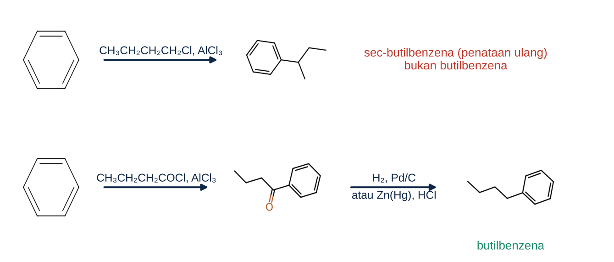

## 10.5 Substitusi elektrofilik aromatik: mekanisme umum

### Dua langkah: serangan elektrofil dan lepasnya proton

Reaksi terpenting senyawa aromatik adalah **substitusi elektrofilik aromatik** (SEAr): sebuah elektrofil, E⁺, menggantikan satu atom H pada cincin.

$$
\text{C}_6\text{H}_6 + \text{E}^+ \longrightarrow \text{C}_6\text{H}_5\text{E} + \text{H}^+ \qquad \text{(10.1)}
$$

Hampir semua reaksi SEAr berjalan dengan mekanisme dua langkah yang sama. Yang berbeda dari satu reaksi ke reaksi lain hanyalah cara membangkitkan elektrofilnya.

**Langkah 1 (lambat): serangan elektrofil.** Sepasang elektron π cincin menyerang elektrofil dan membentuk ikatan σ C–E. Karbon yang diserang menjadi sp³, dengan H dan E terikat padanya. Cincin kehilangan dua elektron π, dan sisa empat elektron π tersebar di lima karbon yang tersisa, membawa muatan positif. Kation ini disebut **ion arenium** (juga **kompleks σ** atau ion Wheland). Muatan positifnya tersebar lewat resonansi ke tiga karbon: dua karbon *orto* dan satu karbon *para* terhadap karbon sp³. Walaupun distabilkan resonansi, ion arenium **tidak aromatik**, karena karbon sp³ memutus lingkaran konjugasi. Kehilangan aromatisitas inilah yang membuat langkah 1 sangat endoterm dan lambat, dan membuat benzena jauh kurang reaktif daripada alkena.

**Langkah 2 (cepat): lepasnya proton.** Suatu basa (sering anion pasangan elektrofil, misalnya FeBr₄⁻ atau HSO₄⁻) mengambil H⁺ dari karbon sp³. Pasangan elektron ikatan C–H kembali ke cincin, dan **aromatisitas pulih**. Langkah ini sangat eksoterm.

{width=98%}

### Mengapa substitusi, bukan adisi

Ion arenium mirip dengan karbokation yang terbentuk pada adisi elektrofilik alkena (subbab 8.3). Pada alkena, karbokation diserang nukleofil, dan produknya adisi. Mengapa ion arenium tidak melakukan hal yang sama? Bila Br⁻ menyerang ion arenium, produknya 5,6-dibromosikloheksa-1,3-diena, senyawa yang **tidak aromatik**: kehilangan sekitar 150 kJ mol⁻¹ energi resonansi menjadi permanen. Bila sebaliknya H⁺ yang lepas, aromatisitas pulih dan energi resonansi didapat kembali. Kedua jalur bersaing dari intermediet yang sama, dan jalur yang menuju produk aromatik jauh lebih menguntungkan. Inilah inti kimia aromatik: **cincin aromatik bereaksi dengan cara yang mempertahankan aromatisitasnya**.

{width=84%}

### Bukti mekanisme

Dua pengamatan mendukung mekanisme ini. Pertama, pada tahun 1950-an George Olah berhasil membuat ion arenium yang cukup stabil untuk diamati dengan NMR pada suhu rendah dalam larutan super asam: intermediet itu memang ada. Kedua, benzena biasa dan benzena yang semua H-nya diganti deuterium (C₆D₆) dinitrasi dengan laju yang praktis sama. Ikatan C–D lebih kuat daripada C–H, sehingga bila pemutusan C–H terjadi pada langkah penentu laju, C₆D₆ seharusnya bereaksi lebih lambat (**efek isotop kinetik**). Tidak adanya efek isotop membuktikan bahwa ikatan C–H putus **sesudah** langkah lambat, tepat seperti yang diramalkan mekanisme dua langkah.

::: {.inti}
**Pola umum SEAr**

1. Bangkitkan elektrofil yang cukup kuat (biasanya dengan asam Lewis atau asam kuat).
2. Elektron π cincin menyerang E⁺ → ion arenium (lambat, aromatisitas hilang sementara).
3. Basa mengambil H⁺ → produk substitusi (cepat, aromatisitas pulih).
:::

::: {.kuis}
**Kuis cepat 10.5** (a) Pada ion arenium dari serangan di C1, di karbon mana saja muatan positif berada? (b) Mengapa benzena memerlukan elektrofil yang jauh lebih kuat daripada alkena?
:::

## 10.6 Halogenasi, nitrasi, dan sulfonasi

### Halogenasi

Br₂ sendiri bukan elektrofil yang cukup kuat untuk benzena. Katalis asam Lewis, **FeBr₃**, menerima satu pasangan bebas bromin dan membentuk kompleks Br–Br⁺–FeBr₃⁻. Ikatan Br–Br dalam kompleks ini sangat terpolarisasi, dan bromin ujungnya bertindak seperti Br⁺. Cincin benzena menyerang bromin itu, FeBr₄⁻ lepas, dan setelah FeBr₄⁻ mengambil proton dari ion arenium, terbentuk bromobenzena, HBr, dan FeBr₃ kembali. Dalam praktik, cukup ditambahkan serbuk besi, yang bereaksi dengan bromin membentuk FeBr₃ di tempat.

**Klorinasi** berjalan dengan cara yang sama memakai Cl₂ dan FeCl₃ atau AlCl₃. **Iodinasi** memerlukan oksidator (misalnya HNO₃ atau CuCl₂) untuk mengubah I₂ menjadi spesies elektrofilik seperti I⁺, karena I₂ sendiri terlalu lemah. **Fluorinasi** langsung dengan F₂ terlalu hebat dan tidak terkendali; senyawa aromatik berfluor dibuat dengan cara lain, misalnya dengan pereaksi "F⁺" khusus atau lewat garam diazonium (Bab 13).

Di dalam tubuh, kelenjar tiroid mengiodinasi cincin aromatik asam amino tirosina dengan enzim peroksidase, membentuk hormon **tiroksina**, yang membawa empat atom iodin. Kekurangan iodin dalam makanan menghambat pembuatan hormon ini dan menyebabkan penyakit gondok; karena itulah garam dapur di Indonesia diwajibkan mengandung iodium.

### Nitrasi

Benzena bereaksi dengan campuran asam nitrat pekat dan asam sulfat pekat (**asam campuran**) menghasilkan nitrobenzena. Elektrofilnya adalah **ion nitronium**, NO₂⁺. Asam sulfat, asam yang lebih kuat, memprotonasi gugus –OH asam nitrat; air lepas, dan tertinggal NO₂⁺, ion linear yang isoelektronik dengan CO₂ dan sangat elektrofilik:

$$
\text{HNO}_3 + 2\,\text{H}_2\text{SO}_4 \rightleftharpoons \text{NO}_2^+ + \text{H}_3\text{O}^+ + 2\,\text{HSO}_4^- \qquad \text{(10.2)}
$$

Cincin menyerang atom nitrogen NO₂⁺, ion arenium terbentuk, dan HSO₄⁻ atau air mengambil proton.

Gugus nitro sangat berguna karena dapat **direduksi menjadi gugus amino**: dengan H₂ dan Pd/C, atau dengan logam (Fe, Sn, atau Zn) dalam HCl, lalu basa. Urutan **nitrasi lalu reduksi** adalah cara utama memasang –NH₂ pada cincin aromatik. Anilina yang dihasilkan menjadi bahan baku pewarna, karet, poliuretan, dan obat seperti parasetamol.

Nitrasi berulang menghasilkan senyawa yang kaya gugus nitro, banyak di antaranya bahan peledak. **TNT** (2,4,6-trinitrotoluena) dibuat dengan menitrasi toluena tiga kali dalam kondisi yang makin keras. Dalam molekul seperti ini, oksigen dari gugus nitro dan bahan bakar (karbon dan hidrogen) berada di dalam molekul yang sama, sehingga pembakarannya tidak memerlukan udara dan berlangsung dalam sepersekian milidetik.

### Sulfonasi

Benzena bereaksi dengan **asam sulfat berasap** (*fuming sulfuric acid*, H₂SO₄ yang mengandung SO₃ terlarut) menghasilkan asam benzenasulfonat, C₆H₅SO₃H. Elektrofilnya SO₃ atau bentuk terprotonasinya, HSO₃⁺; atom belerang yang terikat pada tiga oksigen sangat kekurangan elektron.

Sulfonasi berbeda dari SEAr lainnya dalam satu hal penting: **reaksinya reversibel**. Bila asam benzenasulfonat dipanaskan dengan asam sulfat encer (banyak air), gugus –SO₃H lepas kembali dan benzena terbentuk (**desulfonasi**). Asam pekat dan sedikit air mendorong sulfonasi; asam encer dan panas mendorong desulfonasi. Sifat ini membuat gugus –SO₃H dapat dipakai sebagai **gugus penghalang** sementara: dipasang untuk menutup satu posisi, lalu dilepas setelah substituen lain dipasang di posisi yang diinginkan (subbab 10.12).

Asam sulfonat aromatik adalah asam kuat (pKa sekitar −7). Garam natrium asam dodesilbenzenasulfonat adalah bahan aktif utama **deterjen** cuci: kepala sulfonat yang ionik larut dalam air, ekor hidrokarbon yang panjang larut dalam minyak. Turunan sulfonamida, ArSO₂NH₂, adalah golongan antibiotik sintetis pertama (obat sulfa, 1930-an).

::: {.contoh}
**Contoh 10.6 · Dari benzena ke anilina**

Tulis urutan pereaksi untuk mengubah benzena menjadi anilina, lengkap dengan elektrofil pada langkah pertama.

**Penyelesaian.** (1) HNO₃, H₂SO₄: NO₂⁺ (dari protonasi HNO₃ dan lepasnya air) menyerang cincin, menghasilkan **nitrobenzena**. (2) H₂, Pd/C (atau Fe, HCl, lalu NaOH): gugus –NO₂ direduksi menjadi –NH₂, menghasilkan **anilina**.

**Memahami hasil.** Tidak ada cara langsung memasang –NH₂ dengan SEAr, karena "NH₂⁺" bukan elektrofil yang praktis. Nitrogen dipasang dalam bentuk teroksidasi (nitro), lalu direduksi. Pola "pasang dalam bentuk yang mudah, lalu ubah" sangat umum dalam sintesis aromatik. Perubahan –NO₂ menjadi –NH₂ juga mengubah sifat cincin secara drastis: dari sangat tidak aktif menjadi sangat aktif (subbab 10.8).
:::

::: {.kuis}
**Kuis cepat 10.6** (a) Tulis persamaan pembentukan elektrofil pada brominasi dengan FeBr₃. (b) Mengapa sulfonasi dapat dibalik tetapi nitrasi tidak?
:::

## 10.7 Alkilasi dan asilasi Friedel–Crafts

Pada tahun 1877 Charles Friedel dan James Crafts menemukan bahwa aluminium klorida memungkinkan benzena bereaksi dengan alkil halida dan asil halida. Kedua reaksi ini adalah cara utama membentuk **ikatan C–C baru** pada cincin aromatik.

### Alkilasi Friedel–Crafts

Alkil halida bereaksi dengan benzena dengan katalis AlCl₃ menghasilkan alkilbenzena. AlCl₃ menarik halida dari alkil halida, membentuk **karbokation** (untuk alkil halida sekunder dan tersier) atau kompleks R–Cl–AlCl₃ yang sangat terpolarisasi (untuk primer). Elektrofil karbon ini diserang cincin, dan setelah proton lepas, terbentuk alkilbenzena. 2-Kloro-2-metilpropana dan benzena, misalnya, menghasilkan *tert*-butilbenzena.

Alkilasi Friedel–Crafts mempunyai empat keterbatasan penting:

1. **Penataan ulang karbokation.** Karena elektrofilnya karbokation atau mirip karbokation, penataan ulang ke karbokation yang lebih stabil terjadi (subbab 6.10). Benzena dengan 1-klorobutana menghasilkan terutama *sec*-butilbenzena, bukan butilbenzena: kompleks primer menata ulang lewat geseran hidrida menjadi karbokation sekunder.
2. **Polialkilasi.** Gugus alkil yang masuk **mengaktifkan** cincin (subbab 10.8), sehingga produk lebih reaktif daripada benzena awal dan bereaksi lagi. Untuk mendapatkan produk monoalkil, benzena harus dipakai dalam jumlah sangat berlebih.
3. **Cincin yang tidak aktif tidak bereaksi.** Cincin dengan gugus penarik elektron kuat (–NO₂, –CN, –SO₃H, –COR, –COOH) terlalu miskin elektron untuk menyerang karbokation. Cincin dengan –NH₂, –NHR, atau –NR₂ juga gagal, karena pasangan bebas nitrogen mengikat AlCl₃ dan mengubah gugus itu menjadi gugus bermuatan positif yang sangat menonaktifkan.
4. **Halida vinil dan aril tidak dapat dipakai**, karena karbokation vinil dan aril terlalu tidak stabil untuk terbentuk.

Elektrofil karbokation juga dapat dibuat dari **alkena dan asam** atau dari **alkohol dan asam**. Di industri, benzena dan propena dengan katalis asam menghasilkan **kumena** (isopropilbenzena), bahan baku proses kumena yang menghasilkan fenol dan aseton sekaligus.

### Asilasi Friedel–Crafts

Benzena bereaksi dengan **klorida asam** (RCOCl) dan AlCl₃ menghasilkan **keton aril** (ArCOR). AlCl₃ menarik klorida dari klorida asam, menghasilkan **ion asilium**, R–C≡O⁺. Ion ini distabilkan oleh resonansi dengan pasangan bebas oksigen (R–C⁺=O ↔ R–C≡O⁺), sehingga setiap atom dapat beroktet lengkap. Cincin menyerang karbon ion asilium, dan setelah proton lepas, terbentuk keton.

Asilasi mengatasi dua kelemahan alkilasi:

- **Tidak ada penataan ulang**: ion asilium sudah stabil dan tidak menata ulang.
- **Tidak ada poliasilasi**: gugus asil (–COR) **menonaktifkan** cincin, sehingga produk monoasil kurang reaktif daripada benzena awal dan tidak bereaksi lagi.

Satu kekurangan: keton yang terbentuk mengikat AlCl₃ lewat oksigennya, sehingga AlCl₃ diperlukan dalam jumlah stoikiometrik (sedikit lebih dari satu ekuivalen), bukan katalitik, dan kompleks itu diuraikan dengan air pada akhir reaksi.

### Asilasi lalu reduksi: alkilbenzena rantai lurus

Kombinasi asilasi dan reduksi gugus karbonil memberi cara yang andal untuk membuat alkilbenzena rantai lurus tanpa penataan ulang. Keton aril dapat direduksi menjadi gugus CH₂ dengan hidrogenasi katalitik (H₂, Pd/C; karbonil benzilik, subbab 10.4), dengan **reduksi Clemmensen** (Zn(Hg), HCl pekat), atau dengan **reduksi Wolff–Kishner** (H₂NNH₂, KOH, panas; Bab 11).

{width=96%}

::: {.contoh}
**Contoh 10.7 · Memilih alkilasi atau asilasi**

Usulkan sintesis dari benzena: (a) *tert*-butilbenzena; (b) propilbenzena; (c) 1-fenilpropan-1-on.

**Penyelesaian.** (a) Karbokation *tert*-butil sudah tersier dan tidak menata ulang: **2-kloro-2-metilpropana, AlCl₃** (benzena berlebih untuk mengurangi dialkilasi). (b) Alkilasi dengan 1-kloropropana akan memberi terutama isopropilbenzena (penataan ulang). Jalur yang benar: **propanoil klorida, AlCl₃** → 1-fenilpropan-1-on, lalu **H₂, Pd/C** (atau Zn(Hg), HCl) → propilbenzena. (c) Langsung **propanoil klorida, AlCl₃**.

**Memahami hasil.** Alkilasi Friedel–Crafts hanya andal untuk gugus yang karbokationnya tidak dapat menata ulang (metil, etil dalam kondisi tertentu, isopropil, *tert*-butil, benzil). Untuk rantai lurus yang lebih panjang, pilih asilasi lalu reduksi.
:::

::: {.terapan}
**Ibuprofen dalam tiga langkah**

Ibuprofen, obat antiradang yang dijual bebas, dulu dibuat dengan proses enam langkah yang menghasilkan banyak limbah. Pada tahun 1990-an perusahaan BHC mengembangkan proses tiga langkah yang menjadi contoh terkenal **kimia hijau**. Langkah pertamanya adalah **asilasi Friedel–Crafts** isobutilbenzena dengan anhidrida asetat, memakai HF cair sebagai katalis yang dapat didaur ulang. Keton yang terbentuk kemudian direduksi menjadi alkohol, dan alkohol itu diubah langsung menjadi asam karboksilat dengan karbon monoksida dan katalis paladium. Hampir semua atom bahan baku masuk ke dalam produk, dan proses ini mendapat penghargaan *Presidential Green Chemistry Challenge* 1997.
:::

::: {.kuis}
**Kuis cepat 10.7** (a) Mengapa nitrobenzena tidak mengalami reaksi Friedel–Crafts? (b) Tulis produk benzena + (CH₃)₂CHCH₂Cl, AlCl₃. (c) Tulis produk benzena + asetil klorida, AlCl₃.
:::
