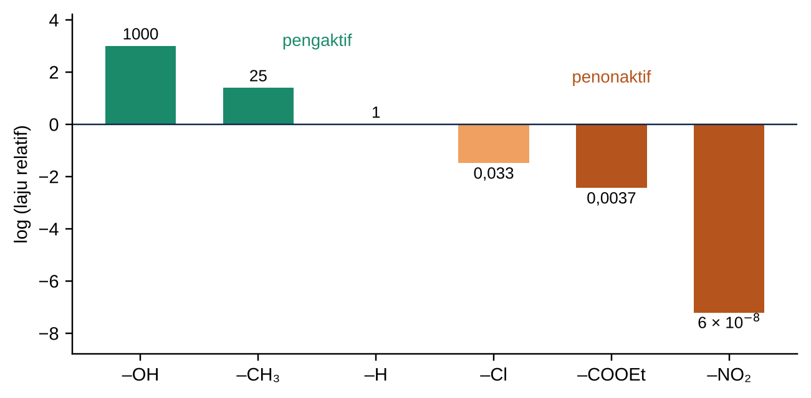
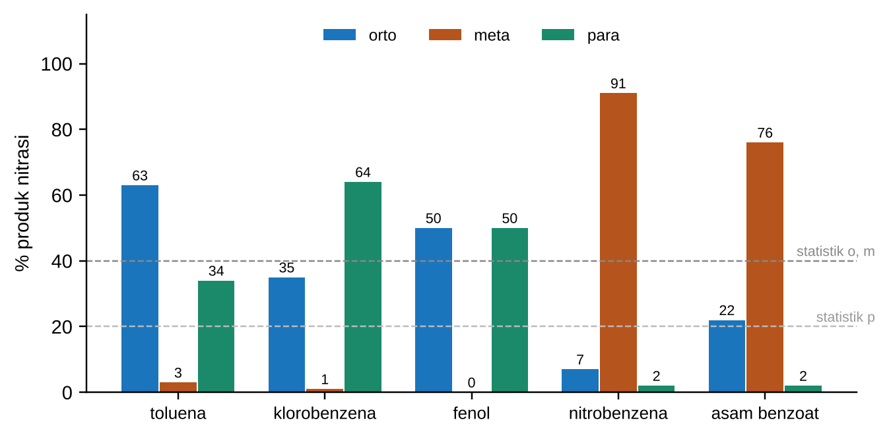

## 10.8 Substituen pengaktif dan penonaktif

### Pengaruh substituen pada laju

Bila benzena sudah membawa satu substituen, substituen itu mempengaruhi substitusi berikutnya dengan dua cara: mengubah **laju** reaksi, dan menentukan **posisi** masuknya elektrofil. Pengaruh pada laju terlihat jelas pada nitrasi. Dengan laju nitrasi benzena sebagai 1, laju relatif beberapa turunan benzena adalah:

| Senyawa | C₆H₅–Z | Laju nitrasi relatif |
|---|---|---|
| fenol | –OH | sekitar 1000 |
| toluena | –CH₃ | 25 |
| benzena | –H | 1 |
| klorobenzena | –Cl | 0,033 |
| etil benzoat | –COOCH₂CH₃ | 0,0037 |
| nitrobenzena | –NO₂ | 6 × 10⁻⁸ |

Substituen yang membuat cincin bereaksi lebih cepat daripada benzena disebut **pengaktif**; yang membuatnya lebih lambat disebut **penonaktif**. Rentangnya luar biasa lebar: fenol bereaksi sekitar sepuluh triliun kali lebih cepat daripada nitrobenzena.

{width=82%}

Penjelasannya sederhana bila kita ingat bahwa langkah penentu laju adalah pembentukan ion arenium, dan keadaan transisinya mirip ion arenium (postulat Hammond, subbab 6.9). Substituen yang **mendorong elektron** ke cincin membuat cincin lebih nukleofilik dan menstabilkan muatan positif ion arenium, sehingga keadaan transisi lebih rendah dan reaksi lebih cepat. Substituen yang **menarik elektron** dari cincin melakukan sebaliknya.

### Dua cara substituen mendorong atau menarik elektron

**Efek induktif** bekerja lewat ikatan σ dan bergantung pada keelektronegatifan (subbab 3.7). Atom yang lebih elektronegatif daripada karbon (halogen, O, N) yang terikat langsung pada cincin menarik kerapatan elektron lewat ikatan σ. Gugus yang bermuatan positif atau berkutub kuat (–NR₃⁺, –NO₂, –CF₃, karbon karbonil) menarik elektron dengan kuat. Gugus alkil sedikit mendorong elektron.

**Efek resonansi** bekerja lewat sistem π dan bergantung pada apakah atom yang terikat pada cincin mempunyai pasangan bebas atau ikatan π ke atom elektronegatif.

- **Pendorong resonansi**: atom dengan pasangan bebas yang terikat langsung pada cincin (–OH, –OR, –NH₂, –NHR, –NHCOR, halogen). Pasangan bebas itu dapat bertumpang tindih dengan sistem π cincin dan mendorong elektron masuk, terutama ke posisi *orto* dan *para*.
- **Penarik resonansi**: gugus dengan ikatan π ke atom elektronegatif yang terikat langsung pada cincin (–CHO, –COR, –COOH, –COOR, –CN, –NO₂, –SO₃H). Elektron π cincin dapat berpindah ke atom elektronegatif itu, menarik kerapatan elektron dari cincin, terutama dari posisi *orto* dan *para*.

Bila kedua efek bekerja ke arah berlawanan, mana yang menang? Untuk O dan N, **resonansi menang dengan jauh**: pasangan bebasnya berada di orbital 2p yang ukurannya cocok dengan orbital 2p karbon, sehingga tumpang tindihnya sangat baik. –OH dan –NH₂ adalah pengaktif kuat walaupun O dan N elektronegatif. Untuk **halogen**, **efek induktif sedikit menang**: Cl, Br, dan I memakai orbital 3p, 4p, dan 5p yang terlalu besar untuk bertumpang tindih dengan baik dengan orbital 2p karbon, dan F sangat elektronegatif. Hasilnya, halogen adalah penonaktif lemah. Kita akan lihat di subbab 10.9 bahwa efek resonansi halogen yang lemah itu tetap menentukan **posisi** substitusi.

::: {.inti}
**Penggolongan substituen pada SEAr**

| Golongan | Contoh | Pengarah |
|---|---|---|
| pengaktif kuat | –NH₂, –NHR, –NR₂, –OH, –O⁻ | *orto*/*para* |
| pengaktif sedang | –OR, –NHCOR | *orto*/*para* |
| pengaktif lemah | –R (alkil), –C₆H₅ | *orto*/*para* |
| penonaktif lemah | –F, –Cl, –Br, –I | *orto*/*para* |
| penonaktif sedang | –CHO, –COR, –COOR, –COOH, –CONH₂ | *meta* |
| penonaktif kuat | –CN, –SO₃H, –CF₃, –NO₂, –NR₃⁺ | *meta* |

Aturan praktis: **semua pengaktif dan halogen mengarahkan ke *orto*/*para*; semua penonaktif selain halogen mengarahkan ke *meta*.**
:::

Pengaktif kuat dapat membuat reaksi sulit dihentikan. Fenol dan anilina bereaksi dengan air bromin tanpa katalis dan langsung menghasilkan produk tribromo (subbab 9.7). Untuk monobrominasi anilina, gugus –NH₂ lebih dulu diasetilasi menjadi –NHCOCH₃ (asetanilida), pengaktif sedang yang lebih jinak, lalu gugus asetil dilepas kembali dengan hidrolisis setelah brominasi.

::: {.contoh}
**Contoh 10.8 · Mengurutkan kereaktifan**

Urutkan laju nitrasi dan jelaskan: anisol, nitrobenzena, toluena, benzena, bromobenzena, asetanilida.

**Penyelesaian.** Anisol (–OCH₃, pengaktif sedang, resonansi kuat) > asetanilida (–NHCOCH₃, pengaktif sedang; pasangan bebas N sebagian ditarik oleh gugus karbonil, sehingga sedikit lebih lemah daripada –OCH₃) > toluena (–CH₃, pengaktif lemah, induktif dan hiperkonjugasi) > benzena > bromobenzena (–Br, penonaktif lemah, induktif lebih kuat daripada resonansinya) > nitrobenzena (–NO₂, penonaktif kuat, induktif dan resonansi sama-sama menarik).

**Memahami hasil.** Pada asetanilida, pasangan bebas nitrogen "terbagi" antara cincin dan gugus karbonil (resonansi amida), sehingga kekuatan aktivasinya berkurang dibanding –NH₂. Inilah alasan asetilasi dipakai untuk "menjinakkan" anilina.
:::

::: {.kuis}
**Kuis cepat 10.8** Urutkan laju brominasi: benzena, fenol, nitrobenzena, toluena, klorobenzena, asetofenon (C₆H₅COCH₃).
:::

## 10.9 Pengarah orto/para dan meta

### Mengapa gugus alkil mengarahkan ke orto dan para

Nitrasi toluena menghasilkan 63% *o*-nitrotoluena, 34% *p*-nitrotoluena, dan hanya 3% *m*-nitrotoluena. Seandainya ketiga posisi sama reaktif, kita mengharapkan 40% *orto* (dua posisi), 40% *meta* (dua posisi), dan 20% *para* (satu posisi). Hampir tidak ada produk *meta*. Mengapa?

Kunci jawabannya adalah membandingkan ion arenium yang terbentuk dari serangan di setiap posisi. Ingat bahwa muatan positif ion arenium berada pada karbon *orto* dan *para* **terhadap karbon yang diserang**.

- **Serangan *orto*** (di C2, bila metil di C1): muatan positif berada di C1, C3, dan C5. Salah satu struktur resonansi menempatkan muatan positif di **C1, karbon yang membawa metil**. Struktur itu adalah karbokation **tersier**, lebih stabil daripada dua struktur lainnya yang sekunder.
- **Serangan *para*** (di C4): muatan positif berada di C3, C5, dan **C1**. Sekali lagi ada struktur karbokation tersier.
- **Serangan *meta*** (di C3): muatan positif berada di C2, C4, dan C6. **Tidak ada** struktur dengan muatan di C1. Semua struktur sekunder.

Ion arenium dari serangan *orto* dan *para* lebih stabil, sehingga keadaan transisinya lebih rendah dan jalurnya lebih cepat. Gugus metil adalah pengarah *orto*/*para*.

### Pengarah dengan pasangan bebas: struktur resonansi keempat

Untuk gugus seperti –OCH₃, –OH, dan –NH₂, efeknya jauh lebih besar. Pada serangan *orto* atau *para*, struktur resonansi dengan muatan positif di karbon pembawa substituen dapat distabilkan lebih jauh oleh **pasangan bebas atom O atau N**: pasangan bebas itu membentuk ikatan π dengan karbon cincin, dan muatan positif berpindah ke heteroatom. Dalam struktur keempat ini, ion **oksonium** atau **iminium**, **setiap atom mempunyai oktet lengkap**, sehingga struktur itu sangat stabil dan menyumbang banyak pada hibrida. Serangan *meta* tidak dapat menghasilkan struktur keempat ini.

{width=98%}

### Mengapa penarik elektron mengarahkan ke meta

Untuk gugus penarik elektron seperti –NO₂ atau –CHO, situasinya terbalik. Pada serangan *orto* atau *para*, salah satu struktur resonansi ion arenium menempatkan muatan positif **di karbon yang terikat langsung pada gugus penarik**, dan atom gugus itu yang terikat pada cincin sendiri sudah positif (N⁺ pada nitro) atau δ+ (karbon karbonil). Dua muatan positif bersebelahan sangat tidak stabil. Serangan *meta* tidak pernah menempatkan muatan positif di karbon itu. Jadi **serangan *meta* adalah yang paling tidak buruk**: semua posisi diperlambat, tetapi posisi *orto* dan *para* jauh lebih diperlambat. Nitrasi nitrobenzena memberi 91% produk *meta*.

### Halogen: penonaktif yang mengarahkan ke orto dan para

Halogen menempati posisi khusus. Efek induktifnya yang menarik elektron membuat semua posisi lebih lambat daripada benzena (penonaktif). Tetapi pada serangan *orto* dan *para*, pasangan bebas halogen dapat membentuk struktur halonium (C=X⁺) yang menstabilkan ion arenium, seperti oksigen pada anisol, walaupun jauh lebih lemah. Serangan *meta* tidak mendapat bantuan ini. Jadi efek induktif menentukan **laju** (lambat), dan efek resonansi menentukan **posisi** (*orto*/*para*). Klorobenzena dinitrasi 30 kali lebih lambat daripada benzena, dan memberi 35% *orto*, 1% *meta*, dan 64% *para*.

{width=86%}

### Orto atau para?

Pengarah *orto*/*para* hampir selalu memberi campuran keduanya. Secara statistik ada dua posisi *orto* dan satu *para*, tetapi posisi *orto* bersebelahan dengan substituen dan lebih terhalang. Makin besar substituen (atau elektrofilnya), makin banyak produk *para*. Nitrasi toluena memberi 63% *orto*, sedangkan nitrasi *tert*-butilbenzena hanya sekitar 16% *orto* dan sekitar 73% *para*. Untungnya, isomer *orto* dan *para* biasanya mudah dipisahkan (titik didih atau titik lelehnya berbeda; isomer *para* yang simetris sering mengkristal lebih mudah), sehingga keduanya dapat diperoleh murni.

::: {.contoh}
**Contoh 10.9 · Meramalkan posisi substitusi**

Tulis produk utama mononitrasi: (a) bromobenzena; (b) benzaldehida; (c) asetanilida (C₆H₅NHCOCH₃); (d) (trifluorometil)benzena.

**Penyelesaian.** (a) –Br: penonaktif lemah, pengarah *o*/*p*. Produk: **1-bromo-4-nitrobenzena** (utama) dan 1-bromo-2-nitrobenzena. (b) –CHO: penonaktif, pengarah *meta*: **3-nitrobenzaldehida**. (c) –NHCOCH₃: pengaktif sedang, pengarah *o*/*p*; gugusnya cukup besar sehingga *para* dominan: **4-nitroasetanilida**. (d) –CF₃: penonaktif kuat lewat efek induktif (tiga F), tanpa pasangan bebas pada karbon yang terikat ke cincin: pengarah *meta*: **1-nitro-3-(trifluorometil)benzena**.

**Memahami hasil.** Cara cepat: lihat atom yang langsung terikat pada cincin. Bila atom itu mempunyai pasangan bebas (O, N, halogen) atau adalah karbon alkil, pengarahnya *o*/*p*. Bila atom itu terikat rangkap ke atom elektronegatif atau bermuatan positif (C=O, C≡N, N⁺, S dengan banyak O, CF₃), pengarahnya *meta*.
:::

::: {.contoh}
**Contoh 10.10 · Menjelaskan dengan struktur resonansi**

Jelaskan dengan struktur ion arenium mengapa nitrasi asam benzoat memberi terutama asam 3-nitrobenzoat.

**Penyelesaian.** Tandai karbon pembawa –COOH sebagai C1. Serangan *para* (C4) menghasilkan muatan positif di C3, C5, dan C1. Struktur dengan muatan di C1 menempatkan dua pusat positif bersebelahan: C1 (⁺) dan karbon karboksil (δ+, karena ditarik oleh dua oksigen). Struktur ini sangat tidak stabil, sehingga ion arenium *para* (dan dengan alasan yang sama *orto*) berenergi tinggi. Serangan *meta* (C3) menghasilkan muatan di C2, C4, dan C6, tidak pernah di C1. Ion arenium *meta* juga kurang stabil daripada ion arenium benzena (gugus –COOH tetap menarik elektron secara induktif), tetapi tidak sejelek *orto* dan *para*. Produk utama: **asam 3-nitrobenzoat** (76%), dengan sedikit isomer *orto* (22%) dan *para* (2%).

**Memahami hasil.** Pengarah *meta* sebenarnya bukan "menarik" elektrofil ke posisi *meta*; posisi *meta* hanya paling sedikit dirugikan. Itulah sebabnya semua pengarah *meta* juga penonaktif.
:::

::: {.kuis}
**Kuis cepat 10.9** (a) Tulis struktur resonansi ion arenium untuk serangan *para* pada fenol, termasuk struktur oksonium. (b) Mengapa –NH₃⁺ (pada anilina dalam asam kuat) mengarahkan ke *meta*, padahal –NH₂ mengarahkan ke *orto*/*para*?
:::

## 10.10 Benzena dengan beberapa substituen

Bila cincin sudah membawa dua substituen atau lebih, posisi substitusi berikutnya dapat diramalkan dengan tiga aturan:

1. **Bila pengaruh kedua substituen searah** (keduanya mengarahkan ke posisi yang sama), ramalannya mudah. Pada 4-nitrotoluena, –CH₃ mengarahkan ke posisi *orto* terhadapnya (C2 dan C6) dan –NO₂ mengarahkan ke posisi *meta* terhadapnya (juga C2 dan C6). Brominasi memberi 2-bromo-4-nitrotoluena.
2. **Bila pengaruhnya bertentangan, pengaktif yang lebih kuat menang.** Urutan kekuatannya mengikuti tabel di subbab 10.8: –NH₂, –OH > –OR, –NHCOR > alkil > halogen > penonaktif. Pada 4-metilfenol, –OH jauh lebih kuat daripada –CH₃, sehingga substitusi terjadi *orto* terhadap –OH.
3. **Posisi di antara dua substituen yang saling *meta* hampir tidak diserang**, karena terlalu terhalang. Pada 1,3-dimetilbenzena (*m*-xilena), C2 terletak di antara kedua metil; substitusi terjadi terutama di C4.

Bila kedua substituen hampir sama kuat dan bertentangan, misalnya –CH₃ dan –Cl, biasanya terbentuk campuran.

::: {.contoh}
**Contoh 10.11 · Dua substituen**

Ramalkan produk utama mononitrasi: (a) 4-kloroanisol; (b) 4-metilasetofenon (1-(4-metilfenil)etanon); (c) 4-bromoasetanilida.

**Penyelesaian.** (a) –OCH₃ (pengaktif sedang) mengalahkan –Cl (penonaktif lemah). Nitrasi *orto* terhadap –OCH₃ (posisi *para*-nya sudah ditempati Cl): **4-kloro-2-nitroanisol**. (b) –CH₃ mengarahkan ke posisi *orto* terhadapnya; –COCH₃ mengarahkan ke posisi *meta* terhadapnya. Kedua pengaruh **searah**: posisi *orto* terhadap metil adalah posisi *meta* terhadap asetil. Produk: **1-(4-metil-3-nitrofenil)etanon**. (c) –NHCOCH₃ (pengaktif sedang) mengalahkan –Br. Posisi *para* terhadap –NHCOCH₃ sudah ditempati Br, sehingga nitrasi terjadi *orto* terhadapnya: **4-bromo-2-nitroasetanilida**.

**Memahami hasil.** Tentukan dulu substituen terkuat, lalu cari posisi *orto*/*para* terhadapnya yang masih kosong dan tidak terlalu terhalang. Setelah gugus baru masuk, beri nama ulang produknya dengan aturan penomoran terendah.
:::

::: {.kuis}
**Kuis cepat 10.10** Tulis produk utama brominasi (FeBr₃): (a) 4-metilanisol; (b) asam 4-metilbenzoat; (c) 1,3-dimetoksibenzena.
:::
