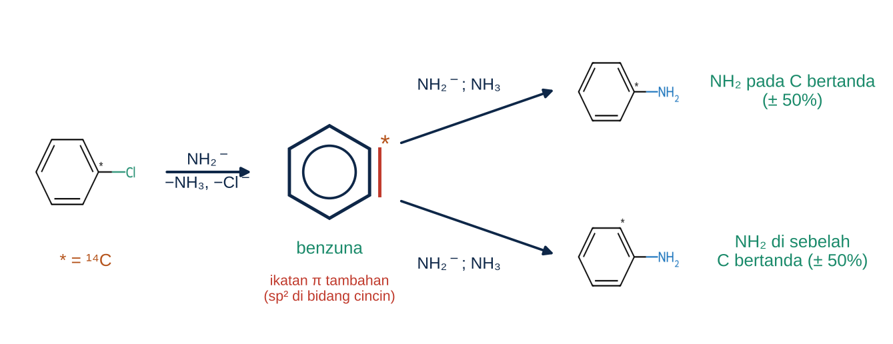
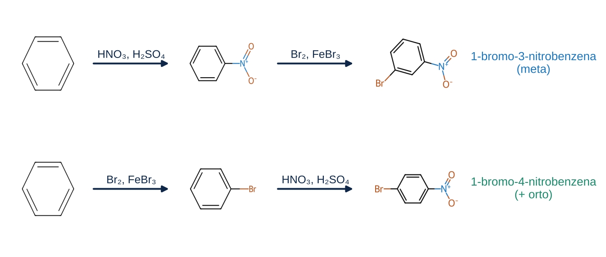

## 10.11 Substitusi nukleofilik aromatik dan benzuna

### Mengapa aril halida biasanya tidak bereaksi dengan nukleofil

Klorobenzena dapat dipanaskan dengan larutan NaOH tanpa berubah, sedangkan klorometana bereaksi dengan mudah. Aril halida menolak kedua mekanisme substitusi dari Bab 7. **SN2** tidak mungkin, karena nukleofil harus menyerang karbon dari sisi belakang, dan sisi belakang itu justru berada di dalam cincin benzena. **SN1** juga tidak mungkin, karena kation fenil yang terbentuk sangat tidak stabil: muatan positifnya berada di orbital sp² yang terletak di bidang cincin, tegak lurus terhadap sistem π, sehingga tidak dapat distabilkan oleh resonansi sama sekali. Selain itu ikatan C–X pada aril halida lebih kuat, karena karbonnya sp².

Namun aril halida dapat mengalami substitusi nukleofilik lewat dua mekanisme lain: **adisi–eliminasi** bila cincinnya membawa gugus penarik elektron kuat, dan **eliminasi–adisi** lewat benzuna bila basa sangat kuat dipakai.

### Adisi–eliminasi: kompleks Meisenheimer

1-Kloro-2,4-dinitrobenzena bereaksi dengan NaOH encer pada sekitar 100 °C menghasilkan 2,4-dinitrofenol. Dengan tiga gugus nitro (2,4,6-trinitroklorobenzena), reaksi dengan air hangat sudah cukup. Gugus nitro yang mempercepat SEAr secara drastis justru memperlambatnya, tetapi di sini membuat cincin miskin elektron sehingga dapat **diserang nukleofil**. Mekanismenya dua langkah, sejajar dengan SEAr tetapi dengan muatan terbalik:

1. **Adisi (lambat).** Nukleofil menyerang karbon pembawa halogen dari atas bidang cincin (menyerang orbital π*, bukan dari belakang ikatan C–X). Karbon itu menjadi sp³, dan terbentuk **anion** yang muatan negatifnya tersebar lewat resonansi ke karbon *orto* dan *para* terhadap karbon yang diserang. Bila gugus nitro berada di posisi *orto* atau *para*, muatan negatif dapat pindah ke oksigen gugus nitro, dan anion menjadi cukup stabil. Anion ini disebut **kompleks Meisenheimer**; beberapa kompleks Meisenheimer bahkan dapat diisolasi sebagai garam berwarna.
2. **Eliminasi (cepat).** Ion halida lepas, dan aromatisitas pulih.

{width=96%}

Mekanisme ini, disebut **SNAr**, mempunyai tiga ciri yang membedakannya dari SN1 dan SN2:

- **Gugus penarik elektron harus berada di posisi *orto* atau *para*** terhadap gugus pergi. Gugus nitro di posisi *meta* hampir tidak membantu, karena muatan resonansi kompleks Meisenheimer tidak pernah sampai ke karbon *meta*.
- **Urutan gugus pergi terbalik: F > Cl ≈ Br > I.** Langkah penentu laju adalah adisi, bukan pemutusan C–X. Fluorin yang paling elektronegatif membuat karbon yang diserang paling δ+ dan menstabilkan kompleks Meisenheimer lewat efek induktif. Bahwa ikatan C–F paling kuat tidak menjadi soal, karena ikatan itu putus pada langkah cepat.
- **Tidak ada inversi atau penataan ulang**; nukleofil masuk tepat di tempat gugus pergi.

::: {.terapan}
**Pereaksi Sanger dan urutan asam amino insulin**

Pada tahun 1945 Frederick Sanger memakai 1-fluoro-2,4-dinitrobenzena (FDNB) untuk menandai ujung rantai protein. Gugus –NH₂ bebas pada asam amino pertama rantai protein menyerang FDNB lewat SNAr, dan terbentuk turunan dinitrofenil berwarna kuning yang tetap terikat ketika protein dihidrolisis menjadi asam-asam aminonya. Dengan mengenali asam amino berwarna kuning itu, Sanger mengetahui asam amino mana yang berada di ujung rantai. Mengulang cara ini pada potongan-potongan protein memungkinkan Sanger menentukan seluruh urutan asam amino insulin, protein pertama yang urutannya diketahui. Ia mendapat Hadiah Nobel Kimia 1958, dan Hadiah Nobel keduanya pada 1980 untuk metode pengurutan DNA.
:::

### Eliminasi–adisi: benzuna

Klorobenzena tanpa gugus nitro bereaksi dengan **natrium amida** dalam amonia cair (−33 °C) menghasilkan anilina. Mekanismenya bukan SNAr, karena tidak ada gugus yang menstabilkan anion. Petunjuk datang dari percobaan isotop (John D. Roberts, 1953): bila karbon pembawa Cl ditandai dengan ¹⁴C, anilina yang terbentuk merupakan campuran kira-kira 50 : 50 antara anilina dengan –NH₂ pada karbon bertanda dan anilina dengan –NH₂ pada karbon **di sebelahnya**. Nukleofil tidak selalu masuk di tempat gugus pergi.

Penjelasannya adalah zat antara yang disebut **benzuna**:

1. **Eliminasi.** NH₂⁻, basa yang sangat kuat, mengambil proton dari karbon *orto* terhadap Cl. Anion aril yang terbentuk melepas Cl⁻, dan terbentuk benzuna: cincin benzena dengan satu "ikatan rangkap tiga" tambahan.
2. **Adisi.** NH₂⁻ menyerang salah satu dari dua karbon ikatan rangkap tiga itu (peluangnya hampir sama), menghasilkan anion aril yang kemudian mengambil proton dari amonia.

Ikatan π tambahan dalam benzuna sangat aneh. Ikatan itu terbentuk dari dua orbital sp² yang terletak **di bidang cincin**, mengarah keluar dan hampir tidak sejajar, sehingga tumpang tindihnya buruk. Ikatan ini sangat lemah, dan benzuna sangat reaktif, hidup hanya sesaat. Keberadaannya dibuktikan dengan "menangkapnya" memakai diena seperti furan, yang bereaksi dengan benzuna membentuk produk adisi siklik (reaksi Diels–Alder, yang dibahas di Kimia Organik 2).

{width=96%}

::: {.contoh}
**Contoh 10.12 · SNAr atau benzuna**

Ramalkan produk: (a) 1-fluoro-4-nitrobenzena + NaOCH₃, CH₃OH, panas; (b) 1-fluoro-3-nitrobenzena + NaOCH₃, CH₃OH, panas; (c) 4-klorotoluena + NaNH₂, NH₃ cair.

**Penyelesaian.** (a) Gugus nitro *para* menstabilkan kompleks Meisenheimer: SNAr berjalan, menghasilkan **4-nitroanisol**. (b) Gugus nitro di posisi *meta* tidak dapat menampung muatan lewat resonansi: reaksi **sangat lambat**, praktis tidak terjadi pada kondisi yang sama. (c) Tanpa gugus penarik elektron, dengan basa sangat kuat: mekanisme benzuna. Proton *orto* terhadap Cl diambil, terbentuk 4-metilbenzuna (ikatan rangkap tiga antara C3 dan C4 bila metil di C1). NH₂⁻ menyerang C3 atau C4: campuran **4-metilanilina** (*p*-toluidina) dan **3-metilanilina** (*m*-toluidina), dalam jumlah yang hampir sama.

**Memahami hasil.** Pilih mekanisme dari kondisi. Gugus nitro *o*/*p* dengan nukleofil biasa → SNAr, produk tepat di tempat halogen. Tanpa gugus aktivasi dengan NaNH₂ → benzuna, produk campuran isomer.
:::

::: {.kuis}
**Kuis cepat 10.11** (a) Urutkan laju reaksi dengan NaOCH₃: 1-kloro-4-nitrobenzena, 1-fluoro-4-nitrobenzena, klorobenzena, 1-kloro-2,4-dinitrobenzena. (b) Mengapa bromobenzena dengan ¹⁴C di C1 memberi dua anilina bertanda yang berbeda dengan NaNH₂?
:::

## 10.12 Sintesis senyawa aromatik bertahap

Kita sekarang mempunyai cukup banyak reaksi untuk merancang sintesis senyawa aromatik dengan beberapa substituen. Tantangan utamanya adalah **urutan**: setiap substituen yang sudah ada menentukan ke mana substituen berikutnya masuk, sehingga urutan yang berbeda menghasilkan isomer yang berbeda.

### Prinsip-prinsip

1. **Pasang dulu substituen yang mengarahkan ke posisi yang diinginkan.** Untuk dua substituen *meta*, pasang lebih dulu pengarah *meta*. Untuk dua substituen *orto* atau *para*, pasang lebih dulu pengarah *orto*/*para*, lalu pisahkan isomer *orto* dan *para*.
2. **Ubah sifat pengarah dengan mengubah gugus.** Beberapa gugus dapat diubah menjadi gugus dengan sifat pengarah yang berlawanan:
   - –NO₂ (*meta*, penonaktif) → –NH₂ (*o*/*p*, pengaktif) dengan reduksi;
   - –COR (*meta*) → –CH₂R (*o*/*p*) dengan reduksi Clemmensen atau Wolff–Kishner;
   - –CH₃ (*o*/*p*) → –COOH (*meta*) dengan oksidasi KMnO₄.
3. **Friedel–Crafts tidak jalan pada cincin yang tidak aktif.** Lakukan alkilasi atau asilasi sebelum memasang –NO₂, –COR, –CN, atau –SO₃H.
4. **Gugus –SO₃H dapat dipakai sebagai penghalang** untuk menutup posisi *para*, lalu dilepas dengan asam encer panas.
5. **Pikirkan mundur** (retrosintesis, subbab 8.14): substituen mana yang dipasang terakhir, dan apakah substituen-substituen yang ada sebelumnya mengarahkannya ke posisi yang benar?

{width=96%}

::: {.contoh}
**Contoh 10.13 · Urutan nitrasi dan oksidasi**

Rancang sintesis dari toluena: (a) asam 4-nitrobenzoat; (b) asam 3-nitrobenzoat.

**Penyelesaian.** (a) Kedua gugus saling *para*. –CH₃ adalah pengarah *orto*/*para*, sedangkan –COOH pengarah *meta*. Jadi nitrasi harus dilakukan **selagi gugus itu masih –CH₃**: (1) HNO₃, H₂SO₄ → 4-nitrotoluena (dipisahkan dari isomer *orto*); (2) KMnO₄, panas → **asam 4-nitrobenzoat**. (b) Kedua gugus saling *meta*. Oksidasi lebih dulu: (1) KMnO₄, panas → asam benzoat; (2) HNO₃, H₂SO₄ → **asam 3-nitrobenzoat**.

**Memahami hasil.** Satu gugus (metil) dapat menjadi pengarah *o*/*p* atau, setelah dioksidasi, pengarah *meta*. Memilih kapan mengubahnya adalah cara memilih isomer.
:::

::: {.contoh}
**Contoh 10.14 · Rantai lurus dan pengarah meta sementara**

Rancang sintesis 1-bromo-3-propilbenzena dari benzena.

**Rencana (mundur).** Gugus propil (pengarah *o*/*p*) dan Br (pengarah *o*/*p*) saling *meta*. Tidak satu pun dari keduanya mengarahkan ke *meta*. Tetapi gugus propil dapat dibuat dari gugus propanoil (–COCH₂CH₃), yang adalah pengarah *meta*. Jadi: 1-bromo-3-propilbenzena ⇒ 1-(3-bromofenil)propan-1-on (reduksi) ⇒ 1-fenilpropan-1-on + Br₂ (brominasi *meta*) ⇒ benzena + propanoil klorida.

**Penyelesaian (maju).**

1. CH₃CH₂COCl, AlCl₃ → 1-fenilpropan-1-on.
2. Br₂, FeBr₃ → 1-(3-bromofenil)propan-1-on (gugus asil mengarahkan *meta*).
3. Zn(Hg), HCl (Clemmensen) atau H₂NNH₂, KOH (Wolff–Kishner) → **1-bromo-3-propilbenzena**.

**Memahami hasil.** Gugus asil berperan ganda: menghindari penataan ulang (propil lurus, bukan isopropil) dan menjadi pengarah *meta* sementara. Untuk reduksi pada langkah 3, hindari H₂/Pd berlebih, karena ikatan C–Br aril dapat ikut tereduksi; Clemmensen atau Wolff–Kishner lebih aman.
:::

::: {.contoh}
**Contoh 10.15 · Gugus penghalang untuk isomer orto**

Rancang sintesis 2-bromotoluena yang bebas dari isomer *para*.

**Penyelesaian.** Brominasi langsung toluena memberi campuran *orto* dan *para* yang sulit dipisahkan. Tutup dulu posisi *para*:

1. SO₃, H₂SO₄ → asam 4-metilbenzenasulfonat (gugus –SO₃H yang besar masuk terutama ke posisi *para*).
2. Br₂, FeBr₃ → brom masuk *orto* terhadap –CH₃ (yang juga *meta* terhadap –SO₃H; kedua pengaruh searah).
3. H₂SO₄ encer, panas → gugus –SO₃H lepas (desulfonasi), menghasilkan **2-bromotoluena**.

**Memahami hasil.** Reversibilitas sulfonasi (subbab 10.6) membuat gugus –SO₃H menjadi penghalang sementara yang ideal: dipasang dengan asam pekat, dilepas dengan asam encer.
:::

::: {.strategi}
**Daftar periksa sintesis aromatik**

1. Tandai hubungan setiap pasangan substituen di sasaran: *orto*, *meta*, atau *para*.
2. Tentukan sifat pengarah setiap substituen, termasuk "bentuk sebelumnya" (–NH₂ dapat berasal dari –NO₂; –CH₂R dari –COR; –COOH dari –CH₃).
3. Pilih urutan sehingga setiap substituen yang masuk diarahkan ke posisi yang benar oleh substituen yang sudah ada.
4. Periksa batasan: Friedel–Crafts sebelum gugus penonaktif; asilasi lalu reduksi untuk rantai lurus; nitro direduksi pada saat yang tepat.
5. Untuk *orto* murni, pertimbangkan gugus penghalang –SO₃H.
:::

::: {.kuis}
**Kuis cepat 10.12** Rancang sintesis dari benzena: (a) 3-kloroanilina; (b) 4-kloroanilina; (c) asam 4-bromobenzoat dari toluena.
:::

## Menuju bab berikutnya

Teka-teki pembuka bab kini terjawab. Benzena bukan "sikloheksatriena": keenam elektron π-nya tersebar merata dan mengisi penuh tiga orbital ikatan, memberi kestabilan sekitar 150 kJ mol⁻¹. Adisi akan merusak kestabilan itu, sehingga benzena memilih substitusi, yang memulihkan cincin aromatik di langkah terakhir. Keenam karbonnya setara, sehingga hanya ada satu bromobenzena, dan tiga dibromobenzena (*orto*, *meta*, *para*).

Kita telah melihat bahwa gugus karbonil pada keton aril, asam benzoat, dan benzaldehida mengubah kereaktifan cincin dengan kuat. Bab 11 membahas gugus karbonil itu sendiri. Karbon karbonil adalah elektrofil yang diserang oleh banyak nukleofil, dari hidrida dan pereaksi Grignard yang sudah kita kenal (subbab 9.2) sampai air, alkohol, dan amina. Kimia **aldehida dan keton** adalah inti dari sebagian besar sintesis organik, dan juga kimia gula, yang membentuk cincin hemiasetal di dalam tubuh kita.
