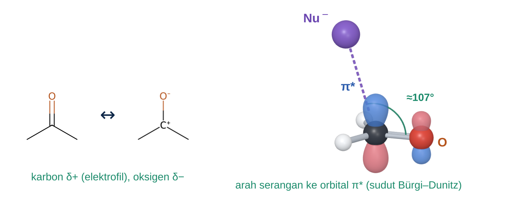

# Bab 11 Aldehida dan Keton

Glukosa, gula yang beredar dalam darah kita, adalah sebuah **aldehida**: rumus rantai terbukanya mempunyai gugus –CHO di ujung rantai enam karbon, dan pada setiap karbon lainnya terdapat gugus –OH. Tetapi bila glukosa dilarutkan dalam air dan diperiksa dengan spektroskopi, hampir tidak ada gugus aldehida yang terlihat. Kurang dari tiga molekul glukosa dari setiap seratus ribu berada dalam bentuk rantai terbuka. Sisanya berbentuk **cincin beranggota enam** yang mengandung atom oksigen, dan cincin itu pun terdapat dalam dua bentuk yang berbeda (sekitar 36% dan 64%) yang perlahan saling berubah bila larutan dibiarkan. Ke mana perginya gugus aldehida glukosa? Mengapa gula membentuk cincin? Dan mengapa dua bentuk cincin itu saling berubah, padahal ikatan C–C tidak putus?

Jawabannya terletak pada reaksi terpenting gugus karbonil: **adisi nukleofilik**. Karbon gugus karbonil, C=O, kekurangan elektron karena oksigen yang elektronegatif menarik elektron ikatan π. Nukleofil, mulai dari air dan alkohol yang lemah sampai hidrida dan karbanion yang kuat, menyerang karbon itu, dan ikatan π C=O berubah menjadi pasangan bebas pada oksigen. Pada glukosa, nukleofilnya adalah salah satu gugus –OH di dalam molekul yang sama.

Bab ini adalah gerbang ke kimia karbonil, yang akan mengisi sebagian besar sisa buku ini dan seluruh Kimia Organik 2. Kita mulai dengan struktur dan sifat gugus karbonil serta cara membuat aldehida dan keton. Lalu kita pelajari pola umum adisi nukleofilik dalam basa dan dalam asam, dan memakai pola itu untuk memahami hidrat, sianohidrin, asetal, imina, reduksi dengan hidrida, adisi pereaksi Grignard, dan reaksi Wittig. Kita juga membahas oksidasi Baeyer–Villiger, yang menyisipkan oksigen di sebelah gugus karbonil, dan memperkenalkan sifat **karbon α**, karbon tetangga gugus karbonil, yang hidrogennya bersifat asam. Di akhir bab, semua reaksi itu kita rangkai menjadi rencana sintesis.

::: {.kuis}
**Pertanyaan pembuka**

1. Mengapa karbon karbonil diserang oleh nukleofil, sedangkan karbon alkena diserang oleh elektrofil?
2. Mengapa formaldehida dalam air hampir seluruhnya berubah menjadi hidrat, sedangkan aseton hampir tidak?
3. Mengapa glukosa berbentuk cincin, dan bagaimana bentuk cincin itu dapat dibuka kembali?
4. Mengapa pembentukan imina paling cepat pada pH sekitar 4–5, bukan dalam asam kuat atau dalam basa?
5. Bagaimana kita dapat memasang ikatan rangkap C=C tepat di tempat gugus C=O semula?
6. Bagaimana sebuah keton dapat diubah menjadi ester tanpa memutus rantai karbon lewat jalan biasa?
7. Mengapa hidrogen pada karbon di sebelah gugus karbonil jauh lebih asam daripada hidrogen alkana biasa?
:::

::: {.tujuan}
**Tujuan belajar**

Setelah mempelajari bab ini, kamu mampu:

1. Menjelaskan struktur dan kepolaran gugus karbonil, menamai aldehida dan keton, dan menjelaskan sifat fisikanya.
2. Membuat aldehida dan keton dari alkohol, alkena, alkuna, arena, dan turunan asam karboksilat.
3. Menulis mekanisme umum adisi nukleofilik dalam basa dan dalam asam, dan menjelaskan mengapa aldehida lebih reaktif daripada keton.
4. Meramalkan posisi kesetimbangan pembentukan hidrat dan sianohidrin.
5. Menulis mekanisme pembentukan asetal dan memakai asetal sebagai gugus pelindung; menjelaskan bentuk cincin gula.
6. Menulis mekanisme pembentukan imina dan enamina, menjelaskan pengaruh pH, dan mengenali turunan amina (oksim, hidrazon).
7. Memilih reaksi reduksi gugus karbonil menjadi alkohol atau menjadi CH₂ (NaBH₄, LiAlH₄, Wolff–Kishner, Clemmensen).
8. Memakai pereaksi Grignard dan organolitium untuk membuat alkohol, dan reaksi Wittig untuk membuat alkena.
9. Meramalkan produk oksidasi Baeyer–Villiger dari urutan kemampuan bermigrasi.
10. Menjelaskan tautomerisasi keto–enol, keasaman hidrogen α, halogenasi α, dan reaksi haloform.
11. Merancang sintesis bertahap memakai reaksi aldehida dan keton.
:::

::: {.mat}
**Prasyarat**

Bab 1: ikatan π, resonansi (subbab 1.6, 1.8). Bab 2: tata nama aldehida dan keton (subbab 2.6–2.7). Bab 3: pKa dan resonansi (subbab 3.2, 3.6). Bab 6: nukleofil, elektrofil, empat pola langkah polar (subbab 6.2–6.5). Bab 8: hidrasi alkuna dan keto–enol (subbab 8.13), ozonolisis (subbab 8.10). Bab 9: reduksi karbonil, pereaksi Grignard, oksidasi alkohol (subbab 9.2, 9.5).
:::

## 11.1 Gugus karbonil: struktur, tata nama, dan sifat

### Struktur dan kepolaran

Karbon dan oksigen gugus karbonil sama-sama terhibridisasi sp². Karbon karbonil membentuk tiga ikatan σ (ke O dan ke dua gugus lain) yang terletak dalam satu bidang dengan sudut sekitar 120°, dan satu ikatan π dengan oksigen lewat orbital p yang tegak lurus terhadap bidang itu. Oksigen membawa dua pasangan bebas di orbital sp² yang juga terletak di bidang molekul. Ikatan C=O pendek (sekitar 122 pm) dan kuat (sekitar 745 kJ mol⁻¹ pada keton, jauh lebih kuat daripada C=C, 614 kJ mol⁻¹).

Yang paling menentukan kimia gugus karbonil adalah **kepolarannya**. Oksigen jauh lebih elektronegatif daripada karbon dan menarik elektron, terutama elektron π yang mudah bergeser. Hal ini dapat dinyatakan dengan dua struktur resonansi:

$$
\text{R}_2\text{C=O} \;\longleftrightarrow\; \text{R}_2\text{C}^{+}\text{–O}^{-} \qquad \text{(11.1)}
$$

Struktur kedua, dengan muatan terpisah, menyumbang cukup besar pada hibrida. Akibatnya karbon karbonil bermuatan parsial positif cukup besar: karbon itu adalah **elektrofil**, dan oksigennya bermuatan parsial negatif dan bersifat basa Lewis lemah. Momen dipol aseton 2,9 D, jauh di atas eter (dietil eter 1,2 D).

Bandingkan dengan alkena. Pada C=C, elektron π tersebar merata dan mudah dijangkau, sehingga alkena adalah **nukleofil** yang bereaksi dengan elektrofil (Bab 8). Pada C=O, elektron π ditarik ke oksigen, dan karbonnya terbuka untuk diserang **nukleofil**. Kedua gugus mempunyai ikatan π, tetapi kepolarannya membalik perannya.

{width=92%}

Nukleofil tidak menyerang dari sembarang arah. Pengamatan struktur kristal oleh Hans-Beat Bürgi dan Jack Dunitz menunjukkan bahwa nukleofil mendekati karbon karbonil dari atas atau bawah bidang, membentuk sudut sekitar 107° dengan ikatan C=O. Arah ini mengarah ke **orbital π\*** kosong pada karbon, orbital yang akan menerima pasangan elektron nukleofil.

### Tata nama singkat

Tata nama sudah dibahas di subbab 2.6. Ringkasnya:

- **Aldehida** (RCHO): akhiran *-al*; karbon –CHO selalu C1. Contoh: butanal, 3-metilpentanal. Bila –CHO terikat pada cincin, dipakai akhiran *-karbaldehida*: sikloheksanakarbaldehida.
- **Keton** (RCOR'): akhiran *-on* dengan nomor letak: butan-2-on, pentan-3-on, sikloheksanon.
- Nama umum yang masih lazim: formaldehida (metanal), asetaldehida (etanal), benzaldehida, aseton (propan-2-on), asetofenon (1-feniletanon), benzofenon (difenilmetanon).
- Sebagai substituen, C=O ditulis *okso-* dan –CHO ditulis *formil-*.

### Sifat fisika

Aldehida dan keton polar tetapi tidak mempunyai H yang terikat pada oksigen, sehingga tidak membentuk ikatan hidrogen antarmolekul. Titik didihnya berada di antara alkana dan alkohol yang seukuran:

| Senyawa | Massa molar (g mol⁻¹) | Titik didih (°C) |
|---|---|---|
| pentana | 72 | 36 |
| dietil eter | 74 | 35 |
| butanal | 72 | 75 |
| butan-2-on | 72 | 80 |
| butan-1-ol | 74 | 117 |

Gaya dipol–dipol antara gugus karbonil yang sangat polar menaikkan titik didih sekitar 40 derajat di atas alkana, tetapi tidak sebanyak ikatan hidrogen pada alkohol. Oksigen karbonil dapat **menerima** ikatan hidrogen dari air, sehingga aldehida dan keton kecil larut dalam air; aseton bercampur dengan air dalam segala perbandingan dan merupakan pelarut serbaguna.

### Aldehida dan keton di sekitar kita

Banyak bau dan rasa alami berasal dari aldehida dan keton: **vanilin** (vanili), **sinamaldehida** (kayu manis), **benzaldehida** (aroma almon), **sitral** (serai), **karvon** (daun mint dan jintan, Bab 5), dan **kamfer**. Hormon steroid seperti **progesteron** dan **testosteron** adalah keton. Formaldehida, dalam bentuk larutan formalin, dipakai untuk mengawetkan spesimen biologi dan untuk membuat resin perekat kayu lapis; penyalahgunaannya sebagai pengawet makanan dilarang karena formaldehida beracun dan karsinogenik.

::: {.kuis}
**Kuis cepat 11.1** (a) Beri nama IUPAC: CH₃CH₂CH(CH₃)CHO; CH₃COCH₂CH(CH₃)₂. (b) Mengapa butanal mendidih lebih tinggi daripada pentana tetapi lebih rendah daripada butan-1-ol?
:::

## 11.2 Membuat aldehida dan keton

Sebagian besar cara membuat aldehida dan keton sudah kita kenal dari bab-bab sebelumnya. Mengumpulkannya di satu tempat membantu saat merancang sintesis.

**Dari alkohol (oksidasi, subbab 9.5).** Alkohol primer → aldehida dengan PCC, oksidasi Swern, atau periodinan Dess–Martin. Alkohol sekunder → keton dengan hampir semua oksidator, termasuk pereaksi Jones.

**Dari alkena (ozonolisis, subbab 8.10).** O₃, lalu (CH₃)₂S atau Zn/CH₃COOH. Karbon ikatan rangkap yang membawa H menjadi aldehida; yang membawa dua gugus karbon menjadi keton.

**Dari alkuna (hidrasi, subbab 8.13).** H₂O, H₂SO₄, HgSO₄ mengubah alkuna ujung menjadi keton metil; hidroborasi dengan boran besar lalu oksidasi mengubahnya menjadi aldehida.

**Dari arena (asilasi Friedel–Crafts, subbab 10.7).** RCOCl, AlCl₃ menghasilkan keton aril.

**Dari turunan asam karboksilat (dibahas lebih lanjut di Bab 12).**

- **Klorida asam + kuprat Gilman** (R'₂CuLi, subbab 7.14) menghasilkan **keton**. Kuprat cukup reaktif untuk menyerang klorida asam, tetapi tidak cukup reaktif untuk menyerang keton yang terbentuk, sehingga reaksi berhenti pada keton. Pereaksi Grignard, sebaliknya, akan menyerang keton itu lagi.
- **Ester + DIBAL-H** (diisobutilaluminium hidrida) pada −78 °C menghasilkan **aldehida**. Pada suhu rendah, zat antara tetrahedral yang terbentuk tidak terurai sampai air ditambahkan, sehingga hidrida kedua tidak sempat masuk.
- **Nitril + pereaksi Grignard**, lalu hidrolisis dengan asam, menghasilkan **keton**.

::: {.contoh}
**Contoh 11.1 · Memilih cara membuat keton**

Usulkan dua cara membuat 1-fenilbutan-1-on (C₆H₅COCH₂CH₂CH₃): satu dari benzena dan satu dari 1-fenilbutan-1-ol.

**Penyelesaian.** (1) Dari benzena: **butanoil klorida, AlCl₃** (asilasi Friedel–Crafts, tanpa penataan ulang). (2) Dari 1-fenilbutan-1-ol (alkohol sekunder): **oksidasi** dengan PCC, Swern, Dess–Martin, atau pereaksi Jones. Karena alkohol sekunder hanya dapat menjadi keton, oksidator kuat pun aman.

**Memahami hasil.** Satu sasaran dapat dicapai dari arah yang berbeda; pilihan bergantung pada bahan awal yang tersedia. Rute Friedel–Crafts membangun ikatan C–C baru, sedangkan rute oksidasi hanya mengubah tingkat oksidasi.
:::

::: {.contoh}
**Contoh 11.2 · Aldehida dari berbagai bahan**

Tunjukkan bagaimana membuat pentanal dari (a) pentan-1-ol; (b) heks-1-ena; (c) pent-1-una; (d) metil pentanoat.

**Penyelesaian.** (a) PCC dalam CH₂Cl₂ (atau Swern, atau DMP). (b) O₃, lalu (CH₃)₂S: CH₂= menjadi HCHO, dan =CH–C₄H₉ menjadi pentanal. (c) Disiamilboran atau 9-BBN, lalu H₂O₂, NaOH (hidroborasi anti-Markovnikov, enol bertautomerisasi menjadi aldehida). (d) DIBAL-H, −78 °C, lalu H₂O.

**Memahami hasil.** Empat gugus fungsi yang berbeda, satu sasaran. Perhatikan bahwa pada (b), satu karbon hilang sebagai formaldehida, sehingga alkena awal harus mempunyai satu karbon lebih banyak.
:::

::: {.kuis}
**Kuis cepat 11.2** Tulis produk: (a) sikloheksilmetanol + PCC; (b) 1-metilsikloheksena + O₃, lalu (CH₃)₂S; (c) benzena + CH₃CH₂COCl, AlCl₃; (d) CH₃COCl + (CH₃CH₂)₂CuLi.
:::

## 11.3 Adisi nukleofilik: mekanisme dalam asam dan basa

### Pola dasar

Reaksi khas aldehida dan keton adalah **adisi nukleofilik**: nukleofil terikat pada karbon karbonil, dan oksigen berubah menjadi gugus –OH (atau –O⁻). Karbon karbonil berubah dari sp² (datar, 120°) menjadi sp³ (tetrahedral, 109,5°). Hasilnya disebut **zat antara tetrahedral** atau, bila stabil, produk adisi. Mekanismenya bergantung pada kekuatan nukleofil.

**Dalam basa atau dengan nukleofil kuat** (H⁻, R⁻, CN⁻, OH⁻, RO⁻):

1. Nukleofil menyerang karbon karbonil. Pasangan elektron π C=O berpindah seluruhnya ke oksigen, membentuk ion **alkoksida** tetrahedral.
2. Alkoksida mengambil proton dari pelarut atau dari asam yang ditambahkan pada akhir reaksi, menghasilkan alkohol.

**Dalam asam dengan nukleofil lemah** (H₂O, ROH):

1. Asam memprotonasi oksigen karbonil. Gugus karbonil terprotonasi, R₂C=OH⁺, jauh lebih elektrofilik: muatan positif penuh tersebar ke karbon (R₂C⁺–OH).
2. Nukleofil lemah menyerang karbon.
3. Proton lepas dari nukleofil yang kini bermuatan positif.

Kedua pola ini hanyalah urutan langkah dasar yang sudah kita kenal dari Bab 6: serangan nukleofil pada elektrofil dan transfer proton. Dalam basa, nukleofilnya dibuat kuat; dalam asam, elektrofilnya dibuat kuat.

{width=96%}

### Aldehida lebih reaktif daripada keton

Aldehida bereaksi lebih cepat dan lebih tuntas daripada keton dalam hampir semua adisi nukleofilik. Ada dua alasan.

**Sterik.** Pada produk tetrahedral, keempat gugus di sekitar karbon lebih berdekatan (109,5°) daripada pada karbonil datar (120°). Keton mempunyai dua gugus karbon yang besar, sehingga produk adisinya lebih berdesakan dan nukleofil lebih sulit mendekat. Aldehida hanya mempunyai satu gugus karbon dan satu H yang kecil.

**Elektronik.** Gugus alkil mendorong elektron dan menstabilkan muatan parsial positif karbon karbonil (seperti menstabilkan karbokation, subbab 6.10). Keton dengan dua gugus alkil karena itu kurang elektrofilik daripada aldehida. Sebaliknya, gugus penarik elektron di dekat karbonil (misalnya –CCl₃ pada kloral, atau –CF₃) membuat karbon jauh lebih elektrofilik.

Formaldehida, dengan dua H, adalah yang paling reaktif. Aldehida dan keton aromatik (benzaldehida, asetofenon) sedikit kurang reaktif daripada padanan alifatiknya, karena cincin benzena mendorong elektron ke karbon karbonil lewat resonansi.

### Reversibel atau tidak

Apakah adisi dapat berbalik? Itu bergantung pada apakah nukleofil dapat lepas lagi dari zat antara tetrahedral, yaitu apakah nukleofil itu **gugus pergi yang baik**. Nukleofil yang merupakan basa lemah (H₂O, ROH, CN⁻, amina) dapat lepas kembali, sehingga adisinya **reversibel** dan posisinya ditentukan oleh kesetimbangan. Nukleofil yang merupakan basa sangat kuat (H⁻ dari NaBH₄ dan LiAlH₄, R⁻ dari pereaksi Grignard) praktis tidak pernah lepas lagi, sehingga adisinya **tidak reversibel**. Perbedaan ini sangat menentukan: hidrat dan asetal dapat dibuat dan dibuka kembali, sedangkan alkohol hasil reduksi atau Grignard tidak akan kembali menjadi keton dengan sendirinya.

### Stereokimia

Karbon karbonil datar, dan nukleofil dapat menyerang dari kedua sisinya. Bila serangan menciptakan pusat kiral baru dan kedua sisi setara (tidak ada pusat kiral lain di molekul), kedua sisi diserang dengan peluang sama dan produknya **rasemat**. Misalnya, butan-2-on + NaBH₄ menghasilkan butan-2-ol rasemat. Bila molekul sudah mempunyai pusat kiral atau cincin yang tidak simetris, kedua sisi tidak setara, dan satu diastereomer dapat terbentuk lebih banyak (subbab 11.7). Enzim, yang kiral, biasanya menyerang hanya satu sisi dan menghasilkan satu enansiomer.

::: {.contoh}
**Contoh 11.3 · Mengurutkan kereaktifan**

Urutkan kereaktifan terhadap adisi nukleofilik: aseton, formaldehida, asetaldehida, kloral (Cl₃CCHO), benzaldehida, di-*tert*-butil keton.

**Penyelesaian.** Kloral > formaldehida > asetaldehida > benzaldehida > aseton > di-*tert*-butil keton.

**Memahami hasil.** Kloral paling reaktif karena tiga Cl menarik elektron dari karbon karbonil (efek induktif). Formaldehida tidak mempunyai gugus karbon sama sekali. Asetaldehida mempunyai satu metil. Benzaldehida distabilkan resonansi dengan cincin. Aseton mempunyai dua metil. Di-*tert*-butil keton mempunyai dua gugus yang sangat besar, sehingga hampir tidak bereaksi dengan nukleofil besar. (Urutan kloral dan formaldehida dapat bergantung pada nukleofil; keduanya jauh di atas yang lain.)
:::

::: {.kuis}
**Kuis cepat 11.3** (a) Mengapa air dalam asam dapat beradisi pada aseton, tetapi tidak pada butena (tanpa katalis yang kuat)? (b) Apakah adisi CH₃MgBr pada aseton reversibel? Mengapa?
:::
