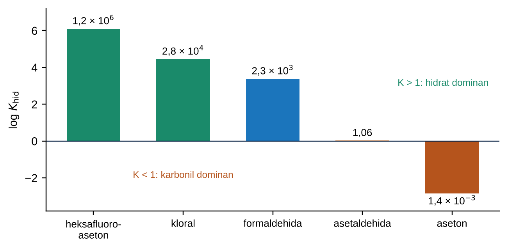
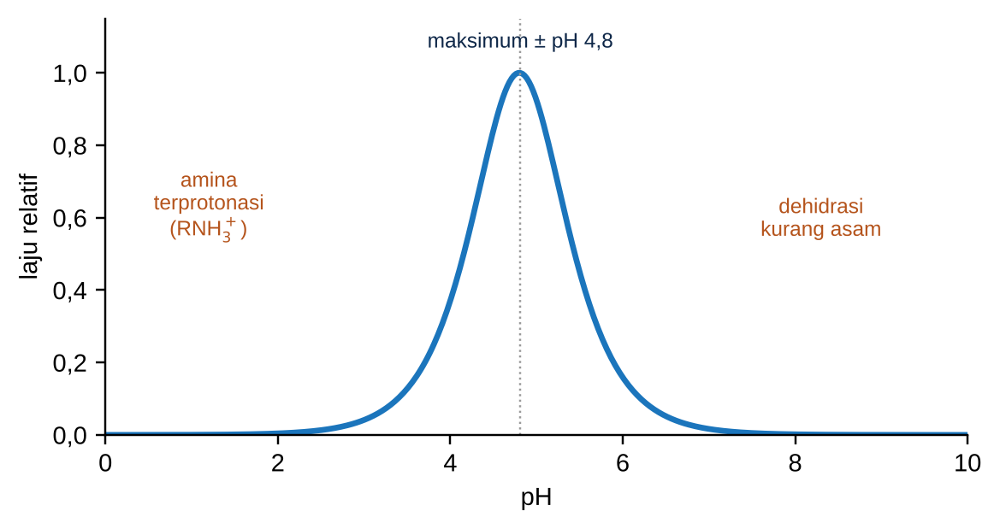

## 11.4 Hidrat dan sianohidrin

### Hidrat: air sebagai nukleofil

Dalam air, aldehida dan keton berada dalam kesetimbangan dengan **hidrat**, atau *gem*-diol, R₂C(OH)₂: senyawa dengan dua gugus –OH pada karbon yang sama.

$$
\text{R}_2\text{C=O} + \text{H}_2\text{O} \rightleftharpoons \text{R}_2\text{C(OH)}_2 \qquad K_\text{hid} = \frac{[\text{hidrat}]}{[\text{karbonil}]} \qquad \text{(11.2)}
$$

Reaksi ini lambat dalam air murni, tetapi dikatalisis oleh asam (protonasi oksigen dulu) maupun oleh basa (OH⁻ yang lebih nukleofilik menyerang dulu). Katalis tidak mengubah posisi kesetimbangan, hanya mempercepat tercapainya. Posisi kesetimbangan sangat berbeda dari satu senyawa ke senyawa lain:

| Senyawa | *K*~hid~ (25 °C) | % hidrat |
|---|---|---|
| heksafluoroaseton, (CF₃)₂CO | 1,2 × 10⁶ | 99,9999 |
| kloral, Cl₃CCHO | 2,8 × 10⁴ | 99,996 |
| formaldehida, HCHO | 2,3 × 10³ | 99,96 |
| asetaldehida, CH₃CHO | 1,06 | 51 |
| aseton, (CH₃)₂CO | 1,4 × 10⁻³ | 0,14 |

Urutannya persis sama dengan urutan kereaktifan di subbab 11.3: gugus penarik elektron menggeser kesetimbangan ke hidrat, gugus alkil (yang menstabilkan karbonil dan berdesakan pada hidrat) menggesernya ke karbonil. Larutan formalin (37% formaldehida dalam air) sebenarnya berisi hampir seluruhnya hidrat, CH₂(OH)₂, dan oligomernya. **Kloral hidrat** adalah padatan stabil yang dulu dipakai sebagai obat tidur; inilah salah satu hidrat yang dapat diisolasi.

{width=80%}

Hidrat umumnya tidak dapat diisolasi: bila air diuapkan, kesetimbangan bergeser kembali ke senyawa karbonil. Namun hidrat penting sebagai zat antara, misalnya pada oksidasi aldehida menjadi asam karboksilat dengan pereaksi Jones dalam air (subbab 9.5).

::: {.contoh}
**Contoh 11.4 · Energi di balik kesetimbangan hidrat**

Hitung ΔG° hidrasi aseton pada 25 °C dari *K*~hid~ = 1,4 × 10⁻³. Bandingkan dengan formaldehida (*K*~hid~ = 2,3 × 10³).

**Penyelesaian.** ΔG° = −*RT* ln *K*. Aseton: −(8,314)(298) ln(1,4 × 10⁻³) = **+16 kJ mol⁻¹**. Formaldehida: −(8,314)(298) ln(2,3 × 10³) = **−19 kJ mol⁻¹**.

**Memahami hasil.** Perbedaan sekitar 35 kJ mol⁻¹ antara keduanya berasal dari dua gugus metil aseton, yang menstabilkan gugus karbonil (dorongan elektron) dan saling berdesakan pada hidrat tetrahedral. Selisih energi yang sedang-sedang saja sudah cukup membalik arah kesetimbangan dari hampir 100% hidrat menjadi hampir 0%.
:::

### Sianohidrin: HCN sebagai nukleofil

Hidrogen sianida beradisi pada aldehida dan sebagian besar keton membentuk **sianohidrin**, R₂C(OH)CN. HCN sendiri adalah asam lemah (pKa 9,2) dan nukleofil yang buruk, sehingga reaksi memerlukan sedikit basa (atau sedikit NaCN/KCN) untuk menghasilkan ion sianida, CN⁻, nukleofil yang kuat. CN⁻ menyerang karbon karbonil, dan alkoksida yang terbentuk mengambil proton dari HCN, sekaligus menghasilkan CN⁻ baru. Reaksinya reversibel; kesetimbangan baik untuk aldehida dan keton yang tidak terlalu terhalang.

Sianohidrin berguna dalam sintesis karena gugus –CN dapat diubah menjadi gugus lain: dihidrolisis dalam asam menjadi –COOH (menghasilkan asam α-hidroksi), atau direduksi dengan LiAlH₄ menjadi –CH₂NH₂ (menghasilkan amino alkohol). Sianohidrin aseton adalah bahan baku industri metil metakrilat, monomer kaca akrilik (subbab 8.11).

::: {.terapan}
**Sianida dalam singkong dan biji almon**

Beberapa tumbuhan menyimpan sianohidrin dalam bentuk terikat pada gula (glikosida sianogenik) sebagai senjata kimia melawan hewan pemakan tumbuhan. Singkong mengandung **linamarin**, glikosida dari sianohidrin aseton; biji almon pahit dan biji aprikot mengandung **amigdalin**, glikosida dari sianohidrin benzaldehida. Bila jaringan tumbuhan rusak (dikunyah atau diparut), enzim memutus gula, dan sianohidrin yang terlepas berbalik menjadi keton atau aldehida dan **HCN** yang beracun (pembentukan sianohidrin adalah kesetimbangan). Itulah sebabnya singkong pahit harus diparut, direndam, dijemur, atau dimasak sampai matang sebelum dimakan: proses itu membiarkan HCN yang mudah menguap (titik didih 26 °C) terlepas ke udara.
:::

::: {.kuis}
**Kuis cepat 11.4** (a) Mengapa formalin dapat disimpan lama, tetapi formaldehida murni (gas) mudah berpolimerisasi? Petunjuk: bentuk apa yang dominan dalam air? (b) Tulis produk benzaldehida + HCN (dengan KCN katalitik), lalu H₃O⁺ panas.
:::

## 11.5 Asetal dan gugus pelindung

### Hemiasetal dan asetal

Alkohol, seperti air, adalah nukleofil lemah. Dengan katalis asam, alkohol beradisi pada aldehida membentuk **hemiasetal** (sebuah karbon yang membawa –OH dan –OR). Sama seperti hidrat, hemiasetal rantai terbuka biasanya tidak stabil dan kesetimbangannya condong ke senyawa karbonil. Tetapi dengan alkohol berlebih dan asam, reaksi berlanjut: gugus –OH hemiasetal terprotonasi, air lepas, dan alkohol kedua masuk. Produk akhirnya **asetal**, R₂C(OR')₂, karbon yang membawa dua gugus –OR'. (Asetal dari keton dulu disebut ketal; IUPAC sekarang memakai nama asetal untuk keduanya.)

Mekanisme lengkap dalam asam (misalnya HCl atau asam *p*-toluenasulfonat):

1. Protonasi oksigen karbonil.
2. Alkohol menyerang karbon karbonil.
3. Proton lepas: terbentuk **hemiasetal**.
4. Protonasi gugus –OH hemiasetal.
5. Air lepas; pasangan bebas oksigen –OR' membantu mendorongnya keluar, membentuk ion **oksokarbenium**, R₂C=O⁺R', yang distabilkan resonansi.
6. Molekul alkohol kedua menyerang ion oksokarbenium.
7. Proton lepas: terbentuk **asetal**.

Setiap langkah reversibel. Kesetimbangan keseluruhan, R₂C=O + 2R'OH ⇌ R₂C(OR')₂ + H₂O, digeser ke kanan dengan alkohol berlebih dan dengan **mengeluarkan air** dari campuran, misalnya dengan alat Dean–Stark yang menyuling air bersama toluena. Ke arah sebaliknya, asetal dihidrolisis kembali menjadi senyawa karbonil dengan **air berlebih dan asam encer**. Prinsip yang sama dengan hidrasi–dehidrasi alkena (subbab 8.2): satu mekanisme, dua arah, dipilih dengan kondisi.

{width=96%}

Asetal **stabil dalam basa dan terhadap nukleofil**. Dalam basa, tidak ada yang dapat memprotonasi gugus –OR', sehingga tidak ada gugus pergi yang baik; asetal berperilaku seperti eter. Asetal hanya terbuka dalam asam berair.

### Asetal siklik dan gugus pelindung

Dengan diol 1,2 seperti **etilena glikol** (HOCH₂CH₂OH), kedua –OH berada dalam satu molekul, dan terbentuk **asetal siklik** beranggota lima (1,3-dioksolana). Pembentukan asetal siklik lebih mudah daripada asetal rantai terbuka: setelah gugus –OH pertama bereaksi, gugus –OH kedua sudah berada dekat, dan reaksi intramolekul tidak "membayar" penurunan entropi karena menggabungkan dua molekul.

Sifat asetal (mudah dipasang dan dilepas dengan asam, tahan basa dan nukleofil) menjadikannya **gugus pelindung** ideal untuk aldehida dan keton, sejajar dengan silil eter untuk alkohol (subbab 9.6).

::: {.contoh}
**Contoh 11.5 · Melindungi keton**

Bagaimana mengubah metil 4-oksosikloheksanakarboksilat menjadi 4-(hidroksimetil)sikloheksanon? Gugus ester harus direduksi, tetapi gugus keton harus tetap.

**Rencana.** LiAlH₄ mereduksi ester menjadi alkohol primer, tetapi juga mereduksi keton. NaBH₄ hanya mereduksi keton, sebaliknya dari yang diinginkan. Jadi keton harus dilindungi selama reduksi.

**Penyelesaian.**

1. Etilena glikol, TsOH (katalis), toluena, Dean–Stark → keton menjadi asetal siklik.
2. LiAlH₄, lalu H₂O → ester menjadi –CH₂OH; asetal tidak terganggu (tahan terhadap hidrida dan basa).
3. H₃O⁺ encer → asetal dihidrolisis kembali menjadi keton: **4-(hidroksimetil)sikloheksanon**.

**Memahami hasil.** Gugus pelindung mengubah sementara gugus yang lebih reaktif menjadi gugus yang tidak reaktif, sehingga pereaksi hanya "melihat" gugus sasaran. Pola pasang–reaksi–lepas ini sangat umum dalam sintesis molekul yang mempunyai beberapa gugus fungsi.
:::

### Gula: hemiasetal siklik

Hemiasetal rantai terbuka tidak stabil, tetapi **hemiasetal siklik** beranggota lima atau enam stabil, karena pembentukannya intramolekul dan tidak kehilangan entropi seperti pada penggabungan dua molekul. Inilah jawaban teka-teki pembuka bab. Gugus –OH pada C5 glukosa menyerang gugus aldehida C1 dalam molekul yang sama, membentuk cincin beranggota enam (piranosa). C1, yang tadinya karbon karbonil datar, menjadi pusat kiral baru, sehingga terbentuk dua diastereomer yang disebut **anomer**: α (gugus –OH pada C1 berada di sisi berlawanan dengan gugus –CH₂OH, aksial pada kursi) dan β (–OH pada sisi yang sama, ekuatorial). Dalam air, keduanya saling berubah lewat bentuk rantai terbuka yang sangat sedikit, sampai mencapai kesetimbangan sekitar 36% α dan 64% β. Perubahan rotasi optik yang menyertai proses ini disebut **mutarotasi**.

{width=92%}

Bila gugus –OH hemiasetal gula bereaksi dengan alkohol lain (atau dengan –OH gula lain) dalam asam atau dengan bantuan enzim, terbentuk **asetal**, yang dalam kimia gula disebut **glikosida**. Sukrosa, laktosa, pati, dan selulosa semuanya adalah rangkaian gula yang dihubungkan oleh ikatan glikosida, yaitu asetal. Karena itu pati dapat dicerna oleh asam lambung dan enzim (hidrolisis asetal), tetapi stabil dalam lingkungan basa.

::: {.kuis}
**Kuis cepat 11.5** (a) Tulis produk sikloheksanon + metanol berlebih, HCl kering. (b) Tulis produk hidrolisis 2,2-dimetil-1,3-dioksolana dengan H₃O⁺. (c) Mengapa asetal tahan terhadap NaOH tetapi tidak terhadap HCl encer?
:::

## 11.6 Imina, enamina, dan turunan amina

### Imina dari amina primer

Amina primer, RNH₂, beradisi pada aldehida dan keton, dan setelah air lepas, terbentuk **imina** (basa Schiff), R₂C=NR', senyawa dengan ikatan rangkap C=N. Mekanismenya, dengan katalis asam lemah:

1. Pasangan bebas nitrogen menyerang karbon karbonil (adisi nukleofilik).
2. Transfer proton dari N ke O menghasilkan **karbinolamina**, zat antara netral dengan –OH dan –NHR' pada karbon yang sama.
3. Gugus –OH terprotonasi oleh asam.
4. Air lepas, didorong oleh pasangan bebas nitrogen, membentuk ion **iminium**, R₂C=N⁺HR'.
5. Proton lepas dari nitrogen: imina.

Seperti asetal, pembentukan imina reversibel: imina dihidrolisis kembali menjadi senyawa karbonil dan amina dengan air dan asam.

### Peran pH

Laju pembentukan imina sangat bergantung pada pH dan biasanya paling cepat pada **pH sekitar 4–5**. Penyebabnya adalah dua kebutuhan yang berlawanan:

- **Langkah 3–4 memerlukan asam**: gugus –OH karbinolamina harus diprotonasi untuk dapat lepas sebagai air. Pada pH tinggi, terlalu sedikit H⁺, dan dehidrasi menjadi lambat.
- **Langkah 1 memerlukan amina bebas**: amina adalah basa, dan dalam asam kuat sebagian besar amina berubah menjadi ion amonium, RNH₃⁺, yang tidak mempunyai pasangan bebas dan tidak dapat menyerang. Pada pH rendah, adisi menjadi lambat.

Kompromi terbaik berada di tengah: cukup asam untuk dehidrasi, tetapi tidak terlalu asam sehingga masih ada amina bebas.

{width=76%}

### Enamina dari amina sekunder

Amina sekunder, R₂NH, bereaksi dengan cara yang sama sampai ion iminium. Tetapi ion iminium dari amina sekunder tidak mempunyai H pada nitrogen yang dapat lepas. Sebagai gantinya, proton lepas dari **karbon α** (karbon di sebelah C=N⁺), dan terbentuk **enamina**, R₂C=CR–NR₂ (*ena* + *amina*): ikatan rangkap C=C yang membawa gugus amino. Enamina adalah nukleofil karbon yang berguna (Kimia Organik 2), karena pasangan bebas nitrogen membuat karbon α kaya elektron.

### Turunan amina lain dan identifikasi

Beberapa senyawa H₂N–Z bereaksi seperti amina primer dan menghasilkan produk yang mudah mengkristal:

| Pereaksi | Rumus | Produk |
|---|---|---|
| hidroksilamina | H₂NOH | **oksim**, R₂C=NOH |
| hidrazina | H₂NNH₂ | **hidrazon**, R₂C=NNH₂ |
| 2,4-dinitrofenilhidrazina | H₂NNHC₆H₃(NO₂)₂ | 2,4-dinitrofenilhidrazon (endapan kuning–jingga) |
| semikarbazida | H₂NNHCONH₂ | semikarbazon |

Sebelum spektroskopi berkembang, aldehida dan keton cair diidentifikasi dengan mengubahnya menjadi 2,4-dinitrofenilhidrazon atau semikarbazon yang padat, lalu mengukur titik lelehnya dan membandingkannya dengan tabel. Endapan jingga dengan pereaksi 2,4-DNP (pereaksi Brady) masih dipakai sebagai uji cepat adanya gugus karbonil aldehida atau keton.

::: {.terapan}
**Imina dalam penglihatan dan metabolisme**

Di retina mata, aldehida **11-*cis*-retinal** terikat pada gugus –NH₂ asam amino lisina protein opsin lewat ikatan imina terprotonasi, membentuk **rodopsin**. Ketika foton diserap, ikatan C11=C12 retinal berubah dari *cis* menjadi *trans* dalam sepersekian pikodetik (subbab 1.6), bentuk molekul berubah, dan sinyal saraf dimulai. Setelah itu imina dihidrolisis, *trans*-retinal dilepaskan, dan diubah kembali menjadi bentuk *cis* oleh enzim.

Banyak enzim lain juga memakai imina. Vitamin B₆ (piridoksal fosfat) membentuk imina dengan asam amino dalam proses **transaminasi**, cara tubuh membuat dan menguraikan asam amino.
:::

::: {.contoh}
**Contoh 11.6 · Imina atau enamina**

Tulis produk sikloheksanon dengan (a) metilamina, CH₃NH₂; (b) pirolidina (amina sekunder siklik); (c) hidroksilamina. Masing-masing dengan katalis asam lemah.

**Penyelesaian.** (a) Amina primer → **imina**: *N*-metilsikloheksanimina (C=N–CH₃). (b) Amina sekunder → ion iminium, lalu proton lepas dari karbon α → **enamina**: 1-(sikloheks-1-en-1-il)pirolidina. (c) Hidroksilamina → **oksim**: sikloheksanon oksim. Oksim ini adalah bahan baku nilon-6 di industri (lewat penataan ulang Beckmann menjadi kaprolaktam).

**Memahami hasil.** Yang menentukan imina atau enamina adalah jumlah H pada nitrogen. Bila N ion iminium masih membawa H, H itu yang lepas (imina). Bila tidak, H dari karbon α yang lepas (enamina).
:::

::: {.kuis}
**Kuis cepat 11.6** (a) Tulis produk benzaldehida + anilina. (b) Mengapa pembentukan imina lambat pada pH 1 dan pada pH 10? (c) Tulis produk hidrolisis imina CH₃CH=NCH₂CH₃ dengan H₃O⁺.
:::
