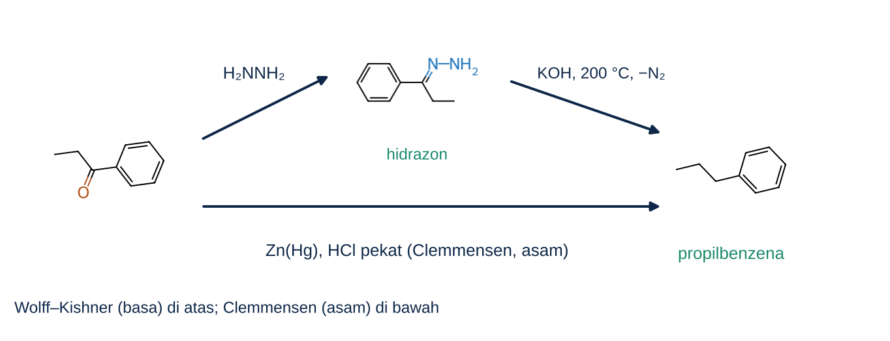

## 11.7 Reduksi: menjadi alkohol atau menjadi CH₂

Gugus karbonil dapat direduksi dua tingkat: menjadi **alkohol** (C=O → CH–OH) atau sampai habis menjadi **gugus CH₂** (C=O → CH₂). Pilihan pereaksi menentukan hasilnya.

### Menjadi alkohol: NaBH₄ dan LiAlH₄

Reduksi dengan hidrida sudah dibahas di subbab 9.2: aldehida menjadi alkohol primer, keton menjadi alkohol sekunder. Mekanismenya adalah adisi nukleofilik yang tidak reversibel: ion hidrida dari BH₄⁻ atau AlH₄⁻ menyerang karbon karbonil, lalu alkoksida terprotonasi. NaBH₄ lunak dan selektif terhadap aldehida dan keton; LiAlH₄ jauh lebih kuat dan juga mereduksi ester, asam karboksilat, amida, dan nitril.

Hidrida dari kompleks logam bukan ion H⁻ bebas; ion H⁻ bebas adalah basa yang sangat kuat dan nukleofil yang buruk (misalnya NaH tidak mereduksi keton). Pada BH₄⁻ dan AlH₄⁻, hidrida "dikirim" ke karbon karbonil oleh atom boron atau aluminium, dan kation logam (Li⁺, Na⁺) membantu dengan mengikat oksigen karbonil sebagai asam Lewis.

### Stereokimia reduksi keton siklik

Pada keton siklik yang tidak simetris, kedua sisi karbonil tidak setara, dan reduksi dapat memberi dua diastereomer dalam jumlah yang berbeda. Contoh klasiknya adalah 4-*tert*-butilsikloheksanon. Gugus *tert*-butil yang besar mengunci cincin dalam satu bentuk kursi dengan gugus itu ekuatorial (subbab 4.8). Hidrida kecil seperti NaBH₄ dan LiAlH₄ menyerang terutama dari sisi **aksial** (dari atas cincin), karena serangan dari sisi ekuatorial bersinggungan dengan ikatan C–H tetangga. Serangan aksial menempatkan –OH di posisi **ekuatorial**, menghasilkan terutama ***trans*-4-*tert*-butilsikloheksanol** (sekitar 90%). Hidrida yang sangat besar, seperti L-Selectride, tidak dapat mendekat dari sisi aksial yang terhalang oleh atom H aksial pada C3 dan C5, sehingga menyerang dari sisi ekuatorial dan memberi terutama isomer ***cis*** (–OH aksial).

{width=92%}

### Menjadi CH₂: Wolff–Kishner dan Clemmensen

Untuk menghapus oksigen sama sekali, ada dua reaksi klasik yang saling melengkapi.

**Reduksi Wolff–Kishner** (dalam basa). Keton atau aldehida dipanaskan dengan hidrazina (H₂NNH₂) dan KOH dalam pelarut bertitik didih tinggi seperti dietilena glikol (sekitar 200 °C). Hidrazina lebih dulu membentuk **hidrazon** (subbab 11.6). Basa kemudian mengambil proton N–H, proton berpindah ke karbon, dan setelah pengambilan proton kedua, molekul nitrogen, N₂, lepas sebagai gas, meninggalkan karbanion yang segera terprotonasi oleh pelarut. Pelepasan N₂, molekul yang sangat stabil, adalah gaya pendorong reaksi ini.

**Reduksi Clemmensen** (dalam asam). Keton dipanaskan dengan amalgam seng, Zn(Hg), dalam HCl pekat. Mekanismenya terjadi di permukaan logam dan belum sepenuhnya dipahami. Reaksi ini sangat baik untuk keton aril hasil asilasi Friedel–Crafts.

Pilihan di antara keduanya bergantung pada gugus lain dalam molekul: molekul yang tidak tahan asam (misalnya mengandung asetal) direduksi dengan Wolff–Kishner; molekul yang tidak tahan basa panas (misalnya mengandung ester atau halida yang mudah tersubstitusi) direduksi dengan Clemmensen. Untuk keton aril, H₂ dengan Pd/C juga dapat dipakai (subbab 10.4).

{width=92%}

::: {.contoh}
**Contoh 11.7 · Memilih reduktor**

Tulis pereaksi untuk mengubah metil 4-asetilbenzoat menjadi (a) metil 4-(1-hidroksietil)benzoat; (b) metil 4-etilbenzoat; (c) 1-[4-(hidroksimetil)fenil]etanol.

**Penyelesaian.** (a) Hanya keton yang direduksi menjadi alkohol, ester tetap: **NaBH₄** dalam metanol. (b) Keton menjadi CH₂, ester tetap: **Clemmensen**, Zn(Hg), HCl (Wolff–Kishner dengan KOH panas akan menghidrolisis ester). (c) Keduanya menjadi alkohol: **LiAlH₄**, lalu H₂O.

**Memahami hasil.** Tiga produk dari satu bahan, dengan tiga reduktor. Kemampuan memilih pereaksi yang hanya menyentuh gugus tertentu, **kemoselektivitas**, adalah keterampilan utama dalam sintesis.
:::

::: {.kuis}
**Kuis cepat 11.7** Tulis produk: (a) butan-2-on + NaBH₄; (b) sikloheksanon + H₂NNH₂, KOH, panas; (c) asetofenon + Zn(Hg), HCl. Apakah (a) aktif optik?
:::

## 11.8 Pereaksi Grignard dan organolitium

### Karbanion sebagai nukleofil

Pereaksi Grignard (R–MgX) dan organolitium (R–Li) dibuat dari alkil halida dengan logam (subbab 7.14). Ikatan C–Mg dan C–Li sangat polar dengan karbon δ−, sehingga gugus R bereaksi seperti karbanion: **nukleofil karbon dan basa yang sangat kuat**. Dengan aldehida dan keton, pereaksi ini beradisi tidak reversibel:

1. Gugus R menyerang karbon karbonil, sementara Mg²⁺ (atau Li⁺) mengikat oksigen. Terbentuk alkoksida logam.
2. Asam encer (H₃O⁺ atau NH₄Cl dalam air) ditambahkan pada tahap kedua untuk memprotonasi alkoksida.

Hasilnya alkohol dengan ikatan C–C baru (tabel di subbab 9.2): formaldehida → alkohol primer, aldehida lain → alkohol sekunder, keton → alkohol tersier. Organolitium lebih reaktif daripada pereaksi Grignard dan berguna untuk keton yang terhalang. **Ion asetilida** (subbab 8.12) juga beradisi pada aldehida dan keton, menghasilkan alkohol propargilik (alkohol dengan ikatan rangkap tiga di sebelahnya).

### Batasan

Karena sangat basa, pereaksi Grignard dan organolitium:

- **Hancur oleh H yang asam**: air, alkohol, –NH, –COOH, –SH, alkuna ujung. Semua pelarut dan bahan harus kering, dan gugus asam dalam molekul harus dilindungi (subbab 9.6).
- **Dapat bertindak sebagai basa** terhadap keton yang terhalang: alih-alih menyerang karbon karbonil, gugus R mengambil H α dan membentuk enolat, yang kembali menjadi keton awal setelah pengolahan.
- **Tidak dapat dibuat** dari molekul yang mengandung gugus karbonil, karena pereaksi akan menyerang dirinya sendiri.

::: {.contoh}
**Contoh 11.8 · Retrosintesis alkohol sekunder**

Usulkan dua cara membuat 1-sikloheksiletanol (sikloheksil–CH(OH)–CH₃) dengan pereaksi Grignard, dan satu cara lain tanpa Grignard.

**Penyelesaian.** Karbon karbinol membawa sikloheksil, metil, dan H. (1) Potong ikatan ke metil: **CH₃MgBr + sikloheksanakarbaldehida**. (2) Potong ikatan ke sikloheksil: **sikloheksilmagnesium bromida + asetaldehida**. Keduanya diikuti H₃O⁺. (3) Tanpa Grignard: **reduksi 1-sikloheksiletanon** dengan NaBH₄.

**Memahami hasil.** Alkohol sekunder dapat diputus di dua ikatan C–C (masing-masing menghasilkan aldehida dan pereaksi Grignard) atau di ikatan C–H (keton dan hidrida). Pilihan bergantung pada bahan yang tersedia; jalur yang membangun kerangka dari bahan yang lebih kecil sering lebih berharga.
:::

::: {.kuis}
**Kuis cepat 11.8** Tulis produk: (a) benzaldehida + CH₃CH₂MgBr, lalu H₃O⁺; (b) sikloheksanon + C₆H₅Li, lalu H₃O⁺; (c) aseton + HC≡CNa, lalu H₃O⁺. Mengapa 4-hidroksibutan-2-on tidak dapat langsung direaksikan dengan CH₃MgBr?
:::

## 11.9 Reaksi Wittig

### Alkena tepat di tempat karbonil

Membuat alkena dari keton lewat Grignard lalu dehidrasi sering memberi campuran: dehidrasi E1 memilih alkena paling tersubstitusi dan dapat menata ulang (subbab 8.2). Georg Wittig menemukan cara yang menempatkan ikatan rangkap C=C **tepat di posisi gugus C=O semula**, tanpa keraguan. Untuk penemuan ini ia mendapat Hadiah Nobel Kimia 1979.

Pereaksinya adalah **ilida fosfor** (fosforana), Ph₃P=CR₂, molekul dengan karbon bermuatan negatif yang terikat pada fosfor bermuatan positif (Ph₃P⁺–C⁻R₂ ↔ Ph₃P=CR₂). Ilida dibuat dalam dua langkah:

1. **Garam fosfonium**: trifenilfosfina (Ph₃P), nukleofil yang baik, bereaksi dengan alkil halida primer atau sekunder lewat SN2: Ph₃P + RCH₂Br → Ph₃P⁺–CH₂R Br⁻.
2. **Ilida**: basa kuat (butillitium atau NaH) mengambil proton dari karbon di sebelah fosfor. H itu cukup asam (pKa sekitar 22–35, bergantung pada R) karena karbanion yang terbentuk distabilkan oleh fosfor bermuatan positif di sebelahnya.

### Mekanisme

Karbon ilida yang bermuatan negatif menyerang karbon karbonil, dan oksigen karbonil terikat pada fosfor, membentuk cincin beranggota empat yang disebut **oksafosfetana**. Cincin ini kemudian terpecah: ikatan C–P dan C–O putus, sementara ikatan C=C dan P=O terbentuk. Produknya alkena dan **trifenilfosfina oksida**, Ph₃P=O. Ikatan P=O sangat kuat (sekitar 575 kJ mol⁻¹), dan pembentukannya adalah gaya pendorong seluruh reaksi.

{width=96%}

Stereokimia alkena yang terbentuk bergantung pada jenis ilida. Ilida "tidak distabilkan" (R = alkil) cenderung menghasilkan **alkena *Z***; ilida "distabilkan" (R = –COOR atau –COR, yang menstabilkan karbanion lewat resonansi) cenderung menghasilkan **alkena *E***. Reaksi Wittig dan variannya dipakai di industri, antara lain untuk membuat vitamin A dan β-karotena dalam skala ton.

::: {.contoh}
**Contoh 11.9 · Wittig lawan dehidrasi**

Bandingkan dua cara membuat alkena dari sikloheksanon dengan satu karbon tambahan: (a) CH₃MgBr lalu H₃O⁺, lalu H₂SO₄ panas; (b) Ph₃P=CH₂.

**Penyelesaian.** (a) Grignard memberi 1-metilsikloheksanol; dehidrasi E1 memberi alkena Zaitsev yang paling tersubstitusi, **1-metilsikloheksena** (ikatan rangkap di dalam cincin). (b) Wittig menempatkan C=C tepat di tempat C=O: **metilenasikloheksana** (ikatan rangkap di luar cincin), alkena yang kurang stabil dan tidak dapat diperoleh sebagai produk utama lewat dehidrasi.

**Memahami hasil.** Reaksi Wittig dipilih ketika letak ikatan rangkap harus pasti, terutama bila alkena yang diinginkan bukan yang paling stabil.
:::

::: {.kuis}
**Kuis cepat 11.9** (a) Pereaksi Wittig apa (dan dari alkil halida apa) untuk mengubah benzaldehida menjadi stirena? (b) Tunjukkan dua pasangan karbonil + ilida untuk membuat 2-metilbut-2-ena. Mana yang lebih baik?
:::

## 11.10 Oksidasi Baeyer–Villiger

Aldehida mudah dioksidasi menjadi asam karboksilat (subbab 9.5), tetapi keton tahan terhadap kebanyakan oksidator, karena tidak mempunyai H pada karbon karbonil. Pada tahun 1899 Adolf von Baeyer dan Victor Villiger menemukan bahwa **peroksiasam** mengubah keton menjadi **ester**, dengan menyisipkan satu atom oksigen di antara karbon karbonil dan salah satu gugus di sebelahnya. Keton siklik menjadi **lakton** (ester siklik) dengan cincin satu atom lebih besar.

Mekanismenya:

1. Peroksiasam (misalnya mCPBA) beradisi pada karbon karbonil (adisi nukleofilik, dikatalisis asam), membentuk zat antara tetrahedral yang disebut **zat antara Criegee**: karbon yang membawa –OH dan –O–O–C(=O)Ar.
2. Satu gugus R dari karbon itu **bermigrasi** ke oksigen yang berdekatan, bersamaan dengan lepasnya ion karboksilat (ikatan O–O yang lemah putus). Pasangan bebas –OH membantu mendorong, dan terbentuk ester terprotonasi yang kemudian melepas proton.

Gugus yang bermigrasi berpindah bersama pasangan elektronnya, seperti pada geseran hidrida dan metil dalam karbokation (subbab 6.10), dan dengan **retensi konfigurasi** bila karbon yang bermigrasi kiral. Gugus mana yang bermigrasi? Gugus yang paling mampu menampung muatan positif parsial dalam keadaan transisi:

$$
\text{H} > \text{tersier} > \text{sikloheksil} \approx \text{sekunder} \approx \text{fenil} > \text{primer} > \text{metil} \qquad \text{(11.3)}
$$

{width=96%}

::: {.contoh}
**Contoh 11.10 · Meramalkan produk Baeyer–Villiger**

Tulis produk dengan mCPBA: (a) 3-metilbutan-2-on; (b) siklopentanon; (c) benzaldehida.

**Penyelesaian.** (a) Gugus di kedua sisi karbonil: metil dan isopropil (sekunder). Isopropil bermigrasi: oksigen disisipkan antara C=O dan isopropil, menghasilkan **isopropil asetat**, CH₃COOCH(CH₃)₂. (b) Keton siklik: oksigen disisipkan ke dalam cincin, menghasilkan lakton beranggota enam, **oksan-2-on** (δ-valerolakton). (c) Pada aldehida, H bermigrasi paling mudah: hasilnya **asam benzoat**.

**Memahami hasil.** Baeyer–Villiger memberi cara mengubah keton menjadi ester dan, setelah hidrolisis, menjadi alkohol dan asam karboksilat. Karena retensi konfigurasi, gugus kiral yang bermigrasi tetap mempertahankan stereokimianya, sehingga reaksi ini banyak dipakai dalam sintesis bahan alam. Di industri, ε-kaprolakton dari sikloheksanon adalah bahan baku poliester yang dapat terurai secara hayati.
:::

::: {.kuis}
**Kuis cepat 11.10** Tulis produk Baeyer–Villiger: (a) aseton; (b) sikloheksil metil keton; (c) benzofenon.
:::
