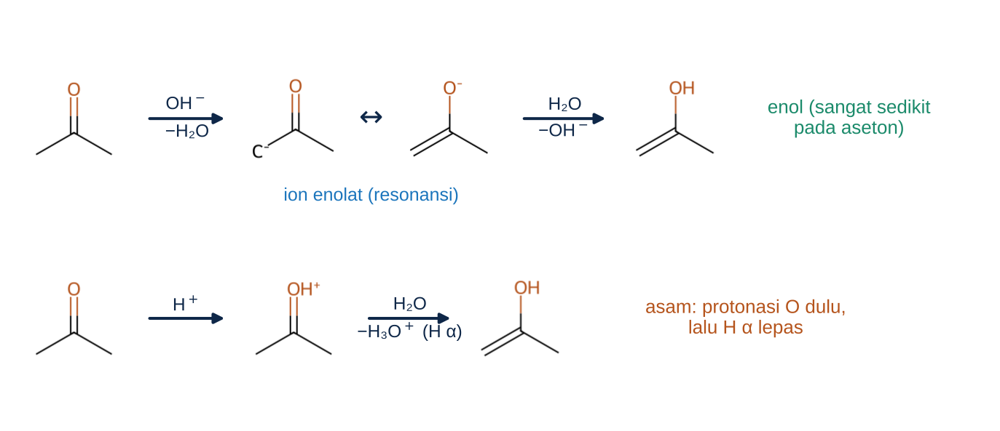
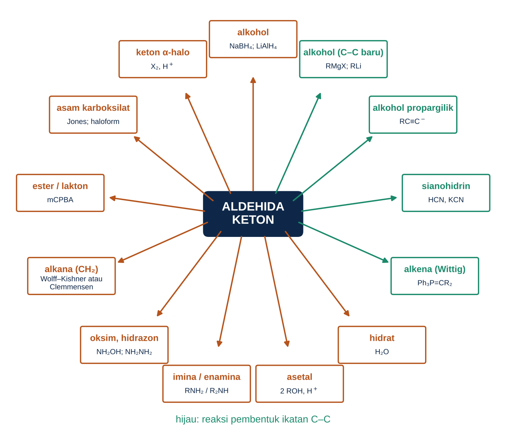

## 11.11 Keto–enol dan halogenasi α: pengantar karbon α

Sejauh ini kita hanya memperhatikan karbon karbonil sendiri. Karbon di sebelahnya, yang disebut **karbon α**, juga istimewa: hidrogen yang terikat padanya, **hidrogen α**, bersifat asam. Sifat ini membuka seluruh bidang kimia baru, kimia enol dan enolat, yang dibahas tuntas di Kimia Organik 2. Di sini kita memperkenalkan dasar-dasarnya.

### Keasaman hidrogen α

pKa aseton sekitar 19 (lampiran A), sangat asam untuk sebuah ikatan C–H. Etana, sebagai pembanding, mempunyai pKa sekitar 50: hidrogen α aseton sekitar 10³¹ kali lebih asam. Penyebabnya **resonansi** basa konjugatnya. Bila H α lepas, pasangan elektron yang tertinggal pada karbon α berkonjugasi dengan ikatan π C=O, sehingga muatan negatif tersebar ke karbon α dan ke oksigen:

$$
\text{CH}_3\text{C(=O)CH}_2^- \;\longleftrightarrow\; \text{CH}_3\text{C(–O}^-\text{)=CH}_2 \qquad \text{(11.4)}
$$

Anion ini disebut **ion enolat**. Struktur resonansi kedua, dengan muatan pada oksigen yang elektronegatif, menyumbang besar pada hibrida. Ion enolat dapat bereaksi sebagai nukleofil di karbon α (paling sering) atau di oksigen.

### Tautomerisasi keto–enol

Tautomerisasi keto–enol sudah kita jumpai pada hidrasi alkuna (subbab 8.13). Keton dan aldehida yang mempunyai H α berada dalam kesetimbangan dengan **enol**-nya, tautomer dengan ikatan C=C dan gugus –OH. Kesetimbangannya dapat dicapai dengan katalis asam maupun basa:

- **Dikatalisis basa**: basa mengambil H α membentuk ion enolat; oksigen enolat kemudian mengambil proton dari air, menghasilkan enol.
- **Dikatalisis asam**: asam memprotonasi oksigen karbonil; lalu air mengambil H α, dan pasangan elektron C–H membentuk ikatan π C=C, menghasilkan enol.

{width=96%}

Untuk keton sederhana, kesetimbangan sangat condong ke bentuk keto: pada aseton, konstanta kesetimbangan enolisasi hanya sekitar 6 × 10⁻⁹, sehingga kurang dari satu molekul per seratus juta berada dalam bentuk enol (subbab 8.13). Ikatan π C=O jauh lebih kuat daripada ikatan π C=C. Namun ada pengecualian penting:

- **Senyawa 1,3-dikarbonil**, misalnya pentana-2,4-dion (asetilaseton), berada sekitar 80% dalam bentuk enol tanpa pelarut. Enolnya distabilkan oleh **konjugasi** (C=C berkonjugasi dengan C=O kedua) dan oleh **ikatan hidrogen intramolekul** dalam cincin beranggota enam.
- **Fenol** adalah "enol" yang tidak pernah berubah menjadi keto, karena bentuk keto (sikloheksadienon) kehilangan aromatisitas.

Walaupun enol hanya sedikit, keberadaannya terlihat dari dua gejala. Pertama, keton dengan pusat kiral pada karbon α **mengalami rasemisasi** dalam asam atau basa: karbon α yang sp³ menjadi sp² datar pada enol atau enolat, dan ketika kembali menjadi keto, H dapat masuk dari kedua sisi. Kedua, dalam D₂O dengan sedikit basa atau asam, semua H α perlahan **diganti deuterium**, sedangkan H lain tidak.

::: {.contoh}
**Contoh 11.11 · Rasemisasi dan pertukaran deuterium**

(*R*)-3-Metilpentan-2-on dibiarkan dalam larutan NaOD dalam D₂O. Ramalkan apa yang terjadi pada aktivitas optik dan atom H mana yang diganti D.

**Penyelesaian.** Karbon α pada sisi kiri (C1, metil) mempunyai tiga H; karbon α pada sisi kanan (C3) adalah pusat kiral dengan satu H. Basa membentuk enolat di kedua sisi. Enolat ke arah C3 membuat C3 datar; ketika terprotonasi (terdeuterasi) kembali dari D₂O, D dapat masuk dari kedua sisi. Hasilnya: **aktivitas optik hilang** (rasemisasi), dan **empat H α diganti D**: tiga H pada C1 dan satu H pada C3. H pada C4 dan C5 (bukan α) tidak berubah.

**Memahami hasil.** Pusat kiral di karbon α keton tidak stabil secara stereokimia dalam asam atau basa. Inilah sebabnya obat yang pusat kiralnya berada di sebelah gugus karbonil dapat mengalami rasemisasi di dalam tubuh.
:::

### Halogenasi α

Keton bereaksi dengan Cl₂, Br₂, atau I₂ pada karbon α. Mekanismenya berbeda dalam asam dan dalam basa, dan perbedaan itu menentukan hasilnya.

**Dalam asam** (misalnya Br₂ dalam asam asetat): keton lebih dulu membentuk enol (dikatalisis asam), lalu ikatan π C=C enol yang nukleofilik menyerang Br₂, seperti alkena menyerang bromin (subbab 8.7). Setelah proton lepas dari oksigen, terbentuk keton α-bromo. Pengukuran kinetika memberi bukti yang elegan: laju reaksi bergantung pada [keton] dan [H⁺], tetapi **tidak bergantung pada [Br₂]**, dan lajunya sama untuk klorinasi, brominasi, dan iodinasi. Artinya langkah penentu laju adalah **pembentukan enol**, yang tidak melibatkan halogen; begitu enol terbentuk, ia segera bereaksi dengan halogen apa pun. Dalam asam, reaksi biasanya berhenti setelah **satu** halogen masuk, karena halogen yang menarik elektron membuat oksigen karbonil kurang basa, sehingga enolisasi berikutnya lebih lambat.

**Dalam basa**: basa membentuk ion enolat, yang menyerang halogen. Di sini halogen pertama justru membuat H α yang tersisa **lebih asam** (efek induktif), sehingga enolat kedua terbentuk lebih cepat, dan seterusnya. Semua H α pada karbon itu diganti halogen.

### Reaksi haloform

Keton metil (RCOCH₃) dengan halogen berlebih dalam NaOH mengalami halogenasi tiga kali pada gugus metil, membentuk RCOCX₃. Gugus –CX₃ dengan tiga halogen yang menarik elektron adalah gugus pergi yang cukup baik (anion ⁻CX₃ distabilkan efek induktif). Ion hidroksida menyerang karbon karbonil, dan ⁻CX₃ lepas, lalu mengambil proton. Produknya **ion karboksilat** RCOO⁻ dan **haloform** CHX₃.

Dengan iodin, haloformnya **iodoform** (CHI₃), padatan kuning berbau khas. Ini adalah dasar **uji iodoform**: endapan kuning dengan I₂/NaOH menunjukkan adanya keton metil (atau asetaldehida), atau alkohol yang dapat dioksidasi oleh I₂/NaOH menjadi keton metil, yaitu alkohol dengan gugus CH₃CH(OH)–, seperti etanol dan propan-2-ol.

::: {.contoh}
**Contoh 11.12 · Uji iodoform**

Senyawa mana yang memberi endapan kuning dengan I₂ dan NaOH: (a) pentan-2-on; (b) pentan-3-on; (c) butan-2-ol; (d) propanal; (e) etanol?

**Penyelesaian.** (a) **Ya**: keton metil. (b) Tidak: kedua sisi karbonil adalah etil. (c) **Ya**: I₂/NaOH mengoksidasi butan-2-ol menjadi butan-2-on, keton metil. (d) Tidak: CH₃CH₂CHO tidak mempunyai CH₃ yang terikat langsung pada C=O. (e) **Ya**: etanol dioksidasi menjadi asetaldehida, CH₃CHO, satu-satunya aldehida yang memberi uji positif.

**Memahami hasil.** Yang dicari uji iodoform adalah gugus CH₃–C(=O)– atau CH₃–CH(OH)–. Reaksi haloform juga dipakai untuk sintesis: keton metil diubah menjadi asam karboksilat dengan satu karbon lebih sedikit.
:::

::: {.kuis}
**Kuis cepat 11.11** (a) Berapa atom H yang diganti D bila sikloheksanon dibiarkan dalam D₂O/NaOD? (b) Tulis produk asetofenon + Br₂ dalam asam asetat. (c) Tulis produk asetofenon + I₂ berlebih, NaOH, lalu H₃O⁺.
:::

## 11.12 Merancang sintesis dengan karbonil

Aldehida dan keton menempati pusat sintesis organik karena dua alasan: gugus karbonil dapat diubah menjadi hampir semua gugus fungsi lain, dan banyak reaksinya (Grignard, organolitium, asetilida, sianida, Wittig) **membentuk ikatan C–C baru**. Peta berikut meringkas reaksi-reaksi yang telah kita pelajari.

{width=96%}

### Pertanyaan pemandu

1. **Apakah sasaran mempunyai karbon yang membawa –OH?** Karbon itu mungkin berasal dari karbon karbonil, dengan salah satu gugusnya dipasang lewat Grignard atau hidrida.
2. **Apakah sasaran mempunyai ikatan C=C?** Ikatan itu mungkin berasal dari reaksi Wittig, dengan satu sisi dari senyawa karbonil dan sisi lain dari ilida.
3. **Apakah ada ester yang mungkin berasal dari keton?** Pertimbangkan Baeyer–Villiger.
4. **Apakah ada gugus lain yang akan terganggu?** Lindungi aldehida dan keton sebagai asetal, alkohol sebagai silil eter.

::: {.contoh}
**Contoh 11.13 · Empat produk dari sikloheksanon**

Tunjukkan bagaimana mengubah sikloheksanon menjadi (a) 1-etilsikloheksena; (b) etilidenasikloheksana; (c) etilsikloheksana; (d) 1-etilsikloheksanol.

**Penyelesaian.** (d) CH₃CH₂MgBr, lalu H₃O⁺. (a) Dari (d): H₂SO₄ panas (E1, produk Zaitsev, ikatan rangkap di dalam cincin). (b) **Wittig**: Ph₃P=CHCH₃ (dari Ph₃P + bromoetana, lalu BuLi), menempatkan C=C di luar cincin. (c) Dari (a) atau (b): H₂, Pd/C.

**Memahami hasil.** Satu bahan, empat produk dengan kerangka yang sama tetapi gugus fungsi berbeda. Perhatikan perbedaan (a) dan (b): keduanya C₈H₁₄, tetapi letak ikatan rangkapnya berbeda, dan hanya Wittig yang dapat memberi (b) sebagai produk utama.
:::

::: {.contoh}
**Contoh 11.14 · Sintesis dengan gugus pelindung dan Grignard**

Rancang sintesis 5-hidroksi-5-metilheksan-2-on, CH₃COCH₂CH₂C(OH)(CH₃)₂, dari etil 4-oksopentanoat, CH₃COCH₂CH₂COOCH₂CH₃.

**Rencana (mundur).** Sasaran mempunyai keton metil (sama dengan bahan awal) dan alkohol tersier dengan dua metil di tempat gugus ester semula. Alkohol tersier dengan dua gugus sama dapat dibuat dari ester + 2 CH₃MgBr. Tetapi pereaksi Grignard juga akan menyerang keton, bahkan lebih cepat. Jadi keton harus dilindungi.

**Penyelesaian.**

1. Etilena glikol, TsOH, Dean–Stark → keton menjadi asetal siklik.
2. 2 CH₃MgBr (berlebih), lalu NH₄Cl dalam air → ester menjadi –C(OH)(CH₃)₂.
3. H₃O⁺ encer → asetal dihidrolisis, keton kembali: **5-hidroksi-5-metilheksan-2-on**.

**Memahami hasil.** Gugus pelindung asetal tahan terhadap pereaksi Grignard (basa kuat) dan dilepas dengan asam encer pada akhir. Pada langkah 3 harus dipakai asam yang cukup encer agar alkohol tersier tidak terdehidrasi.
:::

::: {.contoh}
**Contoh 11.15 · Menyambung rantai lewat Wittig**

Rancang sintesis 1-fenilbut-1-ena (C₆H₅CH=CHCH₂CH₃) dengan reaksi Wittig, dan sebutkan dua pasangan karbonil + ilida yang mungkin.

**Penyelesaian.** Putus ikatan C=C: (1) **benzaldehida + Ph₃P=CHCH₂CH₃** (ilida dari 1-bromopropana); (2) **propanal + Ph₃P=CHC₆H₅** (ilida dari benzil bromida). Keduanya menghasilkan campuran *E* dan *Z*; pasangan (2) memakai ilida yang sedikit distabilkan oleh cincin benzena.

**Memahami hasil.** Setiap ikatan C=C dapat dipotong menjadi dua pasangan Wittig. Pilih pasangan yang alkil halidanya mudah bereaksi SN2 dengan Ph₃P (primer atau benzilik) dan senyawa karbonilnya mudah didapat.
:::

::: {.kuis}
**Kuis cepat 11.12** Rancang sintesis dari benzaldehida dan bahan berkarbon tiga atau kurang: (a) 1-fenilpropan-1-ol; (b) 1-fenilpropan-1-on; (c) propilbenzena.
:::

## Menuju bab berikutnya

Teka-teki pembuka bab kini terjawab. Gugus aldehida glukosa tidak hilang; gugus itu diserang oleh –OH pada C5 dalam molekul yang sama, membentuk **hemiasetal siklik** beranggota enam. Karbon C1 yang tadinya datar menjadi pusat kiral baru, sehingga ada dua anomer, α dan β, yang saling berubah lewat bentuk rantai terbuka yang sangat sedikit. Adisi nukleofilik yang reversibel inilah yang membuat cincin gula dapat terbuka dan menutup kembali.

Bab ini membahas karbon karbonil yang membawa H atau gugus karbon. Bab 12 membahas karbon karbonil yang membawa atom elektronegatif: **asam karboksilat dan turunannya** (klorida asam, anhidrida, ester, amida, nitril). Pada senyawa-senyawa ini, zat antara tetrahedral yang terbentuk setelah serangan nukleofil dapat **melepas** gugus elektronegatif itu, sehingga reaksinya bukan adisi tetapi **substitusi asil nukleofilik**. Gagasan dasarnya tetap sama: nukleofil menyerang karbon karbonil yang δ+.
