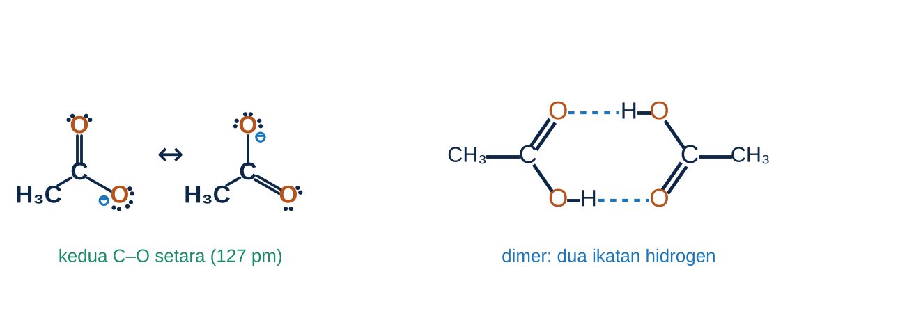
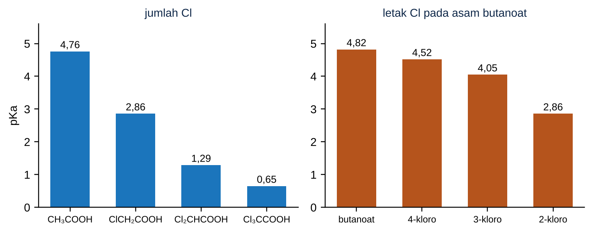

# Bab 12 Asam Karboksilat dan Turunannya

Sebotol tablet aspirin yang sudah lama dibuka sering berbau cuka. Aspirin adalah sebuah **ester**, asam asetilsalisilat, dan uap air dari udara perlahan memutus ikatan esternya menjadi asam salisilat dan **asam asetat**, zat yang memberi cuka baunya. Sekarang bandingkan dengan rambut di kepala kita. Rambut tersusun atas protein keratin, rantai panjang asam amino yang dihubungkan oleh ikatan **amida** (ikatan peptida). Rambut dicuci, dibasahi, dan terkena keringat setiap hari selama bertahun-tahun, tetapi ikatan amidanya hampir tidak pernah putus. Dalam air pada pH netral dan suhu kamar, waktu paruh sebuah ikatan peptida diperkirakan ratusan tahun. Ester dan amida sama-sama turunan asam karboksilat, sama-sama mempunyai gugus C=O, dan sama-sama dapat dihidrolisis menjadi asam karboksilat. Mengapa yang satu begitu mudah terurai dan yang lain begitu tahan?

Jawabannya merangkum bab ini. **Asam karboksilat**, RCOOH, adalah induk dari satu keluarga besar senyawa yang disebut **turunan asam karboksilat**: klorida asam (RCOCl), anhidrida (RCOOCOR), ester (RCOOR'), amida (RCONR'₂), dan, secara lebih longgar, nitril (RC≡N). Semuanya mempunyai karbon karbonil yang terikat pada **atom elektronegatif** (Cl, O, atau N). Inilah perbedaan pokok dari aldehida dan keton di Bab 11. Ketika nukleofil menyerang karbon karbonil turunan asam, zat antara tetrahedral yang terbentuk dapat **melepas** atom elektronegatif itu sebagai gugus pergi, dan gugus karbonil terbentuk kembali. Hasilnya bukan adisi, tetapi **substitusi asil nukleofilik**: satu gugus pada karbon asil diganti oleh gugus lain.

Seberapa mudah gugus itu lepas, dan seberapa besar gugus itu menstabilkan gugus karbonil lewat resonansi, menentukan kereaktifan setiap turunan. Dari pemahaman ini muncul satu "tangga kereaktifan" yang menjelaskan hampir semua kimia di bab ini: klorida asam di puncak, amida di dasar. Aspirin (ester fenol) berada cukup tinggi di tangga itu; protein (amida) berada di dasarnya. Kita akan memakai tangga itu untuk memahami esterifikasi, saponifikasi (pembuatan sabun), pembuatan nilon dan poliester, cara kerja penisilin, dan banyak obat lain.

::: {.kuis}
**Pertanyaan pembuka**

1. Mengapa asam asetat seratus miliar kali lebih asam daripada etanol, padahal keduanya mempunyai gugus O–H?
2. Mengapa asam kloroasetat lebih asam daripada asam asetat, dan mengapa pengaruh klorin melemah bila letaknya makin jauh?
3. Mengapa turunan asam karboksilat mengalami substitusi, sedangkan aldehida dan keton mengalami adisi?
4. Mengapa klorida asam bereaksi hebat dengan air, sedangkan amida hampir tidak?
5. Bagaimana sabun dibuat dari minyak, dan mengapa sabun dapat mengangkat kotoran berminyak?
6. Mengapa esterifikasi Fischer tidak pernah berjalan tuntas, dan bagaimana kimiawan memaksanya?
7. Mengapa cincin beranggota empat pada penisilin membuatnya menjadi antibiotik?
:::

::: {.tujuan}
**Tujuan belajar**

Setelah mempelajari bab ini, kamu mampu:

1. Menjelaskan sifat fisika dan keasaman asam karboksilat, termasuk pengaruh resonansi dan efek induktif substituen.
2. Membuat asam karboksilat dengan oksidasi, karboksilasi pereaksi Grignard, dan hidrolisis nitril.
3. Mengurutkan kereaktifan turunan asam dan menjelaskannya dengan kemampuan gugus pergi dan resonansi.
4. Menulis mekanisme umum substitusi asil nukleofilik (adisi–eliminasi) dalam basa dan dalam asam.
5. Membuat dan memakai klorida asam dan anhidrida untuk membuat ester dan amida.
6. Menulis mekanisme esterifikasi Fischer, hidrolisis ester dalam asam, dan saponifikasi, serta menghitung pengaruh pereaksi berlebih pada hasil.
7. Menjelaskan kestabilan amida dan menulis mekanisme hidrolisisnya.
8. Menuliskan reaksi nitril: hidrolisis, reduksi, dan adisi pereaksi Grignard.
9. Meramalkan produk reduksi turunan asam (LiAlH₄, DIBAL-H) dan reaksinya dengan pereaksi Grignard.
10. Menjelaskan kimia lemak dan sabun, serta pembentukan poliester dan poliamida.
11. Menjelaskan cara kerja antibiotik β-laktam dan obat-obat lain yang merupakan turunan asam karboksilat.
:::

::: {.mat}
**Prasyarat**

Bab 1: resonansi (subbab 1.8). Bab 3: pKa, resonansi, efek induktif (subbab 3.2–3.7). Bab 9: alkohol, oksidasi, pereaksi Grignard (subbab 9.2, 9.5). Bab 11: adisi nukleofilik, zat antara tetrahedral, reduksi dengan hidrida (subbab 11.3, 11.7, 11.8).
:::

## 12.1 Asam karboksilat: sifat dan keasaman

### Struktur dan tata nama

Gugus karboksil, –COOH, terdiri atas gugus karbonil dan gugus hidroksil pada karbon yang sama. Karbon karboksil terhibridisasi sp², sehingga gugus –COOH datar dengan sudut sekitar 120°. Tata namanya sudah dibahas di subbab 2.6: akhiran *-oat* dengan kata "asam" di depan (asam butanoat), atau *-karboksilat* bila –COOH terikat pada cincin (asam sikloheksanakarboksilat). Banyak nama umum masih dipakai: **asam format** (HCOOH, dari semut, *formica*), **asam asetat** (CH₃COOH, dari cuka, *acetum*), asam propionat, asam butirat (bau mentega tengik), dan **asam benzoat**.

### Sifat fisika

Asam karboksilat mempunyai titik didih yang lebih tinggi daripada alkohol yang seukuran: asam asetat mendidih pada 118 °C, sedangkan propan-1-ol (massa molar hampir sama) pada 97 °C. Penyebabnya, dua molekul asam karboksilat dapat membentuk **dimer** yang terikat oleh **dua ikatan hidrogen** sekaligus, dalam cincin beranggota delapan: gugus O–H satu molekul berikatan hidrogen dengan C=O molekul lain, dan sebaliknya. Dimer ini bertahan bahkan dalam fase gas. Asam karboksilat kecil (sampai empat karbon) bercampur dengan air dalam segala perbandingan.

Asam-asam karboksilat kecil terkenal karena baunya. Asam butanoat memberi bau khas pada mentega tengik dan keringat; asam heksanoat, oktanoat, dan dekanoat (dari bahasa Latin *caper*, kambing) memberi bau kambing. Hidung manusia sangat peka terhadap asam-asam ini.

### Keasaman

Asam karboksilat adalah asam lemah, tetapi jauh lebih asam daripada alkohol. pKa asam asetat 4,76, sedangkan pKa etanol 16: perbedaannya lebih dari sebelas satuan, sehingga asam asetat sekitar 10¹¹ kali (seratus miliar kali) lebih asam. Dengan basa seperti NaOH, dan bahkan dengan NaHCO₃ (pKa asam konjugatnya, H₂CO₃, 6,35), asam karboksilat berubah menjadi ion **karboksilat** yang larut dalam air (subbab 9.1, Contoh 9.1).

Penyebab utamanya adalah **resonansi** pada basa konjugat (subbab 3.6). Pada ion etoksida, muatan negatif terkurung di satu oksigen. Pada ion asetat, muatan negatif tersebar merata ke **dua** atom oksigen yang sama elektronegatifnya:

$$
\text{CH}_3\text{–C(=O)–O}^- \;\longleftrightarrow\; \text{CH}_3\text{–C(–O}^-\text{)=O} \qquad \text{(12.1)}
$$

Kedua struktur resonansi setara, sehingga hibridanya simetris. Pengukuran mendukung gambaran ini: pada asam format, ikatan C=O (120 pm) dan C–O (134 pm) berbeda panjang, tetapi pada ion format kedua ikatan C–O sama panjang, 127 pm, di antara keduanya. Selain resonansi, gugus karbonil yang menarik elektron juga menstabilkan muatan negatif lewat efek induktif.

{width=92%}

### Pengaruh substituen

Gugus penarik elektron pada rantai menstabilkan ion karboksilat lewat **efek induktif** (subbab 3.7) dan menaikkan keasaman. Pengaruhnya bertambah dengan banyaknya gugus penarik dan melemah dengan cepat bila gugus itu makin jauh dari gugus karboksil:

| Asam | pKa | Asam | pKa |
|---|---|---|---|
| CH₃COOH | 4,76 | CH₃CH₂CH₂COOH | 4,82 |
| ClCH₂COOH | 2,86 | CH₃CH₂CHClCOOH (2-kloro) | 2,86 |
| Cl₂CHCOOH | 1,29 | CH₃CHClCH₂COOH (3-kloro) | 4,05 |
| Cl₃CCOOH | 0,65 | ClCH₂CH₂CH₂COOH (4-kloro) | 4,52 |
| F₃CCOOH | 0,2 | | |

Efek induktif diteruskan lewat ikatan σ dan melemah kira-kira tiga kali setiap satu karbon tambahan. Pada asam benzoat tersubstitusi, gugus penarik elektron pada cincin juga menaikkan keasaman (asam 4-nitrobenzoat, pKa 3,44), dan gugus pendorong elektron menurunkannya (asam 4-metoksibenzoat, pKa 4,47).

{width=88%}

::: {.contoh}
**Contoh 12.1 · Karboksilat dalam tubuh**

Hitung persen asam asetat yang berada dalam bentuk ion asetat pada pH darah, 7,4. Bagaimana dengan asam benzoat di lambung (pH 2,0)?

**Rencana.** Dari persamaan Henderson–Hasselbalch (subbab 3.13), fraksi terionisasi = 1/(1 + 10^(pKa − pH)).

**Penyelesaian.** Asam asetat pada pH 7,4: 1/(1 + 10^(4,76 − 7,4)) = **99,8%** terionisasi. Asam benzoat pada pH 2,0: 1/(1 + 10^(4,20 − 2,0)) = **0,6%** terionisasi; hampir seluruhnya dalam bentuk asam netral.

**Memahami hasil.** Di dalam tubuh (pH sekitar 7,4), asam karboksilat hampir seluruhnya berupa anion karboksilat. Karena itu nama metabolit sering ditulis dalam bentuk anion: piruvat, laktat, sitrat, asetat. Di lambung yang sangat asam, asam karboksilat sebagian besar netral, sehingga obat seperti aspirin dapat diserap melewati dinding lambung, yang hanya ditembus mudah oleh molekul netral.
:::

::: {.kuis}
**Kuis cepat 12.1** (a) Urutkan keasaman: asam asetat, asam fluoroasetat, asam bromoasetat, asam propanoat. (b) Mengapa kedua ikatan C–O pada ion benzoat sama panjang?
:::

## 12.2 Membuat asam karboksilat

Ada beberapa cara utama membuat asam karboksilat. Masing-masing mempunyai kelebihan tersendiri, terutama dalam hal **jumlah karbon**: ada yang mempertahankan kerangka karbon, ada yang menambah satu karbon.

**Oksidasi alkohol primer dan aldehida** (subbab 9.5). Pereaksi Jones atau KMnO₄ mengubah RCH₂OH dan RCHO menjadi RCOOH. Jumlah karbon tetap.

**Oksidasi alkilbenzena** (subbab 10.4). KMnO₄ panas memotong rantai samping menjadi –COOH yang terikat pada cincin. Seluruh rantai samping, berapa pun panjangnya, menjadi satu karbon karboksil.

**Pemutusan oksidatif alkena dan alkuna** (subbab 8.10, 8.13). KMnO₄ panas atau ozonolisis dengan pengolahan H₂O₂ memotong RCH=CHR' menjadi RCOOH dan R'COOH.

**Karboksilasi pereaksi Grignard.** Pereaksi Grignard menyerang karbon dioksida (biasanya sebagai es kering) seperti menyerang keton, dan menghasilkan garam karboksilat magnesium. Pengasaman menghasilkan asam karboksilat:

$$
\text{R–MgX} + \text{CO}_2 \longrightarrow \text{R–COO}^-\,{}^+\text{MgX} \xrightarrow{\text{H}_3\text{O}^+} \text{R–COOH} \qquad \text{(12.2)}
$$

Cara ini **menambah satu karbon**: R–Br menjadi R–COOH.

**Hidrolisis nitril** (subbab 12.9). Alkil halida primer atau sekunder bereaksi dengan NaCN lewat SN2 menjadi nitril, R–C≡N, yang kemudian dihidrolisis dalam asam atau basa menjadi R–COOH. Cara ini juga **menambah satu karbon**, dan berguna bila molekul mengandung gugus yang tidak tahan pereaksi Grignard (misalnya –OH).

::: {.contoh}
**Contoh 12.2 · Grignard atau nitril**

Rancang sintesis asam 3-metilbutanoat dari 1-bromo-2-metilpropana dengan dua cara. Untuk 4-bromobutan-1-ol, mana yang dapat dipakai?

**Penyelesaian.** 1-Bromo-2-metilpropana (C₄) → asam 3-metilbutanoat (C₅): satu karbon ditambahkan. (1) **Mg, eter; CO₂; H₃O⁺**. (2) **NaCN (SN2); H₃O⁺, panas**. Untuk 4-bromobutan-1-ol, pereaksi Grignard tidak dapat dibuat karena –OH akan menghancurkannya (subbab 9.6), tetapi **jalur nitril** berhasil: NaCN menggantikan Br lewat SN2 tanpa mengganggu –OH, lalu hidrolisis menghasilkan asam 5-hidroksipentanoat.

**Memahami hasil.** Kedua jalur saling melengkapi. Jalur nitril memerlukan SN2 sehingga gagal untuk halida tersier; jalur Grignard bekerja untuk halida primer, sekunder, tersier, dan aril, tetapi gagal bila ada H yang asam.
:::

::: {.kuis}
**Kuis cepat 12.2** Tulis produk: (a) bromobenzena + Mg, lalu CO₂, lalu H₃O⁺; (b) *p*-xilena + KMnO₄ panas; (c) 1-bromobutana + NaCN, lalu H₃O⁺ panas.
:::
