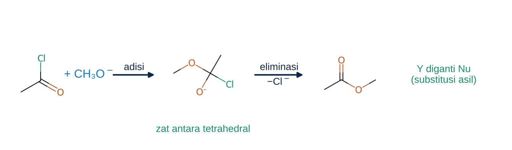

## 12.3 Turunan asam: struktur dan kereaktifan relatif

### Lima turunan

Turunan asam karboksilat dibentuk dengan mengganti gugus –OH asam karboksilat dengan gugus lain. Semuanya mempunyai **gugus asil**, R–C(=O)–, yang terikat pada atom elektronegatif:

| Turunan | Rumus | Contoh | Nama |
|---|---|---|---|
| klorida asam (asil klorida) | RCOCl | CH₃COCl | asetil klorida (etanoil klorida) |
| anhidrida asam | RCOOCOR | (CH₃CO)₂O | anhidrida asetat |
| ester | RCOOR' | CH₃COOCH₂CH₃ | etil asetat (etil etanoat) |
| amida | RCONH₂, RCONHR', RCONR'₂ | CH₃CONH₂ | asetamida (etanamida) |
| nitril | RC≡N | CH₃CN | asetonitril (etananitril) |

Nitril tidak mempunyai gugus asil, tetapi digolongkan bersama karena karbonnya berada pada tingkat oksidasi yang sama dengan karbon karboksil (+3) dan karena hidrolisisnya menghasilkan asam karboksilat. Ester siklik disebut **lakton**, dan amida siklik disebut **laktam**.

### Mengapa substitusi, bukan adisi

Ketika nukleofil menyerang karbon karbonil turunan asam, terbentuk **zat antara tetrahedral**, sama seperti pada aldehida dan keton. Bedanya, karbon tetrahedral itu kini membawa gugus **Y** (Cl, OCOR, OR', atau NR'₂) yang dapat lepas sebagai anion yang relatif stabil. Pasangan bebas oksigen –O⁻ kembali membentuk ikatan π C=O, dan Y⁻ terlepas. Hasil bersihnya: Y diganti oleh Nu. Pada aldehida dan keton, gugus yang terikat pada karbon karbonil (H⁻ atau R⁻) adalah basa yang terlalu kuat untuk lepas, sehingga zat antara tetrahedral tidak dapat kembali ke C=O dengan melepas gugus itu dan malah terprotonasi.

### Tangga kereaktifan

Turunan asam berbeda sangat besar dalam kereaktifannya terhadap nukleofil. Urutannya:

$$
\text{klorida asam} > \text{anhidrida} > \text{ester} \approx \text{asam} > \text{amida} \;(> \text{ion karboksilat}) \qquad \text{(12.3)}
$$

Dua faktor, yang bekerja ke arah yang sama, menjelaskan urutan ini.

**Kemampuan gugus pergi.** Gugus pergi yang baik adalah basa lemah, yaitu basa konjugat asam yang kuat (subbab 6.4). Cl⁻ (asam konjugatnya HCl, pKa −7) adalah gugus pergi terbaik; RCOO⁻ (pKa sekitar 4,8) cukup baik; RO⁻ (pKa sekitar 16) buruk; dan R₂N⁻ (pKa sekitar 38) sangat buruk.

**Stabilisasi resonansi gugus karbonil.** Atom yang terikat pada karbon asil dapat menyumbangkan pasangan bebasnya ke gugus karbonil lewat resonansi, Y–C=O ↔ Y⁺=C–O⁻. Sumbangan ini menstabilkan turunan dan mengurangi muatan positif pada karbon karbonil, sehingga turunan kurang elektrofilik. Nitrogen, yang paling tidak elektronegatif dan paling mudah menyumbangkan pasangan bebasnya, memberi stabilisasi terbesar: amida paling stabil. Oksigen ester memberi stabilisasi sedang. Klorin, dengan pasangan bebas di orbital 3p yang tumpang tindihnya buruk dengan orbital 2p karbon, hampir tidak memberi stabilisasi: klorida asam paling tidak stabil dan paling elektrofilik.

{width=86%}

Tangga ini mempunyai satu akibat yang sangat praktis: **setiap turunan dapat diubah dengan mudah menjadi turunan yang berada di bawahnya**, tetapi tidak sebaliknya. Klorida asam dapat menjadi anhidrida, ester, atau amida; ester dapat menjadi amida; tetapi amida tidak dapat langsung menjadi ester atau klorida asam dengan nukleofil biasa. Untuk "naik tangga", diperlukan jalan memutar, biasanya lewat asam karboksilat (yang dapat diubah menjadi klorida asam dengan SOCl₂).

::: {.contoh}
**Contoh 12.3 · Naik atau turun tangga**

Mana dari perubahan berikut yang dapat dilakukan langsung dengan satu nukleofil, dan mana yang memerlukan jalan memutar? (a) metil benzoat → benzamida; (b) benzamida → metil benzoat; (c) anhidrida asetat → etil asetat; (d) etil asetat → asetil klorida.

**Penyelesaian.** (a) **Langsung**: NH₃ menggantikan –OCH₃ (ester → amida, turun). (b) **Memutar**: amida tidak dapat langsung menjadi ester (naik). Hidrolisis dulu menjadi asam benzoat, lalu esterifikasi Fischer dengan metanol (atau asam → klorida asam dengan SOCl₂ → ester). (c) **Langsung**: etanol (anhidrida → ester, turun). (d) **Memutar**: hidrolisis ester menjadi asam asetat, lalu SOCl₂.

**Memahami hasil.** Untuk naik tangga, turun dulu ke asam karboksilat (atau karboksilat), lalu "lompat" ke puncak dengan SOCl₂. Asam karboksilat adalah titik balik semua interkonversi turunan asam.
:::

::: {.kuis}
**Kuis cepat 12.3** (a) Beri nama: CH₃CH₂COCl; CH₃CH₂COOCH₃; CH₃CON(CH₃)₂; C₆H₅CN. (b) Dapatkah etil asetat diubah menjadi asetil klorida dengan NaCl? Mengapa?
:::

## 12.4 Substitusi asil nukleofilik: mekanisme adisi–eliminasi

### Dalam basa atau dengan nukleofil kuat

Mekanisme umum substitusi asil nukleofilik terdiri atas dua langkah, sehingga disebut mekanisme **adisi–eliminasi**:

1. **Adisi.** Nukleofil menyerang karbon karbonil. Elektron π C=O berpindah ke oksigen, membentuk zat antara tetrahedral beranion.
2. **Eliminasi.** Pasangan bebas O⁻ membentuk kembali ikatan π C=O, dan gugus pergi Y⁻ lepas.

Perhatikan bahwa ini **bukan SN2**: nukleofil tidak menyerang karbon dari belakang sambil gugus pergi lepas pada saat yang sama. Nukleofil masuk dulu ke orbital π\*, membentuk zat antara yang dapat dideteksi, lalu gugus pergi lepas. Karena itu substitusi asil terjadi dengan mudah pada karbon sp² datar, tempat SN2 tidak mungkin terjadi.

{width=96%}

### Dalam asam dengan nukleofil lemah

Untuk nukleofil lemah seperti air dan alkohol, dan untuk turunan yang kurang reaktif seperti ester dan asam karboksilat, reaksi memerlukan katalis asam. Pola langkahnya sama dengan adisi nukleofilik dalam asam (subbab 11.3), ditambah langkah eliminasi:

1. Protonasi oksigen karbonil (karbon menjadi lebih elektrofilik).
2. Nukleofil lemah menyerang karbon karbonil.
3. Transfer proton: dari nukleofil yang masuk ke gugus pergi, sehingga gugus pergi menjadi molekul netral (ROH, H₂O) yang mudah lepas.
4. Eliminasi gugus pergi netral, dibantu pasangan bebas –OH.
5. Deprotonasi oksigen karbonil.

Kunci mekanisme dalam asam adalah langkah 3: gugus pergi yang buruk (RO⁻, OH⁻) diubah menjadi gugus pergi yang baik (ROH, H₂O) dengan protonasi. Prinsip yang sama sudah kita lihat pada reaksi alkohol dengan HX (subbab 9.3).

### Bukti zat antara tetrahedral

Pada tahun 1951 Myron Bender menghidrolisis etil benzoat yang oksigen karbonilnya ditandai dengan isotop ¹⁸O. Ketika reaksi dihentikan setengah jalan, ester yang belum bereaksi ternyata telah kehilangan sebagian ¹⁸O-nya ke air. Ini hanya mungkin bila terbentuk zat antara tetrahedral di mana oksigen bertanda dan oksigen dari air menjadi setara (keduanya –OH), sehingga ketika zat antara itu kembali menjadi ester (tanpa melepas etoksida), oksigen mana pun dapat menjadi oksigen karbonil. Mekanisme SN2 satu langkah tidak dapat menjelaskan pertukaran isotop ini.

::: {.contoh}
**Contoh 12.4 · Membaca percobaan isotop**

Etil benzoat dengan oksigen karbonil bertanda ¹⁸O dihidrolisis dalam NaOH. Ke mana ¹⁸O pergi pada akhir reaksi? Dan bila etil benzoat dengan ¹⁸O pada oksigen etoksi (C₆H₅CO–¹⁸O–CH₂CH₃) yang dihidrolisis?

**Penyelesaian.** (1) Oksigen karbonil tetap terikat pada karbon asil sepanjang mekanisme adisi–eliminasi; ¹⁸O berakhir di **ion benzoat** (dan, karena pertukaran lewat zat antara tetrahedral, sebagian juga di air). (2) Ikatan yang putus adalah ikatan asil–oksigen (C(=O)–OEt), bukan ikatan alkil–oksigen (O–CH₂CH₃). Oksigen etoksi lepas bersama gugus etil sebagai etoksida, sehingga ¹⁸O berakhir di **etanol**.

**Memahami hasil.** Percobaan dengan alkohol bertanda membuktikan bahwa hidrolisis ester biasa memutus ikatan **asil–oksigen**, sesuai dengan serangan nukleofil pada karbon karbonil. Bila ikatan alkil–oksigen yang putus (seperti pada SN2 pada karbon etil), ¹⁸O akan berakhir di ion benzoat. Pengecualian terjadi pada ester *tert*-butil dalam asam, yang putus lewat karbokation tersier (subbab 9.9).
:::

::: {.kuis}
**Kuis cepat 12.4** (a) Tulis mekanisme asetil klorida + NH₃ (dua ekuivalen). Mengapa diperlukan dua ekuivalen amonia? (b) Mengapa substitusi asil nukleofilik dapat terjadi pada karbon sp², sedangkan SN2 tidak?
:::

## 12.5 Klorida asam

### Pembuatan

Klorida asam dibuat dari asam karboksilat dengan **tionil klorida**, SOCl₂ (seperti mengubah alkohol menjadi alkil klorida, subbab 9.3), atau dengan oksalil klorida, (COCl)₂, atau PCl₅. Pada SOCl₂, oksigen –OH asam menyerang belerang dan membentuk zat antara **asil klorosulfit**, RCO–O–SOCl, dengan gugus pergi yang sangat baik. Ion klorida kemudian menyerang karbon asil (adisi–eliminasi), dan gugus pergi pecah menjadi SO₂ dan Cl⁻. Hasil sampingnya gas (SO₂ dan HCl), sehingga produk mudah dimurnikan.

### Reaksi

Karena berada di puncak tangga, klorida asam bereaksi dengan hampir semua nukleofil, biasanya cepat pada suhu kamar:

- **Air** → asam karboksilat + HCl (hidrolisis; klorida asam berasap di udara lembap karena bereaksi dengan uap air).
- **Alkohol** → ester + HCl. Basa seperti piridina ditambahkan untuk menangkap HCl.
- **Amonia atau amina** → amida. Diperlukan dua ekuivalen amina (satu sebagai nukleofil, satu untuk menangkap HCl sebagai garam amonium), atau satu ekuivalen amina ditambah basa lain.
- **Ion karboksilat** → anhidrida.
- **Arena + AlCl₃** → keton aril (asilasi Friedel–Crafts, subbab 10.7).
- **Kuprat Gilman** → keton (subbab 11.2).
- **LiAlH₄** → alkohol primer; **LiAlH(O-*t*Bu)₃** (hidrida yang lemah dan besar) pada suhu rendah → aldehida.

::: {.contoh}
**Contoh 12.5 · Satu klorida asam, banyak produk**

Tulis produk benzoil klorida (C₆H₅COCl) dengan: (a) H₂O; (b) etanol, piridina; (c) dimetilamina berlebih; (d) natrium asetat; (e) (CH₃)₂CuLi.

**Penyelesaian.** (a) **Asam benzoat** + HCl. (b) **Etil benzoat**. (c) ***N*,*N*-dimetilbenzamida** + (CH₃)₂NH₂⁺Cl⁻. (d) **Anhidrida asetat benzoat**, C₆H₅COOCOCH₃ (anhidrida campuran). (e) **Asetofenon**, C₆H₅COCH₃.

**Memahami hasil.** Semua reaksi ini berjalan dengan mekanisme adisi–eliminasi yang sama dan semuanya "menuruni tangga". Karena sangat reaktif, klorida asam adalah titik awal yang paling serbaguna untuk membuat turunan lain. Kekurangannya: klorida asam harus dijaga kering, dan HCl yang terbentuk harus ditangkap.
:::

::: {.kuis}
**Kuis cepat 12.5** Rancang sintesis *N*-etilpropanamida dari asam propanoat. Tulis setiap pereaksi.
:::

## 12.6 Anhidrida asam

**Anhidrida asam** adalah dua gugus asil yang dihubungkan oleh satu oksigen, RCO–O–COR, yang secara formal terbentuk dari dua molekul asam dengan melepas satu molekul air (*anhidrida* berarti "tanpa air"). Anhidrida dibuat dari klorida asam dan ion karboksilat. Anhidrida siklik beranggota lima atau enam, seperti **anhidrida suksinat** dan **anhidrida ftalat**, dapat dibuat cukup dengan memanaskan asam dikarboksilatnya, karena reaksi intramolekul yang membentuk cincin lima atau enam sangat disukai.

Anhidrida bereaksi seperti klorida asam tetapi lebih lembut: dengan air menjadi dua asam, dengan alkohol menjadi ester + asam, dan dengan amina menjadi amida + garam karboksilat. Gugus perginya ion karboksilat, yang kurang baik daripada Cl⁻ tetapi jauh lebih baik daripada alkoksida. Kelebihan anhidrida dibanding klorida asam: lebih murah, lebih mudah ditangani, dan hasil sampingnya asam karboksilat, bukan HCl yang korosif. Kekurangannya: setengah dari gugus asil terbuang sebagai asam karboksilat.

**Anhidrida asetat** adalah pereaksi asetilasi yang paling banyak dipakai di industri. Dua contoh terkenal:

- **Aspirin** dibuat dengan mengasetilasi gugus –OH fenol asam salisilat dengan anhidrida asetat (dengan sedikit asam sebagai katalis). Produknya ester fenol, asam asetilsalisilat, dan hasil sampingnya asam asetat.
- **Parasetamol** (asetaminofen) dibuat dengan mengasetilasi gugus –NH₂ 4-aminofenol. Gugus amino lebih nukleofilik daripada gugus –OH fenol, sehingga yang terbentuk adalah amida, bukan ester.

::: {.contoh}
**Contoh 12.6 · Nitrogen atau oksigen**

4-Aminofenol mempunyai gugus –NH₂ dan –OH. Mengapa satu ekuivalen anhidrida asetat mengasetilasi nitrogennya, menghasilkan parasetamol, dan bukan oksigennya?

**Penyelesaian.** Pasangan bebas nitrogen lebih mudah diberikan daripada pasangan bebas oksigen, karena nitrogen kurang elektronegatif; amina adalah nukleofil yang jauh lebih kuat daripada fenol. Selain itu produk amida lebih stabil (lebih rendah di tangga) daripada produk ester. Gugus –NH₂ menyerang karbon karbonil anhidrida lebih cepat, dan produknya, *N*-(4-hidroksifenil)asetamida, adalah **parasetamol**.

**Memahami hasil.** Selektivitas N lawan O ini adalah contoh **kemoselektivitas** yang memanfaatkan perbedaan nukleofilisitas. Dengan anhidrida berlebih dan kondisi lebih keras, gugus –OH juga akan terasetilasi, menghasilkan diasetil.
:::

::: {.kuis}
**Kuis cepat 12.6** (a) Tulis persamaan pembuatan aspirin dari asam salisilat. (b) Tulis produk anhidrida suksinat + metanol.
:::
