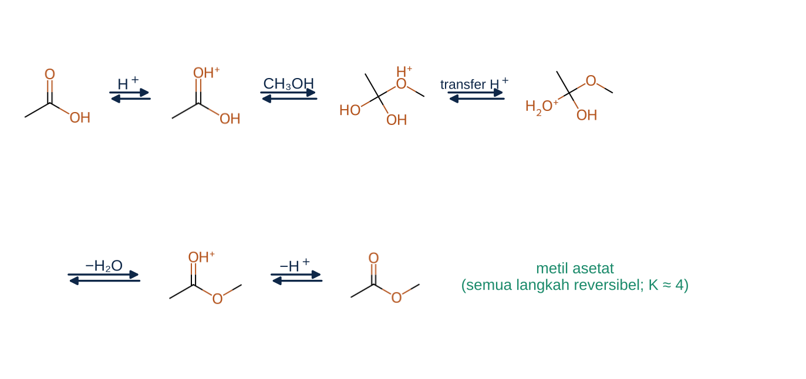
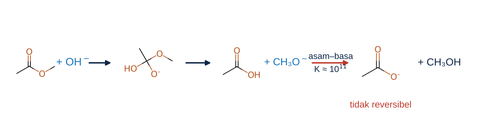
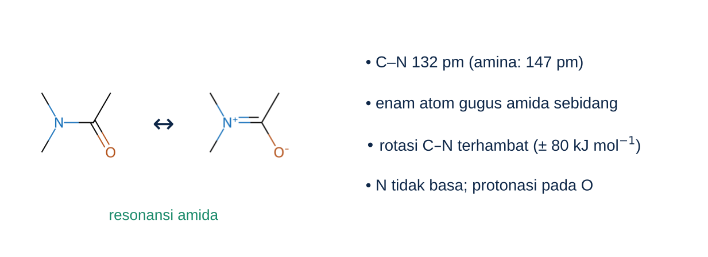
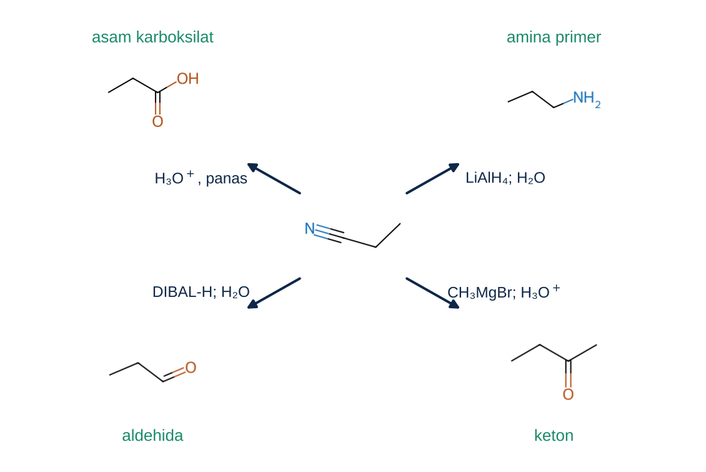

## 12.7 Ester

### Ester di sekitar kita

Ester bertanggung jawab atas banyak aroma buah dan bunga: isopentil asetat (pisang), oktil asetat (jeruk), etil butanoat (nanas), metil butanoat (apel), dan metil salisilat (minyak gandapura, aroma balsem). Lemak dan minyak adalah ester gliserol (subbab 12.11). Banyak pelarut (etil asetat dalam penghapus cat kuku), plastik (PET), dan obat (aspirin, prokaina) juga ester. Ester tidak mempunyai H pada oksigen, sehingga titik didihnya mirip aldehida dan keton yang seukuran, jauh di bawah asam karboksilat.

### Esterifikasi Fischer

Cara paling langsung membuat ester adalah memanaskan asam karboksilat dengan alkohol dan sedikit asam kuat (H₂SO₄ atau HCl): **esterifikasi Fischer** (Emil Fischer, 1895).

$$
\text{RCOOH} + \text{R'OH} \overset{\text{H}^+}{\rightleftharpoons} \text{RCOOR'} + \text{H}_2\text{O} \qquad \text{(12.4)}
$$

Mekanismenya adalah substitusi asil nukleofilik dalam asam (subbab 12.4) dengan –OH asam sebagai gugus yang diganti:

1. Asam memprotonasi oksigen karbonil.
2. Alkohol menyerang karbon karbonil.
3. Proton pindah dari oksigen alkohol yang masuk ke salah satu gugus –OH.
4. Air lepas, dan ikatan π C=O terbentuk kembali.
5. Proton lepas dari oksigen karbonil.

{width=98%}

Percobaan dengan alkohol bertanda ¹⁸O menunjukkan bahwa oksigen alkohol masuk ke dalam **ester**, bukan ke dalam air: ikatan yang putus adalah ikatan C–OH asam, bukan ikatan C–O alkohol. Hal ini sesuai dengan mekanisme di atas, di mana alkohol menyerang karbon asil.

Setiap langkah reversibel, dan konstanta kesetimbangan keseluruhan tidak besar: untuk asam asetat dan etanol, *K* sekitar 4. Agar hasilnya tinggi, kesetimbangan harus digeser, misalnya dengan **alkohol berlebih** (sering dipakai sebagai pelarut) atau dengan **mengeluarkan air** (Dean–Stark atau penyerap air).

::: {.contoh}
**Contoh 12.7 · Menggeser kesetimbangan Fischer**

Untuk CH₃COOH + C₂H₅OH ⇌ CH₃COOC₂H₅ + H₂O, *K* = 4. Hitung fraksi asam asetat yang menjadi ester bila 1 mol asam direaksikan dengan (a) 1 mol; (b) 3 mol; (c) 10 mol etanol.

**Rencana.** Bila *x* mol ester terbentuk, *K* = *x*² / [(1 − *x*)(*n* − *x*)] = 4, dengan *n* mol etanol. Selesaikan untuk *x*.

**Penyelesaian.** (a) *n* = 1: *x*²/(1 − *x*)² = 4, *x*/(1 − *x*) = 2, **x = 0,67** (67%). (b) *n* = 3: diselesaikan secara numerik, ***x* = 0,90** (90%). (c) *n* = 10: ***x* = 0,97** (97%).

**Memahami hasil.** Dengan perbandingan 1 : 1, hanya dua pertiga asam yang menjadi ester. Etanol berlebih sepuluh kali menaikkan hasil menjadi 97%. Inilah penerapan langsung asas Le Chatelier. Bila alkoholnya mahal, kimiawan lebih memilih mengeluarkan air, atau memakai klorida asam yang bereaksi tuntas.
:::

### Hidrolisis ester

Kebalikan esterifikasi Fischer adalah **hidrolisis ester dalam asam**: ester dipanaskan dengan air berlebih dan asam encer menjadi asam karboksilat dan alkohol. Mekanismenya persis kebalikan langkah demi langkah dari esterifikasi Fischer (reversibilitas mikroskopik). Reaksinya tetap merupakan kesetimbangan.

**Hidrolisis dalam basa**, yang disebut **saponifikasi** (pembuatan sabun), berbeda dalam satu hal penting: reaksinya **tidak reversibel**. Mekanismenya:

1. Ion hidroksida menyerang karbon karbonil ester, membentuk zat antara tetrahedral.
2. Zat antara melepas ion alkoksida, RO⁻, dan terbentuk asam karboksilat.
3. Asam karboksilat (pKa sekitar 5) segera bereaksi dengan alkoksida (asam konjugatnya, pKa sekitar 16) membentuk **ion karboksilat** dan alkohol.

Langkah 3 adalah reaksi asam–basa dengan *K* sekitar 10¹¹, yang menarik seluruh kesetimbangan ke kanan. Ion karboksilat yang bermuatan negatif tidak lagi dapat diserang oleh alkohol, sehingga reaksi tidak dapat kembali. Karena itu saponifikasi berjalan tuntas, dan hidroksida dipakai dalam jumlah **stoikiometrik** (satu mol per mol ester), bukan katalitik. Asam karboksilat bebas diperoleh dengan mengasamkan larutan setelah reaksi selesai.

{width=96%}

### Reaksi ester lainnya

- **Transesterifikasi**: ester + alkohol lain dengan katalis asam atau basa → ester baru. Biodiesel dibuat dengan cara ini: trigliserida minyak sawit + metanol dengan katalis NaOH → metil ester asam lemak + gliserol.
- **Aminolisis**: ester + amonia atau amina → amida (menuruni tangga). Lebih lambat daripada dengan klorida asam, tetapi bersih.
- **Lakton** adalah ester siklik. Hidroksi asam dengan gugus –OH di posisi γ atau δ (sehingga terbentuk cincin lima atau enam) menutup cincin sendiri menjadi lakton dalam asam.

::: {.contoh}
**Contoh 12.8 · Biodiesel dari minyak sawit**

Trigliserida minyak sawit direaksikan dengan metanol berlebih dan sedikit NaOH. Tulis produknya untuk gliseril tripalmitat, dan jelaskan mengapa metanol dipakai berlebih dan mengapa NaOH hanya katalitik di sini.

**Penyelesaian.** Transesterifikasi: setiap gugus ester palmitat dipindahkan dari gliserol ke metanol. Produk: **3 metil palmitat** (CH₃(CH₂)₁₄COOCH₃, biodiesel) + **gliserol**. Ion metoksida (dari CH₃OH + NaOH) menyerang karbon asil, dan alkoksida gliserol lepas; alkoksida itu kemudian mengambil proton dari metanol, menghasilkan metoksida baru. Karena tidak terbentuk ion karboksilat, basa tidak habis terpakai dan cukup dalam jumlah katalitik. Reaksinya kesetimbangan, sehingga metanol berlebih menggeser ke arah metil ester.

**Memahami hasil.** Air harus dihindari: air dengan NaOH akan menyabunkan ester (saponifikasi), menghabiskan basa, dan membentuk sabun yang menyulitkan pemisahan. Indonesia, produsen minyak sawit terbesar dunia, mencampurkan biodiesel sawit ke dalam solar (program B30 dan seterusnya).
:::

::: {.kuis}
**Kuis cepat 12.7** (a) Tulis produk esterifikasi Fischer asam benzoat dengan metanol. (b) Tulis produk metil benzoat + NaOH, lalu H₃O⁺. (c) Mengapa saponifikasi tuntas tetapi hidrolisis dalam asam tidak?
:::

## 12.8 Amida dan hidrolisisnya

### Struktur: ikatan C–N yang sebagian rangkap

Amida adalah turunan asam yang paling stabil, dan kestabilan itu berasal dari **resonansi** yang kuat antara pasangan bebas nitrogen dan gugus karbonil:

$$
\text{R–C(=O)–NR'}_2 \;\longleftrightarrow\; \text{R–C(–O}^-\text{)=N}^+\text{R'}_2 \qquad \text{(12.5)}
$$

Struktur kedua menyumbang cukup besar, dan akibatnya dapat diukur:

- **Ikatan C–N pendek**: 132 pm pada amida, dibanding 147 pm pada ikatan C–N amina biasa. Ikatan itu mempunyai sebagian sifat ikatan rangkap.
- **Gugus amida datar**: karbon karbonil, oksigen, nitrogen, dan atom-atom yang terikat padanya terletak dalam satu bidang, karena nitrogen menjadi sp² agar pasangan bebasnya dapat bertumpang tindih dengan orbital π C=O.
- **Rotasi C–N terhambat**: energi penghalang rotasi sekitar 75–85 kJ mol⁻¹, cukup besar sehingga pada spektrum NMR *N*,*N*-dimetilformamida kedua gugus metil terlihat berbeda pada suhu kamar.
- **Nitrogen amida tidak basa**: pasangan bebasnya sudah dipakai untuk resonansi. Amida diprotonasi pada **oksigen**, bukan nitrogen, dan hanya oleh asam kuat.

Sifat ini menentukan struktur protein. Setiap ikatan peptida datar dan kaku, sehingga rantai protein hanya dapat berputar pada ikatan di kedua sisi gugus amida. Batasan ini, ditambah ikatan hidrogen antara N–H dan C=O, menghasilkan heliks α dan lembaran β, bentuk-bentuk dasar protein.

{width=88%}

### Pembuatan

Amida dibuat dengan reaksi amonia, amina primer, atau amina sekunder dengan klorida asam, anhidrida, atau ester (menuruni tangga). Asam karboksilat sendiri dengan amina pada suhu kamar hanya membentuk **garam amonium karboksilat** (reaksi asam–basa); pemanasan kuat garam itu di atas 200 °C melepaskan air dan menghasilkan amida, cara yang dipakai di industri nilon. Di laboratorium, dan dalam sintesis peptida, asam karboksilat diaktifkan dulu dengan pereaksi seperti DCC (disikloheksilkarbodiimida), yang mengubah –OH menjadi gugus pergi yang baik.

### Hidrolisis

Amida dapat dihidrolisis, tetapi memerlukan kondisi yang keras: pemanasan lama dengan asam kuat (misalnya HCl 6 M pada 110 °C selama 24 jam, cara standar menghidrolisis protein menjadi asam amino) atau dengan basa kuat.

- **Dalam asam**: oksigen terprotonasi, air menyerang, proton berpindah ke nitrogen, dan amina lepas sebagai amina netral yang **segera terprotonasi** menjadi ion amonium. Protonasi amina ini membuat reaksi tidak dapat kembali.
- **Dalam basa**: OH⁻ menyerang, dan zat antara tetrahedral harus melepas R₂N⁻, gugus pergi yang sangat buruk. Reaksi berjalan karena gugus pergi diprotonasi oleh air pada saat lepas, dan karena asam karboksilat yang terbentuk segera menjadi ion karboksilat.

Kestabilan amida terhadap hidrolisis adalah jawaban teka-teki pembuka bab. Di dalam tubuh, enzim protease (seperti pepsin di lambung dan tripsin di usus) memutus ikatan peptida jutaan kali lebih cepat daripada tanpa enzim, dengan menempatkan nukleofil, asam, dan basa pada posisi yang tepat di sekitar ikatan amida.

::: {.contoh}
**Contoh 12.9 · Membandingkan kecepatan hidrolisis**

Urutkan kecepatan hidrolisis dalam air pada suhu kamar dan jelaskan: asetil klorida, anhidrida asetat, etil asetat, asetamida.

**Penyelesaian.** Asetil klorida (bereaksi hebat, dalam hitungan detik) > anhidrida asetat (beberapa menit sampai jam) > etil asetat (praktis tidak bereaksi tanpa katalis; dengan asam atau basa beberapa jam) > asetamida (tahan bertahun-tahun pada pH netral).

**Memahami hasil.** Urutan ini adalah tangga kereaktifan. Gugus pergi berubah dari Cl⁻ (sangat baik) ke CH₃COO⁻ ke CH₃CH₂O⁻ ke NH₂⁻ (sangat buruk), sementara stabilisasi resonansi gugus karbonil bertambah dari Cl ke N. Kedua faktor bekerja ke arah yang sama, sehingga rentang kereaktifannya sangat lebar.
:::

::: {.kuis}
**Kuis cepat 12.8** (a) Tulis produk hidrolisis *N*-metilbenzamida dalam HCl panas. (b) Mengapa nitrogen amida tidak basa, sedangkan nitrogen amina basa?
:::

## 12.9 Nitril

**Nitril**, R–C≡N, mempunyai ikatan rangkap tiga karbon–nitrogen yang polar, dengan karbon δ+. Karbon nitril terhibridisasi sp, sehingga gugus C–C≡N linear. Asetonitril, CH₃CN, adalah pelarut aprotik polar yang penting (subbab 7.6).

### Pembuatan

- **SN2 dengan ion sianida**: alkil halida primer atau sekunder + NaCN dalam DMSO → nitril (menambah satu karbon; subbab 12.2).
- **Dehidrasi amida primer**: RCONH₂ + SOCl₂ (atau P₄O₁₀) → R–C≡N + H₂O. Cara ini bekerja juga untuk nitril tersier dan aril, yang tidak dapat dibuat lewat SN2.
- **Dari sianohidrin**, aril diazonium (Bab 13), dan cara lain.

### Reaksi

Karbon nitril bereaksi dengan nukleofil seperti karbon karbonil, dan nitrogen berperan seperti oksigen karbonil:

- **Hidrolisis** dalam asam atau basa panas: nitril → amida → asam karboksilat (atau ion karboksilat dalam basa) + NH₃/NH₄⁺. Air menyerang karbon nitril, menghasilkan asam imidat yang bertautomerisasi menjadi amida; amida kemudian terhidrolisis lebih lanjut. Dengan kondisi lembut, reaksi dapat dihentikan pada amida.
- **Reduksi dengan LiAlH₄**: dua hidrida masuk berturut-turut, dan setelah pengolahan dengan air terbentuk **amina primer**, RCH₂NH₂.
- **Reduksi dengan DIBAL-H**: satu hidrida masuk, terbentuk anion imina yang setelah hidrolisis menjadi **aldehida**.
- **Pereaksi Grignard**: gugus R' menyerang karbon nitril, membentuk anion imina (garam magnesium) yang tidak bereaksi lagi; hidrolisis dengan asam menghasilkan **keton**, RCOR'. Reaksi berhenti pada keton karena keton baru terbentuk saat pengolahan, ketika pereaksi Grignard sudah tidak ada.

{width=86%}

::: {.contoh}
**Contoh 12.10 · Dari satu alkil halida, empat gugus fungsi**

Mulai dari benzil bromida (C₆H₅CH₂Br), tunjukkan bagaimana membuat (a) asam fenilasetat; (b) 2-feniletilamina; (c) 1-fenilpropan-2-on; (d) fenilasetaldehida.

**Penyelesaian.** Semuanya lewat **fenilasetonitril**, C₆H₅CH₂CN, dari benzil bromida + NaCN (SN2). Lalu: (a) H₃O⁺, panas → C₆H₅CH₂COOH. (b) LiAlH₄, lalu H₂O → C₆H₅CH₂CH₂NH₂. (c) CH₃MgBr, lalu H₃O⁺ → C₆H₅CH₂COCH₃. (d) DIBAL-H, lalu H₂O → C₆H₅CH₂CHO.

**Memahami hasil.** Nitril adalah "persimpangan" yang menambah satu karbon dan dapat diubah menjadi asam, amina, keton, atau aldehida. 2-Feniletilamina adalah kerangka dasar banyak neurotransmiter dan obat (dopamina, adrenalin, amfetamina).
:::

::: {.kuis}
**Kuis cepat 12.9** Tulis produk: (a) butananitril + H₃O⁺ panas; (b) benzonitril + C₂H₅MgBr, lalu H₃O⁺; (c) butanamida + SOCl₂.
:::
