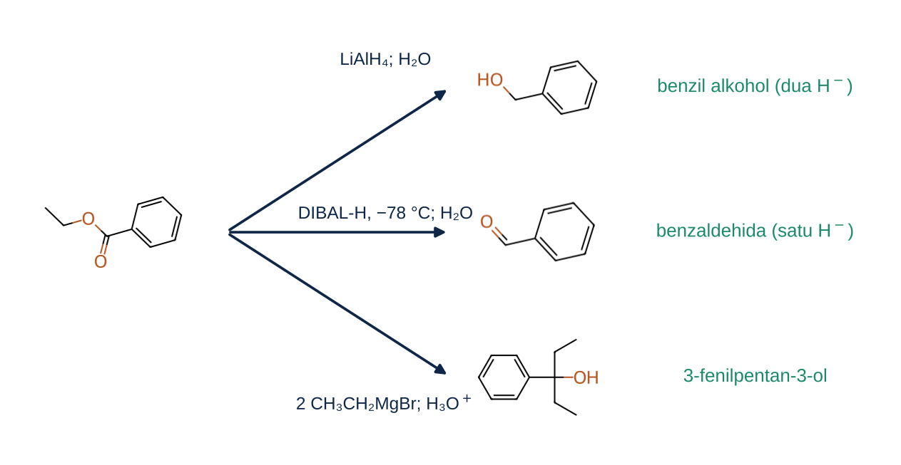
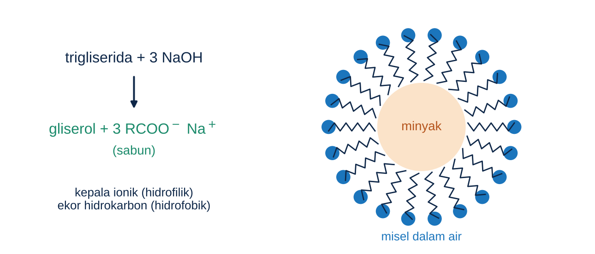
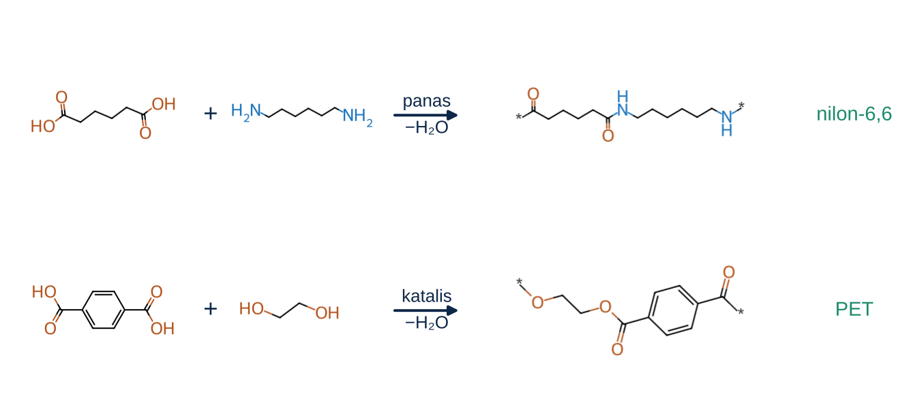
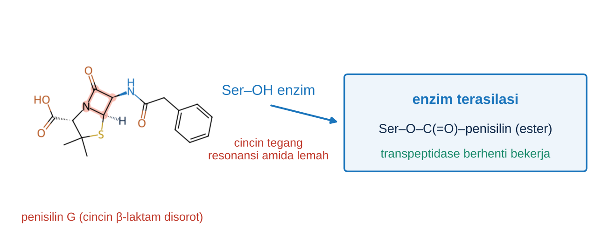

## 12.10 Reduksi dan reaksi dengan organologam

### Reduksi

Turunan asam berada pada tingkat oksidasi yang lebih tinggi daripada aldehida, sehingga reduksi dapat berhenti di dua tempat: aldehida atau alkohol (atau amina untuk amida dan nitril).

| Bahan | LiAlH₄ (lalu H₂O) | Hidrida lunak/terkendali |
|---|---|---|
| asam karboksilat | alkohol primer | BH₃·THF → alkohol primer |
| klorida asam | alkohol primer | LiAlH(O-*t*Bu)₃, −78 °C → aldehida |
| ester | alkohol primer (+ R'OH) | DIBAL-H, −78 °C → aldehida |
| amida | **amina** | — |
| nitril | amina primer | DIBAL-H → aldehida |

NaBH₄ biasanya **tidak** mereduksi ester, asam, dan amida (subbab 9.2), tetapi mereduksi klorida asam.

Mengapa reduksi ester dengan LiAlH₄ tidak berhenti pada aldehida? Hidrida pertama menyerang ester dan membentuk zat antara tetrahedral yang melepas alkoksida, menghasilkan aldehida. Aldehida lebih reaktif daripada ester (subbab 12.3), sehingga segera menerima hidrida kedua dan menjadi alkoksida primer. Hal yang sama terjadi dengan pereaksi Grignard. DIBAL-H pada suhu sangat rendah berhasil berhenti pada aldehida karena zat antara tetrahedral yang terikat pada aluminium stabil pada −78 °C dan baru terurai menjadi aldehida setelah air ditambahkan, ketika pereaksi sudah habis.

**Reduksi amida** dengan LiAlH₄ berbeda: hasilnya **amina**, bukan alkohol. Pada zat antara tetrahedral amida, gugus R₂N⁻ terlalu buruk untuk lepas; yang lepas adalah oksigen (sebagai O–Al, gugus pergi yang baik), membentuk ion **iminium** yang kemudian menerima hidrida kedua. Karbon karbonil menjadi gugus CH₂. Reaksi ini adalah cara umum membuat amina (Bab 13), dan juga mengubah laktam menjadi amina siklik.

### Pereaksi Grignard

- **Ester + 2 RMgX** → **alkohol tersier** dengan dua gugus R yang sama (subbab 9.2). Pereaksi pertama mengubah ester menjadi keton, yang lebih reaktif dan segera menerima pereaksi kedua.
- **Klorida asam + 2 RMgX** → alkohol tersier juga. Untuk berhenti pada keton, pakai **kuprat Gilman**.
- **Nitril + RMgX**, lalu H₃O⁺ → **keton** (subbab 12.9).
- **Asam karboksilat + RMgX** → hanya reaksi asam–basa: Grignard dihancurkan, membentuk garam karboksilat dan alkana.

{width=92%}

::: {.contoh}
**Contoh 12.11 · Memilih pereaksi untuk ester dan amida**

Tulis produk: (a) etil benzoat + LiAlH₄, lalu H₂O; (b) etil benzoat + DIBAL-H, −78 °C, lalu H₂O; (c) *N*,*N*-dimetilbenzamida + LiAlH₄, lalu H₂O; (d) etil benzoat + 2 CH₃CH₂MgBr, lalu H₃O⁺.

**Penyelesaian.** (a) **Benzil alkohol** + etanol. (b) **Benzaldehida** + etanol. (c) ***N*,*N*-dimetilbenzilamina**, C₆H₅CH₂N(CH₃)₂. (d) **3-Fenilpentan-3-ol**, C₆H₅C(OH)(CH₂CH₃)₂, + etanol.

**Memahami hasil.** Pada (a), (b), dan (d), gugus –OCH₂CH₃ lepas. Pada (c), oksigen yang lepas, bukan nitrogen, sehingga hasilnya amina. Perbedaan ini mengikuti kemampuan gugus pergi: alkoksida lebih baik daripada amida, tetapi O–Al lebih baik daripada keduanya.
:::

::: {.kuis}
**Kuis cepat 12.10** Tulis produk: (a) laktam siklik beranggota lima (pirolidin-2-on) + LiAlH₄; (b) metil asetat + 2 C₆H₅MgBr; (c) asam pentanoat + LiAlH₄.
:::

## 12.11 Lemak, sabun, poliester, dan poliamida

### Lemak dan minyak

**Lemak** dan **minyak** adalah **trigliserida** (triasilgliserol): triester dari gliserol (propana-1,2,3-triol) dengan tiga asam lemak, asam karboksilat berantai panjang (biasanya 12–20 karbon, jumlahnya genap). Asam lemak jenuh (asam palmitat, C16; asam stearat, C18) mempunyai rantai lurus yang dapat tersusun rapat, sehingga lemak yang kaya asam jenuh (lemak hewan, minyak kelapa) padat atau setengah padat pada suhu kamar. Asam lemak tak jenuh (asam oleat dengan satu C=C *cis*; asam linoleat dengan dua) mempunyai rantai yang bengkok, sehingga minyak yang kaya asam tak jenuh (minyak jagung, minyak kedelai) cair. Minyak sawit, minyak goreng utama di Indonesia, berada di tengah: sekitar setengah asam lemaknya jenuh (terutama palmitat).

### Sabun

**Sabun** dibuat dengan saponifikasi lemak atau minyak dengan NaOH (sabun keras) atau KOH (sabun lunak): ketiga ikatan ester putus, menghasilkan gliserol dan tiga molekul **garam asam lemak**, misalnya natrium stearat, CH₃(CH₂)₁₆COO⁻Na⁺. Satu molekul sabun mempunyai dua bagian dengan sifat berlawanan: "kepala" karboksilat yang ionik dan **hidrofilik** (suka air), dan "ekor" hidrokarbon panjang yang **hidrofobik** (takut air).

Dalam air, molekul sabun berkumpul membentuk **misel**: bola kecil dengan ekor-ekor hidrokarbon di bagian dalam (menjauhi air) dan kepala-kepala karboksilat di permukaan (bersentuhan dengan air). Kotoran berminyak larut di dalam bagian tengah misel yang hidrofobik dan terbawa air. Kelemahan sabun: dalam **air sadah**, ion Ca²⁺ dan Mg²⁺ membentuk garam karboksilat yang tidak larut (buih kerak). Deterjen sintetis dengan kepala sulfonat (subbab 10.6) tidak mengendap dengan ion-ion ini.

{width=92%}

::: {.contoh}
**Contoh 12.12 · Bilangan penyabunan**

**Bilangan penyabunan** adalah jumlah miligram KOH yang diperlukan untuk menyabunkan 1 g lemak. Hitung bilangan penyabunan tristearin (gliseril tristearat, 891,5 g mol⁻¹), dan berapa gram NaOH yang diperlukan untuk menyabunkan 100 g tristearin.

**Penyelesaian.** Satu mol trigliserida memerlukan tiga mol hidroksida. Bilangan penyabunan = 3 × 56,11 × 1000 / 891,5 = **189 mg KOH per gram**. NaOH untuk 100 g: 3 × 40,00 × 100 / 891,5 = **13,5 g**.

**Memahami hasil.** Bilangan penyabunan berbanding terbalik dengan massa molar rata-rata trigliserida: lemak dengan asam lemak pendek (minyak kelapa, kaya asam laurat C12) mempunyai bilangan penyabunan lebih besar (sekitar 250). Pembuat sabun memakai angka ini untuk menghitung banyaknya basa, agar sabun tidak menyisakan basa berlebih yang mengiritasi kulit.
:::

### Poliester dan poliamida

Bila asam dengan **dua** gugus –COOH bereaksi dengan alkohol atau amina dengan **dua** gugus fungsi, setiap reaksi esterifikasi atau amidasi menyisakan gugus fungsi bebas di kedua ujung, dan rantai terus memanjang. Hasilnya **polimer kondensasi** (polimer pertumbuhan bertahap), karena setiap langkah melepaskan molekul kecil seperti air atau metanol. Ini berbeda dari polimerisasi adisi pada alkena (subbab 8.11), di mana seluruh atom monomer masuk ke rantai.

- **Poli(etilena tereftalat), PET**: poliester dari asam tereftalat (atau dimetil tereftalat) dan etilena glikol. Dipakai untuk botol minuman, serat pakaian (polyester), dan film.
- **Nilon-6,6**: poliamida dari asam heksanadioat (asam adipat, 6 karbon) dan heksana-1,6-diamina (6 karbon). Wallace Carothers di DuPont membuatnya pada tahun 1935 sebagai "sutra buatan" pertama. **Nilon-6** dibuat dari kaprolaktam (subbab 11.6).
- **Kevlar**: poliamida aromatik dari asam tereftalat dan benzena-1,4-diamina. Rantai yang kaku dan ikatan hidrogen antarrantai membuatnya lebih kuat daripada baja per satuan massa; dipakai untuk rompi antipeluru.
- **Poli(asam laktat), PLA**: poliester dari asam laktat (dari fermentasi gula), plastik yang dapat terurai secara hayati karena ikatan esternya dapat dihidrolisis.

{width=96%}

::: {.contoh}
**Contoh 12.13 · Membaca polimer**

Sebuah polimer mempunyai satuan berulang –[O–CH₂CH₂CH₂CH₂–O–CO–(CH₂)₄–CO]–. Golongan polimer apa ini, dari monomer apa, dan produk apa yang terbentuk bila polimer ini disaponifikasi sempurna dengan NaOH?

**Penyelesaian.** Satuan berulang mengandung dua ikatan **ester**: poliester. Pisahkan di ikatan ester: monomernya **butana-1,4-diol** (HO–(CH₂)₄–OH) dan **asam heksanadioat** (asam adipat, HOOC–(CH₂)₄–COOH). Saponifikasi memutus semua ikatan ester: produknya **butana-1,4-diol** dan **natrium adipat**.

**Memahami hasil.** Untuk mengenali polimer kondensasi, cari ikatan yang dapat dihidrolisis (ester atau amida) dan potong di sana, menambahkan –OH pada gugus asil dan –H pada O atau N. Kemampuan dihidrolisis ini juga membuat poliester dapat didaur ulang secara kimia menjadi monomernya.
:::

::: {.kuis}
**Kuis cepat 12.11** (a) Mengapa sabun tidak berbuih baik dalam air sadah? (b) Gambar satu satuan berulang nilon-6,6. (c) Mengapa PLA dapat terurai di alam, sedangkan polietilena hampir tidak?
:::

## 12.12 β-Laktam dan obat turunan asam

### Penisilin: amida yang tegang

Pada tahun 1928 Alexander Fleming memperhatikan bahwa jamur *Penicillium* yang mencemari cawan biakannya membunuh bakteri di sekitarnya. Zat aktifnya, **penisilin**, mulai diproduksi massal selama Perang Dunia II dan mengubah dunia kedokteran. Inti struktur penisilin adalah **cincin β-laktam**: amida siklik beranggota empat, yang terfusi dengan cincin tiazolidina beranggota lima.

Amida biasa sangat stabil karena resonansi (subbab 12.8). Tetapi pada β-laktam penisilin, nitrogen terikat pada dua cincin yang terfusi, sehingga tidak dapat menjadi datar; pasangan bebasnya tidak dapat bertumpang tindih dengan baik dengan gugus karbonil, dan resonansi amida sangat berkurang. Selain itu cincin beranggota empat sangat tegang (sudut sekitar 90°). Kedua faktor ini membuat karbonil β-laktam **jauh lebih reaktif** daripada amida biasa, mendekati kereaktifan ester atau anhidrida.

### Cara kerja

Bakteri membangun dinding selnya dengan menghubungkan rantai-rantai peptidoglikan menggunakan enzim **transpeptidase**. Situs aktif enzim ini mempunyai gugus –OH serina yang menyerang ikatan amida pada rantai peptida. Penisilin menyerupai bagian peptida yang menjadi sasaran enzim itu. Ketika serina enzim menyerang karbonil β-laktam, cincin tegang itu terbuka (substitusi asil nukleofilik), dan enzim menjadi **terasilasi**: terikat secara kovalen pada penisilin lewat ikatan ester yang sangat lambat dihidrolisis. Enzim berhenti bekerja, dinding sel tidak terbentuk dengan sempurna, dan bakteri pecah. Sel manusia tidak mempunyai dinding sel peptidoglikan, sehingga penisilin relatif aman bagi kita.

{width=92%}

Bakteri melawan dengan enzim **β-laktamase**, yang menghidrolisis cincin β-laktam sebelum antibiotik sempat bekerja. Inilah salah satu penyebab utama resistansi antibiotik. Salah satu penangkalnya adalah **asam klavulanat**, β-laktam yang mengasilasi β-laktamase secara permanen; kombinasi amoksisilin dan asam klavulanat (ko-amoksiklav) melindungi antibiotiknya dari enzim itu. Penggunaan antibiotik yang tidak tuntas atau tidak perlu mempercepat munculnya bakteri yang resistan, salah satu ancaman kesehatan terbesar abad ini.

### Obat lain yang merupakan turunan asam

- **Aspirin** (ester fenol) bekerja dengan **mengasetilasi** gugus –OH serina pada enzim siklooksigenase (COX), yang membuat prostaglandin penyebab radang dan nyeri. Asetilasi ini permanen, sehingga efek antipenggumpalan darah aspirin bertahan sampai trombosit baru dibuat.
- **Parasetamol** (amida) adalah analgesik dan antipiretik.
- **Anestetik lokal** golongan ester (prokaina, benzokaina) cepat dihidrolisis oleh esterase dalam darah, sehingga kerjanya singkat; golongan amida (lidokaina) jauh lebih tahan, sehingga kerjanya lebih lama. Perbedaan ini adalah tangga kereaktifan yang diterjemahkan menjadi durasi obat.
- **Ibuprofen** dan **naproksen** adalah asam karboksilat; gugus –COOH-nya penting untuk terikat pada situs aktif COX.

::: {.contoh}
**Contoh 12.14 · Ester atau amida untuk obat yang bekerja lama**

Dokter gigi memerlukan anestetik lokal yang bekerja sekitar satu sampai dua jam. Antara prokaina (ester) dan lidokaina (amida), mana yang lebih cocok? Jelaskan dengan tangga kereaktifan.

**Penyelesaian.** Darah mengandung enzim esterase yang menghidrolisis ikatan ester dengan cepat; prokaina terurai dalam hitungan menit. Ikatan amida lidokaina jauh lebih stabil (lebih rendah di tangga), tidak dihidrolisis oleh esterase plasma, dan baru dimetabolisme perlahan di hati. Karena itu **lidokaina** bekerja lebih lama dan lebih cocok.

**Memahami hasil.** Kimiawan obat memilih gugus fungsi untuk mengatur berapa lama obat bertahan di tubuh. Kadang yang diinginkan justru kerja singkat: obat jenis "ester lunak" sengaja dirancang agar cepat dihidrolisis menjadi zat yang tidak aktif.
:::

::: {.kuis}
**Kuis cepat 12.12** (a) Mengapa β-laktam penisilin lebih reaktif daripada amida biasa? (b) Mengapa efek aspirin pada trombosit bertahan beberapa hari, walaupun aspirin sendiri cepat dihidrolisis dalam darah?
:::

## Menuju bab berikutnya

Teka-teki pembuka bab kini terjawab. Aspirin adalah ester fenol, cukup tinggi di tangga kereaktifan: gugus perginya ion fenoksida yang cukup stabil, dan oksigen fenol kurang menstabilkan karbonil daripada nitrogen. Uap air saja sudah cukup untuk menghidrolisisnya perlahan menjadi asam salisilat dan asam asetat. Ikatan peptida dalam rambut adalah amida, di dasar tangga: resonansi yang kuat menstabilkan gugus karbonil dan membuat ikatan C–N sebagian rangkap, dan gugus perginya, ion amida, adalah basa yang sangat kuat. Hidrolisis tanpa enzim memerlukan ratusan tahun.

Amida adalah turunan asam yang mengandung nitrogen. Bab 13 membahas senyawa nitrogen itu sendiri, **amina**: kebasaannya, cara membuatnya (termasuk reduksi amida dan nitril yang baru kita pelajari), reaksi-reaksinya, garam diazonium yang membuka jalan ke pewarna azo, dan heterosiklik nitrogen yang terdapat dalam hampir semua obat.
