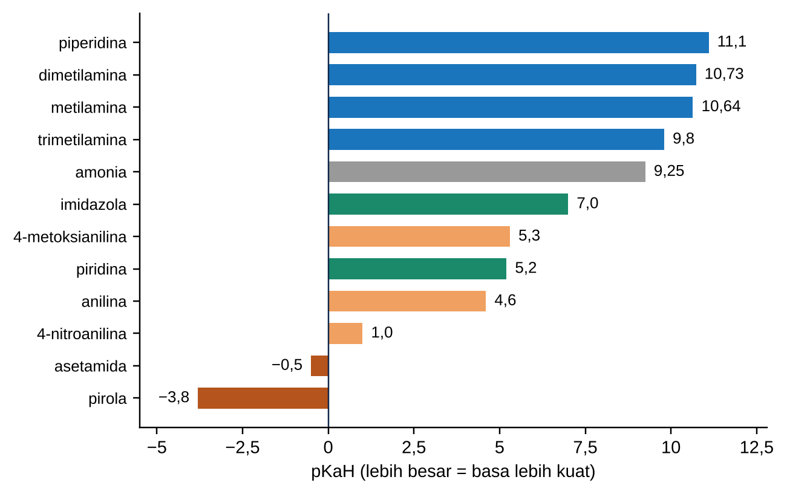
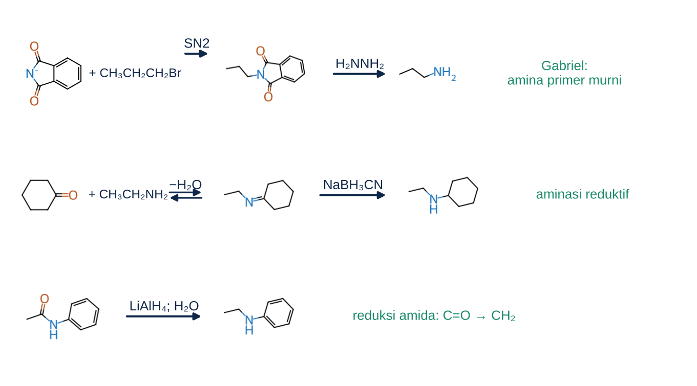

# Bab 13 Amina

Ikan yang tidak lagi segar berbau amis yang menusuk. Penjual ikan dan juru masak di seluruh Nusantara tahu caranya menghilangkan bau itu: peras jeruk nipis atau siram dengan sedikit cuka, dan bau amisnya hampir lenyap. Bau amis ikan berasal terutama dari **trimetilamina**, (CH₃)₃N, senyawa yang dibentuk bakteri dari trimetilamina oksida dalam daging ikan laut. Trimetilamina mendidih pada 3 °C, sehingga menguap dengan mudah dan sampai ke hidung kita, yang sangat peka terhadapnya. Mengapa sedikit asam dapat menghapus bau ini? Asam tidak menghancurkan trimetilamina: bila larutan dibuat basa kembali, baunya muncul lagi.

Jawabannya terletak pada sifat terpenting amina: **kebasaan**. Atom nitrogen amina mempunyai satu pasangan elektron bebas yang siap menerima proton. Asam dalam jeruk nipis memprotonasi trimetilamina menjadi ion **trimetilamonium**, (CH₃)₃NH⁺, sebuah ion yang tidak dapat menguap. Molekul yang tidak menguap tidak dapat dicium. Pasangan bebas yang sama membuat amina menjadi **nukleofil** yang baik, sehingga amina bereaksi dengan alkil halida, klorida asam, aldehida, dan keton.

Amina adalah turunan amonia, NH₃, dengan satu atau lebih atom H diganti gugus karbon. Senyawa nitrogen terdapat di mana-mana dalam kehidupan: asam amino dan protein, basa DNA, neurotransmiter (dopamina, serotonin, adrenalin), vitamin, dan hampir semua alkaloid tumbuhan (nikotin, kafeina, morfin, kinina). Sebagian besar obat juga mengandung nitrogen yang bersifat basa. Bab ini membahas sifat amina, cara membuatnya dengan selektif, reaksi-reaksinya (termasuk garam diazonium yang membuka jalan ke ratusan senyawa aromatik dan pewarna), dan kimia heterosiklik nitrogen yang telah kita kenal sifat aromatiknya di Bab 10.

::: {.kuis}
**Pertanyaan pembuka**

1. Mengapa trimetilamina, dengan tiga gugus metil, sedikit kurang basa dalam air daripada dimetilamina?
2. Mengapa anilina sejuta kali kurang basa daripada sikloheksilamina?
3. Mengapa alkilasi amonia dengan alkil halida menghasilkan campuran, dan bagaimana membuat amina primer murni?
4. Mengapa eliminasi Hofmann menghasilkan alkena yang kurang tersubstitusi, berlawanan dengan aturan Zaitsev?
5. Bagaimana gugus –NH₂ pada cincin benzena dapat diganti dengan –F, –Cl, –Br, –I, –CN, –OH, atau bahkan –H?
6. Mengapa pewarna azo berwarna terang, dan mengapa metil jingga berubah warna dengan pH?
7. Mengapa banyak obat dijual sebagai garam hidroklorida?
:::

::: {.tujuan}
**Tujuan belajar**

Setelah mempelajari bab ini, kamu mampu:

1. Menamai amina, menggolongkannya sebagai primer, sekunder, tersier, atau kuaterner, dan menjelaskan sifat fisikanya.
2. Membandingkan kebasaan amina alkil, aril amina, amida, dan heterosiklik nitrogen, dan memakai kebasaan untuk ekstraksi.
3. Membuat amina dengan alkilasi, sintesis Gabriel, aminasi reduktif, dan reduksi amida, nitril, dan senyawa nitro.
4. Menuliskan asilasi dan sulfonilasi amina serta eliminasi Hofmann dengan regiokimianya.
5. Membuat garam diazonium dan mengubahnya menjadi berbagai senyawa aromatik lewat reaksi Sandmeyer dan reaksi terkait.
6. Menjelaskan reaksi kopling azo dan sumber warna pewarna azo.
7. Membandingkan kereaktifan piridina, pirola, imidazola, dan indola dalam substitusi.
8. Menjelaskan peran amina dalam biologi dan obat, termasuk garam obat dan alkaloid.
:::

::: {.mat}
**Prasyarat**

Bab 2: tata nama amina (subbab 2.6). Bab 3: kebasaan amina dan heterosiklik nitrogen, pKaH (subbab 3.10, 3.13). Bab 7: SN2, E2 (subbab 7.5–7.9). Bab 10: aromatisitas heterosiklik, nitrasi dan reduksi nitro, SEAr dan pengarah (subbab 10.3, 10.6–10.9). Bab 11: imina (subbab 11.6). Bab 12: amida, nitril, reduksi dengan LiAlH₄ (subbab 12.8–12.10).
:::

## 13.1 Struktur, tata nama, dan sifat amina

### Penggolongan dan struktur

Amina digolongkan menurut **jumlah gugus karbon yang terikat pada nitrogen**, bukan menurut jenis karbonnya (berbeda dengan alkohol dan alkil halida):

- **amina primer**: RNH₂ (satu gugus karbon), misalnya metilamina, anilina;
- **amina sekunder**: R₂NH (dua gugus karbon), misalnya dimetilamina, piperidina;
- **amina tersier**: R₃N (tiga gugus karbon), misalnya trimetilamina, piridina;
- **ion amonium kuaterner**: R₄N⁺ (empat gugus karbon, bermuatan positif tetap), misalnya ion tetrametilamonium, kolina.

Perhatikan bahwa *tert*-butilamina, (CH₃)₃CNH₂, adalah amina **primer** (nitrogen terikat pada satu karbon), walaupun karbonnya tersier.

Nitrogen amina terhibridisasi kira-kira sp³, dengan tiga ikatan dan satu pasangan bebas yang membentuk tetrahedron; sudut C–N–C pada trimetilamina sekitar 108°. Molekul amina berbentuk **piramida** dengan nitrogen di puncaknya.

Amina dengan tiga gugus berbeda pada nitrogen, misalnya etilmetilpropilamina, secara bentuk mempunyai pusat kiral (pasangan bebas berperan sebagai gugus keempat). Tetapi enansiomernya **tidak dapat dipisahkan**, karena nitrogen membalik bentuk piramidanya dengan sangat cepat, seperti payung yang tertiup angin: pasangan bebas melewati bidang datar dan muncul di sisi lain. Energi yang diperlukan untuk **inversi nitrogen** ini hanya sekitar 25 kJ mol⁻¹, sehingga terjadi miliaran kali setiap detik pada suhu kamar. Ion amonium kuaterner dengan empat gugus berbeda, yang tidak mempunyai pasangan bebas, tidak dapat membalik dan dapat dipisahkan enansiomernya.

{width=86%}

### Tata nama

Tata nama amina dibahas di subbab 2.6. Ringkasnya, amina sederhana dinamai dengan menambahkan akhiran *-amina* pada nama gugus alkil (etilamina, dietilamina, trietilamina) atau pada nama alkana induk (butan-2-amina, sikloheksanamina). Gugus pada nitrogen ditandai dengan awalan *N*-: *N*,*N*-dimetilpropan-1-amina. Bila ada gugus fungsi yang lebih tinggi prioritasnya, –NH₂ ditulis sebagai awalan *amino-* (asam 4-aminobenzoat). Banyak nama umum masih dipakai: anilina (C₆H₅NH₂), toluidina (metilanilina), dan nama-nama heterosiklik (piridina, piperidina, pirola).

### Sifat fisika

Amina primer dan sekunder mempunyai ikatan N–H yang dapat membentuk ikatan hidrogen, tetapi lebih lemah daripada ikatan O–H alkohol, karena nitrogen kurang elektronegatif daripada oksigen. Amina tersier tidak mempunyai H pada nitrogen.

| Senyawa | Golongan | Massa molar | Titik didih (°C) |
|---|---|---|---|
| butana | alkana | 58 | −1 |
| trimetilamina | amina 3° | 59 | 3 |
| etilmetilamina | amina 2° | 59 | 37 |
| propilamina | amina 1° | 59 | 48 |
| propan-1-ol | alkohol | 60 | 97 |

Semua amina dapat **menerima** ikatan hidrogen dari air, sehingga amina kecil larut baik dalam air. Amina kecil berbau tajam: amonia, bau "ikan" trimetilamina, dan bau busuk diamina **putresina** (butana-1,4-diamina) dan **kadaverina** (pentana-1,5-diamina) yang terbentuk saat protein membusuk.

::: {.contoh}
**Contoh 13.1 · Kiral atau tidak**

Manakah yang dapat dipisahkan menjadi enansiomer yang stabil: (a) *N*-etil-*N*-metilpropan-1-amina; (b) iodida *N*-etil-*N*-metil-*N*-propilbenzilamonium; (c) butan-2-amina?

**Penyelesaian.** (a) Tiga gugus berbeda pada N, tetapi inversi nitrogen sangat cepat: **tidak dapat dipisahkan**. (b) Ion amonium kuaterner dengan empat gugus berbeda dan tanpa pasangan bebas: tidak dapat membalik, **dapat dipisahkan**. (c) Pusat kiralnya adalah **karbon** C2 (H, CH₃, C₂H₅, NH₂), bukan nitrogen; karbon tidak mengalami inversi: **dapat dipisahkan**.

**Memahami hasil.** Pusat kiral pada karbon stabil, pada nitrogen amina tidak. Inversi nitrogen dapat dihentikan dengan mengikat pasangan bebas (kuaterner) atau dengan menjebak nitrogen dalam sistem cincin yang kaku.
:::

::: {.kuis}
**Kuis cepat 13.1** (a) Golongkan: *tert*-butilamina, *N*-metilanilina, trietilamina, piperidina, tetrabutilamonium bromida. (b) Mengapa propilamina mendidih lebih tinggi daripada trimetilamina, padahal massa molarnya sama?
:::

## 13.2 Kebasaan amina, anilina, dan heterosiklik

### Mengulang dan memperluas

Faktor-faktor yang menentukan kebasaan sudah dibahas di subbab 3.10. Kebasaan diukur dengan **pKaH**, pKa asam konjugat (ion amonium): makin besar pKaH, makin kuat basanya. Amina alkil adalah basa organik netral yang paling umum dan cukup kuat (pKaH sekitar 10–11), karena pasangan bebasnya terlokalisasi di orbital sp³. Di subbab ini kita memperluas pembahasan dengan tiga pengamatan yang menarik dan satu penerapan yang sangat penting.

### Mengapa amina tersier tidak paling basa

Gugus alkil mendorong elektron dan menstabilkan muatan positif ion amonium, sehingga kita mengharapkan kebasaan naik dari amonia ke amina primer, sekunder, dan tersier. Dalam fase gas, urutan itu memang teramati. Tetapi dalam air:

| Amina | pKaH (air) |
|---|---|
| NH₃ | 9,25 |
| CH₃NH₂ | 10,64 |
| (CH₃)₂NH | 10,73 |
| (CH₃)₃N | 9,80 |

Trimetilamina lebih lemah daripada dimetilamina. Penyebabnya **solvasi**, seperti pada keasaman alkohol (subbab 9.1): ion amonium distabilkan dalam air oleh ikatan hidrogen antara N–H⁺ dan molekul air. Ion trimetilamonium, (CH₃)₃NH⁺, hanya mempunyai satu N–H untuk berikatan hidrogen, sedangkan ion dimetilamonium mempunyai dua. Dua pengaruh yang berlawanan, dorongan elektron gugus alkil dan berkurangnya solvasi, saling mengimbangi, sehingga amina primer, sekunder, dan tersier dalam air hanya berbeda sedikit.

### Aril amina: pasangan bebas yang terbagi

Anilina (pKaH 4,6) sekitar sejuta kali kurang basa daripada sikloheksilamina (10,6), karena pasangan bebas nitrogennya terdelokalisasi ke cincin benzena (Contoh 3.14). Substituen pada cincin mengubah kebasaan anilina dengan pola yang sama seperti pada keasaman fenol (subbab 9.1), tetapi dengan arah terbalik: gugus penarik elektron di posisi *orto* atau *para* menarik pasangan bebas lebih jauh ke cincin dan **menurunkan** kebasaan; gugus pendorong elektron **menaikkan**-nya.

| Anilina | pKaH |
|---|---|
| 4-metoksianilina | 5,3 |
| 4-metilanilina | 5,1 |
| anilina | 4,6 |
| 4-kloroanilina | 4,0 |
| 3-nitroanilina | 2,5 |
| 4-nitroanilina | 1,0 |

Pada 4-nitroanilina, pasangan bebas nitrogen dapat ditarik lewat resonansi sampai ke oksigen gugus nitro, sehingga hampir tidak tersedia lagi; kebasaannya turun lebih dari seribu kali dibanding anilina.

{width=86%}

### Amida bukan basa

Amida hampir tidak basa (pKaH sekitar −0,5), karena pasangan bebas nitrogennya terdelokalisasi ke gugus karbonil (subbab 12.8), dan amida yang diprotonasi asam kuat menerima proton pada **oksigen**. Hal ini penting dalam sintesis: mengasetilasi amina menjadi amida "mematikan" kebasaan dan nukleofilisitasnya untuk sementara (subbab 13.4).

### Penerapan: ekstraksi dan garam obat

Kebasaan amina memungkinkan pemisahan yang sangat sederhana. Bila campuran amina dan senyawa netral dalam eter dikocok dengan HCl encer, amina berubah menjadi **garam amonium** yang larut dalam air dan pindah ke lapisan air; senyawa netral tetap di eter. Lapisan air kemudian dibasakan dengan NaOH, dan amina bebas dapat diekstraksi kembali. Cara ini, bersama ekstraksi asam karboksilat dengan NaHCO₃ dan fenol dengan NaOH (Contoh 9.1), memungkinkan pemisahan campuran organik menjadi golongan asam, basa, dan netral.

Prinsip yang sama dipakai dalam farmasi. Banyak obat adalah amina yang, dalam bentuk basa bebasnya, berupa minyak atau padatan yang sukar larut dalam air dan mudah teroksidasi. Mengubahnya menjadi **garam hidroklorida** (atau garam sulfat, maleat, dan lain-lain) menghasilkan padatan kristal yang stabil, mudah dimurnikan, dan larut dalam air. Itulah sebabnya label obat sering bertuliskan "...hidroklorida" (misalnya ranitidina hidroklorida, metformin hidroklorida).

::: {.contoh}
**Contoh 13.2 · Jeruk nipis dan bau ikan**

Trimetilamina mempunyai pKaH 9,80. Hitung persen trimetilamina yang berada dalam bentuk ion trimetilamonium pada pH 7,4 (darah, daging ikan segar sekitar pH 6,5–7) dan pada pH 2,5 (perasan jeruk nipis).

**Rencana.** Fraksi terprotonasi dari basa B = 1/(1 + 10^(pH − pKaH)).

**Penyelesaian.** pH 7,4: 1/(1 + 10^(7,4 − 9,80)) = **99,6%**. pH 2,5: 1/(1 + 10^(2,5 − 9,80)) = **99,99999%**, praktis seluruhnya.

**Memahami hasil.** Pada pH netral pun sebagian besar trimetilamina sudah terprotonasi, tetapi 0,4% sisanya, yang netral dan mudah menguap, sudah cukup untuk dicium, karena hidung manusia sangat peka terhadapnya. Perasan jeruk nipis menurunkan fraksi bebas sekitar seratus ribu kali, sehingga baunya hilang. Bila ikan dimasak dalam suasana basa, bau itu kembali.
:::

::: {.kuis}
**Kuis cepat 13.2** (a) Urutkan kebasaan: anilina, sikloheksilamina, piridina, asetamida, 4-nitroanilina. (b) Tulis cara memisahkan campuran anilina dan naftalena dengan ekstraksi.
:::

## 13.3 Membuat amina

### Alkilasi langsung dan masalahnya

Amonia dan amina adalah nukleofil yang baik dan bereaksi dengan alkil halida primer lewat SN2. Masalahnya, produknya juga amina, dan biasanya **lebih nukleofilik** daripada bahan awalnya (gugus alkil mendorong elektron). Amina primer yang terbentuk bereaksi dengan alkil halida lebih cepat daripada amonia, menghasilkan amina sekunder, lalu tersier, lalu garam amonium kuaterner. Hasilnya **campuran** yang sulit dipisahkan. Alkilasi langsung hanya berguna dalam dua kasus: membuat **garam amonium kuaterner** (alkil halida berlebih, semua posisi teralkilasi) dan membuat amina primer dengan amonia dalam jumlah sangat besar berlebih.

Untuk membuat amina dengan selektif, kimiawan memakai cara-cara tidak langsung yang "menghentikan" reaksi pada tahap yang diinginkan.

### Sintesis Gabriel: amina primer murni

**Ftalimida** adalah imida (nitrogen terikat pada dua gugus karbonil). H pada nitrogennya cukup asam (pKa 8,3), karena anion yang terbentuk distabilkan resonansi dengan dua gugus karbonil. Dengan KOH, ftalimida menjadi anion ftalimida, nukleofil nitrogen yang hanya mempunyai **satu** tempat untuk bereaksi. Anion ini bereaksi dengan alkil halida primer lewat SN2 menghasilkan *N*-alkilftalimida, yang tidak bersifat nukleofilik lagi (pasangan bebas nitrogen ditarik oleh dua karbonil), sehingga alkilasi berhenti tepat setelah satu kali. Amina primer kemudian dibebaskan dengan hidrazina (H₂NNH₂, cara Ing–Manske) atau dengan hidrolisis basa.

### Aminasi reduktif

**Aminasi reduktif** adalah cara paling serbaguna membuat amina primer, sekunder, dan tersier. Aldehida atau keton direaksikan dengan amonia, amina primer, atau amina sekunder; terbentuk imina atau ion iminium (subbab 11.6), yang **langsung direduksi** di tempat menjadi amina:

$$
\text{R}_2\text{C=O} + \text{R'NH}_2 \;\rightleftharpoons\; \text{R}_2\text{C=NR'} \;\xrightarrow{\text{[H]}}\; \text{R}_2\text{CH–NHR'} \qquad \text{(13.1)}
$$

Pereduksi yang dipakai harus mereduksi imina (atau ion iminium) lebih cepat daripada senyawa karbonil awal. **Natrium sianoborohidrida**, NaBH₃CN, atau **natrium triasetoksiborohidrida**, NaBH(OAc)₃, memenuhi syarat itu: keduanya lebih lemah daripada NaBH₄, sehingga hampir tidak mereduksi aldehida dan keton pada pH 5–7, tetapi mereduksi ion iminium yang jauh lebih elektrofilik. Hidrogenasi katalitik (H₂, Ni) juga dipakai di industri.

Dengan aminasi reduktif, "satu gugus karbon ditambahkan pada nitrogen", dan reaksi berhenti setelah satu kali karena setiap imina hanya terbentuk dari satu senyawa karbonil. Di dalam tubuh, enzim membuat asam amino dari asam α-keto dengan cara yang sama (lewat imina dengan piridoksal fosfat, subbab 11.6).

{width=96%}

### Reduksi senyawa nitrogen lain

- **Amida + LiAlH₄** → amina dengan jumlah karbon sama; C=O menjadi CH₂ (subbab 12.10). Amida primer, sekunder, dan tersier memberi amina primer, sekunder, dan tersier. Rute "asilasi lalu reduksi" adalah cara bersih menambahkan satu gugus alkil pada amina.
- **Nitril + LiAlH₄** → amina primer RCH₂NH₂ (subbab 12.9). Bersama SN2 dengan CN⁻, ini menambah satu karbon: R–X → R–CN → R–CH₂NH₂.
- **Azida + LiAlH₄** (atau H₂, Pd): alkil halida + NaN₃ (SN2) → alkil azida, R–N₃, yang tidak dapat bereaksi lagi dengan alkil halida; reduksi memberi amina primer R–NH₂ tanpa karbon tambahan.
- **Senyawa nitro aromatik** + H₂/Pd atau Fe/HCl atau SnCl₂ → aril amina (subbab 10.6). Inilah cara utama membuat anilina.

::: {.contoh}
**Contoh 13.3 · Memilih cara membuat amina**

Usulkan cara membuat: (a) pentan-1-amina dari 1-bromopentana (tanpa menambah karbon); (b) heksan-1-amina dari 1-bromopentana; (c) *N*-etilsikloheksanamina dari sikloheksanon; (d) *N*-etilanilina dari anilina.

**Penyelesaian.** (a) **Gabriel**: kalium ftalimida, lalu H₂NNH₂; atau NaN₃, lalu LiAlH₄. (b) Tambah satu karbon: **NaCN**, lalu **LiAlH₄**. (c) **Aminasi reduktif**: sikloheksanon + etilamina, NaBH₃CN (pH sekitar 6). (d) **Asilasi lalu reduksi**: asetil klorida (atau anhidrida asetat) → asetanilida; LiAlH₄ → *N*-etilanilina. (Alternatif: aminasi reduktif anilina dengan asetaldehida.)

**Memahami hasil.** Semua cara ini menghindari alkilasi langsung yang tidak terkendali. Setiap cara mempunyai "rem": ftalimida dan azida hanya dapat bereaksi sekali, imina hanya terbentuk dari satu karbonil, dan amida tidak nukleofilik.
:::

::: {.contoh}
**Contoh 13.4 · Retrosintesis amfetamina**

Amfetamina adalah 1-fenilpropan-2-amina, C₆H₅CH₂CH(NH₂)CH₃. Tunjukkan dua cara membuatnya: dari keton dan dari alkohol.

**Penyelesaian.** (1) Dari **1-fenilpropan-2-on**: aminasi reduktif dengan NH₃ dan NaBH₃CN (atau H₂, Ni). (2) Dari **1-fenilpropan-2-ol**: ubah –OH menjadi tosilat (TsCl, piridina), lalu NaN₃ (SN2, inversi), lalu LiAlH₄ → amina primer.

**Memahami hasil.** Kedua rute menghasilkan rasemat bila bahan awalnya rasemat. Rute (2) dari alkohol enantiomurni memberi amina dengan konfigurasi terbalik (inversi SN2), sehingga dapat dipakai untuk membuat satu enansiomer; (*S*)-amfetamina jauh lebih aktif sebagai stimulan daripada (*R*). Amfetamina dan turunannya adalah zat yang diawasi ketat; bahan awal pembuatannya pun termasuk prekursor terkendali.
:::

::: {.kuis}
**Kuis cepat 13.3** (a) Mengapa reaksi bromoetana dengan amonia (1 : 1) memberi campuran? (b) Tulis produk aminasi reduktif benzaldehida dengan dimetilamina dan NaBH(OAc)₃. (c) Rancang sintesis 2-feniletanamina dari benzil bromida.
:::
