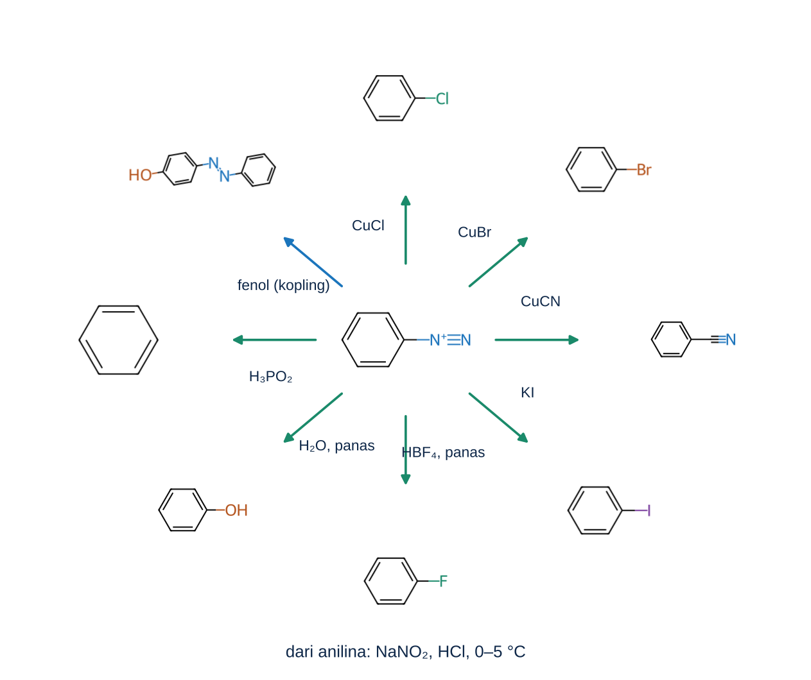

## 13.4 Reaksi amina: asilasi, sulfonamida, dan eliminasi Hofmann

### Asilasi: amina menjadi amida

Amina primer dan sekunder bereaksi dengan klorida asam dan anhidrida membentuk **amida** (subbab 12.5, 12.6). Reaksi berhenti setelah satu asilasi, karena nitrogen amida tidak lagi nukleofilik. Amina tersier tidak dapat membentuk amida yang stabil (tidak mempunyai H untuk dilepas), tetapi sering dipakai sebagai basa penangkap HCl (trietilamina, piridina).

Asilasi juga dipakai sebagai **gugus pelindung** nitrogen. Anilina sangat reaktif dalam SEAr dan sulit dikendalikan (subbab 10.8), mudah teroksidasi, dan bereaksi dengan AlCl₃. Asetanilida, amidanya, adalah pengaktif sedang yang lebih jinak, pengarah *orto*/*para* dengan dominasi *para* karena ukurannya, dan tidak mengganggu Friedel–Crafts. Setelah reaksi pada cincin selesai, gugus asetil dilepas dengan hidrolisis asam atau basa.

### Sulfonamida

Amina primer dan sekunder bereaksi dengan **sulfonil klorida**, RSO₂Cl, dengan cara yang serupa, membentuk **sulfonamida**, RSO₂NR'₂. Sulfonamida dari amina primer, RSO₂NHR', mempunyai H pada nitrogen yang cukup asam (pKa sekitar 10), karena anionnya distabilkan oleh gugus sulfonil.

Sulfonamida membuka era antibiotik sintetis. Pada tahun 1935 Gerhard Domagk menemukan bahwa pewarna prontosil menyembuhkan infeksi streptokokus pada tikus; kemudian diketahui bahwa di dalam tubuh prontosil diuraikan menjadi **sulfanilamida**, 4-aminobenzenasulfonamida, zat aktif yang sebenarnya. Sulfanilamida menyerupai **asam 4-aminobenzoat (PABA)**, yang diperlukan bakteri untuk membuat asam folat. Enzim bakteri "tertipu" dan memakai sulfanilamida, sehingga pembuatan asam folat terhenti dan bakteri berhenti tumbuh. Manusia memperoleh asam folat dari makanan, sehingga tidak terpengaruh. Domagk mendapat Hadiah Nobel Kedokteran 1939.

### Eliminasi Hofmann

Gugus –NH₂ adalah gugus pergi yang sangat buruk (NH₂⁻ basa sangat kuat). Untuk memakai amina dalam eliminasi, nitrogen diubah dulu menjadi gugus pergi yang baik: **ion amonium kuaterner**, yang lepas sebagai amina tersier netral.

1. **Metilasi tuntas**: amina direaksikan dengan iodometana berlebih, sehingga semua H pada nitrogen diganti metil dan terbentuk iodida amonium kuaterner, R–N(CH₃)₃⁺ I⁻.
2. **Pertukaran ion**: perak oksida dalam air, Ag₂O, mengganti I⁻ dengan OH⁻ (AgI mengendap).
3. **Eliminasi**: pemanasan menyebabkan E2; OH⁻ mengambil H β, dan trimetilamina lepas, membentuk alkena.

Ciri khas eliminasi Hofmann adalah regiokimianya: **alkena yang kurang tersubstitusi** menjadi produk utama (**aturan Hofmann**), berlawanan dengan aturan Zaitsev pada E2 alkil halida dengan basa kecil (subbab 7.9). Butan-2-amina, misalnya, memberi terutama but-1-ena, bukan but-2-ena. Dua alasan:

- **Sterik.** Gugus –N(CH₃)₃⁺ sangat besar. Agar H β dan gugus pergi anti-periplanar, molekul harus mengambil konformasi di mana gugus besar itu tidak berdesakan. Konformasi yang menuju alkena dalam (lebih tersubstitusi) mengharuskan gugus alkil berada gauche terhadap –N(CH₃)₃⁺, sehingga tidak disukai. H pada gugus metil ujung lebih mudah dijangkau.
- **Elektronik.** Trimetilamina adalah gugus pergi yang lebih buruk daripada halida, sehingga keadaan transisi E2 lebih "mirip karbanion": ikatan C–H putus lebih dulu daripada ikatan C–N. Karbanion yang lebih stabil adalah yang primer, sehingga H diambil dari karbon yang kurang tersubstitusi.

Dulu, eliminasi Hofmann dipakai untuk menentukan struktur alkaloid: dengan mengulanginya dan mengidentifikasi alkena serta amina yang terbentuk, kimiawan dapat "membongkar" kerangka nitrogen molekul yang belum dikenal.

{width=94%}

::: {.contoh}
**Contoh 13.5 · Meramalkan produk eliminasi Hofmann**

Tulis produk utama eliminasi Hofmann (CH₃I berlebih; Ag₂O, H₂O; panas) dari (a) pentan-2-amina; (b) *N*-metilpiperidina (dua kali berturut-turut).

**Penyelesaian.** (a) Pentan-2-amina: H β tersedia di C1 (metil) dan C3 (CH₂). Hofmann: H dari C1 diambil, produk utama **pent-1-ena**, dengan sedikit pent-2-ena. (b) *N*-Metilpiperidina: metilasi memberi *N*,*N*-dimetilpiperidinium; eliminasi pertama membuka cincin, menghasilkan *N*,*N*-dimetilpent-4-en-1-amina. Ulangi: metilasi memberi garam trimetilamonium, eliminasi kedua menghasilkan **penta-1,4-diena** dan trimetilamina.

**Memahami hasil.** Setiap eliminasi Hofmann memutus satu ikatan C–N. Dua eliminasi berturut-turut pada amina siklik mengeluarkan nitrogen sama sekali dari molekul, memperlihatkan kerangka karbonnya.
:::

::: {.contoh}
**Contoh 13.6 · Sulfa dari benzena**

Rancang sintesis sulfanilamida (4-aminobenzenasulfonamida) dari benzena.

**Rencana.** –NH₂ dan –SO₂NH₂ saling *para*. Gugus –NH₂ (dalam bentuk asetanilida) mengarahkan ke *para*. Tetapi –NH₂ bebas akan bereaksi dengan sulfonil klorida, sehingga harus dilindungi sebagai amida.

**Penyelesaian.**

1. HNO₃, H₂SO₄; lalu Fe, HCl, NaOH → anilina.
2. Anhidrida asetat → asetanilida (pelindung N).
3. HSO₃Cl (asam klorosulfonat) → 4-asetamidobenzenasulfonil klorida (substitusi *para*).
4. NH₃ → 4-asetamidobenzenasulfonamida.
5. H₃O⁺ encer, panas → **sulfanilamida** (amida asetil terhidrolisis; sulfonamida tahan).

**Memahami hasil.** Gugus asetil berperan ganda: mengarahkan ke *para* dan melindungi nitrogen dari sulfonil klorida. Pada langkah 5, amida karboksilat terhidrolisis lebih mudah daripada sulfonamida, sehingga hanya pelindung yang lepas.
:::

::: {.kuis}
**Kuis cepat 13.4** (a) Tulis produk anilina + anhidrida asetat, dan produk itu + HNO₃/H₂SO₄, lalu hidrolisis. (b) Tulis produk eliminasi Hofmann sikloheksilamina.
:::

## 13.5 Garam diazonium dan reaksi Sandmeyer

### Diazotisasi

Amina aromatik primer, ArNH₂, bereaksi dengan **asam nitrit**, HNO₂, pada suhu 0–5 °C membentuk **garam arenadiazonium**, Ar–N≡N⁺ X⁻. Asam nitrit tidak stabil, sehingga dibuat langsung di dalam campuran dari natrium nitrit dan asam kuat (HCl atau H₂SO₄). Elektrofilnya adalah ion **nitrosonium**, N≡O⁺, yang terbentuk dari asam nitrit terprotonasi yang melepas air. Pasangan bebas nitrogen amina menyerang N≡O⁺; setelah beberapa transfer proton dan lepasnya air, terbentuk ion diazonium.

Garam **arena**diazonium cukup stabil di bawah 5 °C karena muatan positifnya distabilkan oleh resonansi dengan cincin aromatik. Garam **alkana**diazonium dari amina alkil primer sangat tidak stabil: N₂ segera lepas, meninggalkan karbokation yang memberi campuran alkena, alkohol, dan produk penataan ulang. Karena itu diazotisasi berguna terutama untuk amina aromatik. (Garam diazonium kering dapat meledak; selalu dipakai dalam larutan.)

### Mengganti –N₂⁺ dengan gugus lain

Gugus –N₂⁺ adalah **gugus pergi terbaik** yang dikenal, karena lepas sebagai gas nitrogen, N₂, molekul yang sangat stabil. Dengan berbagai pereaksi, gugus diazonium dapat diganti oleh banyak gugus lain:

| Pereaksi | Produk | Nama reaksi |
|---|---|---|
| CuCl | Ar–Cl | Sandmeyer |
| CuBr | Ar–Br | Sandmeyer |
| CuCN | Ar–CN | Sandmeyer |
| KI | Ar–I | — |
| HBF₄, lalu panas | Ar–F | Balz–Schiemann |
| H₂O, panas (Cu₂O, Cu²⁺) | Ar–OH | — |
| H₃PO₂ | Ar–H | deaminasi |

Reaksi dengan garam tembaga(I) (**reaksi Sandmeyer**, ditemukan Traugott Sandmeyer pada 1884) berjalan lewat radikal aril: Cu⁺ memberikan satu elektron ke ion diazonium, N₂ lepas, dan radikal aril mengambil halogen atau sianida dari tembaga.

### Mengapa diazonium sangat berguna

Garam diazonium menjadi "pusat lalu lintas" dalam sintesis aromatik karena dua alasan. Pertama, ia membuka jalan ke gugus yang **tidak dapat dipasang langsung** dengan SEAr: –F, –I, –CN, dan –OH. Kedua, ia memungkinkan pola substitusi yang **tidak dapat dicapai dengan aturan pengarah biasa**. Gugus –NH₂ (lewat –NO₂) dapat dipakai sebagai pengarah sementara, lalu diganti dengan gugus lain, atau dihapus sama sekali dengan H₃PO₂.

{width=92%}

::: {.contoh}
**Contoh 13.7 · Pengarah sementara: 1,3,5-tribromobenzena**

1,3,5-Tribromobenzena tidak dapat dibuat dengan brominasi benzena, karena Br adalah pengarah *orto*/*para*. Rancang sintesisnya dari benzena.

**Rencana.** Ketiga Br saling *meta*. Gugus –NH₂ pada anilina mengarahkan Br ke kedua posisi *orto* dan posisi *para*, yang saling *meta* satu sama lain. Setelah itu –NH₂ dihapus.

**Penyelesaian.**

1. HNO₃, H₂SO₄ → nitrobenzena.
2. Fe, HCl, lalu NaOH → anilina.
3. Br₂ dalam air (berlebih) → 2,4,6-tribromoanilina (endapan; –NH₂ pengaktif kuat).
4. NaNO₂, HCl, 0 °C → garam diazonium.
5. H₃PO₂ → **1,3,5-tribromobenzena**.

**Memahami hasil.** Gugus amino dipasang hanya untuk mengarahkan, lalu dibuang. Strategi ini, "pasang pengarah, pakai, hapus", memberi pola substitusi yang mustahil dengan aturan pengarah biasa.
:::

::: {.contoh}
**Contoh 13.8 · Isomer meta lewat diazonium**

Rancang sintesis 3-bromofenol dari benzena.

**Penyelesaian.** –Br dan –OH keduanya pengarah *o*/*p*, sehingga hubungan *meta* harus dibuat lewat pengarah *meta*. Gugus –NO₂ yang kemudian diubah menjadi –OH melayani tujuan ini:

1. HNO₃, H₂SO₄ → nitrobenzena.
2. Br₂, FeBr₃ → 1-bromo-3-nitrobenzena (–NO₂ mengarahkan *meta*).
3. Fe, HCl (atau SnCl₂) → 3-bromoanilina.
4. NaNO₂, H₂SO₄, 0 °C → garam diazonium.
5. H₂O, panas → **3-bromofenol**.

**Memahami hasil.** Gugus nitro berperan tiga kali: sebagai pengarah *meta*, lalu sebagai amina, lalu sebagai diazonium yang diganti –OH. Rangkaian nitro → amino → diazonium adalah salah satu alat paling ampuh dalam sintesis aromatik.
:::

::: {.contoh}
**Contoh 13.9 · Benzonitril tersubstitusi lewat Sandmeyer**

Rancang sintesis 4-metilbenzonitril dari toluena, dan jelaskan mengapa sianida tidak dapat dipasang langsung.

**Penyelesaian.** "CN⁺" bukan elektrofil yang dapat dibuat untuk SEAr, dan SN2 tidak terjadi pada karbon cincin. Jalur lewat diazonium:

1. HNO₃, H₂SO₄ → 4-nitrotoluena (pisahkan dari isomer *orto*).
2. Fe, HCl, lalu NaOH → 4-metilanilina.
3. NaNO₂, HCl, 0 °C → garam diazonium.
4. CuCN → **4-metilbenzonitril**.

**Memahami hasil.** Nitril aromatik kemudian dapat dihidrolisis menjadi asam 4-metilbenzoat atau direduksi menjadi 4-metilbenzilamina (subbab 12.9). Diazonium adalah pintu masuk ke gugus yang tidak dapat dipasang dengan SEAr.
:::

::: {.kuis}
**Kuis cepat 13.5** Tulis produk garam diazonium dari 4-metilanilina dengan: (a) CuCN; (b) KI; (c) HBF₄, panas; (d) H₃PO₂.
:::

## 13.6 Pewarna azo

### Kopling azo

Ion arenadiazonium adalah elektrofil yang lemah, tetapi cukup kuat untuk menyerang cincin aromatik yang **sangat aktif**, yaitu fenol (lebih tepat ion fenoksida) dan anilina. Reaksi SEAr ini disebut **kopling azo**, dan produknya **senyawa azo**, Ar–N=N–Ar', dua cincin aromatik yang dihubungkan oleh gugus –N=N–. Kopling terjadi terutama di posisi **para** terhadap –OH atau –NR₂ (karena ion diazonium cukup besar); bila posisi *para* sudah terisi, kopling terjadi di posisi *orto*.

Kondisi pH penting. Fenol dikopling dalam larutan sedikit basa (pH sekitar 8–9), karena ion fenoksida jauh lebih nukleofilik daripada fenol. Tetapi dalam basa kuat, ion diazonium sendiri berubah menjadi spesies yang tidak reaktif. Amina dikopling dalam larutan sedikit asam (pH sekitar 5–7), cukup asam agar ion diazonium stabil tetapi tidak terlalu asam sehingga amina tetap tidak terprotonasi.

### Mengapa berwarna

Senyawa azo aromatik mempunyai sistem π terkonjugasi yang panjang: cincin–N=N–cincin. Makin panjang sistem terkonjugasi, makin kecil selisih energi antara orbital π tertinggi yang terisi dan orbital π\* terendah yang kosong, dan makin panjang gelombang cahaya yang diserap. Azobenzena sendiri menyerap di daerah biru (berwarna jingga). Gugus pendorong elektron (–NR₂, –OH) dan penarik elektron (–NO₂, –SO₃⁻) di ujung-ujung sistem memperpanjang konjugasi dan menggeser serapan ke panjang gelombang yang lebih panjang, menghasilkan kuning, jingga, merah, dan biru. Gugus –SO₃⁻ juga membuat pewarna larut dalam air dan menempel pada serat.

Pewarna azo adalah golongan pewarna sintetis terbesar, sekitar separuh dari semua pewarna industri: untuk tekstil, makanan (tartrazin E102, kuning; *sunset yellow* E110, jingga; *allura red* E129, merah), dan tinta. Beberapa pewarna tekstil dilarang untuk makanan, misalnya **metanil yellow** (pewarna azo yang di dalam tubuh dapat dipecah menjadi amina aromatik berbahaya) dan **rhodamin B** (pewarna merah dari golongan lain). Keduanya di Indonesia masih kadang disalahgunakan untuk mewarnai kerupuk, sirup, dan jajanan.

### Indikator asam–basa

**Metil jingga** adalah pewarna azo dari asam sulfanilat (diazotisasi) dan *N*,*N*-dimetilanilina (kopling). Dalam larutan basa dan netral ia berwarna kuning. Dalam asam (pH di bawah sekitar 3,1), salah satu atom nitrogen azo terprotonasi, sistem terkonjugasi berubah susunannya (struktur kuinonoid dengan muatan tersebar sampai ke nitrogen dimetilamino), serapan bergeser ke panjang gelombang yang lebih panjang, dan warnanya menjadi merah. Perubahan warna terjadi pada pH sekitar 3,1–4,4, sehingga metil jingga dipakai sebagai indikator titrasi basa lemah dengan asam kuat.

{width=96%}

::: {.contoh}
**Contoh 13.10 · Merancang pewarna azo**

Rancang sintesis 4-[(4-nitrofenil)diazenil]fenol (pewarna azo kuning–jingga) dari 4-nitroanilina dan fenol. Tuliskan kondisinya.

**Penyelesaian.** (1) 4-Nitroanilina + NaNO₂, HCl, 0–5 °C → garam 4-nitrobenzenadiazonium. (2) Tambahkan larutan fenol dalam NaOH encer (pH sekitar 9), tetap dingin → ion fenoksida menyerang ujung nitrogen diazonium di posisi *para* fenol → **4-[(4-nitrofenil)diazenil]fenol**.

**Memahami hasil.** Gugus nitro pada komponen diazonium membuat ion diazonium lebih elektrofilik (penarik elektron), sehingga kopling lebih cepat. Gugus –OH pada komponen lain mengaktifkan cincin dan memperpanjang konjugasi. Pewarna "dorong–tarik" seperti ini adalah resep umum warna kuat.
:::

::: {.kuis}
**Kuis cepat 13.6** (a) Di posisi mana garam benzenadiazonium mengkopling dengan 4-metilfenol? (b) Mengapa kopling azo dengan fenol dilakukan dalam basa lemah, bukan basa kuat?
:::
