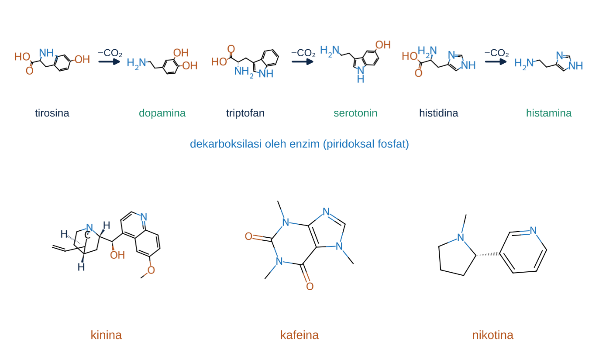

## 13.7 Heterosiklik nitrogen: piridina, pirola, imidazola, dan indola

Di subbab 10.3 kita melihat bahwa piridina, pirola, dan imidazola aromatik, dan bahwa letak pasangan bebas nitrogen menentukan kebasaannya. Di sini kita melihat bagaimana kedua jenis nitrogen itu menentukan **kereaktifan cincin**: piridina adalah cincin yang miskin elektron, pirola adalah cincin yang kaya elektron.

### Piridina: cincin miskin elektron

Nitrogen lebih elektronegatif daripada karbon dan menarik kerapatan elektron dari cincin, baik lewat efek induktif maupun resonansi. Akibatnya piridina berperilaku seperti benzena yang membawa gugus penarik elektron kuat, mirip nitrobenzena.

**Substitusi elektrofilik sangat lambat**, dan terjadi di **C3**. Bila elektrofil menyerang C2 atau C4, salah satu struktur resonansi ion arenium menempatkan muatan positif pada **nitrogen** yang hanya mempunyai enam elektron, sangat tidak stabil. Serangan di C3 menghindari struktur itu. Selain itu, dalam kondisi SEAr yang asam, nitrogen piridina terprotonasi (atau mengikat asam Lewis), sehingga cincin menjadi lebih miskin elektron lagi. Nitrasi piridina memerlukan suhu sekitar 300 °C dan hasilnya rendah; Friedel–Crafts tidak berjalan sama sekali.

**Substitusi nukleofilik relatif mudah**, terjadi di **C2 dan C4**. Ketika nukleofil menyerang C2 atau C4, muatan negatif zat antara dapat berada pada **nitrogen**, atom elektronegatif yang menampungnya dengan baik, seperti gugus nitro pada kompleks Meisenheimer (subbab 10.11). 2-Kloropiridina dan 4-kloropiridina bereaksi dengan nukleofil (alkoksida, amina) jauh lebih mudah daripada klorobenzena. Bahkan piridina sendiri bereaksi dengan natrium amida pada suhu tinggi menghasilkan 2-aminopiridina (**reaksi Chichibabin**), di mana gugus perginya ion hidrida.

Pasangan bebas sp² piridina juga menjadikannya **nukleofil** dan **basa lemah** yang sangat sering dipakai: sebagai pelarut dan penangkap HCl pada asilasi dan tosilasi, dan dalam bentuk turunannya DMAP sebagai katalis asilasi (Contoh 10.3). Bila cincin piridina dihidrogenasi penuh, terbentuk **piperidina**, amina sekunder siklik yang jenuh dan jauh lebih basa (pKaH 11,1).

### Pirola, furan, tiofena: cincin kaya elektron

Pada pirola, pasangan bebas nitrogen adalah bagian dari sistem π, sehingga **enam elektron π tersebar di lima atom**: cincin lebih kaya elektron per atom daripada benzena. Pirola bereaksi dengan elektrofil **jauh lebih cepat** daripada benzena, kira-kira seperti anilina atau fenol, dan sering tanpa katalis. Dalam asam kuat pirola mudah berpolimerisasi, sehingga kondisi SEAr harus lunak.

Substitusi terjadi terutama di **C2** (posisi di sebelah N). Ion arenium dari serangan di C2 mempunyai **tiga** struktur resonansi, termasuk struktur yang menempatkan muatan positif pada nitrogen dengan oktet lengkap (iminium). Serangan di C3 hanya memberi **dua** struktur resonansi. Lebih banyak struktur, muatan lebih tersebar, keadaan transisi lebih rendah.

Furan dan tiofena bereaksi dengan pola yang sama (substitusi di C2), dengan urutan kereaktifan **pirola > furan > tiofena > benzena**. Oksigen lebih elektronegatif dan menyumbangkan pasangan bebasnya kurang rela daripada nitrogen; belerang memakai orbital 3p yang tumpang tindihnya dengan 2p karbon kurang baik, sehingga tiofena paling mirip benzena.

{width=96%}

### Imidazola dan indola

**Imidazola** mempunyai satu nitrogen jenis pirola dan satu jenis piridina. Ia bersifat **amfoter**: nitrogen jenis piridina dapat menerima proton (pKaH 7,0), dan N–H jenis pirola dapat melepas proton (pKa sekitar 14,5). Pada pH tubuh, imidazola berada di tengah-tengah keadaan terprotonasi dan tidak terprotonasi, sehingga dapat menerima atau memberi proton dengan sama mudahnya. Itulah sebabnya cincin imidazola histidina sering menjadi katalis asam–basa di situs aktif enzim, misalnya pada protease serina yang memutus ikatan peptida.

**Indola** adalah benzena terfusi dengan pirola. Cincin pirola-nya yang kaya elektron bereaksi dengan elektrofil, tetapi berbeda dari pirola, substitusi terjadi di **C3**. Serangan di C3 menghasilkan ion arenium yang muatannya dapat distabilkan oleh nitrogen **tanpa mengganggu aromatisitas cincin benzena**; serangan di C2 tidak dapat melakukannya tanpa merusak cincin benzena. Indola adalah inti asam amino triptofan, neurotransmiter serotonin, hormon melatonin, dan banyak alkaloid.

### Heterosiklik dalam asam nukleat

Basa-basa DNA dan RNA adalah heterosiklik nitrogen aromatik: **pirimidina** (sitosina, timina, urasil) dan **purina** (adenina, guanina). Gugus N–H dan C=O pada basa-basa ini membentuk ikatan hidrogen spesifik: adenina dengan timina (dua ikatan hidrogen) dan guanina dengan sitosina (tiga). Pasangan basa yang datar dan aromatik itu juga saling bertumpuk di dalam heliks ganda, distabilkan oleh interaksi antara awan elektron π. Struktur DNA adalah kimia heterosiklik aromatik dalam skala molekul raksasa.

::: {.contoh}
**Contoh 13.11 · Meramalkan substitusi pada heterosiklik**

Tulis produk utama: (a) piridina + HNO₃/H₂SO₄, 300 °C; (b) pirola + anhidrida asetat (tanpa katalis, panas); (c) 2-kloropiridina + NaOCH₃; (d) indola + Br₂ (dingin).

**Penyelesaian.** (a) **3-Nitropiridina** (hasil rendah). (b) **2-Asetilpirola** (asilasi di C2, tanpa AlCl₃ karena pirola sangat aktif). (c) **2-Metoksipiridina** (substitusi nukleofilik di C2; muatan negatif zat antara ditampung N). (d) **3-Bromoindola**.

**Memahami hasil.** Untuk heterosiklik, pertanyaan pertama adalah: kaya atau miskin elektron? Cincin miskin elektron (piridina) diserang nukleofil di C2/C4 dan elektrofil (dengan sulit) di C3. Cincin kaya elektron (pirola, furan, indola) diserang elektrofil dengan mudah, di C2 untuk cincin lima tunggal dan di C3 untuk indola.
:::

::: {.kuis}
**Kuis cepat 13.7** (a) Mengapa piridina tidak mengalami asilasi Friedel–Crafts? (b) Urutkan kereaktifan SEAr: benzena, pirola, piridina, tiofena, furan.
:::

## 13.8 Amina dalam biologi dan obat

### Neurotransmiter dan hormon

Banyak molekul pembawa pesan di otak dan tubuh adalah amina yang dibuat dari asam amino dengan satu reaksi kunci: **dekarboksilasi** oleh enzim yang memakai piridoksal fosfat (vitamin B₆). Gugus –COOH lepas sebagai CO₂, meninggalkan amina primer:

- **Tirosina** → L-DOPA → **dopamina** → **norepinefrina** → **epinefrina** (adrenalin). Kekurangan dopamina di bagian otak tertentu menyebabkan penyakit Parkinson; pasien diberi L-DOPA, prekursor yang dapat menembus sawar darah otak dan diubah menjadi dopamina di sana. Pembentukan epinefrina dari norepinefrina adalah metilasi SN2 oleh SAM (subbab 7.15).
- **Triptofan** → **serotonin** (5-hidroksitriptamina) → melatonin. Banyak obat antidepresi bekerja dengan menghambat penyerapan kembali serotonin.
- **Histidina** → **histamina**, pemicu reaksi alergi dan sekresi asam lambung. Obat antihistamin (untuk alergi) dan penghambat H₂ (untuk maag, seperti ranitidina dan famotidina) memblokir reseptornya.
- **Asetilkolina**, ion amonium kuaterner, membawa sinyal dari saraf ke otot. Enzim asetilkolinesterase menghidrolisis ikatan esternya dalam sepersekian milidetik. Pestisida organofosfat dan gas saraf menghambat enzim ini secara kovalen, menyebabkan kelumpuhan.

### Alkaloid

**Alkaloid** adalah senyawa nitrogen basa dari tumbuhan, sering dengan efek fisiologis yang kuat. Beberapa contoh dengan kaitan Indonesia:

- **Kinina**, dari kulit pohon kina (*Cinchona*), obat malaria pertama yang efektif. Pada awal abad ke-20, perkebunan kina di Jawa Barat memasok sebagian besar kina dunia.
- **Kafeina** (kopi, teh), turunan purina, menghambat reseptor adenosina dan membuat kita terjaga.
- **Nikotina** (tembakau), dengan cincin piridina dan pirolidina, meniru asetilkolina pada reseptornya, dan sangat adiktif.
- **Morfina**, dari getah buah opium, analgesik kuat; turunannya kodeina dan heroin.
- **Piperina** (lada hitam) dan **kapsaisina** (cabai) sebenarnya bukan alkaloid basa, tetapi **amida**; rasa pedasnya berasal dari pengikatan pada reseptor panas di lidah.

### Kebasaan dan perjalanan obat di dalam tubuh

Sebagian besar obat adalah amina dengan pKaH sekitar 8–10. Pada pH darah (7,4), obat seperti itu sebagian besar terprotonasi (bermuatan, larut dalam air) dan sebagian kecil berupa basa bebas (netral, dapat menembus membran lemak). Keseimbangan antara kedua bentuk inilah yang memungkinkan obat beredar dalam darah sekaligus masuk ke dalam sel. Amina kuaterner, yang bermuatan tetap, sulit menembus membran dan sawar darah otak; karena itu beberapa obat sengaja dibuat kuaterner agar **tidak** masuk ke otak (misalnya pelemas otot untuk pembedahan).

### Ion amonium kuaterner sebagai surfaktan

Ion amonium kuaterner dengan satu rantai hidrokarbon panjang, seperti **benzalkonium klorida**, adalah **surfaktan kationik**: kepala bermuatan positif, ekor hidrofobik, seperti sabun tetapi dengan muatan terbalik. Senyawa ini dipakai sebagai antiseptik dan desinfektan (merusak membran bakteri yang bermuatan negatif) dan sebagai pelembut kain dan kondisioner rambut (menempel pada permukaan serat dan rambut yang bermuatan negatif).

{width=96%}

::: {.contoh}
**Contoh 13.12 · Basa bebas dan garam**

Efedrina (pKaH 9,6) dijual sebagai efedrin hidroklorida. Hitung fraksi basa bebas pada pH 7,4 dan pada pH 2 (lambung). Di bagian mana saluran cerna efedrina lebih banyak diserap?

**Penyelesaian.** Fraksi basa bebas = 1/(1 + 10^(pKaH − pH)). pH 7,4: 1/(1 + 10^2,2) = **0,63%**. pH 2: 1/(1 + 10^7,6) ≈ **2,5 × 10⁻⁶ %**, praktis nol. Penyerapan lewat membran terutama terjadi dalam bentuk netral, sehingga efedrina diserap terutama di **usus** (pH sekitar 6–7,5), bukan di lambung.

**Memahami hasil.** Untuk obat yang bersifat basa, lambung yang asam menahan obat dalam bentuk ion, dan penyerapan baru terjadi di usus. Untuk obat yang bersifat asam, seperti aspirin, keadaannya terbalik (Contoh 12.1). Kimia asam–basa sederhana menjelaskan di mana obat diserap.
:::

::: {.contoh}
**Contoh 13.13 · Dari tirosina ke adrenalin**

Tulis jenis reaksi pada setiap langkah biosintesis tirosina → L-DOPA → dopamina → norepinefrina → epinefrina.

**Penyelesaian.** (1) Tirosina → L-DOPA: **hidroksilasi aromatik** (gugus –OH kedua dipasang pada cincin fenol, posisi *orto* terhadap –OH pertama), oleh enzim yang memakai O₂. (2) L-DOPA → dopamina: **dekarboksilasi** (–COOH lepas sebagai CO₂, lewat imina dengan piridoksal fosfat). (3) Dopamina → norepinefrina: **hidroksilasi pada karbon benzilik** (posisi yang mudah dioksidasi, subbab 10.4). (4) Norepinefrina → epinefrina: ***N*-metilasi SN2** oleh SAM.

**Memahami hasil.** Empat langkah, empat jenis reaksi yang semuanya sudah kita pelajari dalam versi laboratoriumnya: substitusi aromatik, reaksi lewat imina, oksidasi benzilik, dan SN2. Enzim menjalankan kimia organik yang sama, hanya dengan kecepatan dan selektivitas yang luar biasa.
:::

::: {.kuis}
**Kuis cepat 13.8** (a) Mengapa L-DOPA diberikan kepada penderita Parkinson, bukan dopamina langsung? (b) Mengapa benzalkonium klorida membunuh bakteri?
:::

## Menuju bagian berikutnya

Teka-teki pembuka bab kini terjawab. Bau amis ikan berasal dari trimetilamina yang mudah menguap. Asam dalam jeruk nipis memprotonasinya menjadi ion trimetilamonium, garam yang tidak menguap dan tidak berbau. Bila larutan dibasakan kembali, amina bebas terlepas dan baunya kembali. Satu pasangan elektron bebas pada nitrogen, dan satu proton, menentukan semuanya.

Dengan bab ini kita menyelesaikan pembahasan gugus fungsi utama: alkana, alkil halida, alkena, alkuna, alkohol, eter, aromatik, aldehida, keton, asam karboksilat dan turunannya, serta amina. Di setiap bab, kita menyebut struktur senyawa seolah-olah sudah diketahui. Tetapi bagaimana kimiawan mengetahui struktur senyawa yang baru dibuat atau baru diisolasi dari alam? Bagian IV menjawab pertanyaan itu. Bab 14 membahas **spektroskopi inframerah**, yang mengenali gugus fungsi dari getaran ikatannya, dan **spektrometri massa**, yang mengukur massa molekul dan potongan-potongannya. Bab 15 membahas **resonansi magnet inti (NMR)**, alat paling ampuh untuk menentukan kerangka karbon dan hidrogen sebuah molekul.
