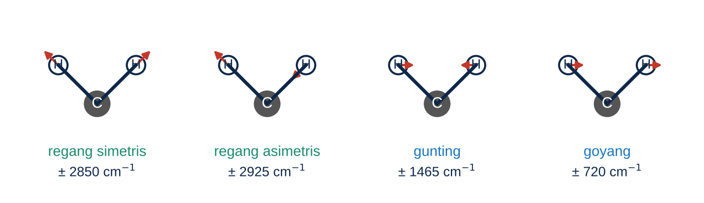
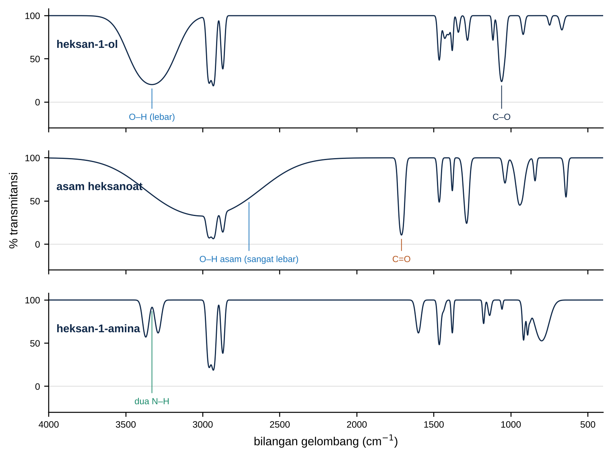
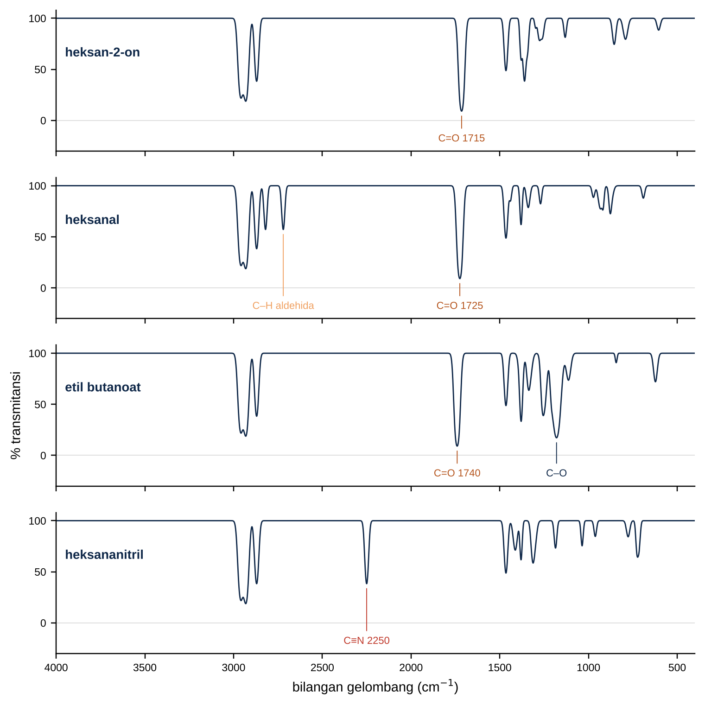

# Bab 14 Spektroskopi Inframerah dan Spektrometri Massa

Di rak sebuah laboratorium ditemukan sebuah botol tanpa label berisi cairan bening. Catatan lama hanya menyebut bahwa rumus molekulnya C₃H₆O. Ada beberapa kemungkinan: **aseton** (keton), **propanal** (aldehida), **prop-2-en-1-ol** (alkohol alilik), **metil vinil eter** (eter dengan C=C), atau **oksetana** dan **metiloksirana** (eter siklik). Semuanya mempunyai massa molar yang sama, 58 g mol⁻¹, dan beberapa di antaranya mendidih pada suhu yang mirip. Seratus tahun lalu, seorang kimiawan harus melakukan serangkaian uji kimia selama berhari-hari: apakah cairan ini menghilangkan warna bromin, apakah memberi endapan dengan 2,4-dinitrofenilhidrazina, apakah mereduksi pereaksi Tollens, apakah memberi uji iodoform positif. Hari ini, kimiawan memasukkan setetes cairan itu ke dalam dua alat, dan dalam waktu kurang dari lima menit jawabannya sudah jelas. Bagaimana caranya?

Jawabannya adalah **spektroskopi**: cara "melihat" molekul dengan mengamati bagaimana molekul berinteraksi dengan cahaya atau dengan medan listrik dan magnet. Di bab ini kita membahas dua metode yang paling sering dipakai bersama. **Spektroskopi inframerah (IR)** mengukur frekuensi getaran ikatan, dan karena setiap jenis ikatan bergetar pada frekuensi yang khas, spektrum IR memberi tahu **gugus fungsi apa** yang ada dalam molekul: C=O, O–H, N–H, C≡N, C=C. **Spektrometri massa (MS)** memecah molekul menjadi ion-ion dan menimbang massanya, sehingga memberi tahu **massa molekul**, kadang rumus molekulnya yang tepat, keberadaan atom tertentu (Cl, Br, N), dan potongan-potongan yang menyusun molekul.

Bersama spektroskopi NMR di Bab 15, kedua metode ini menggantikan hampir seluruh uji kimia klasik. Tetapi spektroskopi bukan sihir: setiap pita dan setiap puncak adalah akibat langsung dari struktur yang kita pelajari di bab-bab sebelumnya, seperti kekuatan ikatan, hibridisasi, resonansi, dan kestabilan karbokation. Bab ini menunjukkan bagaimana pengetahuan itu dibaca balik dari spektrum.

::: {.kuis}
**Pertanyaan pembuka**

1. Mengapa molekul menyerap cahaya inframerah hanya pada frekuensi tertentu?
2. Mengapa pita C=O muncul sekitar 1715 cm⁻¹, sedangkan C–O sekitar 1100 cm⁻¹?
3. Mengapa pita O–H alkohol lebar, sedangkan pita O–H yang sama dalam larutan sangat encer tajam?
4. Bagaimana spektrometer massa "menimbang" sebuah molekul tunggal?
5. Mengapa senyawa yang mengandung satu atom bromin memberi dua puncak ion molekul yang hampir sama tinggi, dua satuan massa terpisah?
6. Mengapa senyawa dengan satu atom nitrogen selalu mempunyai massa molekul ganjil?
7. Bagaimana massa yang diukur sampai empat angka desimal dapat membedakan CO, N₂, dan C₂H₄, yang ketiganya bermassa 28?
:::

::: {.tujuan}
**Tujuan belajar**

Setelah mempelajari bab ini, kamu mampu:

1. Menghubungkan panjang gelombang, bilangan gelombang, frekuensi, dan energi radiasi, dan menempatkan IR, UV–tampak, dan NMR pada spektrum elektromagnetik.
2. Menjelaskan getaran molekul dan memakai model pegas (hukum Hooke) untuk meramalkan letak pita IR.
3. Mengenali pita-pita khas gugus fungsi: O–H, N–H, C–H (sp, sp², sp³), C≡C, C≡N, C=O, C=C, dan C–O.
4. Membaca spektrum IR secara sistematis untuk menentukan gugus fungsi yang ada dan yang tidak ada.
5. Menjelaskan cara kerja spektrometer massa dan mengenali ion molekul.
6. Memakai pola isotop untuk mengenali Cl dan Br, puncak M+1 untuk memperkirakan jumlah karbon, dan aturan nitrogen.
7. Meramalkan fragmentasi khas alkana, alkohol, senyawa karbonil (termasuk penataan ulang McLafferty), amina, eter, dan senyawa aromatik.
8. Memakai massa eksak untuk menentukan rumus molekul.
9. Menggabungkan rumus molekul, derajat ketidakjenuhan, IR, dan MS untuk menentukan struktur.
:::

::: {.mat}
**Prasyarat**

Bab 1: ikatan, hibridisasi, derajat ketidakjenuhan (subbab 1.4–1.6). Bab 6: kestabilan karbokation dan radikal (subbab 6.10–6.11). Bab 8–13: gugus fungsi dan reaksinya. Kimia Kuantum (Bab 11–13): tingkat energi dan transisi; Fisika Umum: gelombang elektromagnetik.
:::

## 14.1 Spektroskopi dan spektrum elektromagnetik

### Cahaya sebagai gelombang dan sebagai paket energi

Radiasi elektromagnetik (cahaya dalam arti luas) dapat digambarkan sebagai gelombang dengan **panjang gelombang** λ dan **frekuensi** ν, yang dihubungkan oleh kecepatan cahaya: *c* = λν. Radiasi juga dapat digambarkan sebagai aliran paket energi, **foton**, dengan energi

$$
E = h\nu = \frac{hc}{\lambda} = hc\tilde{\nu} \qquad \text{(14.1)}
$$

dengan *h* tetapan Planck (6,626 × 10⁻³⁴ J s). Spektroskopi inframerah biasanya memakai **bilangan gelombang**, ν̃ = 1/λ, dalam satuan cm⁻¹ (berapa gelombang dalam satu sentimeter). Bilangan gelombang berbanding lurus dengan energi: makin besar ν̃, makin besar energi foton.

### Molekul hanya menyerap energi tertentu

Molekul mempunyai tingkat-tingkat energi yang **terkuantisasi**: energi elektronik, energi getaran, energi rotasi, dan (dalam medan magnet) energi spin inti. Molekul hanya dapat menyerap foton yang energinya **tepat sama** dengan selisih dua tingkat energi. Jenis radiasi menentukan jenis transisi:

| Daerah | Panjang gelombang | Energi foton (kJ mol⁻¹) | Yang berubah | Metode |
|---|---|---|---|---|
| ultraviolet–tampak | 200–800 nm | sekitar 150–600 | elektron (π → π\*) | UV–Vis |
| inframerah | 2,5–25 μm (4000–400 cm⁻¹) | sekitar 5–48 | getaran ikatan | IR |
| gelombang radio | sekitar 1 m | sekitar 10⁻⁴ | spin inti dalam medan magnet | NMR (Bab 15) |

Satu foton inframerah pada 1700 cm⁻¹ membawa energi sekitar 20 kJ mol⁻¹: cukup untuk membuat ikatan bergetar lebih kuat, tetapi jauh terlalu kecil untuk memutus ikatan (ratusan kJ mol⁻¹). Spektroskopi IR karena itu tidak merusak molekul.

Sebuah **spektrum** adalah grafik seberapa banyak radiasi diserap (atau diteruskan) terhadap frekuensi atau panjang gelombang. Pada spektrum IR, sumbu mendatar adalah bilangan gelombang (biasanya dari 4000 cm⁻¹ di kiri sampai 400 cm⁻¹ di kanan), dan sumbu tegak adalah **% transmitansi**: pita serapan tampak sebagai lembah yang mengarah ke bawah.

{width=96%}

::: {.contoh}
**Contoh 14.1 · Energi foton inframerah**

Hitung energi per mol foton pada 1700 cm⁻¹ (pita C=O) dan bandingkan dengan energi ikatan C=O (sekitar 745 kJ mol⁻¹).

**Penyelesaian.** *E* = *hc*ν̃ × *N*ₐ = (6,626 × 10⁻³⁴ J s)(2,998 × 10¹⁰ cm s⁻¹)(1700 cm⁻¹)(6,022 × 10²³ mol⁻¹) = 2,03 × 10⁴ J mol⁻¹ = **20 kJ mol⁻¹**. Ini hanya sekitar 3% energi ikatan C=O.

**Memahami hasil.** Foton IR menaikkan getaran ikatan satu tingkat tanpa memutusnya. Untuk perbandingan, foton ultraviolet 200 nm membawa sekitar 600 kJ mol⁻¹, cukup untuk memutus banyak ikatan; itulah sebabnya sinar UV merusak kulit dan DNA, sedangkan inframerah hanya terasa hangat.
:::

::: {.kuis}
**Kuis cepat 14.1** (a) Ubah 3300 cm⁻¹ menjadi panjang gelombang dalam μm. (b) Mana yang lebih besar energinya: foton 2200 cm⁻¹ atau foton 1100 cm⁻¹?
:::

## 14.2 Getaran molekul dan pita IR

### Ikatan sebagai pegas

Ikatan kimia tidak kaku. Dua atom yang terikat terus-menerus bergetar mendekat dan menjauh, seperti dua bola yang dihubungkan oleh pegas. Model **osilator harmonik** (hukum Hooke) memberi frekuensi getaran:

$$
\tilde{\nu} = \frac{1}{2\pi c}\sqrt{\frac{k}{\mu}}, \qquad \mu = \frac{m_1 m_2}{m_1 + m_2} \qquad \text{(14.2)}
$$

dengan *k* tetapan gaya ikatan (kekakuan pegas) dan μ massa tereduksi kedua atom. Dua kesimpulan langsung dari persamaan ini menjelaskan sebagian besar letak pita IR:

1. **Ikatan yang lebih kuat (k besar) bergetar lebih cepat**: C≡C > C=C > C–C, dan C≡N > C=N > C–N. Ikatan rangkap tiga kira-kira dua kali lebih kaku daripada ikatan tunggal.
2. **Atom yang lebih ringan bergetar lebih cepat**: ikatan dengan hidrogen (C–H, O–H, N–H) muncul pada bilangan gelombang tertinggi, di atas 2700 cm⁻¹, karena massa tereduksinya kecil.

::: {.contoh}
**Contoh 14.2 · Memperkirakan letak pita dengan hukum Hooke**

Dengan tetapan gaya C–H sekitar 500 N m⁻¹ dan C=O sekitar 1200 N m⁻¹, perkirakan letak pita regang C–H dan C=O. Berapa letak pita C–D (deuterium) dengan tetapan gaya yang sama?

**Penyelesaian.** C–H: μ = (12 × 1,008)/(13,008) = 0,930 u = 1,544 × 10⁻²⁷ kg. ν̃ = [1/(2π × 2,998 × 10¹⁰)] × √(500/1,544 × 10⁻²⁷) = **3021 cm⁻¹**. C=O: μ = (12 × 16)/28 = 6,857 u; ν̃ = **1723 cm⁻¹**. C–D: μ = (12 × 2,014)/14,014 = 1,725 u; ν̃ = **2218 cm⁻¹**.

**Memahami hasil.** Model sederhana ini memberi angka yang sangat dekat dengan pengamatan (C–H sekitar 2850–3100, C=O sekitar 1715, C–D sekitar 2200 cm⁻¹). Mengganti H dengan D hanya mengubah massa, sehingga pita bergeser dengan faktor sekitar √2 (tepatnya 1,36). Pergeseran isotop ini dipakai untuk memastikan pita mana yang berasal dari ikatan dengan hidrogen.
:::

### Jenis getaran

Molekul dengan *N* atom mempunyai 3*N* − 6 cara bergetar (3*N* − 5 untuk molekul linear). Etana saja, dengan 8 atom, mempunyai 18 getaran. Getaran dikelompokkan menjadi dua jenis:

- **Regang** (*stretching*): panjang ikatan berubah. Dapat **simetris** (kedua ikatan memanjang bersamaan) atau **asimetris** (satu memanjang, satu memendek).
- **Tekuk** (*bending*): sudut ikatan berubah: gunting, goyang, kibas, dan pelintir. Tekukan memerlukan energi lebih kecil daripada regangan, sehingga pitanya berada pada bilangan gelombang lebih rendah.

{width=88%}

### Syarat menyerap: perubahan momen dipol

Getaran hanya menyerap radiasi inframerah bila getaran itu **mengubah momen dipol** molekul. Medan listrik cahaya yang berosilasi "mendorong dan menarik" muatan parsial; bila getaran tidak mengubah sebaran muatan, cahaya tidak dapat menggerakkannya. Akibatnya:

- Ikatan polar (C=O, O–H, C–O) memberi pita **kuat**.
- Ikatan yang kurang polar (C=C, C≡C) memberi pita **lemah sampai sedang**.
- Ikatan yang terletak simetris, misalnya C≡C pada but-2-una atau C=C pada *trans*-but-2-ena, hampir **tidak tampak** dalam IR, karena regangannya tidak mengubah momen dipol sama sekali.

Molekul diatomik homonuklir seperti N₂ dan O₂ tidak menyerap IR. Inilah sebabnya udara (sebagian besar N₂ dan O₂) transparan terhadap inframerah, sedangkan CO₂, H₂O, dan CH₄ menyerapnya dan menjadi **gas rumah kaca**: getaran tekuk CO₂ dan regang asimetrisnya mengubah momen dipol walaupun molekulnya sendiri nonpolar.

::: {.kuis}
**Kuis cepat 14.2** (a) Mana yang muncul pada bilangan gelombang lebih tinggi: C≡N atau C–N? O–H atau O–D? (b) Mengapa pita C=C pada 2,3-dimetilbut-2-ena hampir tidak terlihat?
:::

## 14.3 Daerah gugus fungsi

Spektrum IR biasanya dibagi menjadi dua bagian. **Daerah gugus fungsi** (4000–1500 cm⁻¹) memuat pita-pita yang khas untuk jenis ikatan tertentu dan hampir tidak dipengaruhi oleh bagian molekul yang lain. **Daerah sidik jari** (1500–400 cm⁻¹) memuat banyak pita yang rumit, berasal dari tekukan dan regangan C–C, C–O, dan C–N yang saling bercampur; pola daerah ini khas untuk setiap molekul, seperti sidik jari, dan dipakai untuk memastikan identitas dengan membandingkan dengan spektrum rujukan, tetapi jarang dipakai untuk menafsirkan struktur dari nol.

### Daerah di atas 2500 cm⁻¹: ikatan dengan hidrogen

**O–H.** Alkohol dan fenol memberi pita **kuat dan lebar** pada 3200–3550 cm⁻¹. Lebarnya berasal dari **ikatan hidrogen**: dalam cairan, setiap gugus O–H terlibat ikatan hidrogen dengan kekuatan yang berbeda-beda, sehingga setiap molekul bergetar pada frekuensi yang sedikit berbeda, dan pita-pita yang tumpang tindih membentuk satu pita lebar. Dalam larutan sangat encer, di mana molekul alkohol tidak saling bertemu, muncul pita O–H "bebas" yang tajam pada sekitar 3620 cm⁻¹.

Gugus O–H **asam karboksilat** memberi pita yang **sangat lebar**, dari sekitar 3300 sampai 2500 cm⁻¹, sering menutupi pita C–H. Asam karboksilat membentuk dimer dengan ikatan hidrogen yang sangat kuat (subbab 12.1), yang melemahkan dan memperlebar getaran O–H.

**N–H.** Amina dan amida memberi pita pada 3300–3500 cm⁻¹, lebih **tajam dan lebih lemah** daripada O–H (ikatan hidrogen N–H lebih lemah). Amina primer (–NH₂) memberi **dua** pita (regang simetris dan asimetris kedua N–H); amina sekunder (–NH–) memberi **satu** pita; amina tersier tidak memberi pita N–H sama sekali.

**C–H.** Letak pita regang C–H bergantung pada **hibridisasi** karbon, karena makin besar sifat s orbital, makin pendek dan kuat ikatannya:

- C(sp)–H (alkuna ujung, ≡C–H): sekitar **3300** cm⁻¹, tajam dan kuat.
- C(sp²)–H (alkena, aromatik, =C–H): **3000–3100** cm⁻¹.
- C(sp³)–H (alkana): **2850–3000** cm⁻¹.
- C–H aldehida (–CHO): dua pita lemah yang khas pada sekitar **2720 dan 2820** cm⁻¹.

Garis **3000 cm⁻¹** adalah batas yang sangat berguna: pita C–H di atas 3000 menandakan karbon sp² atau sp (ikatan rangkap atau cincin aromatik); pita hanya di bawah 3000 menandakan karbon sp³ saja.

### Daerah 2000–2300 cm⁻¹: ikatan rangkap tiga

Daerah ini biasanya kosong, sehingga pita apa pun di sini langsung menarik perhatian. **C≡N** (nitril) memberi pita tajam dan sedang pada sekitar **2250** cm⁻¹. **C≡C** memberi pita lemah pada **2100–2260** cm⁻¹; pada alkuna ujung pita ini terlihat (dan disertai pita ≡C–H pada 3300), sedangkan pada alkuna dalam yang hampir simetris pita ini sangat lemah atau hilang. (CO₂ udara memberi pita pada 2350 cm⁻¹ yang kadang muncul sebagai gangguan.)

### Daerah 1650–1800 cm⁻¹: gugus karbonil

Pita regang **C=O** adalah pita yang paling penting dan paling mudah dikenali dalam IR: **kuat dan tajam**, biasanya pita terkuat dalam spektrum, pada 1650–1800 cm⁻¹. Letak tepatnya membedakan jenis senyawa karbonil, dan dapat dijelaskan dengan resonansi yang kita pelajari di Bab 12:

| Gugus | C=O (cm⁻¹) | Alasan |
|---|---|---|
| klorida asam | sekitar 1800 | Cl menarik elektron, C=O paling "rangkap" |
| anhidrida | dua pita, sekitar 1820 dan 1760 | dua C=O bergetar bersama (simetris dan asimetris) |
| ester | sekitar 1735–1750 | O menarik elektron secara induktif |
| aldehida | sekitar 1725 | |
| keton | sekitar 1715 | |
| asam karboksilat | sekitar 1710 | dimer berikatan hidrogen |
| amida | sekitar 1650–1690 | resonansi N kuat, C=O bersifat setengah tunggal |
| keton terkonjugasi (C=C–C=O atau Ar–C=O) | sekitar 1685–1690 | konjugasi melemahkan C=O |

Prinsipnya: apa pun yang membuat ikatan C=O **lebih tunggal** (resonansi dengan pasangan bebas N, konjugasi dengan C=C atau cincin) menurunkan bilangan gelombang; apa pun yang membuatnya **lebih rangkap** (penarikan elektron secara induktif) menaikkannya. Tegangan cincin juga menaikkan bilangan gelombang: sikloheksanon 1715, siklopentanon sekitar 1745, siklobutanon sekitar 1780 cm⁻¹.

### Daerah 1450–1680 cm⁻¹: C=C dan cincin aromatik

**C=C** alkena memberi pita sedang sampai lemah pada **1620–1680** cm⁻¹ (lemah bila hampir simetris). **Cincin aromatik** memberi beberapa pita sedang pada sekitar **1600 dan 1500** cm⁻¹, ditambah C–H aromatik di atas 3000 cm⁻¹. Pita kuat pada 690–900 cm⁻¹ (tekukan C–H keluar bidang) dapat menunjukkan pola substitusi cincin.

### Daerah 1000–1300 cm⁻¹: C–O

Alkohol, eter, ester, dan asam karboksilat memberi pita **C–O** yang kuat pada **1000–1300** cm⁻¹. Pita ini sendiri kurang khas karena berada di daerah sidik jari yang ramai, tetapi berguna untuk mengonfirmasi: eter memberi pita C–O kuat tanpa O–H dan tanpa C=O.

{width=96%}

::: {.inti}
**Lima pertanyaan untuk spektrum IR**

1. Adakah pita **kuat dan tajam** di 1650–1800 cm⁻¹? → gugus **C=O**. Di mana letaknya?
2. Adakah pita **lebar** di 3200–3550 (alkohol) atau sangat lebar 2500–3300 cm⁻¹ (asam)? Adakah satu atau dua pita lebih tajam di 3300–3500 (N–H)?
3. Adakah pita C–H **di atas 3000** cm⁻¹ (C=C, aromatik, alkuna) atau hanya di bawahnya?
4. Adakah pita di **2100–2260** cm⁻¹ (C≡C, C≡N)? Adakah pita tajam di 3300 (≡C–H)?
5. Adakah pita C=C atau aromatik di 1450–1680, dan pita C–O kuat di 1000–1300 cm⁻¹?

Sama pentingnya: pita yang **tidak ada**. Tidak ada pita di 1650–1800 berarti tidak ada C=O; tidak ada pita lebar di 3200–3550 berarti tidak ada O–H.
:::

::: {.contoh}
**Contoh 14.3 · Mengurutkan pita karbonil**

Urutkan letak pita C=O dari bilangan gelombang tertinggi: sikloheksanon, sikloheks-2-en-1-on, asetil klorida, *N*,*N*-dimetilasetamida, etil asetat, siklopentanon.

**Penyelesaian.** Asetil klorida (sekitar 1800) > siklopentanon (sekitar 1745, tegangan cincin lima) ≈ etil asetat (sekitar 1740) > sikloheksanon (1715) > sikloheks-2-en-1-on (sekitar 1680, terkonjugasi dengan C=C) > *N*,*N*-dimetilasetamida (sekitar 1650, resonansi amida).

**Memahami hasil.** Setiap pergeseran dapat dijelaskan dengan satu pertanyaan: apakah faktor ini membuat ikatan C=O lebih rangkap (naik) atau lebih tunggal (turun)? Penarikan elektron induktif dan tegangan cincin menaikkan; resonansi dengan pasangan bebas dan konjugasi menurunkan.
:::

::: {.kuis}
**Kuis cepat 14.3** Di mana pita khas: (a) C=O pada etil asetat; (b) N–H pada dietilamina (berapa pita?); (c) ≡C–H pada heks-1-una; (d) C=O pada benzamida?
:::

## 14.4 Membaca spektrum IR

Membaca spektrum IR bukan mencocokkan setiap pita; spektrum senyawa organik sederhana pun memuat puluhan pita. Kuncinya adalah mencari **beberapa pita diagnostik** di daerah gugus fungsi, lalu memeriksa apakah pita-pita itu konsisten dengan rumus molekul. Gambar-gambar berikut adalah spektrum skematis yang menonjolkan pita-pita kunci; spektrum sebenarnya memuat lebih banyak pita kecil, terutama di daerah sidik jari.

{width=96%}

{width=96%}

{width=96%}

::: {.contoh}
**Contoh 14.4 · Menjawab teka-teki botol C₃H₆O**

Spektrum IR cairan C₃H₆O dari pembuka bab memperlihatkan: pita kuat dan tajam pada 1715 cm⁻¹; pita C–H hanya di bawah 3000 cm⁻¹; tidak ada pita lebar di 3200–3550; tidak ada pita di 2700–2850 selain C–H biasa. Tentukan senyawanya.

**Rencana.** Derajat ketidakjenuhan C₃H₆O: (8 − 6)/2 = 1: satu ikatan π atau satu cincin. Periksa kandidat satu per satu terhadap pita yang ada dan yang tidak ada.

**Penyelesaian.** Pita 1715 cm⁻¹ menunjukkan **C=O**, sehingga satu-satunya derajat ketidakjenuhan adalah gugus karbonil; ini menyingkirkan prop-2-en-1-ol, metil vinil eter, oksetana, dan metiloksirana. Tinggal aseton dan propanal. Tidak ada pita C–H aldehida pada 2720 dan 2820 cm⁻¹, dan letak 1715 cocok untuk keton. Senyawa itu **aseton**.

**Memahami hasil.** Dua informasi saja, rumus molekul dan satu spektrum IR, sudah mempersempit enam kemungkinan menjadi satu. Bila pita 1715 tidak ada tetapi ada pita lebar pada 3350 dan pita C=C pada 1645 serta C–H di atas 3000, senyawanya prop-2-en-1-ol. Bila hanya ada C–O kuat pada sekitar 1000–1200 tanpa O–H, C=O, dan C=C, senyawanya eter siklik.
:::

::: {.contoh}
**Contoh 14.5 · Membedakan isomer dengan IR**

Bagaimana IR membedakan pasangan berikut: (a) heksan-1-ol dan dipropil eter; (b) asam butanoat dan etil asetat; (c) *N*-metilpropanamida dan *N*,*N*-dimetilasetamida?

**Penyelesaian.** (a) Alkohol: pita O–H lebar 3200–3550; eter: tidak ada, hanya C–O kuat 1100. (b) Asam: O–H sangat lebar 2500–3300 dan C=O 1710; ester: tanpa O–H, C=O 1740 dan C–O kuat 1240. (c) Amida sekunder: satu pita N–H pada sekitar 3300 dan C=O sekitar 1650; amida tersier: tanpa N–H, C=O sekitar 1650.

**Memahami hasil.** Isomer dengan gugus fungsi berbeda hampir selalu dapat dibedakan dengan IR. Isomer dengan gugus fungsi sama (misalnya heksan-1-ol dan heksan-2-ol) hanya berbeda di daerah sidik jari dan lebih mudah dibedakan dengan NMR (Bab 15).
:::

::: {.kuis}
**Kuis cepat 14.4** Sebuah senyawa C₄H₈O₂ memberi pita sangat lebar pada 2500–3300 dan pita kuat pada 1710 cm⁻¹. Golongan apa? Tulis dua struktur yang mungkin.
:::
