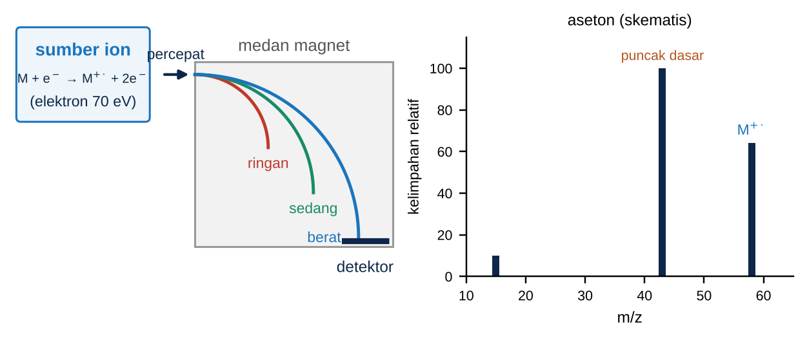
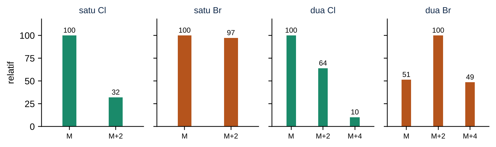
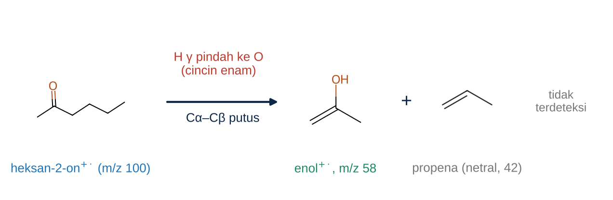
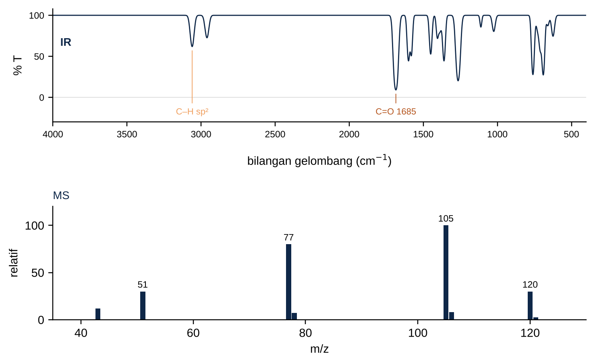

## 14.5 Spektrometer massa: ionisasi dan ion molekul

### Prinsip kerja

Spektrometer massa tidak memakai cahaya. Alat ini mengubah molekul menjadi **ion**, memisahkan ion-ion itu menurut **perbandingan massa terhadap muatan** (*m*/*z*), dan menghitung berapa banyak ion dari setiap *m*/*z*. Karena hampir semua ion yang terbentuk bermuatan +1, *m*/*z* praktis sama dengan massa ion. Ada tiga bagian utama:

1. **Sumber ion.** Pada cara yang paling klasik, **ionisasi elektron** (EI), uap sampel ditembak dengan berkas elektron berenergi tinggi (biasanya 70 eV, sekitar 6700 kJ mol⁻¹). Tabrakan itu melempar satu elektron dari molekul, menghasilkan **kation radikal**, M⁺·: ion dengan muatan positif dan satu elektron tak berpasangan. Ion ini disebut **ion molekul**, dan massanya adalah massa molekul (massa elektron yang hilang dapat diabaikan).
2. **Penganalisis massa.** Ion-ion dipercepat oleh medan listrik, lalu dipisahkan menurut *m*/*z*: dalam medan magnet (ion yang lebih ringan dibelokkan lebih tajam), dalam medan listrik bolak-balik (kuadrupol), atau berdasarkan waktu terbang (TOF: ion yang lebih ringan tiba lebih dulu).
3. **Detektor** menghitung ion-ion yang tiba.

Elektron mana yang dilepas? Elektron yang paling mudah dilepas, yaitu yang energinya paling tinggi: pasangan bebas (O, N, halogen) lebih dulu daripada elektron π, dan elektron π lebih dulu daripada elektron σ. Hal ini menentukan di mana muatan dan radikal mula-mula berada, dan dengan itu bagaimana ion molekul pecah (subbab 14.7).

### Spektrum massa

Ion molekul membawa energi berlebih dari tabrakan, dan banyak di antaranya pecah menjadi potongan-potongan yang lebih kecil sebelum mencapai detektor: **ion fragmen**. Spektrum massa adalah grafik batang: sumbu mendatar *m*/*z*, sumbu tegak **kelimpahan relatif**. Puncak tertinggi disebut **puncak dasar** (*base peak*) dan diberi nilai 100; puncak lain dinyatakan relatif terhadapnya. Puncak dasar adalah ion yang paling banyak terbentuk, biasanya fragmen yang paling stabil, dan tidak selalu ion molekul.

{width=90%}

**Ion molekul** biasanya adalah puncak dengan *m*/*z* tertinggi (selain puncak isotop kecil di sebelahnya, subbab 14.6). Pada beberapa golongan senyawa, ion molekul sangat lemah atau tidak terlihat, karena terlalu cepat pecah: alkohol tersier, alkana bercabang banyak, dan beberapa eter. Untuk molekul yang mudah pecah dan untuk biomolekul besar, dipakai cara ionisasi yang lebih "lembut": **ionisasi kimia** (CI) dan **ionisasi semprotan listrik** (ESI), yang biasanya memberi ion [M+H]⁺ (massa M + 1) tanpa banyak fragmentasi. ESI memungkinkan penimbangan protein utuh dengan massa puluhan ribu, dan penemunya, John Fenn dan Koichi Tanaka (untuk cara laser MALDI), mendapat Hadiah Nobel Kimia 2002.

::: {.kuis}
**Kuis cepat 14.5** (a) Apa beda puncak dasar dan ion molekul? (b) Mengapa pada spektrum EI 2-metilpropan-2-ol ion molekul hampir tidak terlihat?
:::

## 14.6 Pola isotop: Cl, Br, puncak M+1, dan aturan nitrogen

### Isotop alami

Spektrometer massa menimbang molekul satu per satu, sehingga dapat membedakan molekul yang mengandung isotop berbeda. Unsur-unsur organik umum mempunyai isotop alami dengan kelimpahan tertentu:

| Unsur | Isotop utama | Isotop kedua (kelimpahan relatif terhadap yang utama) |
|---|---|---|
| H | ¹H | ²H: 0,015% (diabaikan) |
| C | ¹²C | ¹³C: 1,1% |
| N | ¹⁴N | ¹⁵N: 0,37% |
| O | ¹⁶O | ¹⁸O: 0,2% |
| S | ³²S | ³⁴S: 4,4% |
| Cl | ³⁵Cl | ³⁷Cl: 32% (perbandingan sekitar 3 : 1) |
| Br | ⁷⁹Br | ⁸¹Br: 97% (perbandingan sekitar 1 : 1) |

### Klorin dan bromin

Klorin dan bromin memberi pola yang langsung dikenali, karena isotop keduanya berlimpah dan terpisah **dua satuan massa**:

- **Satu Cl**: puncak M dan **M+2** dengan perbandingan sekitar **3 : 1**.
- **Satu Br**: puncak M dan M+2 hampir **sama tinggi** (1 : 1).
- **Dua Cl**: M, M+2, M+4 sekitar 100 : 64 : 10.
- **Dua Br**: M, M+2, M+4 sekitar **1 : 2 : 1**.

Pola ini juga muncul pada setiap fragmen yang masih membawa halogen, sehingga dapat dipakai untuk menentukan fragmen mana yang mengandung Cl atau Br.

{width=92%}

### Puncak M+1 dan jumlah karbon

Setiap atom karbon mempunyai peluang 1,1% untuk berupa ¹³C. Molekul dengan *n* karbon karena itu memberi puncak **M+1** dengan tinggi sekitar **1,1*n*%** dari puncak M (sumbangan ¹⁵N dan ²H kecil). Perbandingan M+1 terhadap M dapat dipakai untuk memperkirakan jumlah karbon, asalkan ion molekul cukup kuat untuk diukur dengan teliti.

### Aturan nitrogen

Nitrogen mempunyai massa genap (14) tetapi valensi ganjil (3). Akibatnya, **molekul dengan jumlah atom nitrogen ganjil mempunyai massa molekul ganjil**, dan molekul tanpa nitrogen (atau dengan jumlah nitrogen genap) mempunyai massa molekul genap. Contoh: CH₄ (16), CH₃NH₂ (31), H₂NCH₂CH₂NH₂ (60), piridina C₅H₅N (79). Aturan ini berlaku untuk senyawa yang hanya mengandung C, H, N, O, S, dan halogen.

::: {.contoh}
**Contoh 14.6 · Membaca pola isotop**

Sebuah senyawa memberi ion molekul pada *m*/*z* 156 dan 158 dengan tinggi hampir sama, dan puncak besar pada 77. Senyawa lain memberi *m*/*z* 112 dan 114 dengan perbandingan sekitar 3 : 1. Tentukan keduanya, bila keduanya turunan benzena.

**Penyelesaian.** Senyawa pertama: pasangan 1 : 1 dua satuan terpisah menunjukkan **satu Br**. 156 − 79 = 77, massa gugus fenil, C₆H₅⁺ (cocok dengan puncak 77). Senyawa: **bromobenzena**, C₆H₅Br. Senyawa kedua: 3 : 1 menunjukkan **satu Cl**; 112 − 35 = 77: **klorobenzena**.

**Memahami hasil.** Pola isotop adalah "tanda tangan" halogen yang terlihat sebelum kita menafsirkan apa pun yang lain. Fragmen 77 tidak lagi menunjukkan pasangan M/M+2, membuktikan bahwa halogen sudah lepas dari fragmen itu.
:::

::: {.contoh}
**Contoh 14.7 · Aturan nitrogen dan puncak M+1**

Ion molekul sebuah senyawa berada pada *m*/*z* 87, dengan puncak M+1 sekitar 5,5% dari M. Apa yang dapat disimpulkan? Usulkan satu rumus molekul yang mungkin.

**Penyelesaian.** Massa ganjil: jumlah **N ganjil** (paling mungkin satu). M+1/M = 5,5% berarti sekitar 5,5/1,1 = **5 karbon** (sedikit sumbangan ¹⁵N diabaikan). C₅ (60) + N (14) = 74; sisa 87 − 74 = 13, yaitu 13 H: **C₅H₁₃N**, misalnya pentan-1-amina. Derajat ketidakjenuhan (2·5 + 2 + 1 − 13)/2 = 0: amina jenuh. (Alternatif lain, misalnya C₄H₉NO, mempunyai 4 karbon dan M+1 sekitar 4,8%.)

**Memahami hasil.** Puncak M+1 memberi perkiraan kasar jumlah karbon; massa eksak (subbab 14.8) memberi rumus yang pasti.
:::

::: {.contoh}
**Contoh 14.8 · Menghitung pola isotop**

Hitung perbandingan puncak M : M+2 : M+4 untuk diklorometana, CH₂Cl₂ (kelimpahan ³⁵Cl 75,76%, ³⁷Cl 24,24%).

**Rencana.** Setiap atom Cl dapat berupa ³⁵Cl atau ³⁷Cl secara bebas; peluang setiap kombinasi adalah hasil kali peluangnya.

**Penyelesaian.** M (³⁵Cl³⁵Cl): 0,7576² = 0,574. M+2 (satu ³⁷Cl, dua cara): 2 × 0,7576 × 0,2424 = 0,367. M+4 (³⁷Cl³⁷Cl): 0,2424² = 0,059. Dinormalkan ke M = 100: **100 : 64 : 10**.

**Memahami hasil.** Pola ini mengikuti suku-suku binomial (*a* + *b*)². Untuk *n* atom halogen, pola mengikuti (*a* + *b*)ⁿ: tiga atom Br memberi 1 : 3 : 3 : 1, mudah dikenali.
:::

::: {.kuis}
**Kuis cepat 14.6** Ramalkan pola puncak ion molekul: (a) CH₂Cl₂; (b) CH₃CH₂Br; (c) CH₂BrCl. Untuk (c), hitung perbandingan M : M+2 : M+4.
:::

## 14.7 Fragmentasi khas

### Prinsip umum

Ion molekul M⁺· pecah menjadi **satu kation dan satu radikal netral**. Hanya kation yang terdeteksi; radikal netral tidak terlihat, tetapi massanya dapat diketahui dari selisih *m*/*z*. Fragmentasi tidak acak: ikatan yang putus adalah ikatan yang menghasilkan **kation paling stabil** (dan radikal paling stabil). Semua yang kita ketahui tentang kestabilan karbokation (subbab 6.10) berlaku di sini: kation tersier, alilik, benzilik, dan kation yang distabilkan oleh pasangan bebas atom tetangga (ion asilium, oksonium, iminium) terbentuk paling mudah.

Selisih massa yang sering muncul (kehilangan dari M): 15 (CH₃·), 18 (H₂O), 28 (CO atau C₂H₄), 29 (C₂H₅· atau CHO·), 31 (OCH₃·), 43 (C₃H₇· atau CH₃CO·), 45 (OC₂H₅· atau COOH·).

### Alkana

Alkana rantai lurus memberi deretan puncak yang berselisih **14** (CH₂): *m*/*z* 29, 43, 57, 71, ..., dengan puncak 43 dan 57 biasanya terbesar. Alkana bercabang pecah terutama **di titik percabangan**, karena di situ terbentuk kation sekunder atau tersier. 2-Metilpropana, misalnya, memberi puncak dasar 43 [(CH₃)₂CH⁺] dan 2,2-dimetilpropana memberi puncak dasar 57 [(CH₃)₃C⁺] dengan ion molekul hampir tidak terlihat.

### Pemutusan α oleh heteroatom

Pada alkohol, eter, amina, dan senyawa karbonil, elektron yang dilepas adalah pasangan bebas heteroatom. Ikatan C–C **di sebelah karbon yang membawa heteroatom** (ikatan α) kemudian putus, menghasilkan kation yang distabilkan resonansi oleh pasangan bebas heteroatom:

- **Alkohol** → ion oksonium, misalnya CH₂=OH⁺ (*m*/*z* 31) dari alkohol primer, CH₃CH=OH⁺ (45) dari alkohol sekunder bermetil. Alkohol juga sering kehilangan **air** (M − 18).
- **Amina** → ion iminium, misalnya CH₂=NH₂⁺ (*m*/*z* 30), puncak dasar banyak amina primer.
- **Eter** → ion oksonium, R–O⁺=CH₂.
- **Keton dan aldehida** → **ion asilium**, R–C≡O⁺, misalnya CH₃CO⁺ (*m*/*z* 43). Gugus yang lebih besar lebih mudah lepas sebagai radikal.

### Penataan ulang McLafferty

Senyawa karbonil yang mempunyai **H pada karbon γ** (tiga karbon dari C=O) mengalami penataan ulang khas yang ditemukan Fred McLafferty. Dalam keadaan transisi beranggota enam, oksigen karbonil (yang membawa radikal setelah ionisasi) mengambil H γ, dan ikatan Cα–Cβ putus. Hasilnya molekul **alkena netral** yang lepas dan **kation radikal enol** yang terdeteksi. Heksan-2-on, misalnya, memberi puncak *m*/*z* **58** (CH₂=C(OH)CH₃⁺·) setelah kehilangan propena (42). Karena ion yang terbentuk mempunyai massa genap (bila tanpa N), puncak McLafferty mudah dikenali sebagai puncak bermassa genap di antara fragmen-fragmen bermassa ganjil.

{width=94%}

{width=92%}

### Senyawa aromatik

Senyawa aromatik memberi ion molekul yang **kuat**, karena cincin aromatik menstabilkan kation radikal. Alkilbenzena pecah di ikatan **benzilik**, menghasilkan kation benzil yang menata ulang menjadi **ion tropilium**, C₇H₇⁺, cincin tujuh aromatik (subbab 10.3) pada *m*/*z* **91**, puncak dasar toluena dan banyak alkilbenzena lain. Gugus fenil memberi puncak 77 (C₆H₅⁺).

::: {.contoh}
**Contoh 14.9 · Membaca fragmen**

Ramalkan puncak-puncak utama spektrum massa: (a) butan-2-ol (*M* = 74); (b) butan-1-amina (*M* = 73); (c) propilbenzena (*M* = 120).

**Penyelesaian.** (a) Pemutusan α di kedua sisi C2: kehilangan etil (29) memberi CH₃CH=OH⁺ **45** (puncak dasar); kehilangan metil (15) memberi C₂H₅CH=OH⁺ **59**. Juga M − 18 = 56. (b) Massa ganjil (satu N). Pemutusan α: kehilangan propil memberi CH₂=NH₂⁺ **30** (puncak dasar). (c) Pemutusan benzilik: kehilangan etil (29) memberi ion tropilium **91** (puncak dasar); ion molekul 120 kuat.

**Memahami hasil.** Pada pemutusan α, pertanyaannya selalu: ikatan mana di sebelah karbon pembawa heteroatom yang putus, dan gugus mana yang lepas sebagai radikal? Biasanya gugus yang lebih besar lebih mudah lepas, tetapi kedua kemungkinan sering terlihat.
:::

::: {.contoh}
**Contoh 14.10 · Membedakan isomer dengan fragmen**

Pentan-2-on dan pentan-3-on (keduanya *M* = 86) mempunyai spektrum IR yang hampir sama. Bagaimana MS membedakannya?

**Penyelesaian.** Pentan-3-on, CH₃CH₂COCH₂CH₃: pemutusan α di kedua sisi menghasilkan ion yang sama, C₂H₅CO⁺ (**57**), puncak dasar. Pentan-2-on, CH₃COCH₂CH₂CH₃: pemutusan α memberi CH₃CO⁺ (**43**, puncak dasar) atau C₃H₇CO⁺ (71); karena mempunyai H γ, juga memberi puncak McLafferty **58** (kehilangan etena, 28).

**Memahami hasil.** Puncak dasar 57 lawan 43, dan ada tidaknya puncak genap 58, langsung membedakan kedua isomer. Fragmentasi yang dapat diramalkan dari kestabilan ion membuat MS jauh lebih informatif daripada sekadar penimbang massa.
:::

::: {.kuis}
**Kuis cepat 14.7** (a) Mengapa puncak dasar 2,2-dimetilpropana pada *m*/*z* 57? (b) Ramalkan puncak McLafferty butanal. (c) Etilbenzena memberi puncak dasar pada *m*/*z* berapa?
:::

## 14.8 Massa eksak dan rumus molekul

Sampai di sini kita memakai **massa nominal**, bilangan bulat (C = 12, H = 1, O = 16, N = 14). Tetapi massa isotop sebenarnya bukan bilangan bulat, kecuali ¹²C yang dipakai sebagai standar (tepat 12,0000):

| Isotop | Massa eksak (u) |
|---|---|
| ¹H | 1,00783 |
| ¹²C | 12,00000 |
| ¹⁴N | 14,00307 |
| ¹⁶O | 15,99491 |

Spektrometer massa **resolusi tinggi** mengukur *m*/*z* sampai empat angka desimal atau lebih (ketelitian beberapa bagian per juta). Pada ketelitian ini, rumus-rumus dengan massa nominal sama dapat dibedakan:

| Rumus | Massa nominal | Massa eksak |
|---|---|---|
| CO | 28 | 27,9949 |
| N₂ | 28 | 28,0061 |
| C₂H₄ | 28 | 28,0313 |
| C₃H₄O₂ | 72 | 72,0211 |
| C₄H₈O | 72 | 72,0575 |
| C₅H₁₂ | 72 | 72,0939 |

Perbedaannya berasal dari hidrogen (sedikit lebih berat dari 1) dan oksigen (sedikit lebih ringan dari 16): rumus yang kaya hidrogen bermassa sedikit di atas bilangan bulat, rumus yang kaya oksigen sedikit di bawahnya.

::: {.contoh}
**Contoh 14.11 · Rumus dari massa eksak**

Spektrometer massa resolusi tinggi memberi ion molekul pada *m*/*z* 100,0888. Kandidat dengan massa nominal 100 antara lain C₆H₁₂O, C₇H₁₆, dan C₅H₈O₂. Mana rumusnya?

**Penyelesaian.** Massa eksak: C₆H₁₂O = 6(12,00000) + 12(1,00783) + 15,99491 = **100,0888**; C₇H₁₆ = 100,1252; C₅H₈O₂ = 100,0524. Hanya **C₆H₁₂O** yang cocok (selisih dengan dua kandidat lain sekitar 0,036 u, ratusan kali lebih besar daripada ketelitian alat).

**Memahami hasil.** Dengan rumus molekul pasti, derajat ketidakjenuhan dapat dihitung: (14 − 12)/2 = 1, sehingga senyawa ini mempunyai satu ikatan π atau satu cincin, misalnya heksan-2-on, heksanal, atau sikloheksanol. Spektrum IR akan memilih di antara keduanya.
:::

::: {.kuis}
**Kuis cepat 14.8** Ion molekul pada *m*/*z* 58,0419. Pilih antara C₃H₆O (58,0419) dan C₄H₁₀ (58,0782). Hitung derajat ketidakjenuhannya.
:::

## 14.9 Menggabungkan IR dan MS

IR dan MS saling melengkapi. MS memberi **massa** (dan sering rumus molekul), keberadaan Cl, Br, dan N, serta potongan-potongan molekul. IR memberi **gugus fungsi**. Bersama-sama, dan dengan derajat ketidakjenuhan, keduanya sering sudah cukup untuk molekul kecil, atau setidaknya mempersempit kemungkinan menjadi beberapa isomer yang kemudian dibedakan dengan NMR.

::: {.strategi}
**Langkah menentukan struktur dari IR dan MS**

1. **Ion molekul** (MS): massa molekul. Periksa pola isotop (Cl, Br), aturan nitrogen, dan puncak M+1.
2. **Rumus molekul**: dari massa eksak, atau dari analisis unsur dan massa molekul.
3. **Derajat ketidakjenuhan**: (2C + 2 + N − H − X)/2. Nilai 4 atau lebih sering menandakan cincin benzena.
4. **IR**: gugus fungsi apa yang ada dan yang tidak ada (lima pertanyaan di subbab 14.3).
5. **Fragmen MS**: potongan mana yang hilang dan kation apa yang terbentuk (pemutusan α, benzilik, McLafferty).
6. **Usulkan struktur**, lalu periksa apakah setiap data cocok dengannya.
:::

{width=94%}

::: {.contoh}
**Contoh 14.12 · Senyawa tak dikenal**

Sebuah senyawa memberi data berikut. MS: ion molekul *m*/*z* 120 (kuat), puncak 105 (puncak dasar) dan 77; massa eksak ion molekul 120,0575. IR: pita kuat 1685 cm⁻¹, C–H di atas dan di bawah 3000 cm⁻¹, pita 1600 dan 1450 cm⁻¹, tidak ada pita lebar di 3200–3550. Tentukan strukturnya.

**Penyelesaian.** (1) Massa 120 genap: tanpa N (atau N genap). Massa eksak 120,0575 cocok dengan **C₈H₈O** (8 × 12 + 8 × 1,00783 + 15,99491 = 120,0575). (2) Derajat ketidakjenuhan: (18 − 8)/2 = **5**: satu cincin benzena (4) ditambah satu ikatan π. (3) IR: C=O pada **1685** cm⁻¹, rendah untuk keton biasa, menandakan **konjugasi dengan cincin**; pita 1600/1450 dan C–H di atas 3000 menandakan **cincin aromatik**; C–H di bawah 3000 menandakan gugus alkil. (4) MS: 120 − 105 = 15: kehilangan **CH₃·**, menghasilkan **C₆H₅CO⁺** (benzoil, 105), yang kehilangan CO (28) menjadi C₆H₅⁺ (77). Struktur: **asetofenon**, C₆H₅COCH₃.

**Memahami hasil.** Setiap data cocok: satu cincin + satu C=O (derajat ketidakjenuhan 5), C=O terkonjugasi (1685), dan pemutusan α yang memberi ion benzoil yang sangat stabil. Isomer seperti fenilasetaldehida (C₆H₅CH₂CHO) akan memberi C=O sekitar 1725, pita C–H aldehida 2720/2820, dan puncak dasar 91 (tropilium), bukan 105.
:::

::: {.contoh}
**Contoh 14.13 · Isomer C₄H₈O₂**

Tiga isomer C₄H₈O₂ (*M* = 88) memberi data: (A) IR 2500–3300 sangat lebar dan 1710 cm⁻¹; MS puncak 60 yang kuat. (B) IR 1740 dan 1240 cm⁻¹, tanpa O–H; MS 43 (dasar), 61, 88. (C) IR 1740 dan 1200 cm⁻¹, tanpa O–H; MS 57 (dasar), 29, 59. Tentukan A, B, dan C.

**Penyelesaian.** Derajat ketidakjenuhan 1: satu C=O. (A) Asam karboksilat (O–H sangat lebar + 1710). Puncak 60 genap: puncak McLafferty CH₂=C(OH)₂⁺· dari asam yang mempunyai H γ: **asam butanoat**. (B) Ester. Puncak 43 = CH₃CO⁺ (asetil): ester asetat, CH₃COO–C₂H₅: **etil asetat** (puncak 61, CH₃C(OH)₂⁺, terbentuk lewat penataan ulang yang memindahkan dua atom H dari gugus etil). (C) Ester dengan 57 = C₂H₅CO⁺ (propanoil) dan 59 = COOCH₃⁺: **metil propanoat**.

**Memahami hasil.** IR memisahkan asam dari ester; fragmen asilium di MS (43 lawan 57) memisahkan kedua ester. Inilah kekuatan menggabungkan kedua metode: masing-masing menjawab pertanyaan yang tidak dapat dijawab yang lain.
:::

::: {.kuis}
**Kuis cepat 14.9** Sebuah senyawa C₇H₇Br memberi ion molekul 170/172 (1 : 1) dan puncak dasar 91. Tentukan strukturnya dan jelaskan puncak 91.
:::

## Menuju bab berikutnya

Teka-teki pembuka bab kini terjawab. Spektrometer massa memastikan massa 58 dan, dengan resolusi tinggi, rumus C₃H₆O. Spektrum IR menunjukkan pita C=O kuat pada 1715 cm⁻¹, tanpa O–H dan tanpa C–H aldehida: **aseton**. Spektrum massanya mendukung: puncak dasar 43 (CH₃CO⁺) dari pemutusan α. Lima menit, dua alat, satu jawaban.

IR dan MS memberi tahu gugus fungsi dan massa, tetapi sering belum dapat membedakan isomer yang gugus fungsinya sama: pentan-2-on dan pentan-3-on, atau propan-1-ol dan propan-2-ol. Untuk itu kita perlu melihat **kerangka karbon dan hidrogen** molekul atom demi atom: berapa jenis hidrogen yang ada, berapa banyak masing-masing, dan siapa tetangganya. Inilah yang diberikan oleh **spektroskopi resonansi magnet inti (NMR)**, alat paling ampuh dalam penentuan struktur organik, yang dibahas di Bab 15.
