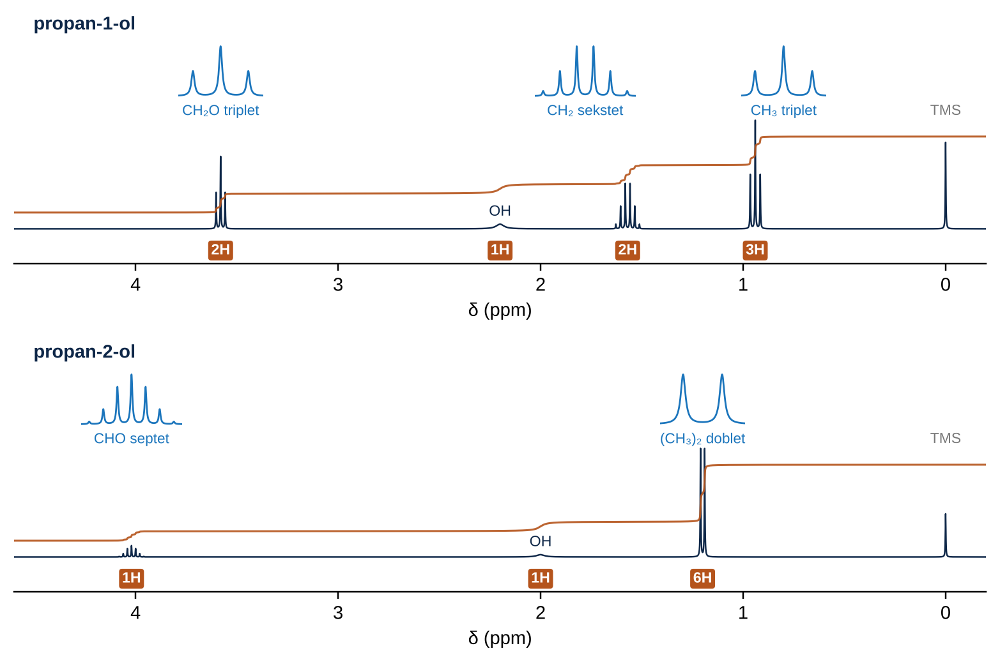

## 15.5 Pemecahan spin–spin dan aturan *n* + 1

### Tetangga yang juga magnet

Lihat kembali spektrum etil asetat (Gambar 15.7). Singlet CH₃ asetil pada δ 2,05 adalah satu garis tunggal, tetapi sinyal CH₂ pada δ 4,12 terdiri atas **empat** garis berdekatan, dan sinyal CH₃ etil pada δ 1,26 terdiri atas **tiga** garis. Pemecahan sinyal menjadi beberapa garis ini disebut **pemecahan spin–spin** (*spin–spin splitting*) atau **kopling**. Pemecahan ini membawa informasi yang sangat berharga: berapa banyak proton yang menjadi tetangga.

Asalnya sebagai berikut. Setiap proton adalah magnet kecil yang dapat berada dalam keadaan α atau β. Proton H~a~ merasakan medan magnet dari proton tetangganya H~b~, dan pengaruh itu diteruskan melalui elektron-elektron ikatan yang menghubungkan keduanya. Bila H~b~ dalam keadaan α, H~a~ merasakan medan yang sedikit lebih besar; bila H~b~ dalam keadaan β, H~a~ merasakan medan yang sedikit lebih kecil. Karena kedua keadaan H~b~ hampir sama banyak (subbab 15.1), separuh molekul dalam sampel mempunyai H~b~-α dan separuh lagi H~b~-β. Akibatnya sinyal H~a~ terpecah menjadi **dua garis** yang sama tinggi: sebuah **doblet**. Jarak antara kedua garis itu, dalam hertz, disebut **tetapan kopling** *J*.

Kopling bersifat **timbal balik**: bila H~a~ dipecah oleh H~b~ dengan tetapan *J*, maka H~b~ juga dipecah oleh H~a~ dengan tetapan *J* yang **persis sama**. Inilah petunjuk penting untuk mencari pasangan: dua sinyal yang saling memecah selalu menunjukkan jarak garis yang sama.

### Tiga tetangga memberi empat garis

Bila sebuah proton mempunyai lebih dari satu tetangga yang setara, kita menghitung semua kombinasi keadaan spin para tetangga itu. Ambil gugus CH₂ etil asetat yang bertetangga dengan CH₃. Ketiga proton metil masing-masing dapat α atau β, sehingga ada 2³ = 8 kombinasi:

- ααα (1 cara): medan tambahan terbesar;
- ααβ, αβα, βαα (3 cara): medan tambahan sedikit;
- αββ, βαβ, ββα (3 cara): medan berkurang sedikit;
- βββ (1 cara): medan berkurang terbanyak.

Kombinasi dengan jumlah α dan β yang sama memberi medan yang sama, sehingga hanya ada **empat** medan yang berbeda, dengan peluang 1 : 3 : 3 : 1. Sinyal CH₂ terpecah menjadi **kuartet** dengan perbandingan tinggi 1 : 3 : 3 : 1. Dengan cara yang sama, CH₃ yang bertetangga dengan dua proton CH₂ melihat αα, αβ/βα, ββ: tiga medan dengan peluang 1 : 2 : 1, sebuah **triplet**.

{width=94%}

### Aturan *n* + 1 dan segitiga Pascal

Pola umumnya dirangkum dalam **aturan *n* + 1**: sinyal proton yang mempunyai ***n* tetangga setara** terpecah menjadi ***n* + 1 garis**. Perbandingan tinggi garis-garisnya mengikuti **segitiga Pascal** (koefisien binomial), karena menghitung kombinasi α dan β sama dengan menghitung kemungkinan hasil pelemparan *n* uang logam.

| *n* | Nama pola | Lambang | Perbandingan tinggi |
|---|---|---|---|
| 0 | singlet | s | 1 |
| 1 | doblet | d | 1 : 1 |
| 2 | triplet | t | 1 : 2 : 1 |
| 3 | kuartet | q | 1 : 3 : 3 : 1 |
| 4 | kuintet | quint | 1 : 4 : 6 : 4 : 1 |
| 5 | sekstet | sext | 1 : 5 : 10 : 10 : 5 : 1 |
| 6 | septet | sept | 1 : 6 : 15 : 20 : 15 : 6 : 1 |

{width=92%}

Perhatikan bahwa garis-garis luar pola besar sangat kecil. Pada septet, garis terluar hanya 1/20 tinggi garis tengah, sehingga dalam spektrum yang kurang bersih septet sering tampak seperti kuintet. Menghitung garis harus disertai akal sehat: gugus isopropil, (CH₃)₂CH–, selalu memberi doblet 6H dan septet 1H.

### Siapa yang dihitung sebagai tetangga

Aturan *n* + 1 hanya bekerja bila kita menghitung tetangga yang benar:

1. **Tetangga** adalah proton pada karbon yang bersebelahan, berjarak tiga ikatan (H–C–C–H). Kopling tiga ikatan ini disebut **kopling vicinal**, ³*J*, biasanya 6–8 Hz dalam rantai yang bebas berotasi. Proton yang berjarak empat ikatan atau lebih umumnya tidak saling memecah (kecuali dalam sistem π atau cincin kaku).
2. **Proton setara tidak saling memecah.** Ketiga proton CH₃ etana saling bertetangga, tetapi tidak saling memecah; etana memberi singlet. Kopling antarproton setara memang ada, tetapi tidak menimbulkan pemecahan yang teramati.
3. **Proton O–H dan N–H biasanya tidak memecah** dan tidak dipecah, karena bertukar cepat antarmolekul (subbab 15.7).
4. **Atom tanpa H memutus rantai kopling.** Atom O, karbon karbonil, atau karbon kuarterner di antara dua gugus membuat keduanya berjarak empat ikatan atau lebih. Itulah sebabnya CH₃ asetil dan CH₂ etil pada etil asetat tidak saling memecah: di antaranya ada C=O dan O.

::: {.contoh}
**Contoh 15.8 · Meramalkan pola pemecahan**

Ramalkan geseran kimia perkiraan, integrasi, dan pola pemecahan semua sinyal dalam: (a) 1,1-dikloroetana; (b) 2-kloropropana; (c) 1-bromopropana; (d) metil propanoat.

**Penyelesaian.** (a) CH₃CHCl₂: CH₃ dengan satu tetangga, **doblet 3H**, δ ≈ 2,1; CHCl₂ dengan tiga tetangga, **kuartet 1H**, δ ≈ 5,9 (dua Cl menjumlah). (b) (CH₃)₂CHCl: dua CH₃ setara dengan satu tetangga, **doblet 6H**, δ ≈ 1,5; CHCl dengan enam tetangga setara, **septet 1H**, δ ≈ 4,2. (c) BrCH₂CH₂CH₃: CH₂Br dengan dua tetangga, **triplet 2H**, δ ≈ 3,4; CH₂ tengah dengan lima tetangga (2 + 3), **sekstet 2H**, δ ≈ 1,9; CH₃ dengan dua tetangga, **triplet 3H**, δ ≈ 1,0. (d) CH₃CH₂COOCH₃: OCH₃ tanpa tetangga, **singlet 3H**, δ ≈ 3,7; CH₂ dengan tiga tetangga, **kuartet 2H**, δ ≈ 2,3; CH₃ dengan dua tetangga, **triplet 3H**, δ ≈ 1,1.

**Memahami hasil.** Pada (c), CH₂ tengah mempunyai dua kelompok tetangga yang **tidak setara** (CH₂Br dan CH₃). Aturan *n* + 1 dengan *n* = 5 hanya berlaku karena kedua tetapan koplingnya kebetulan hampir sama (sekitar 7 Hz). Bila kedua *J* berbeda, polanya lebih rumit (subbab 15.6). Nilai terukur: (a) 2,06 dan 5,89; (b) 1,55 dan 4,16; (c) 3,39, 1,89, 1,03; (d) 3,67, 2,32, 1,14.
:::

::: {.strategi}
**Strategi membaca spektrum ¹H NMR**

1. Dari rumus molekul, hitung derajat ketidakjenuhan.
2. Hitung jumlah sinyal: berapa jenis proton.
3. Ubah integrasi menjadi jumlah proton memakai jumlah total H dalam rumus.
4. Baca geseran kimia setiap sinyal: daerah mana (alkil, dekat O/N/halogen, α karbonil, vinil, aromatik, aldehida, asam)?
5. Baca pola pemecahan: jumlah tetangga = jumlah garis − 1. Cari pasangan sinyal dengan *J* yang sama.
6. Susun potongan-potongan: singlet 3H pada δ 2,1 (CH₃CO–), triplet 3H + kuartet 2H (CH₃CH₂–), doblet 6H + septet 1H ((CH₃)₂CH–), singlet 9H (*t*-Bu), lima proton aromatik (C₆H₅–).
7. Gabungkan potongan menjadi struktur yang memenuhi rumus, lalu periksa kembali setiap sinyal.
:::

::: {.contoh}
**Contoh 15.9 · Menjawab teka-teki pembuka bab**

Dua botol C₄H₈O₂. Botol A: δ 4,12 (q, 2H), 2,05 (s, 3H), 1,26 (t, 3H). Botol B: δ 3,67 (s, 3H), 2,32 (q, 2H), 1,14 (t, 3H). IR keduanya: 1740 cm⁻¹. Tentukan strukturnya.

**Gambaran fisis.** Kedua senyawa mempunyai potongan yang sama: satu gugus etil (triplet 3H + kuartet 2H dengan *J* yang sama) dan satu CH₃ tanpa tetangga. Perbedaannya hanya pada letak geseran kimia.

**Penyelesaian.** Derajat ketidakjenuhan (2·4 + 2 − 8)/2 = 1: satu C=O, ester menurut IR. Potongan yang tersedia: CH₃CH₂–, CH₃–, dan –COO–. Hanya ada dua cara menyusunnya: CH₃COOCH₂CH₃ atau CH₃CH₂COOCH₃. Pada A, CH₂ kuartet berada pada δ 4,12, daerah H–C–O: CH₂ terikat pada oksigen. CH₃ singlet pada 2,05: CH₃ pada C=O. A adalah **etil asetat**. Pada B, CH₃ singlet berada pada 3,67, daerah H–C–O: CH₃ terikat pada oksigen. CH₂ kuartet pada 2,32: α karbonil. B adalah **metil propanoat**.

**Memahami hasil.** Pola pemecahan memberi potongan (etil dan metil terpisah), geseran kimia menunjukkan di mana setiap potongan terpasang. Inilah kekuatan NMR: dua isomer yang hampir kembar dalam IR dan perlu ditebak jalur fragmentasinya dalam MS dapat dibedakan dalam sekejap.
:::

::: {.kuis}
**Kuis cepat 15.5** (a) Ramalkan pola dan integrasi sinyal dalam 2-metilpropan-1-ol (abaikan kopling OH). (b) Mengapa CH₂ dalam ClCH₂CH₂Cl memberi singlet? (c) Senyawa C₄H₁₀O memberi δ 3,38 (q, 4H) dan 1,15 (t, 6H), tanpa sinyal yang hilang dengan D₂O. Tentukan strukturnya.
:::

## 15.6 Tetapan kopling dan pola rumit

### Tetapan kopling tidak bergantung pada medan

Geseran kimia dalam hertz sebanding dengan medan magnet, tetapi tetapan kopling *J* adalah sifat molekul yang **tidak bergantung pada medan**: *J* = 7 Hz pada spektrometer 60 MHz dan tetap 7 Hz pada spektrometer 900 MHz. Karena itu *J* selalu dilaporkan dalam hertz. Akibatnya penting: dalam skala δ, sebuah multiplet tampak **makin sempit** bila medan makin besar. Pada 300 MHz, 7 Hz sama dengan 0,023 ppm; pada 600 MHz hanya 0,012 ppm.

Ini menjelaskan alasan utama mengapa kimiawan menginginkan magnet yang makin kuat. Aturan *n* + 1 hanya berlaku bila jarak antara dua sinyal yang saling memecah (Δν, dalam hertz) jauh lebih besar daripada *J*, kira-kira Δν/*J* > 10. Spektrum seperti ini disebut **spektrum orde pertama**. Bila Δν/*J* kecil, garis-garis multiplet saling "menarik": garis dalam menjadi lebih tinggi dan garis luar lebih rendah (**efek atap**), dan bila Δν/*J* sangat kecil polanya menjadi rumit dan tidak dapat dibaca dengan aturan *n* + 1. Medan yang lebih kuat memperbesar Δν tanpa mengubah *J*, sehingga spektrum rumit menjadi sederhana.

::: {.contoh}
**Contoh 15.10 · Mengapa magnet kuat menyederhanakan spektrum**

Dua jenis proton bertetangga, H~a~ pada δ 2,40 dan H~b~ pada δ 2,30, dengan *J* = 7 Hz. Hitung Δν/*J* pada spektrometer 60, 300, dan 600 MHz, dan ramalkan bentuk spektrumnya.

**Penyelesaian.** Δδ = 0,10 ppm. Pada 60 MHz: Δν = 0,10 × 60 = 6 Hz, Δν/*J* = **0,86**: kedua multiplet bertumpuk menjadi pola orde kedua yang rumit. Pada 300 MHz: Δν = 30 Hz, Δν/*J* = **4,3**: dua multiplet terpisah, tetapi dengan efek atap yang jelas. Pada 600 MHz: Δν = 60 Hz, Δν/*J* = **8,6**: hampir orde pertama.

**Memahami hasil.** Spektrum yang tidak dapat dibaca pada alat 60 MHz tahun 1960-an menjadi hampir sederhana pada alat 600 MHz. Efek atap juga berguna: kedua multiplet yang saling memecah "condong" satu sama lain, seperti dua sisi atap rumah, sehingga membantu mencari pasangan kopling.
:::

### Besar *J* mengungkap geometri

Besar tetapan kopling bergantung pada jumlah ikatan di antara kedua proton dan pada geometri. Nilai-nilai yang paling berguna:

| Jenis kopling | *J* khas (Hz) | Keterangan |
|---|---|---|
| H–C–C–H, rantai bebas berotasi | 6–8 | rata-rata semua konformasi |
| H–C=C–H, *trans* | 12–18 | sekitar 15–17 |
| H–C=C–H, *cis* | 6–12 | sekitar 10 |
| =CH₂ (geminal, alkena) | 0–3 | |
| Aromatik *orto* | 7–9 | |
| Aromatik *meta* | 1–3 | |
| Aromatik *para* | 0–1 | biasanya tidak teramati |
| H–C–C(=O)–H aldehida | 1–3 | proton aldehida sering doblet atau triplet sempit |
| Sikloheksana aksial–aksial | 8–13 | sudut dihedral 180° |
| Sikloheksana aksial–ekuatorial, ekuatorial–ekuatorial | 2–5 | sudut dihedral sekitar 60° |

Ketergantungan ³*J* pada sudut dihedral antara kedua ikatan C–H dirumuskan oleh **persamaan Karplus**: *J* besar bila sudut dihedral mendekati 0° atau 180° (orbital ikatan C–H sejajar dan dapat "berbicara" dengan baik melalui ikatan C–C) dan kecil bila mendekati 90°. Karena itu proton *trans* pada alkena (sudut 180°) berkopling lebih kuat daripada proton *cis* (0°), dan proton aksial–aksial pada sikloheksana kursi (180°) berkopling lebih kuat daripada aksial–ekuatorial (60°). Inilah cara kimiawan menentukan konfigurasi alkena dan konformasi cincin dari spektrum NMR.

::: {.contoh}
**Contoh 15.11 · Menentukan konfigurasi alkena dari *J***

Dua isomer metil but-2-enoat, CH₃CH=CHCOOCH₃. Pada isomer X, proton vinil di sebelah C=O muncul pada δ 5,84 sebagai doblet dari kuartet dengan *J* = 15,5 Hz dan 1,7 Hz. Pada isomer Y, proton yang sama muncul pada δ 5,78 dengan *J* = 11,5 Hz dan 1,8 Hz. Tentukan konfigurasi *E*/*Z* masing-masing.

**Penyelesaian.** Kopling besar adalah kopling vinil–vinil antara kedua proton pada C=C. *J* = 15,5 Hz berada dalam daerah *trans*: X adalah isomer **(*E*)**, dengan kedua proton vinil berseberangan. *J* = 11,5 Hz berada dalam daerah *cis*: Y adalah isomer **(*Z*)**. Kopling kecil 1,7–1,8 Hz adalah kopling empat ikatan (alilik) dengan proton CH₃ di ujung lain ikatan rangkap, yang memecah setiap garis doblet menjadi kuartet sempit.

**Memahami hasil.** Untuk alkena yang setiap karbonnya membawa satu H, *J* antarproton vinil adalah cara paling langsung menentukan konfigurasi. Batasnya: alkena yang kedua proton vinilnya setara, seperti (*E*)- dan (*Z*)-1,2-dikloroetena, tidak menunjukkan pemecahan sama sekali (proton setara tidak saling memecah), sehingga *J* tidak dapat dibaca langsung.
:::

### Pola rumit dan diagram pohon

Bila sebuah proton bertetangga dengan dua kelompok proton yang **tidak setara** dan tetapan koplingnya berbeda, aturan *n* + 1 sederhana tidak berlaku. Kita memakai **diagram pohon**: pecah sinyal oleh kelompok pertama, lalu pecah setiap garis hasilnya oleh kelompok kedua. Proton yang bertetangga dengan satu H (tetapan *J*₁) dan satu H lain (tetapan *J*₂ ≠ *J*₁) memberi empat garis sama tinggi: sebuah **doblet dari doblet** (dd). Proton yang bertetangga dengan dua H setara (*J*₁) dan satu H lain (*J*₂) memberi **triplet dari doblet** (td), dan seterusnya.

Contoh klasik adalah gugus vinil stirena, C₆H₅CH=CH₂. Ketiga proton vinil tidak setara: H~a~ pada karbon yang membawa cincin, H~b~ *trans* terhadap H~a~, dan H~c~ *cis* terhadap H~a~. Setiap proton berkopling dengan dua proton lainnya dengan tetapan yang berbeda: *J*~ab~(*trans*) = 17,6 Hz, *J*~ac~(*cis*) = 10,9 Hz, dan *J*~bc~(geminal) = 0,9 Hz. Ketiga sinyal semuanya doblet dari doblet.

{width=96%}

::: {.contoh}
**Contoh 15.12 · Membaca doblet dari doblet**

Sebuah sinyal pada δ 6,72 dalam spektrum 300 MHz terdiri atas empat garis sama tinggi pada 2030,25; 2019,35; 2012,65; dan 2001,75 Hz dari TMS. (a) Tentukan kedua tetapan kopling. (b) Tunjukkan bahwa titik tengahnya sesuai dengan δ 6,72.

**Penyelesaian.** (a) Pada doblet dari doblet, jarak garis 1–2 dan garis 3–4 sama dengan *J* kecil, dan jarak garis 1–3 dan 2–4 sama dengan *J* besar. Garis 1–2: 2030,25 − 2019,35 = **10,9 Hz**; garis 3–4: 2012,65 − 2001,75 = 10,9 Hz. Garis 1–3: 2030,25 − 2012,65 = **17,6 Hz**; garis 2–4: 2019,35 − 2001,75 = 17,6 Hz. (b) Titik tengah = (2030,25 + 2001,75)/2 = 2016,0 Hz; δ = 2016,0/300 = **6,72**.

**Memahami hasil.** Empat garis sama tinggi bukan kuartet: kuartet sejati mempunyai perbandingan 1 : 3 : 3 : 1 dan jarak antargaris yang sama. Bila jarak antargaris tidak sama atau tinggi garis tidak mengikuti segitiga Pascal, curigai pola dari dua (atau lebih) tetapan kopling yang berbeda. Kedua *J* ini (17,6 dan 10,9 Hz) adalah tanda khas proton vinil yang mempunyai satu tetangga *trans* dan satu tetangga *cis*.
:::

### Pola cincin benzena

Proton aromatik sering memberi pola yang langsung menunjukkan pola substitusi cincin:

- **Monosubstitusi** (C₆H₅–X): lima proton, biasanya bertumpuk sebagai multiplet 5H pada δ 7,1–7,5 bila X tidak terlalu menarik atau mendorong elektron.
- ***Para*-disubstitusi** dengan dua substituen berbeda: empat proton membentuk dua pasang proton setara, yang tampak sebagai **dua doblet 2H** dengan *J* *orto* sekitar 8–9 Hz. Pola simetris "dua doblet miring" ini sangat khas.
- ***Orto*- dan *meta*-disubstitusi** dengan dua substituen berbeda: empat proton tidak setara, polanya lebih rumit. Pada *meta*, proton di antara kedua substituen tidak mempunyai tetangga *orto* dan sering tampak sebagai singlet sempit (hanya kopling *meta*).

Geseran kimia proton aromatik juga mengikuti efek substituen yang kita pelajari dalam substitusi elektrofilik (subbab 10.8): gugus pendorong elektron seperti –OCH₃ dan –NH₂ memperbesar kerapatan elektron di posisi *orto* dan *para* sehingga proton-proton itu bergeser ke medan atas (δ 6,7–6,9), sedangkan gugus penarik seperti –NO₂ dan –C(=O)R menggeser proton *orto* ke medan bawah (δ 7,9–8,2).

::: {.contoh}
**Contoh 15.13 · Pola substitusi cincin**

Senyawa C₇H₇Cl memberi δ 7,25 (d, *J* = 8,4 Hz, 2H), 7,08 (d, *J* = 8,4 Hz, 2H), dan 2,31 (s, 3H). Tentukan strukturnya.

**Penyelesaian.** Derajat ketidakjenuhan (2·7 + 2 − 7 − 1)/2 = 4: cincin benzena. Empat proton aromatik sebagai dua doblet 2H dengan *J* *orto* yang sama: cincin *para*-disubstitusi. Singlet 3H pada δ 2,31: CH₃ benzilik. Substituen lainnya Cl. Struktur: **4-klorotoluena** (1-kloro-4-metilbenzena).

**Memahami hasil.** Isomer *orto* dan *meta* (2- dan 3-klorotoluena) juga memberi singlet CH₃ pada δ sekitar 2,3, tetapi daerah aromatiknya berisi empat sinyal tidak setara, bukan dua doblet simetris. Pola dua doblet 2H adalah sidik jari cincin *para*.
:::

::: {.kuis}
**Kuis cepat 15.6** (a) Proton H~a~ mempunyai satu tetangga dengan *J* = 10 Hz dan dua tetangga setara dengan *J* = 3 Hz. Berapa garis yang terlihat, dan apa nama polanya? (b) Bagaimana *J* membedakan metil (*E*)- dan (*Z*)-3-fenilpropenoat? (c) Mengapa kopling *trans* lebih besar daripada kopling *cis*?
:::

## 15.7 Proton OH dan NH

### Pertukaran cepat menghapus kopling

Dalam etanol, proton OH bertetangga dengan dua proton CH₂. Menurut aturan *n* + 1, sinyal OH seharusnya triplet dan sinyal CH₂ seharusnya terpecah oleh CH₃ **dan** OH. Kenyataannya, dalam spektrum etanol biasa (CDCl₃, dengan sedikit air atau asam), OH tampak sebagai **singlet** yang sering lebar, dan CH₂ hanya kuartet: seolah-olah proton OH tidak ada hubungannya dengan CH₂.

Penyebabnya adalah **pertukaran proton** yang cepat. Proton OH terus-menerus berpindah dari satu molekul etanol ke molekul lain, dan ke air, dengan bantuan sedikit asam atau basa:

$$
\text{CH}_3\text{CH}_2\text{O–H} + \text{H–O–CH}_2\text{CH}_3^* \rightleftharpoons \text{CH}_3\text{CH}_2\text{O–H}^* + \text{H–O–CH}_2\text{CH}_3
$$

Bila pertukaran terjadi jauh lebih cepat daripada kebalikan tetapan kopling (beberapa kali per detik sudah cukup bila *J* sekitar 5 Hz), proton CH₂ "melihat" banyak proton OH yang berbeda, separuh α dan separuh β, dalam waktu yang sangat singkat. Medan yang dirasakannya menjadi rata-rata, dan kopling lenyap. Dari sisi OH pun sama: setiap proton OH berpindah-pindah antarmolekul terlalu cepat untuk merasakan keadaan spin CH₂ tertentu. Pertukaran juga merata-ratakan geseran kimia OH dengan geseran kimia air atau proton asam lain dalam sampel, sehingga δ(OH) bergantung pada konsentrasi dan kemurnian.

Dalam pelarut yang menerima ikatan hidrogen kuat dan sangat kering, seperti DMSO-*d*₆, pertukaran melambat. Etanol dalam DMSO-*d*₆ memberi OH sebagai **triplet** pada δ 4,35 (*J* = 5,1 Hz), dan CH₂ tampak sebagai multiplet (dipecah oleh CH₃ dan OH). Spektrum ini dipakai untuk membedakan alkohol primer (OH triplet), sekunder (OH doblet), dan tersier (OH singlet).

### Uji D₂O

Cara paling sederhana untuk mengenali sinyal OH dan NH adalah **uji pertukaran D₂O**. Setelah spektrum biasa direkam, setetes D₂O ditambahkan ke tabung NMR, tabung dikocok, dan spektrum direkam lagi. Proton OH dan NH (juga COOH) bertukar dengan deuterium:

$$
\text{R–OH} + \text{D}_2\text{O} \rightleftharpoons \text{R–OD} + \text{HOD}
$$

Deuterium tidak terlihat dalam spektrum ¹H, sehingga sinyal OH **hilang** (atau sangat mengecil) dan sinyal HOD baru muncul sekitar δ 4,7. Proton C–H tidak bertukar dan tidak berubah.

{width=94%}

### Proton NH dan efek kuadrupol

Proton N–H amina berperilaku mirip proton OH: geseran kimianya beragam (δ 0,5–5 untuk amina alifatik), sering lebar, dan bertukar dengan D₂O. Proton N–H **amida** (δ 5–9) bertukar lebih lambat dan sering tampak sebagai sinyal yang sangat lebar. Penyebab tambahannya adalah inti ¹⁴N, yang mempunyai spin *I* = 1 dan **momen kuadrupol listrik**. Inti kuadrupolar berganti keadaan spin sangat cepat, sehingga proton yang terikat padanya melihat tetangga yang "kabur": garis-garisnya melebar, bukan terpecah rapi.

::: {.contoh}
**Contoh 15.14 · Mengenali sinyal yang dapat dipertukarkan**

Senyawa C₃H₈O memberi spektrum: δ 4,02 (sept, *J* = 6,1 Hz, 1H), 2,10 (s lebar, 1H), dan 1,20 (d, *J* = 6,1 Hz, 6H). Setelah dikocok dengan D₂O, sinyal pada δ 2,10 hilang. (a) Tentukan strukturnya. (b) Bagaimana spektrum propan-1-ol berbeda?

**Penyelesaian.** (a) Derajat ketidakjenuhan 0. Sinyal 2,10 yang hilang dengan D₂O adalah OH. Doblet 6H dan septet 1H dengan *J* sama: gugus isopropil. Septet pada δ 4,02 berada di daerah H–C–O. Struktur: **propan-2-ol**, (CH₃)₂CHOH. (b) Propan-1-ol, CH₃CH₂CH₂OH, memberi empat sinyal: δ 3,58 (t, 2H, CH₂O), 1,57 (sekstet, 2H), 0,94 (t, 3H), dan OH (s lebar, 1H, hilang dengan D₂O). CH₂O pada propan-1-ol hanya triplet (dipecah oleh CH₂ tengah, tidak oleh OH).

**Memahami hasil.** Kedua isomer ini mempunyai pita IR O–H dan C–O yang hampir sama dan spektrum massa yang berbeda tetapi perlu ditafsirkan. Dalam NMR, keduanya berbeda jelas: tiga sinyal lawan empat, doblet 6H lawan triplet 3H.
:::

{width=96%}

::: {.inti}
**Inti subbab 15.5–15.7**

- Proton dengan *n* tetangga setara (berjarak tiga ikatan) terpecah menjadi *n* + 1 garis dengan perbandingan segitiga Pascal. Proton setara tidak saling memecah.
- *J* (Hz) tidak bergantung pada medan; pasangan yang saling memecah mempunyai *J* sama. Medan kuat membuat spektrum mendekati orde pertama.
- *J* mengungkap geometri: *trans* 12–18 Hz, *cis* 6–12 Hz, *orto* 7–9 Hz, aksial–aksial 8–13 Hz (persamaan Karplus).
- Dua kelompok tetangga dengan *J* berbeda: diagram pohon (dd, td, ...). Cincin *para*: dua doblet 2H.
- OH dan NH bertukar cepat: biasanya singlet lebar, tidak memecah tetangga, δ beragam, hilang dengan D₂O.
:::

::: {.kuis}
**Kuis cepat 15.7** (a) Mengapa proton OH etanol dalam CDCl₃ tidak memecah sinyal CH₂? (b) Dalam DMSO-*d*₆ yang kering, sinyal OH sebuah alkohol C₄H₁₀O tampak sebagai doblet. Apakah alkohol itu primer, sekunder, atau tersier? Sebutkan strukturnya. (c) Apa yang terjadi pada spektrum asam asetat bila dikocok dengan D₂O?
:::
