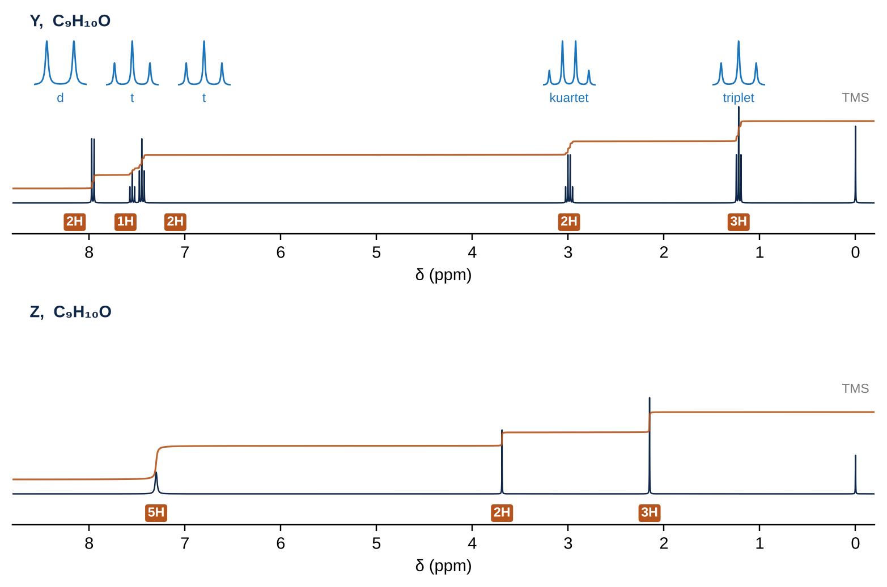

## 15.8 NMR ¹³C dan DEPT

### Melihat kerangka karbon secara langsung

Kerangka molekul organik terbuat dari karbon, tetapi isotop karbon yang paling melimpah, ¹²C, tidak mempunyai spin dan tidak terlihat dalam NMR. Isotop ¹³C mempunyai spin ½, tetapi kelimpahan alaminya hanya 1,1%, dan rasio giromagnetiknya hanya seperempat rasio proton. Kedua faktor ini membuat sinyal ¹³C sekitar **5900 kali lebih lemah** daripada sinyal ¹H untuk jumlah atom yang sama. Spektrum ¹³C baru menjadi rutin setelah FT-NMR memungkinkan ratusan sampai ribuan pengukuran dijumlahkan dalam waktu yang wajar.

Kelimpahan yang rendah ternyata membawa keuntungan. Peluang dua atom ¹³C bersebelahan dalam satu molekul hanya sekitar 0,011² ≈ 1 dalam 8000, sehingga kopling ¹³C–¹³C praktis tidak terlihat. Kopling ¹³C–¹H memang ada dan besar (sekitar 125–250 Hz untuk ikatan C–H langsung), tetapi spektrometer menghilangkannya dengan **pemisahan proton pita lebar** (*broadband proton decoupling*): selama pengukuran ¹³C, semua proton disinari terus-menerus dengan gelombang radio pada frekuensi ¹H, sehingga keadaan spinnya berganti-ganti sangat cepat dan efeknya rata-rata nol. Hasilnya, **setiap atom karbon yang tidak setara memberi satu garis tunggal**. Spektrum ¹³C biasa adalah daftar garis yang bersih: jumlah garis sama dengan jumlah jenis karbon.

### Geseran kimia ¹³C

Geseran kimia ¹³C diukur terhadap TMS seperti ¹H, tetapi rentangnya sekitar dua puluh kali lebih lebar: 0–220 ppm. Karena itu sinyal karbon jarang bertumpuk, bahkan dalam molekul yang cukup besar. Faktor-faktor yang menentukan δ(¹³C) sama dengan ¹H: atom elektronegatif dan hibridisasi sp² menggeser sinyal ke medan bawah. Karbon karbonil, yang sp² **dan** terikat pada oksigen, berada paling kiri.

{width=96%}

| Jenis karbon | δ (ppm) | Jenis karbon | δ (ppm) |
|---|---|---|---|
| CH₃, CH₂, CH alkil | 5–45 | C≡C (alkuna) | 65–90 |
| C–N (amina) | 30–60 | C=C (alkena) | 100–150 |
| C–Cl, C–Br | 25–65 | C aromatik | 110–160 |
| C–O (alkohol, eter, ester) | 50–90 | C≡N (nitril) | 115–125 |
| C=O asam, ester, amida | 160–185 | C=O aldehida | 190–205 |
| | | C=O keton | 200–220 |

Perbedaan antara karbonil keton/aldehida dan karbonil asam/turunannya sangat berguna. Pada asam dan turunannya, pasangan bebas oksigen atau nitrogen yang terikat pada karbon karbonil memberi elektron lewat resonansi (subbab 12.3), sehingga karbon itu sedikit lebih terperisai (160–185) daripada karbon keton (200–220).

::: {.contoh}
**Contoh 15.15 · Jumlah sinyal ¹³C**

Berapa sinyal ¹³C yang diberikan oleh: (a) sikloheksana; (b) metilsikloheksana; (c) 2,3-dimetilbut-2-ena; (d) etil asetat; (e) asam benzoat; (f) 1,4-dimetilbenzena?

**Penyelesaian.** (a) Semua karbon setara: **1**. (b) CH₃, C1, C2/C6, C3/C5, C4: **5**. (c) (CH₃)₂C=C(CH₃)₂: empat CH₃ setara dan dua karbon alkena setara: **2**. (d) CH₃CO, C=O, OCH₂, CH₃ etil: **4** (14,2; 21,0; 60,4; 171,1). (e) C=O, C1 (*ipso*), C2/C6 (*orto*), C3/C5 (*meta*), C4 (*para*): **5**. (f) Dua CH₃ setara, dua C *ipso* setara, empat CH aromatik setara: **3**.

**Memahami hasil.** Penghitungan karbon setara memakai simetri yang sama dengan penghitungan proton. Cincin benzena bersubstituen tunggal selalu memberi empat sinyal aromatik, sedangkan cincin *para* dengan dua substituen berbeda juga memberi empat (dua C *ipso* dan dua pasang CH). Benzena *para* dengan dua substituen **sama** hanya memberi dua sinyal aromatik.
:::

### Intensitas dan karbon kuarterner

Dalam spektrum ¹³C rutin, tinggi garis **tidak** sebanding dengan jumlah karbon (subbab 15.4). Karbon yang membawa proton biasanya memberi garis yang lebih tinggi, karena sinyalnya diperkuat oleh pemisahan proton (efek Overhauser inti) dan karena karbon itu cepat pulih ke keadaan setimbang di antara pulsa. Karbon **kuarterner** (tanpa H), termasuk karbon karbonil dan karbon *ipso* aromatik, hampir selalu memberi garis yang **paling kecil**. Kelemahan ini justru dapat dipakai sebagai petunjuk: garis kecil di daerah 125–145 sering berasal dari karbon *ipso*, dan garis kecil di 170–210 dari karbon karbonil.

### DEPT: berapa H pada setiap karbon

Spektrum ¹³C dengan pemisahan proton menghilangkan informasi tentang jumlah proton pada setiap karbon. Informasi itu dikembalikan oleh teknik **DEPT** (*distortionless enhancement by polarization transfer*), yang memakai rangkaian pulsa pada kedua saluran ¹H dan ¹³C. Tanpa membahas fisika pulsanya, hasilnya dapat diringkas sebagai berikut:

- **DEPT-90**: hanya karbon **CH** yang muncul (garis positif).
- **DEPT-135**: karbon **CH** dan **CH₃** muncul positif (ke atas), karbon **CH₂** muncul **negatif** (ke bawah).
- Karbon **kuarterner** (C tanpa H, termasuk C=O) tidak muncul dalam kedua spektrum DEPT; ia hanya terlihat dalam spektrum ¹³C biasa.

Dengan membandingkan ketiga spektrum (¹³C biasa, DEPT-135, DEPT-90), setiap garis dapat diberi label C, CH, CH₂, atau CH₃.

{width=96%}

::: {.contoh}
**Contoh 15.16 · Membedakan tiga keton C₅H₁₀O dengan ¹³C dan DEPT**

Tiga keton C₅H₁₀O: pentan-2-on, pentan-3-on, dan 3-metilbutan-2-on. Sebuah sampel memberi spektrum ¹³C dengan empat garis: δ 212,5; 41,6; 27,5; 18,2. Dalam DEPT-135, garis 41,6 positif, 27,5 positif, 18,2 positif, dan garis 212,5 hilang; tidak ada garis negatif. Dalam DEPT-90 hanya garis 41,6 yang muncul. Tentukan keton yang mana.

**Penyelesaian.** Hitung jumlah garis yang diharapkan: pentan-3-on, CH₃CH₂COCH₂CH₃, simetris: **3** garis. Pentan-2-on, CH₃COCH₂CH₂CH₃: **5** garis. 3-Metilbutan-2-on, CH₃COCH(CH₃)₂: C=O, CH, CH₃CO, dan dua CH₃ setara: **4** garis. Sampel memberi empat garis, sesuai dengan 3-metilbutan-2-on. DEPT memastikan: tidak ada CH₂ (tidak ada garis negatif), satu CH pada δ 41,6 (muncul di DEPT-90), dua jenis CH₃ (27,5 dan 18,2), dan C=O keton kuarterner pada 212,5. Sampel adalah **3-metilbutan-2-on**.

**Memahami hasil.** Pentan-2-on akan memberi dua garis negatif (dua CH₂) dalam DEPT-135, dan pentan-3-on satu garis negatif. Jumlah garis ¹³C memberi simetri molekul; DEPT memberi jumlah H pada setiap karbon. Bila jumlah H dari DEPT dijumlahkan, hasilnya harus cocok dengan rumus molekul (di sini 3 + 3 + 3 + 1 = 10, dengan dua CH₃ setara dihitung dua kali): pemeriksaan sederhana yang menangkap banyak kesalahan.
:::

::: {.inti}
**Inti subbab 15.8**

- ¹³C: kelimpahan 1,1%, sekitar 5900 kali kurang peka daripada ¹H; kopling ¹³C–¹³C tidak terlihat dan kopling ¹³C–¹H dihapus dengan pemisahan proton, sehingga setiap karbon tak setara memberi satu garis.
- Rentang δ 0–220 ppm: alkil 5–45, C–O 50–90, alkena/aromatik 100–160, C=O turunan asam 160–185, C=O keton/aldehida 190–220.
- Intensitas ¹³C rutin tidak sebanding dengan jumlah karbon; karbon kuarterner lemah.
- DEPT-90: hanya CH. DEPT-135: CH dan CH₃ ke atas, CH₂ ke bawah. Kuarterner tidak muncul.
:::

::: {.kuis}
**Kuis cepat 15.8** (a) Berapa garis ¹³C untuk pentan-2-on, dan berapa yang negatif dalam DEPT-135? (b) Sebuah garis pada δ 172 tidak muncul dalam DEPT. Gugus apa yang mungkin? (c) Mengapa spektrum ¹³C rutin tidak diintegrasi?
:::

## 15.9 Strategi menentukan struktur dari IR, MS, dan NMR

### Setiap metode menjawab pertanyaan yang berbeda

Kita sekarang memiliki empat alat utama penentuan struktur. Masing-masing paling kuat untuk pertanyaan tertentu:

| Metode | Pertanyaan yang dijawab |
|---|---|
| MS (dan analisis unsur) | Berapa massa molekulnya? Apa rumus molekulnya? Adakah Cl, Br, N? Potongan apa yang mudah lepas? |
| Rumus molekul | Berapa derajat ketidakjenuhan (cincin + ikatan π)? |
| IR | Gugus fungsi apa yang ada dan, sama pentingnya, yang tidak ada? |
| ¹³C NMR + DEPT | Berapa jenis karbon? Berapa H pada masing-masing? Adakah C=O, dan jenis apa? Simetrikah molekulnya? |
| ¹H NMR | Berapa jenis H, berapa jumlahnya, di lingkungan apa, dan siapa tetangganya? |

Tidak ada satu metode pun yang selalu cukup sendirian, tetapi gabungan keempatnya hampir selalu menghasilkan struktur yang tunggal.

::: {.strategi}
**Strategi penentuan struktur**

1. **Rumus molekul** (dari MS resolusi tinggi atau analisis unsur + ion molekul). Hitung derajat ketidakjenuhan. Empat atau lebih sering berarti cincin benzena.
2. **IR**: tandai gugus fungsi utama (O–H, N–H, C=O dan jenisnya, C≡N, C≡C) dan catat yang tidak ada.
3. **¹³C NMR dan DEPT**: hitung jenis karbon; cari C=O (dan apakah keton/aldehida atau turunan asam), karbon aromatik/alkena, karbon C–O. Bandingkan jumlah garis dengan jumlah atom C untuk menilai simetri.
4. **¹H NMR**: ubah integrasi menjadi jumlah H; baca geseran kimia dan pola pemecahan; susun potongan-potongan (etil, isopropil, *t*-butil, metil keton, metoksi, fenil, cincin *para*).
5. **Rakit** potongan menjadi struktur yang memenuhi rumus dan derajat ketidakjenuhan. Tuliskan semua kemungkinan bila lebih dari satu.
6. **Periksa** setiap data terhadap struktur akhir, termasuk fragmen MS. Satu data yang tidak cocok berarti struktur harus diperbaiki.
:::

::: {.contoh}
**Contoh 15.17 · Ester aromatik**

Senyawa X, C₉H₁₀O₂. IR: 1740 cm⁻¹ (kuat), 1230 cm⁻¹, pita aromatik; tidak ada O–H. ¹H NMR: δ 7,35 (m, 5H), 5,10 (s, 2H), 2,08 (s, 3H). ¹³C NMR: δ 170,8; 136,0; 128,5; 128,2; 128,1; 66,3; 21,0. DEPT-135: 66,3 negatif. MS: 150 (M), 108, 91 (puncak dasar), 43. Tentukan strukturnya.

**Penyelesaian.** Derajat ketidakjenuhan (2·9 + 2 − 10)/2 = **5**: cincin benzena (4) + satu C=O (1). IR 1740 dan 1230: ester. ¹H: lima H aromatik dalam satu multiplet: C₆H₅– bersubstituen tunggal. Singlet 2H pada δ 5,10: CH₂ tanpa tetangga, terawaperisai kuat oleh cincin **dan** oksigen ester. Singlet 3H pada 2,08: CH₃ asetil. ¹³C: 170,8 (C=O ester), empat garis aromatik (C *ipso* 136,0 dan tiga CH), 66,3 (CH₂–O, negatif di DEPT-135), 21,0 (CH₃CO). Struktur: **benzil asetat**, CH₃COOCH₂C₆H₅. MS: 91 adalah ion benzil/tropilium (subbab 14.7); 43 adalah CH₃CO⁺; 108 berasal dari penataan ulang yang melepas keten (CH₂=C=O, 42).

**Memahami hasil.** Isomer fenil propanoat (C₂H₅COOC₆H₅) akan memberi triplet 3H dan kuartet 2H, bukan dua singlet; metil fenilasetat (C₆H₅CH₂COOCH₃) memberi singlet CH₂ pada δ 3,6 dan OCH₃ pada δ 3,7, bukan 5,1 dan 2,1. Geseran kimia singlet 2H (5,10) yang sangat ke kiri adalah kunci: CH₂ yang diapit cincin benzena dan oksigen ester.
:::

{width=96%}

::: {.contoh}
**Contoh 15.18 · Dua keton aromatik C₉H₁₀O**

Dua senyawa C₉H₁₀O sama-sama memberi pita C=O dalam IR. Y: IR 1685 cm⁻¹; ¹H NMR δ 7,96 (d, 2H), 7,55 (t, 1H), 7,45 (t, 2H), 2,99 (q, *J* = 7,2 Hz, 2H), 1,22 (t, *J* = 7,2 Hz, 3H); MS 134, 105 (dasar), 77. Z: IR 1715 cm⁻¹; ¹H NMR δ 7,20–7,35 (m, 5H), 3,69 (s, 2H), 2,15 (s, 3H); MS 134, 91 (dasar), 43. Tentukan strukturnya (lihat Gambar 15.15).

**Penyelesaian.** Derajat ketidakjenuhan (2·9 + 2 − 10)/2 = 5: cincin benzena + C=O. **Y**: C=O pada 1685, lebih rendah daripada keton biasa: terkonjugasi dengan cincin (subbab 14.3). Proton aromatik terpisah menjadi 2H + 1H + 2H, dengan dua proton *orto* jauh di medan bawah (7,96) karena anisotropi C=O di sebelahnya: C₆H₅–C(=O)–. Etil (q 2H + t 3H) dengan CH₂ pada δ 2,99, α karbonil. Y adalah **1-fenilpropan-1-on** (propiofenon), C₆H₅COCH₂CH₃. MS: pemutusan α melepas etil memberi ion benzoil C₆H₅CO⁺ (105), yang kehilangan CO menjadi C₆H₅⁺ (77). **Z**: C=O pada 1715, tidak terkonjugasi. Lima H aromatik dalam satu multiplet: C₆H₅– yang tidak terikat langsung pada C=O. Singlet 2H pada δ 3,69 (CH₂ yang diapit cincin dan C=O) dan singlet 3H pada 2,15 (metil keton). Z adalah **1-fenilpropan-2-on**, C₆H₅CH₂COCH₃. MS: 91 (benzil/tropilium) dan 43 (CH₃CO⁺).

**Memahami hasil.** Setiap metode memberi bukti yang sejalan: konjugasi terlihat di IR (1685 lawan 1715), di ¹H NMR (proton *orto* yang terdorong ke 7,96), dan di MS (105 lawan 91). Pola pemecahan menunjukkan apakah gugus alkilnya etil atau CH₂ + CH₃ yang terpisah. Bila satu metode meragukan, metode lain hampir selalu memutuskan.
:::

::: {.contoh}
**Contoh 15.19 · Keton alifatik dari semua data**

Senyawa W memberi MS: 86 (M), 71, 43 (dasar); tidak ada puncak 58. IR: 1715 cm⁻¹. ¹H NMR: δ 2,62 (sept, *J* = 6,9 Hz, 1H), 2,14 (s, 3H), 1,11 (d, *J* = 6,9 Hz, 6H). ¹³C: 212,5; 41,6; 27,5; 18,2. Tentukan strukturnya dan jelaskan mengapa puncak McLafferty tidak ada.

**Penyelesaian.** M = 86 genap (tanpa N). Keton (1715) dengan rumus C₅H₁₀O (86 = 5·12 + 10 + 16), derajat ketidakjenuhan 1. ¹H: doblet 6H + septet 1H dengan *J* sama: isopropil; septet pada 2,62 berada α karbonil. Singlet 3H pada 2,14: metil keton. Struktur: **3-metilbutan-2-on**, CH₃COCH(CH₃)₂, sesuai dengan data ¹³C di Contoh 15.16. MS: 43 = CH₃CO⁺ (dasar) dan 71 = M − 15. Penataan ulang McLafferty memerlukan proton pada karbon γ terhadap C=O. Pada 3-metilbutan-2-on, karbon terjauh dari C=O hanya karbon β (kedua CH₃ isopropil); tidak ada karbon γ, sehingga puncak 58 tidak muncul.

**Memahami hasil.** Bandingkan dengan pentan-2-on, CH₃COCH₂CH₂CH₃, yang mempunyai H γ dan memberi puncak McLafferty 58, serta memberi triplet, sekstet, dan triplet dalam ¹H NMR. Absennya sebuah puncak MS sama informatifnya dengan kehadirannya.
:::

::: {.awas}
**Hati-hati: jangan berhenti pada struktur pertama yang cocok**

Setelah menemukan satu struktur yang memenuhi sebagian besar data, tuliskan isomer-isomer lain yang memakai potongan yang sama, lalu periksa apakah data dapat membedakannya. Dalam Contoh 15.17, benzil asetat, metil fenilasetat, dan fenil propanoat memakai potongan yang mirip; hanya geseran kimia yang menunjukkan susunan yang benar. Kesalahan paling sering dalam soal struktur bukan salah membaca spektrum, melainkan tidak memikirkan kemungkinan lain.
:::

::: {.terapan}
**Terapan: dari tabung NMR ke MRI**

Prinsip yang sama dengan NMR dipakai dalam **pencitraan resonansi magnet** (*magnetic resonance imaging*, MRI) di rumah sakit. Sebagian besar proton dalam tubuh berada dalam molekul air dan lemak. Dalam MRI, medan magnet sengaja dibuat sedikit berbeda dari satu titik ke titik lain (gradien medan), sehingga frekuensi resonansi proton bergantung pada letaknya di dalam tubuh. Transformasi Fourier lalu mengubah sinyal menjadi peta tiga dimensi kerapatan proton. Kontras antara jaringan berasal dari perbedaan waktu pemulihan (relaksasi) proton air dalam lingkungan yang berbeda, dan dapat diperkuat dengan zat kontras berbasis ion gadolinium(III) yang mempercepat relaksasi. Kata "inti" sengaja dihilangkan dari nama teknik ini karena terdengar menakutkan bagi pasien, padahal MRI tidak memakai radiasi pengion sama sekali: energi foton yang dipakai, seperti telah kita hitung, ratusan ribu kali lebih kecil daripada foton inframerah.
:::

::: {.inti}
**Inti subbab 15.9**

- MS → rumus dan potongan; rumus → derajat ketidakjenuhan; IR → gugus fungsi; ¹³C + DEPT → jenis karbon dan simetri; ¹H → potongan dan cara penyambungannya.
- Rakit potongan, tuliskan semua isomer yang mungkin, lalu uji setiap kemungkinan terhadap semua data.
- Data yang tidak ada (pita IR, puncak McLafferty, garis negatif DEPT) sama pentingnya dengan data yang ada.
:::

::: {.kuis}
**Kuis cepat 15.9** Senyawa C₄H₈O₂ memberi IR pita sangat lebar 2500–3300 dan 1710 cm⁻¹; ¹H NMR δ 11,8 (s lebar, 1H, hilang dengan D₂O), 2,57 (sept, 1H), 1,20 (d, 6H); ¹³C: 184, 34, 19. Tentukan strukturnya.
:::

## Menuju bab berikutnya

Teka-teki pembuka bab kini terjawab sepenuhnya. Etil asetat dan metil propanoat, yang hampir kembar dalam IR, memberi potongan ¹H NMR yang sama (etil dan metil) tetapi pada geseran kimia yang berbeda: CH₂ pada 4,12 berarti O–CH₂, sedangkan CH₃ pada 3,67 berarti O–CH₃. Dengan IR, MS, dan NMR di tangan, kita dapat menentukan struktur hampir setiap senyawa monofungsi yang dibahas dalam buku ini, biasanya hanya dari beberapa miligram sampel dan dalam waktu kurang dari satu jam.

Mengetahui struktur suatu senyawa adalah separuh pekerjaan kimiawan organik. Separuh lainnya adalah **membuat** senyawa yang diinginkan dari bahan yang tersedia. Selama lima belas bab kita telah mengumpulkan puluhan reaksi: substitusi, eliminasi, adisi, oksidasi, reduksi, substitusi aromatik, reaksi karbonil, dan reaksi turunan asam. Bab 16 merangkai semuanya menjadi **strategi sintesis**: bagaimana merencanakan rangkaian reaksi dari belakang (analisis retrosintesis), bagaimana membentuk ikatan C–C, bagaimana mengubah satu gugus fungsi menjadi gugus lain, dan bagaimana melindungi gugus yang tidak boleh ikut bereaksi. Spektroskopi dari Bab 14 dan 15 akan menjadi alat untuk memeriksa bahwa setiap langkah sintesis benar-benar menghasilkan apa yang kita rencanakan.
