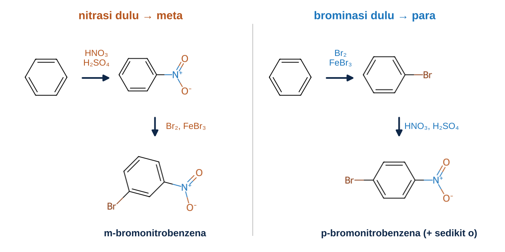

## 16.4 Analisis retrosintesis

### Berpikir dari belakang

Bayangkan kita diminta membuat sebuah molekul target yang belum pernah kita lihat. Bila kita mulai dari bahan awal dan mencoba reaksi apa saja yang mungkin, jumlah kemungkinannya meledak dengan cepat: dari satu bahan ada puluhan reaksi, dari setiap produk ada puluhan reaksi lagi. Pencarian ke depan seperti ini hampir tidak pernah berhasil untuk target yang rumit.

Pada tahun 1960-an, Elias J. Corey merumuskan cara berpikir sebaliknya yang kini dipakai semua kimiawan sintesis: **analisis retrosintesis**. Kita mulai dari **molekul target** dan bertanya: "Dari molekul apa target ini dapat dibuat dalam satu langkah?" Jawabannya, **prekursor**, lalu diperlakukan sebagai target baru, dan seterusnya, sampai kita sampai pada bahan yang tersedia secara komersial. Setiap langkah mundur ditulis dengan **panah retrosintesis** (⇒), panah berbatang ganda yang dibaca "dapat dibuat dari". Setelah pohon retrosintesis selesai, kita membalik arahnya dan menuliskan **sintesis maju** dengan pereaksi lengkap. Corey memperoleh Hadiah Nobel Kimia 1990 untuk gagasan ini.

Ada dua jenis langkah mundur:

1. **Diskoneksi** (pemutusan): memutus satu ikatan dalam target secara imajiner, terutama ikatan C–C atau C–heteroatom, sehingga molekul terbelah menjadi dua potongan yang lebih sederhana.
2. **Interkonversi gugus fungsi** (FGI): mengubah satu gugus fungsi menjadi gugus lain yang memudahkan diskoneksi berikutnya, misalnya alkana ⇒ alkena atau alkuna, amina ⇒ amida atau nitril, alkohol ⇒ keton.

### Sinton dan padanan sintetik

Ketika sebuah ikatan diputus secara heterolitik, satu potongan mendapat kedua elektron ikatan (bermuatan negatif, nukleofil) dan potongan lain kehilangan elektron (bermuatan positif, elektrofil). Potongan bermuatan ideal ini disebut **sinton**. Sinton biasanya bukan zat yang dapat dibeli; yang kita pakai di laboratorium adalah **padanan sintetik**-nya, yaitu pereaksi nyata yang berperilaku seperti sinton itu.

| Sinton | Padanan sintetik |
|---|---|
| R⁻ (karbanion alkil atau aril) | RMgBr, RLi, R₂CuLi |
| ⁻C≡CR | RC≡C⁻ Na⁺ (dari alkuna + NaNH₂) |
| ⁻CN | NaCN, KCN |
| ⁻CH₂CH₂OH | (melalui Grignard + oksirana) |
| R⁺ (karbokation alkil) | R–Br, R–OTs (dalam SN2) |
| R–C⁺(OH)R′ (karbon karbonil sebagai elektrofil) | aldehida atau keton RC(=O)R′ |
| R–C⁺=O (asilium) | RCOCl (Friedel–Crafts, substitusi asil) |
| ⁺COOH | CO₂ |

Diskoneksi yang baik memenuhi tiga syarat: (1) kedua sintonnya mempunyai padanan sintetik yang nyata, (2) reaksi majunya dikenal dan dapat diandalkan, dan (3) molekul terbelah menjadi potongan yang ukurannya kira-kira seimbang, karena itu menyederhanakan masalah paling banyak.

{width=96%}

### Diskoneksi yang paling sering dipakai

Beberapa pola diskoneksi muncul berulang kali. Masing-masing menunjuk ke reaksi maju yang sudah kita kenal:

- **Alkohol**: putus ikatan C–C di sebelah karbon pembawa OH ⇒ karbonil + Grignard (subbab 11.8).
- **Asam karboksilat**: putus ikatan C–COOH ⇒ Grignard + CO₂, atau R–X + CN⁻.
- **Alkena**: putus C=C ⇒ karbonil + ilida (Wittig); atau FGI ⇒ alkohol (dehidrasi) atau alkuna (reduksi).
- **Alkuna**: putus C–C≡ ⇒ ion asetilida + R–X primer.
- **Eter**: putus C–O ⇒ alkoksida + R–X primer (Williamson, subbab 9.8).
- **Ester dan amida**: putus C(O)–O atau C(O)–N ⇒ klorida asam + alkohol atau amina.
- **Aril keton**: putus Ar–C(O) ⇒ arena + RCOCl (Friedel–Crafts).
- **Amina**: FGI ⇒ amida, nitril, atau imina (aminasi reduktif), lalu diskoneksi.

::: {.contoh}
**Contoh 16.6 · Retrosintesis alkohol sekunder**

Rancang sintesis 1-fenilbutan-1-ol, C₆H₅CH(OH)CH₂CH₂CH₃, dari bahan yang masing-masing mengandung paling banyak enam atom karbon.

**Rencana.** Target adalah alkohol sekunder; putus ikatan C–C di sebelah karbon pembawa OH. Ada dua pilihan: ikatan C1–fenil atau ikatan C1–C2.

**Penyelesaian.** Retrosintesis: C₆H₅CH(OH)CH₂CH₂CH₃ ⇒ C₆H₅CHO + ⁻CH₂CH₂CH₃ (diskoneksi a), atau ⇒ C₆H₅⁻ + OHC–CH₂CH₂CH₃ (diskoneksi b). Padanan sintetik untuk (a): benzaldehida + propilmagnesium bromida; untuk (b): fenilmagnesium bromida + butanal. Jalan (a) memerlukan benzaldehida yang mempunyai tujuh karbon, sehingga melanggar batasan; pilih (b): bromobenzena (6 C) → Mg, eter → C₆H₅MgBr; + butanal (4 C), lalu H₃O⁺ → **1-fenilbutan-1-ol**.

**Memahami hasil.** Batasan soal (paling banyak enam karbon) menentukan pilihan; dalam praktik nyata, harga dan ketersediaan bahan yang menentukan. Kedua diskoneksi sama-sama valid karena keduanya memutus ikatan yang berbatasan dengan karbon pembawa OH.
:::

::: {.contoh}
**Contoh 16.7 · Retrosintesis dengan interkonversi gugus fungsi**

Rancang sintesis heptan-2-on, CH₃COCH₂CH₂CH₂CH₂CH₃, dari asetilena dan alkil halida.

**Penyelesaian.** Keton tidak dapat dibuat langsung dari asetilida, tetapi metil keton dapat dibuat dari alkuna terminal lewat hidrasi Markovnikov (subbab 8.13). Retrosintesis: heptan-2-on ⇒ (FGI) hept-1-una ⇒ (diskoneksi ikatan C3–C4, antara C≡C dan rantai pentil) HC≡C⁻ + Br–CH₂CH₂CH₂CH₂CH₃. Sintesis maju: (1) HC≡CH + NaNH₂, NH₃(l) → HC≡C⁻Na⁺; (2) + 1-bromopentana → hept-1-una; (3) H₂O, H₂SO₄, HgSO₄ → **heptan-2-on**.

**Memahami hasil.** Langkah FGI (keton ⇒ alkuna) membuka jalan untuk diskoneksi yang mudah. Inilah pola umum: bila diskoneksi langsung tidak memberi sinton dengan padanan yang baik, ubah dulu gugus fungsinya secara imajiner menjadi gugus yang diskoneksinya dikenal.
:::

{width=96%}

::: {.contoh}
**Contoh 16.8 · Memilih di antara beberapa diskoneksi**

Analisis retrosintesis 4-fenilbutan-2-ol, C₆H₅CH₂CH₂CH(OH)CH₃, dan pilih jalan terbaik dari bahan yang mudah diperoleh (benzena, toluena, alkil halida sederhana, aldehida dan epoksida kecil).

**Penyelesaian.** Diskoneksi (a), C2–C3: ⇒ CH₃CHO + ⁻CH₂CH₂C₆H₅; padanannya asetaldehida + 2-feniletilmagnesium bromida (dari 2-feniletil bromida, yang tidak sesederhana itu). Diskoneksi (b), C1–C2: ⇒ C₆H₅CH₂CH₂CHO + CH₃⁻; perlu 3-fenilpropanal. Diskoneksi (c), C3–C4: karbon pembawa OH berada dua karbon dari ikatan ini, pola **Grignard + epoksida**: ⇒ C₆H₅CH₂⁻ + metiloksirana. Sintesis maju (c): toluena → (NBS, cahaya, brominasi benzilik) benzil bromida → Mg, eter → C₆H₅CH₂MgBr → + metiloksirana (serangan pada karbon yang kurang tersubstitusi) → H₃O⁺ → **4-fenilbutan-2-ol**.

**Memahami hasil.** Jalan (c) paling pendek dari bahan yang paling sederhana. Pola "OH dua karbon dari ikatan baru ⇒ epoksida" sering terlewat oleh pemula yang hanya mencari diskoneksi di sebelah karbon pembawa OH. Grignard menyerang epoksida pada karbon yang **kurang** tersubstitusi (seperti SN2, subbab 9.11), sehingga OH berakhir di karbon yang tersubstitusi.
:::

::: {.strategi}
**Strategi retrosintesis**

1. Kenali gugus fungsi dalam target dan kerangka karbonnya. Hitung karbon: apakah kerangka dapat dipotong menjadi bahan yang tersedia?
2. Cari diskoneksi di sekitar gugus fungsi (ikatan C–C di sebelah karbon pembawa O, N, atau ikatan rangkap). Setiap diskoneksi harus sesuai dengan reaksi maju yang dikenal.
3. Bila diskoneksi langsung tidak mungkin, lakukan FGI imajiner (alkana ⇒ alkena/alkuna; amina ⇒ amida/nitril; alkohol ⇒ keton).
4. Utamakan diskoneksi yang membelah molekul di tengah, pada titik cabang, atau yang memakai simetri.
5. Ulangi pada setiap prekursor sampai mencapai bahan yang tersedia.
6. Tulis sintesis maju lengkap dengan pereaksi, lalu periksa setiap langkah terhadap kemo-, regio-, dan stereoselektivitas (subbab 16.5) dan gugus yang perlu dilindungi (subbab 16.6).
:::

::: {.inti}
**Inti subbab 16.4**

- Retrosintesis bekerja mundur dari target (⇒ "dapat dibuat dari") sampai bahan yang tersedia; lalu sintesis ditulis maju.
- Dua jenis langkah mundur: diskoneksi (putus ikatan) dan FGI.
- Sinton adalah potongan bermuatan ideal; padanan sintetik adalah pereaksi nyatanya (R⁻ → RMgBr, R⁺ → R–Br, karbon karbonil → aldehida/keton).
- Diskoneksi yang baik memberi padanan nyata, reaksi maju yang andal, dan potongan seimbang.
:::

::: {.kuis}
**Kuis cepat 16.4** Tunjukkan satu diskoneksi dan padanan sintetiknya untuk: (a) 2-metilpentan-2-ol; (b) asam 3-metilbutanoat; (c) etil propil eter; (d) metilenasikloheksana.
:::

## 16.5 Selektivitas: kemo-, regio-, dan stereoselektivitas

Rencana sintesis yang benar di atas kertas belum tentu berhasil di laboratorium. Masalah paling sering adalah **selektivitas**: pereaksi bereaksi dengan gugus yang salah, di posisi yang salah, atau memberi stereoisomer yang salah. Ada tiga jenis selektivitas yang harus selalu diperiksa.

### Kemoselektivitas: gugus mana yang bereaksi

**Kemoselektivitas** adalah kecenderungan pereaksi untuk bereaksi dengan satu gugus fungsi lebih cepat daripada gugus fungsi lain dalam molekul yang sama. Contoh terpenting adalah pereaksi reduksi:

| Pereaksi | Aldehida/keton | Ester | Asam | Amida | Nitril | C=C (terisolasi) | NO₂ aromatik |
|---|---|---|---|---|---|---|---|
| NaBH₄ | ya | sangat lambat | tidak | tidak | tidak | tidak | tidak |
| LiAlH₄ | ya | ya | ya | ya (→ amina) | ya (→ amina) | tidak | (rumit) |
| H₂, Pd/C | lambat | tidak | tidak | tidak | lambat | ya | ya |
| Fe, HCl | tidak | tidak | tidak | tidak | tidak | tidak | ya |

NaBH₄ adalah reduktor yang lembut dan sangat kemoselektif: ia mereduksi aldehida dan keton tetapi membiarkan ester, asam, dan amida. LiAlH₄ jauh lebih kuat dan mereduksi hampir semua gugus karbonil. Hidrogenasi katalitik dengan Pd mereduksi C=C dan C≡C dengan mudah, tetapi biasanya membiarkan C=O. Dengan tabel ini kita dapat memilih reduktor yang mengenai tepat satu gugus.

Oksidator juga berbeda kemoselektivitasnya: PCC mengoksidasi alkohol primer menjadi aldehida dan berhenti di situ, sedangkan asam kromat (Jones) atau KMnO₄ meneruskannya menjadi asam. KMnO₄ panas juga menyerang C=C dan rantai samping benzilik, sedangkan PCC tidak.

::: {.contoh}
**Contoh 16.9 · Memilih reduktor**

Senyawa X adalah metil 4-oksopentanoat, CH₃COCH₂CH₂COOCH₃ (keton + ester). Tuliskan produk reaksinya dengan (a) NaBH₄ dalam metanol; (b) LiAlH₄ berlebih lalu H₂O.

**Penyelesaian.** (a) NaBH₄ mereduksi keton saja: **metil 4-hidroksipentanoat**, CH₃CH(OH)CH₂CH₂COOCH₃. (Dalam praktik, hidroksi ester ini dapat menutup cincin menjadi lakton beranggota lima, γ-valerolakton, dengan melepas metanol.) (b) LiAlH₄ mereduksi keduanya: **pentana-1,4-diol**, HOCH₂CH₂CH₂CH(OH)CH₃.

**Memahami hasil.** Untuk mereduksi keton saja, cukup pilih reduktor yang lebih lemah. Tetapi bagaimana bila kita ingin mereduksi **ester saja** dan membiarkan keton? Tidak ada reduktor sederhana yang mereduksi ester lebih cepat daripada keton. Masalah seperti ini diselesaikan dengan gugus pelindung (Contoh 16.12).
:::

### Regioselektivitas: di mana reaksi terjadi

**Regioselektivitas** adalah kecenderungan reaksi terjadi di satu posisi lebih daripada posisi lain yang mungkin. Kita sudah bertemu banyak contohnya:

- Adisi pada alkena: Markovnikov (HX, H₃O⁺, oksimerkurasi) lawan anti-Markovnikov (hidroborasi, HBr dengan peroksida).
- Eliminasi: Zaitsev (basa kecil) lawan Hofmann (basa besar).
- Pembukaan epoksida: dalam basa, nukleofil menyerang karbon yang kurang tersubstitusi; dalam asam, karbon yang lebih tersubstitusi.
- Substitusi aromatik: pengarah *orto*/*para* lawan *meta*.

Dalam sintesis senyawa aromatik bersubstituen ganda, regioselektivitas menentukan **urutan langkah**. Gugus yang sudah ada mengarahkan gugus berikutnya, sehingga urutan yang salah memberi isomer yang salah.

::: {.contoh}
**Contoh 16.10 · Urutan langkah pada cincin benzena**

Buatlah (a) *m*-bromonitrobenzena dan (b) *p*-bromonitrobenzena dari benzena.

**Penyelesaian.** (a) NO₂ adalah pengarah *meta*. Nitrasi dulu, lalu brominasi: benzena → (HNO₃, H₂SO₄) nitrobenzena → (Br₂, FeBr₃) ***m*-bromonitrobenzena**. (b) Br adalah pengarah *orto*/*para*. Brominasi dulu, lalu nitrasi: benzena → (Br₂, FeBr₃) bromobenzena → (HNO₃, H₂SO₄) campuran *o*- dan *p*-bromonitrobenzena; isomer ***para*** dipisahkan (biasanya produk utama karena halangan sterik di posisi *orto*, dan mudah dimurnikan dengan kristalisasi karena titik lelehnya jauh lebih tinggi).

**Memahami hasil.** Kedua produk memakai pereaksi yang sama persis; hanya urutannya yang berbeda. Inilah alasan urutan langkah menjadi pertanyaan pertama dalam sintesis aromatik. Ingat juga batas lain dari subbab 10.12: Friedel–Crafts gagal pada cincin yang sangat dinonaktifkan (misalnya nitrobenzena), sehingga alkilasi atau asilasi harus dilakukan sebelum nitrasi.
:::

{width=96%}

### Stereoselektivitas: stereoisomer mana yang terbentuk

**Stereoselektivitas** adalah kecenderungan reaksi membentuk satu stereoisomer lebih banyak daripada yang lain. Pilihan pereaksi sering menentukan stereokimia produk:

| Tujuan | Pereaksi | Subbab |
|---|---|---|
| alkena *cis* dari alkuna | H₂, katalis Lindlar | 8.13 |
| alkena *trans* dari alkuna | Na, NH₃(l) | 8.13 |
| diol *syn* dari alkena | OsO₄ (atau KMnO₄ dingin) | 8.9 |
| diol *anti* dari alkena | RCO₃H lalu H₃O⁺ | 8.9, 9.11 |
| H dan OH *syn* (anti-Markovnikov) | BH₃ lalu H₂O₂, NaOH | 8.6 |
| inversi konfigurasi | SN2 | 7.5 |
| dibromida *anti* | Br₂ | 8.7 |

::: {.contoh}
**Contoh 16.11 · Mengatur stereokimia cincin**

Buatlah (a) *trans*-2-metilsikloheksanol dari 1-metilsikloheksena; (b) *cis*- dan (c) *trans*-1,2-dimetilsikloheksana-1,2-diol dari 1,2-dimetilsikloheksena.

**Penyelesaian.** (a) Hidroborasi–oksidasi: BH₃ menambahkan H dan B pada sisi yang sama (*syn*), B pada karbon yang kurang tersubstitusi; oksidasi mengganti B dengan OH dengan retensi. H baru pada C1 dan OH pada C2 berada pada sisi yang sama, sehingga CH₃ pada C1 dan OH pada C2 berada **berseberangan**: ***trans*-2-metilsikloheksanol** (rasemat). (b) OsO₄ lalu NaHSO₃ menambahkan kedua OH dari sisi yang sama: diol ***cis***. (c) Epoksidasi dengan *m*-CPBA lalu pembukaan cincin dengan H₃O⁺: air menyerang dari sisi yang berlawanan dengan oksigen epoksida, sehingga kedua OH berseberangan: diol ***trans*** (rasemat).

**Memahami hasil.** Bahan awal yang sama memberi dua diastereomer yang berbeda hanya dengan mengganti pereaksi. Dalam merancang sintesis, stereokimia diputuskan pada langkah yang membentuk pusat kiral, bukan sesudahnya. Untuk stereokimia cincin, gambar produk dengan baji dan garis putus-putus, lalu periksa hubungan *cis*/*trans* antar substituen (subbab 5.9).
:::

::: {.inti}
**Inti subbab 16.5**

- Kemoselektivitas: NaBH₄ (aldehida/keton saja) lawan LiAlH₄ (hampir semua C=O); PCC (berhenti di aldehida) lawan Jones/KMnO₄ (sampai asam).
- Regioselektivitas: Markovnikov/anti-Markovnikov, Zaitsev/Hofmann, epoksida asam/basa, pengarah *o*/*p* lawan *m*. Pada cincin aromatik, urutan langkah menentukan isomer.
- Stereoselektivitas: Lindlar (*cis*) lawan Na/NH₃ (*trans*); OsO₄ (*syn*) lawan epoksida + H₃O⁺ (*anti*); hidroborasi *syn*; SN2 inversi.
:::

::: {.kuis}
**Kuis cepat 16.5** (a) Pereaksi apa yang mengubah heks-5-en-2-on menjadi heksan-2-on, dan pereaksi apa yang mengubahnya menjadi heks-5-en-2-ol? (b) Urutan apa yang memberi asam *m*-nitrobenzoat dari toluena? (c) Bagaimana membuat (*E*)-heks-3-ena dari heks-3-una?
:::

## 16.6 Gugus pelindung dalam rancangan

### Menyembunyikan gugus untuk sementara

Kadang tidak ada pereaksi yang cukup selektif. Pereaksi Grignard menyerang **semua** karbonil dan dihancurkan oleh **semua** proton asam; LiAlH₄ mereduksi keton dan ester sekaligus. Dalam keadaan seperti ini, gugus yang tidak boleh ikut bereaksi diubah sementara menjadi bentuk yang lembam, yang disebut **gugus pelindung** (*protecting group*). Setelah reaksi di tempat lain selesai, gugus pelindung dilepas untuk mengembalikan gugus semula. Kita telah bertemu beberapa gugus pelindung di subbab 9.6 (eter silil untuk alkohol), 11.5 (asetal untuk aldehida dan keton), dan 13.4 (asetamida untuk amina).

Gugus pelindung yang baik memenuhi tiga syarat: (1) mudah dipasang dengan hasil tinggi, (2) tahan terhadap kondisi reaksi yang akan dilakukan, dan (3) mudah dilepas dengan hasil tinggi tanpa merusak bagian lain molekul.

| Gugus yang dilindungi | Gugus pelindung | Dipasang dengan | Tahan terhadap | Dilepas dengan |
|---|---|---|---|---|
| aldehida, keton | asetal siklik | etilena glikol, H⁺ | basa, Grignard, LiAlH₄, NaBH₄ | H₃O⁺ |
| alkohol | eter silil (TBS) | TBSCl, imidazola | basa, Grignard, oksidator ringan | F⁻ (Bu₄N⁺F⁻) |
| alkohol | eter benzil | NaH lalu BnBr | asam, basa, oksidator | H₂, Pd/C |
| amina | amida (asetil) | Ac₂O | oksidator, SEA (meredam kereaktifan) | H₃O⁺ atau OH⁻, panas |
| amina | karbamat (Boc) | (Boc)₂O | basa, nukleofil, hidrogenasi | asam (CF₃COOH) |
| asam karboksilat | ester metil | CH₃OH, H⁺ | asam, oksidator | OH⁻ lalu H₃O⁺ |

{width=98%}

::: {.contoh}
**Contoh 16.12 · Mereduksi ester, mempertahankan keton**

Ubah metil 4-oksopentanoat, CH₃COCH₂CH₂COOCH₃, menjadi 5-hidroksipentan-2-on, CH₃COCH₂CH₂CH₂OH.

**Penyelesaian.** LiAlH₄ akan mereduksi keton dan ester (Contoh 16.9), dan NaBH₄ hanya mereduksi keton, kebalikan dari yang kita inginkan. Maka: (1) etilena glikol, TsOH (katalis), buang air → keton menjadi asetal siklik (dioksolana); ester tidak berubah. (2) LiAlH₄ dalam eter, lalu H₂O → ester menjadi CH₂OH; asetal lembam terhadap hidrida dan basa. (3) H₃O⁺ encer → asetal terhidrolisis kembali menjadi keton: **5-hidroksipentan-2-on**.

**Memahami hasil.** Tiga langkah untuk satu perubahan "sederhana" adalah harga yang dibayar untuk selektivitas. Asetal cocok di sini karena tahan terhadap basa dan nukleofil (kondisi LiAlH₄) tetapi mudah dilepas dengan asam. Pemilihan gugus pelindung selalu dimulai dari pertanyaan: kondisi apa yang harus ia tahan, dan kondisi apa yang boleh dipakai untuk melepasnya?
:::

::: {.contoh}
**Contoh 16.13 · Grignard dalam molekul yang mempunyai OH**

Buatlah 4-metilpentana-1,4-diol, HOCH₂CH₂CH₂C(OH)(CH₃)₂, dari 3-bromopropan-1-ol dan aseton.

**Penyelesaian.** Retrosintesis: putus ikatan C3–C4 di sebelah karbon pembawa OH tersier ⇒ aseton + ⁻CH₂CH₂CH₂OH. Padanannya Grignard dari 3-bromopropan-1-ol, tetapi Grignard tidak dapat dibuat dari halida yang mengandung OH (Grignard akan langsung mengambil proton OH). Jadi: (1) HOCH₂CH₂CH₂Br + TBSCl, imidazola → TBSOCH₂CH₂CH₂Br. (2) Mg, eter → TBSOCH₂CH₂CH₂MgBr. (3) + aseton, lalu H₃O⁺ encer → TBSOCH₂CH₂CH₂C(OH)(CH₃)₂. (4) Bu₄N⁺F⁻ → **4-metilpentana-1,4-diol**.

**Memahami hasil.** Eter silil tahan terhadap Grignard dan basa, dan dilepas dengan ion fluorida yang sangat kuat ikatannya dengan silikon (ikatan Si–F termasuk ikatan tunggal terkuat). Tanpa pelindung, molekul 3-bromopropan-1-ol akan saling menghancurkan selama pembuatan Grignard.
:::

### Menghindari gugus pelindung

Gugus pelindung menambah dua langkah (pasang dan lepas) untuk setiap gugus yang dilindungi, sehingga menurunkan hasil keseluruhan dan menambah limbah. Sintesis modern berusaha **sesedikit mungkin** memakai gugus pelindung: memilih pereaksi yang lebih kemoselektif, mengubah urutan langkah sehingga gugus yang peka baru dimasukkan di akhir, atau memakai gugus fungsi "tersembunyi" (misalnya alkuna sebagai keton tersembunyi, nitro sebagai amina tersembunyi). Contoh klasik dari Bab 13: gugus NO₂ adalah pengarah *meta* dan tahan oksidasi; ia baru direduksi menjadi NH₂ di akhir sintesis, sehingga amina tidak perlu dilindungi.

::: {.inti}
**Inti subbab 16.6**

- Gugus pelindung membuat gugus fungsi sementara lembam: asetal (aldehida/keton), eter silil atau benzil (alkohol), amida atau Boc (amina), ester (asam).
- Syarat: mudah dipasang, tahan terhadap kondisi reaksi, mudah dilepas.
- Setiap gugus pelindung menambah dua langkah; sintesis yang baik memakainya sesedikit mungkin.
:::

::: {.kuis}
**Kuis cepat 16.6** (a) Gugus pelindung apa yang dipakai untuk membuat Grignard dari 4-bromobenzaldehida? (b) Mengapa anilina diasetilasi sebelum nitrasi? (c) Mengapa eter silil dilepas dengan F⁻?
:::
