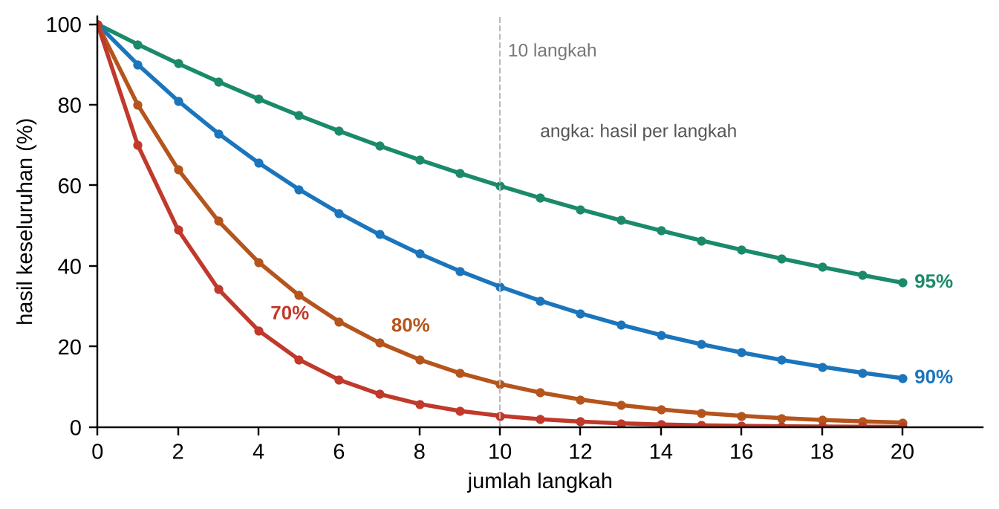
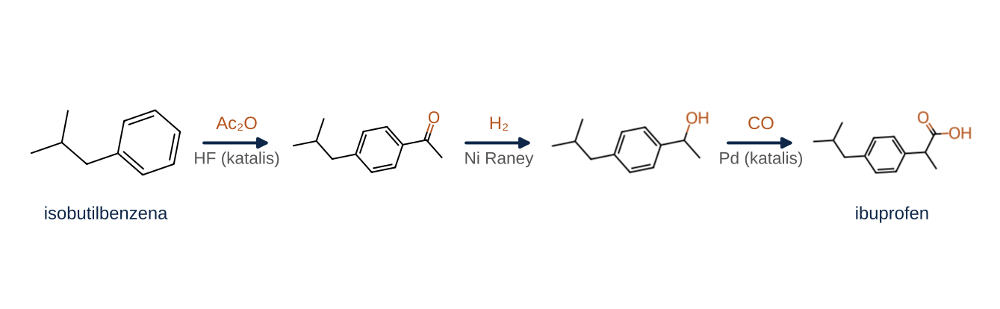
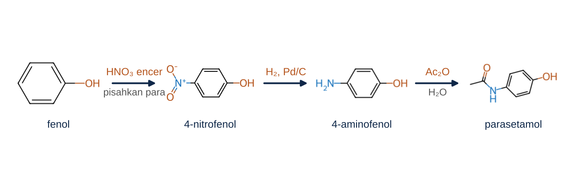

## 16.7 Sintesis bertahap dan hasil keseluruhan

### Hasil yang berkurang di setiap langkah

**Hasil** (*yield*) sebuah reaksi adalah perbandingan jumlah mol produk yang benar-benar diperoleh dengan jumlah mol yang diharapkan secara teori dari pereaksi pembatas. Dalam sintesis bertahap, produk setiap langkah menjadi bahan langkah berikutnya, sehingga **hasil keseluruhan** adalah **hasil kali** hasil setiap langkah:

$$
\text{hasil keseluruhan} = y_1 \times y_2 \times y_3 \times \cdots \times y_n \qquad \text{(16.1)}
$$

Akibatnya mengejutkan. Bila setiap langkah memberi hasil 90%, yang sudah tergolong sangat baik, sintesis tiga langkah memberi 72,9%, lima langkah 59,0%, dan sepuluh langkah hanya 34,9%. Dengan hasil 80% per langkah, sepuluh langkah memberi 10,7%, dan dua puluh langkah 1,2%. Itulah sebabnya kimiawan sintesis sangat menghargai setiap langkah yang dapat dihemat.

{width=86%}

::: {.contoh}
**Contoh 16.14 · Berapa banyak bahan awal yang diperlukan?**

Benzokaina (etil 4-aminobenzoat, *M* = 165,19), anestetik lokal, dibuat dari 4-nitrotoluena (*M* = 137,14) dalam tiga langkah dengan hasil 80%, 90%, dan 95%. (a) Hitung hasil keseluruhan. (b) Berapa gram 4-nitrotoluena diperlukan untuk memperoleh 10,0 g benzokaina? (c) Bila satu langkah tambahan dengan hasil 85% disisipkan, berapa gram bahan awal yang diperlukan?

**Penyelesaian.** (a) 0,80 × 0,90 × 0,95 = 0,684 = **68,4%**. (b) Benzokaina yang diinginkan: 10,0/165,19 = 0,06054 mol. Setiap mol bahan awal menghasilkan paling banyak satu mol produk, sehingga bahan awal yang diperlukan = 0,06054/0,684 = 0,0885 mol = 0,0885 × 137,14 = **12,1 g**. (c) Hasil keseluruhan menjadi 0,684 × 0,85 = 0,581; bahan awal = 0,06054/0,581 × 137,14 = **14,3 g**.

**Memahami hasil.** Perhitungan selalu memakai mol, bukan massa, karena massa molar bahan dan produk berbeda. Satu langkah tambahan dengan hasil 85% menuntut 18% lebih banyak bahan awal, ditambah pelarut, pereaksi, waktu, dan limbah untuk langkah itu sendiri.
:::

### Sintesis linear dan konvergen

Dalam **sintesis linear**, molekul dibangun selangkah demi selangkah dalam satu rantai: A → B → C → D → E → F → G. Dalam **sintesis konvergen**, dua (atau lebih) bagian molekul dibuat terpisah, lalu digabungkan di akhir: A → B → C dan D → E → F, lalu C + F → G. Jumlah langkahnya sama, tetapi hasil keseluruhannya berbeda, karena yang menentukan hasil adalah **rangkaian linear terpanjang**.

{width=96%}

::: {.contoh}
**Contoh 16.15 · Membandingkan linear dan konvergen**

Sebuah target dapat dibuat lewat (a) enam langkah linear, atau (b) dua cabang masing-masing tiga langkah yang menghasilkan dua potongan, lalu satu langkah penggabungan (total tujuh langkah). Semua langkah memberi 80%. Bandingkan hasil keseluruhannya terhadap bahan awal cabang yang paling mahal.

**Penyelesaian.** (a) 0,80⁶ = **26,2%**. (b) Setiap cabang: 0,80³ = 51,2%; penggabungan: × 0,80. Rangkaian linear terpanjang adalah empat langkah: 0,80⁴ = **41,0%** terhadap bahan awal setiap cabang.

**Memahami hasil.** Meskipun sintesis konvergen mempunyai lebih banyak langkah total (tujuh lawan enam), hasilnya hampir dua kali lipat, karena setiap bahan awal hanya melewati empat langkah. Bagian yang mahal sebaiknya dimasukkan selambat mungkin. Prinsip ini sangat penting dalam sintesis molekul besar seperti obat peptida dan produk alam.
:::

::: {.inti}
**Inti subbab 16.7**

- Hasil keseluruhan = hasil kali hasil setiap langkah; menurun eksponensial dengan jumlah langkah.
- Hitung bahan yang diperlukan dalam mol: mol bahan = mol produk / hasil keseluruhan.
- Sintesis konvergen memberi hasil lebih tinggi daripada linear karena rangkaian linear terpanjangnya lebih pendek.
:::

::: {.kuis}
**Kuis cepat 16.7** (a) Sintesis lima langkah dengan hasil 85% per langkah: berapa hasil keseluruhannya? (b) Berapa hasil per langkah rata-rata yang diperlukan agar sintesis delapan langkah memberi hasil keseluruhan 50%?
:::

## 16.8 Kimia hijau dan ekonomi atom

### Hasil tinggi belum tentu hijau

Hasil reaksi hanya mengukur berapa banyak produk yang diperoleh dari pereaksi pembatas. Hasil tidak mengatakan apa pun tentang **berapa banyak atom pereaksi yang terbuang** sebagai hasil samping, berapa banyak pelarut yang dipakai, atau seberapa berbahaya pereaksinya. Pada tahun 1998, Paul Anastas dan John Warner merumuskan **dua belas asas kimia hijau** untuk menilai dan merancang proses kimia yang lebih aman dan lebih hemat. Beberapa asas yang paling berkaitan dengan perancangan sintesis:

1. **Mencegah limbah** lebih baik daripada mengolah limbah setelah terbentuk.
2. **Ekonomi atom**: rancang sintesis sehingga sebanyak mungkin atom pereaksi masuk ke produk.
3. **Pereaksi dan produk yang kurang berbahaya** bila memungkinkan.
4. **Pelarut yang lebih aman**, atau tanpa pelarut; air, etanol, dan etil asetat lebih disukai daripada diklorometana atau benzena.
5. **Efisiensi energi**: reaksi pada suhu dan tekanan kamar.
6. **Bahan baku terbarukan** daripada bahan dari minyak bumi.
7. **Mengurangi turunan**: hindari gugus pelindung dan langkah sementara yang tidak perlu (subbab 16.6).
8. **Katalis** lebih baik daripada pereaksi stoikiometrik.

### Ekonomi atom

**Ekonomi atom** (*atom economy*), diperkenalkan oleh Barry Trost pada 1991, mengukur fraksi massa pereaksi yang menjadi bagian dari produk yang diinginkan, dengan anggapan reaksi berjalan sempurna:

$$
\text{ekonomi atom} = \frac{M_\text{produk}}{\sum M_\text{pereaksi}} \times 100\% \qquad \text{(16.2)}
$$

dengan *M* massa molar dan jumlahan mencakup semua pereaksi dalam persamaan setara (tetapi tidak katalis dan pelarut). Reaksi **adisi** (hidrogenasi, adisi HBr, Diels–Alder) mempunyai ekonomi atom 100%: semua atom pereaksi masuk ke produk. Reaksi **substitusi** dan **eliminasi** selalu kehilangan sebagian atom sebagai hasil samping. Beberapa reaksi yang sangat berguna justru boros atom: reaksi Wittig melepaskan trifenilfosfina oksida (*M* = 278) untuk setiap gugus CH₂ (*M* = 14) yang dipasang.

::: {.contoh}
**Contoh 16.16 · Menghitung ekonomi atom**

Hitung ekonomi atom untuk: (a) adisi HBr pada etena; (b) 1-bromopropana + NaCN → butanenitril + NaBr; (c) sikloheksanon + Ph₃P=CH₂ → metilenasikloheksana + Ph₃P=O.

**Penyelesaian.** (a) C₂H₄ (28,05) + HBr (80,91) → C₂H₅Br (108,97): 108,97/(28,05 + 80,91) = **100%**. (b) C₃H₇Br (122,99) + NaCN (49,01) → C₄H₇N (69,11): 69,11/172,00 = **40,2%**; sisanya NaBr. (c) C₆H₁₀O (98,15) + C₁₉H₁₇P (276,32) → C₇H₁₂ (96,17): 96,17/374,47 = **25,7%**.

**Memahami hasil.** Reaksi Wittig dapat memberi hasil 95% dan tetap membuang hampir tiga perempat massa pereaksinya sebagai Ph₃PO. Ekonomi atom tidak menggantikan hasil, tetapi melengkapinya: proses yang baik mempunyai hasil tinggi **dan** ekonomi atom tinggi. Bila ada pilihan, reaksi adisi dan reaksi katalitik lebih disukai.
:::

### Faktor E

Ukuran yang lebih realistis adalah **faktor E** (*E-factor*), yang diperkenalkan oleh Roger Sheldon: massa seluruh limbah (hasil samping, pelarut yang tidak didaur ulang, pereaksi berlebih, bahan pemurnian) dibagi massa produk. Faktor E khas industri: kimia curah 1–5, kimia halus 5–50, dan farmasi 25 sampai lebih dari 100. Angka farmasi yang tinggi berasal dari sintesis panjang, banyak langkah pemurnian, dan pelarut dalam jumlah besar. Banyak perusahaan farmasi kini menetapkan sasaran penurunan faktor E sebagai bagian dari pengembangan proses.

### Contoh industri: ibuprofen

Ibuprofen, obat antiradang yang sangat banyak dipakai, mula-mula diproduksi lewat proses enam langkah (proses Boots, 1960-an) dengan ekonomi atom sekitar 40%. Pada tahun 1990-an, perusahaan BHC mengembangkan proses tiga langkah dari isobutilbenzena: (1) asilasi Friedel–Crafts dengan anhidrida asetat memakai HF sebagai katalis yang didaur ulang; (2) hidrogenasi katalitik keton menjadi alkohol; (3) karbonilasi alkohol dengan CO dan katalis paladium langsung menjadi asam karboksilat. Ekonomi atom proses ini 77%, dan mendekati 99% bila asam asetat hasil samping langkah pertama dimanfaatkan. Proses ini memperoleh penghargaan kimia hijau Presiden Amerika Serikat tahun 1997, dan menjadi contoh baku bagaimana pemikiran sintesis yang baik menghasilkan proses yang lebih bersih sekaligus lebih murah.

{width=100%}

::: {.inti}
**Inti subbab 16.8**

- Kimia hijau: cegah limbah, maksimalkan ekonomi atom, pakai pereaksi dan pelarut yang lebih aman, katalis, bahan terbarukan, dan hindari langkah yang tidak perlu.
- Ekonomi atom = *M*(produk)/Σ*M*(pereaksi) × 100%; adisi 100%, substitusi dan eliminasi lebih rendah, Wittig sangat rendah.
- Faktor E = massa limbah / massa produk; farmasi 25–100+.
- Proses BHC ibuprofen: tiga langkah katalitik, ekonomi atom 77% (Boots: enam langkah, 40%).
:::

::: {.kuis}
**Kuis cepat 16.8** (a) Hitung ekonomi atom asetilasi asam salisilat (C₇H₆O₃, 138,12) dengan anhidrida asetat (C₄H₆O₃, 102,09) menjadi aspirin (C₉H₈O₄, 180,16) dan asam asetat. (b) Mengapa katalis lebih disukai daripada pereaksi stoikiometrik?
:::

## 16.9 Studi kasus: sintesis obat sederhana

Untuk menutup buku ini, kita merancang sintesis tiga obat yang sangat dikenal. Ketiganya sederhana, tetapi setiap langkahnya memakai gagasan yang telah kita pelajari: pengarah substitusi aromatik, kemoselektivitas, urutan langkah, dan ekonomi atom.

### Parasetamol

**Parasetamol** (asetaminofen, *N*-(4-hidroksifenil)asetamida) adalah analgesik dan antipiretik paling banyak dipakai di dunia. Molekulnya adalah cincin benzena dengan OH dan NHCOCH₃ dalam posisi *para*.

{width=100%}

::: {.contoh}
**Contoh 16.17 · Retrosintesis dan sintesis parasetamol**

Analisis retrosintesis parasetamol dan tuliskan sintesis maju dari fenol. Jelaskan mengapa asetilasi terjadi pada N, bukan pada O.

**Penyelesaian.** Retrosintesis: amida ⇒ (diskoneksi C(O)–N) 4-aminofenol + anhidrida asetat; 4-aminofenol ⇒ (FGI: NH₂ ⇒ NO₂) 4-nitrofenol ⇒ fenol + nitrasi. Sintesis maju: (1) fenol + HNO₃ encer → campuran 2- dan 4-nitrofenol (OH adalah pengaktif kuat dan pengarah *o*/*p*; asam encer cukup). Isomer *orto* dipisahkan dengan distilasi uap karena ikatan hidrogen intramolekulnya membuatnya lebih mudah menguap. (2) 4-Nitrofenol + H₂, Pd/C (atau Fe, HCl) → 4-aminofenol. (3) 4-Aminofenol + anhidrida asetat dalam air → **parasetamol** + asam asetat.

Pada langkah (3), molekul mempunyai dua nukleofil: NH₂ dan OH. Nitrogen amina jauh lebih nukleofilik daripada oksigen fenol (pasangan bebas N lebih tinggi energinya dan lebih basa), sehingga asetilasi terjadi pada N dengan selektivitas tinggi bila anhidrida tidak berlebihan.

**Memahami hasil.** Gugus nitro berperan sebagai "amina tersembunyi": dipasang dengan SEA, lalu direduksi. Kemoselektivitas N lawan O membuat gugus pelindung tidak diperlukan. Ekonomi atom langkah terakhir adalah 151,16/(109,13 + 102,09) = 71,6%.
:::

### Benzokaina

**Benzokaina** (etil 4-aminobenzoat) adalah anestetik lokal yang dipakai dalam obat sariawan dan salep luka bakar ringan.

::: {.contoh}
**Contoh 16.18 · Mengatur urutan tiga perubahan**

Rancang sintesis benzokaina dari toluena. Jelaskan alasan urutan langkah.

**Penyelesaian.** Target mempunyai COOC₂H₅ dan NH₂ dalam posisi *para*. Retrosintesis: ester ⇒ asam 4-aminobenzoat + etanol, atau ester ⇒ (FGI NH₂ ⇒ NO₂) etil 4-nitrobenzoat ⇒ asam 4-nitrobenzoat ⇒ (FGI COOH ⇒ CH₃) 4-nitrotoluena ⇒ toluena. Sintesis maju: (1) toluena + HNO₃, H₂SO₄ → 4-nitrotoluena (CH₃ pengarah *o*/*p*; isomer *para* dipisahkan). (2) KMnO₄, panas → asam 4-nitrobenzoat (oksidasi rantai samping benzilik, subbab 10.4). (3) Etanol, H₂SO₄ (esterifikasi Fischer) → etil 4-nitrobenzoat. (4) H₂, Pd/C → **benzokaina**.

Urutan ini dipilih karena: nitrasi harus dilakukan selagi gugus pengarah adalah CH₃ (*o*/*p*), bukan COOH (pengarah *meta*). Oksidasi KMnO₄ harus dilakukan **sebelum** gugus amina ada, karena KMnO₄ akan mengoksidasi amina. Reduksi nitro dilakukan paling akhir, sehingga amina tidak perlu dilindungi selama oksidasi dan esterifikasi.

**Memahami hasil.** Tiga gagasan bekerja bersama: pengarah SEA menentukan kapan nitrasi; kemoselektivitas oksidator menentukan kapan oksidasi; dan gugus nitro sebagai amina tersembunyi menghindari gugus pelindung. Bila urutannya dibalik, misalnya oksidasi dulu lalu nitrasi, produknya adalah isomer *meta* yang tidak diinginkan.
:::

### Aspirin dan seterusnya

**Aspirin** (asam asetilsalisilat) dibuat dengan asetilasi gugus OH asam salisilat memakai anhidrida asetat, satu langkah dengan ekonomi atom 75%. Asam salisilat sendiri dibuat dalam industri dari fenol, natrium hidroksida, dan CO₂ di bawah tekanan (reaksi Kolbe–Schmitt), sebuah reaksi substitusi elektrofilik pada ion fenoksida yang sangat teraktifkan. Ketiga obat ini, parasetamol, benzokaina, dan aspirin, adalah turunan sederhana fenol dan asam benzoat. Obat modern biasanya jauh lebih rumit, dengan beberapa pusat kiral dan cincin heterosiklik, dan sintesisnya memerlukan reaksi yang akan dibahas di *Kimia Organik 2*: reaksi enolat, reaksi perisiklik, kopling silang berkatalis logam, dan sintesis asimetris. Tetapi cara berpikirnya tetap sama: retrosintesis, pemilihan reaksi menurut gugus fungsi, perhatian pada selektivitas, dan keinginan membuat jalan yang pendek dan bersih.

::: {.terapan}
**Terapan: dari meja kimiawan ke pabrik obat**

Sintesis obat di laboratorium penemuan (skala miligram) dan di pabrik (skala ratusan kilogram sampai ton) sering sangat berbeda. Ahli kimia proses menulis ulang jalan sintesis untuk menghilangkan pereaksi berbahaya (misalnya diazometana, natrium hidrida, atau pelarut terklorinasi), mengganti kromatografi dengan kristalisasi, mengurangi jumlah langkah, dan menurunkan faktor E. Kontrol mutu memakai alat-alat yang kita pelajari di Bab 14 dan 15: setiap batch obat diperiksa dengan HPLC, IR, NMR, dan MS untuk memastikan identitas dan kemurniannya. Badan pengawas obat di setiap negara, termasuk BPOM di Indonesia, mensyaratkan bahwa cemaran dalam bahan baku obat diidentifikasi dan dibatasi sampai tingkat bagian per sejuta.
:::

::: {.inti}
**Inti subbab 16.9**

- Parasetamol: fenol → nitrasi (*p*) → reduksi NO₂ → asetilasi kemoselektif pada N.
- Benzokaina: toluena → nitrasi (*p*) → oksidasi CH₃ → esterifikasi → reduksi NO₂; urutan ditentukan oleh pengarah SEA dan kemoselektivitas.
- Aspirin: asetilasi asam salisilat (dari fenol, Kolbe–Schmitt).
- Gugus nitro sering dipakai sebagai amina tersembunyi untuk menghindari gugus pelindung.
:::

::: {.kuis}
**Kuis cepat 16.9** (a) Mengapa toluena tidak dioksidasi dulu menjadi asam benzoat sebelum nitrasi dalam sintesis benzokaina? (b) Usulkan sintesis 4-bromoanilina dari benzena, dan jelaskan mengapa anilina tidak langsung dibrominasi.
:::

## Penutup buku

Kita memulai buku ini dengan pertanyaan sederhana: apa yang membuat kimia karbon begitu kaya? Jawabannya ternyata terletak pada beberapa gagasan yang terus berulang: ikatan kovalen dan hibridisasi, resonansi dan efek induktif, kestabilan karbokation dan karbanion, nukleofil yang menyerang elektrofil, dan bentuk tiga dimensi molekul. Dengan gagasan-gagasan itu kita memahami mengapa alkil halida bereaksi lewat SN2 atau SN1, mengapa alkena menjalani adisi dan benzena menjalani substitusi, mengapa karbonil diserang nukleofil, dan mengapa amina bersifat basa. Dengan spektroskopi kita belajar melihat molekul; dengan strategi sintesis kita belajar membuatnya.

Kimia Organik 1 berfokus pada senyawa **monofungsi**: molekul dengan satu gugus fungsi yang menentukan sifatnya. Dunia nyata, terutama dunia biologi dan obat, penuh dengan molekul **polifungsi**, tempat gugus-gugus fungsi saling memengaruhi: karbonil yang membuat karbon α menjadi asam, ikatan rangkap terkonjugasi yang bereaksi sebagai satu kesatuan, gula dengan lima gugus OH, protein dengan ratusan amida. Itulah pokok *Kimia Organik 2*: enol dan enolat, kondensasi karbonil, sistem terkonjugasi dan reaksi perisiklik, karbohidrat, asam amino dan protein, lipid, asam nukleat, dan polimer. Semua yang telah kamu pelajari di sini akan menjadi fondasinya.
