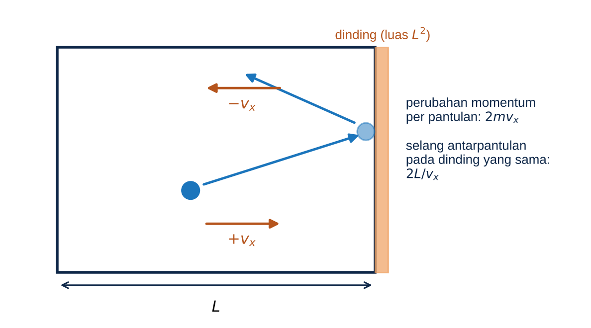
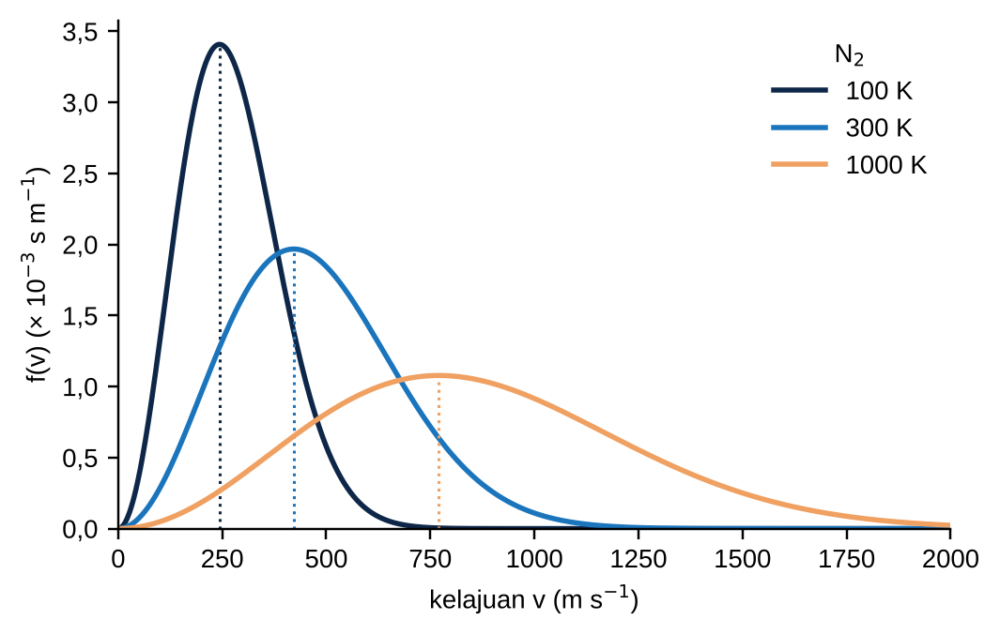

## 1.7 Teori kinetik: dari tumbukan molekul ke tekanan

Hukum-hukum gas di subbab sebelumnya ditemukan dari percobaan. Semuanya menggambarkan **apa** yang terjadi, tetapi tidak menjelaskan **mengapa**. Mengapa tekanan sebanding dengan *n* dan *T* dan berbanding terbalik dengan *V*? Mengapa semua gas, ringan atau berat, mengikuti persamaan yang sama? Untuk menjawabnya kita perlu masuk ke dalam gas dan melihat molekulnya.

**Model kinetik gas** bertumpu pada tiga anggapan:

1. Gas terdiri atas molekul-molekul bermassa *m* yang bergerak acak tanpa henti.
2. Ukuran molekul sangat kecil dibanding jarak rata-rata di antara mereka, sehingga molekul dapat dianggap titik.
3. Molekul tidak saling tarik-menarik atau tolak-menolak, kecuali pada saat tumbukan, dan tumbukannya lenting: energi kinetik total tidak berubah.

Dengan anggapan ini, tekanan tidak lagi misterius. Tekanan adalah akibat rata-rata dari miliaran tumbukan kecil molekul pada dinding setiap detik. Mari kita hitung.

**Satu molekul, satu dinding.** Letakkan *N* molekul di dalam kubus bersisi *L*. Pandang satu molekul yang bergerak dengan komponen kecepatan $v_x$ menuju dinding kanan (Gambar 1.1). Ketika memantul, komponen itu berbalik menjadi $-v_x$, sehingga momentumnya berubah sebesar $2mv_x$. Setelah memantul, molekul itu harus menempuh jarak 2*L* bolak-balik sebelum menumbuk dinding yang sama lagi, dan itu memerlukan waktu $2L/v_x$. Gaya rata-rata yang diberikannya pada dinding adalah perubahan momentum dibagi selang waktu itu:

$$
F_1 = \frac{2mv_x}{2L/v_x} = \frac{mv_x^2}{L} .
$$

{width=82%}

Bagaimana dengan tumbukan antarmolekul di tengah jalan? Molekul yang kita ikuti memang dapat menumbuk molekul lain dan berbelok, tetapi tumbukan itu hanya **menukar** momentum di antara molekul-molekul; momentum total yang dibawa ke dinding per detik tidak berubah. Karena itu kita boleh menghitung seolah-olah setiap molekul bergerak bolak-balik tanpa terganggu.

**Semua molekul.** Molekul yang berbeda mempunyai $v_x$ yang berbeda. Menjumlahkan semuanya sama dengan mengalikan *N* dengan rata-rata $\langle v_x^2\rangle$. Membagi gaya total dengan luas dinding $L^2$ menghasilkan tekanan, dan $L^3$ adalah volume *V*:

$$
p = \frac{Nm\langle v_x^2\rangle}{L^3} = \frac{Nm\langle v_x^2\rangle}{V} .
$$

**Ketiga arah sama.** Gerak molekul acak, jadi tidak ada arah yang istimewa: $\langle v_x^2\rangle = \langle v_y^2\rangle = \langle v_z^2\rangle$. Karena $v^2 = v_x^2 + v_y^2 + v_z^2$, setiap komponen menyumbang sepertiga: $\langle v_x^2\rangle = \tfrac13\langle v^2\rangle$. Hasil akhirnya:

$$
pV = \tfrac13 Nm\langle v^2\rangle . \qquad \text{(1.14)}
$$

Persamaan (1.14) diturunkan hanya dari mekanika Newton, tanpa menyebut suhu sama sekali. Sekarang bandingkan dengan persamaan gas ideal, $pV = nRT$. Keduanya hanya cocok bila ruas kanannya sama. Dengan $N = nN_\text{A}$ dan $k = R/N_\text{A}$ (**tetapan Boltzmann**, $1{,}381 \times 10^{-23}$ J K⁻¹), kita peroleh

::: {.inti}
$$
\tfrac12 m\langle v^2\rangle = \tfrac32 kT \qquad \text{atau, per mol,} \qquad E_\text{k,m} = \tfrac32 RT \qquad \text{(1.15)}
$$
**Suhu adalah ukuran energi kinetik translasi rata-rata molekul.** Energi itu hanya bergantung pada suhu, tidak pada jenis gas.
:::

Inilah jawaban atas pertanyaan pembuka yang pertama. Termometer mengukur seberapa keras rata-rata molekul bergerak, dan nol mutlak adalah keadaan ketika gerak translasi itu berhenti. Persamaan (1.15) juga menjelaskan asas Avogadro: pada suhu yang sama, molekul hidrogen yang ringan dan molekul iodin yang berat membawa energi kinetik rata-rata yang sama, sehingga *N* molekul dari gas mana pun memberikan tekanan yang sama pada volume yang sama.

Dari (1.15) kita juga dapat menghitung kelajuan molekul. Akar dari rata-rata kuadrat kelajuan, disebut **kelajuan rms** (*root mean square*), adalah

$$
v_\text{rms} = \sqrt{\langle v^2\rangle} = \sqrt{\frac{3RT}{M}} , \qquad \text{(1.16)}
$$

dengan *M* massa molar dalam **kg mol⁻¹** supaya satuannya m s⁻¹.

::: {.contoh}
**Contoh 1.12 · Kelajuan molekul udara**

Hitung $v_\text{rms}$ molekul N₂ dan atom He pada 25 °C, serta energi kinetik translasi rata-rata per mol.

**Penyelesaian.** Untuk N₂, $M = 0{,}028\,02$ kg mol⁻¹:
$$
v_\text{rms} = \sqrt{\frac{3(8{,}314\ \text{J K}^{-1}\text{mol}^{-1})(298{,}15\ \text{K})}{0{,}028\,02\ \text{kg mol}^{-1}}} = 515\ \text{m s}^{-1} .
$$
Untuk He, $M = 0{,}004\,003$ kg mol⁻¹, dan $v_\text{rms} = 1363$ m s⁻¹. Energi kinetik per mol untuk keduanya sama: $\tfrac32(8{,}314)(298{,}15) = 3{,}72$ kJ mol⁻¹.

**Memahami hasil.** Satuan J = kg m² s⁻², sehingga J/kg = m² s⁻²; akarnya m s⁻¹. Helium tujuh kali lebih ringan daripada nitrogen, jadi pada energi yang sama ia bergerak $\sqrt7 \approx 2{,}6$ kali lebih cepat. Bandingkan pula 3,72 kJ mol⁻¹ dengan energi ikatan kimia, sekitar 200–1000 kJ mol⁻¹: tumbukan molekul biasa pada suhu kamar terlalu lemah untuk memutus ikatan, dan itulah sebabnya kebanyakan zat stabil pada suhu kamar.
:::

::: {.kuis}
**Kuis cepat 1.7** Suhu gas dinaikkan dari 300 K menjadi 1200 K. Berapa kali $v_\text{rms}$ bertambah? Berapa kali energi kinetik rata-ratanya bertambah?
:::

## 1.8 Kelajuan molekul dan sebaran Maxwell–Boltzmann

Kelajuan rms adalah rata-rata, tetapi molekul-molekul gas tidak bergerak dengan kelajuan yang sama. Setiap tumbukan mengubah kelajuan molekul yang bertabrakan: yang satu dipercepat, yang lain diperlambat. Akibatnya, pada setiap saat ada molekul yang hampir diam, ada yang sangat cepat, dan kebanyakan di antaranya. Seperti apa sebaran itu?

James Clerk Maxwell menurunkannya pada 1860, dan Ludwig Boltzmann kemudian memberinya dasar yang lebih umum. Hasilnya, peluang menemukan molekul dengan kelajuan antara *v* dan $v + dv$ adalah $f(v)\,dv$, dengan

$$
f(v) = 4\pi\left(\frac{M}{2\pi RT}\right)^{3/2} v^2 \exp\!\left(-\frac{Mv^2}{2RT}\right) . \qquad \text{(1.17)}
$$

Rumus ini tampak rumit, tetapi bentuknya dapat dipahami dari dua faktor yang saling bertarung:

* Faktor eksponensial $e^{-Mv^2/2RT}$ adalah **faktor Boltzmann**, $e^{-E/RT}$ dengan $E = \tfrac12Mv^2$. Makin besar energi kinetik, makin kecil peluangnya. Faktor ini sendirian akan membuat kelajuan nol paling mungkin.
* Faktor $v^2$ menghitung banyaknya **arah** yang tersedia. Molekul dapat bergerak ke segala arah, dan semua kecepatan dengan besar *v* menempati kulit bola berjari-jari *v*, yang luasnya $4\pi v^2$. Makin besar kelajuan, makin banyak cara untuk memilikinya.

Hasil kali keduanya nol pada $v = 0$, naik ke suatu puncak, lalu turun dengan cepat di kelajuan tinggi (Gambar 1.2).

{width=78%}

Dari sebaran ini kita dapat menghitung tiga kelajuan khas. Kelajuan **paling mungkin** $v_\text{mp}$ terletak di puncak kurva, tempat $df/dv = 0$. Kelajuan **rata-rata** $\bar v$ diperoleh dari $\int_0^\infty vf(v)\,dv$. Hasilnya, bersama $v_\text{rms}$ dari (1.16):

$$
v_\text{mp} = \sqrt{\frac{2RT}{M}} , \qquad \bar v = \sqrt{\frac{8RT}{\pi M}} , \qquad v_\text{rms} = \sqrt{\frac{3RT}{M}} . \qquad \text{(1.18)}
$$

Ketiganya sebanding dengan $\sqrt{T/M}$ dan selalu berurutan $v_\text{mp} < \bar v < v_\text{rms}$, dengan perbandingan $1 : 1{,}128 : 1{,}225$. Urutan ini timbul karena ekor sebaran di sisi kelajuan tinggi menarik rata-rata ke kanan dari puncaknya, dan rata-rata kuadrat lebih terpengaruh lagi oleh ekor itu.

::: {.contoh}
**Contoh 1.13 · Tiga kelajuan oksigen**

Hitung $v_\text{mp}$, $\bar v$, dan $v_\text{rms}$ untuk O₂ pada 300 K.

**Penyelesaian.** Dengan $M = 0{,}032\,00$ kg mol⁻¹ dan $RT/M = (8{,}314)(300)/0{,}032\,00 = 7{,}795 \times 10^4$ m² s⁻²:
$$
v_\text{mp} = \sqrt{2 \times 7{,}795 \times 10^4} = 395\ \text{m s}^{-1} ,\quad \bar v = \sqrt{\frac{8 \times 7{,}795 \times 10^4}{\pi}} = 446\ \text{m s}^{-1} ,\quad v_\text{rms} = 484\ \text{m s}^{-1} .
$$

**Memahami hasil.** Menghitung $RT/M$ lebih dulu menghemat pekerjaan, karena ketiga rumus hanya berbeda pada faktor di depannya. Pilih kelajuan yang sesuai dengan pertanyaannya: $\bar v$ untuk laju tumbukan dan efusi, $v_\text{rms}$ untuk energi kinetik.
:::

::: {.terapan}
**Mengapa Bumi kehilangan hidrogen tetapi mempertahankan oksigen.** Molekul yang bergerak lebih cepat dari 11,2 km s⁻¹ di lapisan atas atmosfer dapat lolos dari gravitasi Bumi. Di sana suhunya sekitar 1000 K, sehingga $v_\text{rms}$ H₂ sekitar 3,5 km s⁻¹ dan N₂ sekitar 0,94 km s⁻¹, keduanya jauh di bawah kelajuan lepas. Tetapi sebaran Maxwell–Boltzmann mempunyai ekor. Pecahan molekul H₂ yang melampaui 11,2 km s⁻¹ sekitar $10^{-6}$, kecil tetapi cukup untuk mengikis hidrogen selama miliaran tahun. Untuk O₂, pecahannya sekitar $10^{-104}$, praktis nol. Itulah sebabnya atmosfer Bumi kaya nitrogen dan oksigen, tetapi hampir tanpa hidrogen dan helium bebas.
:::

::: {.kuis}
**Kuis cepat 1.8** Pada suhu yang sama, gas mana yang kurvanya lebih lebar dan puncaknya lebih ke kanan: H₂ atau CO₂? Mengapa?
:::

## 1.9 Efusi dan difusi: hukum Graham

Molekul yang bergerak cepat bukan sekadar hasil hitungan; akibatnya dapat diamati langsung. Balon karet berisi helium mengempis dalam semalam, sementara balon berisi udara bertahan berhari-hari. Gas merembes keluar melalui pori-pori kecil karet, dan gas yang lebih ringan merembes lebih cepat. Bagaimana menghitung "lebih cepat" itu?

Proses keluarnya gas melalui lubang yang sangat kecil, lebih kecil daripada jarak tempuh molekul di antara tumbukan, disebut **efusi**. Karena lubangnya kecil, molekul keluar satu per satu, tanpa saling mendorong. Laju efusi karena itu sama dengan laju molekul yang kebetulan mengenai lubang. Dengan penalaran yang mirip dengan subbab 1.7, banyaknya tumbukan molekul pada luas *A* dinding per satuan waktu adalah

$$
Z_\text{dinding} = \tfrac14\frac{N}{V}\bar vA . \qquad \text{(1.19)}
$$

Faktor ¼ timbul karena molekul datang ke dinding dari berbagai sudut, tidak semuanya tegak lurus. Pada suhu dan tekanan yang sama, *N/V* sama untuk semua gas, sehingga laju efusi hanya bergantung pada $\bar v$, yang sebanding dengan $1/\sqrt M$. Hasilnya adalah **hukum Graham** (1846):

::: {.inti}
$$
\frac{\text{laju efusi A}}{\text{laju efusi B}} = \sqrt{\frac{M_B}{M_A}} \qquad \text{(1.20)}
$$
Pada suhu dan tekanan yang sama, laju efusi berbanding terbalik dengan akar massa molar.
:::

Thomas Graham menemukan hukum ini dari percobaan, dua puluh tahun sebelum teori kinetik dapat menjelaskannya. Hukum yang sama berlaku secara pendekatan untuk **difusi**, yakni pencampuran gas satu sama lain, walaupun di sana tumbukan antarmolekul ikut berperan.

::: {.contoh}
**Contoh 1.14 · Mengenali gas dari laju efusinya**

(a) Berapa kali lebih cepat H₂ berefusi dibanding O₂? (b) Suatu gas yang tidak dikenal berefusi melalui lubang yang sama dengan laju 0,355 kali laju helium pada kondisi yang sama. Berapa massa molarnya?

**Penyelesaian.** (a) Dari (1.20): $\sqrt{32{,}00/2{,}016} = 3{,}98$, hampir tepat empat kali.

(b) $\text{laju}_X/\text{laju}_{He} = \sqrt{M_{He}/M_X} = 0{,}355$, sehingga
$$
M_X = \frac{M_{He}}{(0{,}355)^2} = \frac{4{,}003\ \text{g mol}^{-1}}{0{,}126} = 31{,}8\ \text{g mol}^{-1} .
$$

**Memahami hasil.** Massa molar sekitar 32 cocok dengan O₂. Seperti pada Contoh 1.6, hukum Graham memberi massa molar dari pengukuran yang murni fisika: cukup sebuah lubang kecil dan stopwatch.
:::

::: {.contoh}
**Contoh 1.15 · Pengayaan uranium**

Uranium alam mengandung 0,72% ²³⁵U; sisanya hampir seluruhnya ²³⁸U. Reaktor daya memerlukan sekitar 3% ²³⁵U. Salah satu cara pengayaannya adalah efusi gas UF₆ melalui membran berpori, berulang-ulang. (a) Berapa faktor pemisahan satu tahap efusi? (b) Kira-kira berapa tahap yang diperlukan?

**Penyelesaian.** (a) Massa molar ²³⁵UF₆ = 349,03 g mol⁻¹ dan ²³⁸UF₆ = 352,04 g mol⁻¹. Faktor pemisahan ideal:
$$
\alpha = \sqrt{\frac{352{,}04}{349{,}03}} = 1{,}0043 .
$$
(b) Setiap tahap mengalikan perbandingan ²³⁵U/²³⁸U dengan α. Perbandingan harus naik dari $0{,}0072/0{,}9928$ menjadi $0{,}03/0{,}97$, yaitu 4,26 kali. Jumlah tahap *s* memenuhi $\alpha^s = 4{,}26$:
$$
s = \frac{\ln 4{,}26}{\ln 1{,}0043} \approx 340 .
$$

**Memahami hasil.** Perbedaan massa molar yang hanya 0,9% memberi faktor pemisahan yang sangat kecil, sehingga dibutuhkan ratusan tahap, dan pada praktiknya lebih banyak lagi karena membran nyata tidak ideal. Karena itu instalasi difusi gas menjadi bangunan raksasa yang menghabiskan listrik sangat besar, dan kini sebagian besar telah digantikan sentrifus gas.
:::

::: {.kuis}
**Kuis cepat 1.9** Dua tabung kapas, satu dibasahi larutan NH₃ dan satu lagi larutan HCl, dimasukkan bersamaan ke kedua ujung tabung kaca panjang. Cincin putih NH₄Cl terbentuk di tempat kedua gas bertemu. Apakah cincin itu lebih dekat ke ujung NH₃ atau ke ujung HCl?
:::

## 1.10 Tumbukan antarmolekul dan jalan bebas rata-rata

Sekarang kita dapat kembali ke teka-teki parfum di awal bab. Molekul udara bergerak sekitar 500 m s⁻¹, tetapi wangi menyebar dalam hitungan menit, bukan seperseratus detik. Kuncinya adalah anggapan kedua model kinetik yang sejauh ini kita abaikan: molekul memang kecil, tetapi tidak nol. Karena mempunyai ukuran, molekul saling bertabrakan, dan setiap tabrakan membelokkan arahnya.

Seberapa sering tabrakan itu terjadi? Anggap molekul sebagai bola berdiameter *d*. Dua molekul bertabrakan bila pusatnya mendekat sampai jarak *d*. Jadi, sebuah molekul yang bergerak menyapu silinder dengan luas penampang

$$
\sigma = \pi d^2 , \qquad \text{(1.21)}
$$

yang disebut **penampang lintang tumbukan**. Setiap molekul lain yang pusatnya berada di dalam silinder itu akan tertabrak. Dalam satu detik, silinder itu memanjang sejauh kelajuan relatif rata-rata molekul terhadap molekul lain, $v_\text{rel} = \sqrt2\,\bar v$ (lebih besar dari $\bar v$, karena molekul lain juga bergerak). Mengalikan volume yang disapu per detik dengan banyaknya molekul per volume menghasilkan **frekuensi tumbukan**:

$$
z = \sigma v_\text{rel}\frac{N}{V} = \frac{\sqrt2\,\sigma\bar vp}{kT} . \qquad \text{(1.22)}
$$

Jarak rata-rata yang ditempuh molekul di antara dua tumbukan, **jalan bebas rata-rata** λ, sama dengan jarak yang ditempuh per detik dibagi banyaknya tumbukan per detik:

::: {.inti}
$$
\lambda = \frac{\bar v}{z} = \frac{kT}{\sqrt2\,\sigma p} \qquad \text{(1.23)}
$$
Jalan bebas rata-rata berbanding terbalik dengan tekanan. Pada suhu tetap, gas yang dua kali lebih rapat membuat molekul menabrak dua kali lebih sering.
:::

::: {.contoh}
**Contoh 1.16 · Kehidupan sebuah molekul nitrogen**

Untuk N₂, $\sigma = 0{,}43$ nm². Hitung frekuensi tumbukan dan jalan bebas rata-rata pada 25 °C dan 1,00 atm, lalu jalan bebas rata-rata dalam ruang vakum bertekanan $10^{-6}$ torr.

**Penyelesaian.** Kelajuan rata-rata N₂ pada 298 K adalah $\bar v = \sqrt{8RT/\pi M} = 475$ m s⁻¹, dan $N/V = p/kT = 2{,}46 \times 10^{25}$ m⁻³. Dari (1.22):
$$
z = \sqrt2\,(0{,}43 \times 10^{-18}\ \text{m}^2)(475\ \text{m s}^{-1})(2{,}46 \times 10^{25}\ \text{m}^{-3}) = 7{,}1 \times 10^9\ \text{s}^{-1} .
$$
Dari (1.23): $\lambda = 475/(7{,}1 \times 10^9)$ m $= 67$ nm.

Pada $10^{-6}$ torr = $1{,}33 \times 10^{-4}$ Pa, tekanannya $7{,}6 \times 10^8$ kali lebih kecil, sehingga $\lambda = 67\ \text{nm} \times 7{,}6 \times 10^8 = 51$ m.

**Memahami hasil.** Pada tekanan udara biasa, sebuah molekul nitrogen menabrak tujuh miliar kali setiap detik, dan di antara dua tabrakan ia hanya bergerak sekitar 180 kali diameternya sendiri (*d* = 0,37 nm). Di dalam ruang vakum tinggi, sebaliknya, molekul dapat terbang puluhan meter tanpa menabrak apa pun. Inilah syarat kerja spektrometer massa dan mesin pelapisan logam secara penguapan: molekul harus sampai ke detektor atau ke permukaan target tanpa dibelokkan.
:::

**Kembali ke parfum.** Dengan tujuh miliar tabrakan per detik, sebuah molekul tidak bergerak lurus, tetapi berjalan zig-zag secara acak: setiap 67 nm arahnya berubah. Gerak seperti ini disebut **jalan acak**, dan jarak bersih yang ditempuhnya tidak bertambah sebanding dengan waktu, melainkan hanya sebanding dengan akar waktu. Teori kinetik memberi koefisien difusi sekitar $D \approx \tfrac13\lambda\bar v = 1 \times 10^{-5}$ m² s⁻¹, dan jarak bersih yang ditempuh dalam waktu *t* sekitar $\sqrt{2Dt}$. Dalam satu detik molekul parfum menempuh lintasan zig-zag sepanjang hampir setengah kilometer, tetapi jarak bersihnya hanya sekitar setengah sentimeter. Untuk berpindah lima meter dengan difusi murni ia memerlukan waktu sekitar $t = (5\ \text{m})^2/(2D) \approx 10^6$ s, kira-kira dua minggu.

Jadi, jawaban teka-teki pembuka ada dua. Pertama, kelajuan tinggi molekul "terbuang" dalam tabrakan yang tak terhitung banyaknya, sehingga difusi gas jauh lebih lambat daripada gerak molekulnya. Kedua, wangi parfum yang kita cium beberapa menit kemudian tidak dibawa oleh difusi, melainkan oleh **arus udara** yang selalu ada di dalam ruangan. Difusi baru menang pada jarak yang sangat pendek, misalnya di dalam pori-pori katalis atau di dalam paru-paru.

::: {.kuis}
**Kuis cepat 1.10** Bila tekanan gas diturunkan menjadi separuhnya pada suhu tetap, bagaimana perubahan (a) frekuensi tumbukan *z*, (b) jalan bebas rata-rata λ, (c) kelajuan rata-rata $\bar v$?
:::

### Menuju bab berikutnya

Gas ideal adalah gas tanpa ukuran molekul dan tanpa gaya antarmolekul. Di subbab terakhir kita sudah melihat bahwa ukuran molekul tidak dapat diabaikan untuk menjelaskan tumbukan. Di Bab 2 kita melangkah lebih jauh: bila gas dimampatkan atau didinginkan, ukuran molekul dan tarikan di antara mereka mulai mengubah tekanan itu sendiri, sampai akhirnya gas mencair. Persamaan van der Waals akan memasukkan kedua efek itu ke dalam persamaan keadaan.
