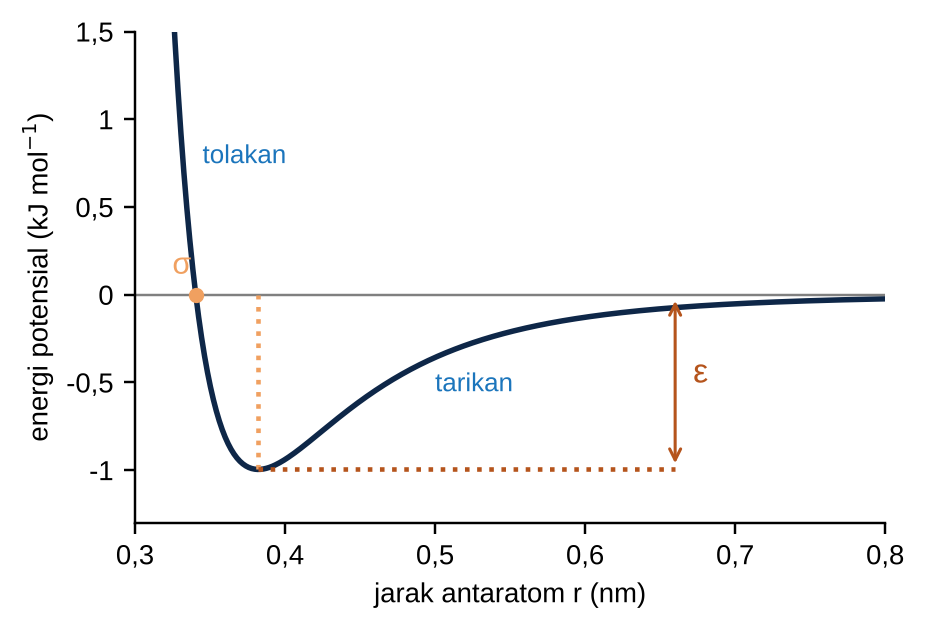

# Bab 2 Gas Nyata

Di dinding laboratorium biasanya tergantung dua jenis tabung bertekanan: tabung pemadam api berisi karbon dioksida dan tabung oksigen. Keduanya terbuat dari baja tebal dan keduanya disimpan pada suhu ruang yang sama. Bila diguncang, tabung CO₂ berbunyi kecipak: di dalamnya ada **cairan**, dan tekanannya sekitar 64 bar. Tabung oksigen tidak berbunyi apa-apa, padahal tekanannya jauh lebih tinggi, sampai 150 bar atau lebih: isinya tetap **gas**. Mengapa CO₂ mencair pada 64 bar, sedangkan oksigen tetap gas walaupun ditekan dua kali lebih kuat? Dan mengapa mulut tabung pemadam CO₂ diselimuti bunga es setiap kali disemprotkan?

Persamaan gas ideal dari Bab 1 tidak dapat menjawab pertanyaan-pertanyaan ini. Menurut persamaan itu, gas dapat ditekan sekuat apa pun tanpa pernah mencair, dan gas yang memuai tanpa melakukan kerja tidak berubah suhunya. Kedua ramalan itu salah untuk gas nyata. Penyebabnya adalah dua hal yang sengaja diabaikan oleh model gas ideal: molekul mempunyai **ukuran**, dan molekul saling **menarik**.

Bab ini memasukkan kedua efek itu satu per satu. Kita mulai dengan mengukur seberapa jauh gas nyata menyimpang dari gas ideal, lalu mencari asal penyimpangan itu pada gaya antarmolekul. Dari sana kita membangun persamaan van der Waals, persamaan sederhana yang secara mengejutkan mampu menjelaskan pencairan gas, titik kritis, dan bahkan hubungan antara sifat gas-gas yang berbeda. Bab ditutup dengan dua penerapan penting: pendinginan gas karena pemuaian, yang dipakai untuk mencairkan udara, dan fluida superkritis, pelarut "hijau" yang dipakai untuk menghilangkan kafein dari kopi.

::: {.strategi}
**Pertanyaan pembuka**

1. Bagaimana kita mengukur seberapa "tidak ideal" suatu gas?
2. Mengapa pada tekanan sedang gas nyata lebih mudah dimampatkan daripada gas ideal, tetapi pada tekanan sangat tinggi justru lebih sukar?
3. Apa arti fisis kedua tetapan *a* dan *b* dalam persamaan van der Waals?
4. Mengapa ada suhu yang di atasnya suatu gas tidak dapat dicairkan, setinggi apa pun tekanannya?
5. Mengapa gas yang berbeda-beda ternyata berperilaku sama bila suhu dan tekanannya dinyatakan sebagai pecahan dari nilai kritisnya?
6. Mengapa kebanyakan gas mendingin ketika memuai melalui katup, tetapi helium dan hidrogen pada suhu kamar justru memanas?
:::

::: {.tujuan}
**Tujuan belajar**

Setelah mempelajari bab ini, kamu mampu:

1. Menghitung dan menafsirkan faktor kompresi *Z*.
2. Menjelaskan bentuk potensial Lennard-Jones dan menghubungkannya dengan penyimpangan gas dari perilaku ideal.
3. Memakai persamaan van der Waals untuk menghitung tekanan, volume molar, dan jumlah zat gas nyata.
4. Menafsirkan isoterm gas nyata, daerah dua fasa, dan titik kritis.
5. Menurunkan tetapan kritis dari tetapan van der Waals dan sebaliknya.
6. Memakai variabel tereduksi dan hukum keadaan sehubungan.
7. Menghitung faktor kompresi dari koefisien virial kedua dan menentukan suhu Boyle.
8. Menjelaskan efek Joule–Thomson dan suhu inversi, serta sifat dan pemakaian fluida superkritis.
:::

::: {.mat}
**Prasyarat**

Dari Bab 1: persamaan gas ideal (subbab 1.5), teori kinetik (subbab 1.7), dan penampang lintang tumbukan (subbab 1.10). Dari matematika: turunan pertama dan kedua, serta akar persamaan pangkat tiga (diselesaikan dengan Python).
:::

## 2.1 Penyimpangan dari gas ideal: faktor kompresi

Sebelum menjelaskan penyimpangan, kita perlu cara untuk mengukurnya. Cara yang paling langsung adalah membandingkan volume molar gas nyata dengan volume molar yang diramalkan persamaan gas ideal pada suhu dan tekanan yang sama. Perbandingan itu disebut **faktor kompresi**:

$$
Z = \frac{V_\text{m}}{V_\text{m}^\circ} = \frac{pV_\text{m}}{RT} , \qquad \text{(2.1)}
$$

dengan $V_\text{m}^\circ = RT/p$ volume molar gas ideal. Untuk gas ideal, $Z = 1$ pada semua kondisi. Untuk gas nyata, *Z* memberi tahu kita ke arah mana gas itu menyimpang:

* $Z < 1$: gas menempati volume **lebih kecil** daripada gas ideal. Ia lebih mudah dimampatkan, seolah-olah molekul-molekulnya saling menarik dan membantu mendekatkan diri.
* $Z > 1$: gas menempati volume **lebih besar**. Ia lebih sukar dimampatkan, seolah-olah molekul-molekulnya saling mendorong menjauh.

Gambar 2.1 menunjukkan bagaimana *Z* berubah dengan tekanan untuk beberapa gas. Pada tekanan mendekati nol, semua kurva berawal di $Z = 1$: molekul-molekul sangat berjauhan sehingga tidak saling memengaruhi, dan semua gas berperilaku ideal. Dengan bertambahnya tekanan, gas-gas mulai berbeda. Helium dan hidrogen langsung naik di atas 1. Nitrogen turun sedikit, lalu naik. Metana dan terutama CO₂ turun jauh di bawah 1 sebelum akhirnya naik juga. Pada tekanan yang sangat tinggi, **semua** gas berakhir dengan $Z > 1$.

{width=76%}

Pola ini menunjukkan bahwa ada **dua** pengaruh yang bekerja berlawanan. Pengaruh pertama menurunkan *Z* dan paling terasa pada tekanan sedang. Pengaruh kedua menaikkan *Z* dan selalu menang pada tekanan tinggi. Mencari tahu kedua pengaruh itu adalah pokok subbab berikutnya.

::: {.contoh}
**Contoh 2.1 · Menghitung faktor kompresi dari data**

Pada 300 K, satu mol CO₂ yang dikurung dalam wadah 0,500 L terukur bertekanan 40,0 bar. (a) Hitung *Z*. (b) Berapa tekanan yang diramalkan persamaan gas ideal, dan berapa persen kesalahannya?

**Penyelesaian.** (a) Dengan $R = 0{,}083\,14$ L bar K⁻¹ mol⁻¹:
$$
Z = \frac{(40{,}0\ \text{bar})(0{,}500\ \text{L mol}^{-1})}{(0{,}083\,14\ \text{L bar K}^{-1}\text{mol}^{-1})(300\ \text{K})} = 0{,}802 .
$$
(b) Gas ideal: $p = RT/V_\text{m} = 49{,}9$ bar, 25% terlalu tinggi.

**Memahami hasil.** Nilai $Z = 0{,}80$ berarti CO₂ dalam keadaan ini menempati volume 20% lebih kecil daripada gas ideal pada tekanan yang sama, atau, setara dengan itu, memberikan tekanan 20% lebih kecil pada volume yang sama. Kesalahan 25% jelas terlalu besar untuk perhitungan teknik, misalnya merancang tabung atau pipa gas.
:::

::: {.kuis}
**Kuis cepat 2.1** Untuk suatu gas, $Z = 1{,}10$ pada kondisi tertentu. Apakah volume molarnya lebih besar atau lebih kecil daripada gas ideal pada suhu dan tekanan yang sama? Berapa persen?
:::

## 2.2 Gaya antarmolekul dan potensial Lennard-Jones

Mengapa molekul saling menarik? Molekul netral pun mempunyai awan elektron yang selalu bergoyang. Pada suatu saat, awan itu sedikit lebih banyak di satu sisi daripada sisi lain, sehingga molekul menjadi dipol sesaat. Dipol sesaat ini menginduksi dipol pada molekul tetangganya, dan keduanya saling menarik. Tarikan ini, yang disebut **gaya dispersi London**, ada di antara semua molekul, bahkan antara atom gas mulia. Pada molekul yang polar, misalnya NH₃ dan H₂O, tarikan antardipol permanen dan ikatan hidrogen menambah kekuatannya.

Mengapa molekul juga saling menolak? Bila dua molekul didekatkan terlalu rapat, awan elektron mereka mulai bertumpang tindih. Asas larangan Pauli melarang elektron-elektron itu menempati ruang yang sama, sehingga energi naik dengan tajam. Akibatnya, molekul berperilaku seperti bola keras yang tidak dapat ditembus: inilah asal **ukuran** molekul.

Kedua pengaruh itu digabungkan dalam satu kurva energi potensial sebagai fungsi jarak antarmolekul *r*. Bentuk yang paling sering dipakai adalah **potensial Lennard-Jones**:

$$
V(r) = 4\varepsilon\left[\left(\frac{\sigma}{r}\right)^{12} - \left(\frac{\sigma}{r}\right)^6\right] . \qquad \text{(2.2)}
$$

Suku $r^{-6}$ bertanda negatif adalah tarikan dispersi, yang melemah perlahan dengan jarak. Suku $r^{-12}$ adalah tolakan, yang lemah pada jarak jauh tetapi naik sangat curam pada jarak dekat. Dua parameter menentukan seluruh kurva: σ adalah jarak tempat energi potensial nol, kira-kira diameter molekul, dan ε adalah kedalaman sumur, ukuran kekuatan tarikan (Gambar 2.2).

{width=68%}

Sekarang pola Gambar 2.1 dapat dipahami. Pada tekanan sedang, molekul-molekul rata-rata berada di daerah tarikan, cukup dekat untuk saling merasakan, tetapi jarang sampai bertabrakan keras. Tarikan membuat gas lebih mudah dimampatkan, dan $Z < 1$. Pada tekanan tinggi, molekul-molekul terdesak sampai ke daerah tolakan, sehingga ukuran molekul yang terbatas menjadi penentu, dan $Z > 1$. Gas yang tarikannya kuat (ε besar), seperti CO₂, menunjukkan cekungan yang dalam. Gas yang tarikannya sangat lemah, seperti helium, praktis hanya merasakan tolakan, sehingga *Z* langsung naik.

::: {.contoh}
**Contoh 2.2 · Seberapa kuat tarikan antaratom argon?**

Untuk argon, $\sigma = 0{,}3405$ nm dan $\varepsilon/k = 119{,}8$ K. (a) Pada jarak berapa energi potensialnya minimum? (b) Nyatakan ε dalam kJ mol⁻¹ dan bandingkan dengan *RT* pada 298 K dan pada titik didih argon, 87,3 K.

**Penyelesaian.** (a) Turunan (2.2) terhadap *r* sama dengan nol bila $(\sigma/r)^6 = \tfrac12$, yaitu $r_\text{min} = 2^{1/6}\sigma = 1{,}122 \times 0{,}3405$ nm $= 0{,}382$ nm.

(b) $\varepsilon = (119{,}8\ \text{K})R = (119{,}8)(8{,}314)$ J mol⁻¹ $= 1{,}00$ kJ mol⁻¹. Pada 298 K, $RT = 2{,}48$ kJ mol⁻¹; pada 87,3 K, $RT = 0{,}73$ kJ mol⁻¹.

**Memahami hasil.** Pada suhu kamar, energi gerak molekul (sebanding dengan *RT*) dua setengah kali kedalaman sumur, sehingga tarikan tidak mampu menahan atom-atom bersama: argon adalah gas. Ketika suhu turun sampai *RT* lebih kecil daripada ε, tarikan mulai menang dan argon mencair. Perbandingan ε dengan *RT* adalah ukuran kasar yang sangat berguna untuk menebak apakah suatu zat berupa gas atau cairan.
:::

::: {.kuis}
**Kuis cepat 2.2** Urutkan menurut kedalaman cekungan *Z* yang diharapkan: He, N₂, CO₂. Jelaskan dengan gaya antarmolekul.
:::
