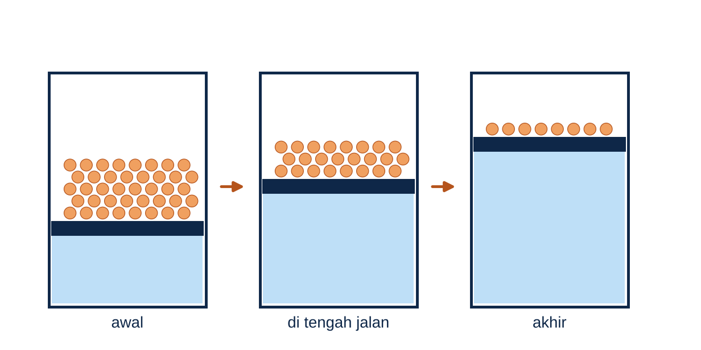

# Bab 3 Energi, Kerja, Kalor, dan Hukum Pertama

Pompa sepeda menjadi hangat setelah dipakai memompa ban beberapa kali. Tidak ada api, tidak ada listrik; yang kita lakukan hanyalah mendorong tuas. Sebaliknya, kaleng semprot terasa dingin di tangan setelah isinya disemprotkan beberapa detik, padahal tidak ada es di dalamnya. Dari mana datangnya panas pada pompa, dan ke mana perginya panas dari kaleng?

Kedua peristiwa itu adalah dua sisi dari satu hukum yang sama, hukum yang barangkali paling penting dalam seluruh ilmu pengetahuan: energi tidak dapat diciptakan atau dimusnahkan. Pada pompa, kerja yang kita berikan dengan tangan masuk ke dalam gas dan muncul sebagai kenaikan suhu. Pada kaleng semprot, gas yang memuai mendorong udara di luar, melakukan kerja, dan membayarnya dengan energinya sendiri, sehingga ia mendingin.

Bab ini membangun hukum itu dengan cermat. Kita akan mendefinisikan **energi dalam** suatu sistem dan dua cara energi berpindah melintasi batas sistem: **kerja** dan **kalor**. Kita akan menghitung kerja yang dilakukan gas ketika memuai, menemukan bahwa besarnya bergantung pada cara gas itu memuai, dan melihat mengapa proses yang dilakukan sangat perlahan, proses reversibel, memberikan kerja terbesar. Lalu kita menuliskan hukum pertama termodinamika dan memakainya untuk gas ideal yang memuai pada suhu tetap dan tanpa pertukaran kalor. Bab ditutup dengan pertanyaan yang menghubungkan kembali termodinamika dengan molekul: di dalam molekul, di mana sebenarnya energi dalam itu tersimpan?

::: {.strategi}
**Pertanyaan pembuka**

1. Apa bedanya kerja dan kalor, bila keduanya sama-sama energi yang berpindah?
2. Mengapa gas yang memuai ke ruang hampa tidak melakukan kerja sama sekali?
3. Mengapa kerja yang dilakukan gas bergantung pada cara ia memuai, padahal keadaan awal dan akhirnya sama?
4. Mengapa proses yang sangat lambat memberikan kerja yang paling besar?
5. Mengapa gas mendingin ketika memuai tanpa menerima kalor, dan memanas ketika dimampatkan?
6. Mengapa kapasitas kalor molar helium hampir tepat $\tfrac32R$, nitrogen $\tfrac52R$, dan klorin lebih besar lagi?
:::

::: {.tujuan}
**Tujuan belajar**

Setelah mempelajari bab ini, kamu mampu:

1. Membedakan fungsi keadaan dan besaran yang bergantung pada jalan.
2. Menghitung kerja ekspansi terhadap tekanan luar tetap, ke ruang hampa, dan secara reversibel.
3. Menjelaskan arti proses reversibel dan mengapa ia memberikan kerja maksimum.
4. Menghitung kalor dari kapasitas kalor dan menentukan kapasitas kalor kalorimeter.
5. Memakai hukum pertama, $\Delta U = q + w$, dengan konvensi tanda IUPAC.
6. Membedakan diferensial eksak dan tak eksak.
7. Menghitung *q*, *w*, dan Δ*U* untuk proses isotermal dan adiabatik gas ideal.
8. Memakai asas ekuipartisi untuk meramalkan kapasitas kalor gas dan menjelaskan mengapa getaran molekul "membeku" pada suhu kamar.
:::

::: {.mat}
**Prasyarat**

Dari Bab 1: persamaan gas ideal dan teori kinetik (subbab 1.5, 1.7). Dari *Fisika Umum*: kerja oleh gas dan hukum pertama (Bab 11). Dari matematika: integral $\int dx/x = \ln x$ dan turunan parsial (dijelaskan di subbab 3.6).
:::

## 3.1 Energi dalam dan fungsi keadaan

Setiap sistem menyimpan energi. Gas di dalam silinder menyimpannya dalam gerak molekul-molekulnya: translasi, rotasi, getaran. Larutan menyimpannya juga dalam tarikan antara molekul pelarut dan zat terlarut, dan setiap molekul menyimpannya dalam ikatan kimianya. Jumlah semua energi itu disebut **energi dalam** dan diberi lambang *U*.

Berapa nilai *U* untuk segelas air? Pertanyaan ini ternyata tidak dapat dijawab, dan untungnya juga tidak perlu dijawab. Untuk menghitungnya kita harus memasukkan energi inti atom, energi massa diam menurut Einstein, dan segala macam energi yang tidak pernah berubah dalam reaksi kimia. Yang dapat diukur, dan yang penting bagi kimia, hanyalah **perubahannya**, Δ*U*, ketika sistem berpindah dari satu keadaan ke keadaan lain.

Energi dalam mempunyai sifat yang sangat berguna: ia adalah **fungsi keadaan**. Nilainya hanya bergantung pada keadaan sistem saat ini, misalnya suhu, tekanan, dan komposisinya, bukan pada sejarah bagaimana sistem itu sampai ke keadaan tersebut. Akibatnya,

$$
\Delta U = U_\text{akhir} - U_\text{awal} , \qquad \text{(3.1)}
$$

apa pun jalan yang ditempuh di antara keduanya. Bandingkan dengan mendaki gunung: perubahan ketinggian antara kaki dan puncak sama, entah kita lewat jalan setapak yang landai atau tebing yang curam. Ketinggian adalah fungsi keadaan. Jarak yang ditempuh dan tenaga yang dikeluarkan pendaki tidak; keduanya bergantung pada jalan yang dipilih.

Dalam termodinamika, kedua besaran yang bergantung pada jalan itu adalah **kerja** dan **kalor**. Keduanya bukan sesuatu yang dimiliki sistem, melainkan cara energi **berpindah** melintasi batas sistem. Sebuah gas tidak "mengandung kerja" atau "mengandung kalor"; ia mengandung energi dalam, yang dapat bertambah atau berkurang lewat kerja atau kalor.

* **Kerja** (*w*) adalah perpindahan energi yang dapat dipakai untuk mengangkat beban, misalnya piston yang terdorong. Di tingkat molekul, kerja adalah perpindahan energi melalui gerak yang **teratur**: semua molekul dinding piston bergerak searah.
* **Kalor** (*q*) adalah perpindahan energi karena perbedaan suhu. Di tingkat molekul, kalor adalah perpindahan energi melalui gerak yang **acak**: molekul-molekul yang bergetar kuat di dinding panas menumbuk molekul-molekul sistem ke segala arah.

::: {.inti}
**Konvensi tanda IUPAC.** *w* dan *q* positif bila energi **masuk** ke sistem, dan negatif bila energi **keluar** dari sistem.
:::

::: {.awas}
**Dua konvensi tanda.** Buku fisika dan teknik, termasuk *Fisika Umum*, sering menulis hukum pertama sebagai $\Delta U = Q - W$, dengan *W* kerja yang dilakukan **oleh** sistem. Kimiawan memakai konvensi IUPAC, $\Delta U = q + w$, dengan *w* kerja yang dilakukan **pada** sistem. Kedua konvensi menggambarkan fisika yang sama; hanya tanda kerjanya yang terbalik ($w = -W$). Saat membaca buku lain, selalu periksa konvensi yang dipakai.
:::

::: {.contoh}
**Contoh 3.1 · Fungsi keadaan atau bukan?**

Manakah di antara besaran berikut yang fungsi keadaan: suhu, tekanan, energi dalam, kerja, kalor, volume, massa jenis?

**Penyelesaian.** Suhu, tekanan, energi dalam, volume, dan massa jenis adalah fungsi keadaan: nilainya dapat dibaca dari sistem pada suatu saat tanpa mengetahui sejarahnya. Kerja dan kalor bukan: keduanya hanya bermakna untuk suatu **proses**, dan nilainya bergantung pada jalan proses itu.

**Memahami hasil.** Cara cepat mengenali fungsi keadaan: tanyakan apakah masuk akal bertanya "berapa nilainya **sekarang**?" Berapa suhu air ini sekarang? Masuk akal. Berapa kalor air ini sekarang? Tidak masuk akal. Karena itu kita menulis Δ*U* dan Δ*T*, tetapi hanya *q* dan *w*, tanpa Δ.
:::

::: {.kuis}
**Kuis cepat 3.1** Tangan yang digosok-gosokkan menjadi hangat. Apakah energi masuk ke tangan sebagai kerja atau sebagai kalor?
:::

## 3.2 Kerja ekspansi

Kerja yang paling sering muncul dalam kimia adalah **kerja ekspansi**: kerja yang dilakukan ketika sistem mengubah volumenya terhadap tekanan luar. Reaksi yang menghasilkan gas di dalam labu terbuka, misalnya, harus mendorong udara atmosfer untuk memberi ruang bagi gas yang baru. Berapa besar kerja itu?

Bayangkan gas di dalam silinder yang ditutup piston seluas *A*. Di sisi luar piston bekerja tekanan luar $p_\text{ex}$, sehingga gaya yang menahan piston adalah $p_\text{ex}A$. Bila gas mendorong piston keluar sejauh *dx*, gas melakukan kerja melawan gaya itu sebesar $p_\text{ex}A\,dx = p_\text{ex}\,dV$. Karena energi **keluar** dari sistem, menurut konvensi IUPAC kerja itu bertanda negatif:

$$
dw = -p_\text{ex}\,dV . \qquad \text{(3.2)}
$$

Perhatikan bahwa yang muncul di sini adalah tekanan **luar**, bukan tekanan gas. Tekanan gas menentukan apakah piston bergerak; tekanan luar menentukan berapa banyak kerja yang dilakukan untuk menggerakkannya. Dua kasus sederhana langsung mengikuti.

**Ekspansi bebas.** Bila gas memuai ke ruang hampa, $p_\text{ex} = 0$ dan $w = 0$. Gas tidak mendorong apa pun, sehingga tidak melakukan kerja, walaupun volumenya bertambah. Inilah jawaban pertanyaan pembuka yang kedua.

**Ekspansi terhadap tekanan luar tetap.** Bila $p_\text{ex}$ tetap selama ekspansi, integral (3.2) menjadi sangat sederhana:

$$
w = -p_\text{ex}\,\Delta V . \qquad \text{(3.3)}
$$

Kerja ini dapat dilihat sebagai luas persegi panjang pada diagram tekanan–volume, dengan tinggi $p_\text{ex}$ dan lebar Δ*V*.

::: {.contoh}
**Contoh 3.2 · Kerja reaksi yang menghasilkan gas**

Sebanyak 5,00 g seng direaksikan dengan asam klorida berlebih dalam labu terbuka pada 25 °C dan 1,00 atm: $\text{Zn}(s) + 2\text{HCl}(aq) \to \text{ZnCl}_2(aq) + \text{H}_2(g)$. Berapa kerja yang dilakukan sistem?

**Rencana.** Hidrogen yang terbentuk harus mendorong atmosfer sejauh volumenya sendiri. Volume zat padat dan cair dapat diabaikan dibanding volume gas.

**Penyelesaian.** $n(\text{H}_2) = n(\text{Zn}) = 5{,}00/65{,}38 = 0{,}0765$ mol. Perubahan volume $\Delta V = nRT/p_\text{ex}$, sehingga
$$
w = -p_\text{ex}\,\Delta V = -nRT = -(0{,}0765)(8{,}314)(298{,}15)\ \text{J} = -190\ \text{J} .
$$

**Memahami hasil.** Tekanan luar ternyata tidak perlu diketahui, karena ia saling menghapus: $p_\text{ex}\,\Delta V = \Delta n_\text{gas}RT$. Setiap mol gas yang dihasilkan reaksi pada 25 °C "membayar" sekitar 2,5 kJ untuk menyingkirkan atmosfer. Energi ini tidak hilang; ia menjadi energi potensial atmosfer yang sedikit terangkat.
:::

::: {.kuis}
**Kuis cepat 3.2** Bila reaksi pada Contoh 3.2 dilakukan di dalam bejana tertutup yang kaku, berapa kerjanya?
:::

## 3.3 Proses reversibel dan tak reversibel

Sekarang kita sampai pada salah satu gagasan terpenting termodinamika. Satu mol gas ideal pada 298 K memuai dari 10,0 L menjadi 20,0 L, dan suhunya dijaga tetap. Keadaan awal dan akhirnya selalu sama. Tetapi berapa kerja yang dilakukan gas?

Jawabannya: bergantung pada caranya. Mula-mula tekanan gas 2,48 bar (dari $p = nRT/V$ pada 10,0 L). Bila tekanan luar langsung diturunkan ke tekanan akhir gas, 1,24 bar (tekanan gas pada 20,0 L), gas memuai dalam satu langkah melawan tekanan itu dan melakukan kerja $|w| = (1{,}24 \times 10^5\ \text{Pa})(0{,}0100\ \text{m}^3) = 1239$ J. Bila ekspansi dilakukan dalam dua tahap, mula-mula melawan 1,65 bar (tekanan gas pada 15,0 L) sampai 15,0 L, lalu melawan 1,24 bar sampai 20,0 L, kerjanya 1446 J. Makin banyak tahapnya, makin besar kerjanya (Gambar 3.1).

{width=96%}

Ke mana batasnya? Bayangkan ekspansi dilakukan dalam tahap yang tak terhingga banyaknya, dengan tekanan luar setiap saat hanya sedikit sekali lebih kecil daripada tekanan gas. Gas memuai sangat perlahan, selalu hampir setimbang dengan lingkungannya. Proses seperti ini disebut **proses reversibel**: perubahan sekecil apa pun pada tekanan luar, ke arah sebaliknya, cukup untuk membalik arah proses. Pada setiap langkahnya $p_\text{ex} = p$, sehingga untuk gas ideal

$$
w = -\int_{V_1}^{V_2} p\,dV = -nRT\int_{V_1}^{V_2}\frac{dV}{V} = -nRT\ln\frac{V_2}{V_1} . \qquad \text{(3.4)}
$$

Untuk contoh kita: $|w| = (8{,}314)(298{,}15)\ln 2 = 1718$ J, lebih besar daripada setiap ekspansi bertahap.

Bagaimana proses seperti itu dapat dibayangkan? Tahan piston dengan tumpukan butir pasir yang beratnya tepat mengimbangi tekanan gas, lalu ambil pasir itu **satu butir demi satu butir** (Gambar 3.2). Setiap butir yang diambil hanya mengurangi tekanan luar sedikit sekali, gas memuai sedikit sampai tekanannya kembali seimbang, dan seterusnya. Mengembalikan satu butir saja sudah cukup untuk membalik arah gerak piston. Itulah arti "reversibel": proses yang dapat dibalik oleh perubahan yang sangat kecil.

{width=88%}

::: {.inti}
**Proses reversibel memberikan kerja maksimum.** Pada ekspansi, gas tidak pernah dapat mendorong lebih kuat daripada tekanannya sendiri. Karena itu kerja terbesar diperoleh bila tekanan luar setiap saat dibuat sama dengan tekanan gas. Setiap proses nyata, yang berlangsung dengan kecepatan tertentu, memberikan kerja yang lebih kecil.
:::

Proses reversibel adalah idealisasi; ia memerlukan waktu tak terhingga. Tetapi ia sangat berharga sebagai **patokan**: ia memberi tahu kita batas atas kerja yang dapat diambil dari suatu perubahan, sebagaimana efisiensi Carnot nanti memberi batas atas mesin kalor (Bab 5). Di sepanjang buku ini, banyak rumus hanya berlaku untuk proses reversibel, dan kita akan selalu menandainya.

::: {.contoh}
**Contoh 3.3 · Tiga cara memuai**

Satu mol gas ideal pada 298 K memuai secara isotermal dari 10,0 L ke 20,0 L dengan tiga cara: (a) ke ruang hampa, (b) melawan tekanan luar tetap yang sama dengan tekanan akhir gas, (c) secara reversibel. Hitung kerja masing-masing.

**Penyelesaian.** (a) $p_\text{ex} = 0$, sehingga $w = 0$.

(b) Tekanan akhir $p_2 = nRT/V_2 = (8{,}314)(298{,}15)/(0{,}0200)$ Pa $= 1{,}239 \times 10^5$ Pa. Maka $w = -p_2\,\Delta V = -(1{,}239 \times 10^5)(0{,}0100)$ J $= -1239$ J.

(c) $w = -nRT\ln(V_2/V_1) = -(8{,}314)(298{,}15)\ln2$ J $= -1718$ J.

**Memahami hasil.** Keadaan awal dan akhir ketiga proses sama, sehingga Δ*U* juga sama (untuk gas ideal pada suhu tetap, Δ*U* = 0, seperti akan kita lihat di subbab 3.7). Tetapi kerjanya berkisar dari 0 sampai 1718 J. Inilah bukti paling jelas bahwa kerja bergantung pada jalan.
:::

::: {.kuis}
**Kuis cepat 3.3** Bila gas yang sama **dimampatkan** dari 20 L ke 10 L pada 298 K, apakah kerja yang diperlukan paling sedikit pada proses reversibel atau pada proses satu tahap? Jelaskan.
:::
