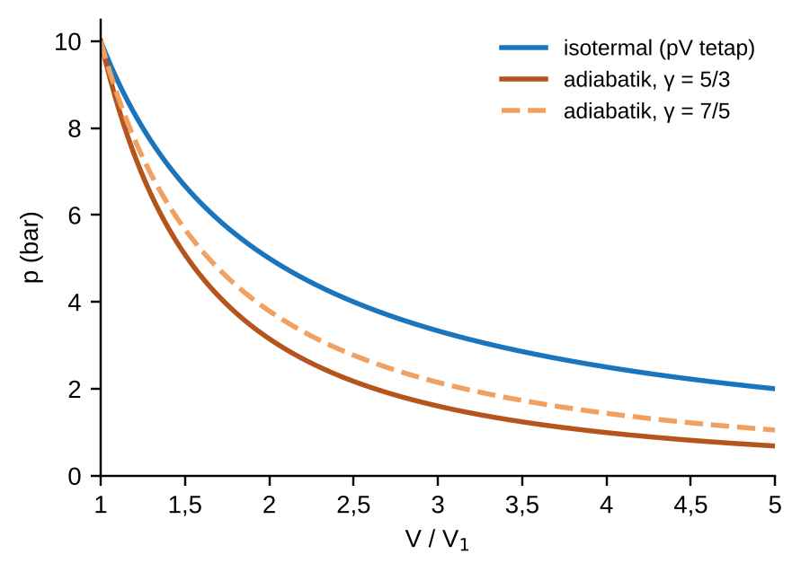

## 3.7 Proses isotermal gas ideal

Hukum pertama berlaku untuk sistem apa pun, tetapi untuk memakainya kita perlu tahu bagaimana *U* bergantung pada keadaan sistem. Untuk gas ideal, jawabannya sangat sederhana: **energi dalam gas ideal hanya bergantung pada suhu**.

Mengapa? Ingat model kinetik (subbab 1.7): molekul gas ideal tidak saling menarik atau menolak. Energinya hanya berupa energi gerak masing-masing molekul, dan energi gerak rata-rata ditentukan oleh suhu. Bila gas ideal memuai pada suhu tetap, jarak antarmolekul bertambah, tetapi karena tidak ada gaya antarmolekul, tidak ada energi potensial yang berubah. Joule menguji hal ini pada 1845 dengan membiarkan udara memuai ke ruang hampa di dalam air: suhu air tidak berubah dalam batas ketelitiannya. (Untuk gas nyata, perubahan kecil memang ada; itulah efek Joule–Thomson dari subbab 2.9.)

Akibatnya langsung: untuk setiap proses **isotermal** gas ideal,

$$
\Delta U = 0 , \qquad q = -w . \qquad \text{(3.9)}
$$

Kalor yang masuk tepat sama dengan kerja yang dilakukan gas. Gas yang memuai pada suhu tetap menyerap kalor dari lingkungannya sebanyak kerja yang ia lakukan; gas yang dimampatkan pada suhu tetap melepaskan kalor sebanyak kerja yang diterimanya. Untuk proses reversibel, dari (3.4):

$$
q_\text{rev} = -w_\text{rev} = nRT\ln\frac{V_2}{V_1} = nRT\ln\frac{p_1}{p_2} . \qquad \text{(3.10)}
$$

Bentuk kedua diperoleh dari hukum Boyle, $p_1V_1 = p_2V_2$.

::: {.contoh}
**Contoh 3.9 · Memampatkan nitrogen pada suhu tetap**

Dua mol N₂, yang dianggap gas ideal, dimampatkan pada 300 K dari 1,00 bar ke 10,0 bar. Hitung *w*, *q*, dan Δ*U* bila pemampatan dilakukan (a) secara reversibel, (b) sekaligus dengan tekanan luar tetap 10,0 bar.

**Penyelesaian.** Untuk kedua cara, suhu awal dan akhir sama, jadi $\Delta U = 0$ dan $q = -w$.

(a) Dari (3.10): $w = -nRT\ln(p_1/p_2) = nRT\ln10 = (2)(8{,}314)(300)(2{,}303)$ J $= +11{,}5$ kJ, dan $q = -11{,}5$ kJ.

(b) $w = -p_\text{ex}(V_2 - V_1) = -p_2\left(\frac{nRT}{p_2} - \frac{nRT}{p_1}\right) = nRT\left(\frac{p_2}{p_1} - 1\right) = (2)(8{,}314)(300)(9)$ J $= +44{,}9$ kJ, dan $q = -44{,}9$ kJ.

**Memahami hasil.** Pemampatan sekaligus memerlukan kerja hampir empat kali lebih besar daripada pemampatan reversibel, dan semua kelebihan itu keluar sebagai kalor ke lingkungan. Inilah sisi lain dari subbab 3.3: untuk ekspansi, proses reversibel **memberikan** kerja terbesar; untuk pemampatan, ia **memerlukan** kerja terkecil. Kompresor industri dirancang mendekati proses bertahap dengan pendinginan di antara tahap justru untuk menghemat kerja ini.
:::

::: {.kuis}
**Kuis cepat 3.7** Pada proses isotermal reversibel gas ideal, kalor masuk tetapi suhu tidak naik. Ke mana perginya kalor itu?
:::

## 3.8 Proses adiabatik gas ideal

Sekarang kita siap menjawab teka-teki pembuka. Pada pompa sepeda, gas dimampatkan begitu cepat sehingga hampir tidak ada waktu bagi kalor untuk mengalir keluar melalui dinding: proses itu hampir **adiabatik**. Dengan $q = 0$, hukum pertama menjadi

$$
\Delta U = w . \qquad \text{(3.11)}
$$

Semua kerja yang kita berikan masuk ke energi dalam gas. Karena energi dalam gas ideal hanya bergantung pada suhu, suhunya harus naik. Sebaliknya, gas yang memuai secara adiabatik melakukan kerja dengan membayar dari energi dalamnya sendiri, sehingga suhunya turun. Itulah sebabnya kaleng semprot dingin: gas pendorong yang memuai keluar melakukan kerja terhadap atmosfer tanpa sempat menerima kalor, dan cairan pendorong yang menguap di dalamnya juga menyerap kalor.

Berapa besar perubahan suhunya? Untuk gas ideal, perubahan energi dalam pada setiap proses dapat ditulis $dU = nC_{V,\text{m}}\,dT$, karena *U* hanya bergantung pada *T* dan $C_V$ adalah laju perubahan *U* terhadap *T*. Untuk proses adiabatik **reversibel**, $dw = -p\,dV = -(nRT/V)\,dV$, sehingga hukum pertama menjadi

$$
nC_{V,\text{m}}\,dT = -\frac{nRT}{V}\,dV \qquad \Rightarrow \qquad C_{V,\text{m}}\frac{dT}{T} = -R\frac{dV}{V} .
$$

Mengintegralkan kedua ruas dari keadaan 1 ke keadaan 2, dengan $C_{V,\text{m}}$ dianggap tetap, menghasilkan $C_{V,\text{m}}\ln(T_2/T_1) = -R\ln(V_2/V_1) = R\ln(V_1/V_2)$. Membagi dengan $C_{V,\text{m}}$ dan mengambil eksponen kedua ruas:

$$
\frac{T_2}{T_1} = \left(\frac{V_1}{V_2}\right)^{R/C_{V,\text{m}}} .
$$

Hasil ini biasanya ditulis dengan **perbandingan kapasitas kalor** $\gamma = C_{p,\text{m}}/C_{V,\text{m}}$. Untuk gas ideal, $C_{p,\text{m}} - C_{V,\text{m}} = R$ (akan dibuktikan di Bab 4), sehingga $R/C_{V,\text{m}} = \gamma - 1$, dan memakai $pV = nRT$ kita peroleh tiga bentuk yang setara:

::: {.inti}
$$
TV^{\gamma - 1} = \text{tetap} , \qquad pV^\gamma = \text{tetap} , \qquad Tp^{(1 - \gamma)/\gamma} = \text{tetap} \qquad \text{(3.12)}
$$
**Adiabat reversibel gas ideal.** Untuk gas monoatomik $\gamma = 5/3$; untuk gas diatomik pada suhu kamar $\gamma = 7/5$.
:::

Karena $\gamma > 1$, adiabat pada diagram *p*–*V* lebih curam daripada isoterm (Gambar 3.3). Pada ekspansi isotermal, kalor yang masuk menjaga suhu tetap, sehingga tekanan turun hanya karena volume bertambah. Pada ekspansi adiabatik, suhu juga turun, sehingga tekanan turun lebih cepat.

{width=66%}

::: {.contoh}
**Contoh 3.10 · Pompa sepeda**

Udara ($\gamma = 1{,}40$) pada 25 °C dan 1,00 bar dimampatkan dengan cepat di dalam pompa sepeda sampai 4,00 bar. Taksir suhu udara di akhir pemampatan bila prosesnya dianggap adiabatik reversibel.

**Penyelesaian.** Dari bentuk ketiga (3.12), $T_2 = T_1(p_2/p_1)^{(\gamma - 1)/\gamma}$:
$$
T_2 = (298{,}15\ \text{K})(4{,}00)^{0{,}40/1{,}40} = (298{,}15)(1{,}486)\ \text{K} = 443\ \text{K} \approx 170\ ^\circ\text{C} .
$$

**Memahami hasil.** Pompa sepeda yang nyata tidak sepanas itu, karena kalor sempat mengalir ke dinding logam di setiap langkah dan sebagian udara bocor. Tetapi hasil ini menjelaskan mengapa ujung pompa terasa hangat, terutama dekat katup, tempat pemampatan paling besar. Teka-teki pembuka terjawab: kerja tangan kita menjadi energi dalam udara.
:::

::: {.contoh}
**Contoh 3.11 · Mesin diesel menyalakan bahan bakar tanpa busi**

Mesin diesel memampatkan udara dengan perbandingan volume 18 : 1 sebelum menyemprotkan solar. Taksir suhu udara pada akhir pemampatan bila suhu awalnya 300 K, dengan $\gamma = 1{,}40$.

**Penyelesaian.** Dari bentuk pertama (3.12), $T_2 = T_1(V_1/V_2)^{\gamma - 1} = (300\ \text{K})(18)^{0{,}40} = 953$ K, sekitar 680 °C.

**Memahami hasil.** Suhu ini jauh di atas suhu nyala sendiri solar (sekitar 250 °C), sehingga bahan bakar langsung terbakar begitu disemprotkan. Mesin bensin memakai perbandingan pemampatan yang jauh lebih kecil (sekitar 10 : 1) supaya campuran bensin dan udara tidak menyala sebelum waktunya, dan karena itu memerlukan busi.
:::

::: {.contoh}
**Contoh 3.12 · Argon yang mendingin**

Satu mol argon ($C_{V,\text{m}} = \tfrac32R$) pada 300 K dan 10,0 bar memuai secara adiabatik reversibel sampai 1,00 bar. Hitung suhu akhir dan kerja yang dilakukan.

**Penyelesaian.** $\gamma = 5/3$, sehingga $(\gamma - 1)/\gamma = 0{,}40$ dan $T_2 = (300\ \text{K})(0{,}100)^{0{,}40} = 119$ K. Kerjanya sama dengan perubahan energi dalam:
$$
w = \Delta U = nC_{V,\text{m}}\,\Delta T = (1)(\tfrac32)(8{,}314)(119{,}4 - 300)\ \text{J} = -2{,}25\ \text{kJ} .
$$

**Memahami hasil.** Pemuaian sepuluh kali lipat menurunkan suhu argon dari suhu kamar sampai jauh di bawah titik didih nitrogen. Pendinginan adiabatik semacam ini, yang dilakukan dengan turbin yang mengambil kerja dari gas, dipakai pada mesin pencair gas modern, bersama efek Joule–Thomson dari subbab 2.9.
:::

::: {.terapan}
**Mengapa puncak gunung dingin.** Udara yang naik ke lereng gunung masuk ke daerah bertekanan lebih rendah. Ia memuai hampir tanpa pertukaran kalor, karena udara adalah penghantar kalor yang buruk, sehingga ia mendingin secara adiabatik. Seberapa cepat? Turunkan bentuk ketiga (3.12) menjadi $dT/T = (R/C_{p,\text{m}})\,dp/p$, lalu pakai penurunan tekanan dengan ketinggian, $dp = -\rho g\,dz$ dengan $\rho = pM/RT$. Hasilnya sederhana: $dT/dz = -Mg/C_{p,\text{m}}$. Untuk udara kering ($M = 0{,}029$ kg mol⁻¹, $C_{p,\text{m}} = 29{,}1$ J K⁻¹ mol⁻¹), suhunya turun 9,8 K setiap kilometer naik. Udara nyata mendingin lebih lambat, rata-rata sekitar 6,5 K per kilometer, karena uap air yang mengembun menjadi awan melepaskan kalor. Proses yang sama, dibalik, juga bekerja: udara yang turun dari gunung dimampatkan dan memanas.
:::

::: {.kuis}
**Kuis cepat 3.8** Angin gending yang turun dari Pegunungan Tengger ke Probolinggo terasa panas dan kering. Pakai gagasan kotak di atas untuk menjelaskan mengapa udara itu memanas ketika turun, dan mengapa ia kering.
:::

## 3.9 Energi dalam dari sudut molekul: ekuipartisi

Kita telah memakai $C_{V,\text{m}} = \tfrac32R$ untuk argon dan $\gamma = 7/5$ untuk udara. Dari mana angka-angka itu? Termodinamika sendiri tidak dapat menjawabnya; ia hanya mengatakan bahwa *U* adalah fungsi keadaan. Untuk menghitung *U*, kita harus kembali ke molekul.

Di Bab 1 kita menemukan bahwa energi kinetik translasi rata-rata molekul adalah $\tfrac32kT$, yaitu $\tfrac12kT$ untuk setiap arah gerak *x*, *y*, dan *z*. Hasil ini ternyata merupakan contoh dari asas yang lebih umum, **asas ekuipartisi energi**: dalam kesetimbangan termal, setiap suku energi yang berbentuk kuadrat (seperti $\tfrac12mv_x^2$ atau $\tfrac12I\omega^2$ atau $\tfrac12kx^2$) menyumbang rata-rata $\tfrac12kT$ per molekul, atau $\tfrac12RT$ per mol.

Dengan asas ini, kita cukup menghitung suku-suku kuadrat untuk setiap jenis molekul:

* **Gas monoatomik** (He, Ne, Ar): hanya translasi, tiga suku. $U_\text{m} = \tfrac32RT$, sehingga $C_{V,\text{m}} = \tfrac32R = 12{,}47$ J K⁻¹ mol⁻¹.
* **Molekul linear** (N₂, O₂, CO₂): translasi ditambah rotasi terhadap dua sumbu tegak lurus ikatan, lima suku. $C_{V,\text{m}} = \tfrac52R = 20{,}79$ J K⁻¹ mol⁻¹.
* **Molekul tak linear** (H₂O, CH₄): translasi dan rotasi terhadap tiga sumbu, enam suku. $C_{V,\text{m}} = 3R = 24{,}94$ J K⁻¹ mol⁻¹.
* **Getaran**: setiap mode getaran mempunyai energi kinetik dan energi potensial, dua suku kuadrat, sehingga bila aktif penuh menyumbang *R* lagi.

| Gas | Terukur pada 298 K (J K⁻¹ mol⁻¹) | Ekuipartisi tanpa getaran |
|---|---|---|
| He, Ar | 12,47 | 12,47 |
| N₂ | 20,81 | 20,79 |
| O₂ | 21,05 | 20,79 |
| Cl₂ | 25,60 | 20,79 |
| H₂O | 25,27 | 24,94 |
| CO₂ | 28,80 | 20,79 |

Tabel 3.1 Kapasitas kalor molar pada volume tetap beberapa gas.

Untuk gas monoatomik dan N₂, ramalan ekuipartisi tepat sekali, **asalkan getaran diabaikan**. Bila getaran ikut dihitung, N₂ seharusnya mempunyai $\tfrac72R = 29{,}1$ J K⁻¹ mol⁻¹, jauh di atas nilai terukur. Mengapa getaran tidak ikut menyerap energi?

Jawabannya datang dari mekanika kuantum (*Kimia Kuantum* Bab 5). Energi getaran terkuantisasi: molekul hanya dapat menyerap energi getaran dalam paket sebesar *hν*. Bila *kT* jauh lebih kecil daripada *hν*, hampir tidak ada tumbukan yang cukup kuat untuk mengeksitasi getaran, dan mode itu praktis "membeku". Untuk N₂, *hν/k* sekitar 3400 K, sebelas kali suhu kamar. Untuk Cl₂, yang ikatannya lebih lemah dan atomnya lebih berat, *hν/k* hanya sekitar 800 K, sehingga getarannya sudah sebagian aktif pada suhu kamar. Untuk CO₂, dua mode tekuknya yang berfrekuensi rendah juga sebagian aktif. Inilah sebabnya Cl₂ dan CO₂ mempunyai kapasitas kalor di atas ramalan ekuipartisi tanpa getaran.

::: {.contoh}
**Contoh 3.13 · Getaran klorin yang setengah bangun**

Bilangan gelombang getaran Cl₂ adalah 560 cm⁻¹. Model kuantum (Einstein) memberi sumbangan getaran pada kapasitas kalor
$$
C_{V,\text{m}}^\text{get} = R\frac{x^2e^x}{(e^x - 1)^2} , \qquad x = \frac{hc\tilde\nu}{kT} .
$$
Hitung $C_{V,\text{m}}$ Cl₂ pada 298 K dan bandingkan dengan Tabel 3.1. Lakukan hal yang sama untuk N₂ ($\tilde\nu = 2359$ cm⁻¹).

**Penyelesaian.** Untuk Cl₂: $hc\tilde\nu/k = (1{,}4388\ \text{cm K})(560\ \text{cm}^{-1}) = 806$ K, sehingga $x = 806/298{,}15 = 2{,}70$, dan
$$
C_{V,\text{m}}^\text{get} = (8{,}314)\frac{(2{,}70)^2e^{2{,}70}}{(e^{2{,}70} - 1)^2} = 4{,}68\ \text{J K}^{-1}\text{mol}^{-1} .
$$
Totalnya $20{,}79 + 4{,}68 = 25{,}5$ J K⁻¹ mol⁻¹, hampir tepat nilai terukur 25,6. Untuk N₂: $x = 3394/298{,}15 = 11{,}4$, dan sumbangan getarannya hanya 0,012 J K⁻¹ mol⁻¹.

**Memahami hasil.** Getaran Cl₂ "setengah bangun": sumbangannya 4,68 dari *R* penuh (8,31). Getaran N₂ masih "tidur nyenyak". Bila suhu dinaikkan sampai beberapa ribu kelvin, getaran N₂ juga bangun dan kapasitas kalornya mendekati $\tfrac72R$. Inilah salah satu bukti paling awal bahwa fisika klasik tidak cukup untuk menjelaskan sifat termal zat.
:::

::: {.contoh}
**Contoh 3.14 · Menghitung γ dari ekuipartisi**

Hitung $\gamma = C_{p,\text{m}}/C_{V,\text{m}}$ untuk gas monoatomik, diatomik (tanpa getaran), dan tak linear (tanpa getaran), dengan $C_{p,\text{m}} = C_{V,\text{m}} + R$.

**Penyelesaian.** Monoatomik: $\gamma = (\tfrac52R)/(\tfrac32R) = 5/3 = 1{,}67$. Diatomik: $(\tfrac72R)/(\tfrac52R) = 7/5 = 1{,}40$. Tak linear: $(4R)/(3R) = 4/3 = 1{,}33$.

**Memahami hasil.** Makin banyak cara molekul menyimpan energi, makin dekat γ ke 1, dan makin landai adiabatnya. Molekul yang kompleks menyerap sebagian kerja pemampatan ke dalam rotasi dan getarannya, sehingga suhunya naik lebih sedikit. Pengukuran kecepatan bunyi dalam gas, yang bergantung pada γ, pernah dipakai untuk membuktikan bahwa argon adalah gas monoatomik.
:::

::: {.kuis}
**Kuis cepat 3.9** Mengapa kapasitas kalor molar gas monoatomik tidak bergantung pada suhu, sedangkan kapasitas kalor Cl₂ bertambah bila suhu dinaikkan?
:::

### Menuju bab berikutnya

Kebanyakan reaksi kimia tidak terjadi dalam wadah bervolume tetap, tetapi dalam gelas kimia yang terbuka ke atmosfer, pada tekanan tetap. Pada kondisi itu, sebagian energi selalu terpakai untuk mendorong atmosfer, seperti hidrogen pada Contoh 3.2. Agar pembukuan energi tetap sederhana, kimiawan memakai fungsi keadaan baru, **entalpi**, yang langsung sama dengan kalor yang dipertukarkan pada tekanan tetap. Bab 4 memperkenalkan entalpi dan memakainya untuk menghitung kalor reaksi, dari hukum Hess sampai energi bahan bakar.
