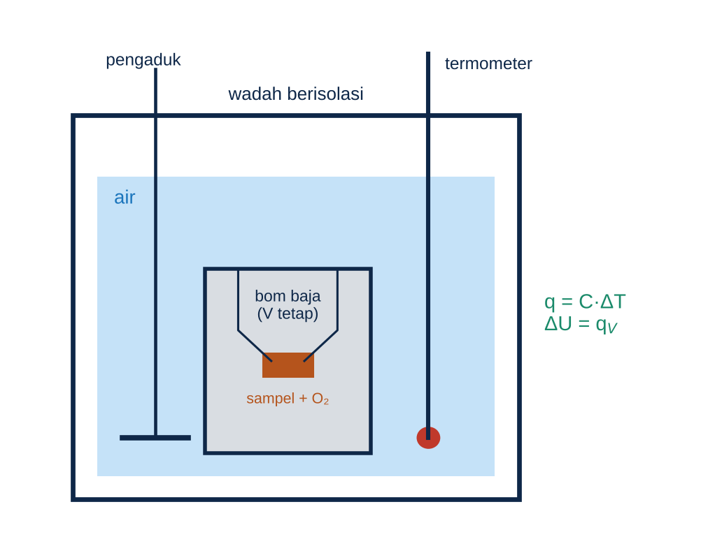

# Bab 4 Entalpi dan Termokimia

Di apotek dijual dua jenis kantong kompres yang tampak serupa. Kantong penghangat tangan berisi serbuk besi, garam, dan sedikit air; begitu dibuka dan diremas, besi bereaksi dengan oksigen udara dan kantong menjadi hangat selama berjam-jam. Kompres dingin instan berisi amonium nitrat dan sekantong air; begitu sekat di dalamnya dipecah, garam itu larut dan kantong menjadi sedingin es dalam beberapa detik. Keduanya terjadi dengan sendirinya. Yang satu melepaskan kalor, yang lain menyerap kalor. Berapa banyak kalor yang dipertukarkan masing-masing, dan bagaimana kita dapat menghitungnya tanpa membuat kantongnya lebih dulu?

Pertanyaan yang sama muncul dalam skala yang jauh lebih besar. Mengapa satu gram hidrogen yang terbakar menghasilkan energi tiga kali lebih banyak daripada satu gram bensin, dan sembilan kali lebih banyak daripada satu gram gula? Insinyur yang merancang roket, ahli gizi yang menghitung kalori makanan, dan kimiawan yang merancang reaktor industri semuanya memerlukan jawaban yang sama: berapa kalor yang dilepaskan atau diserap suatu reaksi?

Cabang termodinamika yang menjawab pertanyaan itu disebut **termokimia**. Alat utamanya adalah fungsi keadaan baru, **entalpi**, yang dirancang khusus untuk reaksi yang berlangsung pada tekanan tetap, seperti hampir semua reaksi di laboratorium dan di dalam tubuh kita. Karena entalpi adalah fungsi keadaan, kalor reaksi dapat dihitung dengan menjumlahkan kalor reaksi-reaksi lain, seperti potongan teka-teki. Dengan beberapa ratus angka dalam tabel, kita dapat menghitung kalor puluhan ribu reaksi tanpa pernah melakukannya.

::: {.strategi}
**Pertanyaan pembuka**

1. Mengapa kimiawan memerlukan entalpi, padahal energi dalam sudah ada?
2. Mengapa kalor yang diukur dalam bom kalorimeter berbeda dari kalor reaksi yang sama di dalam gelas kimia terbuka?
3. Bagaimana kalor suatu reaksi dapat dihitung tanpa pernah melakukan reaksi itu?
4. Mengapa entalpi pembentukan unsur dalam bentuk paling stabilnya ditetapkan nol?
5. Seberapa teliti energi ikatan rata-rata untuk meramalkan kalor reaksi?
6. Mengapa hidrogen adalah bahan bakar terbaik per gram, tetapi bukan per liter?
:::

::: {.tujuan}
**Tujuan belajar**

Setelah mempelajari bab ini, kamu mampu:

1. Mendefinisikan entalpi dan menjelaskan mengapa $\Delta H = q_p$.
2. Menghitung selisih Δ*H* dan Δ*U* untuk reaksi yang melibatkan gas, dan membuktikan $C_p - C_V = nR$ untuk gas ideal.
3. Menentukan kalor reaksi dari data bom kalorimeter dan kalorimeter tekanan tetap.
4. Memakai entalpi perubahan fisika (penguapan, peleburan, sublimasi).
5. Menuliskan persamaan termokimia dengan keadaan standar yang benar.
6. Memakai hukum Hess dan entalpi pembentukan standar untuk menghitung entalpi reaksi.
7. Menaksir entalpi reaksi dari entalpi ikatan rata-rata dan menilai ketelitiannya.
8. Menghitung entalpi reaksi pada suhu lain dengan hukum Kirchhoff.
9. Membandingkan bahan bakar berdasarkan entalpi pembakaran per gram dan per liter.
:::

::: {.mat}
**Prasyarat**

Dari Bab 3: hukum pertama, kerja ekspansi, kapasitas kalor, dan fungsi keadaan (subbab 3.1–3.5). Dari Kimia Dasar: stoikiometri reaksi dan konsep mol.
:::

## 4.1 Entalpi

Bayangkan sebuah reaksi berlangsung di dalam gelas kimia yang terbuka ke udara. Tekanannya tetap, yaitu tekanan atmosfer. Bila reaksi itu menghasilkan gas, sistem memuai dan melakukan kerja terhadap atmosfer, seperti hidrogen pada Contoh 3.2. Akibatnya, kalor yang kita ukur bukan perubahan energi dalam: sebagian energi telah "bocor" sebagai kerja ekspansi.

Kita dapat melihatnya dari hukum pertama. Bila satu-satunya kerja adalah kerja ekspansi terhadap tekanan tetap *p*, maka $w = -p\,\Delta V$, dan

$$
\Delta U = q_p - p\,\Delta V \qquad \Rightarrow \qquad q_p = \Delta U + p\,\Delta V .
$$

Indeks *p* menandai kalor yang dipertukarkan pada tekanan tetap. Ruas kanan adalah perubahan dari besaran $U + pV$, karena *p* tetap. Besaran inilah yang diberi nama **entalpi**:

::: {.inti}
$$
H = U + pV \qquad \text{(4.1)}
$$
$$
\Delta H = q_p \qquad \text{(tekanan tetap, hanya kerja ekspansi)} \qquad \text{(4.2)}
$$
**Perubahan entalpi sama dengan kalor yang dipertukarkan pada tekanan tetap.** Karena *U*, *p*, dan *V* fungsi keadaan, *H* juga fungsi keadaan.
:::

Inilah alasan entalpi diciptakan. Ia adalah energi dalam yang sudah "dikoreksi" untuk kerja ekspansi terhadap atmosfer, sehingga kalor yang diukur di gelas kimia terbuka langsung memberi Δ*H*. Bila Δ*H* negatif, reaksi melepaskan kalor dan disebut **eksoterm**; bila positif, reaksi menyerap kalor dan disebut **endoterm**. Kantong penghangat tangan menjalankan reaksi eksoterm; kompres dingin menjalankan proses endoterm.

Seberapa besar perbedaan Δ*H* dan Δ*U*? Untuk reaksi yang hanya melibatkan padatan dan cairan, perubahan volumenya sangat kecil, sehingga $\Delta H \approx \Delta U$. Untuk reaksi yang melibatkan gas, perubahan volume ditentukan oleh perubahan jumlah mol gas, $p\,\Delta V = \Delta n_\text{gas}RT$, sehingga

$$
\Delta H = \Delta U + \Delta n_\text{gas}RT . \qquad \text{(4.3)}
$$

::: {.contoh}
**Contoh 4.1 · Δ*H* dan Δ*U* pembakaran metana**

Untuk $\text{CH}_4(g) + 2\text{O}_2(g) \to \text{CO}_2(g) + 2\text{H}_2\text{O}(l)$ pada 298 K, $\Delta H = -890{,}3$ kJ mol⁻¹. Berapa Δ*U*?

**Penyelesaian.** Gas di ruas kiri 3 mol, di ruas kanan 1 mol (air berupa cairan), jadi $\Delta n_\text{gas} = -2$. Dari (4.3):
$$
\Delta U = \Delta H - \Delta n_\text{gas}RT = -890{,}3 - (-2)(8{,}314 \times 10^{-3})(298{,}15)\ \text{kJ mol}^{-1} = -885{,}3\ \text{kJ mol}^{-1} .
$$

**Memahami hasil.** Reaksi pada tekanan tetap melepaskan 5 kJ lebih banyak kalor daripada reaksi yang sama dalam wadah tertutup. Asal selisih itu: volume gas berkurang, sehingga atmosfer **mendorong masuk** dan melakukan kerja 5 kJ pada sistem, dan energi ini ikut keluar sebagai kalor. Selisih 0,6% kecil, tetapi tidak dapat diabaikan dalam kalorimetri yang teliti.
:::

::: {.contoh}
**Contoh 4.2 · Menguapkan air**

Entalpi penguapan air pada 100 °C dan 1 atm adalah 40,66 kJ mol⁻¹. Berapa perubahan energi dalamnya? Abaikan volume cairan.

**Penyelesaian.** Satu mol cairan menjadi satu mol gas, $\Delta n_\text{gas} = +1$:
$$
\Delta U = 40{,}66 - (8{,}314 \times 10^{-3})(373{,}15)\ \text{kJ mol}^{-1} = 37{,}56\ \text{kJ mol}^{-1} .
$$

**Memahami hasil.** Dari 40,66 kJ kalor yang diberikan, 37,56 kJ dipakai untuk memisahkan molekul-molekul air dari tarikan ikatan hidrogennya (kenaikan energi dalam), dan 3,10 kJ dipakai uap yang terbentuk untuk mendorong atmosfer menjauh. Sekitar 8% kalor penguapan adalah kerja ekspansi.
:::

::: {.kuis}
**Kuis cepat 4.1** Untuk reaksi $\text{N}_2(g) + 3\text{H}_2(g) \to 2\text{NH}_3(g)$, mana yang lebih negatif, Δ*H* atau Δ*U*? Untuk $\text{H}_2(g) + \text{Cl}_2(g) \to 2\text{HCl}(g)$?
:::

## 4.2 Cp, Cv, dan hubungan keduanya

Di Bab 3 kita membedakan dua kapasitas kalor: $C_V$ pada volume tetap dan $C_p$ pada tekanan tetap. Sekarang keduanya dapat didefinisikan dengan tepat. Pada volume tetap tidak ada kerja ekspansi, sehingga semua kalor menaikkan energi dalam; pada tekanan tetap, kalor sama dengan perubahan entalpi:

$$
C_V = \left(\frac{\partial U}{\partial T}\right)_V , \qquad C_p = \left(\frac{\partial H}{\partial T}\right)_p . \qquad \text{(4.4)}
$$

Mengapa $C_p$ lebih besar? Ketika sistem dipanaskan pada tekanan tetap, ia memuai dan melakukan kerja terhadap lingkungannya. Kalor yang diberikan harus membayar dua hal sekaligus: kenaikan energi dalam dan kerja ekspansi. Untuk menaikkan suhu sebesar yang sama, diperlukan lebih banyak kalor.

Untuk gas ideal, selisihnya dapat dihitung dengan tepat. Dari $H = U + pV = U + nRT$, perubahan kecilnya $dH = dU + nR\,dT$. Membagi dengan *dT* dan mengingat bahwa *U* dan *H* gas ideal hanya bergantung pada *T*:

$$
C_p - C_V = nR \qquad \text{atau} \qquad C_{p,\text{m}} - C_{V,\text{m}} = R . \qquad \text{(4.5)}
$$

Inilah hubungan yang kita pakai di subbab 3.8 untuk menurunkan γ. Untuk cairan dan padatan, yang hampir tidak memuai, $C_p$ dan $C_V$ hampir sama. Dalam tabel data, yang biasanya dicantumkan adalah $C_{p,\text{m}}$, karena pengukuran pada tekanan tetap jauh lebih mudah. Untuk rentang suhu yang lebar, kapasitas kalor berubah dengan suhu, dan sering dinyatakan dengan rumus empiris $C_{p,\text{m}} = a + bT + c/T^2$, dengan tetapan *a*, *b*, dan *c* dari tabel.

::: {.contoh}
**Contoh 4.3 · Memanaskan nitrogen dengan dua cara**

Hitung kalor yang diperlukan untuk memanaskan 1,00 mol N₂ dari 25 °C ke 100 °C (a) pada tekanan tetap, (b) pada volume tetap. Pakai $C_{p,\text{m}} = 29{,}12$ J K⁻¹ mol⁻¹.

**Penyelesaian.** (a) $q_p = nC_{p,\text{m}}\Delta T = (1{,}00)(29{,}12)(75)$ J $= 2184$ J.

(b) $C_{V,\text{m}} = 29{,}12 - 8{,}31 = 20{,}81$ J K⁻¹ mol⁻¹, sehingga $q_V = (1{,}00)(20{,}81)(75)$ J $= 1561$ J.

**Memahami hasil.** Selisihnya, 624 J, tepat sama dengan $nR\,\Delta T$, yaitu kerja yang dilakukan gas ketika memuai pada tekanan tetap. Pada (a), kalor itu sama dengan Δ*H*; pada (b), sama dengan Δ*U*.
:::

::: {.kuis}
**Kuis cepat 4.2** Mengapa $C_p$ dan $C_V$ air cair hampir sama, padahal untuk uap air keduanya berbeda *R*?
:::

## 4.3 Kalorimetri: bom dan tekanan tetap

Bagaimana kalor reaksi diukur? Ada dua jenis kalorimeter utama, dan perbedaannya tepat sejajar dengan perbedaan Δ*U* dan Δ*H*.

**Bom kalorimeter** adalah wadah baja tebal bervolume tetap, diisi zat yang akan dibakar dan oksigen bertekanan tinggi, lalu direndam dalam air di dalam bejana terisolasi (Gambar 4.1). Zat dinyalakan dengan kawat listrik, dan kenaikan suhu air diukur. Karena volume tetap, tidak ada kerja ekspansi, dan kalor yang diukur sama dengan **Δ*U***. Bom kalorimeter dipakai untuk reaksi pembakaran, termasuk untuk mengukur kandungan energi makanan dan bahan bakar. Δ*H* kemudian dihitung dengan (4.3).

{width=60%}

**Kalorimeter tekanan tetap**, dalam bentuk paling sederhana berupa dua gelas plastik busa bertumpuk dengan tutup dan termometer, dipakai untuk reaksi dalam larutan: penetralan, pelarutan, pengendapan. Karena terbuka ke atmosfer, kalor yang diukur sama dengan **Δ*H***.

Kedua kalorimeter dikalibrasi lebih dulu, dengan pemanas listrik (Contoh 3.4) atau dengan pembakaran zat baku yang kalornya diketahui sangat teliti. Zat baku internasional untuk bom kalorimeter adalah asam benzoat, dengan $\Delta_\text{c}U = -26{,}43$ kJ g⁻¹.

::: {.contoh}
**Contoh 4.4 · Kalori sesendok gula**

Pembakaran 0,825 g asam benzoat dalam bom kalorimeter menaikkan suhu 2,18 K. Pembakaran 1,000 g glukosa dalam kalorimeter yang sama menaikkan suhu 1,56 K. Hitung entalpi pembakaran molar glukosa.

**Penyelesaian.** Kapasitas kalor kalorimeter:
$$
C = \frac{(0{,}825\ \text{g})(26{,}43\ \text{kJ g}^{-1})}{2{,}18\ \text{K}} = 10{,}00\ \text{kJ K}^{-1} .
$$
Kalor dari 1,000 g glukosa: $(10{,}00)(1{,}56) = 15{,}6$ kJ, sehingga $\Delta_\text{c}U = -15{,}6$ kJ g⁻¹ $= -15{,}6 \times 180{,}16 = -2811$ kJ mol⁻¹. Untuk $\text{C}_6\text{H}_{12}\text{O}_6(s) + 6\text{O}_2(g) \to 6\text{CO}_2(g) + 6\text{H}_2\text{O}(l)$, $\Delta n_\text{gas} = 0$, sehingga $\Delta_\text{c}H = \Delta_\text{c}U = -2811$ kJ mol⁻¹.

**Memahami hasil.** Nilai literatur sekitar −2808 kJ mol⁻¹. Dalam satuan gizi, 15,6 kJ g⁻¹ setara dengan 3,7 kkal g⁻¹; label makanan memakai angka bulat 4 kkal per gram karbohidrat. Tubuh kita membakar glukosa dengan oksigen yang sama, menghasilkan energi yang sama, hanya jauh lebih perlahan dan bertahap.
:::

::: {.contoh}
**Contoh 4.5 · Kalor penetralan**

Sebanyak 50,0 mL HCl 1,00 M dicampur dengan 50,0 mL NaOH 1,00 M dalam kalorimeter gelas busa. Suhu naik 6,82 K. Anggap larutan bermassa 100 g dengan kapasitas kalor spesifik air, dan abaikan kalor yang diserap gelas. Hitung entalpi penetralan per mol air yang terbentuk.

**Penyelesaian.** Kalor yang diserap larutan: $q = (100\ \text{g})(4{,}184\ \text{J K}^{-1}\text{g}^{-1})(6{,}82\ \text{K}) = 2853$ J. Mol air yang terbentuk sama dengan mol HCl, 0,0500 mol. Kalor itu dilepaskan reaksi, jadi
$$
\Delta H = -\frac{2853\ \text{J}}{0{,}0500\ \text{mol}} = -57{,}1\ \text{kJ mol}^{-1} .
$$

**Memahami hasil.** Hasil ini hampir sama untuk semua pasangan asam kuat dan basa kuat, karena reaksi yang sebenarnya selalu sama: $\text{H}^+(aq) + \text{OH}^-(aq) \to \text{H}_2\text{O}(l)$. Ion Na⁺ dan Cl⁻ hanya penonton. Untuk asam lemah, nilainya sedikit berbeda karena sebagian kalor terpakai untuk mengionkan asam itu.
:::

::: {.kuis}
**Kuis cepat 4.3** Mengapa bom kalorimeter mengukur Δ*U*, bukan Δ*H*? Dalam keadaan apa keduanya sama untuk reaksi pembakaran?
:::
