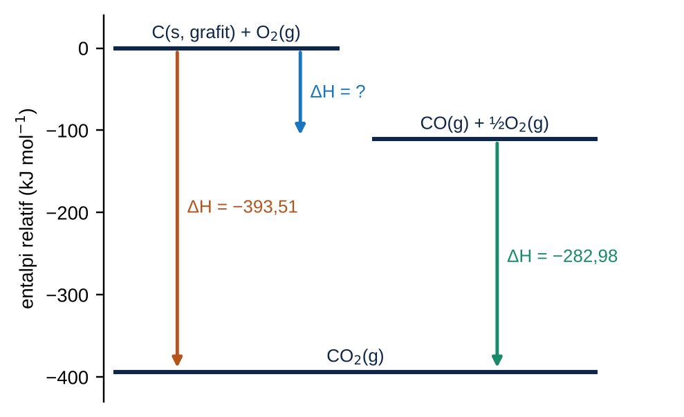

## 4.4 Entalpi perubahan fisika

Reaksi kimia bukan satu-satunya proses yang melibatkan kalor. Es yang mencair menyerap kalor tanpa suhunya naik; air yang menguap dari kulit membawa kalor pergi dan membuat kita sejuk. Kalor yang menyertai perubahan wujud pada tekanan tetap juga merupakan perubahan entalpi, dan diberi nama sesuai prosesnya:

* **Entalpi peleburan** $\Delta_\text{fus}H$: padat → cair.
* **Entalpi penguapan** $\Delta_\text{vap}H$: cair → gas.
* **Entalpi sublimasi** $\Delta_\text{sub}H$: padat → gas.

Semuanya positif, karena untuk memisahkan molekul dari tarikan tetangganya diperlukan energi. Entalpi penguapan selalu jauh lebih besar daripada entalpi peleburan: pada peleburan, molekul hanya dilonggarkan dari susunan teraturnya dan masih bersentuhan; pada penguapan, molekul dipisahkan sepenuhnya. Untuk air, $\Delta_\text{fus}H = 6{,}01$ kJ mol⁻¹ pada 0 °C dan $\Delta_\text{vap}H = 40{,}66$ kJ mol⁻¹ pada 100 °C.

Karena entalpi adalah fungsi keadaan, dua aturan sederhana berlaku untuk semua perubahan, fisika maupun kimia. Pertama, membalik arah proses membalik tanda Δ*H*: pengembunan melepaskan kalor sebanyak yang diserap penguapan. Kedua, perubahan yang dapat ditempuh lewat beberapa langkah mempunyai Δ*H* sama dengan jumlah langkah-langkahnya. Sublimasi, misalnya, dapat dibayangkan sebagai peleburan diikuti penguapan pada suhu yang sama:

$$
\Delta_\text{sub}H = \Delta_\text{fus}H + \Delta_\text{vap}H . \qquad \text{(4.6)}
$$

::: {.contoh}
**Contoh 4.6 · Keringat sebagai pendingin**

Entalpi penguapan air pada suhu tubuh (37 °C) adalah 43,4 kJ mol⁻¹. Seorang atlet kehilangan 1,00 L keringat dalam satu jam latihan, dan semuanya menguap. Berapa kalor yang dibawa pergi?

**Penyelesaian.** 1,00 L air = 1000 g = 1000/18,02 = 55,5 mol. Kalor yang diserap penguapan: $(55{,}5)(43{,}4)$ kJ $= 2{,}41 \times 10^3$ kJ $= 2{,}41$ MJ.

**Memahami hasil.** Daya pendinginannya $2{,}41 \times 10^6\ \text{J}/3600\ \text{s} \approx 670$ W, kira-kira sebesar daya sebuah setrika listrik. Tanpa penguapan keringat, kalor sebesar itu akan menaikkan suhu tubuh 70 kg beberapa derajat setiap jam. Entalpi penguapan air yang luar biasa besar, akibat ikatan hidrogennya, adalah salah satu alasan kehidupan dapat bertahan di cuaca panas.
:::

::: {.contoh}
**Contoh 4.7 · Entalpi sublimasi es**

Pada 0 °C, $\Delta_\text{fus}H$ air 6,01 kJ mol⁻¹ dan $\Delta_\text{vap}H$ 45,05 kJ mol⁻¹. Hitung entalpi sublimasi es pada 0 °C.

**Penyelesaian.** Dari (4.6): $\Delta_\text{sub}H = 6{,}01 + 45{,}05 = 51{,}06$ kJ mol⁻¹.

**Memahami hasil.** Perhatikan bahwa entalpi penguapan dipakai pada 0 °C (45,05), bukan pada 100 °C (40,66). Persamaan (4.6) hanya berlaku bila ketiga entalpi diukur pada suhu yang sama. Mengapa entalpi penguapan lebih besar pada suhu rendah akan dijelaskan oleh hukum Kirchhoff di subbab 4.9.
:::

::: {.kuis}
**Kuis cepat 4.4** Mengapa luka bakar karena uap air 100 °C jauh lebih parah daripada karena air mendidih 100 °C dengan massa yang sama?
:::

## 4.5 Persamaan termokimia dan keadaan standar

Agar kalor reaksi dapat dicatat dalam tabel dan dipakai siapa saja, kita perlu bahasa yang tepat. Kalor reaksi bergantung pada banyak hal: berapa banyak zat yang bereaksi, wujud pereaksi dan hasilnya, suhu, dan tekanan. Semua itu harus disebutkan.

Bahasa itu adalah **persamaan termokimia**: persamaan reaksi yang disetarakan, dengan wujud setiap zat, diikuti nilai Δ*H*. Contohnya

$$
\text{CH}_4(g) + 2\text{O}_2(g) \to \text{CO}_2(g) + 2\text{H}_2\text{O}(l) \qquad \Delta_\text{r}H^\circ = -890{,}3\ \text{kJ mol}^{-1} .
$$

Satuan "per mol" di sini berarti **per mol reaksi sebagaimana tertulis**: satu mol CH₄ bereaksi dengan dua mol O₂. Bila persamaannya dikalikan dua, Δ*H*-nya juga dikalikan dua. Bila dibalik, tandanya dibalik. Wujud zat harus disebut karena berpengaruh: bila air yang terbentuk berupa uap, Δ*H*-nya hanya −802,3 kJ mol⁻¹, karena 2 × 44,0 kJ tidak dilepaskan sebagai kalor pengembunan.

Lambang ° menandai **keadaan standar**: setiap zat murni pada tekanan 1 bar (untuk zat terlarut, konsentrasi 1 mol kg⁻¹). Keadaan standar **tidak** menyebut suhu; suhu harus dinyatakan terpisah, dan tabel biasanya memberi data pada 298,15 K. Kesepakatan ini memungkinkan data dari laboratorium mana pun digabungkan dalam satu tabel.

::: {.contoh}
**Contoh 4.8 · Kalor dari tabung gas propana**

Untuk $\text{C}_3\text{H}_8(g) + 5\text{O}_2(g) \to 3\text{CO}_2(g) + 4\text{H}_2\text{O}(l)$, $\Delta_\text{r}H^\circ = -2220$ kJ mol⁻¹. (a) Berapa kalor yang dilepaskan pembakaran 10,0 g propana? (b) Berapa Δ*H* untuk persamaan $2\text{C}_3\text{H}_8 + 10\text{O}_2 \to 6\text{CO}_2 + 8\text{H}_2\text{O}$?

**Penyelesaian.** (a) $n = 10{,}0/44{,}10 = 0{,}227$ mol, sehingga kalor yang dilepaskan $0{,}227 \times 2220 = 503$ kJ. (b) Persamaan dikalikan dua: $\Delta_\text{r}H^\circ = -4440$ kJ mol⁻¹.

**Memahami hasil.** Sepuluh gram propana, kira-kira isi kecil sebuah korek api gas, melepaskan kalor yang cukup untuk mendidihkan lebih dari satu setengah liter air dari 25 °C. Pada (b), kalor yang dilepaskan **per gram** propana tidak berubah; hanya cara menuliskan persamaannya yang berubah.
:::

::: {.kuis}
**Kuis cepat 4.5** Untuk $\text{H}_2(g) + \tfrac12\text{O}_2(g) \to \text{H}_2\text{O}(l)$, $\Delta_\text{r}H^\circ = -285{,}8$ kJ mol⁻¹. Berapa $\Delta_\text{r}H^\circ$ untuk $2\text{H}_2\text{O}(l) \to 2\text{H}_2(g) + \text{O}_2(g)$?
:::

## 4.6 Hukum Hess

Sekarang kita sampai pada alat termokimia yang paling kuat. Tidak semua reaksi dapat diukur kalornya secara langsung. Sebagian berlangsung terlalu lambat, sebagian menghasilkan campuran hasil, sebagian berbahaya. Pembakaran grafit menjadi karbon monoksida, misalnya, tidak dapat dilakukan bersih: sebagian karbon selalu terbakar sampai CO₂. Bagaimana kita mengetahui Δ*H*-nya?

Jawabannya datang dari sifat fungsi keadaan. Karena Δ*H* hanya bergantung pada keadaan awal dan akhir, kita dapat memilih **jalan mana pun** yang menghubungkan keduanya, termasuk jalan berupa reaksi-reaksi lain yang kalornya sudah diketahui. Germain Hess menemukan aturan ini dari percobaan pada 1840, sebelum hukum pertama dirumuskan:

::: {.inti}
**Hukum Hess.** Entalpi reaksi keseluruhan sama dengan jumlah entalpi reaksi-reaksi yang dapat dijumlahkan menjadi reaksi itu.
:::

Cara memakainya: susun reaksi-reaksi yang diketahui, balik atau kalikan bila perlu, sampai jumlahnya sama dengan reaksi yang dicari, lalu jumlahkan Δ*H*-nya dengan perlakuan yang sama.

{width=70%}

::: {.contoh}
**Contoh 4.9 · Entalpi pembentukan CO yang tidak dapat diukur langsung**

Diketahui (pada 298 K):
(1) $\text{C}(s, \text{grafit}) + \text{O}_2(g) \to \text{CO}_2(g)$, $\Delta H_1 = -393{,}51$ kJ mol⁻¹;
(2) $\text{CO}(g) + \tfrac12\text{O}_2(g) \to \text{CO}_2(g)$, $\Delta H_2 = -282{,}98$ kJ mol⁻¹.
Hitung Δ*H* untuk $\text{C}(s) + \tfrac12\text{O}_2(g) \to \text{CO}(g)$.

**Penyelesaian.** Reaksi yang dicari = (1) dikurangi (2), yaitu (1) ditambah kebalikan (2):
$$
\text{C} + \text{O}_2 \to \text{CO}_2 \quad\text{dan}\quad \text{CO}_2 \to \text{CO} + \tfrac12\text{O}_2 \quad\Rightarrow\quad \text{C} + \tfrac12\text{O}_2 \to \text{CO} .
$$
Maka $\Delta H = \Delta H_1 - \Delta H_2 = -393{,}51 + 282{,}98 = -110{,}53$ kJ mol⁻¹.

**Memahami hasil.** Gambar 4.1 memperlihatkan perhitungan ini sebagai tangga energi: dari C ke CO₂ dapat ditempuh sekaligus atau dua langkah, dan kedua jalan harus turun sejauh yang sama. Dari kedua pembakaran yang mudah diukur, kita memperoleh kalor reaksi yang tidak mungkin diukur bersih.
:::

::: {.contoh}
**Contoh 4.10 · Hidrogenasi etena dari kalor pembakaran**

Entalpi pembakaran standar pada 298 K: C₂H₄(g) −1411,0; H₂(g) −285,83; C₂H₆(g) −1559,8 kJ mol⁻¹ (semua menghasilkan H₂O cair). Hitung $\Delta_\text{r}H^\circ$ untuk $\text{C}_2\text{H}_4(g) + \text{H}_2(g) \to \text{C}_2\text{H}_6(g)$.

**Penyelesaian.** Bakar pereaksi, lalu "bakar balik" hasil reaksinya. Oksigen, CO₂, dan air saling menghapus:
$$
\Delta_\text{r}H^\circ = \Delta_\text{c}H^\circ(\text{C}_2\text{H}_4) + \Delta_\text{c}H^\circ(\text{H}_2) - \Delta_\text{c}H^\circ(\text{C}_2\text{H}_6) = -1411{,}0 - 285{,}83 + 1559{,}8 = -137{,}0\ \text{kJ mol}^{-1} .
$$

**Memahami hasil.** Aturan umumnya: $\Delta_\text{r}H^\circ = \sum\Delta_\text{c}H^\circ(\text{pereaksi}) - \sum\Delta_\text{c}H^\circ(\text{hasil})$. Urutannya terbalik dibanding rumus dengan entalpi pembentukan di subbab berikutnya, karena pembakaran "menghancurkan" zat sedangkan pembentukan "membangun"-nya. Entalpi hidrogenasi seperti ini dipakai di Kimia Organik untuk mengukur kestabilan ikatan rangkap, termasuk kestabilan istimewa benzena.
:::

::: {.kuis}
**Kuis cepat 4.6** Mengapa hukum Hess akan gagal bila entalpi bukan fungsi keadaan?
:::

## 4.7 Entalpi pembentukan standar

Hukum Hess dapat dipakai dengan cara yang lebih sistematis. Daripada mencari kombinasi reaksi untuk setiap soal, bayangkan setiap reaksi berlangsung melalui dua langkah khayal: pereaksi diurai dulu menjadi unsur-unsurnya, lalu unsur-unsur itu disusun kembali menjadi hasil reaksi. Kalor kedua langkah itu cukup diketahui untuk setiap **zat**, bukan untuk setiap reaksi.

Kalor langkah "penyusunan" itu disebut **entalpi pembentukan standar** $\Delta_\text{f}H^\circ$: perubahan entalpi standar ketika satu mol zat dibentuk dari unsur-unsurnya dalam **keadaan acuan**, yaitu bentuk paling stabil unsur itu pada 1 bar dan suhu yang ditentukan. Keadaan acuan karbon adalah grafit, bukan intan; oksigen adalah O₂(g); bromin adalah Br₂(l). Konsekuensinya, entalpi pembentukan unsur dalam keadaan acuannya **nol menurut definisi**: membentuk grafit dari grafit tidak memerlukan apa pun.

Dengan definisi ini, entalpi reaksi apa pun diperoleh dari tabel:

::: {.inti}
$$
\Delta_\text{r}H^\circ = \sum_\text{hasil}\nu\,\Delta_\text{f}H^\circ - \sum_\text{pereaksi}\nu\,\Delta_\text{f}H^\circ \qquad \text{(4.7)}
$$
dengan ν koefisien stoikiometri.
:::

| Zat | $\Delta_\text{f}H^\circ$ (kJ mol⁻¹) | Zat | $\Delta_\text{f}H^\circ$ (kJ mol⁻¹) |
|---|---|---|---|
| H₂O(l) | −285,83 | CH₄(g) | −74,81 |
| H₂O(g) | −241,83 | C₂H₅OH(l) | −277,69 |
| CO₂(g) | −393,51 | C₆H₁₂O₆(s) | −1273,3 |
| CO(g) | −110,53 | NH₃(g) | −46,11 |
| Fe₂O₃(s) | −824,2 | NO(g) | +90,25 |
| Al₂O₃(s) | −1675,7 | C₂H₂(g) | +226,73 |
| CaCO₃(s) | −1206,9 | NH₄NO₃(s) | −365,56 |

Tabel 4.1 Entalpi pembentukan standar pada 298,15 K.

Tanda $\Delta_\text{f}H^\circ$ memberi informasi kimia yang berharga. Zat dengan $\Delta_\text{f}H^\circ$ sangat negatif, seperti Al₂O₃ dan CO₂, berada jauh "di bawah" unsur-unsurnya dalam tangga entalpi; membentuknya melepaskan banyak kalor. Zat dengan $\Delta_\text{f}H^\circ$ positif, seperti asetilena dan NO, berada "di atas" unsur-unsurnya; zat semacam ini menyimpan energi dan cenderung melepaskannya, kadang dengan ledakan.

::: {.contoh}
**Contoh 4.11 · Pembakaran etanol**

Hitung entalpi pembakaran standar etanol cair dari Tabel 4.1.

**Penyelesaian.** $\text{C}_2\text{H}_5\text{OH}(l) + 3\text{O}_2(g) \to 2\text{CO}_2(g) + 3\text{H}_2\text{O}(l)$. Dari (4.7), dengan $\Delta_\text{f}H^\circ(\text{O}_2) = 0$:
$$
\Delta_\text{c}H^\circ = 2(-393{,}51) + 3(-285{,}83) - (-277{,}69) = -1366{,}8\ \text{kJ mol}^{-1} .
$$

**Memahami hasil.** Nilai terukur dalam bom kalorimeter adalah −1366,8 kJ mol⁻¹, sama persis. Tabel entalpi pembentukan sebenarnya disusun dari pengukuran pembakaran seperti ini, sehingga keduanya konsisten.
:::

::: {.contoh}
**Contoh 4.12 · Reaksi termit**

Campuran serbuk aluminium dan karat besi, bila dinyalakan, menghasilkan besi cair yang dipakai untuk mengelas rel kereta api: $\text{Fe}_2\text{O}_3(s) + 2\text{Al}(s) \to \text{Al}_2\text{O}_3(s) + 2\text{Fe}(s)$. Hitung $\Delta_\text{r}H^\circ$.

**Penyelesaian.** $\Delta_\text{r}H^\circ = -1675{,}7 - (-824{,}2) = -851{,}5$ kJ mol⁻¹. (Al dan Fe unsur, entalpi pembentukannya nol.)

**Memahami hasil.** Aluminium "merebut" oksigen dari besi karena Al₂O₃ jauh lebih rendah dalam tangga entalpi daripada Fe₂O₃. Kalor 851,5 kJ dilepaskan oleh hanya 214 g campuran, cukup untuk memanaskan hasilnya di atas 2500 °C, jauh melewati titik leleh besi.
:::

::: {.contoh}
**Contoh 4.13 · Kompres dingin instan**

Entalpi pelarutan NH₄NO₃ dalam air adalah +25,7 kJ mol⁻¹. Sebuah kompres dingin berisi 30,0 g NH₄NO₃ dan 100 g air pada 25 °C. Taksir suhu terendah yang dicapai, dengan menganggap kapasitas kalor larutan 4,18 J K⁻¹ g⁻¹ dan tidak ada kalor yang masuk dari luar.

**Penyelesaian.** $n = 30{,}0/80{,}04 = 0{,}375$ mol. Kalor yang diserap pelarutan: $(0{,}375)(25{,}7)$ kJ $= 9{,}63$ kJ. Kalor ini diambil dari larutan seberat 130 g:
$$
\Delta T = -\frac{9630\ \text{J}}{(130\ \text{g})(4{,}18\ \text{J K}^{-1}\text{g}^{-1})} = -17{,}7\ \text{K} ,
$$
sehingga suhunya turun ke sekitar 7 °C.

**Memahami hasil.** Proses ini endoterm, tetapi tetap berlangsung dengan sendirinya. Jadi kalor saja tidak menentukan apakah suatu proses terjadi spontan. Kantong penghangat (eksoterm) dan kompres dingin (endoterm) sama-sama spontan. Penentu arah proses yang sebenarnya adalah **entropi**, pokok bahasan Bab 5.
:::

::: {.kuis}
**Kuis cepat 4.7** Mengapa $\Delta_\text{f}H^\circ$ intan tidak nol (nilainya +1,9 kJ mol⁻¹), padahal intan adalah karbon murni?
:::
