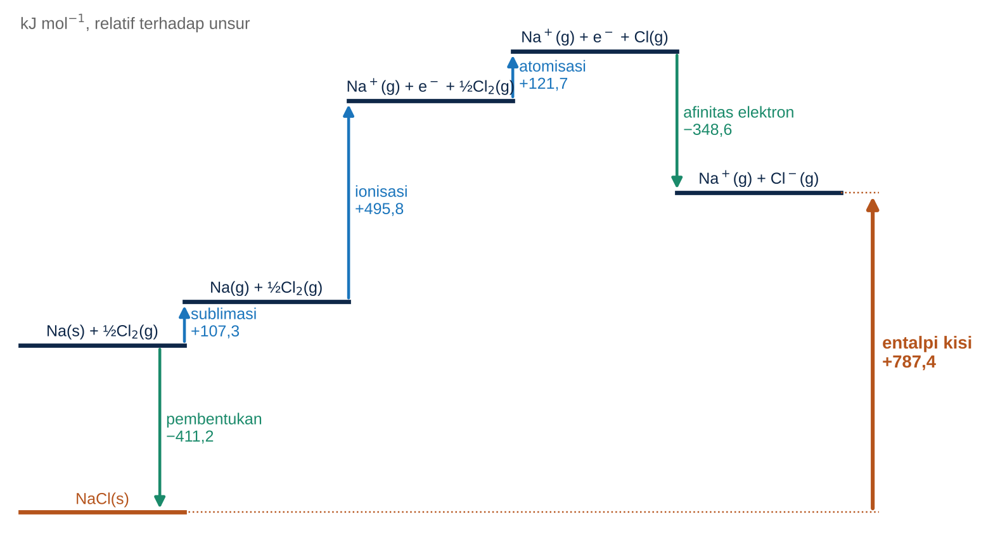
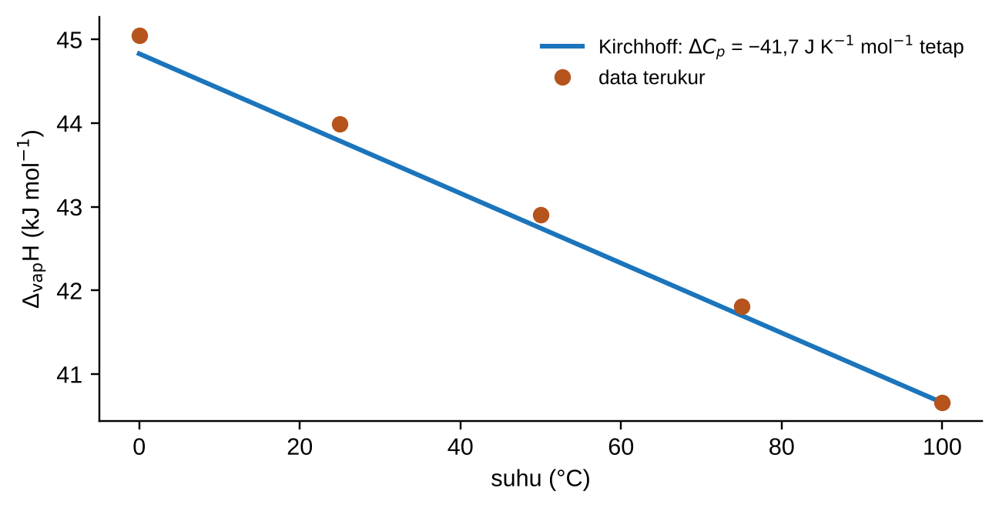
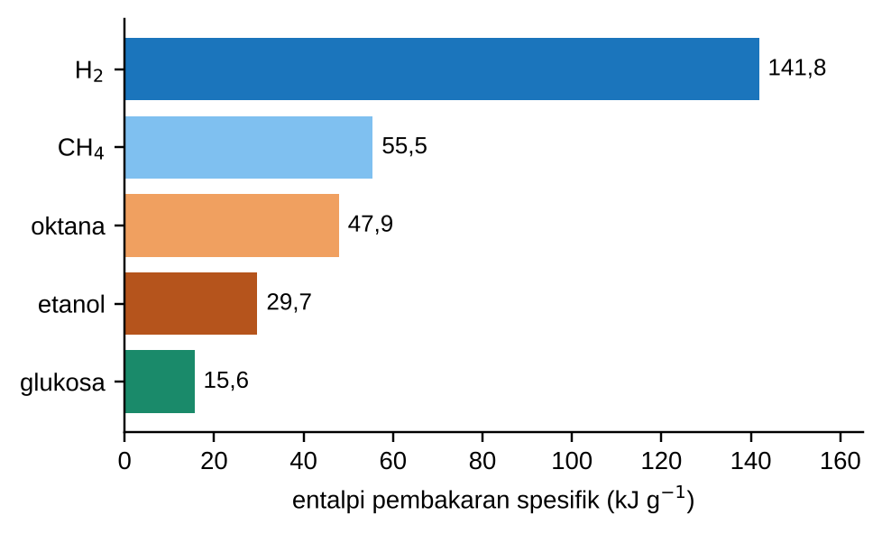
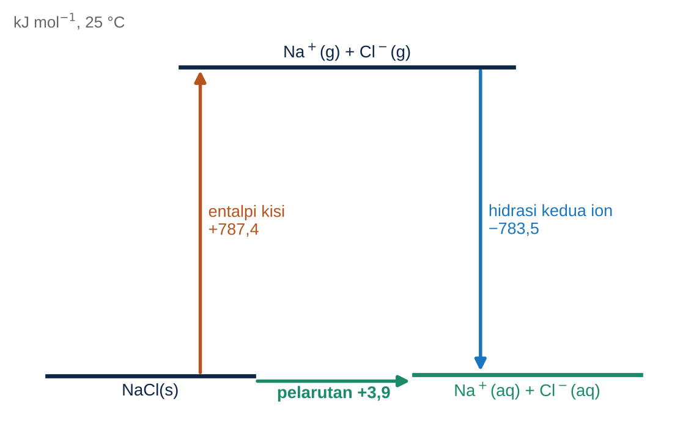

## 4.8 Entalpi ikatan

Entalpi pembentukan memberi kalor reaksi dengan teliti, asalkan semua zatnya tercantum dalam tabel. Bagaimana bila kita merancang molekul baru yang belum pernah dibuat? Kimiawan memerlukan cara menaksir kalor reaksi dari struktur molekulnya saja. Cara itu berangkat dari gambaran yang sangat kimiawi: reaksi adalah pemutusan ikatan lama dan pembentukan ikatan baru.

Untuk memutus ikatan diperlukan energi; ketika ikatan terbentuk, energi dilepaskan. **Entalpi ikatan** adalah perubahan entalpi untuk memutus satu mol ikatan tertentu dalam fase gas, misalnya $\text{H–H}(g) \to 2\text{H}(g)$, Δ*H* = +436 kJ mol⁻¹. Untuk molekul diatomik, nilai ini tepat. Untuk ikatan dalam molekul poliatom, misalnya C–H, nilainya sedikit berbeda dari satu molekul ke molekul lain, karena lingkungan ikatan memengaruhi kekuatannya. Tabel karena itu memberi **entalpi ikatan rata-rata** dari banyak molekul.

| Ikatan | kJ mol⁻¹ | Ikatan | kJ mol⁻¹ | Ikatan | kJ mol⁻¹ |
|---|---|---|---|---|---|
| H–H | 436 | C–C | 348 | O–H | 463 |
| C–H | 412 | C=C | 612 | O=O | 498 |
| N–H | 388 | C≡C | 837 | C=O (dalam CO₂) | 799 |
| C–Cl | 338 | N≡N | 945 | H–Cl | 431 |
| Cl–Cl | 242 | C–O | 360 | | |

Tabel 4.2 Entalpi ikatan rata-rata.

Dengan tabel ini, entalpi reaksi fase gas ditaksir sebagai energi yang diperlukan untuk memutus semua ikatan pereaksi dikurangi energi yang dilepaskan ketika semua ikatan hasil terbentuk:

$$
\Delta_\text{r}H \approx \sum D(\text{ikatan diputus}) - \sum D(\text{ikatan dibentuk}) . \qquad \text{(4.8)}
$$

Reaksi eksoterm bila ikatan yang terbentuk lebih kuat daripada yang diputus. Itulah inti pembakaran: ikatan C=O dalam CO₂ dan O–H dalam air termasuk ikatan terkuat yang dapat dibentuk karbon, hidrogen, dan oksigen.

{width=80%}

::: {.contoh}
**Contoh 4.14 · Menaksir pembakaran metana**

Taksir $\Delta_\text{r}H$ untuk $\text{CH}_4(g) + 2\text{O}_2(g) \to \text{CO}_2(g) + 2\text{H}_2\text{O}(g)$ dari Tabel 4.2, lalu bandingkan dengan nilai dari entalpi pembentukan.

**Penyelesaian.** Diputus: 4 C–H dan 2 O=O, $4(412) + 2(498) = 2644$ kJ. Dibentuk: 2 C=O dan 4 O–H, $2(799) + 4(463) = 3450$ kJ. Maka $\Delta_\text{r}H \approx 2644 - 3450 = -806$ kJ mol⁻¹.

Dari Tabel 4.1, dengan air berupa gas: $-393{,}51 + 2(-241{,}83) - (-74{,}81) = -802{,}4$ kJ mol⁻¹.

**Memahami hasil.** Taksiran meleset hanya 0,5%, sangat baik untuk cara yang tidak memerlukan data apa pun selain struktur molekul. Perhatikan bahwa air harus dianggap **gas**; entalpi ikatan hanya berlaku untuk fase gas, dan bila air cair yang terbentuk, kalor pengembunan harus ditambahkan terpisah.
:::

::: {.contoh}
**Contoh 4.15 · Batas ketelitian entalpi ikatan rata-rata**

Taksir $\Delta_\text{r}H$ untuk klorinasi metana, $\text{CH}_4(g) + \text{Cl}_2(g) \to \text{CH}_3\text{Cl}(g) + \text{HCl}(g)$, lalu bandingkan dengan nilai dari entalpi pembentukan ($\Delta_\text{f}H^\circ$ CH₃Cl = −81,9; HCl = −92,31 kJ mol⁻¹).

**Penyelesaian.** Hanya ikatan yang berubah yang perlu dihitung. Diputus: C–H dan Cl–Cl, $412 + 242 = 654$ kJ. Dibentuk: C–Cl dan H–Cl, $338 + 431 = 769$ kJ. Taksiran: $654 - 769 = -115$ kJ mol⁻¹. Dari entalpi pembentukan: $-81{,}9 - 92{,}31 - (-74{,}81) = -99{,}4$ kJ mol⁻¹.

**Memahami hasil.** Kali ini taksirannya meleset 16 kJ, sekitar 16%. Kesalahan terbesar berasal dari entalpi ikatan C–Cl dan C–H yang dipakai, yang merupakan rata-rata dari banyak molekul lain dan tidak persis berlaku dalam CH₃Cl. Entalpi ikatan rata-rata baik untuk taksiran cepat dan untuk memahami **mengapa** suatu reaksi eksoterm, tetapi untuk angka yang teliti selalu pakai entalpi pembentukan.
:::

::: {.dalam}
**Lebih dalam: siklus Born–Haber dan entalpi kisi.** Entalpi ikatan menggambarkan molekul kovalen. Untuk padatan ionik seperti NaCl, besaran yang setara adalah **entalpi kisi** $\Delta_\text{L}H$: perubahan entalpi untuk memecah satu mol padatan menjadi ion-ionnya dalam fase gas, $\text{NaCl}(s) \to \text{Na}^+(g) + \text{Cl}^-(g)$. Besaran ini tidak dapat diukur langsung, karena tidak ada cara memanaskan garam sampai terurai bersih menjadi ion gas. Hukum Hess memberi jalan memutar. Kita bentuk ion-ion gas dari unsur-unsurnya melalui empat langkah yang masing-masing dapat diukur, lalu bandingkan dengan jalan lain yang melewati NaCl padat:

| Langkah | Δ*H* (kJ mol⁻¹) |
|---|---|
| Sublimasi: Na(s) → Na(g) | +107,3 |
| Ionisasi: Na(g) → Na⁺(g) + e⁻ | +495,8 |
| Atomisasi: ½Cl₂(g) → Cl(g) | +121,7 |
| Penangkapan elektron: Cl(g) + e⁻ → Cl⁻(g) | −348,6 |
| Pembentukan: Na(s) + ½Cl₂(g) → NaCl(s) | −411,2 |

{width=90%}

Jalan "unsur → ion gas" melalui empat langkah pertama dan jalan "unsur → NaCl(s) → ion gas" harus memberi Δ*H* total yang sama. Karena itu
$$
\Delta_\text{L}H = 107{,}3 + 495{,}8 + 121{,}7 - 348{,}6 - (-411{,}2) = +787{,}4\ \text{kJ mol}^{-1} .
$$
Angka sebesar ini menjelaskan mengapa garam dapur baru meleleh pada 801 °C. Ia juga menjelaskan mengapa NaCl larut dalam air, tetapi tidak dalam heksana: air menebus energi kisi itu dengan kalor hidrasi ion yang hampir sama besarnya. Ada satu penyederhanaan kecil. Energi ionisasi dan afinitas elektron sebenarnya diukur sebagai energi pada 0 K. Koreksinya ke entalpi pada 298 K hanya beberapa kJ mol⁻¹, dan koreksi kedua langkah itu saling menghapus.
:::

::: {.kuis}
**Kuis cepat 4.8** Mengapa entalpi ikatan C=C (612 kJ mol⁻¹) kurang dari dua kali entalpi ikatan C–C (348 kJ mol⁻¹)? Petunjuk: ingat ikatan σ dan π.
:::

## 4.9 Ketergantungan entalpi reaksi pada suhu: hukum Kirchhoff

Tabel memberi entalpi reaksi pada 298 K, tetapi banyak reaksi industri berlangsung pada suhu yang jauh lebih tinggi. Sintesis amonia, misalnya, dilakukan sekitar 450 °C. Apakah entalpi reaksinya sama dengan pada suhu kamar?

Bayangkan dua jalan dari pereaksi pada 298 K ke hasil pada suhu *T*. Jalan pertama: reaksikan pada 298 K, lalu panaskan hasilnya sampai *T*. Jalan kedua: panaskan pereaksi sampai *T*, lalu reaksikan pada *T*. Karena entalpi fungsi keadaan, kedua jalan harus memberi perubahan total yang sama. Pemanasan hasil dan pemanasan pereaksi memerlukan kalor yang berbeda bila kapasitas kalornya berbeda, dan selisih itu harus muncul sebagai perbedaan entalpi reaksi pada kedua suhu:

::: {.inti}
$$
\Delta_\text{r}H^\circ(T_2) = \Delta_\text{r}H^\circ(T_1) + \Delta_\text{r}C_p^\circ\,(T_2 - T_1) , \qquad \Delta_\text{r}C_p^\circ = \sum_\text{hasil}\nu C_{p,\text{m}}^\circ - \sum_\text{pereaksi}\nu C_{p,\text{m}}^\circ \qquad \text{(4.9)}
$$
**Hukum Kirchhoff**, bila $\Delta_\text{r}C_p^\circ$ dianggap tidak bergantung pada suhu.
:::

Biasanya $\Delta_\text{r}C_p^\circ$ hanya beberapa puluh J K⁻¹ mol⁻¹, sehingga perubahan Δ*H* untuk selisih suhu ratusan kelvin hanya beberapa kilojoule. Untuk perhitungan kasar, entalpi reaksi sering dianggap tetap; untuk perancangan reaktor, koreksi Kirchhoff diperlukan.

::: {.contoh}
**Contoh 4.16 · Sintesis amonia pada suhu reaktor**

Untuk $\text{N}_2(g) + 3\text{H}_2(g) \to 2\text{NH}_3(g)$, $\Delta_\text{r}H^\circ(298\ \text{K}) = -92{,}22$ kJ mol⁻¹. Kapasitas kalor molar (J K⁻¹ mol⁻¹): N₂ 29,12; H₂ 28,82; NH₃ 35,06. Taksir $\Delta_\text{r}H^\circ$ pada 723 K.

**Penyelesaian.** $\Delta_\text{r}C_p^\circ = 2(35{,}06) - 29{,}12 - 3(28{,}82) = -45{,}46$ J K⁻¹ mol⁻¹. Dari (4.9):
$$
\Delta_\text{r}H^\circ(723\ \text{K}) = -92{,}22 + (-45{,}46 \times 10^{-3})(723 - 298)\ \text{kJ mol}^{-1} = -111{,}5\ \text{kJ mol}^{-1} .
$$

**Memahami hasil.** Pada suhu reaktor, reaksi melepaskan sekitar 20% lebih banyak kalor. Taksiran ini kasar karena kapasitas kalor sebenarnya naik dengan suhu, tetapi arahnya benar. Kalor reaksi yang besar ini harus terus diambil dari reaktor agar suhunya tidak naik, karena seperti akan kita lihat di Bab 12, suhu yang terlalu tinggi mengurangi hasil amonia.
:::

{width=74%}

::: {.contoh}
**Contoh 4.17 · Mengapa air lebih sukar menguap pada suhu rendah**

$\Delta_\text{vap}H^\circ$ air pada 25 °C adalah 44,01 kJ mol⁻¹. Dengan $C_{p,\text{m}}$ air cair 75,29 dan uap air 33,58 J K⁻¹ mol⁻¹, taksir $\Delta_\text{vap}H$ pada 100 °C.

**Penyelesaian.** $\Delta C_p = 33{,}58 - 75{,}29 = -41{,}71$ J K⁻¹ mol⁻¹. Maka $\Delta_\text{vap}H(373\ \text{K}) = 44{,}01 + (-41{,}71 \times 10^{-3})(75) = 40{,}88$ kJ mol⁻¹.

**Memahami hasil.** Nilai terukurnya 40,66 kJ mol⁻¹, selisih hanya 0,5%. Penjelasan molekulnya: air cair menyimpan banyak energi dalam ikatan hidrogennya yang meregang dan putus ketika dipanaskan (kapasitas kalornya besar), sedangkan uap tidak. Makin panas air cair, makin banyak ikatan hidrogennya yang sudah putus, sehingga makin sedikit energi yang diperlukan untuk menguapkannya. Inilah jawaban pertanyaan yang tertunda di Contoh 4.7.
:::

::: {.kuis}
**Kuis cepat 4.9** Bila $\Delta_\text{r}C_p^\circ = 0$, bagaimana entalpi reaksi berubah dengan suhu?
:::

## 4.10 Termokimia pembakaran dan bahan bakar

Sekarang kita dapat menjawab pertanyaan pembuka tentang bahan bakar. Untuk membandingkan bahan bakar, yang penting bukan entalpi pembakaran per mol, melainkan **per gram** (untuk kendaraan yang harus mengangkat bahan bakarnya) atau **per liter** (untuk tangki yang ruangnya terbatas). Gambar 4.7 membandingkan beberapa bahan bakar per gram.

{width=70%}

Dua pola terlihat jelas, dan keduanya dapat dipahami dari entalpi ikatan.

Pertama, **hidrogen unggul per gram** karena atomnya sangat ringan dan ikatan O–H yang terbentuk sangat kuat. Per massa, tidak ada bahan bakar kimia biasa yang menandinginya. Itulah sebabnya hidrogen cair dipakai sebagai bahan bakar tahap atas roket.

Kedua, **senyawa yang sudah mengandung oksigen melepaskan energi lebih sedikit**. Etanol dan glukosa dapat dipandang sebagai hidrokarbon yang sebagian sudah "terbakar": sebagian atom karbon dan hidrogennya sudah terikat pada oksigen. Makin banyak oksigen dalam molekul bahan bakar, makin sedikit energi yang tersisa untuk dilepaskan. Tubuh kita menyimpan energi jangka panjang dalam lemak, yang hampir tidak mengandung oksigen (sekitar 9 kkal g⁻¹), bukan dalam karbohidrat (sekitar 4 kkal g⁻¹), karena alasan yang sama.

Tetapi per liter, keadaannya berbalik. Hidrogen adalah gas yang sangat ringan; satu liter hidrogen pada 1 bar dan 25 °C hanya mengandung sekitar 11,5 kJ energi pembakaran, sedangkan satu liter bensin mengandung sekitar 34 000 kJ. Bahkan bila hidrogen dimampatkan sampai 700 bar, seperti pada tangki mobil hidrogen, satu liternya hanya membawa sekitar 6 MJ, seperenam bensin. Inilah tantangan teknis terbesar kendaraan hidrogen.

::: {.contoh}
**Contoh 4.18 · Kalor dari kantong penghangat tangan**

Kantong penghangat tangan bekerja dengan mengoksidasi besi menjadi Fe₂O₃: $4\text{Fe}(s) + 3\text{O}_2(g) \to 2\text{Fe}_2\text{O}_3(s)$. (a) Hitung $\Delta_\text{r}H^\circ$ dari Tabel 4.1. (b) Berapa kalor yang dilepaskan per gram besi? (c) Sebuah kantong berisi 20 g serbuk besi. Bila kantong melepaskan kalornya merata selama 6 jam, berapa daya rata-ratanya?

**Penyelesaian.** (a) $\Delta_\text{r}H^\circ = 2(-824{,}2) = -1648{,}4$ kJ mol⁻¹.

(b) Per gram besi: $1648{,}4/(4 \times 55{,}85) = 7{,}38$ kJ g⁻¹.

(c) Kalor total $20 \times 7{,}38 = 148$ kJ; daya $1{,}48 \times 10^5\ \text{J}/(6 \times 3600\ \text{s}) = 6{,}8$ W.

**Memahami hasil.** Daya beberapa watt, kira-kira kalor yang dilepaskan sebuah lampu LED kecil, cukup untuk menghangatkan tangan. Reaksinya sama dengan perkaratan besi biasa; garam dan karbon aktif di dalam kantong hanya mempercepatnya dari bertahun-tahun menjadi beberapa jam. Teka-teki pembuka kini terjawab sebagian: kita dapat menghitung kalor kedua kantong dari tabel. Mengapa kompres dingin tetap bekerja walaupun menyerap kalor adalah pertanyaan untuk Bab 5.
:::

::: {.kuis}
**Kuis cepat 4.10** Metanol (CH₃OH) dan etana (C₂H₆) mempunyai massa molar yang hampir sama. Mana yang kamu duga melepaskan energi lebih banyak per gram ketika dibakar, dan mengapa?
:::

## 4.11 Entalpi pelarutan dan hidrasi ion

Contoh 4.13 memakai entalpi pelarutan NH₄NO₃ (+25,7 kJ mol⁻¹) sebagai data begitu saja. Mengapa sebagian garam mendinginkan air ketika larut (NH₄NO₃, KCl), sedangkan yang lain memanaskannya (NaOH, CaCl₂), dan NaCl hampir tidak mengubah suhu sama sekali? Jawabannya adalah persaingan dua besaran yang sangat besar, yang hampir saling menghapus.

### Siklus pelarutan

Melarutkan garam ionik dapat dibayangkan sebagai dua langkah (Gambar 4.8). Mula-mula kisi kristal dipecah menjadi ion-ion dalam fase gas; langkah ini menyerap **entalpi kisi** Δ$_\text{L}$*H* yang besar (subbab 4.8). Lalu setiap ion gas dimasukkan ke dalam air dan dikelilingi molekul air yang mengarahkan dipolnya ke ion; langkah ini melepas **entalpi hidrasi** Δ$_\text{hyd}$*H*. Menurut hukum Hess,
$$
\Delta_\text{sol}H = \Delta_\text{L}H + \Delta_\text{hyd}H . \qquad \text{(4.10)}
$$
Untuk NaCl, Δ$_\text{L}$*H* = +787,4 kJ mol⁻¹ dan entalpi pelarutannya terukur +3,9 kJ mol⁻¹, sehingga entalpi hidrasi kedua ion bersama-sama adalah −783,5 kJ mol⁻¹. Dua angka sebesar hampir 800 kJ mol⁻¹ saling menghapus sampai tinggal 4 kJ mol⁻¹. Karena itu tanda entalpi pelarutan sangat peka: perubahan kecil ukuran atau muatan ion dapat membalik tandanya.

{width=76%}

Apa yang menentukan besarnya entalpi hidrasi? Ion kecil dan bermuatan besar menarik dipol air paling kuat, karena medan listrik di permukaannya paling besar. Entalpi hidrasi Li⁺ jauh lebih negatif daripada Cs⁺, dan Mg²⁺ jauh lebih negatif daripada Na⁺. Itulah sebabnya garam litium dan magnesium cenderung melarut secara eksoterm, dan mengapa ion-ion itu dalam larutan selalu membawa selubung air yang terikat erat.

### Entalpi pembentukan ion dalam larutan

Sama seperti energi Gibbs (subbab 12.9), entalpi pembentukan satu jenis ion tidak dapat diukur sendirian, karena larutan selalu netral. Konvensinya sama: Δ$_\text{f}$*H*°(H⁺, aq) = 0. Dengan acuan ini, ion lain mempunyai nilai tabel, dan entalpi pelarutan garam pada pengenceran tak hingga dihitung seperti entalpi reaksi biasa dengan (4.7).

| Spesies | Δ$_\text{f}$*H*° (kJ mol⁻¹) | Spesies | Δ$_\text{f}$*H*° (kJ mol⁻¹) |
|---|---|---|---|
| Na⁺(aq) | −240,12 | NaCl(s) | −411,15 |
| K⁺(aq) | −252,38 | KCl(s) | −436,75 |
| NH₄⁺(aq) | −132,51 | NH₄NO₃(s) | −365,56 |
| Cl⁻(aq) | −167,16 | NaOH(s) | −425,61 |
| OH⁻(aq) | −229,99 | NO₃⁻(aq) | −205,0 |

Tabel 4.3 Entalpi pembentukan standar beberapa ion dalam air (pengenceran tak hingga) dan garam padatnya, pada 25 °C.

::: {.contoh}
**Contoh 4.19 · Garam yang mendinginkan dan garam yang memanaskan**

Dari Tabel 4.3, hitung entalpi pelarutan pada pengenceran tak hingga untuk NaCl, KCl, NaOH, dan NH₄NO₃. Bandingkan nilai NH₄NO₃ dengan +25,7 kJ mol⁻¹ pada Contoh 4.13.

**Penyelesaian.** Untuk $\text{NaCl}(s) \to \text{Na}^+(aq) + \text{Cl}^-(aq)$:
$$
\Delta_\text{sol}H^\circ = (-240{,}12) + (-167{,}16) - (-411{,}15) = +3{,}87\ \text{kJ mol}^{-1} .
$$
Dengan cara yang sama: KCl +17,2 kJ mol⁻¹; NaOH −44,5 kJ mol⁻¹; NH₄NO₃ +28,1 kJ mol⁻¹.

**Memahami hasil.** KCl dan NH₄NO₃ menyerap kalor saat larut, sehingga larutannya mendingin; NaOH melepas banyak kalor, dan melarutkan butiran NaOH memang dapat membuat gelas panas. Nilai NH₄NO₃ dari tabel (+28,1) sedikit lebih besar daripada +25,7 kJ mol⁻¹ yang dipakai di Contoh 4.13. Keduanya benar: tabel memberi nilai pada pengenceran tak hingga, sedangkan kompres dingin membuat larutan pekat, dan entalpi pelarutan bergantung pada konsentrasi akhir. Selisihnya disebut **entalpi pengenceran**, yaitu kalor yang menyertai penambahan pelarut pada larutan yang sudah ada. Untuk garam yang sangat mudah larut seperti NH₄NO₃, besarnya beberapa kJ mol⁻¹.
:::

Mengapa KCl, yang entalpi pelarutannya +17 kJ mol⁻¹, tetap larut dengan mudah? Karena pelarutan menaikkan entropi: ion yang tadinya terkunci di kisi kristal menjadi bebas bergerak di larutan. Bab 6 dan 7 akan memperlihatkan bahwa yang menentukan apakah garam larut adalah Δ*G* = Δ*H* − *T*Δ*S*, bukan Δ*H* saja. Entalpi pelarutan hanya menentukan apakah larutan menjadi hangat atau dingin.

::: {.kuis}
**Kuis cepat 4.11** Entalpi kisi LiF (1037 kJ mol⁻¹) jauh lebih besar daripada CsF (744 kJ mol⁻¹), tetapi entalpi pelarutan keduanya kecil. Apa yang dapat kamu simpulkan tentang entalpi hidrasi Li⁺ dibanding Cs⁺?
:::

### Menuju bab berikutnya

Hukum pertama dan entalpi memungkinkan kita menghitung berapa energi yang dipertukarkan dalam setiap proses. Tetapi keduanya tidak dapat menjawab pertanyaan yang lebih mendasar: **ke arah mana** suatu proses berjalan dengan sendirinya? Kalor mengalir dari benda panas ke benda dingin, tidak pernah sebaliknya, walaupun hukum pertama mengizinkan keduanya. Kompres dingin menyerap kalor, tetapi tetap bekerja. Bab 5 memperkenalkan hukum kedua termodinamika dan besaran yang menentukan arah semua perubahan: **entropi**.
