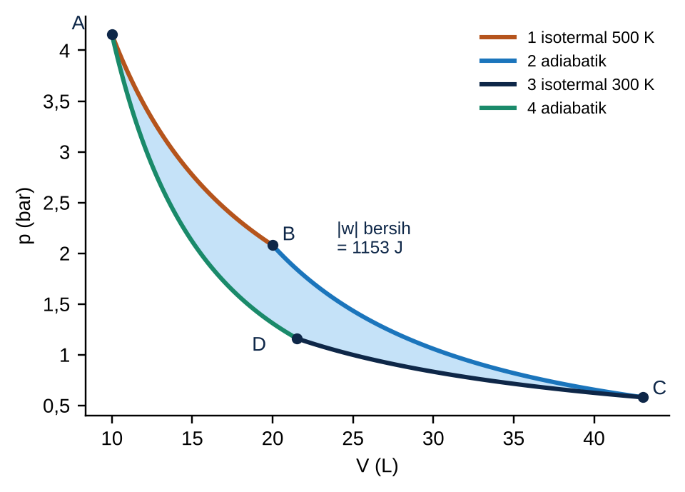

## 5.3 Siklus Carnot tahap demi tahap

Pada 1824, insinyur muda Prancis Sadi Carnot mengajukan pertanyaan yang tepat: mesin kalor macam apa yang paling efisien? Jawabannya mengejutkan dalam kesederhanaannya. Mesin terbaik adalah mesin yang **seluruhnya reversibel**, karena di subbab 3.3 kita sudah melihat bahwa proses reversibel memberikan kerja terbesar. Carnot merancang siklus reversibel paling sederhana yang bekerja di antara dua suhu, dan siklus itu kini menyandang namanya.

Siklus Carnot terdiri atas empat tahap reversibel (Gambar 5.1):

1. **Ekspansi isotermal pada $T_\text{h}$** (A → B). Gas bersentuhan dengan sumber panas, memuai perlahan, dan menyerap kalor $q_\text{h}$.
2. **Ekspansi adiabatik** (B → C). Gas diisolasi dan terus memuai; karena tidak menerima kalor, suhunya turun dari $T_\text{h}$ ke $T_\text{c}$.
3. **Kompresi isotermal pada $T_\text{c}$** (C → D). Gas bersentuhan dengan penampung dingin, dimampatkan perlahan, dan melepaskan kalor $q_\text{c}$.
4. **Kompresi adiabatik** (D → A). Gas diisolasi lagi dan dimampatkan sampai suhunya naik kembali ke $T_\text{h}$.

{width=74%}

Mengapa siklus ini harus terdiri atas dua isoterm dan dua adiabat? Karena hanya dua jenis proses itu yang reversibel ketika mesin bekerja di antara dua suhu saja. Pertukaran kalor hanya reversibel bila suhu gas sama dengan suhu sumber, jadi harus terjadi secara isotermal. Peralihan dari satu suhu ke suhu lain harus terjadi tanpa pertukaran kalor sama sekali, jadi harus adiabatik.

Rencana pembelajaran mata kuliah ini meminta kita menghitung semua besaran energi pada setiap tahap. Mari kita lakukan dengan satu contoh lengkap.

::: {.contoh}
**Contoh 5.4 · Siklus Carnot dalam angka**

Satu mol gas ideal monoatomik ($C_{V,\text{m}} = \tfrac32R$, $C_{p,\text{m}} = \tfrac52R$) menjalani siklus Carnot antara $T_\text{h} = 500$ K dan $T_\text{c} = 300$ K. Volume di titik A adalah 10,0 L dan di titik B 20,0 L. (a) Hitung volume di titik C dan D. (b) Hitung *q*, *w*, Δ*U*, Δ*H*, dan $\Delta S = q_\text{rev}/T$ pada setiap tahap. (c) Hitung efisiensinya.

**Rencana.** Tahap isotermal: Δ*U* = Δ*H* = 0 dan $q = -w = nRT\ln(V_\text{akhir}/V_\text{awal})$. Tahap adiabatik: *q* = 0, $w = \Delta U = nC_{V,\text{m}}\Delta T$, $\Delta H = nC_{p,\text{m}}\Delta T$. Volume ujung adiabat diperoleh dari $TV^{\gamma - 1}$ tetap, dengan $\gamma - 1 = 2/3$.

**Penyelesaian.** (a) Dari B ke C: $V_\text{C} = V_\text{B}(T_\text{h}/T_\text{c})^{1/(\gamma - 1)} = 20{,}0 \times (5/3)^{3/2} = 43{,}0$ L. Dengan cara yang sama dari A ke D: $V_\text{D} = 10{,}0 \times (5/3)^{3/2} = 21{,}5$ L. Perhatikan bahwa $V_\text{C}/V_\text{D} = V_\text{B}/V_\text{A} = 2$.

(b) Dengan $R = 8{,}314$ J K⁻¹ mol⁻¹:

| Tahap | *q* (J) | *w* (J) | Δ*U* (J) | Δ*H* (J) | Δ*S* (J K⁻¹) |
|---|---|---|---|---|---|
| 1 isotermal 500 K, A → B | +2882 | −2882 | 0 | 0 | +5,76 |
| 2 adiabatik, B → C | 0 | −2494 | −2494 | −4157 | 0 |
| 3 isotermal 300 K, C → D | −1729 | +1729 | 0 | 0 | −5,76 |
| 4 adiabatik, D → A | 0 | +2494 | +2494 | +4157 | 0 |
| **Siklus** | **+1153** | **−1153** | **0** | **0** | **0** |

Rinciannya: $q_1 = RT_\text{h}\ln2 = (8{,}314)(500)(0{,}693) = 2882$ J. $q_3 = RT_\text{c}\ln(V_\text{D}/V_\text{C}) = -(8{,}314)(300)(0{,}693) = -1729$ J. $w_2 = \tfrac32R(300 - 500) = -2494$ J dan $\Delta H_2 = \tfrac52R(-200) = -4157$ J. Tahap 4 adalah kebalikan tahap 2.

(c) $\eta = |w|/q_\text{h} = 1153/2882 = 0{,}400$.

**Memahami hasil.** Tiga hal patut dicatat. Pertama, kerja kedua tahap adiabatik saling menghapus, sehingga kerja bersih hanya berasal dari selisih kalor kedua tahap isotermal. Kedua, Δ*U* dan Δ*H* untuk satu siklus penuh nol, sebagaimana seharusnya untuk fungsi keadaan. Ketiga, dan inilah yang terpenting: kolom $q/T$ juga berjumlah nol, walaupun *q* sendiri tidak. Besaran $q_\text{rev}/T$ berperilaku seperti fungsi keadaan. Kita akan kembali ke pengamatan ini di subbab 5.6.
:::

::: {.kuis}
**Kuis cepat 5.3** Pada tahap mana dalam siklus Carnot suhu gas berubah? Pada tahap mana gas menerima atau melepaskan kalor?
:::

## 5.4 Efisiensi mesin Carnot

Contoh 5.4 memberi efisiensi 0,400, dan perhatikan bahwa $1 - T_\text{c}/T_\text{h} = 1 - 300/500 = 0{,}400$ juga. Kebetulan? Mari kita buktikan bahwa hasil ini berlaku umum.

Untuk gas ideal, kalor pada kedua tahap isotermal adalah

$$
q_\text{h} = nRT_\text{h}\ln\frac{V_\text{B}}{V_\text{A}} , \qquad q_\text{c} = nRT_\text{c}\ln\frac{V_\text{D}}{V_\text{C}} = -nRT_\text{c}\ln\frac{V_\text{C}}{V_\text{D}} .
$$

Kedua tahap adiabatik menghubungkan volume-volume ini. Dari $TV^{\gamma - 1}$ tetap: $T_\text{h}V_\text{B}^{\gamma - 1} = T_\text{c}V_\text{C}^{\gamma - 1}$ dan $T_\text{h}V_\text{A}^{\gamma - 1} = T_\text{c}V_\text{D}^{\gamma - 1}$. Membagi persamaan pertama dengan yang kedua menghasilkan $(V_\text{B}/V_\text{A})^{\gamma - 1} = (V_\text{C}/V_\text{D})^{\gamma - 1}$, sehingga

$$
\frac{V_\text{B}}{V_\text{A}} = \frac{V_\text{C}}{V_\text{D}} .
$$

Kedua logaritma sama, dan perbandingan kalor tinggal perbandingan suhu:

$$
\frac{|q_\text{c}|}{q_\text{h}} = \frac{T_\text{c}}{T_\text{h}} . \qquad \text{(5.2)}
$$

Memasukkan hasil ini ke (5.1):

::: {.inti}
$$
\eta_\text{Carnot} = 1 - \frac{T_\text{c}}{T_\text{h}} \qquad \text{(5.3)}
$$
**Efisiensi mesin Carnot** hanya bergantung pada suhu kedua penampung, tidak pada zat kerja atau ukuran mesin. Tidak ada mesin kalor yang bekerja di antara dua suhu yang sama dapat lebih efisien.
:::

Penurunan di atas memakai gas ideal, tetapi kesimpulannya berlaku untuk **semua** mesin reversibel. Carnot membuktikannya dengan penalaran yang indah: misalkan ada mesin reversibel A yang lebih efisien daripada mesin reversibel B. Jalankan A sebagai mesin dan B secara terbalik sebagai kulkas, dengan kerja dari A menggerakkan B. Karena A lebih efisien, ia memerlukan kalor lebih sedikit dari sumber panas untuk menghasilkan kerja yang dibutuhkan B, sedangkan B mengembalikan lebih banyak kalor ke sumber panas. Hasil bersihnya: kalor berpindah dari penampung dingin ke penampung panas tanpa kerja dari luar. Itu melanggar pernyataan Clausius. Jadi semua mesin reversibel yang bekerja di antara dua suhu yang sama harus mempunyai efisiensi yang sama, dan mesin tak reversibel selalu kurang efisien.

Persamaan (5.3) mempunyai dua akibat praktis. Pertama, efisiensi hanya dapat mendekati 1 bila $T_\text{c}$ jauh lebih kecil daripada $T_\text{h}$; karena itu pembangkit listrik berusaha memakai uap sepanas mungkin. Kedua, karena penampung dingin praktis selalu lingkungan pada sekitar 300 K, tidak ada mesin kalor yang dapat membuang nol kalor; efisiensi 100% hanya mungkin bila $T_\text{c} = 0$ K, yang tidak dapat dicapai.

Persamaan (5.2) juga memberi cara untuk **mendefinisikan** suhu tanpa mengacu pada zat tertentu: perbandingan dua suhu sama dengan perbandingan kalor yang dipertukarkan mesin Carnot di antara keduanya. Kelvin memakai gagasan ini untuk mendefinisikan **skala suhu termodinamika**, yang ternyata sama dengan skala termometer gas ideal dari Bab 1.

::: {.contoh}
**Contoh 5.5 · Batas efisiensi pembangkit listrik**

Pembangkit listrik tenaga uap modern memakai uap bersuhu 565 °C dan membuang kalor pada 27 °C. (a) Berapa efisiensi Carnotnya? (b) Efisiensi sebenarnya sekitar 40%. Mengapa lebih rendah? (c) Berapa efisiensi Carnot bila suhu uap dapat dinaikkan menjadi 700 °C?

**Penyelesaian.** (a) $T_\text{h} = 838$ K, $T_\text{c} = 300$ K, $\eta = 1 - 300/838 = 0{,}642$, atau 64%.

(b) Mesin nyata tidak reversibel: kalor mengalir melalui perbedaan suhu yang terbatas, ada gesekan, kebocoran, dan uap tidak memuai secara ideal. Setiap ketakreversibelan menurunkan efisiensi di bawah batas Carnot.

(c) $T_\text{h} = 973$ K: $\eta = 1 - 300/973 = 0{,}692$, atau 69%.

**Memahami hasil.** Kenaikan suhu uap 135 K hanya menaikkan batas efisiensi 5 poin persen, tetapi bagi pembangkit 1000 MW itu berarti puluhan megawatt tambahan dari bahan bakar yang sama. Itulah sebabnya ilmuwan material terus mencari baja yang tahan pada suhu dan tekanan makin tinggi.
:::

::: {.contoh}
**Contoh 5.6 · Kerja dari panas bumi dan laut**

(a) Pembangkit panas bumi memakai uap alam bersuhu sekitar 180 °C dan membuang kalor ke udara 30 °C. (b) Pembangkit "energi panas laut" memakai air permukaan laut tropis 28 °C dan air laut dalam 5 °C. Hitung efisiensi Carnot keduanya.

**Penyelesaian.** (a) $\eta = 1 - 303{,}15/453{,}15 = 0{,}331$. (b) $\eta = 1 - 278{,}15/301{,}15 = 0{,}0764$.

**Memahami hasil.** Pembangkit energi panas laut paling banyak hanya mengubah 7,6% kalornya menjadi kerja, dan dalam praktik sekitar 3%. Perbedaan suhu yang kecil berarti sumber kalor yang sangat besar harus dialirkan untuk menghasilkan sedikit listrik. Sumber panasnya gratis dan tak habis, tetapi hukum kedua membuat pemanfaatannya mahal.
:::

::: {.contoh}
**Contoh 5.7 · Berapa kerja yang tersimpan dalam air panas?**

Satu kilogram air pada 90 °C didinginkan sampai suhu lingkungan, 20 °C. (a) Berapa kalor yang dilepaskan? (b) Berapa kerja maksimum yang dapat diperoleh bila kalor itu dimasukkan ke serangkaian mesin Carnot yang membuang kalor ke lingkungan 20 °C?

**Rencana.** Suhu air turun selama proses, sehingga efisiensi Carnot berubah terus. Untuk setiap kalor kecil $dq = -C\,dT$ yang dilepaskan air pada suhu *T*, mesin Carnot memberi kerja $dw = (1 - T_0/T)\,dq$ dengan $T_0 = 293{,}15$ K.

**Penyelesaian.** (a) $q = C\Delta T = (4184\ \text{J K}^{-1})(70\ \text{K}) = 293$ kJ.

(b) Mengintegralkan dari $T_1 = 363{,}15$ K ke $T_0$:
$$
|w|_\text{maks} = \int_{T_0}^{T_1}C\left(1 - \frac{T_0}{T}\right)dT = C\left[(T_1 - T_0) - T_0\ln\frac{T_1}{T_0}\right] = 4184\left[70 - 293{,}15\ln\frac{363{,}15}{293{,}15}\right]\ \text{J} = 30{,}2\ \text{kJ} .
$$

**Memahami hasil.** Hanya sekitar 10% kalor air panas yang dapat diubah menjadi kerja; sisanya pasti terbuang ke lingkungan. Kerja maksimum ini disebut **eksergi**. Air panas suam-suam kuku banyak mengandung energi, tetapi sedikit eksergi. Itulah sebabnya "limbah panas" dari pabrik, walaupun jumlah energinya besar, sukar dimanfaatkan untuk menghasilkan listrik, dan lebih sering dipakai langsung untuk pemanasan.
:::

::: {.dalam}
**Lebih dalam: skala suhu termodinamika.** Persamaan (5.2) memberi cara mendefinisikan suhu yang sama sekali tidak bergantung pada zat termometrik. Jalankan mesin Carnot antara benda yang suhunya hendak diukur dan sel titik tripel air; perbandingan kalor yang dipertukarkan sama dengan perbandingan suhunya: $T = 273{,}16\ \text{K} \times |q|/|q_3|$. Karena efisiensi Carnot berlaku untuk semua zat kerja, skala ini universal. Bila zat kerjanya gas ideal, perhitungan subbab 5.4 menunjukkan bahwa skala ini identik dengan skala termometer gas ideal (persamaan 1.1). Inilah alasan kelvin disebut satuan suhu **termodinamika**, dan alasan nol mutlak tidak dapat dicapai: mesin Carnot yang membuang kalor ke 0 K akan berefisiensi 100%, melanggar pernyataan Kelvin.
:::

::: {.kuis}
**Kuis cepat 5.4** Mana yang lebih efektif menaikkan efisiensi Carnot: menaikkan $T_\text{h}$ sebesar 10 K atau menurunkan $T_\text{c}$ sebesar 10 K? (Petunjuk: bandingkan untuk $T_\text{h} = 600$ K dan $T_\text{c} = 300$ K.)
:::

## 5.5 Mesin pendingin dan pompa kalor

Hukum kedua tidak melarang kalor berpindah dari benda dingin ke benda panas; ia hanya melarang hal itu terjadi **dengan sendirinya**. Dengan memberikan kerja dari luar, kita dapat menjalankan mesin Carnot secara terbalik: menyerap kalor $q_\text{c}$ dari penampung dingin dan membuang kalor $|q_\text{h}| = q_\text{c} + w$ ke penampung panas. Inilah prinsip kulkas, pendingin ruangan, dan pompa kalor.

Untuk mesin pendingin, yang penting adalah berapa banyak kalor yang dapat diambil dari ruang dingin untuk setiap joule kerja yang dibayar. Perbandingan ini disebut **koefisien kinerja** (COP). Untuk mesin pendingin reversibel, dengan (5.2):

$$
\text{COP}_\text{pendingin} = \frac{q_\text{c}}{w} = \frac{T_\text{c}}{T_\text{h} - T_\text{c}} . \qquad \text{(5.4)}
$$

Untuk **pompa kalor**, yang dipakai untuk memanaskan rumah dengan "memompa" kalor dari udara luar yang dingin, yang penting adalah kalor yang dikirim ke ruang panas:

$$
\text{COP}_\text{pompa kalor} = \frac{|q_\text{h}|}{w} = \frac{T_\text{h}}{T_\text{h} - T_\text{c}} . \qquad \text{(5.5)}
$$

Berbeda dari efisiensi, koefisien kinerja dapat jauh lebih besar dari 1. Pompa kalor tidak menciptakan energi; ia memindahkan kalor yang sudah ada di lingkungan, dan kerja hanya dipakai untuk "mengangkat" kalor itu ke suhu yang lebih tinggi. Makin kecil selisih suhu yang harus diatasi, makin murah pengangkatannya.

::: {.contoh}
**Contoh 5.8 · Kulkas dan AC**

Hitung COP maksimum untuk (a) kulkas yang menjaga bagian dalam pada −5 °C di dapur 25 °C; (b) AC yang menjaga ruangan pada 18 °C ketika suhu luar 35 °C. (c) Berapa kerja minimum untuk membekukan 1,00 kg air pada 0 °C di dalam pembeku bersuhu −10 °C di dapur 25 °C?

**Penyelesaian.** (a) $\text{COP} = 268{,}15/30 = 8{,}9$. (b) $\text{COP} = 291{,}15/17 = 17{,}1$.

(c) Kalor yang harus diambil: $q_\text{c} = (1000/18{,}02)(6{,}01\ \text{kJ}) = 334$ kJ. Dengan $T_\text{c} = 263$ K dan $T_\text{h} = 298$ K, $\text{COP} = 263/35 = 7{,}5$, sehingga $w = q_\text{c}/\text{COP} = 334/7{,}5 = 44$ kJ.

**Memahami hasil.** Kulkas ideal hanya memerlukan satu joule listrik untuk memindahkan sembilan joule kalor. Kulkas nyata mencapai sepertiga sampai setengah angka ini. Pada (c), membekukan sekilo air memerlukan kerja minimum 44 kJ, kira-kira energi sebuah lampu 10 W yang menyala satu seperempat jam. Perhatikan pula bahwa kulkas memanaskan dapur: kalor yang dibuang di belakangnya adalah kalor dari makanan **ditambah** kerja listriknya.
:::

::: {.contoh}
**Contoh 5.9 · Pompa kalor atau pemanas listrik?**

Sebuah ruangan memerlukan 10 kWh kalor per hari. Bandingkan listrik yang diperlukan oleh pemanas listrik biasa dan oleh pompa kalor nyata dengan COP 3,5.

**Penyelesaian.** Pemanas listrik mengubah listrik menjadi kalor satu banding satu: 10 kWh. Pompa kalor: $10/3{,}5 = 2{,}9$ kWh.

**Memahami hasil.** Pompa kalor menghemat hampir tiga perempat listrik, karena ia tidak **membuat** kalor dari listrik, melainkan **memindahkan** kalor yang sudah ada di udara luar. Pemanas listrik, sebaliknya, memakai energi berkualitas tinggi (listrik, yang dapat diubah seluruhnya menjadi kerja) untuk menghasilkan energi berkualitas rendah (kalor pada suhu kamar). Dari sudut hukum kedua, itu pemborosan: eksergi listrik dibuang begitu saja.
:::

::: {.kuis}
**Kuis cepat 5.5** Dapatkah dapur didinginkan dengan membiarkan pintu kulkas terbuka? Jelaskan dengan hukum pertama.
:::
