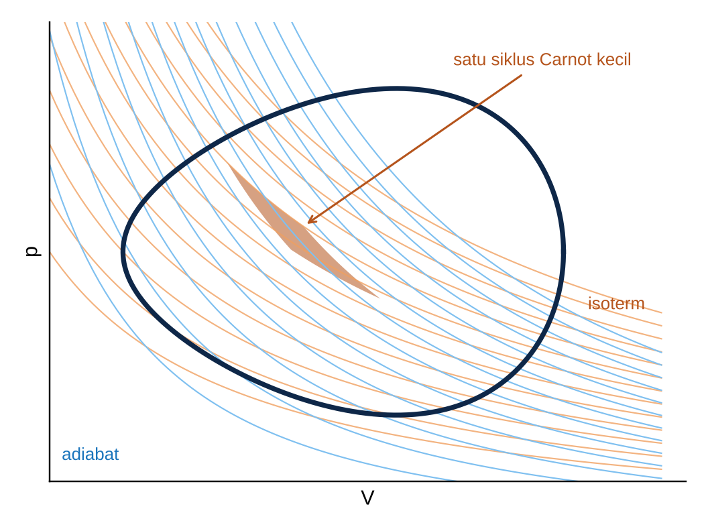
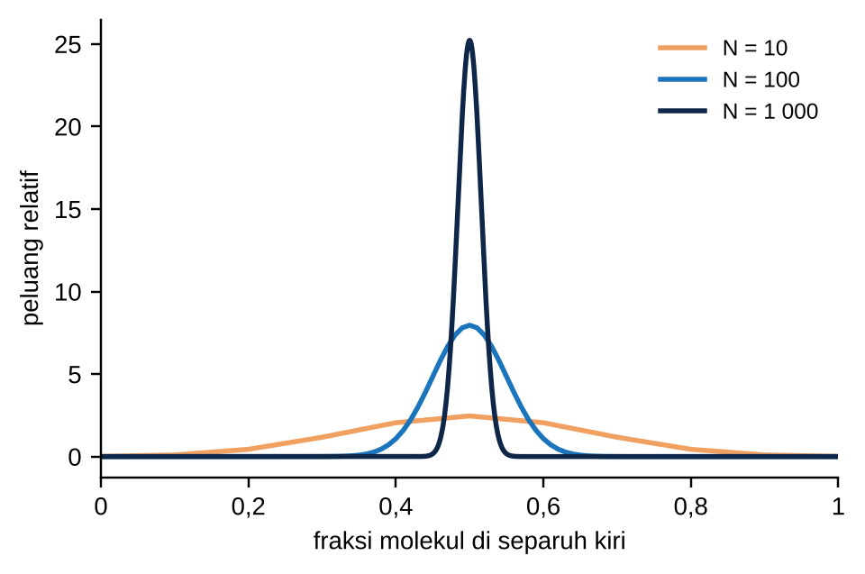

## 5.6 Entropi sebagai fungsi keadaan

Kembali ke pengamatan di akhir Contoh 5.4. Dalam siklus Carnot, kalor yang dipertukarkan tidak berjumlah nol (sebagian berubah menjadi kerja), tetapi jumlah $q/T$ pada kedua tahap isotermal tepat nol. (Kedua tahap adiabatik tidak ikut dijumlahkan karena pada tahap itu *q* = 0, sehingga sumbangannya nol.) Persamaan (5.2) memastikan hal ini berlaku untuk setiap siklus Carnot, karena $|q_\text{c}|/q_\text{h} = T_\text{c}/T_\text{h}$ dapat ditulis ulang, dengan tanda $q_\text{c}$ negatif, sebagai

$$
\frac{q_\text{h}}{T_\text{h}} + \frac{q_\text{c}}{T_\text{c}} = 0 . \qquad \text{(5.6)}
$$

Apa artinya? Besaran yang jumlahnya nol untuk setiap siklus adalah ciri khas fungsi keadaan. Ketinggian, misalnya: berjalan mengelilingi bukit dan kembali ke titik awal, jumlah semua naik-turun kita tepat nol. Kalor bukan fungsi keadaan, tetapi kalor reversibel dibagi suhu tampaknya ya.

Clausius menunjukkan bahwa hasil ini berlaku untuk **sembarang** siklus reversibel, bukan hanya siklus Carnot. Gagasannya: setiap siklus reversibel pada diagram *p*–*V* dapat didekati dengan banyak sekali siklus Carnot kecil yang berdampingan. Isoterm dan adiabat yang dipakai bersama oleh dua siklus kecil yang bertetangga dijalani dua kali dalam arah berlawanan, sehingga sumbangannya saling menghapus, dan yang tersisa hanyalah batas luar, yaitu siklus aslinya (Gambar 5.2). Karena setiap siklus kecil memenuhi (5.6), jumlah seluruhnya juga nol:

{width=62%}

$$
\oint\frac{dq_\text{rev}}{T} = 0 .
$$

Lingkaran pada tanda integral berarti integral mengelilingi siklus tertutup. Karena integral ini nol untuk setiap siklus, $dq_\text{rev}/T$ adalah diferensial eksak dari suatu fungsi keadaan. Clausius menamai fungsi itu **entropi**:

::: {.inti}
$$
dS = \frac{dq_\text{rev}}{T} , \qquad \Delta S = \int_\text{awal}^\text{akhir}\frac{dq_\text{rev}}{T} \qquad \text{(5.7)}
$$
**Entropi** adalah fungsi keadaan. Perubahannya dihitung sepanjang jalan **reversibel** yang menghubungkan kedua keadaan, walaupun proses sebenarnya tidak reversibel. Satuannya J K⁻¹.
:::

Mengapa kalor dibagi suhu? Gambaran intuitifnya: sejumlah kalor yang diberikan pada benda dingin menimbulkan "kekacauan" relatif yang lebih besar daripada kalor yang sama pada benda panas. Bersin di perpustakaan yang sunyi jauh lebih mengganggu daripada bersin di pasar yang ramai. Benda dingin, yang molekulnya bergerak lambat, lebih "terganggu" oleh tambahan energi.

Persamaan (5.7) langsung memberi Δ*S* untuk beberapa proses penting.

**Ekspansi isotermal gas ideal.** Dari (3.10), $q_\text{rev} = nRT\ln(V_2/V_1)$, dan *T* tetap, sehingga

$$
\Delta S = nR\ln\frac{V_2}{V_1} . \qquad \text{(5.8)}
$$

**Perubahan fasa pada suhu transisinya.** Pada titik leleh atau titik didih normal, perubahan fasa berlangsung reversibel pada suhu tetap, dan kalor yang diserap adalah entalpi transisinya:

$$
\Delta_\text{trs}S = \frac{\Delta_\text{trs}H}{T_\text{trs}} . \qquad \text{(5.9)}
$$

**Pemanasan pada tekanan tetap.** Untuk perubahan suhu kecil, $dq_\text{rev} = C_p\,dT$, sehingga

$$
\Delta S = \int_{T_1}^{T_2}\frac{C_p}{T}\,dT = C_p\ln\frac{T_2}{T_1} \qquad (C_p\ \text{tetap}) . \qquad \text{(5.10)}
$$

Bab 6 akan mengembangkan cara-cara ini menjadi alat lengkap untuk menghitung entropi.

::: {.contoh}
**Contoh 5.10 · Tiga perubahan entropi air**

Hitung perubahan entropi untuk (a) pencairan 1,00 mol es pada 0 °C ($\Delta_\text{fus}H = 6{,}01$ kJ mol⁻¹); (b) pemanasan 1,00 mol air cair dari 25 °C ke 100 °C ($C_{p,\text{m}} = 75{,}29$ J K⁻¹ mol⁻¹); (c) penguapan 1,00 mol air pada 100 °C ($\Delta_\text{vap}H = 40{,}66$ kJ mol⁻¹).

**Penyelesaian.** (a) $\Delta S = 6010/273{,}15 = +22{,}0$ J K⁻¹. (b) $\Delta S = 75{,}29\ln(373{,}15/298{,}15) = +16{,}9$ J K⁻¹. (c) $\Delta S = 40\,660/373{,}15 = +109$ J K⁻¹.

**Memahami hasil.** Ketiganya positif: pencairan, pemanasan, dan penguapan semuanya membuat molekul air lebih bebas bergerak dan tersebar. Penguapan mempunyai perubahan entropi lima kali pencairan, karena molekul yang menguap berpindah dari ruang yang sempit di dalam cairan ke ruang yang ribuan kali lebih luas di dalam gas. Ini sejalan dengan gambaran "penyebaran" dari subbab 5.1.
:::

::: {.contoh}
**Contoh 5.11 · Aturan Trouton**

Hitung entropi penguapan pada titik didih normal untuk benzena (30,8 kJ mol⁻¹, 353,2 K), karbon tetraklorida (30,0 kJ mol⁻¹, 349,9 K), sikloheksana (30,0 kJ mol⁻¹, 353,9 K), air (40,66 kJ mol⁻¹, 373,15 K), dan etanol (38,6 kJ mol⁻¹, 351,4 K). Apa polanya?

**Penyelesaian.** Dari (5.9): benzena 87,2; CCl₄ 85,7; sikloheksana 84,8; air 109,0; etanol 109,8 J K⁻¹ mol⁻¹.

**Memahami hasil.** Untuk cairan nonpolar, entropi penguapan hampir sama, sekitar 85 J K⁻¹ mol⁻¹. Pengamatan ini disebut **aturan Trouton**. Alasannya: penguapan membebaskan molekul dari ruang cairan ke ruang gas yang kira-kira sama besar untuk semua zat pada tekanan 1 atm, sehingga kenaikan "penyebarannya" pun kira-kira sama. Air dan etanol menyimpang jauh ke atas, karena molekul-molekulnya di dalam cairan sudah tertata oleh ikatan hidrogen; penguapan menghancurkan keteraturan tambahan itu. Aturan Trouton berguna untuk menaksir entalpi penguapan dari titik didih: $\Delta_\text{vap}H \approx (85\ \text{J K}^{-1}\text{mol}^{-1})T_\text{b}$.
:::

::: {.kuis}
**Kuis cepat 5.6** Gas ideal memuai secara isotermal sampai volumenya tiga kali. Bila prosesnya dilakukan secara tak reversibel, apakah Δ*S* gas lebih besar, lebih kecil, atau sama dengan bila dilakukan secara reversibel?
:::

## 5.7 Ketaksamaan Clausius

Entropi didefinisikan dengan kalor reversibel. Apa yang terjadi bila prosesnya tak reversibel? Kita sudah tahu dari subbab 3.3 bahwa proses tak reversibel memberikan kerja lebih sedikit daripada proses reversibel di antara keadaan yang sama: $|w| \le |w_\text{rev}|$ untuk ekspansi, atau dengan tanda IUPAC, $w \ge w_\text{rev}$. Karena Δ*U* sama untuk kedua jalan, hukum pertama memberi $q \le q_\text{rev}$. Membagi dengan *T*:

::: {.inti}
$$
dS \ge \frac{dq}{T} \qquad \text{(5.11)}
$$
**Ketaksamaan Clausius.** Tanda sama berlaku untuk proses reversibel, tanda lebih besar untuk proses tak reversibel (spontan).
:::

Akibat terpenting ketaksamaan ini muncul untuk sistem terisolasi, yang tidak menerima kalor sama sekali ($dq = 0$):

::: {.inti}
$$
\Delta S_\text{terisolasi} \ge 0 \qquad \text{(5.12)}
$$
**Hukum kedua termodinamika (bentuk entropi).** Entropi sistem terisolasi tidak pernah berkurang. Dalam setiap proses spontan, entropi sistem terisolasi bertambah; dalam kesetimbangan, entropinya maksimum.
:::

Inilah pernyataan hukum kedua yang paling berguna bagi kimia. Untuk memakainya pada sistem yang **tidak** terisolasi, seperti gelas kimia di laboratorium, kita memandang sistem bersama lingkungannya sebagai satu sistem terisolasi besar, "semesta". Arah spontan suatu proses ditentukan oleh perubahan entropi total:

$$
\Delta S_\text{total} = \Delta S_\text{sistem} + \Delta S_\text{lingkungan} > 0 . \qquad \text{(5.13)}
$$

Bagaimana menghitung $\Delta S_\text{lingkungan}$? Lingkungan biasanya sangat besar (udara laboratorium, bak air), sehingga suhunya praktis tidak berubah ketika menerima atau melepaskan kalor. Untuk lingkungan seperti itu, setiap perpindahan kalor dapat dianggap reversibel dari sudut pandang lingkungan, dan

$$
\Delta S_\text{lingkungan} = \frac{q_\text{lingkungan}}{T} = -\frac{q_\text{sistem}}{T} . \qquad \text{(5.14)}
$$

Untuk proses pada tekanan tetap, $q_\text{sistem} = \Delta H$, sehingga $\Delta S_\text{lingkungan} = -\Delta H/T$. Reaksi eksoterm memanaskan lingkungan dan menaikkan entropinya; reaksi endoterm mendinginkan lingkungan dan menurunkan entropinya.

::: {.contoh}
**Contoh 5.12 · Kalor mengalir dari panas ke dingin**

Sebanyak 1000 J kalor mengalir dari benda besar bersuhu 350 K ke benda besar bersuhu 300 K. Hitung perubahan entropi total. Bagaimana bila arahnya dibalik?

**Penyelesaian.** Benda panas kehilangan 1000 J: $\Delta S_\text{panas} = -1000/350 = -2{,}857$ J K⁻¹. Benda dingin menerima 1000 J: $\Delta S_\text{dingin} = +1000/300 = +3{,}333$ J K⁻¹. Totalnya $+0{,}476$ J K⁻¹. Bila arahnya dibalik, semua tanda berbalik dan totalnya −0,476 J K⁻¹.

**Memahami hasil.** Entropi yang hilang dari benda panas lebih kecil daripada yang diperoleh benda dingin, karena kalor yang sama dibagi suhu yang lebih besar. Jadi aliran dari panas ke dingin selalu menaikkan entropi total, dan aliran sebaliknya akan menurunkannya, sesuatu yang dilarang (5.12). Pernyataan Clausius tentang hukum kedua adalah akibat langsung dari bentuk entropinya.
:::

::: {.contoh}
**Contoh 5.13 · Ekspansi yang sama, entropi total yang berbeda**

Satu mol gas ideal memuai secara isotermal pada 298 K dari 10,0 L ke 20,0 L dengan tiga cara (Contoh 3.3): (a) reversibel; (b) melawan tekanan luar tetap 1,24 bar; (c) ke ruang hampa. Hitung $\Delta S_\text{sistem}$, $\Delta S_\text{lingkungan}$, dan $\Delta S_\text{total}$ untuk masing-masing.

**Penyelesaian.** Entropi fungsi keadaan, sehingga untuk ketiganya $\Delta S_\text{sistem} = R\ln2 = 5{,}76$ J K⁻¹.

Untuk lingkungan, kita perlu kalor yang **sebenarnya** dipertukarkan. Karena Δ*U* = 0, $q = -w$.
(a) $q = 1718$ J, $\Delta S_\text{lingk} = -1718/298{,}15 = -5{,}76$ J K⁻¹, total 0.
(b) $q = 1239$ J, $\Delta S_\text{lingk} = -4{,}16$ J K⁻¹, total $+1{,}61$ J K⁻¹.
(c) $q = 0$, $\Delta S_\text{lingk} = 0$, total $+5{,}76$ J K⁻¹.

**Memahami hasil.** Proses reversibel tidak menghasilkan entropi sama sekali; entropi hanya berpindah dari lingkungan ke sistem. Makin tak reversibel prosesnya, makin banyak entropi baru yang **tercipta**. Ekspansi ke ruang hampa adalah yang paling tak reversibel: kesempatan untuk mendapatkan kerja disia-siakan sepenuhnya, dan seluruh perubahan entropinya adalah entropi baru.
:::

::: {.contoh}
**Contoh 5.14 · Mengapa kompres dingin bekerja**

Pelarutan NH₄NO₃ dalam air pada 298 K mempunyai $\Delta H = +25{,}7$ kJ mol⁻¹ dan $\Delta S_\text{sistem} = +108{,}7$ J K⁻¹ mol⁻¹. Tunjukkan bahwa proses ini spontan walaupun endoterm.

**Penyelesaian.** Lingkungan memberikan kalor 25,7 kJ kepada sistem: $\Delta S_\text{lingk} = -25\,700/298{,}15 = -86{,}2$ J K⁻¹ mol⁻¹. Maka
$$
\Delta S_\text{total} = 108{,}7 - 86{,}2 = +22{,}5\ \text{J K}^{-1}\text{mol}^{-1} > 0 .
$$

**Memahami hasil.** Teka-teki dari Bab 4 terjawab. Pelarutan menurunkan entropi lingkungan karena mengambil kalornya, tetapi menaikkan entropi sistem lebih banyak lagi: ion-ion NH₄⁺ dan NO₃⁻ yang semula terkurung dalam kisi kristal kini bebas bergerak di seluruh larutan. Kalor saja tidak menentukan arah proses; yang menentukan adalah entropi total. Proses endoterm dapat spontan asalkan entropi sistemnya naik cukup besar.
:::

::: {.contoh}
**Contoh 5.15 · Entropi pencampuran dua gas**

Satu mol N₂ dan satu mol O₂, masing-masing pada 1 bar dan 25 °C, dipisahkan oleh sekat di dalam wadah. Sekat dibuka dan kedua gas bercampur pada suhu tetap. Hitung perubahan entropinya.

**Penyelesaian.** Setiap gas, yang bersifat ideal, memuai dari volumenya semula ke volume total, dua kali lebih besar, tanpa memengaruhi gas lain. Untuk masing-masing gas $\Delta S = R\ln2$, sehingga
$$
\Delta S_\text{campur} = 2R\ln2 = 11{,}5\ \text{J K}^{-1} .
$$
Tidak ada kalor yang dipertukarkan (gas ideal, suhu tetap), sehingga $\Delta S_\text{lingk} = 0$ dan $\Delta S_\text{total} = +11{,}5$ J K⁻¹.

**Memahami hasil.** Pencampuran gas spontan sepenuhnya karena entropi, tanpa sumbangan energi sama sekali. Rumus umumnya, $\Delta S_\text{campur} = -nR\sum x_J\ln x_J$, akan diturunkan di Bab 10 dan menjadi dasar termodinamika larutan.
:::

::: {.awas}
**Entropi sistem boleh turun.** Hukum kedua hanya melarang penurunan entropi **total** (sistem terisolasi atau semesta). Entropi sistem yang tidak terisolasi dapat turun, misalnya ketika air membeku atau gas dimampatkan, asalkan entropi lingkungannya naik sekurang-kurangnya sebanyak itu. Kesalahan yang sering terjadi adalah menyimpulkan bahwa suatu proses tidak mungkin hanya karena $\Delta S_\text{sistem} < 0$.
:::

::: {.kuis}
**Kuis cepat 5.7** Air pada −10 °C membeku dengan sendirinya walaupun entropi air turun ketika membeku. Dari mana datangnya kenaikan entropi total?
:::

## 5.8 Entropi dan peluang: rumus Boltzmann

Sejauh ini entropi kita definisikan dari kalor dan suhu, besaran makroskopik. Tetapi di subbab 5.1 kita menduga bahwa entropi mengukur sesuatu tentang molekul: seberapa "tersebar" mereka. Ludwig Boltzmann membuat dugaan itu tepat pada 1877, dengan rumus yang kini terukir di batu nisannya:

::: {.inti}
$$
S = k\ln W \qquad \text{(5.15)}
$$
*W* adalah banyaknya cara molekul-molekul sistem dapat disusun (disebut **keadaan mikro**) yang semuanya menghasilkan keadaan makroskopik yang sama. *k* adalah tetapan Boltzmann.
:::

Mari kita lihat artinya dengan contoh paling sederhana. Bayangkan empat molekul di dalam wadah yang dibagi dua oleh garis khayal, kiri dan kanan. Setiap molekul dapat berada di kiri atau kanan, sehingga ada $2^4 = 16$ susunan, semuanya sama mungkin. Tetapi bila kita hanya mencatat **berapa** molekul yang ada di kiri:

| Molekul di kiri | 0 | 1 | 2 | 3 | 4 |
|---|---|---|---|---|---|
| Banyaknya susunan *W* | 1 | 4 | 6 | 4 | 1 |

Keadaan "dua di kiri, dua di kanan" dapat dicapai dengan enam cara, sedangkan "semua di kiri" hanya dengan satu cara. Keadaan dengan *W* terbesar adalah keadaan yang paling mungkin, dan menurut (5.15), juga keadaan dengan entropi terbesar.

Dengan empat molekul, peluang menemukan semuanya di kiri masih 1/16, tidak terlalu kecil. Tetapi peluang itu turun sangat cepat dengan banyaknya molekul: untuk 100 molekul, $2^{-100} \approx 8 \times 10^{-31}$; untuk satu mol, $2^{-6 \times 10^{23}}$, angka yang begitu kecil sehingga tidak ada artinya. Gambar 5.3 memperlihatkan bagaimana sebaran peluang menyempit menjadi puncak tajam di tengah ketika banyaknya molekul bertambah.

{width=72%}

Inilah makna statistik hukum kedua. Gas tidak memuai karena ada gaya yang mendorongnya, melainkan karena keadaan "tersebar merata" dapat dicapai dengan jumlah cara yang luar biasa lebih banyak daripada keadaan "terkumpul". Molekul yang bergerak acak hampir pasti berakhir dalam keadaan yang paling banyak caranya. Proses kebalikannya tidak mustahil secara mutlak, tetapi peluangnya begitu kecil sehingga tidak akan pernah teramati selama umur semesta.

Rumus Boltzmann juga menghasilkan rumus termodinamika yang sudah kita kenal. Bila volume gas dilipatduakan, setiap molekul mempunyai dua kali lebih banyak tempat, sehingga *W* untuk *N* molekul naik dengan faktor $2^N$. Perubahan entropinya

$$
\Delta S = k\ln2^N = Nk\ln2 = nR\ln2 ,
$$

tepat sama dengan (5.8) untuk $V_2/V_1 = 2$. Dua definisi entropi yang sangat berbeda, satu dari kalor dan suhu, satu dari menghitung susunan molekul, memberi hasil yang sama.

::: {.contoh}
**Contoh 5.16 · Entropi sisa karbon monoksida**

Molekul CO hampir simetris: ujung C dan ujung O hampir sama besar dan dipolnya sangat kecil. Ketika CO dibekukan, setiap molekul dapat terkunci di kisi kristal dalam dua arah, CO atau OC, tanpa perbedaan energi yang berarti. (a) Hitung entropi yang tersisa pada 0 K karena ketidakteraturan ini. (b) Nilai terukurnya sekitar 4,6 J K⁻¹ mol⁻¹. Apa artinya?

**Penyelesaian.** (a) Untuk $N_\text{A}$ molekul, masing-masing dengan dua arah, $W = 2^{N_\text{A}}$, sehingga
$$
S = k\ln2^{N_\text{A}} = R\ln2 = 5{,}76\ \text{J K}^{-1}\text{mol}^{-1} .
$$
(b) Nilai terukur sedikit lebih kecil, yang berarti arah molekul tidak sepenuhnya acak: sebagian kecil molekul sempat tersusun teratur sebelum kristal terlalu dingin untuk menata ulang dirinya.

**Memahami hasil.** Entropi sisa seperti ini disebut **entropi residu**. Es juga mempunyai entropi residu, sekitar 3,4 J K⁻¹ mol⁻¹, karena atom-atom hidrogen dalam jaringan ikatan hidrogennya dapat disusun dengan banyak cara. Linus Pauling menghitungnya pada 1935 dengan menghitung susunan yang diizinkan, mendapat $R\ln(3/2) = 3{,}37$ J K⁻¹ mol⁻¹, dan hasilnya cocok dengan pengukuran kalorimetri. Ini adalah salah satu bukti paling indah bahwa rumus Boltzmann benar.
:::

::: {.contoh}
**Contoh 5.17 · Seberapa mustahil "mustahil"?**

Sebuah wadah berisi 100 molekul gas. Berapa peluang menemukan semuanya di separuh kiri pada suatu saat? Bila susunan molekul berubah sepenuhnya $10^{10}$ kali per detik, berapa lama rata-rata kita harus menunggu untuk melihatnya sekali?

**Penyelesaian.** Peluang $2^{-100} = 7{,}9 \times 10^{-31}$. Diperlukan rata-rata $1/(7{,}9 \times 10^{-31}) = 1{,}3 \times 10^{30}$ susunan, atau $1{,}3 \times 10^{20}$ s, sekitar $4 \times 10^{12}$ tahun.

**Memahami hasil.** Bahkan untuk hanya 100 molekul, waktu tunggunya tiga ratus kali umur semesta (sekitar $1{,}4 \times 10^{10}$ tahun). Untuk sampel nyata yang berisi $10^{23}$ molekul, "mustahil" dalam termodinamika berarti jauh lebih mustahil daripada apa pun yang dapat kita bayangkan. Hukum kedua adalah hukum statistik, tetapi untuk sistem makroskopik ia sama pastinya dengan hukum apa pun.
:::

::: {.contoh}
**Contoh 5.18 · Entropi setumpuk kartu yang dikocok**

Satu pak kartu remi berisi 52 kartu berbeda. (a) Berapa "entropi susunan" pak kartu yang dikocok sempurna menurut rumus Boltzmann? (b) Bandingkan dengan perubahan entropi termal ketika pak kartu itu (kapasitas kalor sekitar 100 J K⁻¹) dihangatkan dari 25 °C ke 26 °C.

**Penyelesaian.** (a) Ada $52!$ susunan, sehingga $S = k\ln52! = (1{,}381 \times 10^{-23})(156{,}4) = 2{,}2 \times 10^{-21}$ J K⁻¹.

(b) $\Delta S = C\ln(T_2/T_1) = 100\ln(299{,}15/298{,}15) = 0{,}34$ J K⁻¹.

**Memahami hasil.** Menghangatkan kartu satu derajat saja menaikkan entropinya $10^{20}$ kali lebih banyak daripada mengocoknya. Entropi termodinamika hampir seluruhnya berasal dari susunan **molekul** dan energinya, yang jumlahnya mencapai $10^{23}$, bukan dari susunan benda-benda makroskopik. "Kamar yang berantakan" adalah perumpamaan yang berguna untuk memahami entropi, tetapi entropi kamar itu sendiri hampir tidak berubah karena berantakan.
:::

::: {.dalam}
**Lebih dalam: rumus Stirling dan entropi pencampuran.** Untuk *N* yang besar, $\ln N! \approx N\ln N - N$ (rumus Stirling). Bila $N_A$ molekul A dan $N_B$ molekul B ditempatkan pada $N = N_A + N_B$ tempat, banyaknya susunan adalah $W = N!/(N_A!\,N_B!)$. Dengan rumus Stirling,
$$
\ln W \approx N\ln N - N_A\ln N_A - N_B\ln N_B = -N(x_A\ln x_A + x_B\ln x_B) ,
$$
dengan $x_A = N_A/N$. Mengalikan dengan *k* dan memakai $Nk = nR$:
$$
\Delta S_\text{campur} = -nR(x_A\ln x_A + x_B\ln x_B) .
$$
Untuk $x_A = x_B = \tfrac12$ dan $n = 2$ mol, hasilnya $2R\ln2$, sama dengan Contoh 5.15 yang dihitung dari ekspansi isotermal. Sekali lagi, menghitung susunan dan menghitung kalor reversibel memberi jawaban yang sama.
:::

::: {.kuis}
**Kuis cepat 5.8** Menurut rumus Boltzmann, berapa entropi kristal sempurna yang semua molekulnya tersusun dengan satu-satunya cara yang mungkin?
:::

### Menuju bab berikutnya

Kita kini mempunyai entropi dan tahu bahwa entropi total selalu bertambah dalam proses spontan. Untuk memakai pengetahuan ini dalam kimia, kita perlu menghitung entropi zat dan reaksi dengan teliti: bagaimana entropi berubah dengan suhu dan tekanan, berapa entropi mutlak suatu zat, dan berapa perubahan entropi suatu reaksi kimia. Bab 6 mengembangkan alat-alat itu, termasuk hukum ketiga termodinamika, yang memberi titik nol alami bagi entropi.
