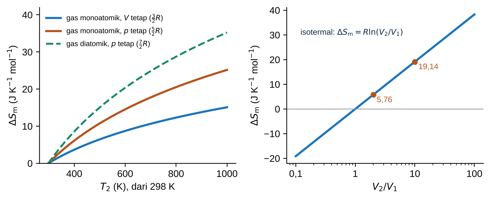
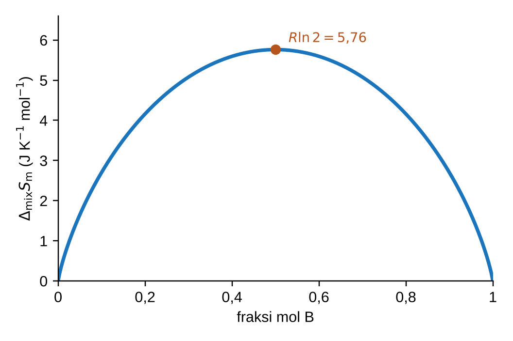

# Bab 6 Menghitung Perubahan Entropi dan Hukum Ketiga

Berapa energi dalam segelas air? Di Bab 3 kita melihat bahwa pertanyaan itu tidak dapat dijawab: hanya perubahan energi dalam yang bermakna. Sekarang ajukan pertanyaan yang serupa untuk entropi: berapa entropi segelas air? Anehnya, untuk entropi pertanyaan ini **mempunyai** jawaban. Tabel data termodinamika mencantumkan entropi molar standar air cair, 69,9 J K⁻¹ mol⁻¹, sebagai angka mutlak, bukan selisih terhadap suatu acuan sembarang. Tabel yang sama mencantumkan intan 2,4, besi 27,3, uap air 188,8, dan helium 126,2 J K⁻¹ mol⁻¹.

Dari mana angka-angka mutlak itu? Dan mengapa urutannya seperti itu: intan, yang paling keras dan teratur, paling kecil; uap air jauh lebih besar daripada air cair; dan helium, gas paling sederhana, ternyata lebih kecil daripada uap air?

Bab ini menjawab kedua pertanyaan itu sambil membangun alat lengkap untuk menghitung entropi. Kita mulai dengan perubahan entropi gas ideal ketika suhu, volume, dan tekanannya berubah, termasuk ketika gas-gas bercampur. Lalu kita menghitung entropi perubahan fasa, juga pada suhu yang bukan suhu transisi normalnya, dan entropi pemanasan zat yang kapasitas kalornya berubah dengan suhu. Hukum ketiga termodinamika kemudian memberi titik nol alami bagi entropi, sehingga kita dapat menghitung entropi mutlak dari pengukuran kalor. Dengan entropi mutlak, entropi reaksi kimia dapat dihitung dari tabel, persis seperti entalpi reaksi di Bab 4. Bab ditutup dengan memakai kedua tabel bersama-sama untuk meramalkan arah reaksi.

::: {.strategi}
**Pertanyaan pembuka**

1. Bagaimana entropi gas berubah bila suhunya dinaikkan pada volume tetap, dibandingkan pada tekanan tetap?
2. Mengapa pencampuran dua gas yang berbeda menaikkan entropi, tetapi "pencampuran" dua bagian gas yang sama tidak?
3. Bagaimana menghitung entropi pembekuan air yang terjadi pada −10 °C, padahal titik bekunya 0 °C?
4. Mengapa entropi dapat mempunyai nilai mutlak, sedangkan energi dalam dan entalpi tidak?
5. Mengapa entropi molar gas jauh lebih besar daripada entropi cairan dan padatan?
6. Bagaimana tabel entropi dan entalpi bersama-sama meramalkan suhu mulai terurainya batu kapur?
:::

::: {.tujuan}
**Tujuan belajar**

Setelah mempelajari bab ini, kamu mampu:

1. Menghitung Δ*S* gas ideal sebagai fungsi suhu dan volume, serta sebagai fungsi suhu dan tekanan.
2. Menghitung entropi pencampuran gas ideal.
3. Menghitung entropi perubahan fasa pada suhu transisi normal dan pada suhu lain dengan siklus termodinamika.
4. Menghitung entropi pemanasan dengan kapasitas kalor yang bergantung pada suhu.
5. Menyatakan hukum ketiga dan memakai hukum *T*³ Debye untuk suhu sangat rendah.
6. Menghitung entropi mutlak dari data kalorimetri.
7. Menghitung entropi reaksi standar dari entropi molar standar.
8. Memakai $\Delta S_\text{total}$ untuk meramalkan arah reaksi dan suhu peralihannya.
:::

::: {.mat}
**Prasyarat**

Dari Bab 5: definisi entropi, $dS = dq_\text{rev}/T$, ketaksamaan Clausius, dan rumus Boltzmann (subbab 5.6–5.8). Dari Bab 3–4: kapasitas kalor $C_V$ dan $C_p$ (subbab 3.9, 4.2). Dari matematika: $\int dx/x = \ln x$ dan sifat logaritma.
:::

## 6.1 Entropi sebagai fungsi T dan V

Entropi adalah fungsi keadaan, sehingga perubahannya hanya bergantung pada keadaan awal dan akhir. Untuk gas, keadaan ditentukan oleh dua variabel, misalnya suhu dan volume. Bagaimana menghitung Δ*S* bila keduanya berubah sekaligus?

Kuncinya adalah memilih jalan reversibel yang paling mudah dihitung. Karena hasilnya tidak bergantung pada jalan, kita boleh memecah perubahan menjadi dua langkah sederhana: ubah volume pada suhu tetap, lalu ubah suhu pada volume tetap.

Untuk gas ideal, kita dapat melakukan ini dengan hukum pertama secara langsung. Pada proses reversibel, $dq_\text{rev} = dU - dw$. Untuk gas ideal $dU = nC_{V,\text{m}}\,dT$ (subbab 3.8), dan kerja reversibelnya $dw = -p\,dV$, sehingga $dq_\text{rev} = nC_{V,\text{m}}\,dT + p\,dV$. Membagi dengan *T* dan memakai $p/T = nR/V$:

$$
dS = \frac{dq_\text{rev}}{T} = nC_{V,\text{m}}\frac{dT}{T} + nR\frac{dV}{V} .
$$

Kedua suku ini masing-masing hanya bergantung pada satu variabel, sehingga dapat diintegralkan terpisah. Bila $C_{V,\text{m}}$ tetap:

::: {.inti}
$$
\Delta S = nC_{V,\text{m}}\ln\frac{T_2}{T_1} + nR\ln\frac{V_2}{V_1} \qquad \text{(6.1)}
$$
**Entropi gas ideal sebagai fungsi suhu dan volume.** Entropi bertambah bila suhu naik (molekul mempunyai lebih banyak cara membagi energi) dan bila volume bertambah (molekul mempunyai lebih banyak tempat).
:::

Kedua suku mempunyai gambaran molekul yang jelas. Suku pertama: suhu yang lebih tinggi berarti energi yang lebih besar, yang dapat dibagi di antara molekul-molekul dengan lebih banyak cara. Suku kedua: volume yang lebih besar berarti lebih banyak posisi yang dapat ditempati, persis seperti hitungan Boltzmann di subbab 5.8.

Persamaan (6.1) juga memeriksa dirinya sendiri. Untuk proses adiabatik reversibel, Δ*S* harus nol karena $q_\text{rev} = 0$. Dengan $R/C_{V,\text{m}} = \gamma - 1$, syarat $\Delta S = 0$ menjadi $\ln(T_2/T_1) = -(\gamma - 1)\ln(V_2/V_1)$, atau $TV^{\gamma - 1} = \text{tetap}$, tepat persamaan adiabat dari Bab 3. Pada ekspansi adiabatik, kenaikan entropi karena volume yang bertambah tepat diimbangi penurunan entropi karena suhu yang turun.

::: {.contoh}
**Contoh 6.1 · Memanaskan helium dalam wadah tertutup**

Satu mol helium dipanaskan dari 300 K ke 600 K dalam wadah kaku. Hitung Δ*S*.

**Penyelesaian.** Volume tetap, sehingga hanya suku pertama (6.1) yang bekerja: $\Delta S = \tfrac32R\ln2 = (1{,}5)(8{,}314)(0{,}693) = +8{,}64$ J K⁻¹.

**Memahami hasil.** Bandingkan dengan melipatduakan **volume** helium pada suhu tetap: $R\ln2 = 5{,}76$ J K⁻¹. Melipatduakan suhu berpengaruh 1,5 kali lebih besar, karena $C_{V,\text{m}} = \tfrac32R$. Untuk molekul yang dapat berotasi dan bergetar, $C_{V,\text{m}}$ lebih besar, dan pengaruh suhu pada entropi makin dominan.
:::

::: {.contoh}
**Contoh 6.2 · Dua langkah, satu jawaban**

Satu mol nitrogen ($C_{V,\text{m}} = \tfrac52R$) dibawa dari 300 K dan 10,0 L ke 600 K dan 30,0 L. Hitung Δ*S* (a) dengan (6.1), (b) dengan jalan: pemanasan pada volume tetap sampai 600 K, lalu ekspansi isotermal sampai 30,0 L.

**Penyelesaian.** (a) $\Delta S = \tfrac52R\ln2 + R\ln3 = 14{,}41 + 9{,}13 = 23{,}5$ J K⁻¹.

(b) Langkah pertama: $\tfrac52R\ln(600/300) = 14{,}41$ J K⁻¹. Langkah kedua: $R\ln(30/10) = 9{,}13$ J K⁻¹. Jumlahnya 23,5 J K⁻¹.

**Memahami hasil.** Tentu saja kedua cara sama, karena (6.1) memang diturunkan dari jalan dua langkah seperti ini. Tetapi cara (b) mengajarkan strategi umum yang akan kita pakai berkali-kali: bila perubahan rumit, pecahlah menjadi langkah-langkah reversibel yang masing-masing hanya mengubah satu variabel.
:::

::: {.dalam}
**Lebih dalam: entropi gas nyata.** Penurunan (6.1) memakai $p/T = nR/V$, yang hanya berlaku untuk gas ideal. Untuk zat apa pun, subbab 7.6 akan menunjukkan (dengan hubungan Maxwell) bahwa
$$
dS = \frac{C_V}{T}dT + \left(\frac{\partial p}{\partial T}\right)_V dV .
$$
Untuk gas van der Waals, $p = nRT/(V - nb) - an^2/V^2$, sehingga $(\partial p/\partial T)_V = nR/(V - nb)$. Tetapan *a* tidak muncul sama sekali, dan perubahan entropi isotermalnya
$$
\Delta S = nR\ln\frac{V_2 - nb}{V_1 - nb} .
$$
Hasilnya sama dengan gas ideal, tetapi dengan volume "bebas" $V - nb$ sebagai ganti *V*. Masuk akal: entropi menghitung tempat yang tersedia bagi molekul, dan bagian volume yang ditempati molekul lain tidak tersedia.
:::

::: {.contoh}
**Contoh 6.3 · Entropi ekspansi CO₂ nyata**

Satu mol CO₂ ($b = 0{,}042\,67$ L mol⁻¹) memuai secara isotermal dari 0,500 L ke 1,000 L. Hitung Δ*S* menurut persamaan van der Waals dan bandingkan dengan gas ideal.

**Penyelesaian.** Van der Waals: $\Delta S = R\ln\frac{1{,}000 - 0{,}0427}{0{,}500 - 0{,}0427} = (8{,}314)\ln2{,}093 = 6{,}14$ J K⁻¹. Gas ideal: $R\ln2 = 5{,}76$ J K⁻¹.

**Memahami hasil.** Gas nyata memperoleh entropi 7% lebih banyak, karena pada volume kecil sebagian ruang sudah "dipesan" oleh molekul-molekul lain, sehingga pelipatduaan volume total lebih dari melipatduakan ruang yang benar-benar bebas. Pada volume besar, *b* tidak berarti lagi dan kedua hasil menyatu.
:::

::: {.kuis}
**Kuis cepat 6.1** Gas ideal memuai secara adiabatik ke ruang hampa sampai volumenya dua kali. Apakah Δ*S*-nya nol, seperti ekspansi adiabatik reversibel? Hitung Δ*S*-nya.
:::

## 6.2 Entropi sebagai fungsi T dan P

Di laboratorium, kita lebih sering mengendalikan tekanan daripada volume. Karena itu bentuk yang lebih praktis adalah entropi sebagai fungsi suhu dan tekanan. Kita dapat mengubah (6.1) dengan memakai $V_2/V_1 = (T_2/T_1)(p_1/p_2)$ dari persamaan gas ideal:

$$
\Delta S = nC_{V,\text{m}}\ln\frac{T_2}{T_1} + nR\ln\frac{T_2}{T_1} + nR\ln\frac{p_1}{p_2} .
$$

Dua suku pertama bergabung karena $C_{V,\text{m}} + R = C_{p,\text{m}}$:

::: {.inti}
$$
\Delta S = nC_{p,\text{m}}\ln\frac{T_2}{T_1} - nR\ln\frac{p_2}{p_1} \qquad \text{(6.2)}
$$
**Entropi gas ideal sebagai fungsi suhu dan tekanan.** Entropi bertambah bila suhu naik dan berkurang bila tekanan naik.
:::

Mengapa suku suhu sekarang memakai $C_p$, bukan $C_V$? Karena pemanasan pada tekanan tetap juga memuaikan gas. Kenaikan entropi pada tekanan tetap mencakup dua sumbangan: suhu yang naik dan volume yang bertambah karena pemuaian. Itulah sebabnya $C_p > C_V$ juga muncul di sini.

Suku tekanan mempunyai tanda negatif yang mudah dipahami: memampatkan gas berarti memperkecil volumenya, sehingga molekul mempunyai lebih sedikit tempat. Bentuk khusus yang sangat penting adalah perubahan tekanan pada suhu tetap:

$$
\Delta S = -nR\ln\frac{p_2}{p_1} \qquad (T\ \text{tetap}) . \qquad \text{(6.3)}
$$

Persamaan inilah yang nanti, di Bab 9 dan 12, membuat potensial kimia dan tetapan kesetimbangan bergantung pada tekanan parsial.

Gambar 6.1 membandingkan kedua cara mengubah entropi gas ideal. Pemanasan dari 298 K ke 1000 K menaikkan entropi gas monoatomik 15,1 J K⁻¹ mol⁻¹ pada volume tetap tetapi 25,2 J K⁻¹ mol⁻¹ pada tekanan tetap, karena pada tekanan tetap gas juga memuai. Kenaikan entropi karena pemuaian isotermal hanya bergantung pada perbandingan volume: setiap pelipatduaan menambah $R\ln2 = 5{,}76$ J K⁻¹ mol⁻¹, berapa pun volume awalnya.

{width=94%}

Untuk **cairan dan padatan**, volume hampir tidak berubah dengan tekanan maupun suhu, sehingga suku tekanan dapat diabaikan, dan $C_p \approx C_V$. Perubahan entropinya praktis hanya karena suhu: $\Delta S \approx C_p\ln(T_2/T_1)$.

::: {.contoh}
**Contoh 6.4 · Memanaskan dan memampatkan argon**

Satu mol argon dibawa dari 25 °C dan 1,00 bar ke 500 K dan 10,0 bar. Hitung Δ*S*.

**Penyelesaian.** Dari (6.2), dengan $C_{p,\text{m}} = \tfrac52R = 20{,}79$ J K⁻¹ mol⁻¹:
$$
\Delta S = (20{,}79)\ln\frac{500}{298{,}15} - (8{,}314)\ln10 = 10{,}75 - 19{,}14 = -8{,}39\ \text{J K}^{-1} .
$$

**Memahami hasil.** Pemanasan menaikkan entropi, tetapi pemampatan sepuluh kali menurunkannya lebih banyak lagi, sehingga hasil bersihnya negatif. Gas yang lebih panas tetapi jauh lebih rapat ternyata lebih "teratur" daripada gas semula.
:::

::: {.contoh}
**Contoh 6.5 · Mendinginkan sekilo air**

Satu kilogram air didinginkan dari 25 °C ke 0 °C pada tekanan tetap, tanpa membeku. Hitung Δ*S* air.

**Penyelesaian.** Untuk cairan, $\Delta S = C_p\ln(T_2/T_1) = (4184\ \text{J K}^{-1})\ln(273{,}15/298{,}15) = -366$ J K⁻¹.

**Memahami hasil.** Entropi air turun karena kalor dikeluarkan darinya. Ini tidak melanggar hukum kedua: kalor yang dikeluarkan masuk ke lingkungan yang lebih dingin, misalnya kulkas, dan menaikkan entropi lingkungan itu sekurang-kurangnya sebanyak 366 J K⁻¹. Pada kulkas nyata, kerja listriknya juga berakhir sebagai kalor di dapur, menambah entropi lebih banyak lagi.
:::

::: {.contoh}
**Contoh 6.6 · Mengisi tabung selam**

Udara diisikan ke tabung selam sampai 200 bar. Bila pemampatan dari 1 bar dilakukan pada suhu tetap 25 °C, hitung perubahan entropi per mol udara dan kalor minimum yang harus dibuang ke lingkungan.

**Penyelesaian.** Dari (6.3): $\Delta S = -R\ln200 = -44{,}1$ J K⁻¹ mol⁻¹. Pada proses isotermal reversibel, kalor yang dibuang $|q| = T|\Delta S| = (298{,}15)(44{,}1)$ J $= 13{,}1$ kJ per mol.

**Memahami hasil.** Penurunan entropi udara harus diimbangi kenaikan entropi lingkungan, dan itu terjadi lewat kalor yang dibuang. Inilah sebabnya kompresor tabung selam dilengkapi pendingin dan tabung yang baru diisi terasa hangat: bila kalor itu tidak dibuang, suhu udara di dalam tabung naik jauh dan tekanannya turun ketika tabung kemudian mendingin.
:::

::: {.kuis}
**Kuis cepat 6.2** Tekanan satu mol gas ideal diturunkan dari 1 bar ke 0,1 bar pada suhu tetap. Berapa perubahan entropinya, dan mengapa tandanya positif?
:::

## 6.3 Entropi pemuaian dan pencampuran gas ideal

Pada Contoh 5.15 kita melihat bahwa pencampuran dua gas berbeda menaikkan entropi tanpa pertukaran kalor sama sekali. Dengan persamaan (6.3) kita dapat menurunkan rumus umumnya dengan sangat ringkas.

Bayangkan $n_A$ mol gas A dan $n_B$ mol gas B, masing-masing pada tekanan *p* dan suhu *T* yang sama, dipisahkan oleh sekat. Ketika sekat dibuka, kedua gas bercampur. Setelah bercampur, tekanan total tetap *p*, tetapi setiap gas kini hanya mempunyai tekanan parsial $p_J = x_Jp$. Dari sudut pandang setiap gas, pencampuran adalah penurunan tekanan dari *p* ke $x_Jp$ pada suhu tetap. Menurut (6.3):

$$
\Delta S_J = -n_JR\ln\frac{x_Jp}{p} = -n_JR\ln x_J .
$$

Menjumlahkan semua gas dan memakai $n_J = x_Jn$:

::: {.inti}
$$
\Delta_\text{mix}S = -nR\sum_J x_J\ln x_J \qquad \text{(6.4)}
$$
**Entropi pencampuran gas ideal.** Karena $0 < x_J < 1$, setiap $\ln x_J$ negatif, sehingga $\Delta_\text{mix}S$ selalu positif.
:::

Untuk campuran dua komponen, entropi pencampuran per mol campuran paling besar pada $x_A = x_B = \tfrac12$, yaitu $R\ln2 = 5{,}76$ J K⁻¹ mol⁻¹ (Gambar 6.2). Rumus ini sama dengan yang kita peroleh dari hitungan susunan molekul di subbab 5.8.

{width=62%}

Ada satu kehalusan yang terkenal dengan nama **paradoks Gibbs**. Bila kedua bagian berisi gas yang **sama**, misalnya nitrogen di kedua sisi sekat, membuka sekat tidak mengubah apa pun yang dapat diukur, sehingga Δ*S* harus nol. Tetapi rumus (6.4) seolah-olah memberi nilai positif. Penyelesaiannya: molekul-molekul yang identik tidak dapat dibedakan, sehingga menukar posisi dua molekul nitrogen tidak menghasilkan susunan baru. Rumus (6.4) hanya berlaku untuk gas yang benar-benar berbeda. Perbedaan sekecil apa pun, misalnya ¹⁴N₂ dan ¹⁵N₂, sudah cukup untuk membuat pencampurannya menaikkan entropi sebesar penuh.

::: {.contoh}
**Contoh 6.7 · Entropi pencampuran udara**

Hitung entropi pencampuran per mol udara dari nitrogen, oksigen, dan argon murni ($x$ = 0,7808; 0,2095; 0,0093) pada suhu dan tekanan yang sama.

**Penyelesaian.** Dari (6.4) dengan *n* = 1 mol:
$$
\Delta_\text{mix}S = -R[0{,}7808\ln0{,}7808 + 0{,}2095\ln0{,}2095 + 0{,}0093\ln0{,}0093] = 4{,}69\ \text{J K}^{-1}\text{mol}^{-1} .
$$

**Memahami hasil.** Nilai ini lebih kecil daripada maksimum dua komponen ($R\ln2 = 5{,}76$), karena udara didominasi nitrogen. Sebaliknya, untuk **memisahkan** udara menjadi komponen-komponennya, entropi ini harus "dibayar" dengan kerja paling sedikit $T\Delta_\text{mix}S = (298)(4{,}69) = 1{,}4$ kJ per mol udara. Pabrik pemisahan udara yang memproduksi oksigen untuk rumah sakit dan industri memerlukan kerja jauh di atas batas ini.
:::

::: {.contoh}
**Contoh 6.8 · Pencampuran gas yang volumenya berbeda**

Satu mol He dalam wadah bervolume *V* dan satu mol Ar dalam wadah bervolume 3*V*, keduanya pada suhu yang sama, dihubungkan sehingga bercampur. Hitung Δ*S*.

**Penyelesaian.** Rumus (6.4) tidak dapat dipakai langsung karena tekanan awal kedua gas berbeda. Kembali ke prinsip: setiap gas memuai secara isotermal ke volume total 4*V*, tanpa memengaruhi gas lain. He: $R\ln(4V/V) = 11{,}53$ J K⁻¹. Ar: $R\ln(4V/3V) = 2{,}39$ J K⁻¹. Totalnya 13,92 J K⁻¹.

**Memahami hasil.** Helium, yang mula-mula paling terkurung, memperoleh kenaikan entropi terbesar. Rumus (6.4) hanyalah kasus khusus prinsip ini untuk gas-gas yang mula-mula bertekanan sama. Bila ragu, selalu kembali ke gambaran setiap gas memuai sendiri-sendiri.
:::

::: {.kuis}
**Kuis cepat 6.3** Untuk campuran biner, pada fraksi mol berapa entropi pencampuran per mol paling besar? Berapa nilainya bila $x_A = 0{,}1$?
:::
