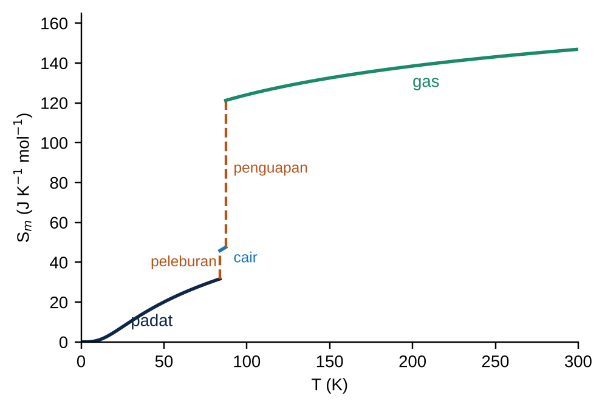

## 6.4 Entropi perubahan fasa dan aturan Trouton

Di Bab 5 kita menghitung entropi perubahan fasa pada suhu transisi normalnya dengan $\Delta_\text{trs}S = \Delta_\text{trs}H/T_\text{trs}$, dan melihat bahwa entropi penguapan cairan nonpolar hampir selalu sekitar 85 J K⁻¹ mol⁻¹ (aturan Trouton). Rumus itu hanya sah karena pada suhu transisi, kedua fasa setimbang dan perubahan fasa berlangsung reversibel.

Bagaimana dengan perubahan fasa yang terjadi pada suhu lain? Air murni yang sangat bersih dapat didinginkan sampai −10 °C tanpa membeku (air **lewat dingin**), lalu membeku tiba-tiba bila diganggu. Pembekuan itu tidak reversibel: air pada −10 °C dan es pada −10 °C tidak setimbang. Rumus $\Delta H/T$ tidak dapat dipakai langsung, karena kalor yang dilepaskan pembekuan tak reversibel bukan $q_\text{rev}$.

Penyelesaiannya memakai sifat entropi sebagai fungsi keadaan. Kita membangun jalan reversibel khayal yang menghubungkan keadaan awal dan akhir yang sama, melalui suhu transisi normal:

1. Panaskan air lewat dingin secara reversibel dari −10 °C ke 0 °C.
2. Bekukan air secara reversibel pada 0 °C.
3. Dinginkan es secara reversibel dari 0 °C ke −10 °C.

Setiap langkah reversibel dan mudah dihitung, dan jumlahnya adalah Δ*S* proses tak reversibel yang sebenarnya.

::: {.contoh}
**Contoh 6.9 · Pembekuan air lewat dingin**

Satu mol air lewat dingin membeku pada −10 °C dan 1 atm. Hitung $\Delta S_\text{sistem}$, $\Delta S_\text{lingk}$, dan $\Delta S_\text{total}$. Pakai $C_{p,\text{m}}$(cair) = 75,3 J K⁻¹ mol⁻¹, $C_{p,\text{m}}$(es) = 37,7 J K⁻¹ mol⁻¹, dan $\Delta_\text{fus}H = 6{,}01$ kJ mol⁻¹ pada 0 °C.

**Penyelesaian.** Langkah 1: $75{,}3\ln(273{,}15/263{,}15) = +2{,}81$ J K⁻¹. Langkah 2: $-6010/273{,}15 = -22{,}00$ J K⁻¹. Langkah 3: $37{,}7\ln(263{,}15/273{,}15) = -1{,}41$ J K⁻¹. Jumlahnya $\Delta S_\text{sistem} = -20{,}60$ J K⁻¹.

Untuk lingkungan, kita perlu kalor **sebenarnya** yang dilepaskan pada −10 °C. Dengan jalan yang sama untuk entalpi (hukum Kirchhoff): $\Delta H = (75{,}3)(10) - 6010 + (37{,}7)(-10) = -5634$ J. Lingkungan pada 263,15 K menerima 5634 J: $\Delta S_\text{lingk} = +5634/263{,}15 = +21{,}41$ J K⁻¹.

$\Delta S_\text{total} = -20{,}60 + 21{,}41 = +0{,}81$ J K⁻¹ > 0: pembekuan spontan.

**Memahami hasil.** Pada 0 °C, kedua suku tepat sama besar dan berlawanan tanda: itulah syarat kesetimbangan. Di bawah 0 °C, kalor pembekuan diberikan kepada lingkungan yang lebih dingin, sehingga menaikkan entropinya lebih banyak; pembekuan menjadi spontan. Di atas 0 °C, hal sebaliknya terjadi dan es mencair. Titik leleh adalah suhu ketika kedua kecenderungan seimbang.
:::

::: {.contoh}
**Contoh 6.10 · Entropi penguapan air pada 25 °C**

Hitung entropi penguapan air pada 25 °C dengan jalan melalui titik didih normal, memakai $\Delta_\text{vap}H = 40{,}66$ kJ mol⁻¹ pada 100 °C, $C_{p,\text{m}}$(cair) = 75,29 dan $C_{p,\text{m}}$(gas) = 33,58 J K⁻¹ mol⁻¹. Bandingkan dengan selisih entropi molar standar uap air (188,83) dan air cair (69,91 J K⁻¹ mol⁻¹).

**Penyelesaian.** Panaskan cairan 298 → 373 K: $+16{,}89$ J K⁻¹. Uapkan pada 373 K: $+108{,}96$ J K⁻¹. Dinginkan uap 373 → 298 K: $33{,}58\ln(298{,}15/373{,}15) = -7{,}53$ J K⁻¹. Jumlahnya $+118{,}3$ J K⁻¹. Selisih nilai tabel: $188{,}83 - 69{,}91 = 118{,}9$ J K⁻¹.

**Memahami hasil.** Selisih 0,5% berasal dari anggapan kapasitas kalor tetap dan dari perbedaan kecil antara tekanan 1 atm dan 1 bar. Entropi penguapan pada 25 °C lebih besar daripada pada 100 °C, karena air cair yang lebih dingin lebih teratur oleh ikatan hidrogennya, sehingga penguapannya membebaskan lebih banyak keteraturan.
:::

::: {.kuis}
**Kuis cepat 6.4** Pada 0 °C, mengapa $\Delta S_\text{total}$ untuk pembekuan air sama dengan nol? Apa artinya bagi es dan air pada suhu itu?
:::

## 6.5 Entropi pemanasan

Untuk rentang suhu yang sempit, kita sudah memakai $\Delta S = C_p\ln(T_2/T_1)$ dengan $C_p$ tetap. Tetapi kapasitas kalor berubah dengan suhu, kadang cukup banyak, dan untuk rentang yang lebar perubahan itu harus diperhitungkan. Bentuk umumnya adalah integral

$$
\Delta S = \int_{T_1}^{T_2}\frac{C_p(T)}{T}\,dT . \qquad \text{(6.5)}
$$

Bila $C_{p,\text{m}} = a + bT + c/T^2$, seperti dalam tabel data, integralnya dapat dihitung suku demi suku:

$$
\Delta S_\text{m} = a\ln\frac{T_2}{T_1} + b(T_2 - T_1) - \frac c2\left(\frac{1}{T_2^2} - \frac{1}{T_1^2}\right) . \qquad \text{(6.6)}
$$

Persamaan (6.5) juga mempunyai tafsiran grafis yang sangat berguna: Δ*S* sama dengan **luas di bawah kurva $C_p/T$ terhadap *T***. Bila kapasitas kalor hanya diketahui sebagai data terukur pada sejumlah suhu, luas itu dapat dihitung secara numerik. Cara inilah yang dipakai untuk menentukan entropi mutlak di subbab berikutnya.

::: {.contoh}
**Contoh 6.11 · Memanaskan CO₂ sampai suhu tungku**

Untuk CO₂(g), $C_{p,\text{m}} = 44{,}22 + 8{,}79 \times 10^{-3}T - 8{,}62 \times 10^5/T^2$ J K⁻¹ mol⁻¹. Hitung Δ*S* untuk pemanasan 1 mol CO₂ dari 298 K ke 1000 K pada tekanan tetap, dan bandingkan dengan hasil yang memakai $C_{p,\text{m}}$ tetap 37,11 J K⁻¹ mol⁻¹.

**Penyelesaian.** Dari (6.6):
$$
\Delta S_\text{m} = 44{,}22\ln\frac{1000}{298{,}15} + (8{,}79 \times 10^{-3})(701{,}85) + \frac{8{,}62 \times 10^5}{2}\left(\frac{1}{1000^2} - \frac{1}{298{,}15^2}\right) = 53{,}53 + 6{,}17 - 4{,}42 = 55{,}3\ \text{J K}^{-1} .
$$
Dengan $C_p$ tetap: $37{,}11\ln(1000/298{,}15) = 44{,}9$ J K⁻¹.

**Memahami hasil.** Anggapan kapasitas kalor tetap meremehkan Δ*S* sekitar 19%. Pada suhu tinggi, mode-mode getaran CO₂ yang "tidur" pada suhu kamar (subbab 3.9) mulai "bangun", menaikkan kapasitas kalornya dari 37 ke sekitar 52 J K⁻¹ mol⁻¹ pada 1000 K. Untuk perhitungan tungku dan mesin, ketergantungan ini tidak boleh diabaikan.
:::

::: {.contoh}
**Contoh 6.12 · Dari es ke uap**

Hitung perubahan entropi satu mol H₂O dari es pada −20 °C sampai uap pada 120 °C, pada tekanan 1 atm. Pakai $C_{p,\text{m}}$ es 37,7, air 75,3, uap 33,6 J K⁻¹ mol⁻¹; $\Delta_\text{fus}H = 6{,}01$ kJ mol⁻¹ (0 °C); $\Delta_\text{vap}H = 40{,}66$ kJ mol⁻¹ (100 °C).

**Penyelesaian.**

| Langkah | J K⁻¹ |
|---|---|
| Es 253 → 273 K: $37{,}7\ln(273{,}15/253{,}15)$ | 2,87 |
| Peleburan: 6010/273,15 | 22,00 |
| Air 273 → 373 K: $75{,}3\ln(373{,}15/273{,}15)$ | 23,49 |
| Penguapan: 40 660/373,15 | 108,96 |
| Uap 373 → 393 K: $33{,}6\ln(393{,}15/373{,}15)$ | 1,75 |
| **Jumlah** | **159,1** |

**Memahami hasil.** Dua pertiga kenaikan entropi berasal dari penguapan saja. Pemanasan air cair sejauh 100 K menyumbang sama besar dengan peleburan, karena kapasitas kalor air cair yang besar. Pola ini sama dengan argon pada Contoh 6.13: perubahan fasa, terutama penguapan, mendominasi entropi.
:::

::: {.kuis}
**Kuis cepat 6.5** Mengapa Δ*S* pemanasan dari 10 K ke 20 K dapat sebanding dengan Δ*S* pemanasan dari 100 K ke 200 K, walaupun selisih suhunya jauh lebih kecil?
:::

## 6.6 Hukum ketiga dan entropi mutlak

Kini kita siap menjawab pertanyaan pembuka: mengapa entropi mempunyai nilai mutlak? Persamaan (6.5) memberi perubahan entropi dari suhu $T_1$ ke $T_2$. Bila kita tahu entropi pada suatu suhu acuan, kita dapat menghitung entropi pada suhu mana pun. Suhu acuan yang alami adalah nol mutlak.

Rumus Boltzmann memberi petunjuk tentang entropi pada nol mutlak. Pada 0 K, setiap sistem berada dalam keadaan energi terendahnya. Bila zat itu kristal sempurna, setiap atom berada di tempatnya yang pasti, hanya ada satu cara menyusunnya, $W = 1$, dan $S = k\ln1 = 0$. Pengamatan ini, yang mula-mula diajukan Walther Nernst dari percobaan dan dirumuskan Max Planck dalam bentuk ini, disebut hukum ketiga:

::: {.inti}
**Hukum ketiga termodinamika.** Entropi kristal sempurna setiap unsur dan senyawa adalah nol pada nol mutlak.
:::

Dengan titik nol ini, entropi mutlak zat pada suhu *T* dihitung dengan menjumlahkan semua sumbangan dari 0 K sampai *T*: pemanasan padatan, peleburan, pemanasan cairan, penguapan, dan pemanasan gas:

$$
S_\text{m}(T) = \int_0^{T_\text{f}}\frac{C_p(\text{s})}{T}dT + \frac{\Delta_\text{fus}H}{T_\text{f}} + \int_{T_\text{f}}^{T_\text{b}}\frac{C_p(\text{l})}{T}dT + \frac{\Delta_\text{vap}H}{T_\text{b}} + \int_{T_\text{b}}^{T}\frac{C_p(\text{g})}{T}dT . \qquad \text{(6.7)}
$$

Entropi yang dihitung dengan cara ini disebut **entropi ketiga hukum** atau entropi kalorimetri. Gambar 6.1 memperlihatkan bentuknya untuk argon: naik perlahan selama pemanasan, dan melompat pada setiap perubahan fasa, terutama pada penguapan.

Ada satu kesulitan praktis: kapasitas kalor tidak dapat diukur sampai tepat 0 K. Untungnya, pada suhu sangat rendah, kapasitas kalor padatan nonlogam mengikuti **hukum *T*³ Debye**:

$$
C_p \approx aT^3 \qquad (T\ \text{sangat rendah}) . \qquad \text{(6.8)}
$$

Memasukkannya ke (6.5) dengan batas bawah 0 memberi hasil yang sangat praktis: $S(T) = \int_0^T aT^2\,dT = aT^3/3 = C_p(T)/3$. Jadi entropi pada suhu terendah yang diukur cukup ditaksir sebagai sepertiga kapasitas kalor pada suhu itu.

{width=72%}

::: {.contoh}
**Contoh 6.13 · Entropi mutlak argon dari kalorimetri**

Hitung entropi molar argon gas pada 298 K dari data berikut: sumbangan padatan dari 0 K sampai titik leleh (83,8 K) menurut model Debye 31,7 J K⁻¹ mol⁻¹; $\Delta_\text{fus}H = 1188$ J mol⁻¹; $C_{p,\text{m}}$(cair) ≈ 42 J K⁻¹ mol⁻¹; titik didih 87,3 K; $\Delta_\text{vap}H = 6430$ J mol⁻¹; $C_{p,\text{m}}$(gas) = 20,79 J K⁻¹ mol⁻¹. Bandingkan dengan nilai tabel, 154,8 J K⁻¹ mol⁻¹.

**Penyelesaian.**

| Sumbangan | Perhitungan | J K⁻¹ mol⁻¹ |
|---|---|---|
| Padatan 0 → 83,8 K | model Debye | 31,7 |
| Peleburan | 1188/83,8 | 14,2 |
| Cairan 83,8 → 87,3 K | 42 ln(87,3/83,8) | 1,7 |
| Penguapan | 6430/87,3 | 73,7 |
| Gas 87,3 → 298 K | 20,79 ln(298,15/87,3) | 25,5 |
| **Jumlah** | | **146,7** |

**Memahami hasil.** Hasilnya 5% di bawah nilai tabel. Hampir seluruh selisih berasal dari padatan: model Debye mengandaikan getaran kisi yang harmonis sempurna, padahal argon padat dekat titik lelehnya bergetar sangat tidak harmonis, sehingga kapasitas kalor terukurnya lebih besar daripada ramalan model. Data kapasitas kalor terukur memberi sumbangan padatan sekitar 40 J K⁻¹ mol⁻¹ dan total 154,8. Perhatikan pula bahwa hampir separuh entropi argon pada suhu kamar berasal dari satu langkah: penguapan.
:::

::: {.contoh}
**Contoh 6.14 · Hukum T³ Debye**

Kapasitas kalor suatu padatan pada 10 K terukur 0,43 J K⁻¹ mol⁻¹. Taksir entropi molarnya pada 10 K.

**Penyelesaian.** Dengan hukum *T*³: $S(10\ \text{K}) = C_p(10\ \text{K})/3 = 0{,}14$ J K⁻¹ mol⁻¹.

**Memahami hasil.** Sumbangan di bawah 10 K biasanya sangat kecil dibanding total entropi pada suhu kamar, sehingga kesalahan kecil dalam taksiran ini hampir tidak berpengaruh. Hukum *T*³ juga menunjukkan bahwa kapasitas kalor menuju nol pada 0 K, akibat lain dari hukum ketiga: tanpa kapasitas kalor, sistem tidak dapat lagi menyerap kalor sedikit pun untuk didinginkan lebih jauh.
:::

::: {.dalam}
**Lebih dalam: nol mutlak tidak dapat dicapai.** Hukum ketiga mempunyai pernyataan lain yang setara: tidak ada proses dengan jumlah langkah terhingga yang dapat mendinginkan sistem sampai 0 K. Gagasannya: setiap metode pendinginan memanfaatkan perbedaan entropi antara dua keadaan sistem (misalnya gas yang dimampatkan dan yang memuai, atau zat paramagnetik di dalam dan di luar medan magnet). Karena semua kurva entropi menyatu di *S* = 0 pada 0 K, perbedaan itu makin kecil ketika suhu makin rendah, dan setiap langkah pendinginan memperoleh penurunan suhu yang makin kecil pula. Fisikawan telah mencapai suhu di bawah satu nanokelvin, tetapi tidak pernah tepat nol.
:::

Ada pengecualian penting yang sudah kita temui di subbab 5.8: zat yang ketidakteraturannya "membeku" ketika didinginkan, seperti CO dan es, tidak mencapai kristal sempurna, sehingga entropinya pada 0 K tidak nol. Entropi kalorimetri zat-zat seperti ini lebih kecil daripada entropi sebenarnya, dan selisihnya adalah entropi residu.

::: {.terapan}
**Kaca dan entropi yang membeku.** Kaca jendela, plastik, dan permen keras adalah padatan **amorf**: molekul-molekulnya tersusun acak seperti cairan, tetapi tidak dapat bergerak. Ketika cairan pembentuk kaca didinginkan cukup cepat, molekul-molekulnya kehilangan kemampuan menata diri sebelum sempat membentuk kristal, dan ketidakteraturan cairan "membeku" di tempat. Akibatnya kaca mempunyai entropi residu pada 0 K, seperti CO dan es, tetapi jauh lebih besar. Kaca tidak berada dalam kesetimbangan: secara termodinamika ia "ingin" mengkristal, tetapi lajunya pada suhu kamar dapat lebih lambat daripada umur semesta. Hukum ketiga hanya berlaku untuk kristal **sempurna** dalam kesetimbangan.
:::

::: {.kuis}
**Kuis cepat 6.6** Mengapa entropi molar standar intan (2,4 J K⁻¹ mol⁻¹) jauh lebih kecil daripada grafit (5,7 J K⁻¹ mol⁻¹)?
:::
