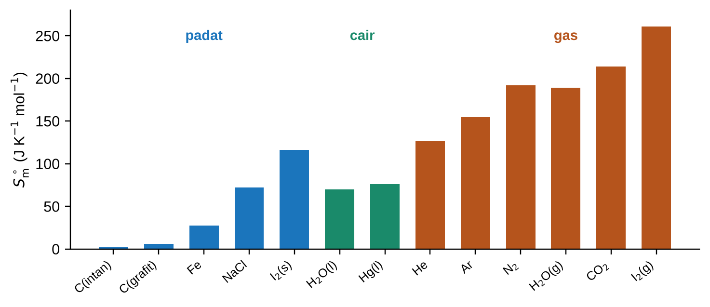
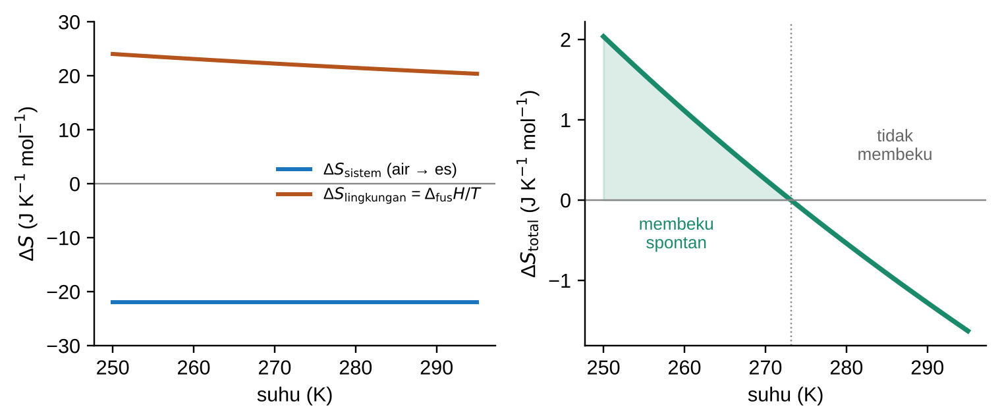

## 6.7 Entropi reaksi standar

Hukum ketiga memberi kita **entropi molar standar** $S_\text{m}^\circ$ setiap zat: entropi mutlak satu mol zat dalam keadaan standarnya (1 bar), biasanya pada 298,15 K. Berbeda dari entalpi pembentukan, entropi standar unsur **tidak** nol: grafit, oksigen, dan hidrogen semuanya mempunyai entropi positif pada suhu kamar, karena atom-atomnya bergetar, berotasi, atau bergerak bebas.

| Zat | $S_\text{m}^\circ$ (J K⁻¹ mol⁻¹) | Zat | $S_\text{m}^\circ$ (J K⁻¹ mol⁻¹) |
|---|---|---|---|
| C(intan) | 2,38 | H₂(g) | 130,68 |
| C(grafit) | 5,74 | He(g) | 126,15 |
| Fe(s) | 27,28 | Ar(g) | 154,84 |
| CaO(s) | 39,75 | N₂(g) | 191,61 |
| NaCl(s) | 72,13 | NH₃(g) | 192,45 |
| H₂O(l) | 69,91 | O₂(g) | 205,14 |
| Hg(l) | 76,02 | H₂O(g) | 188,83 |
| CaCO₃(s) | 92,9 | CO₂(g) | 213,74 |
| I₂(s) | 116,14 | I₂(g) | 260,69 |

Tabel 6.1 Entropi molar standar pada 298,15 K.

{width=86%}

Tabel ini menyimpan banyak kimia, dan polanya dapat dipahami dari gambaran "banyaknya cara" Boltzmann:

* **Gas jauh lebih besar daripada cairan, cairan lebih besar daripada padatan.** Bandingkan H₂O cair dan gas, atau I₂ padat dan gas. Molekul gas mempunyai ruang ribuan kali lebih luas.
* **Padatan keras dan ringan kecil.** Intan, dengan ikatan kovalen yang sangat kaku, hampir tidak bergetar pada suhu kamar. Grafit lebih besar karena lapisan-lapisannya dapat bergeser dan bergetar lebih bebas.
* **Atom lebih berat, entropi lebih besar.** Ar lebih besar daripada He, walaupun keduanya gas monoatomik. Partikel yang lebih berat mempunyai tingkat energi translasi yang lebih rapat (mekanika kuantum partikel dalam kotak, *Kimia Kuantum* Bab 3), sehingga lebih banyak tingkat yang dapat ditempati.
* **Molekul lebih kompleks, entropi lebih besar.** N₂ dan O₂ lebih besar daripada He dan Ar karena dapat berotasi; CO₂ lebih besar lagi karena juga mempunyai getaran berfrekuensi rendah.

Dengan tabel ini, entropi reaksi dihitung persis seperti entalpi reaksi:

::: {.inti}
$$
\Delta_\text{r}S^\circ = \sum_\text{hasil}\nu\,S_\text{m}^\circ - \sum_\text{pereaksi}\nu\,S_\text{m}^\circ \qquad \text{(6.9)}
$$
:::

Aturan praktis untuk menebak tandanya: bila reaksi menghasilkan lebih banyak mol gas daripada yang dikonsumsinya, $\Delta_\text{r}S^\circ$ hampir pasti positif; bila mengonsumsi gas, negatif. Perubahan jumlah gas biasanya jauh lebih menentukan daripada apa pun yang lain.

::: {.contoh}
**Contoh 6.15 · Tiga entropi reaksi**

Hitung $\Delta_\text{r}S^\circ$ pada 298 K untuk (a) $\text{N}_2(g) + 3\text{H}_2(g) \to 2\text{NH}_3(g)$; (b) $\text{CaCO}_3(s) \to \text{CaO}(s) + \text{CO}_2(g)$; (c) $\text{H}_2(g) + \tfrac12\text{O}_2(g) \to \text{H}_2\text{O}(l)$.

**Penyelesaian.** (a) $2(192{,}45) - 191{,}61 - 3(130{,}68) = -198{,}8$ J K⁻¹ mol⁻¹.

(b) $39{,}75 + 213{,}74 - 92{,}9 = +160{,}6$ J K⁻¹ mol⁻¹.

(c) $69{,}91 - 130{,}68 - \tfrac12(205{,}14) = -163{,}3$ J K⁻¹ mol⁻¹.

**Memahami hasil.** Tanda ketiganya sesuai dengan aturan praktis: (a) empat mol gas menjadi dua, (b) padatan menghasilkan gas, (c) satu setengah mol gas menjadi cairan. Besarnya juga dapat ditaksir kasar: setiap mol gas yang hilang atau muncul membawa sekitar 100–200 J K⁻¹ mol⁻¹.
:::

::: {.contoh}
**Contoh 6.16 · Ion yang menata air**

Entropi molar standar ion dalam larutan (J K⁻¹ mol⁻¹): Na⁺(aq) 59,0; Mg²⁺(aq) −138,1; Cl⁻(aq) 56,5. Entropi padatan: NaCl 72,13; MgCl₂ 89,62. Hitung entropi pelarutan standar NaCl dan MgCl₂.

**Penyelesaian.** NaCl: $59{,}0 + 56{,}5 - 72{,}13 = +43{,}4$ J K⁻¹ mol⁻¹. MgCl₂: $-138{,}1 + 2(56{,}5) - 89{,}62 = -114{,}7$ J K⁻¹ mol⁻¹.

**Memahami hasil.** Mengejutkan: pelarutan MgCl₂ **menurunkan** entropi, padahal ion-ion yang semula terkunci dalam kristal menjadi bebas bergerak. Penyebabnya adalah air. Ion Mg²⁺ kecil dan bermuatan dua, sehingga medan listriknya sangat kuat dan menata molekul-molekul air di sekitarnya menjadi selubung hidrasi yang sangat teratur. Keteraturan air itu lebih besar daripada kebebasan yang diperoleh ion. Entropi ion dalam larutan diukur relatif terhadap H⁺(aq), yang ditetapkan nol; karena itu nilai negatif seperti Mg²⁺ dimungkinkan.
:::

::: {.kuis}
**Kuis cepat 6.7** Tanpa menghitung, tebak tanda $\Delta_\text{r}S^\circ$ untuk (a) $2\text{H}_2\text{O}_2(l) \to 2\text{H}_2\text{O}(l) + \text{O}_2(g)$; (b) $\text{H}_2(g) + \text{Cl}_2(g) \to 2\text{HCl}(g)$.
:::

## 6.8 Entropi lingkungan dan entropi total

Kini kita mempunyai semua bahan untuk meramalkan arah reaksi kimia dari tabel. Kriteria hukum kedua adalah $\Delta S_\text{total} > 0$. Entropi sistem diperoleh dari (6.9). Entropi lingkungan, untuk reaksi pada tekanan tetap dan suhu *T*, diperoleh dari kalor yang dilepaskan reaksi ke lingkungan, yaitu $-\Delta_\text{r}H$ (subbab 5.7):

$$
\Delta S_\text{total} = \Delta_\text{r}S - \frac{\Delta_\text{r}H}{T} . \qquad \text{(6.10)}
$$

Persamaan ini menunjukkan persaingan antara dua kecenderungan. Reaksi eksoterm ($\Delta_\text{r}H < 0$) menaikkan entropi lingkungan; reaksi yang menghasilkan gas ($\Delta_\text{r}S > 0$) menaikkan entropi sistem. Suhu menentukan mana yang lebih berpengaruh: pada suhu rendah, suku $\Delta_\text{r}H/T$ besar, sehingga entalpi menang; pada suhu tinggi, suku itu mengecil, dan entropi sistem menang.

Ada empat kemungkinan:

| $\Delta_\text{r}H$ | $\Delta_\text{r}S$ | Spontan? |
|---|---|---|
| − | + | spontan pada semua suhu |
| + | − | tidak spontan pada suhu mana pun |
| − | − | spontan pada suhu rendah |
| + | + | spontan pada suhu tinggi |

::: {.contoh}
**Contoh 6.17 · Sintesis amonia pada suhu kamar**

Dengan $\Delta_\text{r}H^\circ = -92{,}22$ kJ mol⁻¹ (Bab 4) dan $\Delta_\text{r}S^\circ = -198{,}8$ J K⁻¹ mol⁻¹ (Contoh 6.15), apakah sintesis amonia dalam keadaan standar spontan pada 298 K?

**Penyelesaian.** $\Delta S_\text{lingk} = +92\,220/298{,}15 = +309{,}3$ J K⁻¹ mol⁻¹. $\Delta S_\text{total} = -198{,}8 + 309{,}3 = +110{,}6$ J K⁻¹ mol⁻¹ > 0: spontan.

**Memahami hasil.** Reaksi ini mengurangi jumlah molekul gas, sehingga entropi sistem turun banyak. Tetapi kalor yang dilepaskannya menaikkan entropi lingkungan lebih banyak lagi. Mengapa pabrik amonia tetap memerlukan suhu tinggi dan katalis, padahal reaksinya spontan pada suhu kamar? Karena "spontan" bukan berarti "cepat": tanpa katalis, nitrogen dan hidrogen dapat bercampur bertahun-tahun tanpa bereaksi. Kenaikan suhu dipakai untuk mempercepat reaksi, walaupun, seperti akan kita lihat di Bab 12, suhu tinggi justru mengurangi hasil kesetimbangannya.
:::

::: {.contoh}
**Contoh 6.18 · Pada suhu berapa batu kapur terurai?**

Untuk $\text{CaCO}_3(s) \to \text{CaO}(s) + \text{CO}_2(g)$, $\Delta_\text{r}H^\circ = +178{,}3$ kJ mol⁻¹ dan $\Delta_\text{r}S^\circ = +160{,}6$ J K⁻¹ mol⁻¹. (a) Apakah reaksi ini spontan pada 298 K? (b) Di atas suhu berapa reaksi ini menjadi spontan dalam keadaan standar, bila Δ*H* dan Δ*S* dianggap tidak bergantung pada suhu?

**Penyelesaian.** (a) $\Delta S_\text{total} = 160{,}6 - 178\,300/298{,}15 = 160{,}6 - 598{,}0 = -437{,}4$ J K⁻¹ mol⁻¹: tidak spontan.

(b) Peralihan terjadi ketika $\Delta S_\text{total} = 0$, yaitu $T = \Delta_\text{r}H^\circ/\Delta_\text{r}S^\circ = 178\,300/160{,}6 = 1110$ K, sekitar 840 °C.

**Memahami hasil.** Di atas sekitar 840 °C, kenaikan entropi karena terbentuknya gas CO₂ mengalahkan penurunan entropi lingkungan yang memberikan kalor. Tanur kapur industri memang dioperasikan sekitar 900 °C. Selisih kecil dengan taksiran kita berasal dari anggapan bahwa Δ*H* dan Δ*S* tetap; dengan koreksi Kirchhoff (subbab 4.9 dan 6.5), suhu peralihan pada tekanan CO₂ 1 bar sekitar 900 °C.
:::

::: {.contoh}
**Contoh 6.19 · Es di hari yang hangat**

Hitung $\Delta S_\text{total}$ untuk pencairan 1 mol es pada 10 °C, dengan menganggap $\Delta_\text{fus}H = 6{,}01$ kJ mol⁻¹ dan $\Delta_\text{fus}S = 22{,}0$ J K⁻¹ mol⁻¹ tidak berubah antara 0 °C dan 10 °C.

**Penyelesaian.** $\Delta S_\text{lingk} = -6010/283{,}15 = -21{,}2$ J K⁻¹ mol⁻¹. $\Delta S_\text{total} = 22{,}0 - 21{,}2 = +0{,}8$ J K⁻¹ mol⁻¹: es mencair.

**Memahami hasil.** Bandingkan dengan Contoh 6.9: pembekuan pada −10 °C dan pencairan pada +10 °C sama-sama menghasilkan $\Delta S_\text{total}$ sekitar +0,8 J K⁻¹ mol⁻¹. Kedua proses adalah bayangan cermin satu sama lain terhadap titik leleh. Inilah jawaban lengkap teka-teki es batu di Bab 5: di atas 0 °C, hanya pencairan yang menaikkan entropi semesta.
:::

::: {.awas}
**Jangan lupa satuan.** Δ*H* biasanya ditabelkan dalam kJ mol⁻¹, sedangkan Δ*S* dalam J K⁻¹ mol⁻¹. Kesalahan paling sering dalam memakai (6.10) adalah lupa mengalikan Δ*H* dengan 1000, sehingga suku entalpi menjadi seribu kali terlalu kecil dan semua reaksi tampak "dikendalikan entropi".
:::

::: {.contoh}
**Contoh 6.20 · Mengapa air tidak mendidih pada 25 °C**

Untuk $\text{H}_2\text{O}(l) \to \text{H}_2\text{O}(g)$ pada 298 K, $\Delta_\text{vap}H^\circ = 44{,}01$ kJ mol⁻¹ dan $\Delta_\text{vap}S^\circ = 118{,}9$ J K⁻¹ mol⁻¹. (a) Hitung $\Delta S_\text{total}$ untuk penguapan menjadi uap bertekanan 1 bar. (b) Taksir titik didih normal air.

**Penyelesaian.** (a) $\Delta S_\text{total} = 118{,}9 - 44\,010/298{,}15 = -28{,}7$ J K⁻¹ mol⁻¹ < 0: tidak spontan. (b) $T = 44\,010/118{,}9 = 370$ K, sekitar 97 °C.

**Memahami hasil.** Pada 25 °C, air tidak dapat menguap menjadi uap **bertekanan 1 bar**. Tetapi air tetap menguap dari gelas yang terbuka, karena uap di udara bertekanan parsial jauh lebih kecil daripada 1 bar, dan entropi uap bertambah ketika tekanannya lebih rendah (persamaan 6.3). Penguapan berhenti ketika tekanan uap air di atas cairan mencapai tekanan uap jenuhnya, sekitar 0,032 bar pada 25 °C. Hubungan antara tekanan uap dan suhu akan kita turunkan di Bab 8. Taksiran titik didih meleset 3 K karena Δ*H* dan Δ*S* dianggap tetap dari 25 °C sampai 100 °C.
:::

Gambar 6.6 memperlihatkan perhitungan ini untuk pembekuan air pada berbagai suhu, dengan anggapan Δ$_\text{fus}$*H* dan Δ$_\text{fus}$*S* tidak berubah. Entropi sistem selalu turun sekitar 22 J K⁻¹ mol⁻¹ saat air membeku. Entropi lingkungan naik sebesar $\Delta_\text{fus}H/T$, lebih banyak bila lingkungan dingin. Kedua garis berpotongan tepat di 273 K. Di bawahnya, kenaikan entropi lingkungan menang dan air membeku spontan; di atasnya, es mencair. Titik leleh adalah suhu tempat kedua sumbangan seimbang, suatu gagasan yang di Bab 7 akan diringkas menjadi Δ*G* = 0.

{width=86%}

::: {.kuis}
**Kuis cepat 6.8** Suatu reaksi eksoterm mengurangi jumlah mol gas. Apakah ia lebih mungkin spontan pada suhu rendah atau tinggi?
:::

### Menuju bab berikutnya

Persamaan (6.10) adalah resep lengkap untuk meramalkan arah reaksi, tetapi ia memaksa kita selalu menghitung dua hal, sistem dan lingkungan. Kimiawan ingin satu besaran yang **hanya** bergantung pada sistem, namun tetap memberi tahu arah proses. Mengalikan (6.10) dengan −*T* menghasilkan $\Delta_\text{r}H - T\Delta_\text{r}S$, kombinasi yang akan menjadi tokoh utama sisa buku ini: **energi bebas Gibbs**. Bab 7 memperkenalkannya bersama saudaranya, energi bebas Helmholtz, dan jaringan hubungan matematika di antara semua fungsi keadaan.
