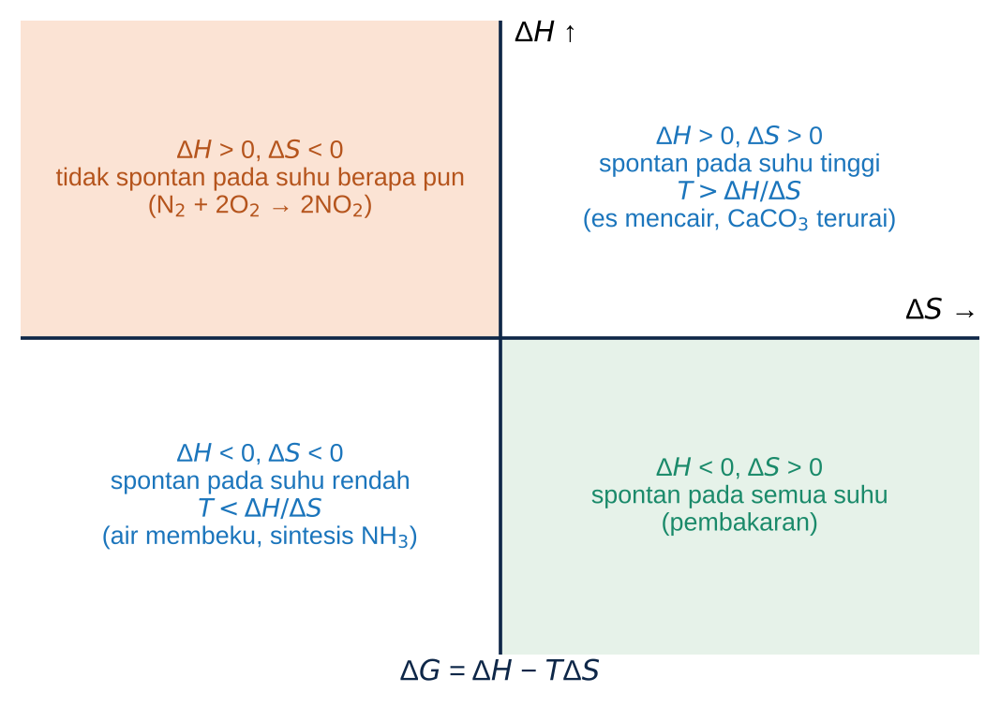

# Bab 7 Energi Bebas dan Hubungan Maxwell

Bakarlah satu mol hidrogen dengan oksigen, dan kamu memperoleh 286 kJ kalor. Masukkan hidrogen yang sama ke dalam sel bahan bakar, dan kamu memperoleh listrik. Berapa banyak? Pengukuran yang teliti memberi jawaban yang mengecewakan: sel bahan bakar yang sempurna pun paling banyak hanya menghasilkan 237 kJ kerja listrik. Ke mana perginya 49 kJ sisanya, dan mengapa tidak ada sel bahan bakar yang dapat menangkapnya?

Teka-teki kedua bahkan lebih aneh. Tubuh kita membakar glukosa dengan oksigen, dan dari bom kalorimeter kita tahu bahwa reaksi itu melepaskan kalor 2803 kJ per mol (Bab 4). Tetapi kerja maksimum yang dapat diperoleh dari reaksi yang sama, misalnya untuk menggerakkan otot atau membangun protein, ternyata **2880 kJ**, lebih besar daripada kalor yang dilepaskannya. Bagaimana suatu reaksi dapat memberikan kerja lebih banyak daripada energi yang dilepaskannya sebagai kalor?

Kedua teka-teki itu dijawab oleh besaran yang akan menjadi alat utama kimiawan di sisa buku ini: **energi bebas**. Di Bab 6 kita belajar meramalkan arah reaksi dengan menghitung entropi sistem dan entropi lingkungan. Bab ini menggabungkan keduanya menjadi satu fungsi keadaan yang hanya bergantung pada sistem. Ada dua versinya: energi bebas Helmholtz untuk proses pada volume tetap dan energi bebas Gibbs untuk proses pada tekanan tetap. Keduanya ternyata juga mengukur kerja maksimum yang dapat diambil dari suatu proses.

Bagian kedua bab ini mengumpulkan seluruh termodinamika yang telah kita bangun ke dalam empat persamaan fundamental, dan dari keempatnya menurunkan jaringan hubungan matematika yang disebut hubungan Maxwell. Hubungan-hubungan ini terdengar abstrak, tetapi kegunaannya sangat praktis: dengan mereka, besaran yang sukar diukur, seperti perubahan entropi terhadap tekanan, dapat dihitung dari besaran yang mudah diukur, seperti pemuaian termal. Bab ditutup dengan cara energi Gibbs berubah terhadap suhu dan tekanan, dan dengan tabel energi Gibbs pembentukan standar yang memungkinkan kita menghitung ΔG reaksi apa pun.

::: {.strategi}
**Pertanyaan pembuka**

1. Bagaimana satu besaran yang hanya bergantung pada sistem dapat menggantikan perhitungan entropi sistem dan lingkungan?
2. Mengapa energi bebas disebut "bebas"?
3. Mengapa sel bahan bakar hidrogen tidak dapat mengubah seluruh entalpi pembakaran menjadi listrik?
4. Bagaimana pembakaran glukosa dapat memberikan kerja lebih besar daripada kalor yang dilepaskannya?
5. Apa gunanya hubungan Maxwell?
6. Berapa tekanan yang diperlukan untuk mengubah grafit menjadi intan?
:::

::: {.tujuan}
**Tujuan belajar**

Setelah mempelajari bab ini, kamu mampu:

1. Menurunkan kriteria spontanitas $dA \le 0$ dan $dG \le 0$ dari ketaksamaan Clausius.
2. Menghitung ΔA dan ΔG untuk proses fisika dan reaksi kimia.
3. Menafsirkan ΔA sebagai kerja maksimum dan ΔG sebagai kerja bukan-ekspansi maksimum.
4. Menuliskan keempat persamaan fundamental dan variabel alaminya.
5. Menurunkan hubungan Maxwell dan memakainya untuk menghitung besaran yang sukar diukur.
6. Memakai persamaan Gibbs–Helmholtz untuk menghitung ΔG pada suhu lain.
7. Menghitung perubahan G terhadap tekanan untuk cairan, padatan, dan gas ideal.
8. Menghitung ΔG reaksi standar dari energi Gibbs pembentukan standar.
:::

::: {.mat}
**Prasyarat**

Dari Bab 5–6: entropi, ketaksamaan Clausius, dan $\Delta S_\text{total} = \Delta S - \Delta H/T$ (subbab 5.7, 6.8). Dari Bab 3: diferensial eksak dan uji Euler (subbab 3.6). Dari matematika: turunan parsial dan diferensial total.
:::

## 7.1 Mengapa perlu energi bebas

Di Bab 6 kita meramalkan arah reaksi dengan persamaan (6.10): $\Delta S_\text{total} = \Delta S - \Delta H/T > 0$. Cara ini benar, tetapi kurang praktis. Ia memaksa kita memikirkan dua sistem, reaksi dan lingkungannya, padahal yang menarik bagi kimiawan hanyalah reaksinya. Dapatkah kriteria itu diubah sehingga hanya memuat besaran sistem?

Bisa, asalkan kita membatasi diri pada kondisi yang paling umum di laboratorium: suhu dan tekanan tetap. Pada kondisi itu, kalikan (6.10) dengan −*T*:

$$
-T\Delta S_\text{total} = \Delta H - T\Delta S .
$$

Semua besaran di ruas kanan adalah besaran sistem. Karena *T* positif, syarat $\Delta S_\text{total} > 0$ sama dengan syarat ruas kanan negatif. Kombinasi $H - TS$ adalah fungsi keadaan, karena *H*, *T*, dan *S* semuanya fungsi keadaan. Josiah Willard Gibbs, ilmuwan Amerika yang menyusun dasar-dasar termodinamika kimia pada 1870-an, memperkenalkannya, dan kini ia menyandang namanya:

$$
G = H - TS . \qquad \text{(7.1)}
$$

Pada suhu dan tekanan tetap, $\Delta G = -T\Delta S_\text{total}$: penurunan energi Gibbs sistem adalah ukuran kenaikan entropi semesta, dikalikan suhu. Inilah keuntungan besarnya: kita tidak perlu lagi menghitung lingkungan; lingkungan sudah "tersimpan" di dalam suku Δ*H*.

Untuk proses pada volume tetap, penalaran yang sama memakai Δ*U* sebagai ganti Δ*H* (karena pada volume tetap, kalor yang dipertukarkan adalah Δ*U*), dan menghasilkan fungsi keadaan saudaranya, **energi bebas Helmholtz** $A = U - TS$. Kedua subbab berikutnya membahas masing-masing.

::: {.contoh}
**Contoh 7.1 · Dua jalan menuju jawaban yang sama**

Untuk $\text{N}_2(g) + 3\text{H}_2(g) \rightarrow 2\text{NH}_3(g)$ pada 298,15 K dan 1 bar, $\Delta_\text{r}H^\circ = -92{,}22$ kJ mol⁻¹ dan $\Delta_\text{r}S^\circ = -198{,}76$ J K⁻¹ mol⁻¹. (a) Tentukan arah reaksi dengan cara Bab 6: hitung entropi lingkungan dan entropi total. (b) Tentukan dengan energi Gibbs. Bandingkan.

**Penyelesaian.** (a) Lingkungan menerima kalor 92,22 kJ: $\Delta S_\text{lingk} = 92\,220/298{,}15 = +309{,}3$ J K⁻¹ mol⁻¹. Entropi total: $-198{,}76 + 309{,}3 = +110{,}5$ J K⁻¹ mol⁻¹. Positif: reaksi spontan.

(b) $\Delta_\text{r}G^\circ = \Delta_\text{r}H^\circ - T\Delta_\text{r}S^\circ = -92{,}22 - (298{,}15)(-0{,}198\,76) = -32{,}96$ kJ mol⁻¹. Negatif: reaksi spontan.

**Memahami hasil.** Kedua cara sepakat, dan angkanya terhubung tepat: $-T\Delta S_\text{total} = -(298{,}15)(0{,}1105) = -32{,}96$ kJ mol⁻¹ $= \Delta_\text{r}G^\circ$. Entropi sistem turun (empat molekul gas menjadi dua), tetapi kalor yang dilepaskan menaikkan entropi lingkungan lebih banyak lagi. Energi Gibbs melakukan pembukuan itu secara otomatis: cukup data sistem, tanpa menghitung lingkungan secara terpisah.
:::

::: {.kuis}
**Kuis cepat 7.1** Mengapa energi Gibbs hanya memberi kriteria spontanitas untuk proses pada suhu **dan** tekanan tetap?
:::

## 7.2 Energi bebas Helmholtz

Mari kita turunkan kriteria spontanitas dengan lebih teliti, langsung dari ketaksamaan Clausius, $dS \ge dq/T$. Untuk sistem yang hanya dapat melakukan kerja ekspansi, pada volume tetap tidak ada kerja sama sekali, sehingga $dq = dU$. Ketaksamaan Clausius menjadi $T\,dS \ge dU$, atau

$$
dU - T\,dS \le 0 \qquad (T, V\ \text{tetap}) .
$$

Pada suhu tetap, ruas kiri adalah perubahan dari $U - TS$:

::: {.inti}
$$
A = U - TS , \qquad dA_{T,V} \le 0 \qquad \text{(7.2)}
$$
**Energi bebas Helmholtz.** Pada suhu dan volume tetap, proses spontan menurunkan *A*; dalam kesetimbangan, *A* minimum.
:::

Gambaran persaingannya jelas: sistem cenderung menurunkan energi dalamnya (suku *U*) dan menaikkan entropinya (suku −*TS*). Pada suhu rendah energi lebih menentukan; pada suhu tinggi entropi. Energi bebas Helmholtz menimbang keduanya dengan "kurs" *T*.

Mengapa disebut energi **bebas**? Karena ΔA mempunyai arti fisis yang sangat konkret. Untuk proses isotermal sembarang, hukum pertama dan ketaksamaan Clausius memberi $dw = dU - dq \ge dU - T\,dS = dA$. Dengan tanda IUPAC, kerja yang dilakukan sistem adalah $-dw$, sehingga

$$
|w|_\text{maks} = -\Delta A \qquad (T\ \text{tetap}) . \qquad \text{(7.3)}
$$

Penurunan energi Helmholtz adalah kerja **maksimum** yang dapat diperoleh dari suatu proses isotermal, dan batas itu dicapai bila prosesnya reversibel. Bagian energi dalam yang "bebas" diubah menjadi kerja adalah Δ*A*; sisanya, *T*Δ*S*, terikat sebagai kalor yang harus dipertukarkan dengan lingkungan agar entropi semesta tidak turun.

::: {.contoh}
**Contoh 7.2 · Kerja maksimum dari gas yang memuai**

Satu mol gas ideal memuai secara isotermal pada 298 K dari 10,0 L ke 20,0 L. Hitung Δ*U*, Δ*S*, dan Δ*A*, lalu bandingkan −Δ*A* dengan kerja ekspansi reversibel dari Bab 3.

**Penyelesaian.** Gas ideal pada suhu tetap: Δ*U* = 0. Dari (6.1): $\Delta S = R\ln2 = 5{,}76$ J K⁻¹. Maka $\Delta A = \Delta U - T\Delta S = 0 - (298{,}15)(5{,}76) = -1718$ J.

**Memahami hasil.** −Δ*A* = 1718 J, tepat sama dengan kerja ekspansi reversibel pada Contoh 3.3. Gas ideal tidak kehilangan energi dalam ketika memuai secara isotermal, tetapi tetap dapat melakukan kerja, sepenuhnya dibayar oleh kalor yang diserap dari lingkungan. Energi bebasnya turun karena entropinya naik.
:::

::: {.contoh}
**Contoh 7.3 · Kerja maksimum pembakaran metana dalam wadah tertutup**

Untuk pembakaran metana dengan air cair pada 298 K, $\Delta U = -885{,}3$ kJ mol⁻¹ (Contoh 4.1) dan $\Delta S^\circ = -243{,}0$ J K⁻¹ mol⁻¹. Hitung Δ*A* dan kerja maksimum pada volume tetap.

**Penyelesaian.** $\Delta A = -885{,}3 - (298{,}15)(-0{,}2430)$ kJ mol⁻¹ $= -885{,}3 + 72{,}4 = -812{,}9$ kJ mol⁻¹. Kerja maksimum 813 kJ per mol metana.

**Memahami hasil.** Dari 885 kJ penurunan energi dalam, hanya 813 kJ yang dapat diubah menjadi kerja. Sisanya, 72 kJ, harus keluar sebagai kalor, karena reaksi ini menurunkan entropi sistem (tiga mol gas menjadi satu), dan penurunan itu harus diimbangi dengan menaikkan entropi lingkungan. Sebanyak apa pun kepintaran insinyur, 72 kJ itu tidak dapat diubah menjadi kerja.
:::

::: {.kuis}
**Kuis cepat 7.2** Untuk proses dengan Δ*S* positif, apakah kerja maksimumnya lebih besar atau lebih kecil daripada −Δ*U*? Dari mana tambahannya?
:::

## 7.3 Energi bebas Gibbs

Kebanyakan reaksi kimia berlangsung pada tekanan tetap, bukan volume tetap. Pada tekanan tetap, dengan hanya kerja ekspansi, kalor yang dipertukarkan sama dengan *dH*. Mengulang penurunan subbab 7.2 dengan *dH* sebagai ganti *dU* menghasilkan

::: {.inti}
$$
G = H - TS , \qquad dG_{T,p} \le 0 \qquad \text{(7.4)}
$$
**Energi bebas Gibbs.** Pada suhu dan tekanan tetap, proses spontan menurunkan *G*; dalam kesetimbangan, *G* minimum.
:::

Untuk perubahan berhingga pada suhu tetap:

$$
\Delta G = \Delta H - T\Delta S . \qquad \text{(7.5)}
$$

Persamaan sederhana ini mungkin adalah persamaan terpenting dalam kimia fisika. Tanda Δ*G* langsung menjawab pertanyaan "apakah proses ini dapat terjadi dengan sendirinya?":

* $\Delta G < 0$: proses spontan.
* $\Delta G > 0$: proses tidak spontan; kebalikannya yang spontan.
* $\Delta G = 0$: sistem dalam kesetimbangan.

Keempat kombinasi tanda Δ*H* dan Δ*S* dari subbab 6.8 kini terbaca langsung dari (7.5). Bila keduanya bertanda sama, suhu menentukan pemenangnya, dan suhu peralihannya adalah $T = \Delta H/\Delta S$, ketika Δ*G* = 0.

Penting diingat bahwa Δ*G* < 0 hanya berarti proses **dapat** terjadi; termodinamika tidak berbicara tentang lajunya. Campuran H₂ dan O₂ pada suhu kamar mempunyai Δ*G* sangat negatif untuk membentuk air, tetapi dapat bertahan bertahun-tahun tanpa bereaksi sampai sebuah percikan memulainya.

{width=72%}

::: {.contoh}
**Contoh 7.4 · Es pada tiga suhu**

Dengan $\Delta_\text{fus}H = 6{,}01$ kJ mol⁻¹ dan $\Delta_\text{fus}S = 22{,}0$ J K⁻¹ mol⁻¹ (dianggap tetap), hitung Δ*G* untuk pencairan es pada −10 °C, 0 °C, dan +10 °C.

**Penyelesaian.** $\Delta G = 6010 - T(22{,}0)$ J mol⁻¹. Pada 263,15 K: +221 J mol⁻¹. Pada 273,15 K: 0. Pada 283,15 K: −219 J mol⁻¹.

**Memahami hasil.** Satu perhitungan memberi tiga jawaban yang sudah kita kenal: di bawah 0 °C es tidak mencair, pada 0 °C es dan air setimbang, di atas 0 °C es mencair. Bandingkan dengan Contoh 6.9 dan 6.19, yang memerlukan perhitungan entropi sistem dan lingkungan secara terpisah. Gambar 7.1 menunjukkan hal yang sama secara grafis: pada 273 K garis es dan air berpotongan.
:::

::: {.contoh}
**Contoh 7.5 · Batu kapur sekali lagi**

Untuk $\text{CaCO}_3(s) \to \text{CaO}(s) + \text{CO}_2(g)$, $\Delta_\text{r}H^\circ = +178{,}3$ kJ mol⁻¹ dan $\Delta_\text{r}S^\circ = +160{,}6$ J K⁻¹ mol⁻¹. Hitung $\Delta_\text{r}G^\circ$ pada 298 K dan 1200 K.

**Penyelesaian.** Pada 298 K: $178{,}3 - (298{,}15)(0{,}1606) = +130{,}4$ kJ mol⁻¹. Pada 1200 K: $178{,}3 - (1200)(0{,}1606) = -14{,}4$ kJ mol⁻¹.

**Memahami hasil.** Tanda Δ*G* berbalik antara kedua suhu, sesuai suhu peralihan 1110 K dari Contoh 6.18. Besarnya Δ*G* juga bermakna: di Bab 12 kita akan melihat bahwa Δ*G*° menentukan tetapan kesetimbangan, sehingga +130 kJ mol⁻¹ berarti tekanan CO₂ di atas batu kapur pada suhu kamar praktis nol.
:::

::: {.contoh}
**Contoh 7.6 · Kantong dingin instan**

Kantong dingin untuk cedera olahraga berisi amonium nitrat padat dan sekantong air. Ketika kantong ditekan, garam itu larut dan kantong menjadi dingin. Untuk pelarutan NH₄NO₃, $\Delta H = +25{,}7$ kJ mol⁻¹ dan $\Delta S = +108{,}7$ J K⁻¹ mol⁻¹. Tunjukkan bahwa pelarutan ini spontan pada 25 °C, dan tentukan suhu di bawah mana ia tidak lagi spontan.

**Penyelesaian.** Pada 298,15 K:
$$
\Delta G = 25{,}7 - (298{,}15)(0{,}1087) = 25{,}7 - 32{,}4 = -6{,}7\ \text{kJ mol}^{-1} .
$$
Batasnya adalah suhu tempat Δ*G* = 0: $T = \Delta H/\Delta S = 25{,}7/0{,}1087 = 236$ K, atau sekitar −37 °C.

**Memahami hasil.** Pelarutan ini **menyerap** kalor dan tetap berlangsung sendiri, karena ion-ion yang tersebar di dalam air mempunyai entropi jauh lebih besar daripada kisi kristal yang teratur. Energi untuk mendinginkan kantong "dibayar" oleh entropi. Contoh ini menghapus anggapan lama bahwa proses spontan harus melepaskan kalor; yang menentukan adalah tanda Δ*G*, bukan tanda Δ*H*.
:::

Karena Δ*G* = Δ*H* − *T*Δ*S*, tanda Δ*H* dan Δ*S* saja sudah memberi tahu kita banyak hal tentang suatu proses (Gambar 7.2). Bila kedua tanda "bekerja sama" (Δ*H* < 0 dan Δ*S* > 0), proses spontan pada suhu berapa pun; bila keduanya melawan, proses tidak pernah spontan. Dua kemungkinan sisanya adalah yang paling menarik secara kimia: di sana suhu menentukan pemenang, dan ada suhu peralihan $T = \Delta H/\Delta S$ tempat Δ*G* berganti tanda.

{width=74%}

::: {.kuis}
**Kuis cepat 7.3** Pada titik didih normal air, berapa Δ*G* penguapan? Mengapa?
:::

## 7.4 Kerja maksimum dan kerja bukan-ekspansi

Energi Gibbs juga mempunyai arti sebagai kerja, dan arti inilah yang menjawab teka-teki sel bahan bakar. Pada tekanan tetap, sebagian kerja yang dilakukan sistem selalu berupa kerja ekspansi terhadap atmosfer, $p\,\Delta V$, yang tidak dapat kita manfaatkan. Kerja **lain**, yang dapat dimanfaatkan, disebut **kerja bukan-ekspansi** atau kerja tambahan: kerja listrik dalam sel elektrokimia, kerja mekanis otot, kerja kimia untuk membangun molekul besar dalam sel. Penurunannya serupa dengan subbab 7.2, hanya kerja kita pisahkan menjadi dua: $dw = -p\,dV + dw_\text{tambahan}$. Pada *T* dan *p* tetap, $dG = dH - T\,dS = dU + p\,dV - T\,dS$. Mengganti $dU = dq - p\,dV + dw_\text{tambahan}$ menghilangkan suku $p\,dV$, sehingga $dG = dq - T\,dS + dw_\text{tambahan}$. Ketaksamaan Clausius, $dq \le T\,dS$, lalu memberi $dw_\text{tambahan} \ge dG$. Kerja tambahan yang dilakukan **oleh** sistem adalah $-dw_\text{tambahan}$, sehingga

::: {.inti}
$$
|w_\text{tambahan}|_\text{maks} = -\Delta G \qquad (T, p\ \text{tetap}) \qquad \text{(7.6)}
$$
Penurunan energi Gibbs adalah kerja bukan-ekspansi maksimum yang dapat diperoleh dari proses pada suhu dan tekanan tetap.
:::

Inilah arti fisis Δ*G* yang paling penting bagi elektrokimia (Bab 13) dan biokimia. Dalam sel elektrokimia, kerja tambahan adalah kerja listrik, dan Δ*G* langsung menentukan tegangan sel: $\Delta G = -nFE$, dengan *n* banyaknya mol elektron yang berpindah dan *F* tetapan Faraday.

::: {.contoh}
**Contoh 7.7 · Batas sel bahan bakar hidrogen**

Untuk $\text{H}_2(g) + \tfrac12\text{O}_2(g) \to \text{H}_2\text{O}(l)$ pada 298 K, $\Delta_\text{r}H^\circ = -285{,}83$ kJ mol⁻¹ dan $\Delta_\text{r}G^\circ = -237{,}13$ kJ mol⁻¹. (a) Berapa kerja listrik maksimum per mol H₂? (b) Berapa efisiensi maksimum sel bahan bakar bila dibandingkan dengan entalpi pembakaran? (c) Berapa tegangan sel maksimumnya? (Dua elektron berpindah per molekul H₂; $F = 96\,485$ C mol⁻¹.)

**Penyelesaian.** (a) 237,13 kJ.

(b) $237{,}13/285{,}83 = 0{,}830$, atau 83%.

(c) $E = -\Delta G/nF = 237\,130/(2 \times 96\,485) = 1{,}229$ V.

**Memahami hasil.** Teka-teki pembuka terjawab. Sisa 48,7 kJ adalah $-T\Delta S = -(298)(-0{,}163)$ kJ: reaksi ini mengubah satu setengah mol gas menjadi cairan, menurunkan entropi sistem, dan penurunan itu **harus** diimbangi dengan membuang kalor ke lingkungan. Tidak ada sel bahan bakar yang dapat menghindarinya. Meski demikian, batas 83% jauh di atas efisiensi Carnot mesin kalor yang membakar hidrogen yang sama (sekitar 40–60%), karena sel bahan bakar tidak melewati tahap "kalor": ia mengubah energi kimia langsung menjadi kerja. Tegangan 1,23 V adalah tegangan teoretis setiap sel bahan bakar hidrogen–oksigen; sel nyata menghasilkan 0,6–0,8 V karena ketakreversibelan.
:::

{width=78%}

::: {.contoh}
**Contoh 7.8 · Kerja dari glukosa**

Untuk pembakaran glukosa, $\text{C}_6\text{H}_{12}\text{O}_6(s) + 6\text{O}_2(g) \to 6\text{CO}_2(g) + 6\text{H}_2\text{O}(l)$, $\Delta_\text{r}H^\circ = -2803$ kJ mol⁻¹ dan $\Delta_\text{r}S^\circ = +259$ J K⁻¹ mol⁻¹ pada 298 K. Hitung $\Delta_\text{r}G^\circ$ dan jelaskan teka-teki pembuka yang kedua.

**Penyelesaian.** $\Delta_\text{r}G^\circ = -2803 - (298{,}15)(0{,}259) = -2803 - 77 = -2880$ kJ mol⁻¹.

**Memahami hasil.** Kerja maksimum, 2880 kJ, memang **lebih besar** daripada kalor pembakaran, 2803 kJ. Tidak ada yang dilanggar: reaksi ini menaikkan entropi sistem (molekul padat besar dipecah menjadi banyak molekul kecil), sehingga dalam proses reversibel ia dapat **menyerap** kalor 77 kJ dari lingkungan dan mengubahnya juga menjadi kerja, tanpa menurunkan entropi semesta. Sel hidup tentu tidak bekerja reversibel; sekitar 40% energi Gibbs glukosa tersimpan sebagai ATP, dan sisanya keluar sebagai kalor yang menjaga suhu tubuh.
:::

::: {.terapan}
**Reaksi berpasangan dalam sel.** Banyak reaksi yang diperlukan sel hidup mempunyai Δ*G* positif, misalnya pembentukan glutamin dari glutamat dan amonia ($\Delta G^{\circ\prime} = +14{,}2$ kJ mol⁻¹). Sel tidak dapat melanggar hukum kedua, tetapi dapat **memasangkan** reaksi yang tidak spontan dengan reaksi yang sangat spontan, yaitu hidrolisis ATP ($-30{,}5$ kJ mol⁻¹). Enzim glutamin sintetase melakukannya lewat zat antara bersama: glutamat lebih dulu bereaksi dengan ATP membentuk glutamil fosfat, yang kemudian bereaksi dengan amonia. Reaksi bersihnya
$$
\text{glutamat} + \text{NH}_3 + \text{ATP} \to \text{glutamin} + \text{ADP} + \text{P}_\text{i} , \qquad \Delta G^{\circ\prime} = 14{,}2 - 30{,}5 = -16{,}3\ \text{kJ mol}^{-1} .
$$
Karena *G* fungsi keadaan, Δ*G* reaksi bersih adalah jumlah Δ*G* kedua tahap. Pasangan ini bukan sekadar "menjumlahkan di atas kertas": tanpa zat antara bersama, energi ATP akan lepas sebagai kalor dan tidak dapat menggerakkan pembentukan glutamin. (Tanda aksen pada $\Delta G^{\circ\prime}$ menandai keadaan standar biokimia, pH 7, yang dibahas di Bab 12.)
:::

::: {.contoh}
**Contoh 7.9 · Berapa foton untuk satu glukosa?**

Fotosintesis membalik pembakaran glukosa: $6\text{CO}_2 + 6\text{H}_2\text{O} \to \text{C}_6\text{H}_{12}\text{O}_6 + 6\text{O}_2$, dengan $\Delta_\text{r}G^\circ = +2879$ kJ mol⁻¹. Energi didatangkan oleh cahaya merah 680 nm. (a) Hitung energi satu mol foton itu. (b) Berapa mol foton paling sedikit yang diperlukan per mol glukosa? (c) Tumbuhan sebenarnya memakai sekitar 48 foton per glukosa. Berapa efisiensinya?

**Penyelesaian.** (a) $E_\text{m} = N_\text{A}hc/\lambda = (6{,}022 \times 10^{23})(6{,}626 \times 10^{-34})(2{,}998 \times 10^8)/(680 \times 10^{-9})$ J mol⁻¹ $= 175{,}9$ kJ mol⁻¹.

(b) Kerja bukan-ekspansi yang diberikan cahaya harus paling sedikit $\Delta_\text{r}G^\circ$: $2879/175{,}9 = 16{,}4$, jadi paling sedikit 17 mol foton.

(c) $2879/(48 \times 175{,}9) = 0{,}34$, atau 34%.

**Memahami hasil.** Energi Gibbs memberi batas bawah yang tidak dapat ditawar: tidak ada mekanisme, sepandai apa pun, yang membuat glukosa dengan kurang dari 17 foton merah. Tumbuhan memakai hampir tiga kali lipat, karena setiap tahap pemindahan elektron harus cukup "menurun" (Δ*G* negatif) agar berlangsung cepat dan tidak balik. Kehilangan itu harga yang dibayar untuk laju, tema yang akan kita temui lagi pada sel elektrokimia.
:::

::: {.kuis}
**Kuis cepat 7.4** Sebuah reaksi mempunyai Δ*H* = −100 kJ mol⁻¹ dan Δ*G* = −120 kJ mol⁻¹ pada 298 K. Apakah Δ*S*-nya positif atau negatif? Berapa kerja tambahan maksimumnya?
:::
