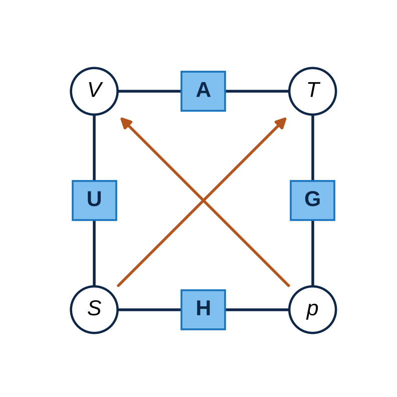

## 7.5 Persamaan fundamental

Kini kita mempunyai empat fungsi keadaan yang mengukur energi: *U*, *H*, *A*, dan *G*. Bagaimana hubungan di antara mereka? Mari kita mulai dari yang paling dasar, energi dalam, dan gabungkan hukum pertama dan kedua.

Untuk perubahan reversibel sistem tertutup yang hanya melakukan kerja ekspansi, $dw = -p\,dV$ dan $dq = T\,dS$. Hukum pertama $dU = dq + dw$ menjadi

$$
dU = T\,dS - p\,dV . \qquad \text{(7.7)}
$$

Persamaan ini disebut **persamaan fundamental** termodinamika. Walaupun diturunkan untuk proses reversibel, ia berlaku untuk **setiap** perubahan sistem tertutup, karena semua besaran di dalamnya adalah fungsi keadaan: perubahan *dU* di antara dua keadaan yang berdekatan tidak bergantung pada apakah perubahan itu reversibel. (Untuk proses tak reversibel, *T dS* tidak sama dengan kalor yang sebenarnya, dan −*p dV* tidak sama dengan kerja yang sebenarnya, tetapi jumlah keduanya tetap *dU*.)

Ketiga fungsi lain diperoleh dengan menambah atau mengurangi hasil kali *pV* dan *TS*. Untuk *H* = *U* + *pV*: $dH = dU + p\,dV + V\,dp = T\,dS + V\,dp$. Untuk *A* = *U* − *TS*: $dA = dU - T\,dS - S\,dT = -S\,dT - p\,dV$. Untuk *G* = *H* − *TS*: $dG = -S\,dT + V\,dp$. Keempatnya:

::: {.inti}
$$
\begin{aligned}
dU &= T\,dS - p\,dV & dH &= T\,dS + V\,dp\\
dA &= -S\,dT - p\,dV & dG &= -S\,dT + V\,dp
\end{aligned} \qquad \text{(7.8)}
$$
**Empat persamaan fundamental.** Variabel yang diferensialnya muncul di ruas kanan disebut **variabel alami** fungsi itu: *U*(*S*, *V*), *H*(*S*, *p*), *A*(*T*, *V*), *G*(*T*, *p*).
:::

Variabel alami *G* adalah suhu dan tekanan, tepat variabel yang paling mudah dikendalikan di laboratorium. Itulah alasan mendasar mengapa energi Gibbs menjadi fungsi termodinamika pilihan kimiawan.

Setiap persamaan fundamental langsung memberi turunan parsial fungsinya. Membandingkan $dG = -S\,dT + V\,dp$ dengan diferensial total $dG = (\partial G/\partial T)_p\,dT + (\partial G/\partial p)_T\,dp$:

$$
\left(\frac{\partial G}{\partial T}\right)_p = -S , \qquad \left(\frac{\partial G}{\partial p}\right)_T = V . \qquad \text{(7.9)}
$$

Kedua hasil ini mempunyai akibat yang dapat dilihat langsung pada Gambar 7.1. Karena entropi selalu positif, *G* setiap fasa **turun** bila suhu naik, dan karena gas mempunyai entropi terbesar, *G*-nya turun paling cepat. Itulah sebabnya pada suhu yang cukup tinggi setiap zat akhirnya menguap. Dan karena volume selalu positif, *G* naik bila tekanan naik, paling cepat untuk gas, yang volumenya paling besar.

::: {.contoh}
**Contoh 7.10 · Membaca persamaan fundamental**

Dari persamaan fundamental, tentukan: (a) $(\partial U/\partial S)_V$; (b) $(\partial H/\partial p)_S$; (c) $(\partial A/\partial V)_T$. Apa arti fisis masing-masing?

**Penyelesaian.** (a) Dari $dU = T\,dS - p\,dV$: $(\partial U/\partial S)_V = T$. (b) Dari $dH = T\,dS + V\,dp$: $(\partial H/\partial p)_S = V$. (c) Dari $dA = -S\,dT - p\,dV$: $(\partial A/\partial V)_T = -p$.

**Memahami hasil.** Hasil (a) memberi definisi suhu yang paling mendasar: suhu adalah laju kenaikan energi dalam terhadap entropi pada volume tetap. Sistem dengan suhu tinggi memerlukan banyak energi untuk sedikit tambahan entropi; sistem dingin memperoleh banyak entropi dari sedikit energi. Inilah alasan kalor mengalir dari panas ke dingin: pindahnya energi dari sistem yang "murah entropi" ke yang "mahal entropi" menaikkan entropi total.
:::

::: {.kuis}
**Kuis cepat 7.5** Dari (7.9), mengapa garis *G* gas pada Gambar 7.1 lebih curam daripada garis cairan?
:::

## 7.6 Hubungan Maxwell

Persamaan fundamental menyimpan informasi lebih banyak daripada yang tampak. Ingat uji eksak dari subbab 3.6: bila $df = M\,dx + N\,dy$ adalah diferensial eksak, maka $(\partial M/\partial y)_x = (\partial N/\partial x)_y$, karena keduanya sama dengan turunan kedua campuran $\partial^2 f/\partial x\,\partial y$, dan urutan penurunan tidak berpengaruh.

Keempat persamaan fundamental adalah diferensial eksak, karena *U*, *H*, *A*, dan *G* fungsi keadaan. Menerapkan uji eksak pada masing-masing menghasilkan empat hubungan yang disebut **hubungan Maxwell**:

::: {.inti}
$$
\begin{aligned}
\text{dari } dU&: & \left(\frac{\partial T}{\partial V}\right)_S &= -\left(\frac{\partial p}{\partial S}\right)_V\\
\text{dari } dH&: & \left(\frac{\partial T}{\partial p}\right)_S &= \left(\frac{\partial V}{\partial S}\right)_p\\
\text{dari } dA&: & \left(\frac{\partial S}{\partial V}\right)_T &= \left(\frac{\partial p}{\partial T}\right)_V\\
\text{dari } dG&: & \left(\frac{\partial S}{\partial p}\right)_T &= -\left(\frac{\partial V}{\partial T}\right)_p
\end{aligned} \qquad \text{(7.10)}
$$
:::

Dua yang terakhir paling berguna, karena ruas kanannya dapat diukur dengan mudah dan ruas kirinya tidak. Entropi tidak dapat diukur dengan alat apa pun secara langsung; tetapi bagaimana volume berubah dengan suhu, atau tekanan dengan suhu, dapat diukur dengan pipa kapiler dan manometer. Hubungan Maxwell mengubah pertanyaan yang sukar menjadi pertanyaan yang mudah.

Keempat hubungan itu, beserta keempat persamaan fundamental, tidak perlu dihafal satu per satu. Gambar 7.2 memberi alat ingat yang disebut **kotak termodinamika**. Setiap fungsi energi (*U*, *H*, *A*, *G*) terletak di sisi kotak, diapit kedua variabel alaminya di sudut. Untuk menulis diferensialnya, ambil kedua variabel alami itu; koefisien setiap diferensial adalah variabel di ujung lain panah diagonal, bertanda plus bila panah menunjuk **dari** variabel alami ke koefisiennya, dan minus bila sebaliknya. Contohnya *U*, yang diapit *S* dan *V*: panah dari *S* ke *T* memberi $+T\,dS$, dan panah dari *p* ke *V* (menuju variabel alami) memberi $-p\,dV$, sehingga $dU = T\,dS - p\,dV$. Coba periksa sendiri bahwa cara yang sama memberi *dH*, *dA*, dan *dG* pada (7.8).

{width=42%}

Untuk cairan dan padatan, ruas kanan hubungan terakhir dinyatakan dengan **koefisien muai volume** $\alpha = (1/V)(\partial V/\partial T)_p$, besaran yang ditabelkan untuk banyak zat. Maka $(\partial S/\partial p)_T = -\alpha V$.

Pemakaian penting lainnya adalah menghitung bagaimana energi dalam bergantung pada volume. Dari $dU = T\,dS - p\,dV$, membagi dengan *dV* pada suhu tetap dan memakai hubungan Maxwell ketiga:

$$
\left(\frac{\partial U}{\partial V}\right)_T = T\left(\frac{\partial p}{\partial T}\right)_V - p . \qquad \text{(7.11)}
$$

Besaran ini disebut **tekanan dalam** $\pi_T$. Ia mengukur seberapa besar energi dalam berubah ketika molekul-molekul dijauhkan pada suhu tetap, yaitu mengukur gaya antarmolekul. Persamaan (7.11) disebut **persamaan keadaan termodinamika**, karena menghubungkan energi dengan persamaan keadaan *p*(*T*, *V*).

Hubungan Maxwell ketiga juga melengkapi rumus entropi yang dijanjikan di subbab 6.1. Pandang entropi sebagai fungsi *T* dan *V*: $dS = (\partial S/\partial T)_V\,dT + (\partial S/\partial V)_T\,dV$. Koefisien pertama adalah $C_V/T$, karena pada volume tetap $dq_\text{rev} = C_V\,dT$; koefisien kedua diganti dengan hubungan Maxwell. Dengan cara yang sama untuk *T* dan *p*, memakai hubungan Maxwell keempat dan $dq_\text{rev} = C_p\,dT$ pada tekanan tetap:
$$
dS = \frac{C_V}{T}\,dT + \left(\frac{\partial p}{\partial T}\right)_V dV , \qquad dS = \frac{C_p}{T}\,dT - \alpha V\,dp .
$$
Kedua rumus ini berlaku untuk zat apa pun: gas nyata, cairan, atau padatan. Untuk gas ideal, $(\partial p/\partial T)_V = nR/V$ dan $\alpha V = nR/p$, sehingga keduanya kembali menjadi (6.1) dan (6.2).

::: {.contoh}
**Contoh 7.11 · Tekanan dalam gas ideal dan gas van der Waals**

Hitung $\pi_T$ untuk (a) gas ideal, (b) gas van der Waals. (c) Berapa nilainya untuk N₂ pada volume molar 1,00 L mol⁻¹?

**Penyelesaian.** (a) $p = nRT/V$, sehingga $(\partial p/\partial T)_V = nR/V$ dan $\pi_T = T(nR/V) - p = p - p = 0$.

(b) $p = nRT/(V - nb) - an^2/V^2$, sehingga $(\partial p/\partial T)_V = nR/(V - nb)$ dan
$$
\pi_T = \frac{nRT}{V - nb} - p = \frac{an^2}{V^2} .
$$
(c) Untuk satu mol: $\pi_T = a/V_\text{m}^2 = 1{,}370/1{,}00^2 = 1{,}37$ bar.

**Memahami hasil.** Hasil (a) **membuktikan** apa yang di Bab 3 hanya kita anggap dari gambaran molekul: energi dalam gas ideal tidak bergantung pada volume. Hasil (b) menunjukkan bahwa untuk gas nyata, energi dalam naik ketika volume bertambah, karena molekul harus "memanjat" keluar dari sumur tarikan; tetapan *a* van der Waals ternyata mengukur tekanan dalam itu secara langsung.
:::

::: {.contoh}
**Contoh 7.12 · Entropi air yang ditekan**

Untuk air cair pada 25 °C, $\alpha = 2{,}07 \times 10^{-4}$ K⁻¹ dan $V_\text{m} = 18{,}07$ cm³ mol⁻¹. Hitung perubahan entropi satu mol air bila tekanannya dinaikkan 100 bar pada suhu tetap. Bandingkan dengan gas ideal yang tekanannya dinaikkan dari 1 bar ke 101 bar.

**Penyelesaian.** Dari hubungan Maxwell keempat, $(\partial S/\partial p)_T = -\alpha V_\text{m}$, yang hampir tetap untuk cairan:
$$
\Delta S = -\alpha V_\text{m}\Delta p = -(2{,}07 \times 10^{-4})(18{,}07 \times 10^{-6})(1{,}00 \times 10^7)\ \text{J K}^{-1} = -0{,}037\ \text{J K}^{-1} .
$$
Gas ideal: $\Delta S = -R\ln101 = -38{,}4$ J K⁻¹.

**Memahami hasil.** Entropi air hampir tidak berubah walaupun ditekan seratus kali tekanan atmosfer, seribu kali lebih kecil daripada gas. Inilah dasar anggapan yang kita pakai sejak Bab 6: entropi cairan dan padatan praktis hanya bergantung pada suhu.
:::

::: {.dalam}
**Lebih dalam: $C_p - C_V$ untuk zat apa pun.** Untuk gas ideal, $C_p - C_V = nR$ (subbab 4.2). Dengan hubungan Maxwell, dapat diturunkan hubungan umum
$$
C_p - C_V = \frac{TV\alpha^2}{\kappa_T} ,
$$
dengan $\kappa_T = -(1/V)(\partial V/\partial p)_T$ **kompresibilitas isotermal**. Untuk gas ideal, $\alpha = 1/T$ dan $\kappa_T = 1/p$, sehingga ruas kanan menjadi $TV(1/T^2)p = pV/T = nR$, sesuai dengan yang sudah kita ketahui. Untuk air cair pada 25 °C ($\alpha = 2{,}07 \times 10^{-4}$ K⁻¹, $\kappa_T = 4{,}52 \times 10^{-10}$ Pa⁻¹), selisih molarnya hanya $0{,}51$ J K⁻¹ mol⁻¹, kurang dari 1% dari $C_{p,\text{m}} = 75{,}3$. Hasil umum ini juga membuktikan bahwa $C_p \ge C_V$ untuk setiap zat yang stabil, karena $\alpha^2 \ge 0$ dan $\kappa_T > 0$. Air pada 4 °C, tempat $\alpha = 0$, adalah contoh langka zat dengan $C_p = C_V$.
:::

::: {.contoh}
**Contoh 7.13 · Energi yang diperlukan untuk menjauhkan molekul**

Satu mol N₂ ($a = 1{,}370$ L² bar mol⁻²) memuai secara isotermal dari 1,00 L ke 10,0 L. Hitung Δ*U* menurut persamaan van der Waals.

**Rencana.** Tekanan dalam $\pi_T = (\partial U/\partial V)_T = an^2/V^2$ diintegralkan terhadap volume.

**Penyelesaian.**
$$
\Delta U = \int_{V_1}^{V_2}\frac{an^2}{V^2}dV = an^2\left(\frac{1}{V_1} - \frac{1}{V_2}\right) = (1{,}370)(1)\left(1 - 0{,}100\right)\ \text{L bar} = 1{,}233\ \text{L bar} = 123\ \text{J} .
$$

**Memahami hasil.** Untuk gas ideal, Δ*U* proses ini nol. Gas nyata memerlukan 123 J untuk menarik molekul-molekulnya saling menjauh. Bila ekspansi itu berlangsung ke dalam vakum tanpa kalor dari luar (ekspansi Joule), energi itu diambil dari gerak molekul sendiri, sehingga gas sedikit mendingin. Dengan $C_{V,\text{m}} = 20{,}8$ J K⁻¹ mol⁻¹, penurunan suhunya sekitar $123/20{,}8 \approx 6$ K: kecil, tetapi nyata dan terukur.
:::

::: {.kuis}
**Kuis cepat 7.6** Dari hubungan Maxwell keempat, apakah entropi karet yang ditekan bertambah atau berkurang, bila karet itu memuai ketika dipanaskan?
:::
