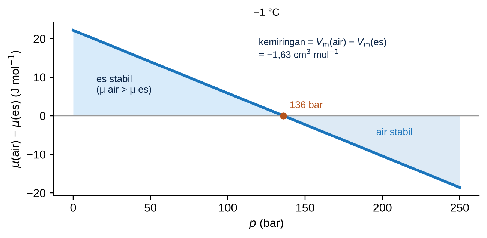

# Bab 8 Kesetimbangan Fasa Zat Murni

Di dapur rumah di kaki gunung, air mendidih pada 100 °C. Bawa panci yang sama ke puncak Semeru, dan air mendidih pada sekitar 88 °C. Mi instan butuh lebih lama untuk matang, karena air yang "mendidih" itu tidak sepanas di bawah. Sebaliknya, panci presto yang ditutup rapat menaikkan tekanan sampai dua kali tekanan udara dan menahan air tetap cair sampai sekitar 120 °C, sehingga daging keras melunak dalam setengah jam. Titik didih ternyata bukan sifat tetap air. Ia bergantung pada tekanan. Seberapa kuat, dan dapatkah dihitung?

Teka-teki kedua datang dari es kering. Sepotong CO₂ padat yang dibiarkan di meja tidak pernah meleleh. Ia langsung menguap, dan mengepulkan kabut putih. Mengapa CO₂ tidak mempunyai fasa cair pada tekanan udara biasa, padahal CO₂ cair ada di dalam tabung pemadam api? Dan mengapa es, berbeda dari hampir semua padatan lain, mengapung di atas cairannya sendiri, serta mencair bila ditekan?

Semua pertanyaan ini dijawab oleh satu gagasan dari Bab 7: pada suhu dan tekanan tertentu, zat memilih fasa yang energi Gibbs molarnya paling rendah. Gambar 7.1 sudah menunjukkan gagasan itu untuk tekanan tetap. Bab ini menambahkan tekanan sebagai variabel kedua. Hasilnya adalah persamaan Clapeyron, yang memberi kemiringan setiap garis batas fasa dari entalpi dan volume perubahan fasa, dan bentuk sederhananya untuk penguapan, persamaan Clausius–Clapeyron. Dari keduanya kita akan membaca **diagram fasa**, peta yang menunjukkan fasa mana yang stabil pada setiap suhu dan tekanan, untuk air dan CO₂. Bab ditutup dengan aturan fasa Gibbs, yang menjelaskan mengapa tiga fasa hanya dapat hidup berdampingan di satu titik.

::: {.strategi}
**Pertanyaan pembuka**

1. Mengapa air mendidih pada suhu lebih rendah di puncak gunung?
2. Bagaimana tekanan uap suatu cairan bergantung pada suhu?
3. Mengapa es mencair bila ditekan, sedangkan kebanyakan padatan justru makin sukar meleleh?
4. Mengapa es kering menyublim dan tidak meleleh pada tekanan udara biasa?
5. Apa yang terjadi pada perbedaan antara cairan dan gas di atas titik kritis?
6. Mengapa air, es, dan uap hanya dapat berada dalam kesetimbangan pada satu suhu dan satu tekanan?
:::

::: {.tujuan}
**Tujuan belajar**

Setelah mempelajari bab ini, kamu mampu:

1. Menjelaskan fasa, transisi fasa, dan kestabilan fasa dengan energi Gibbs molar.
2. Menurunkan syarat kesetimbangan fasa dan menafsirkan keadaan metastabil.
3. Menurunkan persamaan Clapeyron dan memakainya untuk garis batas padat–cair.
4. Memakai persamaan Clausius–Clapeyron untuk menghitung tekanan uap, titik didih, dan entalpi penguapan.
5. Membaca diagram fasa air dan CO₂ serta menjelaskan bentuk khas masing-masing.
6. Menjelaskan titik tripel, titik kritis, dan fluida superkritis.
7. Memakai aturan fasa Gibbs untuk menghitung derajat kebebasan sistem satu komponen.
:::

::: {.mat}
**Prasyarat**

Dari Bab 7: $(\partial G_\text{m}/\partial T)_p = -S_\text{m}$, $(\partial G_\text{m}/\partial p)_T = V_\text{m}$, dan Gambar 7.1 (subbab 7.5, 7.8). Dari Bab 6: entropi perubahan fasa $\Delta_\text{trs}S = \Delta_\text{trs}H/T_\text{trs}$ dan aturan Trouton (subbab 6.4). Dari matematika: integral $\int dx/x = \ln x$.
:::

## 8.1 Fasa, transisi fasa, dan kestabilan

Kata "fasa" sudah sering kita pakai, tetapi termodinamika memerlukan arti yang tepat. **Fasa** adalah bagian sistem yang seragam, baik susunan kimianya maupun keadaan fisisnya, dan dipisahkan dari bagian lain oleh batas yang jelas. Air cair adalah satu fasa. Air dengan bongkahan es di dalamnya adalah dua fasa, berapa pun banyaknya bongkahan itu, karena semua bongkahan es sama sifatnya. Udara adalah satu fasa walaupun berisi banyak zat, karena gas-gas bercampur sempurna. Minyak dan air yang terpisah adalah dua fasa cair.

Satu zat murni dapat mempunyai lebih dari tiga fasa. Selain gas dan cair, banyak padatan mempunyai beberapa bentuk kristal yang berbeda, disebut **polimorf** (atau alotrop untuk unsur). Karbon mempunyai grafit dan intan, belerang mempunyai bentuk rombik dan monoklin, timah mempunyai timah putih dan timah abu-abu, dan es sendiri mempunyai lebih dari belasan bentuk kristal pada tekanan tinggi. Setiap bentuk adalah fasa tersendiri.

**Transisi fasa** adalah perubahan spontan dari satu fasa ke fasa lain pada suhu dan tekanan tertentu: peleburan, penguapan, penyubliman, dan perubahan polimorf. Suhu tempat dua fasa berada dalam kesetimbangan pada tekanan tertentu disebut **suhu transisi**, $T_\text{trs}$. Pada tekanan 1 atm, suhu transisi cair–gas disebut titik didih normal dan suhu transisi padat–cair titik leleh normal. (Bila tekanannya 1 bar, kata yang dipakai adalah titik didih **standar**; untuk air 99,6 °C, sedikit di bawah titik didih normal 100,0 °C.)

Fasa mana yang dipilih zat? Jawabannya sudah kita temui di subbab 7.3: pada suhu dan tekanan tetap, proses spontan menurunkan *G*. Untuk zat murni, *G* sebanding dengan banyaknya zat, $G = nG_\text{m}$, sehingga zat akan berpindah ke fasa dengan **energi Gibbs molar terendah**. Fasa itu disebut fasa **stabil** pada suhu dan tekanan tersebut.

Gambar 7.1 memperlihatkan bagaimana pilihan itu berubah bersama suhu. Garis $G_\text{m}$ setiap fasa menurun dengan kemiringan $-S_\text{m}$. Padatan, yang entropinya paling kecil, turun paling landai; gas, yang entropinya paling besar, turun paling curam. Akibatnya urutan selalu sama: padat stabil pada suhu rendah, cair di tengah, gas pada suhu tinggi. Titik leleh dan titik didih adalah titik potong garis-garis itu.

::: {.contoh}
**Contoh 8.1 · Menghitung fasa**

Berapa banyak fasa dalam setiap sistem berikut? (a) Segelas es teh dengan tiga bongkah es, tanpa memperhitungkan udara. (b) Campuran serbuk besi dan serbuk belerang. (c) Paduan kuningan (tembaga dan seng yang larut sempurna satu sama lain dalam keadaan padat). (d) Air dan minyak goreng yang dikocok kuat sehingga tampak keruh.

**Penyelesaian.** (a) Dua: larutan teh (cair) dan es (padat). Banyaknya bongkah tidak berpengaruh. (b) Dua: setiap jenis serbuk adalah fasa padat tersendiri, walaupun butirannya bercampur. (c) Satu: larutan padat yang seragam sampai skala atom. (d) Dua: kocokan hanya memecah minyak menjadi tetes-tetes kecil, tetapi setiap tetes tetap minyak.

**Memahami hasil.** Ukuran yang menentukan adalah keseragaman pada skala molekul, bukan apa yang tampak oleh mata. Campuran yang tampak seragam bisa dua fasa (emulsi), dan sebaliknya, padatan yang berisi dua logam bisa satu fasa.
:::

Apakah zat selalu langsung berpindah ke fasa yang stabil? Tidak selalu. Air yang sangat murni di dalam wadah yang licin dapat didinginkan sampai −20 °C, bahkan lebih rendah, dan tetap cair. Air seperti itu disebut **dingin-lewat** (*supercooled*). Ia berada dalam keadaan **metastabil**: energi Gibbs molarnya lebih tinggi daripada es pada suhu yang sama, tetapi perubahan menjadi es memerlukan pembentukan inti kristal kecil yang mula-mula tidak menguntungkan, karena molekul-molekul di permukaan inti kecil itu "kehilangan" sebagian ikatannya. Begitu ada debu, goresan, atau kristal es kecil, inti terbentuk dan seluruh cairan membeku dengan cepat.

::: {.contoh}
**Contoh 8.2 · Air dingin-lewat**

Hitung energi Gibbs pembekuan air dingin-lewat pada −10 °C. Pakai $\Delta_\text{fus}H = 6{,}01$ kJ mol⁻¹ dan $\Delta_\text{fus}S = \Delta_\text{fus}H/T_\text{f}$ dengan $T_\text{f} = 273{,}15$ K, keduanya dianggap tidak bergantung pada suhu.

**Penyelesaian.** Untuk peleburan pada suhu *T*:
$$
\Delta_\text{fus}G = \Delta_\text{fus}H - T\frac{\Delta_\text{fus}H}{T_\text{f}} = \Delta_\text{fus}H\left(1 - \frac{T}{T_\text{f}}\right) = (6010)\left(1 - \frac{263{,}15}{273{,}15}\right) = +220\ \text{J mol}^{-1} .
$$
Pembekuan adalah kebalikannya: $\Delta G = -220$ J mol⁻¹.

**Memahami hasil.** Pembekuan air pada −10 °C spontan, tetapi "dorongannya" kecil, hanya 220 J mol⁻¹, kira-kira sepersepuluh energi termal *RT* (2,19 kJ mol⁻¹ pada suhu itu). Dorongan sekecil itu tidak cukup untuk membayar biaya membentuk permukaan inti es, sehingga cairan dapat bertahan lama tanpa membeku. Di awan, tetes-tetes air dingin-lewat semacam ini sangat umum; peran mereka dalam pembentukan hujan dibahas di subbab 8.4.
:::

Contoh lain menunjukkan bahwa transisi antarpolimorf pun mengikuti aturan yang sama. Timah putih, bentuk logam yang dipakai untuk solder dan kaleng, stabil di atas 13,2 °C. Di bawah suhu itu, timah abu-abu yang rapuh dan berbentuk serbuk menjadi stabil. Perubahannya sangat lambat, tetapi pada musim dingin yang panjang, benda timah dapat "berpenyakit": bercak abu-abu muncul dan menyebar sampai benda itu hancur. Gejala ini disebut **wabah timah**.

::: {.contoh}
**Contoh 8.3 · Wabah timah**

Untuk timah putih → timah abu-abu, $\Delta_\text{trs}H = -2{,}09$ kJ mol⁻¹ dan suhu transisinya 13,2 °C (286,35 K). (a) Hitung $\Delta_\text{trs}S$. (b) Hitung $\Delta_\text{trs}G$ pada −30 °C. (c) Mana yang stabil pada suhu kamar 25 °C?

**Penyelesaian.** (a) Pada suhu transisi, $\Delta G = 0$, sehingga $\Delta_\text{trs}S = \Delta_\text{trs}H/T_\text{trs} = -2090/286{,}35 = -7{,}30$ J K⁻¹ mol⁻¹.

(b) $\Delta_\text{trs}G = -2090 - (243{,}15)(-7{,}30) = -315$ J mol⁻¹.

(c) Pada 298,15 K, $\Delta_\text{trs}G = -2090 + (298{,}15)(7{,}30) = +86$ J mol⁻¹, positif, sehingga timah putih yang stabil.

**Memahami hasil.** Timah abu-abu mempunyai entalpi lebih rendah (ikatannya lebih kuat, mirip intan) tetapi entropi juga lebih rendah. Ini persaingan yang sama seperti antara es dan air: pada suhu rendah entalpi menang, pada suhu tinggi entropi menang. Bedanya, di sini kedua fasa padat dan selisih energinya sangat kecil, sehingga perubahannya berjalan sangat lambat.
:::

Gambar 8.1 meringkas gagasan ini untuk satu zat. Potensial kimia setiap fasa turun ketika suhu naik, dengan kemiringan −$S_\text{m}$, sehingga garis gas paling curam, lalu cair, lalu padat. Pada setiap suhu, fasa yang stabil adalah fasa dengan garis **paling bawah**. Titik potong garis padat dan cair adalah titik leleh; titik potong garis cair dan gas adalah titik didih. Bila tekanan dinaikkan, garis gas naik paling banyak (subbab 7.8), sehingga titik potongnya dengan garis cair bergeser ke kanan: titik didih naik bersama tekanan.

{width=78%}

::: {.kuis}
**Kuis cepat 8.1** Bila air dingin-lewat pada −10 °C tiba-tiba membeku di dalam wadah yang terisolasi, apakah suhunya tetap −10 °C? Ke mana kalor peleburan yang dilepaskan?
:::

## 8.2 Syarat kesetimbangan fasa

Dua fasa dapat hidup berdampingan, seperti es dan air di dalam gelas pada 0 °C, atau air dan uapnya di dalam botol tertutup. Apa syaratnya?

Bayangkan sistem tertutup berisi fasa α dan β dari satu zat murni pada suhu dan tekanan tetap. Misalkan sejumlah kecil $dn$ mol berpindah dari α ke β. Energi Gibbs fasa α turun sebesar $G_\text{m}(\alpha)\,dn$, dan energi Gibbs fasa β naik sebesar $G_\text{m}(\beta)\,dn$. Perubahan total:

$$
dG = \left[G_\text{m}(\beta) - G_\text{m}(\alpha)\right]dn . \qquad \text{(8.1)}
$$

Bila $G_\text{m}(\beta) < G_\text{m}(\alpha)$, *dG* negatif dan perpindahan itu spontan: zat terus berpindah ke β sampai fasa α habis. Bila $G_\text{m}(\beta) > G_\text{m}(\alpha)$, yang terjadi sebaliknya. Kedua fasa dapat tinggal bersama dalam jumlah berapa pun hanya bila tidak ada arah yang menguntungkan, yaitu

::: {.inti}
$$
G_\text{m}(\alpha; T, p) = G_\text{m}(\beta; T, p) . \qquad \text{(8.2)}
$$
**Syarat kesetimbangan fasa zat murni.** Dua fasa berada dalam kesetimbangan bila energi Gibbs molarnya sama. Selain itu suhu dan tekanan keduanya harus sama (kesetimbangan termal dan mekanis).
:::

Untuk zat murni, energi Gibbs molar adalah **potensial kimia** zat itu, diberi lambang μ. Nama ini menangkap peran fisisnya: seperti air yang mengalir dari tempat tinggi ke tempat rendah, zat "mengalir" dari fasa dengan μ tinggi ke fasa dengan μ rendah, dan berhenti ketika μ di kedua fasa sama. Di Bab 9, potensial kimia akan diperluas ke campuran, tempat ia menjadi lebih penting lagi. Untuk bab ini cukup kita ingat bahwa $\mu = G_\text{m}$.

Persamaan (8.2) adalah satu persamaan dengan dua variabel, *T* dan *p*. Persamaan seperti itu biasanya mempunyai penyelesaian berupa **garis** pada bidang *p*–*T*: untuk setiap tekanan ada satu suhu tempat kedua fasa setimbang. Inilah alasan titik didih bergantung pada tekanan. Garis-garis itu disebut **garis batas fasa**, dan gambar yang memuat semuanya disebut **diagram fasa**. Pada setiap titik di luar garis, hanya satu fasa yang stabil; pada setiap titik di atas garis, dua fasa setimbang.

Karena energi Gibbs molar setiap fasa bergantung pada tekanan dengan kemiringan $V_\text{m}$ (subbab 7.8), tekanan dapat membalik urutan kestabilan dua fasa. Gambar 8.2 memperlihatkan es dan air pada −1 °C. Pada 1 bar, potensial kimia air 22 J mol⁻¹ lebih tinggi daripada es, sehingga es yang stabil. Tetapi es mempunyai volume molar lebih besar, sehingga potensial kimianya naik lebih cepat ketika ditekan, dan di atas sekitar 136 bar air menjadi fasa yang stabil: es mencair karena ditekan. Angka ini sesuai dengan kemiringan garis padat–cair air, sekitar −135 bar per kelvin, yang akan kita hitung dengan persamaan Clapeyron di subbab 8.3.

{width=80%}

::: {.contoh}
**Contoh 8.4 · Air atau uap pada 25 °C**

Pada 25 °C, $\Delta_\text{vap}G^\circ = +8{,}55$ kJ mol⁻¹ (subbab 7.8). (a) Pada tekanan uap 1 bar, fasa mana yang stabil? (b) Hitung selisih $\mu(g) - \mu(l)$ bila tekanan uapnya 0,0100 bar. (c) Pada tekanan berapa kedua fasa setimbang?

**Penyelesaian.** (a) $\mu(g) - \mu(l) = \Delta_\text{vap}G^\circ > 0$: cairan yang stabil.

(b) Potensial kimia cairan hampir tidak bergantung pada tekanan, sedangkan gas mengikuti $\mu = \mu^\circ + RT\ln(p/p^\circ)$:
$$
\mu(g) - \mu(l) = 8550 + (8{,}314)(298{,}15)\ln0{,}0100 = 8550 - 11\,416 = -2{,}87\ \text{kJ mol}^{-1} .
$$
Kini gas yang stabil: air menguap.

(c) Kesetimbangan bila selisih itu nol: $p = \exp(-8550/RT) = 0{,}0317$ bar, sesuai Contoh 7.17.

**Memahami hasil.** Kata "fasa stabil" selalu menyertakan suhu **dan** tekanan. Pada 25 °C, air cair stabil di bawah tekanan uap 1 bar tetapi tidak stabil terhadap uap bertekanan rendah. Itulah sebabnya cucian kering di udara, dan itulah sebabnya pula air di dalam botol tertutup berhenti menguap ketika tekanan uapnya mencapai 3,17 kPa.
:::

Bagaimana dengan keadaan metastabil? Air dingin-lewat pada −10 °C mempunyai μ lebih tinggi daripada es. Ia tidak dalam kesetimbangan dengan es, tetapi ia dapat berada dalam kesetimbangan dengan uapnya sendiri. Akibatnya, air dingin-lewat mempunyai tekanan uap sendiri, dan tekanan uap itu **lebih tinggi** daripada tekanan uap es pada suhu yang sama. Kita akan menghitung selisihnya di subbab 8.4 dan melihat bahwa selisih inilah yang membuat hujan turun.

::: {.awas}
**Kesetimbangan bukan berarti diam.** Pada kesetimbangan cair–uap, molekul terus-menerus menguap dari permukaan cairan dan mengembun kembali. Yang setimbang adalah **lajunya**: banyaknya molekul yang menguap per detik sama dengan yang mengembun. Termodinamika tidak melihat lalu lintas itu; ia hanya mengatakan bahwa μ kedua fasa sama sehingga tidak ada perpindahan **bersih**.
:::

::: {.kuis}
**Kuis cepat 8.2** Sebotol air tertutup pada 25 °C, dengan ruang di atasnya berisi udara 1 bar dan uap air 3,17 kPa. Apakah air di botol masih menguap? Apakah jumlah air cair berubah?
:::
