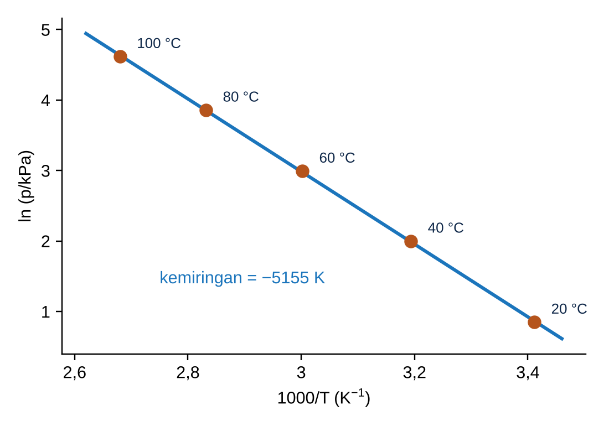
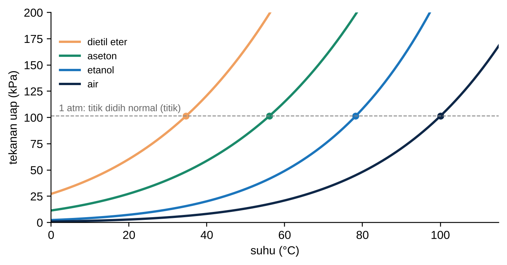

## 8.3 Persamaan Clapeyron

Garis batas fasa adalah tempat $\mu(\alpha) = \mu(\beta)$. Kita ingin mengetahui kemiringannya, *dp*/*dT*: bila suhu dinaikkan sedikit, berapa tekanan harus berubah supaya kedua fasa tetap setimbang?

Mulailah dari satu titik pada garis, tempat $\mu(\alpha) = \mu(\beta)$. Geser suhu sebesar *dT* dan tekanan sebesar *dp*, sepanjang garis. Supaya kesetimbangan tetap terjaga, perubahan potensial kimia kedua fasa harus sama: $d\mu(\alpha) = d\mu(\beta)$. Untuk zat murni, persamaan fundamental $dG = -S\,dT + V\,dp$ per mol memberi $d\mu = -S_\text{m}\,dT + V_\text{m}\,dp$, sehingga

$$
-S_\text{m}(\alpha)\,dT + V_\text{m}(\alpha)\,dp = -S_\text{m}(\beta)\,dT + V_\text{m}(\beta)\,dp .
$$

Kumpulkan suku *dp* di kiri dan *dT* di kanan:
$$
\left[V_\text{m}(\beta) - V_\text{m}(\alpha)\right]dp = \left[S_\text{m}(\beta) - S_\text{m}(\alpha)\right]dT ,
$$
atau, dengan $\Delta_\text{trs}V$ dan $\Delta_\text{trs}S$ sebagai perubahan volume dan entropi molar transisi α → β,

::: {.inti}
$$
\frac{dp}{dT} = \frac{\Delta_\text{trs}S}{\Delta_\text{trs}V} = \frac{\Delta_\text{trs}H}{T\,\Delta_\text{trs}V} . \qquad \text{(8.3)}
$$
**Persamaan Clapeyron.** Kemiringan setiap garis batas fasa. Bentuk kedua memakai $\Delta_\text{trs}S = \Delta_\text{trs}H/T$, yang berlaku karena setiap titik garis adalah titik kesetimbangan.
:::

Persamaan (8.3) eksak: tidak ada pendekatan dalam penurunannya. Ia juga sangat mudah dibaca. Entropi naik pada peleburan dan penguapan, sehingga tanda kemiringan ditentukan oleh tanda $\Delta_\text{trs}V$. Bila fasa yang lebih kacau juga lebih renggang, seperti hampir semua cairan dibandingkan padatannya, garisnya miring ke kanan: tekanan yang lebih tinggi memerlukan suhu lebih tinggi untuk meleleh. Bila fasa yang lebih kacau justru lebih rapat, garisnya miring ke kiri. Air adalah contoh terkenal yang kedua.

Besarnya kemiringan juga dapat diramalkan. Untuk peleburan, $\Delta_\text{fus}V$ sangat kecil, hanya beberapa persen volume molar, sehingga *dp*/*dT* sangat besar: garis padat–cair hampir tegak. Diperlukan ratusan bar untuk menggeser titik leleh satu derajat. Untuk penguapan, $\Delta_\text{vap}V$ sangat besar, karena gas menempati volume ribuan kali cairannya, sehingga garis cair–gas jauh lebih landai.

::: {.contoh}
**Contoh 8.5 · Es yang ditekan**

Pada 0 °C, rapatan air cair 0,99984 g cm⁻³ dan rapatan es 0,9167 g cm⁻³; $\Delta_\text{fus}H = 6{,}01$ kJ mol⁻¹. (a) Hitung kemiringan garis padat–cair air. (b) Berapa titik leleh es pada 100 bar?

**Penyelesaian.** (a) Volume molar: cair $18{,}015/0{,}999\,84 = 18{,}018$ cm³ mol⁻¹, es $18{,}015/0{,}9167 = 19{,}652$ cm³ mol⁻¹. Maka $\Delta_\text{fus}V = -1{,}634$ cm³ mol⁻¹, dan
$$
\frac{dp}{dT} = \frac{6010\ \text{J mol}^{-1}}{(273{,}15\ \text{K})(-1{,}634 \times 10^{-6}\ \text{m}^3\ \text{mol}^{-1})} = -1{,}35 \times 10^7\ \text{Pa K}^{-1} = -135\ \text{bar K}^{-1} .
$$
(b) Kenaikan tekanan 99 bar menurunkan titik leleh sebesar $99/135 = 0{,}74$ K. Titik lelehnya sekitar −0,7 °C.

**Memahami hasil.** Es mencair bila ditekan, karena air cair lebih rapat daripada es: tekanan "menyukai" fasa yang volumenya lebih kecil. Tetapi pengaruhnya kecil. Bahkan di dasar palung laut terdalam, sekitar 1100 bar, titik leleh air hanya turun sekitar 8 °C.
:::

Mengapa es kurang rapat daripada air? Dalam es, setiap molekul H₂O membentuk empat ikatan hidrogen yang tersusun tetrahedral, dan susunan itu memaksa kisi kristal yang sangat terbuka, penuh rongga heksagonal. Ketika es meleleh, sebagian jaringan itu runtuh dan molekul-molekul dapat masuk ke rongga, sehingga volume berkurang. Kebanyakan zat tidak mempunyai jaringan terbuka seperti itu, sehingga padatannya lebih rapat dan garis lelehnya miring ke kanan. Selain air, hanya beberapa zat yang berperilaku seperti es, di antaranya silikon, galium, dan bismut.

::: {.contoh}
**Contoh 8.6 · Benarkah sepatu luncur melelehkan es?**

Penjelasan yang sering dijumpai: peluncur es meluncur di atas lapisan air tipis yang terbentuk karena tekanan bilah sepatu melelehkan es. Seorang peluncur bermassa 70 kg berdiri di atas satu bilah yang luas sentuhnya 2,0 cm². Berapa tekanan bilah itu, dan seberapa banyak titik leleh es turun?

**Penyelesaian.** Tekanan: $p = mg/A = (70)(9{,}81)/(2{,}0 \times 10^{-4})$ Pa $= 3{,}4 \times 10^6$ Pa $= 34$ bar. Dari Contoh 8.5, $\Delta T = 34/135 = 0{,}25$ K.

**Memahami hasil.** Titik leleh hanya turun seperempat derajat. Gelanggang es biasanya dijaga pada −5 °C atau lebih dingin, dan orang tetap dapat meluncur pada −20 °C. Jadi tekanan **bukan** penjelasannya. Penjelasan yang diterima sekarang menggabungkan dua hal: permukaan es mempunyai lapisan molekul yang tidak tersusun rapi, mirip cairan, bahkan jauh di bawah 0 °C, dan gesekan bilah menghasilkan kalor yang melelehkan sedikit es. Persamaan Clapeyron di sini berguna justru untuk **menolak** penjelasan yang keliru.
:::

Untuk kebanyakan zat, garis lelehnya miring ke kanan, dan persamaan yang sama memberi besarnya.

::: {.contoh}
**Contoh 8.7 · Benzena yang ditekan**

Benzena meleleh pada 278,7 K dengan $\Delta_\text{fus}H = 9{,}87$ kJ mol⁻¹ dan $\Delta_\text{fus}V = +10{,}3$ cm³ mol⁻¹. Berapa kenaikan titik leleh per bar?

**Penyelesaian.** Balikkan (8.3):
$$
\frac{dT}{dp} = \frac{T\,\Delta_\text{fus}V}{\Delta_\text{fus}H} = \frac{(278{,}7)(10{,}3 \times 10^{-6})}{9870}\ \text{K Pa}^{-1} = 2{,}91 \times 10^{-7}\ \text{K Pa}^{-1} = 0{,}029\ \text{K bar}^{-1} .
$$

**Memahami hasil.** Pada 1000 bar, titik leleh benzena naik sekitar 29 K. Hasil terukur cocok sampai beberapa ratus bar; pada tekanan lebih tinggi garisnya melengkung, karena $\Delta_\text{fus}V$ mengecil ketika cairan makin termampatkan. Persamaan Clapeyron tetap eksak; yang berubah adalah nilai $\Delta_\text{fus}V$ dan $\Delta_\text{fus}H$ yang dimasukkan ke dalamnya.
:::

::: {.contoh}
**Contoh 8.8 · Kemiringan garis didih air**

Pada 100 °C dan 1 atm, $\Delta_\text{vap}H = 40{,}66$ kJ mol⁻¹, volume molar air cair 18,8 cm³ mol⁻¹, dan uap air dapat dianggap gas ideal. Hitung *dp*/*dT* garis cair–gas.

**Penyelesaian.** Volume molar uap: $V_\text{m} = RT/p = (8{,}314)(373{,}15)/101\,325 = 0{,}030\,62$ m³ mol⁻¹ = 30,6 L mol⁻¹. Maka $\Delta_\text{vap}V = 0{,}030\,62 - 0{,}000\,019 = 0{,}030\,60$ m³ mol⁻¹, dan
$$
\frac{dp}{dT} = \frac{40\,660}{(373{,}15)(0{,}030\,60)} = 3{,}56 \times 10^3\ \text{Pa K}^{-1} = 3{,}56\ \text{kPa K}^{-1} .
$$

**Memahami hasil.** Nilai terukur 3,62 kPa K⁻¹; selisih kecil itu datang dari perilaku tak ideal uap air pada 1 atm. Bandingkan dengan Contoh 8.5: untuk menggeser titik didih satu derajat cukup sekitar 3,6 kPa, empat ribu kali lebih kecil daripada untuk menggeser titik leleh. Itulah sebabnya titik didih begitu peka terhadap cuaca dan ketinggian, sedangkan titik leleh praktis tetap. Perhatikan juga bahwa volume cairan hanya 0,06% dari volume uap, sehingga dapat diabaikan. Pengamatan ini menjadi kunci subbab berikutnya.
:::

::: {.kuis}
**Kuis cepat 8.3** Garis padat–cair suatu zat miring ke kanan. Fasa mana yang lebih rapat, padat atau cair? Bila zat cair itu ditekan pada suhu tetap tepat di atas titik lelehnya, apa yang terjadi?
:::

## 8.4 Persamaan Clausius–Clapeyron

Persamaan Clapeyron untuk penguapan dapat disederhanakan menjadi bentuk yang dapat diintegralkan dengan mudah. Contoh 8.8 menunjukkan bahwa volume cairan dapat diabaikan, sehingga $\Delta_\text{vap}V \approx V_\text{m}(g)$. Bila uap dianggap gas ideal, $V_\text{m}(g) = RT/p$. Masukkan ke (8.3):

$$
\frac{dp}{dT} = \frac{\Delta_\text{vap}H}{T(RT/p)} = \frac{p\,\Delta_\text{vap}H}{RT^2} .
$$

Bagi kedua ruas dengan *p*, dan ingat bahwa $dp/p = d\ln p$:

::: {.inti}
$$
\frac{d\ln p}{dT} = \frac{\Delta_\text{vap}H}{RT^2} . \qquad \text{(8.4)}
$$
**Persamaan Clausius–Clapeyron.** Berlaku untuk kesetimbangan cair–gas dan padat–gas (dengan $\Delta_\text{sub}H$), dengan anggapan volume fasa terkondensasi diabaikan dan uap berperilaku ideal.
:::

Persamaan (8.4) mengatakan sesuatu yang sederhana: tekanan uap naik secara **eksponensial** dengan suhu, dan laju kenaikannya sebanding dengan entalpi penguapan. Cairan yang molekul-molekulnya terikat kuat (Δ*H* besar) mempunyai tekanan uap yang sangat peka terhadap suhu.

::: {.mat}
**Matematika: mengintegralkan Clausius–Clapeyron.** Pisahkan variabel: $d\ln p = (\Delta_\text{vap}H/R)\,T^{-2}\,dT$. Bila $\Delta_\text{vap}H$ dianggap tetap, integral $\int T^{-2}dT = -1/T$, sehingga dari $(T_1, p_1)$ ke $(T_2, p_2)$:
$$
\ln p_2 - \ln p_1 = \frac{\Delta_\text{vap}H}{R}\left(-\frac{1}{T_2} + \frac{1}{T_1}\right) .
$$
Integral tak tentunya memberi $\ln p = -\Delta_\text{vap}H/RT + C$, dengan *C* tetapan integrasi.
:::

Hasilnya dua bentuk yang sering dipakai:

$$
\ln\frac{p_2}{p_1} = -\frac{\Delta_\text{vap}H}{R}\left(\frac{1}{T_2} - \frac{1}{T_1}\right) , \qquad \text{(8.5)}
$$

$$
\ln p = -\frac{\Delta_\text{vap}H}{R}\cdot\frac{1}{T} + C . \qquad \text{(8.6)}
$$

Bentuk (8.6) memberi cara mengukur entalpi penguapan tanpa kalorimeter: ukur tekanan uap pada beberapa suhu, gambarkan ln *p* terhadap 1/*T*, dan hasilnya garis lurus dengan kemiringan $-\Delta_\text{vap}H/R$.

{width=68%}

::: {.contoh}
**Contoh 8.9 · Entalpi penguapan air dari tekanan uapnya**

Tekanan uap air pada 20, 40, 60, 80, dan 100 °C berturut-turut 2,339; 7,384; 19,95; 47,41; dan 101,3 kPa. Tentukan $\Delta_\text{vap}H$.

**Penyelesaian.** Hitung 1000/*T* dan ln(*p*/kPa):

| *t* (°C) | 20 | 40 | 60 | 80 | 100 |
|---|---|---|---|---|---|
| 1000/*T* (K⁻¹) | 3,411 | 3,193 | 3,002 | 2,832 | 2,680 |
| ln(*p*/kPa) | 0,850 | 1,999 | 2,993 | 3,859 | 4,618 |

Garis lurus terbaik melalui titik-titik ini (Gambar 8.3) mempunyai kemiringan −5155 K. Maka
$$
\Delta_\text{vap}H = -R \times \text{kemiringan} = (8{,}314)(5155)\ \text{J mol}^{-1} = 42{,}9\ \text{kJ mol}^{-1} .
$$

**Memahami hasil.** Nilai ini adalah entalpi penguapan rata-rata dalam rentang 20–100 °C. Nilai kalorimetrinya 44,0 kJ mol⁻¹ pada 25 °C dan 40,7 kJ mol⁻¹ pada 100 °C; nilai kita jatuh di antaranya, di sekitar nilai pada 60 °C. Δ*H* penguapan berkurang perlahan ketika suhu naik, karena molekul-molekul cairan makin renggang, dan pada titik kritis ia menjadi nol. Garis pada Gambar 8.3 sebenarnya sedikit melengkung, tetapi kelengkungan itu terlalu kecil untuk terlihat.
:::

Bentuk (8.5) menjawab pertanyaan pembuka bab ini tentang titik didih di gunung. Titik didih adalah suhu tempat tekanan uap cairan sama dengan tekanan di sekitarnya. Bila tekanan luar turun, tekanan uap yang diperlukan untuk mendidih juga turun, dan itu dicapai pada suhu yang lebih rendah.

::: {.contoh}
**Contoh 8.10 · Memasak di puncak Semeru dan di dalam panci presto**

Pakai $\Delta_\text{vap}H = 40{,}66$ kJ mol⁻¹ dan titik didih normal 373,15 K. Hitung titik didih air (a) di puncak Semeru, tempat tekanan udara sekitar 0,65 bar; (b) di dalam panci presto dengan tekanan mutlak 2,0 bar.

**Rencana.** Dalam (8.5), ambil $(T_1, p_1) = (373{,}15\ \text{K}, 1{,}013\ \text{bar})$ dan cari $T_2$:
$$
\frac{1}{T_2} = \frac{1}{T_1} - \frac{R}{\Delta_\text{vap}H}\ln\frac{p_2}{p_1} .
$$

**Penyelesaian.** (a) $\dfrac{1}{T_2} = \dfrac{1}{373{,}15} - \dfrac{8{,}314}{40\,660}\ln\dfrac{0{,}65}{1{,}013} = 2{,}6799 \times 10^{-3} + 9{,}08 \times 10^{-5} = 2{,}7707 \times 10^{-3}$ K⁻¹, sehingga $T_2 = 360{,}9$ K = 87,8 °C.

(b) $\dfrac{1}{T_2} = 2{,}6799 \times 10^{-3} - \dfrac{8{,}314}{40\,660}\ln\dfrac{2{,}0}{1{,}013} = 2{,}5408 \times 10^{-3}$ K⁻¹, sehingga $T_2 = 393{,}6$ K = 120,4 °C.

**Memahami hasil.** Selisih 32 °C antara puncak gunung dan panci presto sangat berarti bagi dapur. Laju reaksi kimia yang melunakkan daging dan mematangkan beras kira-kira berlipat dua setiap kenaikan 10 °C, sehingga panci presto memasak beberapa kali lebih cepat, sedangkan memasak di puncak gunung jauh lebih lambat. Di puncak Everest (sekitar 0,34 bar), air mendidih pada sekitar 71 °C, terlalu dingin untuk menyeduh teh dengan baik.
:::

Bila $\Delta_\text{vap}H$ tidak diketahui, aturan Trouton dari Bab 6 memberi taksiran yang cukup baik untuk cairan nonpolar: $\Delta_\text{vap}H \approx (85\ \text{J K}^{-1}\text{mol}^{-1})\,T_\text{b}$. Gabungan Trouton dan Clausius–Clapeyron memungkinkan kita menaksir tekanan uap suatu cairan hanya dari titik didihnya.

::: {.contoh}
**Contoh 8.11 · Tekanan uap benzena hanya dari titik didihnya**

Benzena mendidih pada 353,2 K. Taksir tekanan uapnya pada 25 °C.

**Penyelesaian.** Trouton: $\Delta_\text{vap}H \approx (85)(353{,}2) = 30{,}0$ kJ mol⁻¹. Dari (8.5):
$$
\ln\frac{p}{1{,}013\ \text{bar}} = -\frac{30\,020}{8{,}314}\left(\frac{1}{298{,}15} - \frac{1}{353{,}2}\right) = -1{,}888 ,
$$
sehingga $p = (1{,}013)(0{,}151) = 0{,}153$ bar.

**Memahami hasil.** Nilai terukurnya 0,127 bar. Taksiran 20% terlalu tinggi, dan sebabnya dapat dimengerti: entalpi penguapan benzena pada 25 °C adalah 33,8 kJ mol⁻¹, lebih besar daripada nilai pada titik didihnya. Dengan nilai itu, (8.5) memberi 0,121 bar. Untuk taksiran cepat, misalnya untuk menilai apakah suatu pelarut cukup mudah menguap untuk diuapkan di rotavapor, ketelitian seperti ini sudah memadai.
:::

### Penyubliman

Persamaan (8.4) berlaku juga untuk kesetimbangan padat–gas, dengan entalpi penyubliman $\Delta_\text{sub}H$ menggantikan $\Delta_\text{vap}H$. Karena entalpi adalah fungsi keadaan, penyubliman pada suatu suhu sama dengan peleburan diikuti penguapan pada suhu yang sama:

$$
\Delta_\text{sub}H = \Delta_\text{fus}H + \Delta_\text{vap}H . \qquad \text{(8.7)}
$$

Akibatnya, $\Delta_\text{sub}H$ selalu lebih besar daripada $\Delta_\text{vap}H$, sehingga garis padat–gas lebih curam daripada garis cair–gas di dekat titik tempat keduanya bertemu. Dengan kata lain, tekanan uap padatan turun lebih cepat daripada tekanan uap cairannya bila suhu diturunkan.

::: {.contoh}
**Contoh 8.12 · Es dan air dingin-lewat pada −20 °C**

Pada titik tripel air (273,16 K), es dan air cair mempunyai tekanan uap yang sama, 611,7 Pa. Pakai $\Delta_\text{vap}H = 45{,}05$ dan $\Delta_\text{fus}H = 6{,}01$ kJ mol⁻¹ (nilai pada 0 °C). Hitung tekanan uap (a) es dan (b) air dingin-lewat pada −20 °C.

**Penyelesaian.** $\Delta_\text{sub}H = 6{,}01 + 45{,}05 = 51{,}06$ kJ mol⁻¹. Dengan $1/253{,}15 - 1/273{,}16 = 2{,}894 \times 10^{-4}$ K⁻¹:

(a) Es: $p = 611{,}7\exp\left[-(51\,060/8{,}314)(2{,}894 \times 10^{-4})\right] = 611{,}7 \times 0{,}169 = 103$ Pa.

(b) Air dingin-lewat: $p = 611{,}7\exp\left[-(45\,050/8{,}314)(2{,}894 \times 10^{-4})\right] = 611{,}7 \times 0{,}208 = 127$ Pa.

**Memahami hasil.** Nilai terukurnya 103 dan 126 Pa. Tekanan uap air dingin-lewat **lebih tinggi** daripada es, sesuai dengan μ-nya yang lebih tinggi (subbab 8.2). Udara yang jenuh terhadap tetes air dingin-lewat mempunyai uap 23% lebih banyak daripada yang dapat ditahan es. Akibatnya dibahas di kotak berikut.
:::

::: {.terapan}
**Mengapa hujan turun.** Di bagian atas awan, suhu sering di bawah −10 °C, tetapi kebanyakan tetes air tetap cair karena dingin-lewat. Tetes-tetes itu terlalu kecil untuk jatuh. Ketika beberapa kristal es terbentuk, misalnya pada butir debu, keadaannya menjadi tidak seimbang: udara yang jenuh terhadap tetes air **lewat jenuh** terhadap es, sehingga uap air terus mengendap pada kristal es, sementara tetes-tetes air menguap untuk mengisi kembali uap itu. Kristal es tumbuh dengan cepat dengan "memakan" tetes air di sekitarnya, menjadi cukup berat untuk jatuh, dan mencair menjadi hujan dalam perjalanan ke bawah. Mekanisme ini, yang disebut **proses Bergeron**, menghasilkan sebagian besar hujan di daerah lintang tinggi dan sebagian hujan lebat di daerah tropis. Penyemaian awan dengan perak iodida, yang kisinya mirip es, bekerja dengan menyediakan inti kristal itu.
:::

::: {.contoh}
**Contoh 8.13 · Entalpi penyubliman es kering**

CO₂ padat menyublim pada 194,65 K di bawah tekanan 1 atm, dan titik tripelnya terletak pada 216,55 K dan 5,18 bar. Hitung $\Delta_\text{sub}H$.

**Penyelesaian.** Kedua titik terletak pada garis padat–gas. Dari (8.5), dengan $\Delta_\text{sub}H$:
$$
\Delta_\text{sub}H = \frac{R\ln(p_2/p_1)}{1/T_1 - 1/T_2} = \frac{(8{,}314)\ln(5{,}18/1{,}013)}{1/194{,}65 - 1/216{,}55} = \frac{13{,}56}{5{,}196 \times 10^{-4}}\ \text{J mol}^{-1} = 26{,}1\ \text{kJ mol}^{-1} .
$$

**Memahami hasil.** Nilai kalorimetrinya 25,2 kJ mol⁻¹. Dua titik pada diagram fasa cukup untuk memperoleh entalpi transisi dengan ketelitian beberapa persen. Bandingkan dengan air ($\Delta_\text{sub}H = 51$ kJ mol⁻¹): molekul CO₂ yang nonpolar hanya diikat gaya dispersi, setengah dari kekuatan ikatan hidrogen dalam es.
:::

::: {.terapan}
**Pengeringan beku.** Kopi instan bermutu tinggi, vaksin, dan sampel biologis dikeringkan dengan cara yang memanfaatkan penyubliman. Bahan dibekukan dahulu, misalnya pada −40 °C, lalu ditaruh dalam ruang hampa yang tekanannya dijaga di bawah tekanan uap es pada suhu itu, sekitar 13 Pa (hitunglah dengan cara Contoh 8.12). Es menyublim langsung menjadi uap tanpa pernah melewati fasa cair, sehingga struktur bahan tidak runtuh dan senyawa aroma yang peka panas tidak rusak. Prosesnya lambat, karena kalor penyubliman harus terus dipasok tanpa mencairkan es; di laboratorium, alat yang melakukannya disebut *freeze dryer* atau liofilisator.
:::

::: {.awas}
**Kapan Clausius–Clapeyron tidak boleh dipakai.** Persamaan (8.4) memakai dua anggapan yang hanya berlaku bila salah satu fasa adalah gas: volume fasa terkondensasi diabaikan dan uap dianggap ideal. Untuk garis padat–cair, kedua anggapan itu salah total, dan yang harus dipakai adalah persamaan Clapeyron (8.3). Di dekat titik kritis, uap tidak lagi ideal dan volume cairan tidak lagi kecil, sehingga Clausius–Clapeyron pun gagal di sana.
:::

Bentuk eksponensial persamaan Clausius–Clapeyron terlihat jelas bila tekanan uap beberapa cairan digambar terhadap suhu (Gambar 8.4). Setiap kurva naik makin curam, dan titik didih normal adalah suhu tempat kurva memotong 1 atm. Cairan yang gaya antarmolekulnya lemah (eter) mempunyai tekanan uap tinggi dan titik didih rendah; air, dengan ikatan hidrogen yang kuat, berada paling kanan.

{width=76%}

::: {.kuis}
**Kuis cepat 8.4** Dua cairan mempunyai titik didih normal yang sama, tetapi Δ*H* penguapan cairan A dua kali cairan B. Pada suhu 30 °C di bawah titik didihnya, cairan mana yang tekanan uapnya lebih tinggi?
:::
